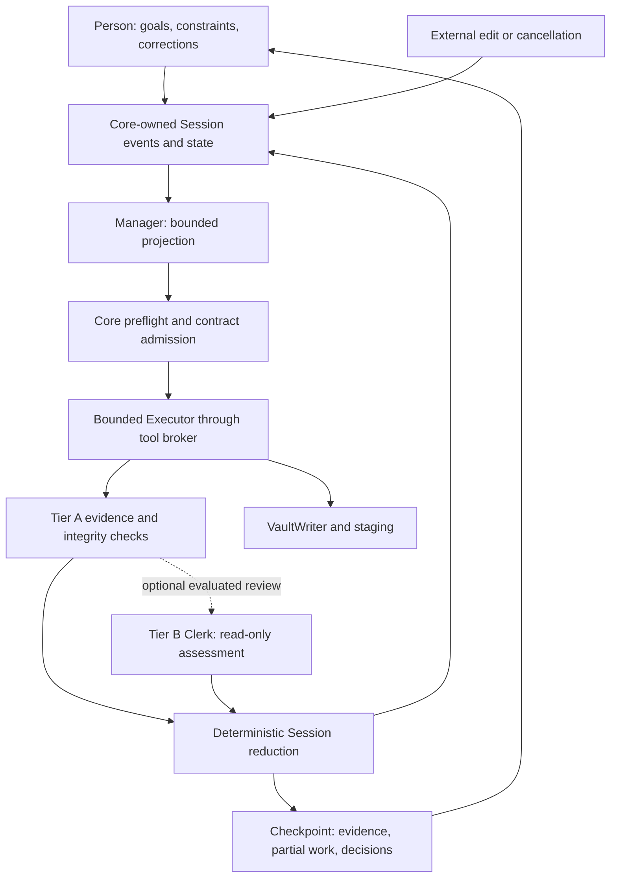

# Long-horizon co-work harness: research-informed design

**Status:** Proposed design specification, 2026-10-29. Prepared from the complete local research-folder screening and the current repository contracts. This describes intended behavior; it does not mark implementation tasks complete.

**Relationship to existing documents:** The [unified implementation plan](unified-implementation-plan.md), especially §9, controls scope, dependencies, and gates. This specification supplies the design direction for HARNESS-01–07 and the evaluation boundary for HARNESS-08/09. It refines the [audited-engagement proposal](audited-engagement-harness.md); when that proposal is reconciled under HARNESS-01, the reduced Session-based design here should replace conflicting legacy rollout or role assumptions. The [research report](../reports/2026-10-29-long-horizon-harness-research/RESEARCH-REPORT.md) and [remaining-corpus review](../reports/2026-10-29-long-horizon-harness-research/REMAINING-CORPUS-REVIEW.md) provide evidence and limitations.

## 1. Intended outcome and scope

The harness helps a person carry a complex task across many rounds without losing the agreed goal, hiding uncertainty, repeating failed work, or treating plausible prose as verified completion. It records what was requested, what was attempted, what changed, which predicates were checked, and which decisions still belong to the person.

**Proposed, not adopted:** whether the product includes long-horizon **code development**, alongside research and project work, is an open owner decision. Neither the product contract nor the unified plan includes it today, and the Workbench requires a person to start every execution. The [development-agent profile](development-agent-harness.md) states the workspace, execution, validation and integration requirements that such an offering would need. Those requirements would be mandatory for it, and the harness foundation alone does not establish that capability.

The first delivery in the existing unified plan is an opt-in **audited Session purpose** for partial research and bounded mechanical work. Ordinary conversation and exploratory research continue to use their existing modes. An audited session may produce useful staged synthesis even when semantic correctness cannot be mechanically established. The development profile proposes follow-on scope without silently expanding HARNESS-01–07 or changing task completion counts.

The design fixes authority boundaries, state semantics, evidence requirements, failure behavior, and observable outcomes. It deliberately leaves exact field names, prompt wording, token limits, ranking rules, checkpoint layout, and numerical tuning to implementation and evaluation. Logical records below are views over Session events, not a requirement to introduce a collection of new persistent classes.

### Goals

| Goal | Intended behavior |
|---|---|
| Requirement fidelity and drift protection | Preserve user constraints across planning, execution, compaction, corrections, and restart. Detect discrepancies between authorized work and actual actions. |
| Useful task capability | Decompose and complete bounded work, identify missing tools/evidence, and recover from failed approaches. |
| Evidence and epistemic discipline | Distinguish source presence, quote presence, arithmetic, executable results, coverage, interpretation, and human acceptance. |
| Reliability and continuity | Resume from recorded state; reconcile uncertain actions; avoid duplicate effects and stale completion. |
| Efficiency | Measure total cost, latency, context, retries, reviewer effort, and human rework against useful accepted outcomes. |
| Safety and policy adherence | Enforce tool, path, operation, composition, and promotion boundaries independently of model statements. |
| User agency | Let the person initiate questions, add evidence, revise scope, reject, pause, resume, or cancel. |
| Observability | Explain current work and blockers using actual state, actions, and evidence. |
| Context and memory quality | Provide relevant, fresh, provenance-bearing information within a bounded working set. |
| Robustness and role consistency | Preserve behavior across qualified routes, failure modes, long sessions, and host surfaces. |
| Operability and privacy | Reuse Core ownership, preserve replayable records, minimize sensitive diagnostics, and bound runtime overhead. |

These goals expand the evaluation coverage. They do not make every candidate algorithm or monitoring widget a required HARNESS-01–07 feature.

## 2. Architectural decisions

1. **One durable Session history.** Extend `session.py` events and its existing fold/replay path. Durable appends go through the active Core and `VaultWriter`. Do not create a parallel harness log or independent authoritative reducer.
2. **Models propose; Core enforces.** The Manager proposes the next bounded action or contract. Core validates it against current user intent, policy, routes, tools, evidence, and budget before dispatch.
3. **Closure belongs to an exact predicate.** A successful tool call or model verdict is insufficient. Mechanical closure is valid only for the declared predicate on the checked artifact/version and within the verifier's scope.
4. **Human judgment remains explicit.** Research interpretation and synthesis are staged for the person. Accepting an interpretation is recorded as human acceptance, not proof that the claim is true.
5. **Verification depth is conditional.** Tier A checks are the foundation. Tier B Clerk review is an experimental, read-only addition under HARNESS-08, not a default per-round cost.
6. **Bounded state replaces dependence on full transcripts.** The Manager and each execution receive a compact projection plus resolvable references. Required constraints cannot silently disappear to meet a token cap.
7. **Delegation must earn its overhead.** A session does not require a worker swarm or a separate model call for every phase. Prefer the simplest admissible execution path; measure additional handoffs at matched quality.

### Existing components and responsibilities

| Component | Harness responsibility |
|---|---|
| Session / SessionStore | Typed events, current phase, budgets, questions, deterministic replay and state projection. |
| Core / VaultWriter / VaultCoordinator | Append ownership, operation ordering, protected writes, leases, fingerprints and recovery records. |
| VaultWatcher and read/target fingerprints | Notify relevant external changes; recheck freshness before authoritative use. |
| RoleRouteBinding / invocation adapters / HostLimiter | Qualified role-specific model routes, usage/error metadata, transport and concurrency controls. |
| RolePolicy / ToolBundle / tool broker | Static eligible bundles in the first slice; per-call and composition authorization. |
| EvidenceStore, quality, quote-location, provenance, claim-run, index and promotion checks | Existing predicates exposed through a small verifier interface. |
| Staging and existing promotion workflow | Draft/synthesis review and the human-controlled promotion boundary. |
| Browser, Obsidian and MCP/Cowork surfaces | Render and operate the same Core state; no separate client-side completion authority. |

The exact integration calls need implementation review. The existing code provides these responsibilities, but their availability does not imply the audited-purpose integration is already implemented.

## 3. Roles and authority

| Harness function | Product binding | Authority |
|---|---|---|
| Manager | Lead | Inference only, using a supplied state projection; no environment or mutation tools. |
| Tool/mutation Executor | Lead | Existing authority narrowed to the admitted contract. |
| Drafting Executor | Scribe | Draft/staging authority, with no promotion authority. |
| Optional Tier B Auditor | Clerk | Read-only consultation and assessment. |
| Supporting researcher | `research_helper` | Read-only unless an explicitly applicable stricter profile permits otherwise. |

Effective permission is the intersection of user authorization, product policy, role, current phase, contract scope, tool capability, and current state. A generated plan, confidence estimate, source document, reviewer endorsement, or historical success cannot enlarge that intersection.

Route assignment comes from the canonical binding and applicable qualification. An unavailable or unsuitable route produces an explicit outcome. Route switching or promotion of a weaker route must follow existing authorization and qualification rules; this design introduces no silent automatic failover.

## 4. Durable state and provenance

Extend the minimal vocabulary already specified in HARNESS-02: `requirement`, `artifact`, `fact`, `question`, `contract`, `verifier_result`, `reduction`, and `external_edit`, alongside existing invocation, phase, budget, and user-decision events.

The logical information required is:

| Record/view | Minimum meaning to preserve |
|---|---|
| Requirement | Stable identity, user-approved wording and revisions, parent/dependencies, constraints, closure class, acceptance predicate, and current status. |
| Contract | Requirements addressed, intended artifact/effect, allowed operations and targets, explicit exclusions, evidence references, selected route/role, budget, verifier obligations, state epoch and operation identity. |
| Artifact/evidence | Source/version identity, location or bounded offset, content fingerprint where applicable, acquisition/inspection status, and provenance. |
| Fact/hypothesis | Assertion and source, whether observed, inferred, unresolved, or refuted; an LLM assertion is not automatically an established fact. |
| Verifier result | Predicate and verifier/version, actual inputs and artifact fingerprints, outcome, strength, scope/limitations, epoch, and execution status. |
| Question/decision | Who initiated it, the requested decision, applicable state/artifact revision, answer or unresolved status, and its effect on authorization or scope. |
| Reduction | Prior state/event boundary, accepted events, resulting requirement statuses, remaining budget, unresolved work, and next permitted phase. |

Store concise failure outcomes and refuted assumptions with their provenance so the Manager can avoid repeating them. Preserve the event history when pruning an active plan; pruning is removal from active consideration, not erasure of failed evidence.

Requirement revisions and user corrections must be visible. A model may suggest a scope change; only the authorized user action can make it operative. Do not convert an old model-generated summary into a new authoritative user constraint.

### Freshness, replay, and integrity

Record enough input/target identity to tell whether a verifier still applies. A relevant external edit, user constraint change, or changed contract makes affected results stale. Use `external_edit` for changed source/target content, a requirement revision for a changed user constraint, and a contract revision for a changed execution agreement; all must participate in the epoch/freshness rule. The first slice may conservatively invalidate a broader session scope when dependency information is insufficient. Fine-grained provenance propagation remains HARNESS-09 work.

Before mutation or closure, revalidate required fingerprints and epoch at the commit boundary; watcher delivery alone is not a freshness guarantee. A change arriving while a model is running must prevent its stale response from authorizing a later write.

Audited resumption validates the relevant event/schema/integrity state and reconstructs the same state from the same event prefix. Checkpoints are derived conveniences. A broken or unsupported history must not silently become authoritative state. Existing hash chains detect some edits but do not authenticate the entire environment or prove scientific correctness; a removed tail is not necessarily detectable without a separately trusted anchor.

## 5. Control loop and outcome semantics

| Phase | Required behavior | Exit or recovery |
|---|---|---|
| **Manage** | Present current constraints, requirements, evidence gaps, recent failures, capability manifest and budget. Propose one bounded next step, a question, or a stop. | A proposal is available; no side effect has yet been authorized by it. |
| **Preflight** | Validate schema, scope, dependency/epoch freshness, role/route eligibility, tools, budget, targets, and closure obligations. | Admit, request clarification, report no suitable tool, refuse, or park. Invalid output gets a bounded repair attempt or a visible stop; never a permissive fallback contract. A repaired proposal must pass the full admission checks again and cannot execute during repair. |
| **Execute** | Run within the admitted contract through the broker. Persist operation identity and reconcile effects. | Report observed artifacts/effects, partial work, failure, interruption or uncertain outcome. A report cannot declare its own authoritative closure. |
| **Audit** | Run applicable Tier A checks on the actual artifacts, staging writes and protected targets. Optional Tier B may add an assessment. | Produce explicit predicate results including failed, unavailable, stale or inconclusive outcomes. |
| **Reduce** | Apply the outcome table deterministically; update requirement state, budget, questions and next action. | Continue, checkpoint, park, cancel, fail or finish with a precise summary of verified, accepted and unresolved work. |

Different concepts must remain distinct in the result mapping:

- Provider success means a response was obtained; tool success means an operation reported success.
- Audit pass means the named predicate passed on the named inputs.
- Mechanically verified means the requirement's permitted closure obligations are satisfied by current exact/bounded evidence.
- Human accepted means a person accepted the specific artifact/interpretation revision.
- Partial, blocked, stale, refused, failed, cancelled and uncertain outcomes must remain visible and resumable where applicable.

The public enum names and serialization are open. The distinctions are required. Mixed research sessions must not collapse verified quote/arithmetic grains and unverified synthesis into “research proven complete.” Finishing a session must account for every requirement and disclose accepted partial scope or unresolved work.

### Interruption and uncertain side effects

Check cancellation and epoch changes before dispatch, between calls, and before writes or reduction. After cancellation is observed, initiate no new side effects. Already-running requests may finish or have caused an effect; record and reconcile them before resume. Do not promise a fixed sub-two-second provider interruption unless the transport actually supports and demonstrates it.

Use stable operation identities and existing writer recovery. An ambiguous timeout is not evidence that nothing happened. Query/reconcile the effect before retrying; if reconciliation is unavailable, park the dependent work for a decision. The checkpoint should identify the uncertain operation and let the person inspect evidence, supply a relevant receipt for verification, choose independent work that does not rely on that outcome, or end with the unresolved effect explicitly recorded. A user statement is not automatically mechanical verification, and a decision to continue cannot bypass tool policy. The design does not promise exactly-once execution across arbitrary external systems. Resume must avoid issuing a second effect merely because the first response was lost.

## 6. Context, tools, and cost control

The Manager projection contains active constraints; open/partial/stale requirements; current verifier predicates; blocked questions; recent events plus aggregate counts; eligible bundles and verifier IDs; approved roots; route availability; and remaining budget. A requirement with multiple closure obligations must expose the current outcome of each obligation: a later passing quote check must not hide a failing arithmetic or stale integrity check. This may be represented as separate research-grain requirement IDs or results keyed by requirement and predicate; the design leaves that representation open. Older reports and large artifacts become references with small relevant excerpts.

The assembler enforces a bounded input size before invocation. It preserves the active contract, safety constraints, decision-relevant changes and evidence identity. If essential content cannot fit, split the work, narrow the task through the existing user workflow, or stop with an explicit reason. Do not silently truncate constraints. Record which material was included, summarized or omitted sufficiently to diagnose a bad decision without retaining sensitive prompt copies.

The initial tool surface is a static policy-filtered bundle with a visible no-suitable-tool outcome. There is no required “five tools,” “K=3,” learned ranker, shared Q table, graph selector, or KV-cache modification. Cached prefixes and provider features follow the existing adapter contract; hosted APIs cannot be assumed to expose attention or internal KV storage.

Every call consumes its actual or conservatively reserved budget. Count Manager, Executor, helper, audit, retry and repair costs. Distinguish known usage, estimated charges and unknown usage; do not reuse stale counters. Cached-input tokens must not be added twice when the provider reports them as a subset of input. A context length ceiling is separate from the total-run budget.

Use the E2′ pilot as a reason to include an inline path and to measure handoff costs. A model's estimate of delegation benefit is advisory. Admission should detect known incompatibilities and capacity limits before allocating worker effort. Break-even thresholds, batching, and delegation heuristics remain open until task-class-specific comparisons exist.

## 7. Verification and authoritative closure

| Closure evidence | Permitted conclusion |
|---|---|
| Exact deterministic check | The named predicate holds for the checked representation/version. |
| Bounded test, solver or evidence check | The named predicate passed within its stated assumptions, cases and limits. |
| LLM-only assessment, self-rating or consensus | Advisory assessment; at most partial closure. |
| Human review/acceptance | The person accepted that artifact or interpretation, with provenance; no automatic truth claim. |
| Missing, failed, stale or inconclusive check | No authoritative closure based on that check. |

The verifier interface exposes its input requirements, predicate, strength, outcome and limits. Verifier absence/failure cannot be repaired by renaming a model judgment “evidence verification.”

### Research grains

| Grain | Existing helper | Example of appropriately limited output |
|---|---|---|
| Intake/integrity | `EvidenceStore.verify`, quality verdicts | The evidence object passes its integrity/ingestion checks; report missing or unreadable material. |
| Coverage | `dik.py` status | These named sources/parts have this recorded examination status; unexamined portions remain explicit. |
| Quote | `clerk.quoted` / `locate` | The supplied quote is present in evidence ID X at offset Y. |
| Arithmetic | `provenance.py` | This calculation is reproducible from these operands and assumptions. |
| Executable claim | `claim_run.py` | This declared claim-run passed in the recorded environment and scope. |
| Findability | `promote.py` step 5 / index checks | This promoted artifact is discoverable through the specified lookup. |
| Synthesis/interpretation | Staging and human review | Draft interpretation supported by linked evidence, awaiting or carrying human acceptance. |

Coverage metadata is not proof of attentive reading; quote presence is not claim support; an intact source is not a true source. Present each predicate separately.

Mechanical operations also require a protected-target snapshot/diff and the applicable schema, citation, index, claim-run or interface checks. Validate the actual output and current target state at commit. Interface checks are distinct from a clean diff: when the contract requires staged submission, its staging record must identify the audited artifact revision; when it requires findability, the declared lookup must resolve that artifact. A diff receipt establishes only what the observation and enforcement boundary can see; unknown external effects prevent stronger claims.

### Composition and trust

Enforce both per-call authorization and prohibited action sequences in HARNESS-05. A permitted read must not grant write scope, credential access, execution, route-change or promotion authority. Reading untrusted text followed by an authorized staged draft is not inherently prohibited; block the forbidden effect/authority transition rather than banning all useful mixed workflows.

Retrieved documents, tool outputs and worker prose are data. They cannot rewrite the contract or policy. HARNESS-05 must demonstrate the basic contract-scope, per-call and prohibited-composition guards before the audited mutation path is accepted. Existing role, writer and promotion boundaries continue to apply. These are requirements for the audited integration, not a claim that comprehensive information-flow enforcement is already implemented. Broad multi-hop trust propagation and targeted dependency taint remain deferred to HARNESS-09.

## 8. Monitoring, checkpoints, and the user experience

The first monitoring layer should be cheap and tied to recorded events: budget consumed/remaining, repeated tool calls without observed progress, repeated verifier failure, stale evidence, missing required predicates, blocked-question age, truncation, provider/tool failure and unresolved operations. Thresholds and cadence are tunable; a repeated read or retry can be legitimate and must not be called semantic drift solely from its signature.

Semantic drift checks should identify a requirement and an observable mismatch: a broadened target, omitted constraint, unjustified exception, altered priority or stale premise. Model/embedding signals may later assist investigation, but no uncalibrated similarity threshold or citation ratio should determine truth, completion or permission. Low-confidence advisory links are quarantined or left unresolved with coverage loss visible; do not silently discard user requirements.

The person should be able to see:

- The agreed goal and active requirement, current phase, progress and outstanding decisions.
- What the system changed or ruled out, its evidence references, and the exact checks that passed or failed.
- What is partial, stale, blocked or awaiting judgment, and why.
- Current resource use and the explanation for a pause, refusal, route issue or extra review.

At checkpoints the person can initiate a question, supply counter-evidence, change a constraint, narrow or expand authorized scope, reject a draft, or pause/resume/cancel. Acceptance is bound to the artifact revision and current decision context; an old approval does not bless a replacement artifact. Each control produces a meaningful Core state change. Presentation may be a timeline, desk note, card, status table or other host-appropriate view; the layout is not prescribed.

Keep observability about system behavior. Avoid worker sentiment, human productivity scores, or claims to reveal hidden reasoning. Concise explanations should refer to actual events and evidence. Provider reasoning-continuation data needed by an adapter remains within its permitted invocation handling; it is not a durable user-facing explanation record.

Telemetry should reuse the existing redacted model-event envelope. Logical fields include local invocation/operation identity, role and exact route/configuration, source/artifact references, phase, usage availability, latency, retry/truncation/failure class, verifier predicate/outcome, epoch changes, budget and user corrections. Do not expand this into raw prompts, credentials, arbitrary tool arguments or unrestricted provider payload logging. Detailed diagnostic capture, retention, deletion and export follow existing privacy policy and authorization; external monitoring services are optional implementation choices.

## 9. Evaluation and delivery

HARNESS-01–07 establish the state and safety foundation. Their acceptance fixtures should demonstrate:

| Work package | Required design/acceptance focus |
|---|---|
| HARNESS-01 | Reconciled documentation: Session reuse, role mapping, writer ownership, scope and deferred features. |
| HARNESS-02 | Valid event transitions and one visible outcome mapping; external edit appears in the session history; requirement and contract revisions participate in freshness invalidation. |
| HARNESS-03 | Audited phases, pause/resume state consistency, question blocking, budgets and writer-only mutation path. |
| HARNESS-04 | Deterministic bounded projection through the plan's 50-round fixture; capability manifest; omitted/old content handled through references. |
| HARNESS-05 | Closure-strength table, per-call checks and prohibited composition refusal. |
| HARNESS-06 | Resumable partial research; exact grain predicates; staged synthesis; meaningful user-initiated checkpoint controls; Tier A closure share measured on actual local research sessions, with source/grain counts and denominators. Synthetic fixture results are reported separately. |
| HARNESS-07 | Mechanical closure requires current verifier results plus a clean protected-target audit and the required interface boundary. |

Include failure cases for malformed contracts, unsupported tools/routes, missing evidence, quote present but claim unsupported, repeated failed work, mixed passing/failing verifier obligations, changed constraints during a provider call, external edits before commit, lost responses, duplicate effects, budget exhaustion, cancellation and interrupted replay. Replay checks must distinguish a safely recoverable incomplete trailing append from a broken committed prefix or unsupported event schema; recovery must not silently lose an unresolved effect. Test differences between mechanically verified and human-accepted outcomes explicitly. Temporal assertions such as “no new mutation after observed cancellation” and “no closure after a relevant edit until re-verification” should be named and checked over event traces; this does not claim a formal proof of the whole LLM system.

The later model evaluation compares ordinary/current execution, externalized state, state plus Tier A, and optional state plus Tier A/B. Control for route, task, budget and outcome quality. Include short work, long work, unfamiliar domains, source conflicts and hostile retrieved text. Separate development-agent delegation results from product-runtime results.

Measure task success; unauthorized requirement changes; false completion and false refusal; evidence support/coverage; resumption and duplicate effects; cost/tokens across roles; latency; human correction/rework; context omission/distraction; role/route consistency; tool-policy compliance; operational load; privacy/logging failures; and user comprehension/usefulness. Report denominators and failure slices, not only an aggregate success score. Cost per accepted completion includes failed attempts; when no task is accepted, report that denominator explicitly rather than a misleading ratio.

HARNESS-08 remains a predeclared go/no-go experiment: adopt Tier B only if demonstrated reduction in consequential errors justifies its additional cost, delay and false rejections. HARNESS-09 adds targeted invalidation and richer trust propagation after the foundation is stable. No learned scheduler, fine-tuned worker, autonomous policy learning, or graph memory is required by this specification.

## 10. Evidence-to-decision trace

| Evidence | Design consequence | Boundary |
|---|---|---|
| ReflectiChain; TMS; existing audited proposal | Stable requirement state, bounded task decomposition, inspectable recovery and drift fixtures. | Metrics and cross-domain effects do not establish universal prompt or drift thresholds; the unidentified “long horizon harness paper” remains unresolved. |
| [E2′ Stage A0 local pilot](../reports/2026-10-29-e2-prime-a0/README.md) | Include inline execution and account for handoff/controller/review overhead. | Three coding-refactor tasks, not a runtime co-work benchmark or universal delegation ratio. |
| HPR-GenRM and process-verification literature | Allocate checks to explicit predicates and evaluate added review conditionally. | Offline trained reward models do not establish a hosted per-call uncertainty oracle. |
| LLM Influence Compiler, `frai-9-1820827.pdf`, pp.5–7, 18, 25 | Typed proposals, independent validation, bounded invalid-output handling; refresh references against current state. | Numerical-agent simulation; stationary gains over a matched hand-coded rule were not significant. Invalid harness proposals must stop/repair, not default to a permissive action. |
| Pattern-Based Deductive Verification, `S0146411625700361.pdf`, pp.1–3, 28–32 | Reusable temporal requirement/check patterns and explicit proof obligations. | PoST/Isabelle formalism is not implemented here; selecting/instantiating patterns requires work and general proof automation is not available. |
| LLM-S2KG, `applsci-16-04720.pdf`, pp.10, 24–25 | Source-position metadata; relationship-direction error fixtures; keep structural and semantic validity distinct. | Describes mitigation, not elimination, of semantic inversions. Graph extraction is not a completion oracle. |
| CoACL, `electronics-15-00844-v2.pdf`, p.19, Appendix A.3 | Explicit unresolved/rejected advisory connections; bounded candidate review and uncertainty visibility. | This is the actual source of the conservative-filtering appendix. Fixed decoding does not guarantee identical hosted responses or semantic correctness. |
| STAGE, `mathematics-14-01568-v2.pdf`, pp.6, 9–10, 16 | Bounded context construction and fallbacks that preserve original source content. | Graph-learning methods and learned token selection are not required; graph enrichment may hallucinate. |
| Worker/agency research; hierarchical-goal explanation study | Parent goal and evidence visible at checkpoints; user can initiate corrections. | Human-work evidence is qualitative; the goal-explanation study is not a user comprehension trial. |
| PQL, SOA and IaC guidance | Declarative predicates, pre/postconditions and clear failure boundaries. | These mechanisms do not supply a ready-made runtime policy broker or guarantee valid deployment. |

## 11. Decisions deliberately left open

Implementation may choose the exact schemas and helper boundaries within existing Session/Writer ownership; prompt templates; context allocation; checkpoint cadence; deterministic ordering among eligible requirements; budget defaults; monitoring thresholds; retry limits; UI layout; and evaluation sample sizes. Those choices must preserve the authority, evidence and recovery semantics above and be recorded when they affect interpretation of results.

Any proposal to add a new model role, automatic route switching, learned scheduling, embedding-based drift gate, graph memory, always-on Clerk audit, or a separate persistent store is a material design change. Evaluate its incremental benefit and reconcile it with the unified plan before adopting it. Small tuning choices should remain easy to change without revising the architecture.
