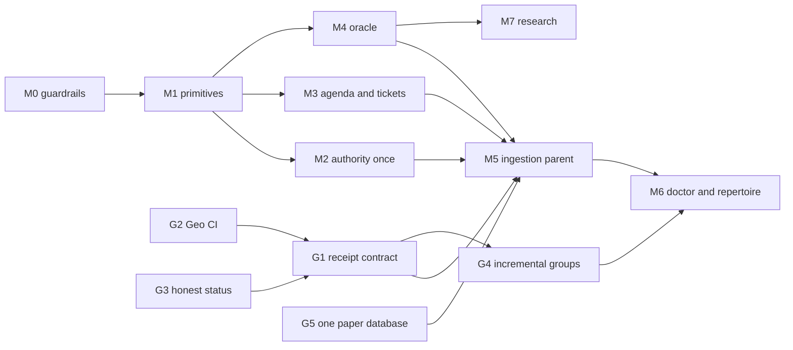

# Implementation plan: building the to-be Librarian and Geo-Grapher

**Status:** proposal (rank 5 in `docs/policy/README.md`), 26 November 2026. It turns [the systems-analysis packs](../../reports/2026-11-25-systems-analysis-finalisation/README.md) (four packs, all `PROPOSED_UNACCEPTED` for the to-be) into ordered, testable work, and supersedes the order in section 2 of [the plan forward](plan-forward-2026-11.md), whose open workstreams it absorbs (section 1.3). Each milestone becomes plan work in `docs/unified-implementation-plan.md` only once the Owner accepts it.

## 1. Review of the packs

### 1.1 What holds

- **The model checks pass.** `render_pack.py --check --all`: 18 + 22 + 3 + 4 specs, 0 errors and 0 warnings, re-run for this review. [VALIDATION.md](../../reports/2026-11-25-systems-analysis-finalisation/VALIDATION.md) is right that this proves the model is well formed, and nothing about runtime.
- **The as-is evidence holds where it was spot-checked against the code:**

| Claim in the as-is pack | Checked |
|---|---|
| The Web UI drops a workflow's result (W-WFR, `app.js:8472`) | `action_done` destructures `result` away before painting |
| A Broker ask waits 150 s over MCP and 600 s in the app (T2) | `app.py:277` `MCP_PERMISSION_WAIT = 150.0`; `broker.py` default timeout 600 |
| The batch's stages share one tool grant (stages table) | `batch.py:67` `STAGE_TOOLS`, granted whole at `batch.py:708` |
| The Web UI's own calls skip the Broker (W-ACT-05) | `app.py` `_person_call` drops `broker` from the context |
| Geo-Grapher's receipts are not read (receipt contract) | `geo_service.py` reads no receipt field |
| CI runs everything on every push (CI pathway 2) | `.github/workflows/ci.yml` has no paths filter |
| A phase's budget halves on each return (T9) | `session.py` `budget_left`: `full >> visits - 1` |

- **The design is consistent with policy.** The authority table reconciles tier 0's authority with the person's reserved decisions (policy, agent roles) and adds the 26 November risk rule. The data contract keeps Medallion layers apart from Geo-Grapher's trust tiers. The ticket routing gives every ticket class one owner.
- **The adversarial review was done properly:** 60 findings, verbatim quotes checked by script, 39 accepted, each rejection given a reason.

### 1.2 What needs correcting before building

1. **The as-is pack is pinned at `d9435e1`, and three of its weaknesses have since been addressed in code** (`8489387`):
   - read work waiting for acceptance is now counted on the agenda, in `batch_status` and in the Lead's context (OP1; part of T5);
   - an agent's acceptance is recorded as the agent's (F2; the code half of W-ACC-04; the 96 notes are still the Owner's decision);
   - the library's review route runs inside the Core (OP8; part of T3).

   Re-pin the as-is pack to the current commit and mark these weaknesses accordingly, so that nothing is built twice (M0).
2. **Folder review has no registered actions.** It is reachable only through the Core API's `/api/folders/*` routes. So:
   - no workflow or pipeline can compose it, which T1's parent process needs;
   - tier 0 over MCP has no folder tools (T2).

   The packs draw folder review as a step of the ingestion parent, but no task makes it composable. This is the first missing primitive (M1.1).
3. **The oracle and the doctor have no role slot.** The role slots are `lead`, `scribe`, `clerk`, `research_helper`, `ocr`, `tts`, `stt` and `embeddings`. A distinct assignment for the oracle (policy: never the worker's route on the same run) needs its own slot, profile and qualification. GLM-5.3 is screened as Resource-Library's Clerk since 21 November; that is not an oracle assignment (M4).
4. **The agent tiers in policy and in code differ.** Policy and terminology now say Clerk = tier 2 and Scribe = tier 3. The code still carries the legacy numbering: the Clerk's endpoint is profiled as tier 3 and the Scribe's as tier 2 (`tools/staging.py`). The policy itself says reconciling them needs an explicit implementation change. It is a rename of identifiers and labels, with no change of behaviour (M0).
5. **The agenda should reuse what exists.** `checkpoints.py` already stores typed, scope-digested decision records that are resolved once and block only their operation. UC9 can be the person's view over checkpoints, waiting acceptances and open tickets, rather than a new store. Tickets do need a store of their own (M3).
6. **The CI pathway session failed.** The card to build CI pathways 1 and 2 ran as `add-a-pack-check-and-a-r` and failed. Nothing of it is in the tree (M0).
7. **Many numbers are open decisions.** They include retention, the concurrency cap, retry counts, review dates per ticket class, the target rate for folder descriptions, and the fault register's size. Each milestone uses a safe default until the Owner decides, and lists the decision it depends on (section 5).

### 1.3 Where the plan forward's workstreams go

| Workstream | State | Here |
|---|---|---|
| W1 workflows as data, W2 canvas service | implemented | reused (phases, macros, the canvas writer) |
| W1b items 1–4 (declarations, manifests, mandates, direct uses) | planned | M1 |
| W1b item 5 (the permission envelope) | planned | M2 |
| W1b item 6 (the coded flows as pipelines) | planned | M1.1 (folder review), M5 (`ingest-folder`) |
| W2b diagram workflows P0–P5 | planned | beside the build; out of these packs' scope |
| W3 change impact | planned | M6.1 |
| W4 views and query surface, W5 relations as claims, W6 organisation, W8 topic filing | planned | after M7; the packs defer them (UC5–UC7, UC10) |
| W7 research fixes | OP1, F2 and OP8 implemented in `8489387`; OP9's cause open | the rest in M7 |
| W9 the oracle and the doctor | planned | M4, M6 |

## 2. How the build runs

- **The test vault first.** Each milestone is built behind a setting and proven in `Librarian ACCEPT-02 Vault` before it is on by default. The as-is path keeps working until the to-be path passes its acceptance test.
- **Runtime acceptance, not diagram checks.** Each milestone ends with the matching row of VALIDATION.md's "what would need runtime work" table, run and recorded in a report. The pack's figures (tier-0 turns, paths) are targets until a run shows them.
- **Measure before and after.** Each row of the performance tables is measured before its milestone starts and after it ends, with its metric.
- **Two repositories, one contract.** The Librarian and Geo-Grapher tracks run in parallel. They meet only at the receipt contract (G1), tested in both repositories' CI.
- **The usual gates.** Each change gets a full suite in a clean clone, a §19 entry, and explicit-path commits. Access declarations are refreshed with each tool change.

## 3. Milestones

Each names the root causes (T1–T10 Librarian, GT1–GT6 Geo-Grapher) and earlier workstreams it carries, the code it touches, and its acceptance test.

### M0. Guardrails (small; needs nothing)

1. **CI pathway 1:** the pack check (`render_pack.py --check --all`) on any push that touches the packs.
2. **CI pathway 2:** a reports- and docs-only path that runs the pack check and the plan test, not the full matrix. It must keep `tests/test_ci_workflows.py`'s rules.
3. **CI pathway 8:** a test that every standard workflow and pipeline loads and validates.
4. **Re-pin the as-is pack** (1.2 item 1).
5. **Reconcile the tier numbering in code** (1.2 item 4): names and labels only, no behaviour change.

**Done when:** a reports-only push runs only the light path; a planted stale view fails CI; every standard process validates in CI.

### M1. Primitives (Librarian; carries W1b items 1–4, T1, T6, T10)

1. **Folder review as registered actions:** survey, draft, decide, apply and queue-sources as registry tools with the right tiers.
   - A sensitivity flag stays a reserved decision.
   - The Core API routes call the same tools, so the Web UI and MCP pass the same gates (W-ACT-05's mechanism; the policy question is the Owner's).
2. **Action declarations:** each action declares the state classes it can change (notes, staging, sessions, indexes, graphs, outside services) and the stage it serves.
3. **Stage contracts:** `standard/stages.yaml` declares the batch's nine stages and the folder stages, as `phases.yaml` declares session phases: tools, entry receipt, exit gate, receipt, recipe version, risk and role.
   - The Broker refuses a tool outside its stage.
   - CI pathways 3 and 4 check the declarations and that every tool has a stage or is marked any-stage.
4. **Manifests and the mandate check:** a JSON manifest per process, schema-checked and rebuilt when its digest changes, from the prototype `build_manifest.py`. The mandate check runs from manifests alone. The validator then allows an action directly in a pipeline, and a workflow inside a workflow without a cycle, as the policy allows.
5. **A run record the person can open** (T6): the Core writes what was done, what failed and why, spend, coverage, and what is left. The Web UI shows it instead of dropping it.
6. **Every error a named refusal** (T10): the TypeErrors the as-is register lists become refusal codes.

**Done when:**
- a pipeline composed of folder-review actions validates and runs;
- a tool called at the wrong stage is refused with its rule;
- every shipped process has a valid manifest;
- the prototype's two mandate checks (refused for a read-only parent, suitable for an ingestion sprint) run in the Core;
- a workflow run's result opens in the Web UI.

### M2. Authority granted once (T2; carries W1b item 5)

1. **The commission:** tier 0's instruction becomes a recorded commission. The specification, the envelope and the risk handling (the authority table) are settled in advance where they can be.
2. **The permission envelope:** predicted from the manifest and approved once. It generalises `workflow_grant` to agent-run sessions and pipelines, with a step budget sized from the manifest.
3. **Reserved and high-risk decisions** become checkpoints on the agenda, never permission prompts. Under the risk rule, a high-risk decision in a run no tier 0 oversees is held for the Owner and does not block the rest.

**Done when:** a commissioned ingestion's broker log shows 0 asks for granted tools, and a high-risk decision in an unoverseen run lands on the agenda while the run carries on.

### M3. The agenda and tickets (T4, T5; UC9)

1. **The agenda (UC9)** is the person's view over pending checkpoints, read work waiting for acceptance, and open tickets. An item is decided once and recorded as the person's. An item whose inputs changed is re-screened, and its run resumes at its recorded point.
2. **The ticket service:** one store, the routing table's classes and owners, and a review date per class (defaults until decided). Past its date a ticket is raised: the Lead, then tier 0, then the Owner.
3. **Consolidation:** an overseen run's open decisions go to tier 0 as one question.

**Done when:** an injected failure of each ticket class lands with its owner; the 20 November case (96 enriched papers) appears on the agenda with its owner; a held run resumes after the decision without redoing anything.

### M4. The oracle (T3; W9 P6–P7)

1. **An `oracle` role slot,** with its own profile and qualification. The Core refuses a run whose oracle route equals its worker's (`oracle:droute`, `oracle:collision`).
2. **Tier A at each stage's exit gate,** from `closure.VERIFIERS`. A missing check is a failure. An unchanged child is accepted by its receipt's hash, with no model call.
3. **Verdicts as claims:** recorded with evidence, rebuttable, and re-checked, as `closure_audit.py` does for the audited session.
4. **Claim review default-on,** if the Owner decides it (OP7).
5. **Scope judgments for the envelope:** in scope and within the mandate, allowed and reported at the end; otherwise escalated.

**Done when:** a run's receipts show distinct worker and oracle routes and a passing recheck, and a planted shortfall fails its exit gate with its extension.

### M5. The parent process for ingestion (T1, T8; UC1; W1b item 6)

1. **`ingest-folder` as a pipeline** over M1's actions: folder review → source intake → batch enrichment → acceptance, owned by one parent that starts each child itself.
2. **The ledger:** the parent reconciles its counts (surveyed, queued, staged, enriched, accepted). Unmet items are held with their tickets and the clean ones go on (`ingestion:holdunmet`).
3. **Stored links (T8):** a link between a Source note and its graph paper is stored when both ends exist, from the publication receipt (needs G1).
4. **Tier-0 turns counted** from the run log.

**Done when:** a commissioned folder ingestion in the test vault ends with one result and at most 2 tier-0 turns; its ledger reconciles; every published paper has its stored link.

### M6. The doctor, remedies and the repertoire (T4, T7; UC-D, UC-L, UC8.2; W3)

1. **Change impact (W3):** the blast radius from the declared state classes (M1.2), dependants, lineage and bridges. Only the checks inside it run.
2. **The remedy catalogue:** R1–R6 as YAML workflows over existing actions. The doctor runs a mapped remedy after the blast-radius check and hands back to the oracle. It drafts a remedy for an unmapped failure and never installs one.
3. **The repertoire and promotion (UC8.2):** validated, accepted by the Owner, digest pinned.
4. **The repair role's code name,** distinct from `doctor`, which already names the install check (W-DOC-05).

**Done when:** a planted, mapped failure is repaired inside its radius and passes its recheck; one outside its radius goes to the Owner; a promoted process is pinned and found by the next composition.

### M7. Research fitted to a brief (T9; UC2, UC3, UC4)

1. **Candidates from the corpus only;** a synthesis per question; the budget from the manifest, not per phase visit.
2. **A code placement is a claim** citing a code entity (query-graph). Comparing projects uses federated search over accepted bridges.
3. **A redraft limit per claim,** then a stated gap (the handoff fixes).

**Done when:** a five-question brief over a corpus needs no budget extension and decides no out-of-corpus candidate. Every report has its own synthesis, and every code placement is verified or stated as a gap.

### Geo-Grapher track (parallel; GT1–GT6)

| Step | What | Done when |
|---|---|---|
| **G1** | The receipt contract: `snapshot_id`, `parser_version`, coverage with unparsed files, `changed_entity_ids`, counts; for papers, `document_id`, the link to the source's identity, claim and concept counts. A JSON schema tested against a fixture in both repositories' CI (pathway 5). The Librarian's `geo_service` reads it. | Both CIs fail on a receipt missing a field the Librarian consumes |
| **G2** | Hosted CI for Geo-Grapher (pathway 6), and the wheel pin moved by a reviewed change when a release passes (pathway 7) | A Geo-Grapher push runs its suite; a too-old wheel is caught in CI, not when a library starts |
| **G3** | Status that says what was done (GT2): a parse failure or an empty paper is a partial outcome, never complete | The receipt's coverage matches the parse log |
| **G4** | Incremental group application (GT1, T7): a decision changes its own group as a delta, with every case in the incremental-safety table | Every row of that table passes as a test, and groups touched per accept is 1 |
| **G5** | One active paper database, pruned by retention, with nothing pruned until the numbers are decided; a WAL checkpoint (GT4) | The paper-import safety cases pass; disk per graph is measured before and after (77.2 GB for 30 graphs today) |
| **G6** | The agent interface sized to the question (GT6), and bridge candidates reviewed into bridges (GT5) | Results within their budget; a bridge is accepted only by the Owner or a standing policy |

### Afterwards

- Draw and refit UC10–UC16: search and read; the five session purposes with no to-be flow; scheduled pipelines.
- Then the deferred UC5–UC7: trusting a relation, reorganising a folder, seeing other models.
- The diagram workflows' P0–P5 continue beside the build.

## 4. Order and parallel work

- **M0 first:** it is small and protects every later change.
- **G2, G3 and G1 run in parallel with M1,** in their own session in the Geo-Grapher repository, and need nothing from the Librarian.
- **M2, M3 and M4 can run in parallel once M1 lands.** They touch different files: M2 the broker and sessions, M3 a new ticket store and the agenda, M4 role slots and closure.
- **M5 is where the tracks meet.** It is the first runtime test of the whole design.

## 5. Decisions for the Owner, in one place

Needed before or during the milestones named:

| Decision | Needed by | Default until decided |
|---|---|---|
| Accept the four packs as the plan (PLAN.md S6) | before M1 | none: the build waits |
| Accept this milestone order | before M1 | none |
| May the Web UI keep skipping the Broker (W-ACT-05)? M1.1 makes it possible either way | M1 | keep skipping, as today |
| Correct the attester on the 96 notes of 20 November (W-ACC-04) | any time | leave them, as recorded |
| Claim review default-on in every library (OP7) | M4 | on in Resource-Library only |
| The short fixed list of models for the oracle and doctor roles | M4 | none: M4 waits |
| Delegate any reserved decision to tier 0 (for example sensitivity review in the test vault)? This changes policy | M2 | no |
| Review dates per ticket class; retry counts; the concurrency cap | M3 | stated defaults, shown on each ticket |
| Retention numbers for snapshots and paper databases | G5 | keep everything |
| The target rate for folder descriptions | M5 | report only |
| Same-layer components beyond workflows (the catalogue's open question) | M6 | workflows only, as accepted |
| The fault register's size | M6 | four bits |
