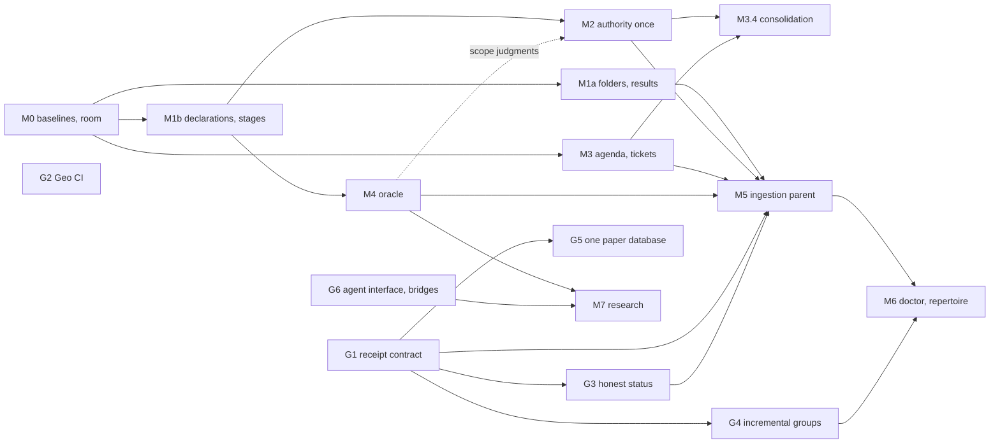

# Implementation plan: hardening the Librarian and Geo-Grapher

**Status:** proposal (rank 5 in `docs/policy/README.md`), 26 November 2026, revised the same day after the Owner's direction and three independent reviews. **Accepted by the Owner on 26 November 2026, with this order; M0 is delivered ([baselines](../../reports/2026-11-26-m0-baselines/README.md)).** It turns [the systems-analysis packs](../../reports/2026-11-25-systems-analysis-finalisation/README.md) into ordered, testable work. It replaces the order in section 2 of [the plan forward](plan-forward-2026-11.md), whose open workstreams it carries (section 1.4). A milestone becomes plan work in `docs/unified-implementation-plan.md` only once the Owner accepts it.

## 0. What this is

The Owner, 26 November:
- The packs map the current system: what makes its processes unreliable, or perform worse than they should. They do not specify additions.
- This build is an optimisation and hardening pass, now that the system has shown it can do what is needed. It builds on the existing code rather than beside it.

So every task below names the module it extends. The to-be pack's [builds-on table](../../reports/2026-11-25-systems-analysis-finalisation/librarian/to-be/builds-on.md) gives each to-be mechanism one specification: the existing code it hardens. Where the to-be's name for a mechanism duplicated an existing one (the agenda, the grant, the exit gates, the verifiers), the table flattens the two into one.

## 1. Review

### 1.1 What holds

- **The model checks pass.** `render_pack.py --check --all` reports 18 + 22 + 3 + 4 specs, 0 errors and 0 warnings, re-run after this revision. [VALIDATION.md](../../reports/2026-11-25-systems-analysis-finalisation/VALIDATION.md) is right that this proves the model is well formed, and nothing about runtime.
- **The as-is pack is current.** `src/` is unchanged since `d9435e1`, the commit it was read at. W7's changes (`8489387`) are an ancestor of that commit, and the pack already records them (OP1 counted, not routed; F2; the review route in the Core). The first version of this plan said the opposite; that was wrong.
- **The as-is evidence holds where it was spot-checked against the code:**

| Claim | Checked |
|---|---|
| The Web UI drops a workflow's result (W-WFR-01) | `ui/app.js:8472` destructures `result` away |
| A Broker ask waits 150 s over MCP and 600 s in the app (T2) | `app.py:277`; `broker.py` default timeout |
| The batch's stages share one tool grant | `batch.py:67` `STAGE_TOOLS`, granted whole at `batch.py:708` |
| The Web UI's own calls skip the Broker (W-ACT-05) | `app.py` `_person_call` drops `broker` |
| Geo-Grapher's receipts are not read | `geo_service.py` reads no receipt field |
| A phase's budget halves on each return (W-RES-02) | `session.py` `budget_left` |
| Folder review has no registered actions (W-ACT-01) | only the `/api/folders/*` routes reach `folder_review.FolderReview` |

- **The design is consistent with policy**, now including the two rules written into policy today (section 1.3).

### 1.2 Corrections to the first version, and what the reviews found

1. **The agenda already exists.** `agenda.py` and the `agenda` tool list dated tasks, and since `8489387` read work awaiting acceptance. UC9 extends that tool with checkpoints and tickets. There will not be two things called the agenda.
2. **The tier numbers in code were right.** The Owner, 26 November: the names imply the hierarchy, and the order was misremembered on 25 November. Policy, terminology, the diagram-workflows proposal and the packs now read Lead 1, Scribe 2, Clerk 3, as the code does (`effort.py` `tier2_agents`/`tier3_agents`, `tools/staging.py`, `tools/plan_dispatch.py`). The code change the first version proposed would have swapped concurrency caps and saved settings. It is dropped.
3. **The checkpoint store is not yet safe for concurrent writers.** `checkpoints.py` rewrites one JSON file with no lock, and its 13 types are a closed list. M3 adds the lock and the types the risk rule needs.
4. **The fault register is not a bit mask.** The first version's "four bits" default contradicted policy (agent-roles-and-authority, fault register). It is removed; tickets carry structured fields.
5. **Same-layer composition is settled by policy.** Composition rule 1 allows a process "of its own kind without a cycle". The catalogue's open question is closed by the higher rank; the validator follows rule 1 (M1b).
6. **Oracle and Doctor assignments are rules, not a model list.** Under assign-not-bind, the decision is the qualification rule. The run records the assignment, and the separation check compares the resolved model, not the route string.
7. **The CI-pathway session never started.** Its worktree needed 5.4 GB with 5.0 GB free (reported by the session that started it). D: has 4.8 GB free today and C: 2.9 GB. Parallel sessions need room first (M0).
8. **CI pathways are integration points, not blockers** (Owner). Each is added where it is cheap and clean. Pathway 8 is already mostly covered by `tests/test_workflows.py` `test_standard_set_is_valid`. A reports-only path would have to change `tests/test_ci_workflows.py`'s fixed set of workflow files, so it waits. `master` has no branch protection, so a skipped job blocks nothing.
9. **Dependencies the first version got wrong:**
   - G1 waited on G2 and G3. Now: G1's contract first, then everything codes against it.
   - M5 waited on G5. Now: publication works today with a copy per paper, so G5 runs alongside.
   - M2 and M4 were drawn as independent. Now: M2's out-of-envelope calls fail closed until M4 judges scope.
   - There was no M2 → M3 arrow, although consolidating an overseen run's decisions needs M2's commission. Added.
   - M7 needs G6 for federated comparison. Added.
   - M5 was the first full ingestion test, before any repair path existed. Now its failures open tickets until M6.
10. **Every as-is weakness now has a milestone** (appendix A). The reviewers found several handled in the packs but scheduled nowhere: W-PAR-01, W-INT-01, W-REA-02, W-BAT-01, W-EXT-01–03, W-ACC-01 and others.

### 1.3 Decided 26 November (Owner), and where each is written

| Decision | Written in |
|---|---|
| A folder the person connected, or routed an agent to, is open to that library's agents. No system decision supersedes it | policy, agent-roles-and-authority: "A connected folder is the person's decision" |
| High risk stays with the person when no tier 0 oversees the run | the same policy: "High risk when no tier 0 oversees" (it was only in the packs) |
| Oracle and repair roles get role slots of their own | M4 |
| Lead 1, Scribe 2, Clerk 3: the names imply the hierarchy | policy, terminology, the packs |
| The build hardens the existing code; the packs map the current system | section 0; the builds-on table |
| CI pathways are optional integration points | section 1.2 item 8 |

### 1.4 Where the plan forward's workstreams go

| Workstream | State | Here |
|---|---|---|
| W1 workflows as data, W2 canvas service | implemented | built on (phases, macros, the canvas writer) |
| W1b items 1–4 (declarations, manifests, mandates, direct uses) | planned | M1b |
| W1b item 5 (the permission envelope) | planned | M2 |
| W1b item 6 (the coded flows as pipelines) | planned | M1a (folder review), M5 (`ingest-folder`) |
| W2b diagram workflows P0–P5 | planned | beside the build |
| W3 change impact | planned | M6 |
| W4 views, W5 relations as claims, W6 organisation, W8 topic filing | planned | after M7 (the packs defer UC5–UC7 and UC10) |
| W7 research fixes | OP1, F2 and OP8 implemented in `8489387`; OP9's cause open | M7 |
| W9 the oracle and the doctor | planned | M4, M6 |

## 2. How the build runs

- **The test vault first, behind a named setting.** Each milestone names its setting. With the setting off, the as-is path runs unchanged, and a test proves it.
- **Old paths retire.** The as-is path a milestone replaces is removed once its acceptance run passes in `Librarian ACCEPT-02 Vault` and one supervised run passes in Resource-Library.
- **Existing vaults migrate.** Each milestone that changes stored state includes a migration test over a copy of real state: `checkpoints.json`, saved effort settings, role assignments, the live Resource-Library vault.
- **Acceptance is a runtime run, not a diagram check.** Each run records the code commit, the manifest and action digests, the vault fixture, the role assignments, the budget, the receipts and the result. Paid calls carry a per-run ceiling and report actual cost.
- **Measure before and after.** M0 records the baselines. Each run reports tier-0 turns and tier-0 tokens (the Owner's aim is fewer of both), spend, and the performance tables' metrics.
- **Two repositories, one contract.** The tracks meet at the receipt contract (G1), tested in both repositories.
- **The usual gates.** Each change gets a full suite in a clean clone, a §19 entry and explicit-path commits. Access declarations are refreshed with each tool change.

## 3. Milestones

Each names the code it extends, the root causes it addresses (T1–T10 for the Librarian, GT1–GT6 for Geo-Grapher), and how it is accepted. Appendix A maps every as-is weakness to a milestone.

### M0. Baselines and room to work (small; needs nothing)

1. **Free disk space** for worktrees, so parallel sessions can start.
2. **Baselines:** tier-0 turns and tokens per run, counted from the run log (`activity`, `log_use`). Also the performance tables' metrics on the fixed test folder (M5).
3. **The pack check as a test:** a test in the existing suite runs `render_pack.py --check --all`. That is CI pathway 1 with no workflow-file change.
4. **Pathway 8's remainder:** `test_standard_set_is_valid` also covers the two standard pipelines. It names each step's stage once M1b adds stages.

**Done when:** the baselines are recorded in a report, and a planted stale view fails the suite.

### M1a. Folders open to agents, results that reach the person (T1, T6, T10)

1. **Folder review as registered actions** (policy: a connected folder is the person's decision):
   - survey, draft, decide, apply and queue-as-Sources become registry tools over the existing `folder_review.FolderReview` and `folder_sources`;
   - they work on every connected folder, or a folder a person routed an agent to;
   - the `/api/folders/*` routes call the same tools.
2. **One eligibility rule on every surface.** `folder_sources` accepts `own-docs`, while the Web UI hides its queue button (`ui/app.js` near 6201). The rule is decided once and used by the UI, the API and MCP.
3. **What the surfaces share:** the same validation and the same refusal codes. The Broker is still skipped for the person's own Web UI calls until W-ACT-05 is decided.
4. **The run record:** what was done, what failed and why, spend, coverage, and what is left. It is kept with the run (`run_status`, `batch_status`). The Web UI shows it instead of dropping it, and a paused run offers resume and dismiss (W-WFR-01, W-WFR-02).
5. **Named refusals:** the TypeErrors in the as-is register become refusal codes the `rules` tool explains, for example an application with no sources (W-EXT-01).
6. **The Web UI defects in the as-is register:**
   - the F-09 reload that wipes the person's edits (W-ACC-01);
   - the "Which sources" filter that omits processing and accepted items (`ui/app.js` near 6325).

   A reviewer also reported a 50-item truncation of the staging list. The code pages 50 at a time and fetches more (`ui/app.js` near 6619), so it is checked in the running UI before it is fixed.
7. **The folder card's two states named apart** (W-FOL-05).

**Done when:**
- an agent surveys, decides and queues a connected folder over MCP;
- the Web UI passes the same checks;
- a folder's classification never removes its connection;
- a workflow's result opens in the Web UI;
- a stale-revision conflict keeps the person's draft.

### M1b. Declarations, stages and manifests (T1, T2, T7; W1b items 1–4)

1. **Action declarations:** the state classes each action can change (notes, staging, sessions, indexes, graphs, outside services), beside its existing tier and effect.
2. **Stage contracts:** `standard/stages.yaml` declares the batch's and folder review's stages as `standard/phases.yaml` declares session phases: tools, entry receipt, exit gate, receipt, recipe version, risk and role.
   - The Broker first only reports a tool used outside its stage, in the test vault. It refuses only after a clean run.
   - An item accepted straight from staged must meet the accept stage's entry receipt (W-STI-01).
3. **Reuse keyed on the stage's recipe:** a stage's output is reused only when its source hash, stage, recipe version and model assignment all match.
4. **Manifests and mandates,** from the prototype `build_manifest.py`:
   - a manifest per process, schema-checked;
   - it is rebuilt when the digest of any action's implementation or declaration changes, so a stale manifest never authorises a changed action;
   - the mandate check runs from manifests alone.
5. **Direct uses,** under composition rules 1 and 2: an action directly in a pipeline, and a process of its own kind without a cycle. Cycles and later-layer components are refused.
6. **Any-stage tools** are listed explicitly and reviewed, so "any stage" is not a bypass (CI pathways 3 and 4 if cheap).

**Done when:**
- every shipped process has a valid, fresh manifest;
- the prototype's two mandate checks run in the Core;
- a tool used outside its stage is reported, then refused, with its rule;
- an unchanged stage is reused and a changed recipe is not.

### M2. Authority granted once (T2; W1b item 5; after M1b)

1. **The commission:** tier 0's instruction becomes a recorded commission (the authority table).
2. **The permission envelope:** predicted from the manifest and approved once, by extending `workflow_grant` and the Broker's `allow_session` to agent-run sessions and pipelines, with a step budget from the manifest.
   - A child never exceeds its parent.
   - `ALWAYS_ASK` tools and reserved decisions are never inside it.
   - Until M4 judges scope, a call outside the envelope fails closed: it goes to the agenda, or to the overseeing tier 0.
3. **High risk and reserved decisions** become agenda items, never permission prompts. Under policy, a high-risk decision in a run no tier 0 oversees is held for the Owner and blocks nothing else.
4. **The three contexts stay distinct:**
   - tier 0 for the Owner;
   - an external project over MCP: the delegated reading runs within the context's helper budget (W-EXT-03), and an `Applications/` note pins its citations and locators (W-EXT-02);
   - the person in the Web UI.

**Done when:**
- a commissioned ingestion's broker log shows no ask for an enveloped tool, and no tool outside the envelope ran;
- an out-of-envelope call is escalated, and a reserved decision is held;
- an unoverseen scheduled run holds its high-risk decision on the agenda while the rest runs;
- an external project stages and never accepts.

### M3. The agenda and tickets (T4, T5; UC9; alongside M1a and M1b)

1. **One agenda:** the existing `agenda` tool, extended to show pending checkpoints, read work awaiting acceptance, and open tickets.
   - Each item is decided once and recorded as the person's.
   - An item whose inputs changed is re-screened, and its run resumes at its recorded point.
2. **The checkpoint store hardened:** a lock for concurrent writers, and new types for high-risk holds, folder sensitivity and ticket escalation, with existing records migrated.
3. **Tickets:** structured records (class, owner, evidence, repair history, re-check, review date) in the Core's store beside the checkpoints.
   - Owners per class follow the ticket-routing table.
   - An overdue ticket escalates by its class: critical alerts the Owner and the overseeing tier 0 at once; reserved goes to the Owner; others go up from the Lead.
   - A quarantined capture opens a ticket (W-INT-02). An enriched or partial item gets an owner and a review date (W-STI-02).
4. **Consolidation** (needs M2's commission): an overseen run's open decisions reach tier 0 as one question.

The folder ticket classes follow M1a.

**Done when:**
- an injected failure of each class lands with its owner and review date;
- two parallel writers lose no checkpoint;
- a held run resumes after its decision without redoing anything.

### M4. The oracle (T3; W9; after M1b)

1. **An oracle role slot and a repair role slot,** in `role_routes`, each with its own profile and qualification rule.
   - Development uses any qualified test assignment in the test vault.
   - The Core refuses a run whose oracle and worker resolve to the same model.
2. **Typed obligations at each stage's exit gate** (M1b's contracts):
   - Deterministic checks are reused from `closure.VERIFIERS` only where their subject matches.
   - A missing or stale check fails closed.
   - An unchanged child is accepted by its receipt's hash.
3. **Validity, not counts:** a model call's answer is judged before its stage counts as done (W-SRC-01, W-REA-01), and before an enriched note is accepted (W-ACC-03).
4. **Verdicts as claims:** recorded with evidence, rebuttable, and re-checked, as `closure_audit.py` does for the audited session.
   - A review that does not complete holds the claim (W-VER-02).
   - OP9's cause is found and fixed.
5. **Scope judgments** for M2's envelope: in scope and within the mandate, allowed and reported at the end; otherwise escalated.

**Done when:**
- receipts show distinct worker and oracle models and a passing recheck;
- a planted collision fails closed;
- a planted shortfall fails its gate with its extension;
- a rebutted verdict lands on the agenda.

### M5. The ingestion parent (T1, T8; UC1; W1b item 6; after M1a, M2, M3, M4, G1 and G3)

1. **`ingest-folder` as a pipeline** over M1a's actions: folder review, then source intake, then batch enrichment, then acceptance. One parent starts each child.
2. **The ledger:** the parent reconciles surveyed, queued, staged, enriched and accepted (W-ING-01).
   - Unmet items are held with their tickets, and the rest go on.
   - Accepting a folder can queue its documents (W-FOL-04).
   - A queue no one drains raises a ticket (W-ING-02).
   - An unfinished run resumes (W-ING-04).
3. **Defects inside the batch, from the as-is register:**
   - folder descriptions failed 12 of 12 (W-BAT-01): the Clerk drafts from the inventory and the Scribe reviews;
   - readable titles in place of slugs (W-INT-01);
   - semantic metadata, Unknown where unsupported (W-REA-02);
   - the provisional paper projection is withdrawn when reading fails (W-PAR-01);
   - findability re-checked (W-ACC-02);
   - spend reserved before each model call, not only between items.
4. **Stored links** between a Source note and its graph paper, from the publication receipt (G1; W-CIT-01, W-PUB-02).
5. **Repairs before M6:** mapped failures open tickets. The full path stays test-vault only until M6's remedies pass.

**Done when:** a commissioned ingestion of a fixed test folder:
- ends with one result;
- costs at most 2 tier-0 turns;
- reconciles its ledger;
- stores every link;
- describes at least 90% of its non-excluded folders, with no silent failure.

Planted cases also pass:
- one folder held while its siblings continue;
- every item held;
- a partial source;
- cancel and resume;
- the link kept through acceptance.

### M6. The doctor, remedies and the repertoire (T4, T7; UC-D, UC-L, UC8.2; W3; after M5 and G4)

1. **Change impact:** a blast radius from M1b's declarations, dependants and lineage. Only the checks inside it run (W-DOC-03).
2. **Remedies as workflows** over existing actions (R1–R6).
   - The doctor runs a mapped remedy after the radius check, then hands back to the oracle (W-DOC-01, W-DOC-04).
   - It drafts a remedy for an unmapped failure and never installs one.
3. **The repertoire:** a process is validated, accepted by the Owner, and pinned by digest (UC8.2).
4. **The repair role's code name,** apart from the existing `doctor` install check (W-DOC-05).

**Done when:**
- a mapped failure is repaired inside its radius and passes its recheck;
- one outside its radius goes to the Owner;
- a compensation step is shown, never run by itself;
- a remedy never writes an original;
- a failure inside the doctor raises a critical ticket instead of looping.

### M7. Research fitted to a brief (T9; UC2–UC4; after M4, and G6 for comparison)

1. **Candidates and budget:**
   - candidates come from the corpus only (W-RES-01);
   - read but unaccepted papers are candidates and can be quoted (W-RES-05, W-CIT-02);
   - the budget comes from the manifest, not per phase visit (W-RES-02).
2. **One synthesis per question** (W-RES-03); a quote from a paper's card alone is caught (W-RES-06).
3. **A code placement is a claim** citing a code entity (W-RES-04). Comparing projects uses federated search over accepted bridges; this part waits for G6.
4. **A redraft limit per claim,** then a stated gap.

**Done when:**
- a five-question brief needs no budget extension and decides no out-of-corpus candidate;
- each report has its own synthesis;
- every code placement is verified or stated as a gap.

### Geo-Grapher track (parallel; GT1–GT6)

| Step | What | Done when |
|---|---|---|
| **G1** | **The receipt contract, first.** A JSON schema and fixtures: `snapshot_id`, `parser_version`, coverage with unparsed files, `changed_entity_ids`, counts; for papers, `document_id`, the source's identity, claim and concept counts. Both repositories code against it. The Librarian's `geo_service` reads and stores it | A receipt missing a consumed field fails both suites |
| **G2** | Hosted CI for Geo-Grapher (about a hundred test files, and no `.github`). Optionally, a reviewed change moves the Librarian's wheel pin when a release passes | A Geo-Grapher push runs its suite |
| **G3** | Status that says what was done (GT2): complete, partial, refused, and not applicable stay distinct. A parse failure is never complete. A genuinely empty input is not miscalled a failure | The receipt's coverage matches the parse log |
| **G4** | Incremental group application (GT1, T7; W-FOL-01, W-FOL-02): a decision changes its own group | Every row of the incremental-safety table passes, and one group is touched per accept |
| **G5** | One active paper database (W-PUB-01), beside M5 rather than before it | Crash recovery, rollback, the WAL checkpoint, the disk reserve sized to the paper, and the compare-and-swap retry all pass before anything is pruned. Disk per graph is measured (77.2 GB for 30 graphs today). Pruning waits for the retention numbers |
| **G6** | The agent interface sized to the question (GT6), and bridges reviewed (GT5) | It starts with an inventory of what exists: Phase 6–7 is integrated locally and v1.1 documents token accounting. It then tests those contracts on the planned questions. A bridge is accepted only by the Owner or a standing policy |

**Triage:** the four defects deferred in the README get one code check each before scheduling:
- dependency relations for Python functions;
- search with repository ids omitted;
- conversions persisting a source graph;
- attached repositories kept read-only.

### Afterwards

- UC10–UC16: draw them, then refit them. They cover search and read, the five session purposes with no to-be flow, and scheduled pipelines. M2's acceptance already covers an unoverseen scheduled run.
- UC5–UC7, with W4–W6 and W8.

## 4. Order and parallel work

- **M0 first.** It is small, and parallel work needs the disk space.
- **Then three lines at once:**
  - M1a, M1b and M3 touch different files;
  - G1 starts the Geo-Grapher track, in its own session in that repository;
  - G2 and G6's inventory need nothing.
- **M2 and M4 follow M1b.** They share the commission and the stage contracts, so those interfaces are agreed before either is built.
- **M5 is where the tracks meet,** and it is the first runtime test of the whole design.

## 5. Decisions for the Owner

| Decision | Needed by | Default until decided |
|---|---|---|
| Accept the packs as the working baseline (PLAN.md S6), meaning the requirements and review baseline, not every diagram as final policy | before M1a | the build waits |
| Accept this order | before M1a | the build waits |
| W-ACT-05: may the Web UI keep skipping the Broker? A reviewer proposes routing it through the Broker with the person's calls approved automatically, so stage checks and the audit log still run with no extra clicks | M1a | keep skipping; share validation and refusals |
| W-ACC-04: correct the attester on the 96 notes of 20 November, by a recorded one-off migration | any time | leave them as recorded |
| OP7: claim review on by default in every library | M4 | on in Resource-Library and the test vault; re-decided after M4 measures its cost |
| The qualification rule for the oracle and repair roles, for live libraries | M4 live | test vault only: any qualified assignment whose model differs from the worker's |
| Delegate any reserved decision to tier 0? This would change policy | M2 | no; tests simulate the Owner's decision instead |
| Ticket review dates and retries (proposed): critical at once; reserved on the agenda with no expiry; a mapped repair one attempt, then the Lead; unmapped 7 days, then up | M3 | the proposed values, shown on each ticket |
| The concurrency cap | M3 | the current effort settings (`tier2_agents`, `tier3_agents`) |
| Retention for snapshots and paper databases | G5 pruning | keep everything |
| Folder descriptions: the production target | after M5 | report only; the test floor is 90% |

## Appendix A. Every as-is weakness, and where it is addressed

| Milestone | Weaknesses |
|---|---|
| M1a | W-ACT-01 (folder tools), W-EXT-01, W-FOL-03, W-FOL-05, W-ACC-01, W-WFR-01, W-WFR-02 |
| M1b | W-ACT-04, W-CMP-01, W-STI-01 |
| M2 | W-ACT-01 (gates within the commission), W-ACT-02, W-ACT-03, W-EXT-02, W-EXT-03, W-ING-03 |
| M3 | W-INT-02, W-BAT-02, W-STI-02, W-DOC-02 |
| M4 | W-SRC-01, W-REA-01, W-ACC-03, W-VER-01, W-VER-02, W-ORA-01 |
| M5 | W-ING-01, W-ING-02, W-ING-04, W-ING-05, W-FOL-04, W-INT-01, W-BAT-01, W-PAR-01, W-REA-02, W-PUB-02, W-ACC-02, W-CIT-01, W-WFR-03 |
| M6 | W-DOC-01, W-DOC-03, W-DOC-04, W-DOC-05 |
| M7 | W-RES-01, W-RES-02, W-RES-03, W-RES-04, W-RES-05, W-RES-06, W-CIT-02 |
| G4 | W-FOL-01, W-FOL-02 |
| G5 | W-PUB-01 |
| Owner decisions | W-ACT-05, W-ACC-04 |
