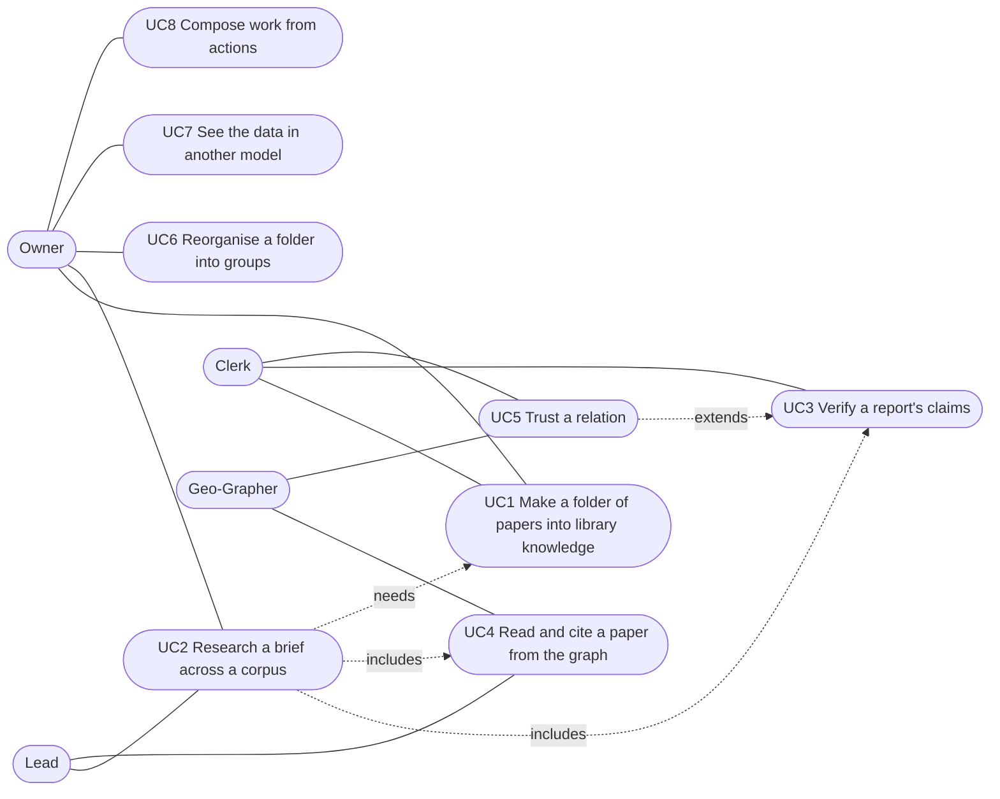

# Use cases and open points

20 November 2026. Written use cases for the Librarian's workflows, in the form taught in *Systems analysis and database design*, week 4 (after Cockburn, *Writing Effective Use Cases*, 2001).

The use cases are one of three artefacts that describe the system together:

| Artefact | Question it answers | Here |
|---|---|---|
| **Use case diagram** | **Who** interacts with the system, and **what** goals they pursue | [Below](#actors-and-the-use-case-diagram) |
| **Activity diagram** | **How** the process flows: sequence, decisions, phases | [WORKFLOW-MAP.md](WORKFLOW-MAP.md), generated from the code. The run itself is in [ingestion-and-research-run.canvas](ingestion-and-research-run.canvas) |
| **Written use case description** | **What exactly** happens, step by step, including the failure cases | This document |

## Conventions

**The template: nine fields.**
1. Use case name.
2. Brief description.
3. Primary actor.
4. Preconditions.
5. Trigger.
6. Success guarantee.
7. Main success scenario (MSS).
8. Extensions.
9. Open questions / assumptions.

Supporting actors are added where they matter.

**Main success scenario.** The happy path, numbered. Four rules:
1. **Who has the ball.** Every step reads *Actor + verb + object*.
2. **Intent, not interface.** No tool or button names in the MSS.
3. **Every step moves forward.**
4. **Validate, don't check.** "The Core validates that…" and carry on. Any `if` goes to an extension.

**Extensions.**
- An extension is numbered by the MSS step it branches from, then a letter for each different condition at that step, then a number for each line of the branch.
  - `6a1` states the condition.
  - `6a2`, `6a3` are what follows.
  - `6b1` is a second, different condition at step 6.
  - `*a1` is a condition that can arise at any step.
- Each branch ends with **"Rejoin at N"** or **"The use case ends."**
- Each branch is tagged **observed** (it happened in the Resource-Library runs of 19–20 November 2026, with the commit that dealt with it) or **anticipated** (the design must handle it, but it has not happened yet).
- A branch whose last line is still unknown ends in **??**. The same question is raised under Open questions, as an open point (OP1–OP16, indexed at the end).

**Status.** UC1–UC4 and UC8 describe what exists (*as-is*). UC5–UC7 describe what is wanted (*to-be*): their MSS is the target, not current behaviour.

## Actors and the use case diagram

| Actor | Who or what | Kind |
|---|---|---|
| **Owner** | The person who runs the library | Primary actor (human) |
| **Lead** | The tier-1 agent that carries out a session in the app | Primary or supporting actor (model) |
| **Outside agent** | A tier-0 agent working through the MCP server | Primary actor (model) |
| **Clerk** | The tier-3 agent that does bounded tasks: folder checks, descriptions, claim reviews | Supporting actor (model) |
| **Scribe** | The tier-2 agent that writes prose from given parts | Supporting actor (model) |
| **Core** | The Librarian itself: registry, gates, staging, index | The system |
| **Geo-Grapher** | The library's own graph service: code and paper graphs | Supporting system |

Which model plays a role is an *assignment*, revisable at any time, so no use case names a model in its MSS.

---

## UC1. Make a folder of papers into library knowledge (as-is)

| Field | Content |
|---|---|
| **Use case name** | Make a folder of papers into library knowledge |
| **Brief description** | An attached folder's documents become Source notes, labelled with their origin, that search, research and reports can use, and their text joins the paper graph |
| **Primary actor** | Owner |
| **Supporting actors** | Clerk, Core, Geo-Grapher |
| **Preconditions** | The library's Core is running; a Clerk is assigned and qualified; the folder is readable |
| **Trigger** | The Owner attaches a folder to the library |
| **Success guarantee** | Every in-scope document is a findable Source note. Its file keeps its authorship label (`third_party` for papers). Its full text is in the paper graph. Nothing in an excluded folder was read. |
| **Activity diagram** | [WORKFLOW-MAP §1](WORKFLOW-MAP.md#1-a-sources-life-end-to-end) |

**Main success scenario**
1. The Owner attaches the folder to the library.
2. The Core surveys the folder and proposes a decision for each subfolder.
3. The Owner decides the subfolders that need a person: their purpose, or exclusion.
4. The Clerk assesses each remaining subfolder's sensitivity.
5. The Core accepts the remaining subfolders by the library's policy.
6. The Core queues every in-scope document, without a model call.
7. The Core captures each queued document and stages it.
8. The Owner approves the staged documents for reading.
9. The Core reads each approved document: parse, read, lenses, data, relate, metadata, review.
10. The Core publishes each fully converted document to the paper graph.
11. The Owner accepts the enriched documents into the library.
12. The Core writes each accepted document as a Source note and validates that it is findable.

**Extensions**
- **2a** *observed*
  - `2a1` Another root in the same library has changed since its survey.
  - `2a2` The Core refuses every folder decision as stale.
  - `2a3` The Owner re-surveys the stale root and re-applies its decisions. Rejoin at 3. (`9c0592d` stopped an *excluded* folder from causing this.)
- **3a**
  - `3a1` The Owner excludes a subfolder.
  - `3a2` The Core never reads its contents. Rejoin at 4.
- **4a** *observed*
  - `4a1` The Clerk's qualification has been lost.
  - `4a2` The Core holds every subfolder.
  - `4a3` The Owner, or an agent managing the Cores, re-qualifies the Clerk. Rejoin at 4. (The cause was Cores overwriting each other's shared qualification records, fixed in `cab623a`.)
- **4b**
  - `4b1` The Clerk judges a subfolder sensitive.
  - `4b2` The Core holds it for the Owner's decision. Rejoin at 3.
- **6a** *observed*
  - `6a1` Each accepted subfolder is its own root, so queuing the top folder finds nothing.
  - `6a2` The Core queues per accepted subfolder. Rejoin at 7.
- **8a**
  - `8a1` The library's promotion mode is `agent`.
  - `8a2` The Core approves by policy, recording the policy as approver. Rejoin at 9.
- **9a** *observed*
  - `9a1` A step needs a model that is not available, or a page reads only in part.
  - `9a2` The Core leaves the document *partial*, recording which stage waits.
  - `9a3` The Owner re-approves it. Rejoin at 9. *(Of 96, 6 were partial. 3 became complete; 3 were accepted at 95–98% read, keeping `coverage: partial`.)*
- **10a**
  - `10a1` The document has no verified full conversion.
  - `10a2` The Core leaves it catalogue-only in the graph, and says so. Rejoin at 11.
- **11a** *observed*
  - `11a1` Nobody accepts the enriched documents.
  - `11a2` The documents stay in staging, and nothing reports the backlog.
  - `11a3` ?? (OP1)
- **11b**
  - `11b1` The library's promotion mode is `agent`.
  - `11b2` An agent accepts by policy, recording itself in the reason. Rejoin at 12.
- **12a**
  - `12a1` A note cannot be found by its title, its bottom line and a concept.
  - `12a2` The Core flags it for maintenance as *written but not findable*. The use case ends for that document.

**Open questions / assumptions**
- **OP1** (`11a3`). Who is told that enriched documents are waiting, and when? An agenda item for the Owner, a line in the Lead's library context, or both? Until then, UC2 can run against a corpus that is not in the library.
- **OP2** (`2a`). Every folder accept re-checks and rebuilds every reviewed group, so a root edited all day keeps blocking decisions in unrelated folders. Should a decision touch only its own group? That is Geo-Grapher's to change.
- *Assumption.* A folder's purpose fixes the authorship of every file under it (`research-docs` and `third-party` → `third_party`), and a Source note written from such a file is generated content about a third-party work.

---

## UC2. Research a brief across a corpus (as-is)

| Field | Content |
|---|---|
| **Use case name** | Research a brief across a corpus |
| **Brief description** | The Lead works a multi-question research brief through an `explore` session and produces one evidenced insight report per question |
| **Primary actor** | Owner (the Lead does the work) |
| **Supporting actors** | Lead, Clerk, Scribe, Core, Geo-Grapher |
| **Preconditions** | The project note exists with standing disqualifiers. The corpus is in the library as Source notes (UC1). A Lead is assigned and qualified. The Owner has set the permission mode. |
| **Trigger** | The Owner asks the Lead to carry out the brief |
| **Success guarantee** | One staged report per question. Every claim's quote is verified and its sentence reviewed (UC3). Each report says where its findings land in our code, and states its gaps as gaps. The run stayed within its budgets. |
| **Activity diagram** | [WORKFLOW-MAP §2, explore](WORKFLOW-MAP.md#explore) |

**Main success scenario**
1. The Owner asks the Lead to carry out the brief.
2. The Lead opens an explore session for the project, with each question as a topic.
3. The Core validates the project and records the session's question.
4. The Lead records its orientation in the library.
5. The Lead opens one brief per question, with the project's disqualifiers.
6. The Lead runs research rounds until the stopping rule fires.
7. The Core adds each round's new finds as candidates.
8. The Lead decides each candidate: kept with its role, context, rejected or deferred, each with its reason.
9. The Lead records its assumptions and how each was settled.
10. The Lead reads the kept papers' sections in the graph (UC4).
11. The Lead locates each finding in our code graph.
12. The Lead records a synthesis for each brief.
13. The Lead drafts one report per brief, each claim citing its source and a verbatim quote.
14. The Core verifies and reviews each report's claims (UC3) and stages the report.
15. The Lead closes each brief with its coverage verdict, then closes the session.

**Extensions**
- **\*a** *observed*
  - `*a1` The Lead calls a tool its phase does not offer, or a macro that does not exist.
  - `*a2` The Core refuses at once, with no 600-second wait (`0d6af41`). Rejoin at the same step.
- **\*b** *observed*
  - `*b1` A refusal names the tool for the next step, but the phase does not offer it. Seen three times: `resume_session`, `request_budget`, `paper_get_outline`.
  - `*b2` The Lead asks the Owner instead, and the step stalls.
  - `*b3` ?? (OP6; fixed one tool at a time in `8129b3b` and `9fd2fe9`)
- **\*c** *observed*
  - `*c1` The phase's budget is spent with its work unfinished.
  - `*c2` The Lead asks the Owner for more calls.
  - `*c3` The Owner extends the phase's budget. Rejoin at the same step. (Four times in this run; see OP5.)
- **2a** *observed*
  - `2a1` The Lead asks the Owner a question and nobody answers.
  - `2a2` The Core parks the thread after 10 minutes.
  - `2a3` The Owner sends a message, and the Core resumes the thread (`7be7a44`). Rejoin at the step that was waiting.
- **5a**
  - `5a1` The brief has no disqualifiers.
  - `5a2` The Core asks the Owner for them. Rejoin at 5.
- **6a** *observed*
  - `6a1` The rounds surface the library's own design notes and folder cards, not the corpus.
  - `6a2` The Core adds them all as candidates: 82 in this run.
  - `6a3` ?? (OP4)
- **8a** *observed*
  - `8a1` Deciding the candidates one by one would cost more than the phase's budget.
  - `8a2` The Lead decides a run of candidates that share a reason in one call (`ea6a30c`). Rejoin at 9.
- **8b** *observed*
  - `8b1` The Lead omits arguments that were optional in the tool's form.
  - `8b2` The Core refuses the call as incomplete; `source` and `reason` are now required (`ea6a30c`). Rejoin at 8.
- **8c** *observed*
  - `8c1` No paper is a candidate, because the papers were never accepted (UC1 `11a`).
  - `8c2` The Lead puts papers forward by their graph citation (`1064cf0`, UC4). Rejoin at 8.
- **8d**
  - `8d1` Nothing is kept.
  - `8d2` The Core refuses the synthesis. Rejoin at 6.
- **11a** *observed*
  - `11a1` The Lead guesses a code graph's label.
  - `11a2` The Core refuses the read.
  - `11a3` The Core now supplies the labels (`9fd2fe9`). Rejoin at 11.
- **11b** *observed*
  - `11b1` The Lead finds no code for a finding, or names it only loosely.
  - `11b2` The report's code placement stays prose in its summary.
  - `11b3` ?? (OP10)
- **12a** *observed*
  - `12a1` The session holds only one synthesis.
  - `12a2` Every report shares one "Together" and "Unknowns", which go stale after a redraft.
  - `12a3` ?? (OP3)
- **13a** *observed*
  - `13a1` The Lead quotes only a paper's card, not its methods or results.
  - `13a2` The project's disqualifier is broken, and nothing catches it.
  - `13a3` The Lead reads the sections through the outline (`9fd2fe9`). Rejoin at 10.
- **14a**
  - `14a1` A claim is challenged (UC3 `4a`, `4b`).
  - `14a2` The Lead rewrites the claim, or keeps it with a rebuttal for the Owner to decide. Rejoin at 13.

**Open questions / assumptions**
- **OP3** (`12a3`). Should a multi-question brief be one session per question, or one session holding a synthesis per brief?
- **OP4** (`6a3`). Should a brief aimed at an outside corpus exclude the library's own design notes and folder cards from its rounds? And should Judge require every candidate decided, or only those that touch a brief?
- **OP5** (`*c`). Should a phase's budget be per visit or per session? Synthesise reopened with one call left.
- **OP6** (`*b3`). Is there a general check that every tool a refusal names is offered in that phase? `phase_walk` checks gate tools only.
- **OP10** (`11b3`). Should "where it lands in our code" be a claim with a cited code entity, verified like any other?
- *Assumption.* The Owner is away during an unattended run, so a driver answers questions as "away". Only a person may extend a budget.

---

## UC3. Verify a report's claims (as-is; included by UC2)

| Field | Content |
|---|---|
| **Use case name** | Verify a report's claims |
| **Brief description** | Before a report is staged, every claim's quote is found verbatim in its source, and every claim is reviewed against the passage around its quote |
| **Primary actor** | Core, on the Owner's behalf |
| **Supporting actors** | Clerk, Lead |
| **Preconditions** | A synthesis is recorded; claim review is on for the library |
| **Trigger** | The Lead submits a draft report |
| **Success guarantee** | Every staged claim's quote exists verbatim in a named source. Each claim carries a review verdict. A challenged claim is rewritten, or kept with a rebuttal only a person can accept. |

**Main success scenario**
1. The Lead submits a draft with its claims, each citing a source and a quote.
2. The Core validates that each quote appears verbatim in its source: the note, its evidence, its document text or the original file.
3. The Core sends each claim, with the passage around its quote, to the Clerk.
4. The Clerk judges that the passage supports the claim as written.
5. The Core records the verdicts on the report.
6. The Core stages the report.

**Extensions**
- **2a**
  - `2a1` A quote is not found in its source.
  - `2a2` The Core refuses the draft and names the closest passage to copy. Rejoin at 1.
- **2b** *observed*
  - `2b1` The source is a paper's graph citation (`<graph>/doc:N`).
  - `2b2` The Core resolves it to the paper's Source note and validates the quote there (`1064cf0`). Rejoin at 3.
- **2c**
  - `2c1` The cited paper has no Source note.
  - `2c2` The Core refuses the claim and says why. Rejoin at 1.
- **3a** *observed*
  - `3a1` Claim review is off for the library.
  - `3a2` The Core skips steps 3–5, and a garbled claim is staged.
  - `3a3` ?? (OP7)
- **3b** *observed*
  - `3b1` The review goes to the assigned Clerk, not the library's review route.
  - `3b2` ?? (OP8)
- **4a**
  - `4a1` The Clerk finds the claim goes beyond the passage, and copies the words that show it.
  - `4a2` The Core sends the challenge back to the Lead. Rejoin at UC2 step 13.
- **4b** *anticipated* (since `9fd2fe9`)
  - `4b1` The Clerk finds the claim is not a readable sentence.
  - `4b2` The Core sends it back to be rewritten; a rebuttal cannot keep it. Rejoin at UC2 step 13.
- **4c** *observed*
  - `4c1` The Clerk's reply does not complete.
  - `4c2` The Core records the claim as *unchecked*, with the Clerk's own problem as its reason (`81914de`).
  - `4c3` ?? (OP9)

**Open questions / assumptions**
- **OP7** (`3a3`). Should claim review be on by default in every library? It costs one Clerk call per claim.
- **OP8** (`3b2`). Should a library's per-task review route apply inside the Core, or does the Clerk role's assignment win?
- **OP9** (`4c3`). Why did three reviews not complete? All three quoted a full PDF text, and the same review outside the Core held.
- *Assumption.* A verbatim quote plus a passage-level review is enough to stage a claim. Promotion into the vault stays a separate, person-gated step.

---

## UC4. Read and cite a paper from the graph (as-is; included by UC2)

| Field | Content |
|---|---|
| **Use case name** | Read and cite a paper from the graph |
| **Brief description** | The Lead finds a paper in the library's paper graph, reads its sections, and cites it as evidence |
| **Primary actor** | Lead |
| **Supporting actors** | Geo-Grapher, Core |
| **Preconditions** | The library's Geo-Grapher is running; the paper was published to the graph (UC1 step 10) |
| **Trigger** | The Lead needs a paper's methods or results for a brief |
| **Success guarantee** | The paper is a kept candidate under its citation handle. A claim cites it, with a quote verified against its Source note. |

**Main success scenario**
1. The Lead identifies the library's paper and code graphs from the Core's context.
2. The Lead searches the paper graph for the brief's terms.
3. The Lead retrieves the paper's outline.
4. The Lead reads the sections that hold the methods and results.
5. The Lead puts the paper forward as a candidate by its citation handle.
6. The Core resolves the handle to the paper and its Source note, and records both.
7. The Lead cites the paper in a claim (UC3).

**Extensions**
- **1a** *observed*
  - `1a1` The Lead does not know the labels, and the graph list is too large to return.
  - `1a2` The Lead guesses a label and is refused.
  - `1a3` The Core now supplies the labels (`9fd2fe9`). Rejoin at 2.
- **3a** *observed*
  - `3a1` No phase offers the outline.
  - `3a2` The Lead cannot read a section by its id and reads only cards.
  - `3a3` The outline is offered now (`9fd2fe9`). Rejoin at 3.
- **6a**
  - `6a1` The paper has no Source note.
  - `6a2` The Core records the candidate and warns that it cannot be quoted. Rejoin at 7, citing a different paper. See UC1 `11a`.
- **6b**
  - `6b1` The library's Geo-Grapher is not connected.
  - `6b2` The Core refuses the handle. The use case ends.

**Open questions / assumptions**
- *Assumption.* A paper's title in the graph is the same as its Source note's name. That holds because both come from the same staged item. A renamed note would break it: should the link be stored, not derived?

---

## UC5. Trust a relation (to-be)

| Field | Content |
|---|---|
| **Use case name** | Trust a relation |
| **Brief description** | A link between two items (section→section, doc→code, claim→code, graph→graph) carries a type and a trust tier earned by checked evidence |
| **Primary actor** | Owner, or an agent reading a graph |
| **Supporting actors** | Core, Clerk, Geo-Grapher |
| **Preconditions** | Both items are in the library or its graphs |
| **Trigger** | An enrichment pass proposes candidate relations, many to many |
| **Success guarantee** | Every relation shown has a type from a declared vocabulary, a score with its evidence, and a tier (gold, silver, bronze) derived from declared thresholds |

**Main success scenario (target)**
1. The Core proposes candidate relations, climbing the ladder of granularity: within a document, then against our own material, then against outside material.
2. The Core distils the candidates: duplicates merged, links made by common words dropped.
3. The Core states each remaining relation as a claim, "A relates to B as R", with evidence from both sides.
4. The Clerk judges each relation claim against its evidence.
5. The Core scores each relation from its evidence and verdict.
6. The Core assigns each relation the tier its score earns.
7. The Owner reviews the relations proposed for the top tier.

**Extensions**
- **1a** *observed today*
  - `1a1` Links are proposed by word match, and common words like "to" and "which" make them.
  - `1a2` ?? (OP11)
- **1b** *observed today*
  - `1b1` Most call edges are unresolved (464 of 690 in a Parallax graph).
  - `1b2` The Core keeps them as unresolved candidates and never shows them as relations. Rejoin at 2.
- **5a** *observed today*
  - `5a1` Nothing connects a relation's evidence to a tier.
  - `5a2` ?? (OP12)
- **7a**
  - `7a1` The Owner rejects a top-tier relation.
  - `7a2` The Core records the rejection and lowers the tier. The use case ends.

**Open questions / assumptions**
- **OP11** (`1a2`). What is the relation vocabulary? A start: `parent`, `depends_on`, `blocks`, `derived_from`, `supports`, `contradicts`, `supersedes`, plus code relations (`calls`, `imports`, `implements`) and within-document ones (`introduces`, `precedes`, `summarises`).
- **OP12** (`5a2`). What scale, and what thresholds, make gold, silver and bronze?
- *Assumption.* Vector similarity may propose a relation but never asserts one.

---

## UC6. Reorganise a folder into groups (to-be)

| Field | Content |
|---|---|
| **Use case name** | Reorganise a folder into groups |
| **Brief description** | The Owner regroups the documents in an attached folder without breaking what the library knows about them |
| **Primary actor** | Owner |
| **Supporting actors** | Core, Clerk, Geo-Grapher |
| **Preconditions** | The folder is attached and its documents are known to the library |
| **Trigger** | The Owner asks for the folder to be organised |
| **Success guarantee** | Each document is in its approved group. Its Source note, evidence and graph document still resolve. Every move can be undone. Only the touched folders were re-surveyed. |

**Main success scenario (target)**
1. The Owner asks for the folder to be organised by a stated rule: folder code, topic or cluster.
2. The Core proposes a plan of groups and moves.
3. The Owner approves the plan.
4. The Core validates the plan in a dry run.
5. The Core moves each document, recording each move with its undo.
6. The Core updates each moved document's references in the library.
7. The Core re-surveys only the touched folders.

**Extensions**
- **4a**
  - `4a1` The dry run finds a move would break a reference.
  - `4a2` The Core refuses the plan and names the reference. Rejoin at 2.
- **5a**
  - `5a1` A move fails part way.
  - `5a2` The Core undoes the moves made so far. The use case ends.
- **7a** *observed today*
  - `7a1` A re-survey rebuilds every group in the library.
  - `7a2` ?? (OP2, OP13)

**Open questions / assumptions**
- **OP13.** Which rules may propose groups (folder code, topic, cluster), and may the Clerk propose them, or only the Owner?
- *Assumption.* A move never changes a document's bytes, so its digest, evidence and conversion stay valid.

---

## UC7. See the data in another model (to-be)

| Field | Content |
|---|---|
| **Use case name** | See the data in another model |
| **Brief description** | The Owner or an agent views what the library already holds as relational/ER, document, provenance or temporal data, and queries it with validated operators (owner's points A–F) |
| **Primary actor** | Owner, or an agent |
| **Supporting actors** | Core, Geo-Grapher |
| **Preconditions** | The views are published |
| **Trigger** | The Owner or an agent asks a question of the data's shape. Example: "papers in O1 and O5 with no Source note" |
| **Success guarantee** | A correct, bounded answer, computed from a validated query over a published view. No free-text SQL. |

**Main success scenario (target)**
1. The agent states the question as a structured query: restrict, project, join, semi-join, anti-join, group-by.
2. The Core validates the query against the view's published schema.
3. The Core compiles the query and runs it, read-only.
4. The Core returns the bounded result with the view and query it came from.

**Extensions**
- **\*a** *observed today*
  - `*a1` No view is published.
  - `*a2` ?? (OP14)
- **2a**
  - `2a1` The query names a field the view does not publish.
  - `2a2` The Core refuses and lists the view's fields. Rejoin at 1.

**Open questions / assumptions**
- **OP14.** Which views come first? A proposal: relational/ER over Source notes, then provenance lineage, then the temporal view over graph snapshots.
- *Assumption.* The views are pre-computed projections of data we already hold. No new data is captured for them.

---

## UC8. Compose work from actions (as-is)

| Field | Content |
|---|---|
| **Use case name** | Compose work from actions |
| **Brief description** | A workflow is defined by sequencing registered actions with bound arguments, never by writing code, and runs under the same gates as any agent call |
| **Primary actor** | Owner, or an orchestrating agent |
| **Supporting actors** | Core, a model for a routing step |
| **Preconditions** | Every action the workflow names is registered |
| **Trigger** | The Owner or an agent saves a workflow or pipeline definition |
| **Success guarantee** | The definition was validated before it was saved. The run is pinned to the exact definitions it started with. Every step passed through the registry, and the run's log can be resumed. |
| **Activity diagram** | [WORKFLOW-MAP §3–4](WORKFLOW-MAP.md#3-yaml-workflows-standardworkflows) |

**Main success scenario**
1. The Owner saves a workflow definition.
2. The Core validates the definition: its actions, arguments, references and routes.
3. The Owner starts a run with its inputs.
4. The Core pins the run to the exact definitions it can reach.
5. The Core runs each step through the registry, binding earlier outputs into later arguments.
6. The Core logs each step and returns the workflow's outputs.

**Extensions**
- **\*a** *observed today*
  - `*a1` The same job has a second mechanism, the agent macros.
  - `*a2` ?? (OP15)
- **\*b** *observed today*
  - `*b1` The largest flows (UC1's stages, UC2's phases) are coded state machines, not definitions.
  - `*b2` UC8 cannot compose them. ?? (OP16)
- **2a**
  - `2a1` The definition is invalid.
  - `2a2` The Core refuses to save it and names each problem. Rejoin at 1.
- **5a**
  - `5a1` A routing step's model is unavailable.
  - `5a2` The Core pauses the run.
  - `5a3` The Owner chooses the route by hand, or resumes later. Rejoin at 5.
- **5b**
  - `5b1` A step that changes something stopped with no recorded result.
  - `5b2` The Core pauses as *outcome unknown*.
  - `5b3` The Owner chooses *retry* or *applied*. Rejoin at 5.
- **5c**
  - `5c1` A definition changed after the run started.
  - `5c2` The Core refuses to resume. The use case ends.

**Open questions / assumptions**
- **OP15.** Should the macros become YAML workflows, and `macro_run` mean running one?
- **OP16.** Can each phase declare its exit gate and tools as data, so UC1 and UC2 become compositions like any other workflow?
- *Assumption.* A definition can only call what the registry already offers: no code between steps and no shell.

---

## Open points index

| OP | Use case and step | Open question | Planned in |
|---|---|---|---|
| OP1 | UC1 `11a3` | Who is told that enriched documents wait for acceptance? | W7 |
| OP2 | UC1 `2a`, UC6 `7a2` | Should a folder decision rebuild only its own group? | W6 (Geo-Grapher) |
| OP3 | UC2 `12a3` | One session per question, or a synthesis per brief? | W7 |
| OP4 | UC2 `6a3` | Keep the library's own notes out of an outside-corpus brief? | W7 |
| OP5 | UC2 `*c` | Budget per visit, or per session? | W7 |
| OP6 | UC2 `*b3` | A general check that every tool a refusal names is offered? | W1 |
| OP7 | UC3 `3a3` | Claim review on by default everywhere? | W7 (owner decision) |
| OP8 | UC3 `3b2` | Does the review route apply inside the Core? | W7 |
| OP9 | UC3 `4c3` | Why did three reviews not complete? | W7 |
| OP10 | UC2 `11b3` | Code placement as a checked claim? | W5 |
| OP11 | UC5 `1a2` | The relation vocabulary | W5 |
| OP12 | UC5 `5a2` | The scale and thresholds for trust tiers | W5 |
| OP13 | UC6 | Which rules may propose groups? | W6 |
| OP14 | UC7 `*a2` | Which views come first? | W4 |
| OP15 | UC8 `*a2` | Macros as YAML workflows? | W1 |
| OP16 | UC8 `*b2` | Phases and stages as data? | W1 |

The workstreams W1–W8 are in [the plan-forward proposal](../../docs/proposals/plan-forward-2026-11.md).
