# Librarian workflow map

Generated by `scripts/workflow_map.py` from `standard/phases.yaml` and the code; regenerate rather than edit. Each phase card shows the exit gate the model is shown in that phase (`Session.missing`) and the tools the live loop offers there (tail tools such as `advance`, `ask_user`, `park_session` and `request_budget` are left out).

## 1. A source's life, end to end

```mermaid
flowchart LR
  survey["folder survey"] --> decide{"folder decision<br/>(person or policy)"}
  decide --> queue["queue documents (deferred, no model)"]
  queue --> intake["intake: capture, fetch, quality, screen, describe"]
  intake --> staged["staged item"] --> approve{"approve (person or agent policy)"}
  approve --> b0["validate"] --> b1["parse"] --> b2["read"] --> b3["lenses"] --> b4["data"] --> b5["relate"] --> b6["metadata"] --> b7["review"] --> b8["publish"]
  b8 --> enriched["enriched / partial"] --> accept{"accept"}
  accept --> note["Source note (indexed, findable)"]
  note --> sessions["research sessions (purposes below)"] --> offering["staged Offering"]
  offering --> promote{"promote (person or agent policy)"}
  b8 -.-> geo["paper graph (Geo-Grapher)"]
  decide -.-> f0["folder_validate"] --> f1["folder_describe"] --> f2["folder_data"]
```

## 2. Research sessions, by purpose

### add_project

```mermaid
flowchart TD
  p0["<b>frame</b><br/>Which project is this for, what stage is it at, and what is fixed?<br/>to leave: no Project note for 'P': create_project<br/>gate uses: create_project, update_plan<br/><i>tools: create_project, get_note, search, session_status, topics_list, update_plan</i>"]
  p1["<b>ingest</b><br/>What does the person already have (repositories, papers, notes) that belongs in the library?<br/>to leave: record what the person already has: update_plan(fields=('ingested': ...)) (a list, or 'none')<br/>gate uses: update_plan<br/><i>tools: get_note, ingest, queue_source, search, update_plan</i>"]
  p0 --> p1
  p2["<b>map</b><br/>What does the library already hold on this, and under which topics?<br/>to leave: record the orientation: search with intent 'orient', then update_plan(fields=('map': ...))<br/>gate uses: search, update_plan<br/><i>tools: dispatch_plan, get_note, read_source_file, record_assumptions, request_raw_source_access, search, source_verification_plan, update_plan</i>"]
  p1 --> p2
  p3["<b>need</b><br/>What is needed, and what must a candidate not assume, require or depend on?<br/>to leave: open at least one brief: open_brief(need, disqualifiers)<br/>gate uses: open_brief<br/><i>tools: get_note, open_brief, read_source_file, record_assumptions, search, update_plan</i>"]
  p2 --> p3
  p4["<b>search</b><br/>What did the last round teach? Which 2-4 sub-threads are open, and what is the next named target?<br/>to leave: run rounds until the stopping rule fires: research_round, then checkpoint<br/>gate uses: checkpoint, research_round<br/><i>tools: checkpoint, get_note, ingest, queue_source, read_source_file, research_round, search, web_search</i>"]
  p3 --> p4
  p5["<b>judge</b><br/>What role would each candidate play? A rejection needs its reason.<br/>to leave: before committing: record what you are assuming and how each was settled - record_assumptions(((assumption, settled_by, how))), where settled_by is a tool you …<br/>gate uses: decide, session_status<br/><i>tools: add_candidate, decide, get_note, record_assumptions, search, session_status, staging_list, staging_review, staging_show</i>"]
  p4 --> p5
  p6["<b>synthesise</b><br/>Which sources together; at what cost; what is unknown; what to open first? Every claim carries its source and a verbati…<br/>to leave: record the cross-source synthesis: record_synthesis<br/>gate uses: draft_offering, promote_offering, record_synthesis<br/><i>tools: draft_offering, get_note, promote_offering, record_synthesis, record_trace, search</i>"]
  p5 --> p6
  p7["<b>check_out</b><br/>What did the library fail to answer?<br/>to leave: nothing: advance<br/>gate uses: close_brief<br/><i>tools: close_brief, close_session, get_note, record_application, staging_list, update_plan</i>"]
  p6 --> p7
```

### explore

```mermaid
flowchart TD
  p0["<b>frame</b><br/>Which project is this for, what stage is it at, and what is fixed?<br/>to leave: nothing: advance<br/>gate uses: create_project, update_plan<br/><i>tools: get_note, search, session_status, topics_list, update_plan</i>"]
  p1["<b>map</b><br/>What does the library already hold on this, and under which topics?<br/>to leave: record the orientation: search with intent 'orient', then update_plan(fields=('map': ...))<br/>gate uses: search, update_plan<br/><i>tools: dispatch_plan, get_note, read_source_file, record_assumptions, request_raw_source_access, search, source_verification_plan, update_plan</i>"]
  p0 --> p1
  p2["<b>need</b><br/>What is needed, and what must a candidate not assume, require or depend on?<br/>to leave: open at least one brief: open_brief(need, disqualifiers)<br/>gate uses: open_brief<br/><i>tools: get_note, open_brief, read_source_file, record_assumptions, search, update_plan</i>"]
  p1 --> p2
  p3["<b>search</b><br/>What did the last round teach? Which 2-4 sub-threads are open, and what is the next named target?<br/>to leave: run rounds until the stopping rule fires: research_round, then checkpoint<br/>gate uses: checkpoint, research_round<br/><i>tools: checkpoint, get_note, ingest, queue_source, read_source_file, research_round, search, web_search</i>"]
  p2 --> p3
  p4["<b>judge</b><br/>What role would each candidate play? A rejection needs its reason.<br/>to leave: before committing: record what you are assuming and how each was settled - record_assumptions(((assumption, settled_by, how))), where settled_by is a tool you …<br/>gate uses: decide, session_status<br/><i>tools: add_candidate, decide, get_note, record_assumptions, search, session_status, staging_list, staging_review, staging_show</i>"]
  p3 --> p4
  p5["<b>synthesise</b><br/>Which sources together; at what cost; what is unknown; what to open first? Every claim carries its source and a verbati…<br/>to leave: record the cross-source synthesis: record_synthesis<br/>gate uses: draft_offering, promote_offering, record_synthesis<br/><i>tools: draft_offering, get_note, promote_offering, record_synthesis, record_trace, search</i>"]
  p4 --> p5
  p6["<b>check_out</b><br/>What did the library fail to answer?<br/>to leave: nothing: advance<br/>gate uses: close_brief<br/><i>tools: close_brief, close_session, get_note, record_application, staging_list, update_plan</i>"]
  p5 --> p6
```

### suggest

```mermaid
flowchart TD
  p0["<b>frame</b><br/>Which project is this for, what stage is it at, and what is fixed?<br/>to leave: no Project note for 'P': create_project<br/>gate uses: create_project, update_plan<br/><i>tools: create_project, get_note, search, session_status, topics_list, update_plan</i>"]
  p1["<b>map</b><br/>What does the library already hold on this, and under which topics?<br/>to leave: record the orientation: search with intent 'orient', then update_plan(fields=('map': ...))<br/>gate uses: read_project, search, update_plan<br/><i>tools: dispatch_plan, get_note, open_brief, read_source_file, record_assumptions, request_raw_source_access, search, source_verification_plan, update_plan</i>"]
  p0 --> p1
  p2["<b>search</b><br/>What did the last round teach? Which 2-4 sub-threads are open, and what is the next named target?<br/>to leave: run rounds until the stopping rule fires: research_round, then checkpoint<br/>gate uses: checkpoint, research_round<br/><i>tools: checkpoint, get_note, ingest, queue_source, read_source_file, research_round, search, web_search</i>"]
  p1 --> p2
  p3["<b>judge</b><br/>What role would each candidate play? A rejection needs its reason.<br/>to leave: before committing: record what you are assuming and how each was settled - record_assumptions(((assumption, settled_by, how))), where settled_by is a tool you …<br/>gate uses: decide, session_status<br/><i>tools: add_candidate, decide, get_note, record_assumptions, search, session_status, staging_list, staging_review, staging_show</i>"]
  p2 --> p3
  p4["<b>synthesise</b><br/>Which sources together; at what cost; what is unknown; what to open first? Every claim carries its source and a verbati…<br/>to leave: record the cross-source synthesis: record_synthesis<br/>gate uses: draft_offering, promote_offering, record_synthesis<br/><i>tools: draft_offering, get_note, promote_offering, record_synthesis, record_trace, search</i>"]
  p3 --> p4
  p5["<b>check_out</b><br/>What did the library fail to answer?<br/>to leave: nothing: advance<br/>gate uses: close_brief<br/><i>tools: close_brief, close_session, get_note, record_application, staging_list, update_plan</i>"]
  p4 --> p5
```

### apply

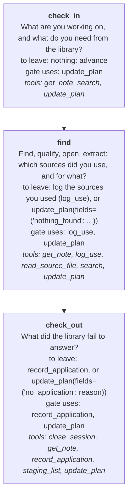

### start_pursuit

```mermaid
flowchart TD
  p0["<b>frame</b><br/>Which project is this for, what stage is it at, and what is fixed?<br/>to leave: no Project note for 'P': create_project<br/>gate uses: create_project, update_plan<br/><i>tools: create_project, get_note, search, session_status, topics_list, update_plan</i>"]
  p1["<b>inventory</b><br/>Kind-specific questions: what does this pursuit actually involve - modules and assessments, a role and its first-90-day…<br/>to leave: record the kind-specific inventory: update_plan(fields=('inventory': ...)); before committing: record what you are assuming and how each was settled - record_a…<br/>gate uses: update_plan<br/><i>tools: get_note, read_source_file, record_assumptions, search, update_plan</i>"]
  p0 --> p1
  p2["<b>plan</b><br/>What are the milestones, and which of them have dates?<br/>to leave: add at least one dated milestone (task_add), or update_plan(fields=('no_dates': reason))<br/>gate uses: task_add, update_plan<br/><i>tools: get_note, search, task_add, update_plan</i>"]
  p1 --> p2
  p3["<b>seed</b><br/>What reading, handbooks or onboarding material belongs in the library for this pursuit, and which of it matters enough …<br/>to leave: record what was seeded: update_plan(fields=('ingested': ...)) (a list, or 'none')<br/>gate uses: ingest, queue_source, update_plan<br/><i>tools: get_note, ingest, queue_source, search, update_plan</i>"]
  p2 --> p3
  p4["<b>check_out</b><br/>What did the library fail to answer?<br/>to leave: nothing: advance<br/>gate uses: <br/><i>tools: close_brief, close_session, get_note, record_application, staging_list, update_plan</i>"]
  p3 --> p4
```

### learn

```mermaid
flowchart TD
  p0["<b>goal</b><br/>What do they want to be able to do, and by when?<br/>to leave: what do they want to be able to do, and by when: update_plan(fields=('goal': ..., 'deadline': ...))<br/>gate uses: update_plan<br/><i>tools: get_note, search, update_plan</i>"]
  p1["<b>baseline</b><br/>Before teaching anything: 2-3 questions on what they already know.<br/>to leave: 2-3 diagnostic questions before teaching: ask_user, then update_plan(fields=('baseline': ...))<br/>gate uses: ask_user, update_plan<br/><i>tools: get_note, search, update_plan</i>"]
  p0 --> p1
  p2["<b>focus</b><br/>What does the library hold on this, and which concepts should this session focus on?<br/>to leave: read what the library holds, then choose the focus concepts: update_plan(fields=('focus': (...)))<br/>gate uses: update_plan<br/><i>tools: get_note, read_source_file, search, update_plan</i>"]
  p1 --> p2
  p3["<b>practice</b><br/>Ask one question anchored in a source passage; the person answers; feedback cites the passage; record what they underst…<br/>to leave: nothing: advance<br/>gate uses: understanding_record, update_plan<br/><i>tools: get_note, read_source_file, search, understanding_record, update_plan</i>"]
  p2 --> p3
  p4["<b>consolidate</b><br/>Let the person explain it in their own words first; critique it against the sources, grounded like the scribe.<br/>to leave: let them explain it in their own words, critique it against the sources, then understanding_record and update_plan(fields=('consolidated': ...))<br/>gate uses: understanding_record, update_plan<br/><i>tools: get_note, read_source_file, search, understanding_record, update_plan</i>"]
  p3 --> p4
  p5["<b>next</b><br/>When should this be reviewed again, and is there a next session to propose?<br/>to leave: review dates as tasks - task_add(note='‹project note›', text='Review: ‹concept›', due=..., heading='Understanding') - or enable the Spaced Repetition plugin, t…<br/>gate uses: task_add, update_plan<br/><i>tools: close_session, get_note, search, task_add, update_plan</i>"]
  p4 --> p5
```

### add_capability

```mermaid
flowchart TD
  p0["<b>candidate</b><br/>Which server? One from capability_candidates (the curated list), or a repository URL the person gives - never one found…<br/>to leave: name the candidate: update_plan(fields=('candidate': ...)) - a curated server (capability_candidates) or a repository URL the person gave<br/>gate uses: capability_candidates, update_plan<br/><i>tools: capability_candidates, get_note, update_plan</i>"]
  p1["<b>assess</b><br/>ingest its repository, read it as a source, and record the assessment: licence, maintenance, what it claims, caveats, w…<br/>to leave: ingest the candidate's repository, so it is read as a source; before committing: record what you are assuming and how each was settled - record_assumptions(((a…<br/>gate uses: ingest, update_plan<br/><i>tools: get_note, ingest, read_source_file, record_assumptions, search, update_plan</i>"]
  p0 --> p1
  p2["<b>propose</b><br/>Propose one exact, pinned definition: which launcher, which version, which secrets (as $(ENV) names only), and why this…<br/>to leave: propose its exact definition: capability_propose(...)<br/>gate uses: capability_propose<br/><i>tools: capability_propose, get_note</i>"]
  p1 --> p2
  p3["<b>install</b><br/>The person decides: capability_install asks them, and installs only on yes.<br/>to leave: capability_install(name) - it asks the person; a decline is a finished outcome too<br/>gate uses: capability_install<br/><i>tools: capability_install, get_note</i>"]
  p2 --> p3
  p4["<b>check_out</b><br/>What did the library fail to answer?<br/>to leave: nothing: advance<br/>gate uses: close_brief<br/><i>tools: close_brief, close_session, get_note, record_application, staging_list, update_plan</i>"]
  p3 --> p4
```

### audited

```mermaid
flowchart TD
  p0["<b>manage</b><br/>Which open requirement comes next, and what one bounded step serves it? Record it with update_plan(fields=('proposal': …<br/>to leave: no requirements yet: the person sets them with set_requirement<br/>gate uses: update_plan<br/><i>tools: audit_projection, get_note, read_evidence, search, update_plan</i>"]
  p1["<b>preflight</b><br/>The Core admits the proposal as a contract against the current state, or refuses it with the reason.<br/>to leave: no contract has been admitted: preflight admits one<br/>gate uses: admit_contract<br/><i>tools: admit_contract, audit_projection</i>"]
  p0 --> p1
  p2["<b>execute</b><br/>Do only what the admitted contract allows, through its tools.<br/>to leave: no contract has been admitted: preflight admits one<br/>gate uses: stage_artifact<br/><i>tools: dispatch_plan, get_note, read_evidence, read_source_file, request_raw_source_access, search, source_verification_plan, stage_artifact</i>"]
  p1 --> p2
  p3["<b>audit</b><br/>Tier A checks every predicate of the contract's requirements on the actual artifacts; a missing or failed check is reco…<br/>to leave: no contract has been admitted: preflight admits one<br/>gate uses: audit_targets, verify_grain<br/><i>tools: audit_projection, audit_targets, verify_grain</i>"]
  p2 --> p3
  p4["<b>reduce</b><br/>The Core turns the round's results into requirement statuses. Then start the next round, or close the session if every …<br/>to leave: no contract has been admitted: preflight admits one<br/>gate uses: close_session, reduce_round<br/><i>tools: audit_projection, close_session, reduce_round</i>"]
  p3 --> p4
```

## 3. YAML workflows (`standard/workflows`)

Each is a closed sequence of registered actions; `[[...]]` is a nested workflow, `{...}` a routing step.

### deep-read-staged

_read the whole text of every staged source, part by part - claims and limits with their pages, terms, and any reasoning stance a text teaches, staged as a lens (V1's lens scan, on the clerk channel)_

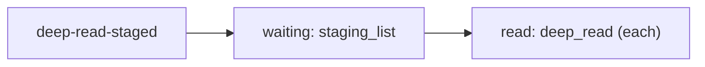

### draft-reflection

_draft a short reflection grounded only in a week's own gathered tasks, activity and desk (W3 weekly-review, step 4)_

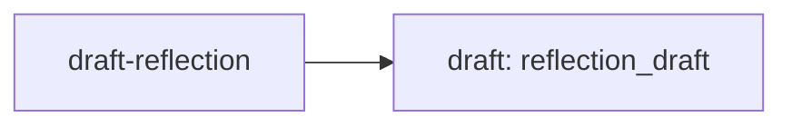

### evidence-to-claim-check

_Read a pinned source file before a claim check_

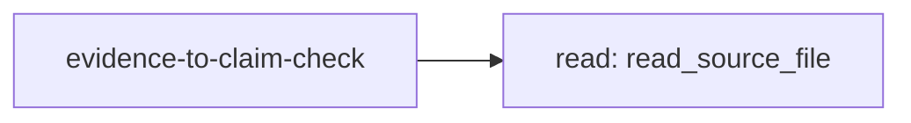

### flag-sensitive

_mark one staged source for a person's review as possibly dual-use_

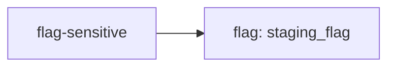

### gather-activity

_what was read and written across every session - or one pursuit's, given a project - since a cutoff (W3 weekly-review, step 2)_

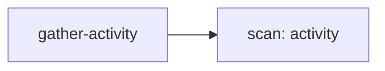

### gather-agenda

_every open, dated task across the vault - or one pursuit's, given a project - bucketed by when it falls (W3 weekly-review, step 1)_

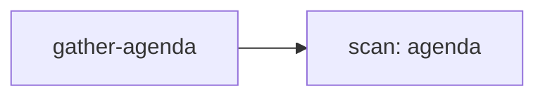

### gather-desk

_a pursuit's current working set (W3 weekly-review, step 3)_

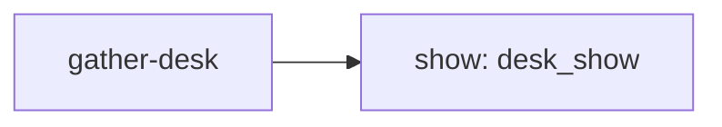

### ingest-cited

_record an external research report's cited links as evidence, then fetch and stage every cited arXiv or DOI paper (V1's ingest_resolved_links, declared)_

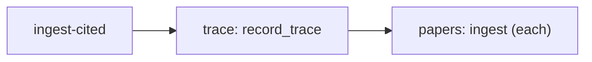

### inspect-map-source

_Inspect a source then refresh its map_

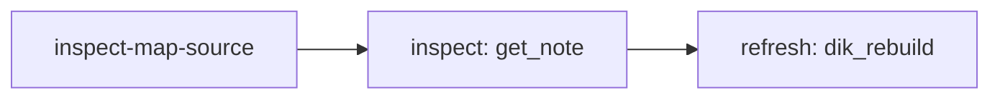

### intake-to-stage

_Ingest one reference into reviewed staging_

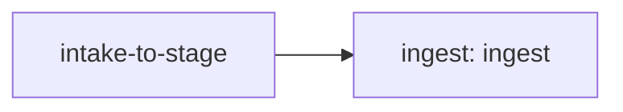

### review-conversation

_find catalogued sources relevant to a snapshot of a conversation; writes nothing_

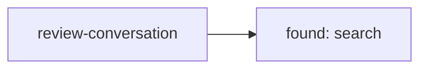

### review-due

_open one parked learn session per concept whose review task is due, framed for the review, for the person to resume from Sessions (Co-work Roadmap §2 W4, §4 D4)_

```mermaid
flowchart LR
  s["review-due"]
  n0["open: review_due_open"]
  s --> n0
```

### review-item

_draft the unframed Bottom Line and run the sensitivity check for one staged source_

```mermaid
flowchart LR
  s["review-item"]
  n0["review: staging_review"]
  s --> n0
```

### review-staged-candidate

_Review a staged candidate, then make the selected decision_

```mermaid
flowchart LR
  s["review-staged-candidate"]
  n0["review: staging_review"]
  s --> n0
  n1["decide: staging_decide"]
  n0 --> n1
```

### review-staged

_draft the unframed Bottom Line and run the sensitivity check for every staged source that has none yet (V1's draft_staging_promotions, declared)_

```mermaid
flowchart LR
  s["review-staged"]
  n0["waiting: staging_list"]
  s --> n0
  n1["review: staging_review (each)"]
  n0 --> n1
```

### run-queue

_take what is waiting in the intake queue through fetch, evidence, description and staging_

```mermaid
flowchart LR
  s["run-queue"]
  n0["intake: intake_run"]
  s --> n0
```

### search-and-judge

_Search then inspect the chosen source_

```mermaid
flowchart LR
  s["search-and-judge"]
  n0["search: search"]
  s --> n0
  n1["inspect: get_note"]
  n0 --> n1
```

### source-pages-to-claim-check

_Read a located generated section, then check the original PDF pages_

```mermaid
flowchart LR
  s["source-pages-to-claim-check"]
  n0["read: read_source_section"]
  s --> n0
  n1["verify: verify_source_pages"]
  n0 --> n1
```

### sync-vault

_keep the vault's ignore rules current, commit what changed, and push it_

```mermaid
flowchart LR
  s["sync-vault"]
  n0["ignore: gitignore_ensure"]
  s --> n0
  n1["commit: vault_commit"]
  n0 --> n1
  n2["push: vault_push"]
  n1 --> n2
```

## 4. YAML pipelines (`standard/pipelines`)

### clear-enrichment-backlog

_run the intake queue, then route each fetched source to review, a sensitivity flag, or nothing further_

```mermaid
flowchart LR
  s["clear-enrichment-backlog"]
  n0[["intake: run-queue"]]
  s --> n0
  n1{"next: route"}
  n0 --> n1
```

### weekly-review

_gather a pursuit's tasks, cross-session activity and desk, then draft a reflection for the person to review (Co-work Roadmap §2, W3)_

```mermaid
flowchart LR
  s["weekly-review"]
  n0[["tasks: gather-agenda"]]
  s --> n0
  n1[["work: gather-activity"]]
  n0 --> n1
  n2[["desk: gather-desk"]]
  n1 --> n2
  n3[["draft: draft-reflection"]]
  n2 --> n3
```

## 5. Agent macros

Workflows above with a `macro:` block. The Lead runs them in a session with `macro_run`; one that can write waits for a person's approval of its exact expanded plan.

| Macro | Steps | Writes |
|---|---|---|
| `evidence_to_claim_check` | `read_source_file` | no |
| `inspect_map_source` | `get_note` → `dik_rebuild` | yes |
| `intake_to_stage` | `ingest` | yes |
| `review_staged_candidate` | `staging_review` → `staging_decide` | yes |
| `search_and_judge` | `search` → `get_note` | no |
| `source_pages_to_claim_check` | `read_source_section` → `verify_source_pages` | no |
