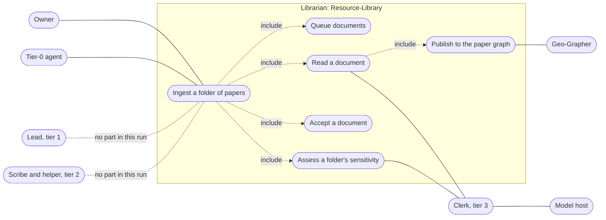

# Worked example: ingesting a folder of papers, orchestrated by a tier-0 agent

20 November 2026. An example of the [diagram workflow](../../../../docs/proposals/diagram-workflows.md) applied to a real run: the ingestion of `E:\DataManagement` (96 papers) into Resource-Library on 19–20 November 2026. The Owner directed it; a tier-0 agent (Claude Code, through the Core's API and MCP) orchestrated it.

The analysis is one **diagram spec**, [ingestion.spec.yaml](ingestion.spec.yaml), written by hand from the run's record. Everything else is generated from it by a prototype renderer, [render_spec.py](render_spec.py), with no model call:
- [ingestion.views.md](ingestion.views.md):
  - the validation result;
  - the activity diagram with swimlanes (Mermaid);
  - the written use case (main success scenario and extensions);
  - the decision tree;
  - the test table;
  - the cross-view check.
- [ingestion.canvas](ingestion.canvas): the same activity diagram as an Obsidian canvas. There is one column per actor, plus an Outcomes column, and extensions are drawn as red arrows.

```text
python render_spec.py ingestion.spec.yaml
```

## 1. The analysis frame (before drawing)

**Symptom.** The research session found no papers to keep, though all 96 had been read.

**Why?**
1. The papers existed only as staged items, catalogue cards and the paper graph.
2. Nobody accepted the enriched items out of staging.
3. Nothing told anyone the acceptance was still owed.

**Root cause.** The ingestion has no step that owns the last hand-off, and no signal when it is missing (OP1).

**Not the root cause.** "Let a graph citation count as evidence" (`1064cf0`) was a *proposed solution*: a good one, but it fixed the research side, not the ingestion.

**Scope.** Inside the boundary: the Core, its staging, its intake and batch stages, and its Source notes. Outside, drawn as actors:
- the Owner;
- the tier-0 agent;
- the Clerk;
- Geo-Grapher;
- the model host (DeepInfra, in our case).

**Perspective.** The Owner's: what had to be true for the papers to be usable.

**Lenses.**
- **Root-Cause**, for the frame above.
- **Guard-Completeness**: every decision drawn with all its ways out.
- **Real-Concurrency**: what ran beside the reading.

## 2. View 1: use case diagram (who and what)



Each oval is an end goal; the steps are in the activity diagram, per the course's granularity rule.
- **Owner** (primary) starts the use case.
- **The tier-0 agent** carries it out on the Owner's behalf.
- **Clerk** (tier 3), with the **Model host** behind it, does every model task: the folder checks, then reading, relating and reviewing each document.
- **Geo-Grapher** imports the converted papers.

**Tiers 1 and 2 had no step in this run.** Every batch stage calls the Clerk (`batch.py`, `clerk_endpoint`), and the tier-0 agent called the Core directly. Section 6 takes this up.

## 3. Views 2–4: generated from the spec

[ingestion.views.md](ingestion.views.md) holds the full output:
- **Activity diagram (how).** Six swimlanes (Owner, Tier-0 agent, Core, Clerk, Model host, Geo-Grapher), 9 decisions, one fork and join, 4 ends. The fork is the Clerk pool reading documents while the tier-0 agent tracks spend against the ceiling.
- **Written use case (what exactly).** A 17-step main success scenario, every step "Actor + verb + object". There are 9 extensions, each numbered by its step, and each ends in "rejoin at N" or "the use case ends". 6 are marked *observed* with what happened; 3 are *anticipated*.
- **Decision tree.** 11 paths: the main success scenario, 9 extensions, and 1 concurrent branch.
- **Test table.** One test per path, each with its expected outcome.

The written use case in the views file is **generated**, not written. Where it reads awkwardly ("Qualification lost."), the spec's guard text is too terse for prose. That is a reason to give each guard a short condition sentence in a later version of the schema.

### Boundary-value tests

The course's boundary-value method (on the limit, just inside it and just outside it; empty; the wrong type) applies to every guard on a number. These are written by hand: the prototype does not generate them yet.

**None of these tests has been run.** The "Expected" column is the behaviour we want. Where it matches what the run showed (0 queued, 20 of 21 parts), that is noted; the rest are requirements to test against.

| Guard | Value | Why | Expected |
|---|---|---|---|
| spend under the ceiling? | spend = ceiling − 1¢ | just inside | run continues |
| | spend = ceiling | on the limit | run stops (14a) and the Owner decides |
| | spend = ceiling + 1¢ | just over, e.g. a parallel call landing late | run stops; the overspend is reported, never hidden |
| | no ceiling set | empty | refused before any model call |
| queued count matches the survey? | 0 | subfolders are their own roots (observed) | 8a: queue per subfolder |
| | 96 | expected | continue |
| | 97 | one more than surveyed (a file added since) | flag; re-survey before reading |
| document fully read? | 21 of 21 parts | complete | enriched |
| | 20 of 21 | one short (observed: 95–98%) | 12b: re-approve, or accept with `coverage: partial` |
| | 0 of 21 | nothing read | stays partial; never accepted |
| findable by title, bottom line and concept? | all three hit | complete | 16 then 17 |
| | two of three | one search misses | 16a: flagged *written but not findable* |

## 4. What the tooling caught

Each of these came from the deterministic checks, not from re-reading by eye:
1. **Guards on activities.** The first draft put "answered?" on the model host's activity and "under the ceiling?" on the spend tracking. The validator refused: guarded branches belong on a **decision node**. That is the course's notation, and it matters because a decision is what the tree unfolds.
2. **An extension numbered by the wrong step.** The partial-read branch was numbered `11a`, the step before parsing. The cross-check found its decision sits after reading (step 12) and asked for `12x`. It is now `12b`.
3. **Too many scenarios.** The first tree walker followed each recovered extension on through every later branch, giving 57 paths. The course counts one scenario per extension, ended where it rejoins. With that rule there are 11 paths, and every one is a single test.
4. **Exactly one way to succeed.** The cross-check requires that exactly one path reaches the success end, and that every extension has a path. Both hold now.

## 5. Findings about the system

| # | Finding | Where in the views | Open point |
|---|---|---|---|
| F1 | The ingestion's last hand-off (step 15) has no owner and no alert. Extension 15a ends the use case with the papers stranded. | 15a, test T10 | OP1 |
| F2 | The tier-0 agent made steps 10 (approve) and 15 (accept) under the library's agent promotion mode. The notes then recorded `attested_by: person`, because the agent used the person's API. | steps 10, 15 | New: attestation must name who actually accepted |
| F3 | A stale root anywhere in the library blocks every folder decision (3a). Re-surveying is a recovery, not a fix. | 3a, test T2 | OP2 |
| F4 | Lost qualification (5a) surfaced only as 23 identical failures with no model call. Nothing named the cause until the tier-0 agent dug in. | 5a, test T3 | Fixed `cab623a`; the diagnosis was manual |
| F5 | Tiers 1 and 2 had no part. All orchestration sat with the tier-0 agent, outside the Core's own workflows. | use case diagram | OP16; see section 6 |
| F6 | Two branches were never exercised (anticipated): sensitive subfolder (6a), and the not-findable note (16a). The spend ceiling (14a) was set but never reached. | 6a, 14a, 16a | Worth a planted test each |

## 6. To-be: the same ingestion with the tiers doing their own work

The policy says each agent finishes its own work, and the in-app agents stay blind to tier 0. In the run, the tier-0 agent did everything a Lead could have done. A to-be version moves the orchestration inside the Core, where its gates and logs apply:

| Step | As-is (who had the ball) | To-be |
|---|---|---|
| 1 | Owner directs the tier-0 agent | Owner directs the ingestion, in the app or through the tier-0 agent |
| 2, 5, 8 | Tier-0 agent calls the Core's API | A **Lead** session runs an `ingest-folder` pipeline (UC8): attach, record the Owner's decisions, queue |
| 10, 15 | Tier-0 agent approves and accepts | The Core by agent policy, attested as the policy, or the Owner (person mode). Never "person" when an agent did it (F2). |
| 14 | Tier-0 agent tracks spend | The Core's spend ceiling, already enforced; the Lead reports progress |
| 17 | Tier-0 agent verifies counts | A **tier-2 helper** (read-only) verifies counts, labels and findability, and the Lead reports |
| oversight | (none separate) | The **tier-0 agent** watches the run's log and reports to the Owner, stepping in only on a blocker |
| new 15b | — | The pipeline's last step raises "N enriched documents await acceptance" on the agenda (OP1) |

The next spec to draw is the to-be version as its own `.spec.yaml`, rendered the same way. It would then show, side by side, which lane each step moved to.

## 7. How this example used the proposed workflow

| Workflow step (proposal, section 8) | Here |
|---|---|
| 1. Name a target and a kind | UC1, as run by a tier-0 agent; `activity` |
| 2. Choose lenses | Root-Cause, Guard-Completeness, Real-Concurrency |
| 3. Gather without a model | The run's records: the commits, the ingest log, the staging counts, `batch.STAGES` |
| 4. Draft the spec | By hand, for this example. In the product, the Clerk drafts lane by lane. |
| 5. Validate | `render_spec.py`; it caught finding 1 of section 4 |
| 6. Cross-check the views | It caught finding 2 of section 4 |
| 7. Render | Mermaid, canvas, tree and test table |
| 8–9. Stage and approve | Not done here: these files are reports, not vault notes |
