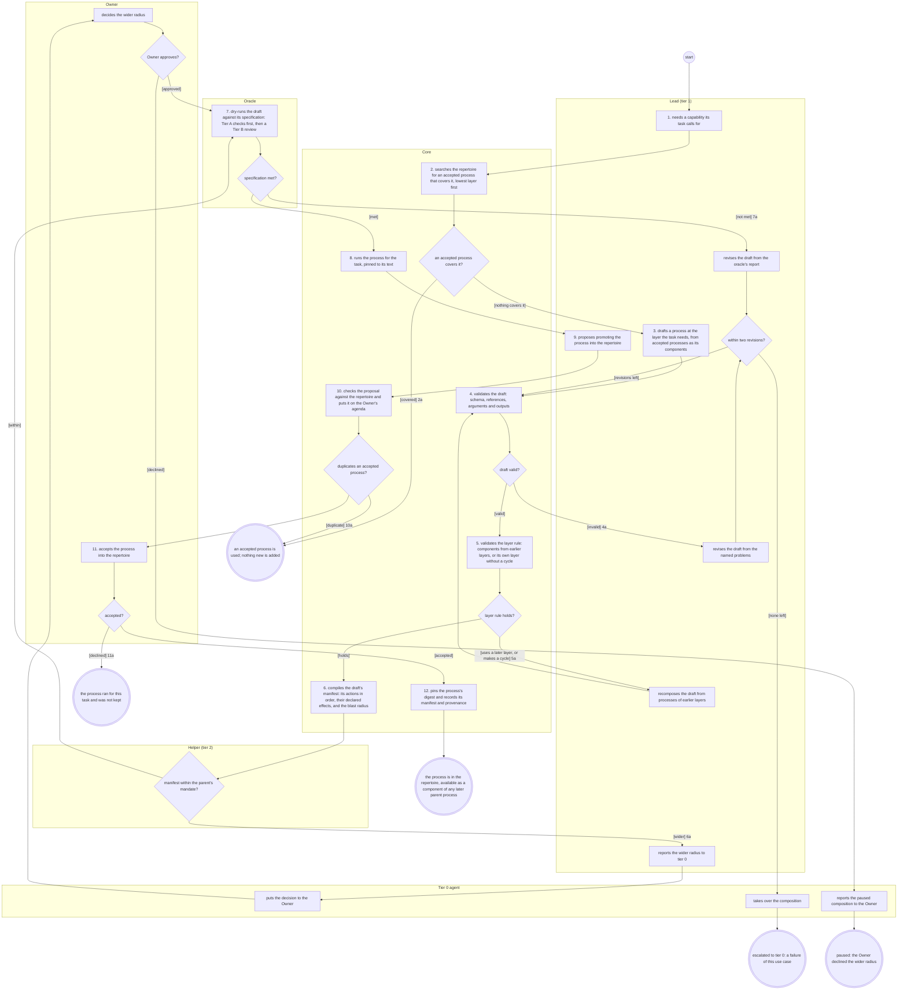

<!-- generated by render_spec.py from compose.spec.yaml; regenerate, do not edit -->
## Validation

No problems: the spec passes the activity rules.

## Activity diagram (swimlanes)



## Written use case (generated)

**Main success scenario** (generated: the guard-true path, in step order)

1. The Lead (tier 1) needs a capability its task calls for.
2. The Core searches the repertoire for an accepted process that covers it, lowest layer first.
3. The Lead (tier 1) drafts a process at the layer the task needs, from accepted processes as its components.
4. The Core validates the draft: schema, references, arguments and outputs.
5. The Core validates the layer rule: components from earlier layers, or its own layer without a cycle.
6. The Core compiles the draft's manifest: its actions in order, their declared effects, and the blast radius.
7. The Oracle dry-runs the draft against its specification: Tier A checks first, then a Tier B review.
8. The Core runs the process for the task, pinned to its text.
9. The Lead (tier 1) proposes promoting the process into the repertoire.
10. The Core checks the proposal against the repertoire and puts it on the Owner's agenda.
11. The Owner accepts the process into the repertoire.
12. The Core pins the process's digest and records its manifest and provenance.

**Extensions** (generated: one per non-happy guard; numbered by the step it leaves)

- **2a** (from: an accepted process covers it?) *anticipated*
  - `2a1` Covered.
  - `2a2` The use case ends: an accepted process is used; nothing new is added.
- **4a** (from: draft valid?) *anticipated*
  - `4a1` Invalid.
  - `4a2` The Lead (tier 1) revises the draft from the named problems.
  - `4a3` The Lead (tier 1) decides: within two revisions?
  - `4a3a` If none left: takes over the composition.
  - `4a4` If revisions left:
  - `4a5` Rejoin at 4.
- **5a** (from: layer rule holds?) *anticipated*
  - `5a1` Uses a later layer, or makes a cycle.
  - `5a2` The Lead (tier 1) recomposes the draft from processes of earlier layers.
  - `5a3` Rejoin at 4.
- **6a** (from: manifest within the parent's mandate?) *anticipated*
  - `6a1` Wider.
  - `6a2` The Lead (tier 1) reports the wider radius to tier 0.
  - `6a3` The Tier 0 agent puts the decision to the Owner.
  - `6a4` The Owner decides the wider radius.
  - `6a5` The Owner decides: Owner approves?
  - `6a5a` If declined: reports the paused composition to the Owner.
  - `6a6` If approved:
  - `6a7` Rejoin at 7.
- **7a** (from: specification met?) *anticipated*
  - `7a1` Not met.
  - `7a2` The Lead (tier 1) revises the draft from the oracle's report.
  - `7a3` The Lead (tier 1) decides: within two revisions?
  - `7a3a` If none left: takes over the composition.
  - `7a4` If revisions left:
  - `7a5` Rejoin at 4.
- **10a** (from: duplicates an accepted process?) *anticipated*
  - `10a1` Duplicate.
  - `10a2` The use case ends: an accepted process is used; nothing new is added.
- **11a** (from: accepted?) *anticipated*
  - `11a1` Declined.
  - `11a2` The use case ends: the process ran for this task and was not kept.

## Lane load

| Lane | On the main success scenario | Anywhere in the diagram |
|---|---|---|
| Owner | 2 | 4 |
| Tier 0 agent | 0 | 3 |
| Oracle | 2 | 2 |
| Lead (tier 1) | 3 | 8 |
| Helper (tier 2) | 1 | 1 |
| Core | 11 | 11 |

**Tier-0 turns** (each return of control to tier 0; owner's scale: 2 ideal, 3 expected, 4 rusty, 5–10 bad, more: might as well have done it themselves). Main success scenario: **0 (ideal)**. Worst path: T6, **2 (ideal)**. Paths by grade: ideal 9; escalated 2 (failures, not graded).

Paths by how they end: **escalated** 2, **paused** 1, **reused** 2, **success** 1, **used once** 1. Every *escalated* path is a failure of this use case: the work went back to tier 0.

## Decision tree: 11 paths

```text
start: Compose a process upward and promote it into the repertoire
              └─ T1: nothing covers it / valid / holds / within / met / new / accepted  ⇒ the process is in the repertoire, available as a component of any later parent process
  └─ T2: covered  ⇒ an accepted process is used; nothing new is added
      └─ T3: nothing covers it / invalid / none left  ⇒ escalated to tier 0: a failure of this use case
      └─ T4: nothing covers it / invalid / revisions left  ⇒ rejoins at step 4
      └─ T5: nothing covers it / valid / uses a later layer, or makes a cycle  ⇒ rejoins at step 4
          └─ T6: nothing covers it / valid / holds / wider / declined  ⇒ paused: the Owner declined the wider radius
          └─ T7: nothing covers it / valid / holds / wider / approved  ⇒ rejoins at step 7
            └─ T8: nothing covers it / valid / holds / within / not met / none left  ⇒ escalated to tier 0: a failure of this use case
            └─ T9: nothing covers it / valid / holds / within / not met / revisions left  ⇒ rejoins at step 4
            └─ T10: nothing covers it / valid / holds / within / met / duplicate  ⇒ an accepted process is used; nothing new is added
              └─ T11: nothing covers it / valid / holds / within / met / new / declined  ⇒ the process ran for this task and was not kept
```

## Test table: one test per path

| Test | Path (guards taken) | Extension | Expected outcome | Tier-0 turns |
|---|---|---|---|---|
| T1 | an accepted process covers it? → nothing covers it; draft valid? → valid; layer rule holds? → holds; manifest within the parent's mandate? → within; specification met? → met; duplicates an accepted process? → new; accepted? → accepted | MSS | the process is in the repertoire, available as a component of any later parent process | 0 (ideal) |
| T2 | an accepted process covers it? → covered | 2a | an accepted process is used; nothing new is added | 0 (ideal) |
| T3 | an accepted process covers it? → nothing covers it; draft valid? → invalid; within two revisions? → none left | 4a | escalated to tier 0: a failure of this use case | 1 (escalated: a failure) |
| T4 | an accepted process covers it? → nothing covers it; draft valid? → invalid; within two revisions? → revisions left | 4a | rejoins at step 4 | 0 (ideal) |
| T5 | an accepted process covers it? → nothing covers it; draft valid? → valid; layer rule holds? → uses a later layer, or makes a cycle | 5a | rejoins at step 4 | 0 (ideal) |
| T6 | an accepted process covers it? → nothing covers it; draft valid? → valid; layer rule holds? → holds; manifest within the parent's mandate? → wider; Owner approves? → declined | 6a | paused: the Owner declined the wider radius | 2 (ideal) |
| T7 | an accepted process covers it? → nothing covers it; draft valid? → valid; layer rule holds? → holds; manifest within the parent's mandate? → wider; Owner approves? → approved | 6a | rejoins at step 7 | 1 (ideal) |
| T8 | an accepted process covers it? → nothing covers it; draft valid? → valid; layer rule holds? → holds; manifest within the parent's mandate? → within; specification met? → not met; within two revisions? → none left | 7a | escalated to tier 0: a failure of this use case | 1 (escalated: a failure) |
| T9 | an accepted process covers it? → nothing covers it; draft valid? → valid; layer rule holds? → holds; manifest within the parent's mandate? → within; specification met? → not met; within two revisions? → revisions left | 7a | rejoins at step 4 | 0 (ideal) |
| T10 | an accepted process covers it? → nothing covers it; draft valid? → valid; layer rule holds? → holds; manifest within the parent's mandate? → within; specification met? → met; duplicates an accepted process? → duplicate | 10a | an accepted process is used; nothing new is added | 0 (ideal) |
| T11 | an accepted process covers it? → nothing covers it; draft valid? → valid; layer rule holds? → holds; manifest within the parent's mandate? → within; specification met? → met; duplicates an accepted process? → new; accepted? → declined | 11a | the process ran for this task and was not kept | 0 (ideal) |

## Cross-view check

No flags.
