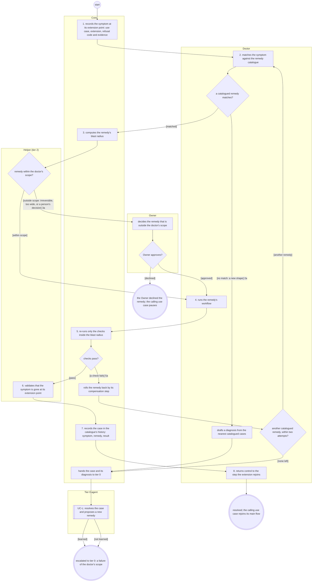

<!-- generated by render_spec.py from doctor.spec.yaml; regenerate, do not edit -->
## Validation

No problems: the spec passes the activity rules.

## Activity diagram (swimlanes)



## Written use case (generated)

**Main success scenario** (generated: the guard-true path, in step order)

1. The Core records the symptom at its extension point: use case, extension, refusal code and evidence.
2. The Doctor matches the symptom against the remedy catalogue.
3. The Core computes the remedy's blast radius.
4. The Doctor runs the remedy's workflow.
5. The Core re-runs only the checks inside the blast radius.
6. The Helper (tier 2) validates that the symptom is gone at its extension point.
7. The Core records the case in the catalogue's history: symptom, remedy, result.
8. The Doctor returns control to the step the extension rejoins.

**Extensions** (generated: one per non-happy guard; numbered by the step it leaves)

- **2a** (from: a catalogued remedy matches?) *anticipated*
  - `2a1` No match: a new shape.
  - `2a2` The Doctor drafts a diagnosis from the nearest catalogued cases.
  - `2a3` The Core hands the case and its diagnosis to tier 0.
  - `2a4` The Tier 0 agent resolves the case and proposes a new remedy (continues in UC-L).
  - `2a4a` If not learned: the use case ends: escalated to tier 0: a failure of the doctor's scope.
  - `2a5` If learned:
  - `2a6` The use case ends: escalated to tier 0: a failure of the doctor's scope.
- **3a** (from: remedy within the doctor's scope?) *anticipated*
  - `3a1` Outside scope: irreversible, too wide, or a person's decision.
  - `3a2` The Owner decides the remedy that is outside the doctor's scope.
  - `3a3` The Owner decides: Owner approves?
  - `3a3a` If declined: the use case ends: the Owner declined the remedy; the calling use case pauses.
  - `3a4` If approved:
  - `3a5` Rejoin at 4.
- **5a** (from: checks pass?) *anticipated*
  - `5a1` A check fails.
  - `5a2` The Core rolls the remedy back by its compensation step.
  - `5a3` The Doctor decides: another catalogued remedy, within two attempts?
  - `5a3a` If none left: hands the case and its diagnosis to tier 0.
  - `5a4` If another remedy:
  - `5a5` Rejoin at 2.

## Lane load

| Lane | On the main success scenario | Anywhere in the diagram |
|---|---|---|
| Core | 5 | 7 |
| Doctor | 4 | 6 |
| Helper (tier 2) | 2 | 2 |
| Owner | 0 | 2 |
| Tier 0 agent | 0 | 1 |

**Tier-0 turns** (each return of control to tier 0; owner's scale: 2 ideal, 3 expected, 4 rusty, 5–10 bad, more: might as well have done it themselves). Main success scenario: **0 (ideal)**. Worst path: T8, **0 (ideal)**. Paths by grade: ideal 4; escalated 4 (failures, not graded).

Paths by how they end: **declined** 1, **escalated** 4, **resolved** 1. Every *escalated* path is a failure of this use case: the work went back to tier 0.

## Decision tree: 8 paths

```text
start: Diagnose and resolve a failure at a mapped extension point (the doctor)
      └─ T1: matched / within scope / pass  ⇒ resolved; the calling use case rejoins its main flow
    └─ T2: no match: a new shape / not learned  ⇒ escalated to tier 0: a failure of the doctor's scope
    └─ T3: no match: a new shape / learned  ⇒ escalated to tier 0: a failure of the doctor's scope
      └─ T4: matched / outside scope: irreversible, too wide, or a person's decision / declined  ⇒ the Owner declined the remedy; the calling use case pauses
      └─ T5: matched / outside scope: irreversible, too wide, or a person's decision / approved  ⇒ rejoins at step 4
          └─ T6: matched / within scope / a check fails / none left / not learned  ⇒ escalated to tier 0: a failure of the doctor's scope
          └─ T7: matched / within scope / a check fails / none left / learned  ⇒ escalated to tier 0: a failure of the doctor's scope
        └─ T8: matched / within scope / a check fails / another remedy  ⇒ rejoins at step 2
```

## Test table: one test per path

| Test | Path (guards taken) | Extension | Expected outcome | Tier-0 turns |
|---|---|---|---|---|
| T1 | a catalogued remedy matches? → matched; remedy within the doctor's scope? → within scope; checks pass? → pass | MSS | resolved; the calling use case rejoins its main flow | 0 (ideal) |
| T2 | a catalogued remedy matches? → no match: a new shape; resolves the case and proposes a new remedy → not learned | 2a | escalated to tier 0: a failure of the doctor's scope | 1 (escalated: a failure) |
| T3 | a catalogued remedy matches? → no match: a new shape; resolves the case and proposes a new remedy → learned | 2a | escalated to tier 0: a failure of the doctor's scope | 1 (escalated: a failure) |
| T4 | a catalogued remedy matches? → matched; remedy within the doctor's scope? → outside scope: irreversible, too wide, or a person's decision; Owner approves? → declined | 3a | the Owner declined the remedy; the calling use case pauses | 0 (ideal) |
| T5 | a catalogued remedy matches? → matched; remedy within the doctor's scope? → outside scope: irreversible, too wide, or a person's decision; Owner approves? → approved | 3a | rejoins at step 4 | 0 (ideal) |
| T6 | a catalogued remedy matches? → matched; remedy within the doctor's scope? → within scope; checks pass? → a check fails; another catalogued remedy, within two attempts? → none left; resolves the case and proposes a new remedy → not learned | 5a | escalated to tier 0: a failure of the doctor's scope | 1 (escalated: a failure) |
| T7 | a catalogued remedy matches? → matched; remedy within the doctor's scope? → within scope; checks pass? → a check fails; another catalogued remedy, within two attempts? → none left; resolves the case and proposes a new remedy → learned | 5a | escalated to tier 0: a failure of the doctor's scope | 1 (escalated: a failure) |
| T8 | a catalogued remedy matches? → matched; remedy within the doctor's scope? → within scope; checks pass? → a check fails; another catalogued remedy, within two attempts? → another remedy | 5a | rejoins at step 2 | 0 (ideal) |

## Cross-view check

No flags.
