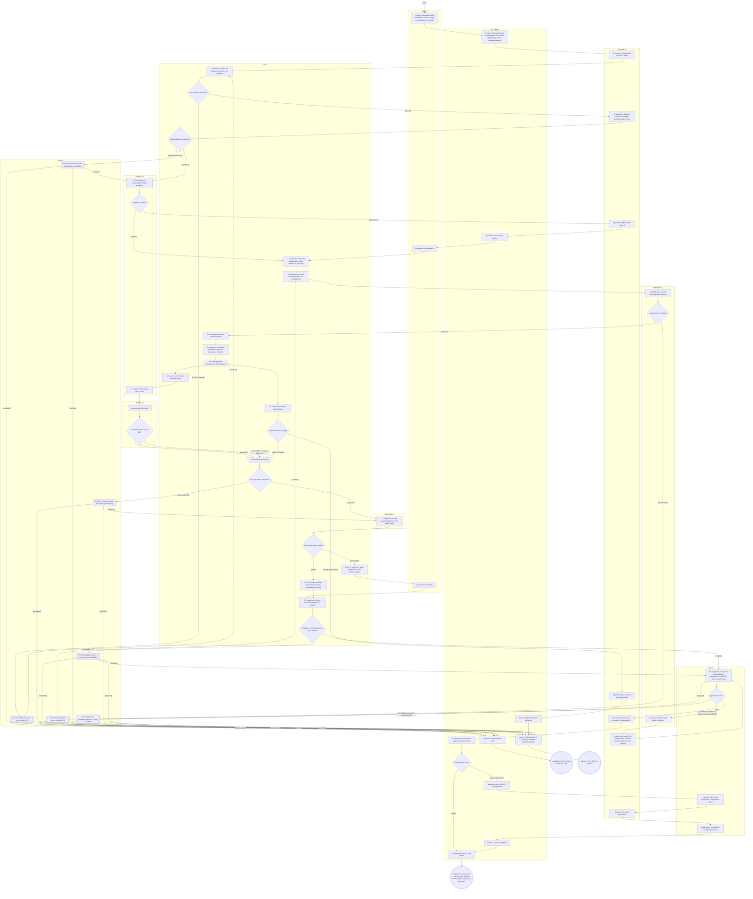

<!-- generated by render_spec.py from ingestion-tobe.spec.yaml; regenerate, do not edit -->
## Validation

No problems: the spec passes the activity rules.

## Activity diagram (swimlanes)



## Written use case (generated)

**Main success scenario** (generated: the guard-true path, in step order)

1. The Owner directs the ingestion of a folder into a library, naming the subfolders to exclude.
2. The Tier 0 agent hands the ingestion to a Lead and sets the oracle's specification: UC1's success guarantee.
3. The Lead (tier 1) opens an ingest-folder run for the folder.
4. The Core surveys the folder and proposes a decision per subfolder.
5. The Lead (tier 1) applies the Owner's exclusions and the decisions policy allows.
6. The Clerk (tier 3) assesses each remaining subfolder's sensitivity.
7. The Core accepts the remaining subfolders by policy, attested as the policy.
8. The Core queues the in-scope documents for each accepted root.
9. The Helper (tier 2) validates the queued count against the survey.
10. The Core captures and stages each document.
11. The Core approves the staged documents by policy, attested as the policy.
12. The Core parses and converts each document.
13. The Clerk (tier 3) reads each document part by part.
14. The Core enforces the library's spend ceiling.
15. The Geo-Grapher imports each fully converted paper into the paper graph.
16. The Core accepts the enriched documents by policy, attested as the policy.
17. The Core writes each Source note and validates it is findable.
18. The Oracle judges the run against the specification: deterministic checks first, then a model review.
19. The Lead (tier 1) hands the result and the oracle's verdict to tier 0.
20. The Tier 0 agent reviews the result once against the specification.
21. The Tier 0 agent reports the result to the Owner.

**Extensions** (generated: one per non-happy guard; numbered by the step it leaves)

- **4a** (from: every other root current?) *observed: as-is 3a*
  - `4a1` A root is stale.
  - `4a2` The Doctor resolves the stale root (remedy R1) (continues in UC-D).
  - `4a2a` If escalated: takes over the escalated case.
  - `4a2a` If declined: reports the paused run to the Owner, with the decision it needs.
  - `4a3` If resolved:
  - `4a4` Rejoin at 4.
- **6a** (from: Clerk qualified in this Core?) *observed: as-is 5a*
  - `6a1` Qualification lost.
  - `6a2` The Doctor restores the Clerk's qualification (remedy R2) (continues in UC-D).
  - `6a2a` If escalated: takes over the escalated case.
  - `6a2a` If declined: reports the paused run to the Owner, with the decision it needs.
  - `6a3` If resolved:
  - `6a4` Rejoin at 6.
- **6b** (from: subfolder sensitive?) *anticipated*
  - `6b1` Sensitive.
  - `6b2` The Lead (tier 1) reports the held subfolder to tier 0.
  - `6b3` The Tier 0 agent puts the decision to the Owner.
  - `6b4` The Owner decides the held subfolder.
  - `6b5` Rejoin at 7.
- **9a** (from: queued count matches?) *observed: as-is 8a*
  - `9a1` Mismatch.
  - `9a2` The Doctor reconciles the queue (remedy R3) (continues in UC-D).
  - `9a2a` If escalated: takes over the escalated case.
  - `9a2a` If declined: reports the paused run to the Owner, with the decision it needs.
  - `9a3` If resolved:
  - `9a4` Rejoin at 8.
- **13a** (from: answered in time and in full?) *observed: as-is 12a*
  - `13a1` Unavailable or partial page.
  - `13a2` Rejoin at 'all documents processed'.
- **14a** (from: spend under the ceiling?) *anticipated*
  - `14a1` Ceiling reached.
  - `14a2` The Lead (tier 1) reports the spend and the work left to tier 0.
  - `14a3` The Tier 0 agent puts the budget decision to the Owner.
  - `14a4` The Tier 0 agent reports the paused run to the Owner, with the decision it needs.
  - `14a5` The use case ends: paused for the Owner's decision.
- **13b** (from: every document fully read?) *observed: as-is 12b*
  - `13b1` Some partial.
  - `13b2` The Doctor re-reads the partial documents (remedy R4) (continues in UC-D).
  - `13b2a` If escalated: takes over the escalated case.
  - `13b2a` If declined: reports the paused run to the Owner, with the decision it needs.
  - `13b3` If resolved:
  - `13b4` Rejoin at 15.
- **16a** (from: library's promotion mode?) *observed: as-is 15a: the hand-off nobody owned*
  - `16a1` Person.
  - `16a2` The Core raises 'N documents await acceptance' on the Owner's agenda.
  - `16a3` The Owner accepts the documents.
  - `16a4` Rejoin at 17.
- **17a** (from: findable by title, bottom line and concept?) *anticipated*
  - `17a1` Not findable.
  - `17a2` The Doctor repairs the note's index entry (remedy R5) (continues in UC-D).
  - `17a2a` If escalated: takes over the escalated case.
  - `17a2a` If declined: reports the paused run to the Owner, with the decision it needs.
  - `17a3` If resolved:
  - `17a4` Rejoin at 18.
- **18a** (from: specification met?) *anticipated*
  - `18a1` Shortfall at a mapped extension.
  - `18a2` The Doctor applies the catalogued remedy for the shortfall (continues in UC-D).
  - `18a2a` If escalated: takes over the escalated case.
  - `18a2a` If declined: reports the paused run to the Owner, with the decision it needs.
  - `18a3` If resolved:
  - `18a4` Rejoin at 18.
- **18b** (from: specification met?) *anticipated*
  - `18b1` Shortfall no extension maps (misalignment).
  - `18b2` The Helper (tier 2) scouts the shortfall's blast radius, read-only.
  - `18b3` The Lead (tier 1) re-aligns the run with the specification, from the oracle's report and the scouting.
  - `18b4` Rejoin at 18.
- **20a** (from: ready to hand over?) *anticipated*
  - `20a1` Needs tidying.
  - `20a2` The Tier 0 agent tasks the oracle with tidy-up instructions.
  - `20a3` The Oracle oversees the tidy-up, through the Lead and the doctor.
  - `20a4` The Lead (tier 1) applies the oracle's instructions.
  - `20a5` The Oracle judges again and submits its response to tier 0.
  - `20a6` The Tier 0 agent makes a second, final pass.
  - `20a7` Rejoin at 21.

## Lane load

| Lane | On the main success scenario | Anywhere in the diagram |
|---|---|---|
| Owner | 1 | 3 |
| Tier 0 agent | 4 | 10 |
| Oracle | 2 | 4 |
| Lead (tier 1) | 3 | 7 |
| Doctor | 0 | 6 |
| Helper (tier 2) | 2 | 3 |
| Clerk (tier 3) | 3 | 3 |
| Core | 13 | 16 |
| Model host | 2 | 2 |
| Geo-Grapher | 1 | 1 |

**Tier-0 turns** (each return of control to tier 0; owner's scale: 2 ideal, 3 expected, 4 rusty, 5–10 bad, more: might as well have done it themselves). Main success scenario: **2 (ideal)**. Worst path: T26, **3 (expected)**. Paths by grade: ideal 18, expected 2; escalated 6 (failures, not graded).

Paths by how they end: **escalated** 6, **paused** 7, **success** 1. Every *escalated* path is a failure of this use case: the work went back to tier 0.

## Decision tree: 26 paths

```text
start: Ingest a folder of papers, overseen by tier 0 for the Owner (to-be)
                    └─ T1: current / qualified / normal / matches / answered / fully read / agent / findable / met / ready  ⇒ the Owner has the result and its report: Source notes findable, labelled, in the graph
    └─ T2: a root is stale / escalated  ⇒ escalated to tier 0: a failure of this use case
    └─ T3: a root is stale / declined  ⇒ paused for the Owner's decision
    └─ T4: a root is stale / resolved  ⇒ rejoins at step 4
      └─ T5: current / qualification lost / escalated  ⇒ escalated to tier 0: a failure of this use case
      └─ T6: current / qualification lost / declined  ⇒ paused for the Owner's decision
      └─ T7: current / qualification lost / resolved  ⇒ rejoins at step 6
      └─ T8: current / qualified / sensitive  ⇒ rejoins at step 7
          └─ T9: current / qualified / normal / mismatch / escalated  ⇒ escalated to tier 0: a failure of this use case
          └─ T10: current / qualified / normal / mismatch / declined  ⇒ paused for the Owner's decision
          └─ T11: current / qualified / normal / mismatch / resolved  ⇒ rejoins at step 8
          └─ T12: current / qualified / normal / matches / ceiling reached  ⇒ paused for the Owner's decision
          └─ T13: current / qualified / normal / matches / under the ceiling  ⇒ joins the main flow at 'all documents processed' (before step 15)
          └─ T14: current / qualified / normal / matches / unavailable or partial page  ⇒ rejoins at 'all documents processed' (before step 15)
              └─ T15: current / qualified / normal / matches / answered / some partial / escalated  ⇒ escalated to tier 0: a failure of this use case
              └─ T16: current / qualified / normal / matches / answered / some partial / declined  ⇒ paused for the Owner's decision
              └─ T17: current / qualified / normal / matches / answered / some partial / resolved  ⇒ rejoins at step 15
              └─ T18: current / qualified / normal / matches / answered / fully read / person  ⇒ rejoins at step 17
                  └─ T19: current / qualified / normal / matches / answered / fully read / agent / not findable / escalated  ⇒ escalated to tier 0: a failure of this use case
                  └─ T20: current / qualified / normal / matches / answered / fully read / agent / not findable / declined  ⇒ paused for the Owner's decision
                  └─ T21: current / qualified / normal / matches / answered / fully read / agent / not findable / resolved  ⇒ rejoins at step 18
                    └─ T22: current / qualified / normal / matches / answered / fully read / agent / findable / shortfall at a mapped extension / escalated  ⇒ escalated to tier 0: a failure of this use case
                    └─ T23: current / qualified / normal / matches / answered / fully read / agent / findable / shortfall at a mapped extension / declined  ⇒ paused for the Owner's decision
                    └─ T24: current / qualified / normal / matches / answered / fully read / agent / findable / shortfall at a mapped extension / resolved  ⇒ rejoins at step 18
                  └─ T25: current / qualified / normal / matches / answered / fully read / agent / findable / shortfall no extension maps (misalignment)  ⇒ rejoins at step 18
                    └─ T26: current / qualified / normal / matches / answered / fully read / agent / findable / met / needs tidying  ⇒ rejoins at step 21
```

## Test table: one test per path

| Test | Path (guards taken) | Extension | Expected outcome | Tier-0 turns |
|---|---|---|---|---|
| T1 | every other root current? → current; Clerk qualified in this Core? → qualified; subfolder sensitive? → normal; queued count matches? → matches; answered in time and in full? → answered; every document fully read? → fully read; library's promotion mode? → agent; findable by title, bottom line and concept? → findable; specification met? → met; ready to hand over? → ready | MSS | the Owner has the result and its report: Source notes findable, labelled, in the graph | 2 (ideal) |
| T2 | every other root current? → a root is stale; resolves the stale root (remedy R1) → escalated | 4a | escalated to tier 0: a failure of this use case | 2 (escalated: a failure) |
| T3 | every other root current? → a root is stale; resolves the stale root (remedy R1) → declined | 4a | paused for the Owner's decision | 2 (ideal) |
| T4 | every other root current? → a root is stale; resolves the stale root (remedy R1) → resolved | 4a | rejoins at step 4 | 2 (ideal) |
| T5 | every other root current? → current; Clerk qualified in this Core? → qualification lost; restores the Clerk's qualification (remedy R2) → escalated | 6a | escalated to tier 0: a failure of this use case | 2 (escalated: a failure) |
| T6 | every other root current? → current; Clerk qualified in this Core? → qualification lost; restores the Clerk's qualification (remedy R2) → declined | 6a | paused for the Owner's decision | 2 (ideal) |
| T7 | every other root current? → current; Clerk qualified in this Core? → qualification lost; restores the Clerk's qualification (remedy R2) → resolved | 6a | rejoins at step 6 | 2 (ideal) |
| T8 | every other root current? → current; Clerk qualified in this Core? → qualified; subfolder sensitive? → sensitive | 6b | rejoins at step 7 | 3 (expected) |
| T9 | every other root current? → current; Clerk qualified in this Core? → qualified; subfolder sensitive? → normal; queued count matches? → mismatch; reconciles the queue (remedy R3) → escalated | 9a | escalated to tier 0: a failure of this use case | 2 (escalated: a failure) |
| T10 | every other root current? → current; Clerk qualified in this Core? → qualified; subfolder sensitive? → normal; queued count matches? → mismatch; reconciles the queue (remedy R3) → declined | 9a | paused for the Owner's decision | 2 (ideal) |
| T11 | every other root current? → current; Clerk qualified in this Core? → qualified; subfolder sensitive? → normal; queued count matches? → mismatch; reconciles the queue (remedy R3) → resolved | 9a | rejoins at step 8 | 2 (ideal) |
| T12 | every other root current? → current; Clerk qualified in this Core? → qualified; subfolder sensitive? → normal; queued count matches? → matches; spend under the ceiling? → ceiling reached | 14a | paused for the Owner's decision | 2 (ideal) |
| T13 | every other root current? → current; Clerk qualified in this Core? → qualified; subfolder sensitive? → normal; queued count matches? → matches; spend under the ceiling? → under the ceiling | concurrent branch | joins the main flow at 'all documents processed' (before step 15) | 2 (ideal) |
| T14 | every other root current? → current; Clerk qualified in this Core? → qualified; subfolder sensitive? → normal; queued count matches? → matches; answered in time and in full? → unavailable or partial page | 13a | rejoins at 'all documents processed' (before step 15) | 2 (ideal) |
| T15 | every other root current? → current; Clerk qualified in this Core? → qualified; subfolder sensitive? → normal; queued count matches? → matches; answered in time and in full? → answered; every document fully read? → some partial; re-reads the partial documents (remedy R4) → escalated | 13b | escalated to tier 0: a failure of this use case | 2 (escalated: a failure) |
| T16 | every other root current? → current; Clerk qualified in this Core? → qualified; subfolder sensitive? → normal; queued count matches? → matches; answered in time and in full? → answered; every document fully read? → some partial; re-reads the partial documents (remedy R4) → declined | 13b | paused for the Owner's decision | 2 (ideal) |
| T17 | every other root current? → current; Clerk qualified in this Core? → qualified; subfolder sensitive? → normal; queued count matches? → matches; answered in time and in full? → answered; every document fully read? → some partial; re-reads the partial documents (remedy R4) → resolved | 13b | rejoins at step 15 | 2 (ideal) |
| T18 | every other root current? → current; Clerk qualified in this Core? → qualified; subfolder sensitive? → normal; queued count matches? → matches; answered in time and in full? → answered; every document fully read? → fully read; library's promotion mode? → person | 16a | rejoins at step 17 | 2 (ideal) |
| T19 | every other root current? → current; Clerk qualified in this Core? → qualified; subfolder sensitive? → normal; queued count matches? → matches; answered in time and in full? → answered; every document fully read? → fully read; library's promotion mode? → agent; findable by title, bottom line and concept? → not findable; repairs the note's index entry (remedy R5) → escalated | 17a | escalated to tier 0: a failure of this use case | 2 (escalated: a failure) |
| T20 | every other root current? → current; Clerk qualified in this Core? → qualified; subfolder sensitive? → normal; queued count matches? → matches; answered in time and in full? → answered; every document fully read? → fully read; library's promotion mode? → agent; findable by title, bottom line and concept? → not findable; repairs the note's index entry (remedy R5) → declined | 17a | paused for the Owner's decision | 2 (ideal) |
| T21 | every other root current? → current; Clerk qualified in this Core? → qualified; subfolder sensitive? → normal; queued count matches? → matches; answered in time and in full? → answered; every document fully read? → fully read; library's promotion mode? → agent; findable by title, bottom line and concept? → not findable; repairs the note's index entry (remedy R5) → resolved | 17a | rejoins at step 18 | 2 (ideal) |
| T22 | every other root current? → current; Clerk qualified in this Core? → qualified; subfolder sensitive? → normal; queued count matches? → matches; answered in time and in full? → answered; every document fully read? → fully read; library's promotion mode? → agent; findable by title, bottom line and concept? → findable; specification met? → shortfall at a mapped extension; applies the catalogued remedy for the shortfall → escalated | 18a | escalated to tier 0: a failure of this use case | 2 (escalated: a failure) |
| T23 | every other root current? → current; Clerk qualified in this Core? → qualified; subfolder sensitive? → normal; queued count matches? → matches; answered in time and in full? → answered; every document fully read? → fully read; library's promotion mode? → agent; findable by title, bottom line and concept? → findable; specification met? → shortfall at a mapped extension; applies the catalogued remedy for the shortfall → declined | 18a | paused for the Owner's decision | 2 (ideal) |
| T24 | every other root current? → current; Clerk qualified in this Core? → qualified; subfolder sensitive? → normal; queued count matches? → matches; answered in time and in full? → answered; every document fully read? → fully read; library's promotion mode? → agent; findable by title, bottom line and concept? → findable; specification met? → shortfall at a mapped extension; applies the catalogued remedy for the shortfall → resolved | 18a | rejoins at step 18 | 2 (ideal) |
| T25 | every other root current? → current; Clerk qualified in this Core? → qualified; subfolder sensitive? → normal; queued count matches? → matches; answered in time and in full? → answered; every document fully read? → fully read; library's promotion mode? → agent; findable by title, bottom line and concept? → findable; specification met? → shortfall no extension maps (misalignment) | 18b | rejoins at step 18 | 2 (ideal) |
| T26 | every other root current? → current; Clerk qualified in this Core? → qualified; subfolder sensitive? → normal; queued count matches? → matches; answered in time and in full? → answered; every document fully read? → fully read; library's promotion mode? → agent; findable by title, bottom line and concept? → findable; specification met? → met; ready to hand over? → needs tidying | 20a | rejoins at step 21 | 3 (expected) |

## Cross-view check

No flags.
