<!-- generated by render_spec.py from ingestion.spec.yaml; regenerate, do not edit -->
## Validation

No problems: the spec passes the activity rules.

## Activity diagram (swimlanes)

```mermaid
flowchart TD
  subgraph Owner["Owner"]
    a1["1. directs the ingestion of E:\DataManagement into Resource-Library"]
    a4["4. decides the subfolders that need a person (excludes 11, 12, 13, _external)"]
    x3["decides the held subfolder"]
  end
  subgraph Tier_0_agent["Tier 0 agent"]
    a2["2. attaches the folder to the library"]
    x1["re-surveys the stale root and re-applies its decisions"]
    a5["5. records the Owner's decisions"]
    x2["restarts the Cores and re-qualifies the Clerk"]
    a8["8. queues the in-scope documents, one accepted subfolder at a time"]
    d4{"queued count matches the survey?"}
    a10["10. approves the staged documents (agent promotion mode)"]
    a14["14. tracks spend against the ceiling and reports progress"]
    dc{"spend under the ceiling?"}
    x5["re-approves the partial document"]
    d6{"enriched documents accepted?"}
    a15["15. accepts the enriched documents into the library"]
    a17["17. verifies the counts and labels, and reports to the Owner"]
  end
  subgraph Core["Core"]
    a3["3. surveys the folder and proposes a decision per subfolder"]
    d1{"every other root current?"}
    d2{"Clerk qualified in this Core?"}
    a7["7. accepts the remaining subfolders by policy"]
    a9["9. captures and stages each document (intake)"]
    f1[/"for each approved document, in the Clerk pool"\]
    a11["11. parses and converts the document page by page"]
    j1[\"all documents processed"/]
    d5{"document fully read?"}
    a16["16. writes each Source note and validates it is findable"]
    d7{"findable by title, bottom line and concept?"}
  end
  subgraph Clerk_tier_3_["Clerk (tier 3)"]
    a6["6. assesses each remaining subfolder's sensitivity"]
    d3{"subfolder sensitive?"}
    a12["12. reads it part by part: claims, terms, relations, review"]
  end
  subgraph Model_host["Model host"]
    m1["answers each Clerk task"]
    dm{"answered in time and in full?"}
  end
  subgraph Geo_Grapher["Geo-Grapher"]
    a13["13. imports each fully converted paper into the paper graph"]
  end
  s(("start"))
  e1((("96 findable Source notes; files labelled third_party; papers in the graph")))
  e2((("papers stay in staging; research finds nothing to keep (OP1)")))
  e3((("note flagged written-but-not-findable")))
  e4((("run stopped at the spend ceiling; Owner decides")))
  s --> a1
  a1 --> a2
  a2 --> a3
  a3 --> d1
  d1 -->|"[current]"| a4
  d1 -->|"[a root is stale] 3a"| x1
  x1 --> a3
  a4 --> a5
  a5 --> d2
  d2 -->|"[qualified]"| a6
  d2 -->|"[qualification lost] 5a"| x2
  x2 --> a6
  a6 --> d3
  d3 -->|"[normal]"| a7
  d3 -->|"[sensitive] 6a"| x3
  x3 --> a7
  a7 --> a8
  a8 --> d4
  d4 -->|"[matches (96)]"| a9
  d4 -->|"[0 queued: subfolders are their own roots] 8a"| a8
  a9 --> a10
  a10 --> f1
  f1 --> a11
  f1 --> a14
  a11 --> a12
  a12 --> m1
  m1 --> dm
  dm -->|"[answered]"| j1
  dm -->|"[unavailable or partial page] 12a"| j1
  a14 --> dc
  dc -->|"[under the ceiling]"| j1
  dc -->|"[ceiling reached] 14a"| e4
  j1 --> d5
  d5 -->|"[fully read]"| a13
  d5 -->|"[partial] 12b"| x5
  x5 --> f1
  a13 --> d6
  d6 -->|"[accepted]"| a15
  d6 -->|"[nobody accepts] 15a"| e2
  a15 --> a16
  a16 --> d7
  d7 -->|"[findable]"| a17
  d7 -->|"[not findable] 16a"| e3
  a17 --> e1
  classDef ext stroke:#d9534f,stroke-width:2px
```



## Written use case (generated)

**Main success scenario** (generated: the guard-true path, in step order)

1. The Owner directs the ingestion of E:\DataManagement into Resource-Library.
2. The Tier 0 agent attaches the folder to the library.
3. The Core surveys the folder and proposes a decision per subfolder.
4. The Owner decides the subfolders that need a person (excludes 11, 12, 13, _external).
5. The Tier 0 agent records the Owner's decisions.
6. The Clerk (tier 3) assesses each remaining subfolder's sensitivity.
7. The Core accepts the remaining subfolders by policy.
8. The Tier 0 agent queues the in-scope documents, one accepted subfolder at a time.
9. The Core captures and stages each document (intake).
10. The Tier 0 agent approves the staged documents (agent promotion mode).
11. The Core parses and converts the document page by page.
12. The Clerk (tier 3) reads it part by part: claims, terms, relations, review.
13. The Geo-Grapher imports each fully converted paper into the paper graph.
14. The Tier 0 agent tracks spend against the ceiling and reports progress.
15. The Tier 0 agent accepts the enriched documents into the library.
16. The Core writes each Source note and validates it is findable.
17. The Tier 0 agent verifies the counts and labels, and reports to the Owner.

**Extensions** (generated: one per non-happy guard; numbered by the step it leaves)

- **3a** (from: every other root current?) *observed: D:\Librarian_V2; fix 9c0592d for excluded folders; OP2 remains*
  - `3a1` A root is stale.
  - `3a2` The Tier 0 agent re-surveys the stale root and re-applies its decisions.
  - `3a3` Rejoin at 3.
- **5a** (from: Clerk qualified in this Core?) *observed: all 23 folders FOLDER_DRAFT_FAILED; fix cab623a*
  - `5a1` Qualification lost.
  - `5a2` The Tier 0 agent restarts the Cores and re-qualifies the Clerk.
  - `5a3` Rejoin at 6.
- **6a** (from: subfolder sensitive?) *anticipated*
  - `6a1` Sensitive.
  - `6a2` The Owner decides the held subfolder.
  - `6a3` Rejoin at 7.
- **8a** (from: queued count matches the survey?) *observed: dry count 0, then 96 per subfolder*
  - `8a1` 0 queued: subfolders are their own roots.
  - `8a2` Rejoin at 8.
- **12a** (from: answered in time and in full?) *observed: 6 of 96 partial*
  - `12a1` Unavailable or partial page.
  - `12a2` Rejoin at 'all documents processed'.
- **14a** (from: spend under the ceiling?) *anticipated*
  - `14a1` Ceiling reached.
  - `14a2` The use case ends: run stopped at the spend ceiling; Owner decides.
- **12b** (from: document fully read?) *observed: 3 completed on re-read; 3 accepted at 95-98%*
  - `12b1` Partial.
  - `12b2` The Tier 0 agent re-approves the partial document.
  - `12b3` Rejoin at 11.
- **15a** (from: enriched documents accepted?) *observed: 19 Nov: all 96 stayed staged until 20 Nov*
  - `15a1` Nobody accepts.
  - `15a2` The use case ends: papers stay in staging; research finds nothing to keep (OP1).
- **16a** (from: findable by title, bottom line and concept?) *anticipated*
  - `16a1` Not findable.
  - `16a2` The use case ends: note flagged written-but-not-findable.

## Lane load

| Lane | On the main success scenario | Anywhere in the diagram |
|---|---|---|
| Owner | 2 | 3 |
| Tier 0 agent | 8 | 13 |
| Core | 9 | 9 |
| Clerk (tier 3) | 3 | 3 |
| Model host | 2 | 2 |
| Geo-Grapher | 1 | 1 |

**Tier-0 turns** (each return of control to tier 0; owner's scale: 2 ideal, 3 expected, 4 rusty, 5–10 bad, more: might as well have done it themselves). Main success scenario: **6 (bad)**. Worst path: T9, **7 (bad)**. Paths by grade: bad 10, rusty 1.

Paths by how they end: **failure** 3, **success** 1.

## Decision tree: 11 paths

```text
start: Ingest a folder of papers, directed by the Owner and orchestrated by a tier-0 agent
                └─ T1: current / qualified / normal / matches (96) / answered / fully read / accepted / findable  ⇒ 96 findable Source notes; files labelled third_party; papers in the graph
  └─ T2: a root is stale  ⇒ rejoins at step 3
    └─ T3: current / qualification lost  ⇒ rejoins at step 6
      └─ T4: current / qualified / sensitive  ⇒ rejoins at step 7
        └─ T5: current / qualified / normal / 0 queued: subfolders are their own roots  ⇒ rejoins at step 8
          └─ T6: current / qualified / normal / matches (96) / ceiling reached  ⇒ run stopped at the spend ceiling; Owner decides
          └─ T7: current / qualified / normal / matches (96) / under the ceiling  ⇒ joins the main flow at 'all documents processed' (before step 13)
          └─ T8: current / qualified / normal / matches (96) / unavailable or partial page  ⇒ rejoins at 'all documents processed' (before step 13)
            └─ T9: current / qualified / normal / matches (96) / answered / partial  ⇒ rejoins at 'for each approved document, in the Clerk pool' (before step 11)
              └─ T10: current / qualified / normal / matches (96) / answered / fully read / nobody accepts  ⇒ papers stay in staging; research finds nothing to keep (OP1)
                └─ T11: current / qualified / normal / matches (96) / answered / fully read / accepted / not findable  ⇒ note flagged written-but-not-findable
```

## Test table: one test per path

| Test | Path (guards taken) | Extension | Expected outcome | Tier-0 turns |
|---|---|---|---|---|
| T1 | every other root current? → current; Clerk qualified in this Core? → qualified; subfolder sensitive? → normal; queued count matches the survey? → matches (96); answered in time and in full? → answered; document fully read? → fully read; enriched documents accepted? → accepted; findable by title, bottom line and concept? → findable | MSS | 96 findable Source notes; files labelled third_party; papers in the graph | 6 (bad) |
| T2 | every other root current? → a root is stale | 3a | rejoins at step 3 | 7 (bad) |
| T3 | every other root current? → current; Clerk qualified in this Core? → qualification lost | 5a | rejoins at step 6 | 7 (bad) |
| T4 | every other root current? → current; Clerk qualified in this Core? → qualified; subfolder sensitive? → sensitive | 6a | rejoins at step 7 | 6 (bad) |
| T5 | every other root current? → current; Clerk qualified in this Core? → qualified; subfolder sensitive? → normal; queued count matches the survey? → 0 queued: subfolders are their own roots | 8a | rejoins at step 8 | 6 (bad) |
| T6 | every other root current? → current; Clerk qualified in this Core? → qualified; subfolder sensitive? → normal; queued count matches the survey? → matches (96); spend under the ceiling? → ceiling reached | 14a | run stopped at the spend ceiling; Owner decides | 4 (rusty) |
| T7 | every other root current? → current; Clerk qualified in this Core? → qualified; subfolder sensitive? → normal; queued count matches the survey? → matches (96); spend under the ceiling? → under the ceiling | concurrent branch | joins the main flow at 'all documents processed' (before step 13) | 6 (bad) |
| T8 | every other root current? → current; Clerk qualified in this Core? → qualified; subfolder sensitive? → normal; queued count matches the survey? → matches (96); answered in time and in full? → unavailable or partial page | 12a | rejoins at 'all documents processed' (before step 13) | 6 (bad) |
| T9 | every other root current? → current; Clerk qualified in this Core? → qualified; subfolder sensitive? → normal; queued count matches the survey? → matches (96); answered in time and in full? → answered; document fully read? → partial | 12b | rejoins at 'for each approved document, in the Clerk pool' (before step 11) | 7 (bad) |
| T10 | every other root current? → current; Clerk qualified in this Core? → qualified; subfolder sensitive? → normal; queued count matches the survey? → matches (96); answered in time and in full? → answered; document fully read? → fully read; enriched documents accepted? → nobody accepts | 15a | papers stay in staging; research finds nothing to keep (OP1) | 5 (bad) |
| T11 | every other root current? → current; Clerk qualified in this Core? → qualified; subfolder sensitive? → normal; queued count matches the survey? → matches (96); answered in time and in full? → answered; document fully read? → fully read; enriched documents accepted? → accepted; findable by title, bottom line and concept? → not findable | 16a | note flagged written-but-not-findable | 5 (bad) |

## Cross-view check

No flags.
