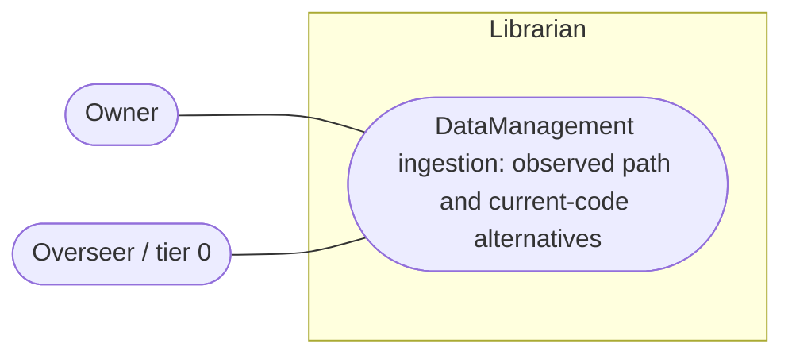

<!-- generated by render_corrected.py from ingestion.spec.yaml; edit the spec -->
# DataManagement ingestion: observed path and current-code alternatives

Corrected current-state parent for the DataManagement ingestion example. The child use case supplies the implemented per-item enrichment detail; failure branches distinguish this cohort from wider-library evidence.

These generated paths cover main and extension/rejoin scenarios, not every combination of repeated items or faults.

## Validation

No structural or cross-view/reference flags.

## Use case diagram



## Called use cases

- [batch-enrichment-current: Current approved batch: source and folder-metadata dispatch](../../../2026-11-21-enrichment-baseline/batch-enrichment-current.views.md)

## Activity diagram

```mermaid
flowchart TD
  subgraph Owner["Owner"]
    a1["1. directs E:\DataManagement ingestion into Resource-Library with pre-read exclusions; later partial acceptance remains an explicit decision"]
    a4["4. decides purpose and exclusions: 11, 12, 13 and _external remain unread"]
    x3{"Owner's decision for the held folder?"}
    startowner{"grant processing start for the approved set?"}
    writeowner{"Owner's bounded decision for the held or unconfirmed Source write?"}
  end
  subgraph Tier_0_agent["Tier 0 agent"]
    a2["2. attaches the folder on the Owner's behalf"]
    x1["requests the stale root survey and authorized decision reapplication; preserves the actual library-wide affected scope"]
    a5["5. submits the Owner's folder decisions with their actual authority and reason"]
    x2["restores qualification after the recorded shared-store defect, then requests a fresh qualification check"]
    draftfault["diagnoses the actual post-draft transport, schema, provenance or missing-output failure from recorded evidence; retains existing flags and reports the unresolved scope without assuming qualification loss"]
    folderfault["retains GEOGRAPHER_CALL_FAILED or other folder refusal; investigates actual capability/scope before authorized retry"]
    a8["8. requests Source queueing per deepest accepted root for third-party, research-docs and own-docs content"]
    queuefix["investigates unexplained mismatch; requests per-root queueing without treating historical queued ledger entries as current pending work"]
    capturefault["retains failed references and successful siblings separately; reports required capture gaps for a bounded decision"]
    a10["12. submits the Owner-authorized ingestion approvals with executor, decision authority and recorded attestation distinguished"]
    startrequest["13. requests an explicit processing start through the existing curate/person authority; approval alone only queues"]
    a14>"observes progress/spend; Core checks ceiling before each item and cancellation between stages. Task-pool concurrency is internal to the child, not document-level parallelism"]
    x5["obtains a new authorized approval/start for finished partial work; unfinished frozen-run resume remains distinct"]
    d6{"Source decision owner acts on the returned package?"}
    a15["16. accepts 96 Sources under the Owner's direction, retaining 93 fully read/published items and three accepted partials with publication gaps"]
    a17["18. reconciles current Source states, coverage, publication receipts, labels and separate lens decisions; reports the dated cohort truth to the Owner"]
    pausedreport["reports distinct cancellation, interruption, ceiling stop or pending decision, completed siblings and exact continuation point to the Owner"]
    escalatereport["reports unresolved processing/capture/integrity faults with originating stage, existing flags and retained evidence"]
    scopeNote>"Historical default follows the partial cohort. Other branches are current-code alternatives; red arrows mean alternatives, not failure. Unexercised paths are not claimed as events."]
    x1application["requests application-stage stale-root resurvey and authorized reapplication; retains actual library-wide scope"]
  end
  subgraph Core["Core"]
    a3["3. inventories roots, fingerprints and literal folder facts; excludes hidden and scratch content before reading"]
    d1{"reviewed roots current?"}
    d2{"assigned folder-review Clerk qualified in this Core?"}
    exclude["records exclusion and removes that subtree from the eligible worklist without reading it"]
    a7["7. submits affirmative folder decisions and read barriers for group application; acceptance is recorded only after the CLI succeeds"]
    dfolder{"folder application result?"}
    dinput{"requested Source-eligible subset remains after common folder-group application?"}
    d4{"scripted current-item count reconciles with eligible inventory?"}
    a9["9. captures immutable source evidence and records each reference result; retains exclusions, duplicates and isolated parser/quarantine failures"]
    dcapture{"usable captured Sources remain?"}
    capturestore["11. stages Source evidence and records mixed-batch item identities; folder cards remain distinct from Source content"]
    dstartauthority{"current explicit processing-start authority present?"}
    startrun["14. validates the existing curate/person start permission and freezes the approved selection; returns the active run instead of duplicating it"]
    enrich[["15. batch-enrichment-current: dispatches the approved mixed batch: Sources use nine stages; folder metadata uses its separate three-stage chain"]]
    d5{"returned coverage and obligations permit acceptance?"}
    sourceledger["persists the actual Source decision; hands independent lens proposals to their own decision owner with accept/reject/defer still separate"]
    a16["17. applies the guarded Source writer and retains the actual commit/refusal/attempt state; Source acceptance does not accept lenses"]
    d7{"required retrieval checks pass for the written notes?"}
    reuseledger["reconciles no-new-work or already-current results with the parent ledger; does not count enqueue history as outstanding work"]
    draftcheck["validates the returned draft status, required fields and literal provenance; records provider, schema and missing-evidence flags without judging semantic adequacy"]
    ddraft{"returned folder draft structurally valid with the Clerk's explicit sensitivity finding?"}
    dwrite{"guarded Source write result and current commit state?"}
    findcheck["checks required title, Bottom-Line and concept retrieval only for a confirmed committed Source note; records actual searches"]
    writestate["reconciles the attempt, lease, current note/hash and commit evidence read-only; preserves human edits and records the reserved write checkpoint without assuming a commit"]
    applicationreceipt["checks CLI exit, JSON and pinned version; records successful application and accepted decisions; returned JSON does not attest parser completeness"]
  end
  subgraph Model_worker_legacy_transport_["Model worker (legacy transport)"]
    a6["6. drafts folder descriptions and sensitivity findings through the historical legacy model transport"]
    d3{"model-reported sensitivity or reserved folder decision?"}
    capturedescribe["10. writes neutral descriptions from captured evidence through the legacy model transport"]
  end
  subgraph Model_host["Model host"]
  end
  subgraph Geo_Grapher["Geo-Grapher"]
    applygroups["applies all accepted non-excluded groups, including documents and papers; ingests supported code/text and may reuse matching complete snapshots"]
  end
  s(("start"))
  e1((("96 accepted Source notes; 93 fully read/published; three explicitly accepted partials retain publication gaps")))
  e2((("19 November: processing retained in staging while Source acceptance was unowned (historical OP1)")))
  e3((("Source note remains written; required retrieval failed and the actual miss is retained")))
  e4((("paused with a named decision owner, retained work and the actual stop reason")))
  escalated((("unresolved fault reported to the Owner without discarding completed work")))
  reused((("existing or excluded work accounted for; no duplicate Source processing claimed")))
  nonsource((("returns the common folder-application receipt; no Source intake applies on this branch and parser completeness is not attested")))
  s --> scopeNote
  a1 --> a2
  a2 --> a3
  a3 --> d1
  d1 -->|"[current]"| a4
  d1 -->|"[stale root] 3a"| x1
  x1 --> a3
  a4 --> a5
  a5 --> d2
  d2 -->|"[qualified]"| a6
  d2 -->|"[qualification lost] 5a"| x2
  x2 --> d2
  draftfault --> escalatereport
  a6 --> draftcheck
  d3 -->|"[normal and already authorized]"| a7
  d3 -->|"[reserved or sensitive] 6a"| x3
  x3 -->|"[approve/apply]"| a7
  x3 -->|"[exclude]"| exclude
  x3 -->|"[decline]"| pausedreport
  x3 -->|"[hold]"| pausedreport
  exclude --> a7
  dfolder -->|"[applied with accepted current assignment]"| dinput
  dfolder -->|"[FOLDER_STALE] 7a"| x1application
  dfolder -->|"[GEOGRAPHER_CALL_FAILED or another refusal] 7b"| folderfault
  folderfault --> escalatereport
  dinput -->|"[nonempty Source-eligible requested subset]"| a8
  dinput -->|"[excluded or no eligible input] 7d"| reuseledger
  a8 --> d4
  d4 -->|"[matches current eligible cohort (96)]"| a9
  d4 -->|"[zero/mismatch from root ownership or another discrepancy] 8a"| queuefix
  queuefix --> a8
  a9 --> dcapture
  dcapture -->|"[usable captured Sources with per-reference outcomes]"| capturedescribe
  dcapture -->|"[required capture gaps or no usable source] 9a"| capturefault
  dcapture -->|"[only duplicates/exclusions and no new work] 9b"| reuseledger
  capturefault --> escalatereport
  capturedescribe --> capturestore
  capturestore --> a10
  a10 --> startrequest
  startrequest --> dstartauthority
  dstartauthority -->|"[valid explicit start authority]"| startrun
  dstartauthority -->|"[reserved or absent authority] 13a"| startowner
  startowner -->|"[grant]"| startrun
  startowner -->|"[decline or hold]"| pausedreport
  startrun --> enrich
  enrich -->|"[partial]"| a14
  enrich -->|"[success] 15a"| a14
  enrich -->|"[reused] 15b"| reuseledger
  enrich -->|"[paused] 15c"| pausedreport
  enrich -->|"[escalated] 15d"| escalatereport
  a14 --> d5
  d5 -->|"[full or explicitly permitted partial with truthful obligations]"| d6
  d5 -->|"[required partial needs new approved work] 15e"| x5
  d5 -->|"[failed or pending required work without acceptance authority] 15f"| pausedreport
  x5 --> startrequest
  d6 -->|"[affirmative authorized Source decision]"| a15
  d6 -->|"[nobody accepts] 16a"| e2
  d6 -->|"[decline or hold] 16b"| pausedreport
  a15 --> sourceledger
  sourceledger --> a16
  a16 --> dwrite
  d7 -->|"[required checks pass]"| a17
  d7 -->|"[required title/Bottom-Line/concept retrieval misses] 17a"| e3
  a17 --> e1
  pausedreport --> e4
  escalatereport --> escalated
  reuseledger --> reused
  draftcheck --> ddraft
  ddraft -->|"[usable returned draft, required fields/provenance valid and sensitivity finding recorded]"| d3
  ddraft -->|"[transport refusal, invalid schema/provenance or partial/queued/failed draft] 6b"| draftfault
  ddraft -->|"[critical integrity or authority-boundary evidence in draft] 6c"| escalatereport
  dwrite -->|"[confirmed committed, including a committed note already flagged written-but-not-findable]"| findcheck
  findcheck --> d7
  dwrite -->|"[unknown/interrupted outcome, human-edit conflict or unconfirmed/uncommitted refusal] 17b"| writestate
  dwrite -->|"[critical integrity or authority-boundary evidence in write] 17c"| escalatereport
  writestate --> writeowner
  writeowner -->|"[specific bounded guarded retry authorized after compatible-state reconciliation; no unresolved human edit]"| a16
  writeowner -->|"[decline, hold or follow-on recovery/compensation needs separate scope]"| pausedreport
  writeowner -->|"[unresolved integrity/scope finding requires escalation]"| escalatereport
  a7 --> applygroups
  applygroups --> applicationreceipt
  applicationreceipt --> dfolder
  scopeNote --> a1
  x1application --> a7
  dinput -->|"[own-code/data/log purpose only; no Source-eligible requested subset] 7c"| nonsource
  classDef ext stroke:#d9534f,stroke-width:2px
```



## Written use case

**Main success scenario** (generated: the guard-true path, in step order)

1. The Owner directs E:\DataManagement ingestion into Resource-Library with pre-read exclusions; later partial acceptance remains an explicit decision.
2. The Tier 0 agent attaches the folder on the Owner's behalf.
3. The Core inventories roots, fingerprints and literal folder facts; excludes hidden and scratch content before reading.
4. The Owner decides purpose and exclusions: 11, 12, 13 and _external remain unread.
5. The Tier 0 agent submits the Owner's folder decisions with their actual authority and reason.
6. The Model worker (legacy transport) drafts folder descriptions and sensitivity findings through the historical legacy model transport.
7. The Core submits affirmative folder decisions and read barriers for group application; acceptance is recorded only after the CLI succeeds.
8. The Tier 0 agent requests Source queueing per deepest accepted root for third-party, research-docs and own-docs content.
9. The Core captures immutable source evidence and records each reference result; retains exclusions, duplicates and isolated parser/quarantine failures.
10. The Model worker (legacy transport) writes neutral descriptions from captured evidence through the legacy model transport.
11. The Core stages Source evidence and records mixed-batch item identities; folder cards remain distinct from Source content.
12. The Tier 0 agent submits the Owner-authorized ingestion approvals with executor, decision authority and recorded attestation distinguished.
13. The Tier 0 agent requests an explicit processing start through the existing curate/person authority; approval alone only queues.
14. The Core validates the existing curate/person start permission and freezes the approved selection; returns the active run instead of duplicating it.
15. The Core dispatches the approved mixed batch: Sources use nine stages; folder metadata uses its separate three-stage chain.
16. The Tier 0 agent accepts 96 Sources under the Owner's direction, retaining 93 fully read/published items and three accepted partials with publication gaps.
17. The Core applies the guarded Source writer and retains the actual commit/refusal/attempt state; Source acceptance does not accept lenses.
18. The Tier 0 agent reconciles current Source states, coverage, publication receipts, labels and separate lens decisions; reports the dated cohort truth to the Owner.

**Extensions** (generated: one per non-happy guard; numbered by the step it leaves)

- **3a** (from: reviewed roots current?) *observed: D:\Librarian_V2; excluded-folder fix 9c0592d; OP2 scope remains*
  - `3a1` Stale root.
  - `3a2` The Tier 0 agent requests the stale root survey and authorized decision reapplication; preserves the actual library-wide affected scope.
  - `3a3` Rejoin at 3.
- **5a** (from: assigned folder-review Clerk qualified in this Core?) *observed: 23 FOLDER_DRAFT_FAILED; QualificationStore fix cab623a*
  - `5a1` Qualification lost.
  - `5a2` The Tier 0 agent restores qualification after the recorded shared-store defect, then requests a fresh qualification check.
  - `5a3` The Core decides: assigned folder-review Clerk qualified in this Core?
  - `5a3a` If qualification lost: restores qualification after the recorded shared-store defect, then requests a fresh qualification check.
  - `5a4` If qualified:
  - `5a5` Rejoin at 6.
- **6a** (from: model-reported sensitivity or reserved folder decision?) *anticipated*
  - `6a1` Reserved or sensitive.
  - `6a2` The Owner decides: Owner's decision for the held folder?
  - `6a2a` If exclude: records exclusion and removes that subtree from the eligible worklist without reading it.
  - `6a2a` If decline: reports distinct cancellation, interruption, ceiling stop or pending decision, completed siblings and exact continuation point to the Owner.
  - `6a2a` If hold: reports distinct cancellation, interruption, ceiling stop or pending decision, completed siblings and exact continuation point to the Owner.
  - `6a3` If approve/apply:
  - `6a4` Rejoin at 7.
- **7a** (from: folder application result?) *anticipated*
  - `7a1` FOLDER_STALE.
  - `7a2` The Tier 0 agent requests application-stage stale-root resurvey and authorized reapplication; retains actual library-wide scope.
  - `7a3` Rejoin at 7.
- **7b** (from: folder application result?) *anticipated*
  - `7b1` GEOGRAPHER_CALL_FAILED or another refusal.
  - `7b2` The Tier 0 agent retains GEOGRAPHER_CALL_FAILED or other folder refusal; investigates actual capability/scope before authorized retry.
  - `7b3` The Tier 0 agent reports unresolved processing/capture/integrity faults with originating stage, existing flags and retained evidence.
  - `7b4` The use case ends: unresolved fault reported to the Owner without discarding completed work.
- **7d** (from: requested Source-eligible subset remains after common folder-group application?) *anticipated*
  - `7d1` Excluded or no eligible input.
  - `7d2` The Core reconciles no-new-work or already-current results with the parent ledger; does not count enqueue history as outstanding work.
  - `7d3` The use case ends: existing or excluded work accounted for; no duplicate Source processing claimed.
- **8a** (from: scripted current-item count reconciles with eligible inventory?) *observed: dry count 0, then 96 per subfolder*
  - `8a1` Zero/mismatch from root ownership or another discrepancy.
  - `8a2` The Tier 0 agent investigates unexplained mismatch; requests per-root queueing without treating historical queued ledger entries as current pending work.
  - `8a3` Rejoin at 8.
- **9a** (from: usable captured Sources remain?) *anticipated*
  - `9a1` Required capture gaps or no usable source.
  - `9a2` The Tier 0 agent retains failed references and successful siblings separately; reports required capture gaps for a bounded decision.
  - `9a3` The Tier 0 agent reports unresolved processing/capture/integrity faults with originating stage, existing flags and retained evidence.
  - `9a4` The use case ends: unresolved fault reported to the Owner without discarding completed work.
- **9b** (from: usable captured Sources remain?) *anticipated*
  - `9b1` Only duplicates/exclusions and no new work.
  - `9b2` The Core reconciles no-new-work or already-current results with the parent ledger; does not count enqueue history as outstanding work.
  - `9b3` The use case ends: existing or excluded work accounted for; no duplicate Source processing claimed.
- **13a** (from: current explicit processing-start authority present?) *anticipated*
  - `13a1` Reserved or absent authority.
  - `13a2` The Owner decides: grant processing start for the approved set?
  - `13a2a` If decline or hold: reports distinct cancellation, interruption, ceiling stop or pending decision, completed siblings and exact continuation point to the Owner.
  - `13a3` If grant:
  - `13a4` Rejoin at 14.
- **15a** (from: dispatches the approved mixed batch: Sources use nine stages; folder metadata uses its separate three-stage chain) *anticipated*
  - `15a1` Success.
  - `15a2` The Core decides: returned coverage and obligations permit acceptance?
  - `15a2a` If required partial needs new approved work: obtains a new authorized approval/start for finished partial work; unfinished frozen-run resume remains distinct.
  - `15a2a` If failed or pending required work without acceptance authority: reports distinct cancellation, interruption, ceiling stop or pending decision, completed siblings and exact continuation point to the Owner.
  - `15a3` If full or explicitly permitted partial with truthful obligations:
  - `15a4` The Tier 0 agent decides: Source decision owner acts on the returned package?
  - `15a4a` If nobody accepts: the use case ends: 19 November: processing retained in staging while Source acceptance was unowned (historical OP1).
  - `15a4a` If decline or hold: reports distinct cancellation, interruption, ceiling stop or pending decision, completed siblings and exact continuation point to the Owner.
  - `15a5` If affirmative authorized Source decision:
  - `15a6` Rejoin at 16.
- **15b** (from: dispatches the approved mixed batch: Sources use nine stages; folder metadata uses its separate three-stage chain) *anticipated*
  - `15b1` Reused.
  - `15b2` The Core reconciles no-new-work or already-current results with the parent ledger; does not count enqueue history as outstanding work.
  - `15b3` The use case ends: existing or excluded work accounted for; no duplicate Source processing claimed.
- **15c** (from: dispatches the approved mixed batch: Sources use nine stages; folder metadata uses its separate three-stage chain) *anticipated*
  - `15c1` Paused.
  - `15c2` The Tier 0 agent reports distinct cancellation, interruption, ceiling stop or pending decision, completed siblings and exact continuation point to the Owner.
  - `15c3` The use case ends: paused with a named decision owner, retained work and the actual stop reason.
- **15d** (from: dispatches the approved mixed batch: Sources use nine stages; folder metadata uses its separate three-stage chain) *anticipated*
  - `15d1` Escalated.
  - `15d2` The Tier 0 agent reports unresolved processing/capture/integrity faults with originating stage, existing flags and retained evidence.
  - `15d3` The use case ends: unresolved fault reported to the Owner without discarding completed work.
- **15e** (from: returned coverage and obligations permit acceptance?) *observed: Six initially partial; three completed on reread; three explicitly accepted partial*
  - `15e1` Required partial needs new approved work.
  - `15e2` The Tier 0 agent obtains a new authorized approval/start for finished partial work; unfinished frozen-run resume remains distinct.
  - `15e3` Rejoin at 13.
- **15f** (from: returned coverage and obligations permit acceptance?) *anticipated*
  - `15f1` Failed or pending required work without acceptance authority.
  - `15f2` The Tier 0 agent reports distinct cancellation, interruption, ceiling stop or pending decision, completed siblings and exact continuation point to the Owner.
  - `15f3` The use case ends: paused with a named decision owner, retained work and the actual stop reason.
- **16a** (from: Source decision owner acts on the returned package?) *observed: 19 November stranded until 20 November*
  - `16a1` Nobody accepts.
  - `16a2` The use case ends: 19 November: processing retained in staging while Source acceptance was unowned (historical OP1).
- **16b** (from: Source decision owner acts on the returned package?) *anticipated*
  - `16b1` Decline or hold.
  - `16b2` The Tier 0 agent reports distinct cancellation, interruption, ceiling stop or pending decision, completed siblings and exact continuation point to the Owner.
  - `16b3` The use case ends: paused with a named decision owner, retained work and the actual stop reason.
- **17a** (from: required retrieval checks pass for the written notes?) *anticipated*
  - `17a1` Required title/Bottom-Line/concept retrieval misses.
  - `17a2` The use case ends: Source note remains written; required retrieval failed and the actual miss is retained.
- **6b** (from: returned folder draft structurally valid with the Clerk's explicit sensitivity finding?) *anticipated*
  - `6b1` Transport refusal, invalid schema/provenance or partial/queued/failed draft.
  - `6b2` The Tier 0 agent diagnoses the actual post-draft transport, schema, provenance or missing-output failure from recorded evidence; retains existing flags and reports the unresolved scope without assuming qualification loss.
  - `6b3` The Tier 0 agent reports unresolved processing/capture/integrity faults with originating stage, existing flags and retained evidence.
  - `6b4` The use case ends: unresolved fault reported to the Owner without discarding completed work.
- **6c** (from: returned folder draft structurally valid with the Clerk's explicit sensitivity finding?) *anticipated*
  - `6c1` Critical integrity or authority-boundary evidence in draft.
  - `6c2` The Tier 0 agent reports unresolved processing/capture/integrity faults with originating stage, existing flags and retained evidence.
  - `6c3` The use case ends: unresolved fault reported to the Owner without discarding completed work.
- **17b** (from: guarded Source write result and current commit state?) *anticipated*
  - `17b1` Unknown/interrupted outcome, human-edit conflict or unconfirmed/uncommitted refusal.
  - `17b2` The Core reconciles the attempt, lease, current note/hash and commit evidence read-only; preserves human edits and records the reserved write checkpoint without assuming a commit.
  - `17b3` The Owner decides: Owner's bounded decision for the held or unconfirmed Source write?
  - `17b3a` If decline, hold or follow-on recovery/compensation needs separate scope: reports distinct cancellation, interruption, ceiling stop or pending decision, completed siblings and exact continuation point to the Owner.
  - `17b3a` If unresolved integrity/scope finding requires escalation: reports unresolved processing/capture/integrity faults with originating stage, existing flags and retained evidence.
  - `17b4` If specific bounded guarded retry authorized after compatible-state reconciliation; no unresolved human edit:
  - `17b5` Rejoin at 17.
- **17c** (from: guarded Source write result and current commit state?) *anticipated*
  - `17c1` Critical integrity or authority-boundary evidence in write.
  - `17c2` The Tier 0 agent reports unresolved processing/capture/integrity faults with originating stage, existing flags and retained evidence.
  - `17c3` The use case ends: unresolved fault reported to the Owner without discarding completed work.
- **7c** (from: requested Source-eligible subset remains after common folder-group application?) *anticipated*
  - `7c1` Own-code/data/log purpose only; no Source-eligible requested subset.
  - `7c2` The use case ends: returns the common folder-application receipt; no Source intake applies on this branch and parser completeness is not attested.

## Lane load

| Lane | On the main success scenario | Anywhere in the diagram |
|---|---|---|
| Owner | 2 | 5 |
| Tier 0 agent | 8 | 18 |
| Core | 22 | 25 |
| Model worker (legacy transport) | 3 | 3 |
| Model host | 0 | 0 |
| Geo-Grapher | 1 | 1 |

**Tier-0 turns** (each return of control to tier 0; owner's scale: 2 ideal, 3 expected, 4 rusty, 5–10 bad, more: might as well have done it themselves). Main success scenario: **8 (bad)**. Worst path: T23, **10 (bad)**. Paths by grade: bad 19, rusty 3, expected 2; escalated 7 (failures, not graded).

Paths by how they end: **escalated** 7, **failure** 1, **paused** 8, **reused** 4, **success** 1. Every *escalated* path is a failure of this use case: the work went back to tier 0.

## Decision tree: 31 extension scenarios

```text
start: DataManagement ingestion: observed path and current-code alternatives
                            └─ T1: current / qualified / usable returned draft, required fields/provenance valid and sensitivity finding recorded / normal and already authorized / applied with accepted current assignment / nonempty Source-eligible requested subset / matches current eligible cohort (96) / usable captured Sources with per-reference outcomes / valid explicit start authority / partial / full or explicitly permitted partial with truthful obligations / affirmative authorized Source decision / confirmed committed, including a committed note already flagged written-but-not-findable / required checks pass  ⇒ 96 accepted Source notes; 93 fully read/published; three explicitly accepted partials retain publication gaps
  └─ T2: stale root  ⇒ rejoins at step 3
    └─ T3: current / qualification lost  ⇒ rejoins at 'assigned folder-review Clerk qualified in this Core?' (before step 6)
      └─ T4: current / qualified / transport refusal, invalid schema/provenance or partial/queued/failed draft  ⇒ unresolved fault reported to the Owner without discarding completed work
      └─ T5: current / qualified / critical integrity or authority-boundary evidence in draft  ⇒ unresolved fault reported to the Owner without discarding completed work
          └─ T6: current / qualified / usable returned draft, required fields/provenance valid and sensitivity finding recorded / reserved or sensitive / exclude  ⇒ rejoins at step 7
          └─ T7: current / qualified / usable returned draft, required fields/provenance valid and sensitivity finding recorded / reserved or sensitive / decline  ⇒ paused with a named decision owner, retained work and the actual stop reason
          └─ T8: current / qualified / usable returned draft, required fields/provenance valid and sensitivity finding recorded / reserved or sensitive / hold  ⇒ paused with a named decision owner, retained work and the actual stop reason
          └─ T9: current / qualified / usable returned draft, required fields/provenance valid and sensitivity finding recorded / reserved or sensitive / approve/apply  ⇒ rejoins at step 7
          └─ T10: current / qualified / usable returned draft, required fields/provenance valid and sensitivity finding recorded / normal and already authorized / FOLDER_STALE  ⇒ rejoins at step 7
          └─ T11: current / qualified / usable returned draft, required fields/provenance valid and sensitivity finding recorded / normal and already authorized / GEOGRAPHER_CALL_FAILED or another refusal  ⇒ unresolved fault reported to the Owner without discarding completed work
            └─ T12: current / qualified / usable returned draft, required fields/provenance valid and sensitivity finding recorded / normal and already authorized / applied with accepted current assignment / excluded or no eligible input  ⇒ existing or excluded work accounted for; no duplicate Source processing claimed
            └─ T13: current / qualified / usable returned draft, required fields/provenance valid and sensitivity finding recorded / normal and already authorized / applied with accepted current assignment / own-code/data/log purpose only; no Source-eligible requested subset  ⇒ returns the common folder-application receipt; no Source intake applies on this branch and parser completeness is not attested
              └─ T14: current / qualified / usable returned draft, required fields/provenance valid and sensitivity finding recorded / normal and already authorized / applied with accepted current assignment / nonempty Source-eligible requested subset / zero/mismatch from root ownership or another discrepancy  ⇒ rejoins at step 8
                └─ T15: current / qualified / usable returned draft, required fields/provenance valid and sensitivity finding recorded / normal and already authorized / applied with accepted current assignment / nonempty Source-eligible requested subset / matches current eligible cohort (96) / required capture gaps or no usable source  ⇒ unresolved fault reported to the Owner without discarding completed work
                └─ T16: current / qualified / usable returned draft, required fields/provenance valid and sensitivity finding recorded / normal and already authorized / applied with accepted current assignment / nonempty Source-eligible requested subset / matches current eligible cohort (96) / only duplicates/exclusions and no new work  ⇒ existing or excluded work accounted for; no duplicate Source processing claimed
                    └─ T17: current / qualified / usable returned draft, required fields/provenance valid and sensitivity finding recorded / normal and already authorized / applied with accepted current assignment / nonempty Source-eligible requested subset / matches current eligible cohort (96) / usable captured Sources with per-reference outcomes / reserved or absent authority / decline or hold  ⇒ paused with a named decision owner, retained work and the actual stop reason
                    └─ T18: current / qualified / usable returned draft, required fields/provenance valid and sensitivity finding recorded / normal and already authorized / applied with accepted current assignment / nonempty Source-eligible requested subset / matches current eligible cohort (96) / usable captured Sources with per-reference outcomes / reserved or absent authority / grant  ⇒ rejoins at step 14
                    └─ T19: current / qualified / usable returned draft, required fields/provenance valid and sensitivity finding recorded / normal and already authorized / applied with accepted current assignment / nonempty Source-eligible requested subset / matches current eligible cohort (96) / usable captured Sources with per-reference outcomes / valid explicit start authority / success  ⇒ rejoins at 'observes progress/spend; Core checks ceiling before each item and cancellation between stages. Task-pool concurrency is internal to the child, not document-level parallelism' (before step 16)
                    └─ T20: current / qualified / usable returned draft, required fields/provenance valid and sensitivity finding recorded / normal and already authorized / applied with accepted current assignment / nonempty Source-eligible requested subset / matches current eligible cohort (96) / usable captured Sources with per-reference outcomes / valid explicit start authority / reused  ⇒ existing or excluded work accounted for; no duplicate Source processing claimed
                    └─ T21: current / qualified / usable returned draft, required fields/provenance valid and sensitivity finding recorded / normal and already authorized / applied with accepted current assignment / nonempty Source-eligible requested subset / matches current eligible cohort (96) / usable captured Sources with per-reference outcomes / valid explicit start authority / paused  ⇒ paused with a named decision owner, retained work and the actual stop reason
                    └─ T22: current / qualified / usable returned draft, required fields/provenance valid and sensitivity finding recorded / normal and already authorized / applied with accepted current assignment / nonempty Source-eligible requested subset / matches current eligible cohort (96) / usable captured Sources with per-reference outcomes / valid explicit start authority / escalated  ⇒ unresolved fault reported to the Owner without discarding completed work
                      └─ T23: current / qualified / usable returned draft, required fields/provenance valid and sensitivity finding recorded / normal and already authorized / applied with accepted current assignment / nonempty Source-eligible requested subset / matches current eligible cohort (96) / usable captured Sources with per-reference outcomes / valid explicit start authority / partial / required partial needs new approved work  ⇒ rejoins at step 13
                      └─ T24: current / qualified / usable returned draft, required fields/provenance valid and sensitivity finding recorded / normal and already authorized / applied with accepted current assignment / nonempty Source-eligible requested subset / matches current eligible cohort (96) / usable captured Sources with per-reference outcomes / valid explicit start authority / partial / failed or pending required work without acceptance authority  ⇒ paused with a named decision owner, retained work and the actual stop reason
                        └─ T25: current / qualified / usable returned draft, required fields/provenance valid and sensitivity finding recorded / normal and already authorized / applied with accepted current assignment / nonempty Source-eligible requested subset / matches current eligible cohort (96) / usable captured Sources with per-reference outcomes / valid explicit start authority / partial / full or explicitly permitted partial with truthful obligations / nobody accepts  ⇒ 19 November: processing retained in staging while Source acceptance was unowned (historical OP1)
                        └─ T26: current / qualified / usable returned draft, required fields/provenance valid and sensitivity finding recorded / normal and already authorized / applied with accepted current assignment / nonempty Source-eligible requested subset / matches current eligible cohort (96) / usable captured Sources with per-reference outcomes / valid explicit start authority / partial / full or explicitly permitted partial with truthful obligations / decline or hold  ⇒ paused with a named decision owner, retained work and the actual stop reason
                            └─ T27: current / qualified / usable returned draft, required fields/provenance valid and sensitivity finding recorded / normal and already authorized / applied with accepted current assignment / nonempty Source-eligible requested subset / matches current eligible cohort (96) / usable captured Sources with per-reference outcomes / valid explicit start authority / partial / full or explicitly permitted partial with truthful obligations / affirmative authorized Source decision / unknown/interrupted outcome, human-edit conflict or unconfirmed/uncommitted refusal / decline, hold or follow-on recovery/compensation needs separate scope  ⇒ paused with a named decision owner, retained work and the actual stop reason
                            └─ T28: current / qualified / usable returned draft, required fields/provenance valid and sensitivity finding recorded / normal and already authorized / applied with accepted current assignment / nonempty Source-eligible requested subset / matches current eligible cohort (96) / usable captured Sources with per-reference outcomes / valid explicit start authority / partial / full or explicitly permitted partial with truthful obligations / affirmative authorized Source decision / unknown/interrupted outcome, human-edit conflict or unconfirmed/uncommitted refusal / unresolved integrity/scope finding requires escalation  ⇒ unresolved fault reported to the Owner without discarding completed work
                            └─ T29: current / qualified / usable returned draft, required fields/provenance valid and sensitivity finding recorded / normal and already authorized / applied with accepted current assignment / nonempty Source-eligible requested subset / matches current eligible cohort (96) / usable captured Sources with per-reference outcomes / valid explicit start authority / partial / full or explicitly permitted partial with truthful obligations / affirmative authorized Source decision / unknown/interrupted outcome, human-edit conflict or unconfirmed/uncommitted refusal / specific bounded guarded retry authorized after compatible-state reconciliation; no unresolved human edit  ⇒ rejoins at step 17
                          └─ T30: current / qualified / usable returned draft, required fields/provenance valid and sensitivity finding recorded / normal and already authorized / applied with accepted current assignment / nonempty Source-eligible requested subset / matches current eligible cohort (96) / usable captured Sources with per-reference outcomes / valid explicit start authority / partial / full or explicitly permitted partial with truthful obligations / affirmative authorized Source decision / critical integrity or authority-boundary evidence in write  ⇒ unresolved fault reported to the Owner without discarding completed work
                            └─ T31: current / qualified / usable returned draft, required fields/provenance valid and sensitivity finding recorded / normal and already authorized / applied with accepted current assignment / nonempty Source-eligible requested subset / matches current eligible cohort (96) / usable captured Sources with per-reference outcomes / valid explicit start authority / partial / full or explicitly permitted partial with truthful obligations / affirmative authorized Source decision / confirmed committed, including a committed note already flagged written-but-not-findable / required title/Bottom-Line/concept retrieval misses  ⇒ Source note remains written; required retrieval failed and the actual miss is retained
```

## Scenario test table

| Test | Path (guards taken) | Extension | Expected outcome | Tier-0 turns |
|---|---|---|---|---|
| T1 | reviewed roots current? → current; assigned folder-review Clerk qualified in this Core? → qualified; returned folder draft structurally valid with the Clerk's explicit sensitivity finding? → usable returned draft, required fields/provenance valid and sensitivity finding recorded; model-reported sensitivity or reserved folder decision? → normal and already authorized; folder application result? → applied with accepted current assignment; requested Source-eligible subset remains after common folder-group application? → nonempty Source-eligible requested subset; scripted current-item count reconciles with eligible inventory? → matches current eligible cohort (96); usable captured Sources remain? → usable captured Sources with per-reference outcomes; current explicit processing-start authority present? → valid explicit start authority; dispatches the approved mixed batch: Sources use nine stages; folder metadata uses its separate three-stage chain → partial; returned coverage and obligations permit acceptance? → full or explicitly permitted partial with truthful obligations; Source decision owner acts on the returned package? → affirmative authorized Source decision; guarded Source write result and current commit state? → confirmed committed, including a committed note already flagged written-but-not-findable; required retrieval checks pass for the written notes? → required checks pass | MSS | 96 accepted Source notes; 93 fully read/published; three explicitly accepted partials retain publication gaps | 8 (bad) |
| T2 | reviewed roots current? → stale root | 3a | rejoins at step 3 | 9 (bad) |
| T3 | reviewed roots current? → current; assigned folder-review Clerk qualified in this Core? → qualification lost | 5a | rejoins at 'assigned folder-review Clerk qualified in this Core?' (before step 6) | 9 (bad) |
| T4 | reviewed roots current? → current; assigned folder-review Clerk qualified in this Core? → qualified; returned folder draft structurally valid with the Clerk's explicit sensitivity finding? → transport refusal, invalid schema/provenance or partial/queued/failed draft | 6b | unresolved fault reported to the Owner without discarding completed work | 4 (escalated: a failure) |
| T5 | reviewed roots current? → current; assigned folder-review Clerk qualified in this Core? → qualified; returned folder draft structurally valid with the Clerk's explicit sensitivity finding? → critical integrity or authority-boundary evidence in draft | 6c | unresolved fault reported to the Owner without discarding completed work | 4 (escalated: a failure) |
| T6 | reviewed roots current? → current; assigned folder-review Clerk qualified in this Core? → qualified; returned folder draft structurally valid with the Clerk's explicit sensitivity finding? → usable returned draft, required fields/provenance valid and sensitivity finding recorded; model-reported sensitivity or reserved folder decision? → reserved or sensitive; Owner's decision for the held folder? → exclude | 6a | rejoins at step 7 | 8 (bad) |
| T7 | reviewed roots current? → current; assigned folder-review Clerk qualified in this Core? → qualified; returned folder draft structurally valid with the Clerk's explicit sensitivity finding? → usable returned draft, required fields/provenance valid and sensitivity finding recorded; model-reported sensitivity or reserved folder decision? → reserved or sensitive; Owner's decision for the held folder? → decline | 6a | paused with a named decision owner, retained work and the actual stop reason | 4 (rusty) |
| T8 | reviewed roots current? → current; assigned folder-review Clerk qualified in this Core? → qualified; returned folder draft structurally valid with the Clerk's explicit sensitivity finding? → usable returned draft, required fields/provenance valid and sensitivity finding recorded; model-reported sensitivity or reserved folder decision? → reserved or sensitive; Owner's decision for the held folder? → hold | 6a | paused with a named decision owner, retained work and the actual stop reason | 4 (rusty) |
| T9 | reviewed roots current? → current; assigned folder-review Clerk qualified in this Core? → qualified; returned folder draft structurally valid with the Clerk's explicit sensitivity finding? → usable returned draft, required fields/provenance valid and sensitivity finding recorded; model-reported sensitivity or reserved folder decision? → reserved or sensitive; Owner's decision for the held folder? → approve/apply | 6a | rejoins at step 7 | 8 (bad) |
| T10 | reviewed roots current? → current; assigned folder-review Clerk qualified in this Core? → qualified; returned folder draft structurally valid with the Clerk's explicit sensitivity finding? → usable returned draft, required fields/provenance valid and sensitivity finding recorded; model-reported sensitivity or reserved folder decision? → normal and already authorized; folder application result? → FOLDER_STALE | 7a | rejoins at step 7 | 9 (bad) |
| T11 | reviewed roots current? → current; assigned folder-review Clerk qualified in this Core? → qualified; returned folder draft structurally valid with the Clerk's explicit sensitivity finding? → usable returned draft, required fields/provenance valid and sensitivity finding recorded; model-reported sensitivity or reserved folder decision? → normal and already authorized; folder application result? → GEOGRAPHER_CALL_FAILED or another refusal | 7b | unresolved fault reported to the Owner without discarding completed work | 4 (escalated: a failure) |
| T12 | reviewed roots current? → current; assigned folder-review Clerk qualified in this Core? → qualified; returned folder draft structurally valid with the Clerk's explicit sensitivity finding? → usable returned draft, required fields/provenance valid and sensitivity finding recorded; model-reported sensitivity or reserved folder decision? → normal and already authorized; folder application result? → applied with accepted current assignment; requested Source-eligible subset remains after common folder-group application? → excluded or no eligible input | 7d | existing or excluded work accounted for; no duplicate Source processing claimed | 3 (expected) |
| T13 | reviewed roots current? → current; assigned folder-review Clerk qualified in this Core? → qualified; returned folder draft structurally valid with the Clerk's explicit sensitivity finding? → usable returned draft, required fields/provenance valid and sensitivity finding recorded; model-reported sensitivity or reserved folder decision? → normal and already authorized; folder application result? → applied with accepted current assignment; requested Source-eligible subset remains after common folder-group application? → own-code/data/log purpose only; no Source-eligible requested subset | 7c | returns the common folder-application receipt; no Source intake applies on this branch and parser completeness is not attested | 3 (expected) |
| T14 | reviewed roots current? → current; assigned folder-review Clerk qualified in this Core? → qualified; returned folder draft structurally valid with the Clerk's explicit sensitivity finding? → usable returned draft, required fields/provenance valid and sensitivity finding recorded; model-reported sensitivity or reserved folder decision? → normal and already authorized; folder application result? → applied with accepted current assignment; requested Source-eligible subset remains after common folder-group application? → nonempty Source-eligible requested subset; scripted current-item count reconciles with eligible inventory? → zero/mismatch from root ownership or another discrepancy | 8a | rejoins at step 8 | 9 (bad) |
| T15 | reviewed roots current? → current; assigned folder-review Clerk qualified in this Core? → qualified; returned folder draft structurally valid with the Clerk's explicit sensitivity finding? → usable returned draft, required fields/provenance valid and sensitivity finding recorded; model-reported sensitivity or reserved folder decision? → normal and already authorized; folder application result? → applied with accepted current assignment; requested Source-eligible subset remains after common folder-group application? → nonempty Source-eligible requested subset; scripted current-item count reconciles with eligible inventory? → matches current eligible cohort (96); usable captured Sources remain? → required capture gaps or no usable source | 9a | unresolved fault reported to the Owner without discarding completed work | 5 (escalated: a failure) |
| T16 | reviewed roots current? → current; assigned folder-review Clerk qualified in this Core? → qualified; returned folder draft structurally valid with the Clerk's explicit sensitivity finding? → usable returned draft, required fields/provenance valid and sensitivity finding recorded; model-reported sensitivity or reserved folder decision? → normal and already authorized; folder application result? → applied with accepted current assignment; requested Source-eligible subset remains after common folder-group application? → nonempty Source-eligible requested subset; scripted current-item count reconciles with eligible inventory? → matches current eligible cohort (96); usable captured Sources remain? → only duplicates/exclusions and no new work | 9b | existing or excluded work accounted for; no duplicate Source processing claimed | 4 (rusty) |
| T17 | reviewed roots current? → current; assigned folder-review Clerk qualified in this Core? → qualified; returned folder draft structurally valid with the Clerk's explicit sensitivity finding? → usable returned draft, required fields/provenance valid and sensitivity finding recorded; model-reported sensitivity or reserved folder decision? → normal and already authorized; folder application result? → applied with accepted current assignment; requested Source-eligible subset remains after common folder-group application? → nonempty Source-eligible requested subset; scripted current-item count reconciles with eligible inventory? → matches current eligible cohort (96); usable captured Sources remain? → usable captured Sources with per-reference outcomes; current explicit processing-start authority present? → reserved or absent authority; grant processing start for the approved set? → decline or hold | 13a | paused with a named decision owner, retained work and the actual stop reason | 6 (bad) |
| T18 | reviewed roots current? → current; assigned folder-review Clerk qualified in this Core? → qualified; returned folder draft structurally valid with the Clerk's explicit sensitivity finding? → usable returned draft, required fields/provenance valid and sensitivity finding recorded; model-reported sensitivity or reserved folder decision? → normal and already authorized; folder application result? → applied with accepted current assignment; requested Source-eligible subset remains after common folder-group application? → nonempty Source-eligible requested subset; scripted current-item count reconciles with eligible inventory? → matches current eligible cohort (96); usable captured Sources remain? → usable captured Sources with per-reference outcomes; current explicit processing-start authority present? → reserved or absent authority; grant processing start for the approved set? → grant | 13a | rejoins at step 14 | 8 (bad) |
| T19 | reviewed roots current? → current; assigned folder-review Clerk qualified in this Core? → qualified; returned folder draft structurally valid with the Clerk's explicit sensitivity finding? → usable returned draft, required fields/provenance valid and sensitivity finding recorded; model-reported sensitivity or reserved folder decision? → normal and already authorized; folder application result? → applied with accepted current assignment; requested Source-eligible subset remains after common folder-group application? → nonempty Source-eligible requested subset; scripted current-item count reconciles with eligible inventory? → matches current eligible cohort (96); usable captured Sources remain? → usable captured Sources with per-reference outcomes; current explicit processing-start authority present? → valid explicit start authority; dispatches the approved mixed batch: Sources use nine stages; folder metadata uses its separate three-stage chain → success | 15a | rejoins at 'observes progress/spend; Core checks ceiling before each item and cancellation between stages. Task-pool concurrency is internal to the child, not document-level parallelism' (before step 16) | 8 (bad) |
| T20 | reviewed roots current? → current; assigned folder-review Clerk qualified in this Core? → qualified; returned folder draft structurally valid with the Clerk's explicit sensitivity finding? → usable returned draft, required fields/provenance valid and sensitivity finding recorded; model-reported sensitivity or reserved folder decision? → normal and already authorized; folder application result? → applied with accepted current assignment; requested Source-eligible subset remains after common folder-group application? → nonempty Source-eligible requested subset; scripted current-item count reconciles with eligible inventory? → matches current eligible cohort (96); usable captured Sources remain? → usable captured Sources with per-reference outcomes; current explicit processing-start authority present? → valid explicit start authority; dispatches the approved mixed batch: Sources use nine stages; folder metadata uses its separate three-stage chain → reused | 15b | existing or excluded work accounted for; no duplicate Source processing claimed | 5 (bad) |
| T21 | reviewed roots current? → current; assigned folder-review Clerk qualified in this Core? → qualified; returned folder draft structurally valid with the Clerk's explicit sensitivity finding? → usable returned draft, required fields/provenance valid and sensitivity finding recorded; model-reported sensitivity or reserved folder decision? → normal and already authorized; folder application result? → applied with accepted current assignment; requested Source-eligible subset remains after common folder-group application? → nonempty Source-eligible requested subset; scripted current-item count reconciles with eligible inventory? → matches current eligible cohort (96); usable captured Sources remain? → usable captured Sources with per-reference outcomes; current explicit processing-start authority present? → valid explicit start authority; dispatches the approved mixed batch: Sources use nine stages; folder metadata uses its separate three-stage chain → paused | 15c | paused with a named decision owner, retained work and the actual stop reason | 6 (bad) |
| T22 | reviewed roots current? → current; assigned folder-review Clerk qualified in this Core? → qualified; returned folder draft structurally valid with the Clerk's explicit sensitivity finding? → usable returned draft, required fields/provenance valid and sensitivity finding recorded; model-reported sensitivity or reserved folder decision? → normal and already authorized; folder application result? → applied with accepted current assignment; requested Source-eligible subset remains after common folder-group application? → nonempty Source-eligible requested subset; scripted current-item count reconciles with eligible inventory? → matches current eligible cohort (96); usable captured Sources remain? → usable captured Sources with per-reference outcomes; current explicit processing-start authority present? → valid explicit start authority; dispatches the approved mixed batch: Sources use nine stages; folder metadata uses its separate three-stage chain → escalated | 15d | unresolved fault reported to the Owner without discarding completed work | 6 (escalated: a failure) |
| T23 | reviewed roots current? → current; assigned folder-review Clerk qualified in this Core? → qualified; returned folder draft structurally valid with the Clerk's explicit sensitivity finding? → usable returned draft, required fields/provenance valid and sensitivity finding recorded; model-reported sensitivity or reserved folder decision? → normal and already authorized; folder application result? → applied with accepted current assignment; requested Source-eligible subset remains after common folder-group application? → nonempty Source-eligible requested subset; scripted current-item count reconciles with eligible inventory? → matches current eligible cohort (96); usable captured Sources remain? → usable captured Sources with per-reference outcomes; current explicit processing-start authority present? → valid explicit start authority; dispatches the approved mixed batch: Sources use nine stages; folder metadata uses its separate three-stage chain → partial; returned coverage and obligations permit acceptance? → required partial needs new approved work | 15e | rejoins at step 13 | 10 (bad) |
| T24 | reviewed roots current? → current; assigned folder-review Clerk qualified in this Core? → qualified; returned folder draft structurally valid with the Clerk's explicit sensitivity finding? → usable returned draft, required fields/provenance valid and sensitivity finding recorded; model-reported sensitivity or reserved folder decision? → normal and already authorized; folder application result? → applied with accepted current assignment; requested Source-eligible subset remains after common folder-group application? → nonempty Source-eligible requested subset; scripted current-item count reconciles with eligible inventory? → matches current eligible cohort (96); usable captured Sources remain? → usable captured Sources with per-reference outcomes; current explicit processing-start authority present? → valid explicit start authority; dispatches the approved mixed batch: Sources use nine stages; folder metadata uses its separate three-stage chain → partial; returned coverage and obligations permit acceptance? → failed or pending required work without acceptance authority | 15f | paused with a named decision owner, retained work and the actual stop reason | 7 (bad) |
| T25 | reviewed roots current? → current; assigned folder-review Clerk qualified in this Core? → qualified; returned folder draft structurally valid with the Clerk's explicit sensitivity finding? → usable returned draft, required fields/provenance valid and sensitivity finding recorded; model-reported sensitivity or reserved folder decision? → normal and already authorized; folder application result? → applied with accepted current assignment; requested Source-eligible subset remains after common folder-group application? → nonempty Source-eligible requested subset; scripted current-item count reconciles with eligible inventory? → matches current eligible cohort (96); usable captured Sources remain? → usable captured Sources with per-reference outcomes; current explicit processing-start authority present? → valid explicit start authority; dispatches the approved mixed batch: Sources use nine stages; folder metadata uses its separate three-stage chain → partial; returned coverage and obligations permit acceptance? → full or explicitly permitted partial with truthful obligations; Source decision owner acts on the returned package? → nobody accepts | 16a | 19 November: processing retained in staging while Source acceptance was unowned (historical OP1) | 7 (bad) |
| T26 | reviewed roots current? → current; assigned folder-review Clerk qualified in this Core? → qualified; returned folder draft structurally valid with the Clerk's explicit sensitivity finding? → usable returned draft, required fields/provenance valid and sensitivity finding recorded; model-reported sensitivity or reserved folder decision? → normal and already authorized; folder application result? → applied with accepted current assignment; requested Source-eligible subset remains after common folder-group application? → nonempty Source-eligible requested subset; scripted current-item count reconciles with eligible inventory? → matches current eligible cohort (96); usable captured Sources remain? → usable captured Sources with per-reference outcomes; current explicit processing-start authority present? → valid explicit start authority; dispatches the approved mixed batch: Sources use nine stages; folder metadata uses its separate three-stage chain → partial; returned coverage and obligations permit acceptance? → full or explicitly permitted partial with truthful obligations; Source decision owner acts on the returned package? → decline or hold | 16b | paused with a named decision owner, retained work and the actual stop reason | 7 (bad) |
| T27 | reviewed roots current? → current; assigned folder-review Clerk qualified in this Core? → qualified; returned folder draft structurally valid with the Clerk's explicit sensitivity finding? → usable returned draft, required fields/provenance valid and sensitivity finding recorded; model-reported sensitivity or reserved folder decision? → normal and already authorized; folder application result? → applied with accepted current assignment; requested Source-eligible subset remains after common folder-group application? → nonempty Source-eligible requested subset; scripted current-item count reconciles with eligible inventory? → matches current eligible cohort (96); usable captured Sources remain? → usable captured Sources with per-reference outcomes; current explicit processing-start authority present? → valid explicit start authority; dispatches the approved mixed batch: Sources use nine stages; folder metadata uses its separate three-stage chain → partial; returned coverage and obligations permit acceptance? → full or explicitly permitted partial with truthful obligations; Source decision owner acts on the returned package? → affirmative authorized Source decision; guarded Source write result and current commit state? → unknown/interrupted outcome, human-edit conflict or unconfirmed/uncommitted refusal; Owner's bounded decision for the held or unconfirmed Source write? → decline, hold or follow-on recovery/compensation needs separate scope | 17b | paused with a named decision owner, retained work and the actual stop reason | 8 (bad) |
| T28 | reviewed roots current? → current; assigned folder-review Clerk qualified in this Core? → qualified; returned folder draft structurally valid with the Clerk's explicit sensitivity finding? → usable returned draft, required fields/provenance valid and sensitivity finding recorded; model-reported sensitivity or reserved folder decision? → normal and already authorized; folder application result? → applied with accepted current assignment; requested Source-eligible subset remains after common folder-group application? → nonempty Source-eligible requested subset; scripted current-item count reconciles with eligible inventory? → matches current eligible cohort (96); usable captured Sources remain? → usable captured Sources with per-reference outcomes; current explicit processing-start authority present? → valid explicit start authority; dispatches the approved mixed batch: Sources use nine stages; folder metadata uses its separate three-stage chain → partial; returned coverage and obligations permit acceptance? → full or explicitly permitted partial with truthful obligations; Source decision owner acts on the returned package? → affirmative authorized Source decision; guarded Source write result and current commit state? → unknown/interrupted outcome, human-edit conflict or unconfirmed/uncommitted refusal; Owner's bounded decision for the held or unconfirmed Source write? → unresolved integrity/scope finding requires escalation | 17b | unresolved fault reported to the Owner without discarding completed work | 8 (escalated: a failure) |
| T29 | reviewed roots current? → current; assigned folder-review Clerk qualified in this Core? → qualified; returned folder draft structurally valid with the Clerk's explicit sensitivity finding? → usable returned draft, required fields/provenance valid and sensitivity finding recorded; model-reported sensitivity or reserved folder decision? → normal and already authorized; folder application result? → applied with accepted current assignment; requested Source-eligible subset remains after common folder-group application? → nonempty Source-eligible requested subset; scripted current-item count reconciles with eligible inventory? → matches current eligible cohort (96); usable captured Sources remain? → usable captured Sources with per-reference outcomes; current explicit processing-start authority present? → valid explicit start authority; dispatches the approved mixed batch: Sources use nine stages; folder metadata uses its separate three-stage chain → partial; returned coverage and obligations permit acceptance? → full or explicitly permitted partial with truthful obligations; Source decision owner acts on the returned package? → affirmative authorized Source decision; guarded Source write result and current commit state? → unknown/interrupted outcome, human-edit conflict or unconfirmed/uncommitted refusal; Owner's bounded decision for the held or unconfirmed Source write? → specific bounded guarded retry authorized after compatible-state reconciliation; no unresolved human edit | 17b | rejoins at step 17 | 8 (bad) |
| T30 | reviewed roots current? → current; assigned folder-review Clerk qualified in this Core? → qualified; returned folder draft structurally valid with the Clerk's explicit sensitivity finding? → usable returned draft, required fields/provenance valid and sensitivity finding recorded; model-reported sensitivity or reserved folder decision? → normal and already authorized; folder application result? → applied with accepted current assignment; requested Source-eligible subset remains after common folder-group application? → nonempty Source-eligible requested subset; scripted current-item count reconciles with eligible inventory? → matches current eligible cohort (96); usable captured Sources remain? → usable captured Sources with per-reference outcomes; current explicit processing-start authority present? → valid explicit start authority; dispatches the approved mixed batch: Sources use nine stages; folder metadata uses its separate three-stage chain → partial; returned coverage and obligations permit acceptance? → full or explicitly permitted partial with truthful obligations; Source decision owner acts on the returned package? → affirmative authorized Source decision; guarded Source write result and current commit state? → critical integrity or authority-boundary evidence in write | 17c | unresolved fault reported to the Owner without discarding completed work | 8 (escalated: a failure) |
| T31 | reviewed roots current? → current; assigned folder-review Clerk qualified in this Core? → qualified; returned folder draft structurally valid with the Clerk's explicit sensitivity finding? → usable returned draft, required fields/provenance valid and sensitivity finding recorded; model-reported sensitivity or reserved folder decision? → normal and already authorized; folder application result? → applied with accepted current assignment; requested Source-eligible subset remains after common folder-group application? → nonempty Source-eligible requested subset; scripted current-item count reconciles with eligible inventory? → matches current eligible cohort (96); usable captured Sources remain? → usable captured Sources with per-reference outcomes; current explicit processing-start authority present? → valid explicit start authority; dispatches the approved mixed batch: Sources use nine stages; folder metadata uses its separate three-stage chain → partial; returned coverage and obligations permit acceptance? → full or explicitly permitted partial with truthful obligations; Source decision owner acts on the returned package? → affirmative authorized Source decision; guarded Source write result and current commit state? → confirmed committed, including a committed note already flagged written-but-not-findable; required retrieval checks pass for the written notes? → required title/Bottom-Line/concept retrieval misses | 17a | Source note remains written; required retrieval failed and the actual miss is retained | 7 (bad) |

## Cross-view check

No flags.
