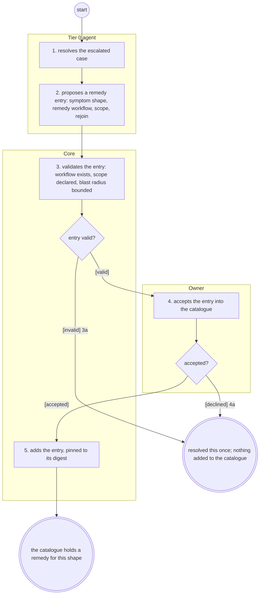

<!-- generated by render_spec.py from learn.spec.yaml; regenerate, do not edit -->
## Validation

No problems: the spec passes the activity rules.

## Activity diagram (swimlanes)



## Written use case (generated)

**Main success scenario** (generated: the guard-true path, in step order)

1. The Tier 0 agent resolves the escalated case.
2. The Tier 0 agent proposes a remedy entry: symptom shape, remedy workflow, scope, rejoin.
3. The Core validates the entry: workflow exists, scope declared, blast radius bounded.
4. The Owner accepts the entry into the catalogue.
5. The Core adds the entry, pinned to its digest.

**Extensions** (generated: one per non-happy guard; numbered by the step it leaves)

- **3a** (from: entry valid?) *anticipated*
  - `3a1` Invalid.
  - `3a2` The use case ends: resolved this once; nothing added to the catalogue.
- **4a** (from: accepted?) *anticipated*
  - `4a1` Declined.
  - `4a2` The use case ends: resolved this once; nothing added to the catalogue.

## Lane load

| Lane | On the main success scenario | Anywhere in the diagram |
|---|---|---|
| Tier 0 agent | 2 | 2 |
| Owner | 2 | 2 |
| Core | 3 | 3 |

**Tier-0 turns** (each return of control to tier 0; owner's scale: 2 ideal, 3 expected, 4 rusty, 5–10 bad, more: might as well have done it themselves). Main success scenario: **1 (ideal)**. Worst path: T3, **1 (ideal)**. Paths by grade: ideal 3.

Paths by how they end: **learned** 1, **not learned** 2.

## Decision tree: 3 paths

```text
start: Learn a remedy from an escalated case
    └─ T1: valid / accepted  ⇒ the catalogue holds a remedy for this shape
  └─ T2: invalid  ⇒ resolved this once; nothing added to the catalogue
    └─ T3: valid / declined  ⇒ resolved this once; nothing added to the catalogue
```

## Test table: one test per path

| Test | Path (guards taken) | Extension | Expected outcome | Tier-0 turns |
|---|---|---|---|---|
| T1 | entry valid? → valid; accepted? → accepted | MSS | the catalogue holds a remedy for this shape | 1 (ideal) |
| T2 | entry valid? → invalid | 3a | resolved this once; nothing added to the catalogue | 1 (ideal) |
| T3 | entry valid? → valid; accepted? → declined | 4a | resolved this once; nothing added to the catalogue | 1 (ideal) |

## Cross-view check

No flags.
