<!-- generated by render_current.py using the supplied renderer; edit the spec -->
# Current approved batch: source and folder-metadata dispatch

**Status:** descriptive current-code contract. The [use-case description](batch-enrichment-current.md) explains ownership, evidence and limitations; proposed autonomous coordination is not claimed here.

Prototype scenarios are guarded departures and rejoins, not every combination of repeated items or evidence of fresh execution.

## Validation

No structural or cross-view/reference flags.

## Activity diagram

```mermaid
flowchart TD
  subgraph Tier_0_agent["Tier 0 agent"]
    contract>"One existing process_approved worker. Child references describe its stage contracts; they do not start separate batches or create new run stores."]
  end
  subgraph Model_worker_legacy_transport_["Model worker (legacy transport)"]
    folderdescribe["folder_describe: attempts description and sensitivity from inventory metadata; unavailable endpoint can fail without a model call; documents stay unread"]
    observed>"Audited 12 folder-item attempts in two batches: validation completed; description failed; no folder_data success observed in that sample."]
  end
  subgraph Core["Core"]
    bind["1. uses the already admitted mixed source/folder selection, batch settings, grants and completion keys"]
    dwork{"frozen items available?"}
    nextitem["2. selects the next frozen item; completed and failed sibling records remain accounted for"]
    dkind{"recorded staged-item kind?"}
    source[["3. source-enrichment-current: uses the current source-stage contract for this item, including its existing controls and in-item publication"]]
    foldercontrols["applies the same before-item ceiling, between-stage cancellation and active-writer controls to the folder card"]
    dfoldercontrols{"folder item controls permit continuation?"}
    foldervalidate["folder_validate: checks current inventory evidence and review fingerprints"]
    dfoldervalidate{"folder_validate result?"}
    dfolderroute{"production drafting enabled, or scripted endpoint?"}
    foldercheck["checks returned structure/provenance and persists the draft under current item preconditions"]
    dfolderdescribe{"folder_describe result?"}
    folderqueued["records folder_describe queued when production drafting is disabled; later applicable stages retain that status"]
    folderdata["folder_data: saves the inventory Data record through the existing guarded writer"]
    dfolderdata{"folder_data result?"}
    folderfailed["records the failed folder stage and skips that card's remaining stages; completed siblings stay intact"]
    foldercoverage["records folder coverage as metadata only, source content not examined; never credits its documents as read"]
    account["4. retains the existing per-item stage/status reduction and updates the original mixed-batch accounting"]
    dmore{"another frozen item?"}
    summary["5. returns actual source/folder item outcomes and pending independent decisions; batch finished is not Source or lens acceptance"]
    dresult{"recorded mixed-batch result?"}
    stopped["retains completed receipts and remaining work with the actual cancellation, ceiling or interruption reason"]
  end
  s(("start"))
  e1((("recorded item stages complete or inapplicable; later Source/folder/lens decisions remain separate")))
  epartial((("batch accounted for with recorded partial/queued/failed items; no content coverage is invented")))
  enowork((("no admitted work; parent still reconciles any outstanding decisions")))
  epaused((("worker stopped with completed work retained and explicit continuation required")))
  eescalated((("a run-wide state, writer or authority failure prevents a trustworthy handback")))
  s --> contract
  contract --> bind
  bind --> dwork
  dwork -->|"[nonempty admitted set]"| nextitem
  dwork -->|"[no approved work] 1a"| enowork
  nextitem --> dkind
  dkind -->|"[source]"| source
  dkind -->|"[folder metadata card] 2a"| foldercontrols
  source -->|"[success]"| account
  source -->|"[partial] 3a"| account
  source -->|"[reused] 3b"| account
  source -->|"[paused] 3c"| stopped
  source -->|"[escalated] 3d"| eescalated
  foldercontrols --> dfoldercontrols
  dfoldercontrols -->|"[active within recorded controls]"| foldervalidate
  dfoldercontrols -->|"[cancelled, interrupted or ceiling reached]"| stopped
  dfoldercontrols -->|"[run-wide state or writer failure]"| eescalated
  foldervalidate --> dfoldervalidate
  dfoldervalidate -->|"[not failed]"| dfolderroute
  dfoldervalidate -->|"[failed]"| folderfailed
  dfolderroute -->|"[production enabled or scripted fixture]"| folderdescribe
  dfolderroute -->|"[production drafting disabled or deferred]"| folderqueued
  folderdescribe --> foldercheck
  foldercheck --> dfolderdescribe
  dfolderdescribe -->|"[not failed]"| folderdata
  dfolderdescribe -->|"[failed, including FOLDER_PROVENANCE or FOLDER_DRAFT_FAILED]"| folderfailed
  folderqueued --> folderdata
  folderdata --> dfolderdata
  dfolderdata -->|"[not failed]"| foldercoverage
  dfolderdata -->|"[failed]"| folderfailed
  folderfailed --> foldercoverage
  foldercoverage --> observed
  observed --> account
  account --> dmore
  dmore -->|"[frozen set accounted for]"| summary
  dmore -->|"[another frozen item] 4a"| nextitem
  summary --> dresult
  dresult -->|"[all recorded item stages complete or inapplicable]"| e1
  dresult -->|"[recorded partial, queued, skipped, stale or failed item remains] 5a"| epartial
  stopped --> epaused
  classDef ext stroke:#d9534f,stroke-width:2px
```



## Written use case

**Main success scenario** (generated: the guard-true path, in step order)

1. The Core uses the already admitted mixed source/folder selection, batch settings, grants and completion keys.
2. The Core selects the next frozen item; completed and failed sibling records remain accounted for.
3. The Core uses the current source-stage contract for this item, including its existing controls and in-item publication.
4. The Core retains the existing per-item stage/status reduction and updates the original mixed-batch accounting.
5. The Core returns actual source/folder item outcomes and pending independent decisions; batch finished is not Source or lens acceptance.

**Extensions** (generated: one per non-happy guard; numbered by the step it leaves)

- **1a** (from: frozen items available?) *anticipated*
  - `1a1` No approved work.
  - `1a2` The use case ends: no admitted work; parent still reconciles any outstanding decisions.
- **2a** (from: recorded staged-item kind?) *anticipated*
  - `2a1` Folder metadata card.
  - `2a2` The Core applies the same before-item ceiling, between-stage cancellation and active-writer controls to the folder card.
  - `2a3` The Core decides: folder item controls permit continuation?
  - `2a3a` If cancelled, interrupted or ceiling reached: retains completed receipts and remaining work with the actual cancellation, ceiling or interruption reason.
  - `2a3a` If run-wide state or writer failure: the use case ends: a run-wide state, writer or authority failure prevents a trustworthy handback.
  - `2a4` If active within recorded controls:
  - `2a5` The Core folder_validate: checks current inventory evidence and review fingerprints.
  - `2a6` The Core decides: folder_validate result?
  - `2a6a` If failed: records the failed folder stage and skips that card's remaining stages; completed siblings stay intact.
  - `2a7` If not failed:
  - `2a8` The Core decides: production drafting enabled, or scripted endpoint?
  - `2a8a` If production drafting disabled or deferred: records folder_describe queued when production drafting is disabled; later applicable stages retain that status.
  - `2a9` If production enabled or scripted fixture:
  - `2a10` The Model worker (legacy transport) folder_describe: attempts description and sensitivity from inventory metadata; unavailable endpoint can fail without a model call; documents stay unread.
  - `2a11` The Core checks returned structure/provenance and persists the draft under current item preconditions.
  - `2a12` The Core decides: folder_describe result?
  - `2a12a` If failed, including FOLDER_PROVENANCE or FOLDER_DRAFT_FAILED: records the failed folder stage and skips that card's remaining stages; completed siblings stay intact.
  - `2a13` If not failed:
  - `2a14` The Core folder_data: saves the inventory Data record through the existing guarded writer.
  - `2a15` The Core decides: folder_data result?
  - `2a15a` If failed: records the failed folder stage and skips that card's remaining stages; completed siblings stay intact.
  - `2a16` If not failed:
  - `2a17` The Core records folder coverage as metadata only, source content not examined; never credits its documents as read.
  - `2a18` Rejoin at 4.
- **3a** (from: uses the current source-stage contract for this item, including its existing controls and in-item publication) *anticipated*
  - `3a1` Partial.
  - `3a2` Rejoin at 4.
- **3b** (from: uses the current source-stage contract for this item, including its existing controls and in-item publication) *anticipated*
  - `3b1` Reused.
  - `3b2` Rejoin at 4.
- **3c** (from: uses the current source-stage contract for this item, including its existing controls and in-item publication) *anticipated*
  - `3c1` Paused.
  - `3c2` The Core retains completed receipts and remaining work with the actual cancellation, ceiling or interruption reason.
  - `3c3` The use case ends: worker stopped with completed work retained and explicit continuation required.
- **3d** (from: uses the current source-stage contract for this item, including its existing controls and in-item publication) *anticipated*
  - `3d1` Escalated.
  - `3d2` The use case ends: a run-wide state, writer or authority failure prevents a trustworthy handback.
- **4a** (from: another frozen item?) *anticipated*
  - `4a1` Another frozen item.
  - `4a2` Rejoin at 2.
- **5a** (from: recorded mixed-batch result?) *anticipated*
  - `5a1` Recorded partial, queued, skipped, stale or failed item remains.
  - `5a2` The use case ends: batch accounted for with recorded partial/queued/failed items; no content coverage is invented.

## Lane load

| Lane | On the main success scenario | Anywhere in the diagram |
|---|---|---|
| Tier 0 agent | 0 | 0 |
| Model worker (legacy transport) | 0 | 1 |
| Core | 9 | 22 |

**Tier-0 turns** (each return of control to tier 0; owner's scale: 2 ideal, 3 expected, 4 rusty, 5–10 bad, more: might as well have done it themselves). Main success scenario: **1 (ideal)**. Worst path: T16, **1 (ideal)**. Paths by grade: ideal 14; escalated 2 (failures, not graded).

Paths by how they end: **escalated** 2, **partial** 1, **paused** 2, **reused** 1, **success** 1. Every *escalated* path is a failure of this use case: the work went back to tier 0.

## Decision tree with 16 extension scenarios

```text
start: Current approved batch: source and folder-metadata dispatch
          └─ T1: nonempty admitted set / source / success / frozen set accounted for / all recorded item stages complete or inapplicable  ⇒ recorded item stages complete or inapplicable; later Source/folder/lens decisions remain separate
  └─ T2: no approved work  ⇒ no admitted work; parent still reconciles any outstanding decisions
      └─ T3: nonempty admitted set / folder metadata card / cancelled, interrupted or ceiling reached  ⇒ worker stopped with completed work retained and explicit continuation required
      └─ T4: nonempty admitted set / folder metadata card / run-wide state or writer failure  ⇒ a run-wide state, writer or authority failure prevents a trustworthy handback
        └─ T5: nonempty admitted set / folder metadata card / active within recorded controls / failed  ⇒ rejoins at step 4
            └─ T6: nonempty admitted set / folder metadata card / active within recorded controls / not failed / production drafting disabled or deferred / failed  ⇒ rejoins at step 4
            └─ T7: nonempty admitted set / folder metadata card / active within recorded controls / not failed / production drafting disabled or deferred / not failed  ⇒ rejoins at step 4
            └─ T8: nonempty admitted set / folder metadata card / active within recorded controls / not failed / production enabled or scripted fixture / failed, including FOLDER_PROVENANCE or FOLDER_DRAFT_FAILED  ⇒ rejoins at step 4
              └─ T9: nonempty admitted set / folder metadata card / active within recorded controls / not failed / production enabled or scripted fixture / not failed / failed  ⇒ rejoins at step 4
              └─ T10: nonempty admitted set / folder metadata card / active within recorded controls / not failed / production enabled or scripted fixture / not failed / not failed  ⇒ rejoins at step 4
      └─ T11: nonempty admitted set / source / partial  ⇒ rejoins at step 4
      └─ T12: nonempty admitted set / source / reused  ⇒ rejoins at step 4
      └─ T13: nonempty admitted set / source / paused  ⇒ worker stopped with completed work retained and explicit continuation required
      └─ T14: nonempty admitted set / source / escalated  ⇒ a run-wide state, writer or authority failure prevents a trustworthy handback
        └─ T15: nonempty admitted set / source / success / another frozen item  ⇒ rejoins at step 2
          └─ T16: nonempty admitted set / source / success / frozen set accounted for / recorded partial, queued, skipped, stale or failed item remains  ⇒ batch accounted for with recorded partial/queued/failed items; no content coverage is invented
```

## Scenario test table

| Test | Path (guards taken) | Extension | Expected outcome | Tier-0 turns |
|---|---|---|---|---|
| T1 | frozen items available? → nonempty admitted set; recorded staged-item kind? → source; uses the current source-stage contract for this item, including its existing controls and in-item publication → success; another frozen item? → frozen set accounted for; recorded mixed-batch result? → all recorded item stages complete or inapplicable | MSS | recorded item stages complete or inapplicable; later Source/folder/lens decisions remain separate | 1 (ideal) |
| T2 | frozen items available? → no approved work | 1a | no admitted work; parent still reconciles any outstanding decisions | 1 (ideal) |
| T3 | frozen items available? → nonempty admitted set; recorded staged-item kind? → folder metadata card; folder item controls permit continuation? → cancelled, interrupted or ceiling reached | 2a | worker stopped with completed work retained and explicit continuation required | 1 (ideal) |
| T4 | frozen items available? → nonempty admitted set; recorded staged-item kind? → folder metadata card; folder item controls permit continuation? → run-wide state or writer failure | 2a | a run-wide state, writer or authority failure prevents a trustworthy handback | 1 (escalated: a failure) |
| T5 | frozen items available? → nonempty admitted set; recorded staged-item kind? → folder metadata card; folder item controls permit continuation? → active within recorded controls; folder_validate result? → failed | 2a | rejoins at step 4 | 1 (ideal) |
| T6 | frozen items available? → nonempty admitted set; recorded staged-item kind? → folder metadata card; folder item controls permit continuation? → active within recorded controls; folder_validate result? → not failed; production drafting enabled, or scripted endpoint? → production drafting disabled or deferred; folder_data result? → failed | 2a | rejoins at step 4 | 1 (ideal) |
| T7 | frozen items available? → nonempty admitted set; recorded staged-item kind? → folder metadata card; folder item controls permit continuation? → active within recorded controls; folder_validate result? → not failed; production drafting enabled, or scripted endpoint? → production drafting disabled or deferred; folder_data result? → not failed | 2a | rejoins at step 4 | 1 (ideal) |
| T8 | frozen items available? → nonempty admitted set; recorded staged-item kind? → folder metadata card; folder item controls permit continuation? → active within recorded controls; folder_validate result? → not failed; production drafting enabled, or scripted endpoint? → production enabled or scripted fixture; folder_describe result? → failed, including FOLDER_PROVENANCE or FOLDER_DRAFT_FAILED | 2a | rejoins at step 4 | 1 (ideal) |
| T9 | frozen items available? → nonempty admitted set; recorded staged-item kind? → folder metadata card; folder item controls permit continuation? → active within recorded controls; folder_validate result? → not failed; production drafting enabled, or scripted endpoint? → production enabled or scripted fixture; folder_describe result? → not failed; folder_data result? → failed | 2a | rejoins at step 4 | 1 (ideal) |
| T10 | frozen items available? → nonempty admitted set; recorded staged-item kind? → folder metadata card; folder item controls permit continuation? → active within recorded controls; folder_validate result? → not failed; production drafting enabled, or scripted endpoint? → production enabled or scripted fixture; folder_describe result? → not failed; folder_data result? → not failed | 2a | rejoins at step 4 | 1 (ideal) |
| T11 | frozen items available? → nonempty admitted set; recorded staged-item kind? → source; uses the current source-stage contract for this item, including its existing controls and in-item publication → partial | 3a | rejoins at step 4 | 1 (ideal) |
| T12 | frozen items available? → nonempty admitted set; recorded staged-item kind? → source; uses the current source-stage contract for this item, including its existing controls and in-item publication → reused | 3b | rejoins at step 4 | 1 (ideal) |
| T13 | frozen items available? → nonempty admitted set; recorded staged-item kind? → source; uses the current source-stage contract for this item, including its existing controls and in-item publication → paused | 3c | worker stopped with completed work retained and explicit continuation required | 1 (ideal) |
| T14 | frozen items available? → nonempty admitted set; recorded staged-item kind? → source; uses the current source-stage contract for this item, including its existing controls and in-item publication → escalated | 3d | a run-wide state, writer or authority failure prevents a trustworthy handback | 1 (escalated: a failure) |
| T15 | frozen items available? → nonempty admitted set; recorded staged-item kind? → source; uses the current source-stage contract for this item, including its existing controls and in-item publication → success; another frozen item? → another frozen item | 4a | rejoins at step 2 | 1 (ideal) |
| T16 | frozen items available? → nonempty admitted set; recorded staged-item kind? → source; uses the current source-stage contract for this item, including its existing controls and in-item publication → success; another frozen item? → frozen set accounted for; recorded mixed-batch result? → recorded partial, queued, skipped, stale or failed item remains | 5a | batch accounted for with recorded partial/queued/failed items; no content coverage is invented | 1 (ideal) |

These are generated consistency cases, not newly executed runtime tests.
