<!-- generated by render_current.py using the supplied renderer; edit the spec -->
# Current source enrichment: scripted stages and legacy model tasks

**Status:** descriptive current-code contract. The [use-case description](source-enrichment-current.md) explains ownership, evidence and limitations; proposed autonomous coordination is not claimed here.

Prototype scenarios are guarded departures and rejoins, not every combination of repeated items or evidence of fresh execution.

## Validation

No structural or cross-view/reference flags.

## Activity diagram

```mermaid
flowchart TD
  subgraph Tier_0_agent["Tier 0 agent"]
    boundary>"Source-only detail of the current mixed-batch dispatcher. Folder metadata uses its separate three-stage chain there. Approval/start and Source/lens decisions stay with the parent."]
  end
  subgraph Model_worker_legacy_transport_["Model worker (legacy transport)"]
    convert["performs configured PDF cleanup or OCR; returns text, page anchors, actual covered pages and explicit task errors"]
    read["5. read: performs bounded points, limits, terms and grounded lens tasks; source-wide derivations retain their own outcomes"]
    relate["8. relate: proposes relations between eligible fully read document components; zero added relations can be valid"]
    review["10. review: drafts the kind-specific Bottom Line and sensitivity findings from source evidence, retaining no answer, refusal and low confidence"]
  end
  subgraph Core["Core"]
    bind["1. binds the source subset to the admitted batch, frozen selection, settings, grants and exact completion keys"]
    dwork{"source work in the admitted subset?"}
    controls["2. checks the configured spend ceiling before each item and cancellation/active-writer state between stages; reuses only matching complete receipts"]
    dcontrols{"recorded run controls permit processing?"}
    validate["3. validate: checks captured evidence, source identity and duplicate note constraints"]
    dvalidate{"validation result?"}
    parse["4. parse: fetches and extracts text with scripts, maps pages and records extraction quality; dispatches model work only where configured and needed"]
    dparse{"scripted extraction result and configured conversion request?"}
    conversioncheck["checks returned structure and literal page mapping; retains original bytes and unused generated evidence"]
    dconversion{"conversion result and usable original text?"}
    fallback["uses original page-mapped text: returned cleanup error retains partial status; unusable generated anchors may still permit complete parse when original text is usable"]
    parsegap["retains partial/queued conversion or absent readable text and actual OCR gaps; missing material receives no reading credit"]
    dprojection{"parse continued without an early partial return; PDF or paper projection applicable?"}
    preproject["writes a free provisional paper-graph .nodes.json before reading, with text_layer=False; catalogue-only or zero-claim output is possible"]
    dpreproject{"provisional projection write result?"}
    parsefinal{"source units and quality verdict after provisional projection if applicable?"}
    readcheck["checks schemas, literal support, keys and part counters; preserves task/derivation records, although batch read completion currently follows remaining-part counts"]
    dread{"read stage result?"}
    lenses["6. lenses: records proposals already derived during reading; zero candidates or nothing read can be valid; no lens is accepted here"]
    dlenses{"lenses stage result?"}
    data["7. Data: assembles kind-specific records from scripted structure and existing current-text readings; preserves partial or inapplicable coverage"]
    ddata{"Data stage result and document relation applicability?"}
    relatestatic["retains existing static relations or records relations as not applicable; does not invent a model call"]
    drelate{"relate stage result?"}
    metadata["9. metadata: copies limited literal Data facts where available and lists required unknown fields; this script is not a general semantic metadata model"]
    dmetadata{"metadata stage result?"}
    reviewcheck["checks returned draft structure, literal grounding and reading counters; a usable draft does not override incomplete reading"]
    dreview{"review stage result?"}
    pubcheck["11. publish: checks PDF applicability, actual full reading, persistent conversion, artifact binding and current trusted accepted folder assignment"]
    dpublication{"publication admission result?"}
    dpubresult{"publication call result?"}
    pubna["records publish as not applicable for non-PDF or a fully read PDF without a full-conversion artifact; retains limitations"]
    pubgap["records incomplete reading, disabled Geo, awaiting accepted folder, FOLDER_STALE or a caught publication refusal/error as partial without erasing reading"]
    itemfailed["records a failed stage and stops this item's remaining stages; another frozen item's completed work is retained"]
    reduce["13. reduces declared stage statuses to enriched, partial or failed and persists each item's actual coverage and reasons"]
    dmore{"more frozen source items?"}
    summary["14. returns per-item stage/coverage/publication receipts and pending Source/lens decisions; reported spend retains unpriced-call limitations"]
    dresult{"source-subset result from recorded statuses?"}
    stopped["persists cancellation, ceiling stop or interruption with completed receipts and pending work for explicit continuation"]
  end
  subgraph Model_host["Model host"]
    host["answers bounded calls through configured legacy routes and their existing task pool; reports transport completion or failure"]
  end
  subgraph Geo_Grapher["Geo-Grapher"]
    publish["12. copies the prior paper DB into a new generation, imports the artifact and switches the active catalog pointer through one CLI call"]
    publishstorage>"The call may fail during copy, import or registration. Old and failed-candidate DBs may remain; the candidate is checkpointed and the catalog uses WAL."]
  end
  s(("start"))
  e1((("the batch marks source processing enriched from stage statuses; parent acceptance and independent judgment of any derivation gaps remain separate")))
  epartial((("recorded partial/failed source items remain; other derivation gaps are reported separately and acceptance is not implied")))
  enowork((("no source work in this admitted selection; the parent retains its authoritative item accounting")))
  epaused((("processing stopped with retained receipts and explicit continuation requirements")))
  eescalated((("a run-wide writer, state or authority failure prevents a trustworthy completion handback")))
  s --> boundary
  boundary --> bind
  bind --> dwork
  dwork -->|"[nonempty source subset]"| controls
  dwork -->|"[empty or already-settled selection] 1a"| enowork
  controls --> dcontrols
  dcontrols -->|"[active, within the configured ceiling and writer available]"| validate
  dcontrols -->|"[cancelled, interrupted or ceiling reached] 2a"| stopped
  dcontrols -->|"[run-wide writer, state or authority failure] 2b"| eescalated
  validate --> dvalidate
  dvalidate -->|"[not failed]"| parse
  dvalidate -->|"[failed] 3a"| itemfailed
  parse --> dparse
  dparse -->|"[scripted parse continued without requested model assistance]"| dprojection
  dparse -->|"[configured model cleanup or OCR needed] 4a"| convert
  dparse -->|"[fetch or OCR precondition returned partial before provisional projection] 4b"| parsegap
  dparse -->|"[uncaught stage failure] 4c"| itemfailed
  convert --> conversioncheck
  conversioncheck --> dconversion
  dconversion -->|"[usable mapped cleanup, or completed OCR without an early partial return]"| dprojection
  dconversion -->|"[returned cleanup error or unusable generated anchors, with usable original text]"| fallback
  dconversion -->|"[returned cleanup error or unusable anchors without usable original text; projection and final chunk check still run]"| dprojection
  dconversion -->|"[OCR returned partial before provisional projection]"| parsegap
  dconversion -->|"[uncaught fatal stage failure]"| itemfailed
  fallback --> dprojection
  dprojection -->|"[PDF or paper; parse did not return early]"| preproject
  dprojection -->|"[other source kind; no paper projection] 4d"| parsefinal
  preproject --> dpreproject
  dpreproject -->|"[provisional artifact written; not published]"| parsefinal
  dpreproject -->|"[uncaught projection write failure] 4e"| itemfailed
  parsefinal -->|"[usable units and no needs_ocr/js_shell verdict; preserve any recorded cleanup-error partial result]"| read
  parsefinal -->|"[no readable units, or quality verdict still needs_ocr/js_shell] 4f"| parsegap
  parsegap --> read
  read --> host
  host --> readcheck
  readcheck --> dread
  dread -->|"[not failed; keep queued/partial tasks and derivations visible]"| lenses
  dread -->|"[failed] 5a"| itemfailed
  lenses --> dlenses
  dlenses -->|"[not failed; none found or inapplicable is valid]"| data
  dlenses -->|"[failed] 6a"| itemfailed
  data --> ddata
  ddata -->|"[not failed; eligible document components for model relation work]"| relate
  ddata -->|"[not failed; static or inapplicable relations] 7a"| relatestatic
  ddata -->|"[failed] 7b"| itemfailed
  relate --> drelate
  relatestatic --> drelate
  drelate -->|"[not failed; retain queued, partial or inapplicable results]"| metadata
  drelate -->|"[failed] 8a"| itemfailed
  metadata --> dmetadata
  dmetadata -->|"[not failed; Unknown is explicit]"| review
  dmetadata -->|"[failed] 9a"| itemfailed
  review --> reviewcheck
  reviewcheck --> dreview
  dreview -->|"[not failed; keep queued/partial review and actual coverage]"| pubcheck
  dreview -->|"[failed or refused stage] 10a"| itemfailed
  pubcheck --> dpublication
  dpublication -->|"[fully read PDF, full conversion and enabled current trusted accepted folder assignment]"| publish
  dpublication -->|"[non-PDF, or fully read PDF without a full-conversion artifact] 11a"| pubna
  dpublication -->|"[reading incomplete, disabled Geo, missing/stale folder assignment or caught admission refusal] 11b"| pubgap
  dpublication -->|"[uncaught preparation exception] 11c"| itemfailed
  publish --> publishstorage
  publishstorage --> dpubresult
  dpubresult -->|"[published]"| reduce
  dpubresult -->|"[returned refusal/disabled or caught publication error] 12a"| pubgap
  dpubresult -->|"[uncaught stage failure] 12b"| itemfailed
  pubna --> reduce
  pubgap --> reduce
  itemfailed --> reduce
  reduce --> dmore
  dmore -->|"[frozen source subset accounted for]"| summary
  dmore -->|"[another frozen source] 13a"| controls
  summary --> dresult
  dresult -->|"[all recorded source-stage statuses complete or inapplicable; not an independent content verdict]"| e1
  dresult -->|"[recorded partial/failed item or incomplete stage status remains; latent derivation gaps are handed back separately] 14a"| epartial
  stopped --> epaused
  classDef ext stroke:#d9534f,stroke-width:2px
```



## Written use case

**Main success scenario** (generated: the guard-true path, in step order)

1. The Core binds the source subset to the admitted batch, frozen selection, settings, grants and exact completion keys.
2. The Core checks the configured spend ceiling before each item and cancellation/active-writer state between stages; reuses only matching complete receipts.
3. The Core validate: checks captured evidence, source identity and duplicate note constraints.
4. The Core parse: fetches and extracts text with scripts, maps pages and records extraction quality; dispatches model work only where configured and needed.
5. The Model worker (legacy transport) read: performs bounded points, limits, terms and grounded lens tasks; source-wide derivations retain their own outcomes.
6. The Core lenses: records proposals already derived during reading; zero candidates or nothing read can be valid; no lens is accepted here.
7. The Core Data: assembles kind-specific records from scripted structure and existing current-text readings; preserves partial or inapplicable coverage.
8. The Model worker (legacy transport) relate: proposes relations between eligible fully read document components; zero added relations can be valid.
9. The Core metadata: copies limited literal Data facts where available and lists required unknown fields; this script is not a general semantic metadata model.
10. The Model worker (legacy transport) review: drafts the kind-specific Bottom Line and sensitivity findings from source evidence, retaining no answer, refusal and low confidence.
11. The Core publish: checks PDF applicability, actual full reading, persistent conversion, artifact binding and current trusted accepted folder assignment.
12. The Geo-Grapher copies the prior paper DB into a new generation, imports the artifact and switches the active catalog pointer through one CLI call.
13. The Core reduces declared stage statuses to enriched, partial or failed and persists each item's actual coverage and reasons.
14. The Core returns per-item stage/coverage/publication receipts and pending Source/lens decisions; reported spend retains unpriced-call limitations.

**Extensions** (generated: one per non-happy guard; numbered by the step it leaves)

- **1a** (from: source work in the admitted subset?) *anticipated*
  - `1a1` Empty or already-settled selection.
  - `1a2` The use case ends: no source work in this admitted selection; the parent retains its authoritative item accounting.
- **2a** (from: recorded run controls permit processing?) *observed: eight cancellations and no ceiling stop in the cross-library audit*
  - `2a1` Cancelled, interrupted or ceiling reached.
  - `2a2` The Core persists cancellation, ceiling stop or interruption with completed receipts and pending work for explicit continuation.
  - `2a3` The use case ends: processing stopped with retained receipts and explicit continuation requirements.
- **2b** (from: recorded run controls permit processing?) *anticipated*
  - `2b1` Run-wide writer, state or authority failure.
  - `2b2` The use case ends: a run-wide writer, state or authority failure prevents a trustworthy completion handback.
- **3a** (from: validation result?) *anticipated*
  - `3a1` Failed.
  - `3a2` The Core records a failed stage and stops this item's remaining stages; another frozen item's completed work is retained.
  - `3a3` Rejoin at 13.
- **4a** (from: scripted extraction result and configured conversion request?) *anticipated*
  - `4a1` Configured model cleanup or OCR needed.
  - `4a2` The Model worker (legacy transport) performs configured PDF cleanup or OCR; returns text, page anchors, actual covered pages and explicit task errors.
  - `4a3` The Core checks returned structure and literal page mapping; retains original bytes and unused generated evidence.
  - `4a4` The Core decides: conversion result and usable original text?
  - `4a4a` If returned cleanup error or unusable generated anchors, with usable original text: uses original page-mapped text: returned cleanup error retains partial status; unusable generated anchors may still permit complete parse when original text is usable.
  - `4a4a` If returned cleanup error or unusable anchors without usable original text; projection and final chunk check still run: parse continued without an early partial return; PDF or paper projection applicable?.
  - `4a4a` If OCR returned partial before provisional projection: retains partial/queued conversion or absent readable text and actual OCR gaps; missing material receives no reading credit.
  - `4a4a` If uncaught fatal stage failure: records a failed stage and stops this item's remaining stages; another frozen item's completed work is retained.
  - `4a5` If usable mapped cleanup, or completed OCR without an early partial return:
  - `4a6` The Core decides: parse continued without an early partial return; PDF or paper projection applicable?
  - `4a6a` If other source kind; no paper projection: source units and quality verdict after provisional projection if applicable?.
  - `4a7` If PDF or paper; parse did not return early:
  - `4a8` The Core writes a free provisional paper-graph .nodes.json before reading, with text_layer=False; catalogue-only or zero-claim output is possible.
  - `4a9` The Core decides: provisional projection write result?
  - `4a9a` If uncaught projection write failure: records a failed stage and stops this item's remaining stages; another frozen item's completed work is retained.
  - `4a10` If provisional artifact written; not published:
  - `4a11` The Core decides: source units and quality verdict after provisional projection if applicable?
  - `4a11a` If no readable units, or quality verdict still needs_ocr/js_shell: retains partial/queued conversion or absent readable text and actual OCR gaps; missing material receives no reading credit.
  - `4a12` If usable units and no needs_ocr/js_shell verdict; preserve any recorded cleanup-error partial result:
  - `4a13` Rejoin at 5.
- **4b** (from: scripted extraction result and configured conversion request?) *anticipated*
  - `4b1` Fetch or OCR precondition returned partial before provisional projection.
  - `4b2` The Core retains partial/queued conversion or absent readable text and actual OCR gaps; missing material receives no reading credit.
  - `4b3` Rejoin at 5.
- **4c** (from: scripted extraction result and configured conversion request?) *anticipated*
  - `4c1` Uncaught stage failure.
  - `4c2` The Core records a failed stage and stops this item's remaining stages; another frozen item's completed work is retained.
  - `4c3` Rejoin at 13.
- **4d** (from: parse continued without an early partial return; PDF or paper projection applicable?) *anticipated*
  - `4d1` Other source kind; no paper projection.
  - `4d2` The Core decides: source units and quality verdict after provisional projection if applicable?
  - `4d2a` If no readable units, or quality verdict still needs_ocr/js_shell: retains partial/queued conversion or absent readable text and actual OCR gaps; missing material receives no reading credit.
  - `4d3` If usable units and no needs_ocr/js_shell verdict; preserve any recorded cleanup-error partial result:
  - `4d4` Rejoin at 5.
- **4e** (from: provisional projection write result?) *anticipated*
  - `4e1` Uncaught projection write failure.
  - `4e2` The Core records a failed stage and stops this item's remaining stages; another frozen item's completed work is retained.
  - `4e3` Rejoin at 13.
- **4f** (from: source units and quality verdict after provisional projection if applicable?) *anticipated*
  - `4f1` No readable units, or quality verdict still needs_ocr/js_shell.
  - `4f2` The Core retains partial/queued conversion or absent readable text and actual OCR gaps; missing material receives no reading credit.
  - `4f3` Rejoin at 5.
- **5a** (from: read stage result?) *anticipated*
  - `5a1` Failed.
  - `5a2` The Core records a failed stage and stops this item's remaining stages; another frozen item's completed work is retained.
  - `5a3` Rejoin at 13.
- **6a** (from: lenses stage result?) *anticipated*
  - `6a1` Failed.
  - `6a2` The Core records a failed stage and stops this item's remaining stages; another frozen item's completed work is retained.
  - `6a3` Rejoin at 13.
- **7a** (from: Data stage result and document relation applicability?) *anticipated*
  - `7a1` Not failed; static or inapplicable relations.
  - `7a2` The Core retains existing static relations or records relations as not applicable; does not invent a model call.
  - `7a3` The Core decides: relate stage result?
  - `7a3a` If failed: records a failed stage and stops this item's remaining stages; another frozen item's completed work is retained.
  - `7a4` If not failed; retain queued, partial or inapplicable results:
  - `7a5` Rejoin at 9.
- **7b** (from: Data stage result and document relation applicability?) *anticipated*
  - `7b1` Failed.
  - `7b2` The Core records a failed stage and stops this item's remaining stages; another frozen item's completed work is retained.
  - `7b3` Rejoin at 13.
- **8a** (from: relate stage result?) *anticipated*
  - `8a1` Failed.
  - `8a2` The Core records a failed stage and stops this item's remaining stages; another frozen item's completed work is retained.
  - `8a3` Rejoin at 13.
- **9a** (from: metadata stage result?) *anticipated*
  - `9a1` Failed.
  - `9a2` The Core records a failed stage and stops this item's remaining stages; another frozen item's completed work is retained.
  - `9a3` Rejoin at 13.
- **10a** (from: review stage result?) *anticipated*
  - `10a1` Failed or refused stage.
  - `10a2` The Core records a failed stage and stops this item's remaining stages; another frozen item's completed work is retained.
  - `10a3` Rejoin at 13.
- **11a** (from: publication admission result?) *anticipated*
  - `11a1` Non-PDF, or fully read PDF without a full-conversion artifact.
  - `11a2` The Core records publish as not applicable for non-PDF or a fully read PDF without a full-conversion artifact; retains limitations.
  - `11a3` Rejoin at 13.
- **11b** (from: publication admission result?) *anticipated*
  - `11b1` Reading incomplete, disabled Geo, missing/stale folder assignment or caught admission refusal.
  - `11b2` The Core records incomplete reading, disabled Geo, awaiting accepted folder, FOLDER_STALE or a caught publication refusal/error as partial without erasing reading.
  - `11b3` Rejoin at 13.
- **11c** (from: publication admission result?) *anticipated*
  - `11c1` Uncaught preparation exception.
  - `11c2` The Core records a failed stage and stops this item's remaining stages; another frozen item's completed work is retained.
  - `11c3` Rejoin at 13.
- **12a** (from: publication call result?) *anticipated*
  - `12a1` Returned refusal/disabled or caught publication error.
  - `12a2` The Core records incomplete reading, disabled Geo, awaiting accepted folder, FOLDER_STALE or a caught publication refusal/error as partial without erasing reading.
  - `12a3` Rejoin at 13.
- **12b** (from: publication call result?) *anticipated*
  - `12b1` Uncaught stage failure.
  - `12b2` The Core records a failed stage and stops this item's remaining stages; another frozen item's completed work is retained.
  - `12b3` Rejoin at 13.
- **13a** (from: more frozen source items?) *anticipated*
  - `13a1` Another frozen source.
  - `13a2` Rejoin at 2.
- **14a** (from: source-subset result from recorded statuses?) *anticipated*
  - `14a1` Recorded partial/failed item or incomplete stage status remains; latent derivation gaps are handed back separately.
  - `14a2` The use case ends: recorded partial/failed source items remain; other derivation gaps are reported separately and acceptance is not implied.

## Lane load

| Lane | On the main success scenario | Anywhere in the diagram |
|---|---|---|
| Tier 0 agent | 0 | 0 |
| Model worker (legacy transport) | 3 | 4 |
| Core | 30 | 39 |
| Model host | 1 | 1 |
| Geo-Grapher | 1 | 1 |

**Tier-0 turns** (each return of control to tier 0; owner's scale: 2 ideal, 3 expected, 4 rusty, 5–10 bad, more: might as well have done it themselves). Main success scenario: **1 (ideal)**. Worst path: T29, **1 (ideal)**. Paths by grade: ideal 28; escalated 1 (failures, not graded).

Paths by how they end: **escalated** 1, **partial** 1, **paused** 1, **reused** 1, **success** 1. Every *escalated* path is a failure of this use case: the work went back to tier 0.

## Decision tree with 29 extension scenarios

```text
start: Current source enrichment: scripted stages and legacy model tasks
                                  └─ T1: nonempty source subset / active, within the configured ceiling and writer available / not failed / scripted parse continued without requested model assistance / PDF or paper; parse did not return early / provisional artifact written; not published / usable units and no needs_ocr/js_shell verdict; preserve any recorded cleanup-error partial result / not failed; keep queued/partial tasks and derivations visible / not failed; none found or inapplicable is valid / not failed; eligible document components for model relation work / not failed; retain queued, partial or inapplicable results / not failed; Unknown is explicit / not failed; keep queued/partial review and actual coverage / fully read PDF, full conversion and enabled current trusted accepted folder assignment / published / frozen source subset accounted for / all recorded source-stage statuses complete or inapplicable; not an independent content verdict  ⇒ the batch marks source processing enriched from stage statuses; parent acceptance and independent judgment of any derivation gaps remain separate
  └─ T2: empty or already-settled selection  ⇒ no source work in this admitted selection; the parent retains its authoritative item accounting
    └─ T3: nonempty source subset / cancelled, interrupted or ceiling reached  ⇒ processing stopped with retained receipts and explicit continuation requirements
    └─ T4: nonempty source subset / run-wide writer, state or authority failure  ⇒ a run-wide writer, state or authority failure prevents a trustworthy completion handback
      └─ T5: nonempty source subset / active, within the configured ceiling and writer available / failed  ⇒ rejoins at step 13
          └─ T6: nonempty source subset / active, within the configured ceiling and writer available / not failed / configured model cleanup or OCR needed / returned cleanup error or unusable generated anchors, with usable original text  ⇒ rejoins at 'parse continued without an early partial return; PDF or paper projection applicable?' (before step 5)
          └─ T7: nonempty source subset / active, within the configured ceiling and writer available / not failed / configured model cleanup or OCR needed / returned cleanup error or unusable anchors without usable original text; projection and final chunk check still run  ⇒ rejoins at 'parse continued without an early partial return; PDF or paper projection applicable?' (before step 5)
          └─ T8: nonempty source subset / active, within the configured ceiling and writer available / not failed / configured model cleanup or OCR needed / OCR returned partial before provisional projection  ⇒ rejoins at step 5
          └─ T9: nonempty source subset / active, within the configured ceiling and writer available / not failed / configured model cleanup or OCR needed / uncaught fatal stage failure  ⇒ rejoins at step 13
          └─ T10: nonempty source subset / active, within the configured ceiling and writer available / not failed / configured model cleanup or OCR needed / usable mapped cleanup, or completed OCR without an early partial return  ⇒ rejoins at 'parse continued without an early partial return; PDF or paper projection applicable?' (before step 5)
        └─ T11: nonempty source subset / active, within the configured ceiling and writer available / not failed / fetch or OCR precondition returned partial before provisional projection  ⇒ rejoins at step 5
        └─ T12: nonempty source subset / active, within the configured ceiling and writer available / not failed / uncaught stage failure  ⇒ rejoins at step 13
          └─ T13: nonempty source subset / active, within the configured ceiling and writer available / not failed / scripted parse continued without requested model assistance / other source kind; no paper projection  ⇒ rejoins at 'source units and quality verdict after provisional projection if applicable?' (before step 5)
            └─ T14: nonempty source subset / active, within the configured ceiling and writer available / not failed / scripted parse continued without requested model assistance / PDF or paper; parse did not return early / uncaught projection write failure  ⇒ rejoins at step 13
              └─ T15: nonempty source subset / active, within the configured ceiling and writer available / not failed / scripted parse continued without requested model assistance / PDF or paper; parse did not return early / provisional artifact written; not published / no readable units, or quality verdict still needs_ocr/js_shell  ⇒ rejoins at step 5
                └─ T16: nonempty source subset / active, within the configured ceiling and writer available / not failed / scripted parse continued without requested model assistance / PDF or paper; parse did not return early / provisional artifact written; not published / usable units and no needs_ocr/js_shell verdict; preserve any recorded cleanup-error partial result / failed  ⇒ rejoins at step 13
                  └─ T17: nonempty source subset / active, within the configured ceiling and writer available / not failed / scripted parse continued without requested model assistance / PDF or paper; parse did not return early / provisional artifact written; not published / usable units and no needs_ocr/js_shell verdict; preserve any recorded cleanup-error partial result / not failed; keep queued/partial tasks and derivations visible / failed  ⇒ rejoins at step 13
                    └─ T18: nonempty source subset / active, within the configured ceiling and writer available / not failed / scripted parse continued without requested model assistance / PDF or paper; parse did not return early / provisional artifact written; not published / usable units and no needs_ocr/js_shell verdict; preserve any recorded cleanup-error partial result / not failed; keep queued/partial tasks and derivations visible / not failed; none found or inapplicable is valid / not failed; static or inapplicable relations  ⇒ rejoins at 'relate stage result?' (before step 9)
                    └─ T19: nonempty source subset / active, within the configured ceiling and writer available / not failed / scripted parse continued without requested model assistance / PDF or paper; parse did not return early / provisional artifact written; not published / usable units and no needs_ocr/js_shell verdict; preserve any recorded cleanup-error partial result / not failed; keep queued/partial tasks and derivations visible / not failed; none found or inapplicable is valid / failed  ⇒ rejoins at step 13
                      └─ T20: nonempty source subset / active, within the configured ceiling and writer available / not failed / scripted parse continued without requested model assistance / PDF or paper; parse did not return early / provisional artifact written; not published / usable units and no needs_ocr/js_shell verdict; preserve any recorded cleanup-error partial result / not failed; keep queued/partial tasks and derivations visible / not failed; none found or inapplicable is valid / not failed; eligible document components for model relation work / failed  ⇒ rejoins at step 13
                        └─ T21: nonempty source subset / active, within the configured ceiling and writer available / not failed / scripted parse continued without requested model assistance / PDF or paper; parse did not return early / provisional artifact written; not published / usable units and no needs_ocr/js_shell verdict; preserve any recorded cleanup-error partial result / not failed; keep queued/partial tasks and derivations visible / not failed; none found or inapplicable is valid / not failed; eligible document components for model relation work / not failed; retain queued, partial or inapplicable results / failed  ⇒ rejoins at step 13
                          └─ T22: nonempty source subset / active, within the configured ceiling and writer available / not failed / scripted parse continued without requested model assistance / PDF or paper; parse did not return early / provisional artifact written; not published / usable units and no needs_ocr/js_shell verdict; preserve any recorded cleanup-error partial result / not failed; keep queued/partial tasks and derivations visible / not failed; none found or inapplicable is valid / not failed; eligible document components for model relation work / not failed; retain queued, partial or inapplicable results / not failed; Unknown is explicit / failed or refused stage  ⇒ rejoins at step 13
                            └─ T23: nonempty source subset / active, within the configured ceiling and writer available / not failed / scripted parse continued without requested model assistance / PDF or paper; parse did not return early / provisional artifact written; not published / usable units and no needs_ocr/js_shell verdict; preserve any recorded cleanup-error partial result / not failed; keep queued/partial tasks and derivations visible / not failed; none found or inapplicable is valid / not failed; eligible document components for model relation work / not failed; retain queued, partial or inapplicable results / not failed; Unknown is explicit / not failed; keep queued/partial review and actual coverage / non-PDF, or fully read PDF without a full-conversion artifact  ⇒ rejoins at step 13
                            └─ T24: nonempty source subset / active, within the configured ceiling and writer available / not failed / scripted parse continued without requested model assistance / PDF or paper; parse did not return early / provisional artifact written; not published / usable units and no needs_ocr/js_shell verdict; preserve any recorded cleanup-error partial result / not failed; keep queued/partial tasks and derivations visible / not failed; none found or inapplicable is valid / not failed; eligible document components for model relation work / not failed; retain queued, partial or inapplicable results / not failed; Unknown is explicit / not failed; keep queued/partial review and actual coverage / reading incomplete, disabled Geo, missing/stale folder assignment or caught admission refusal  ⇒ rejoins at step 13
                            └─ T25: nonempty source subset / active, within the configured ceiling and writer available / not failed / scripted parse continued without requested model assistance / PDF or paper; parse did not return early / provisional artifact written; not published / usable units and no needs_ocr/js_shell verdict; preserve any recorded cleanup-error partial result / not failed; keep queued/partial tasks and derivations visible / not failed; none found or inapplicable is valid / not failed; eligible document components for model relation work / not failed; retain queued, partial or inapplicable results / not failed; Unknown is explicit / not failed; keep queued/partial review and actual coverage / uncaught preparation exception  ⇒ rejoins at step 13
                              └─ T26: nonempty source subset / active, within the configured ceiling and writer available / not failed / scripted parse continued without requested model assistance / PDF or paper; parse did not return early / provisional artifact written; not published / usable units and no needs_ocr/js_shell verdict; preserve any recorded cleanup-error partial result / not failed; keep queued/partial tasks and derivations visible / not failed; none found or inapplicable is valid / not failed; eligible document components for model relation work / not failed; retain queued, partial or inapplicable results / not failed; Unknown is explicit / not failed; keep queued/partial review and actual coverage / fully read PDF, full conversion and enabled current trusted accepted folder assignment / returned refusal/disabled or caught publication error  ⇒ rejoins at step 13
                              └─ T27: nonempty source subset / active, within the configured ceiling and writer available / not failed / scripted parse continued without requested model assistance / PDF or paper; parse did not return early / provisional artifact written; not published / usable units and no needs_ocr/js_shell verdict; preserve any recorded cleanup-error partial result / not failed; keep queued/partial tasks and derivations visible / not failed; none found or inapplicable is valid / not failed; eligible document components for model relation work / not failed; retain queued, partial or inapplicable results / not failed; Unknown is explicit / not failed; keep queued/partial review and actual coverage / fully read PDF, full conversion and enabled current trusted accepted folder assignment / uncaught stage failure  ⇒ rejoins at step 13
                                └─ T28: nonempty source subset / active, within the configured ceiling and writer available / not failed / scripted parse continued without requested model assistance / PDF or paper; parse did not return early / provisional artifact written; not published / usable units and no needs_ocr/js_shell verdict; preserve any recorded cleanup-error partial result / not failed; keep queued/partial tasks and derivations visible / not failed; none found or inapplicable is valid / not failed; eligible document components for model relation work / not failed; retain queued, partial or inapplicable results / not failed; Unknown is explicit / not failed; keep queued/partial review and actual coverage / fully read PDF, full conversion and enabled current trusted accepted folder assignment / published / another frozen source  ⇒ rejoins at step 2
                                  └─ T29: nonempty source subset / active, within the configured ceiling and writer available / not failed / scripted parse continued without requested model assistance / PDF or paper; parse did not return early / provisional artifact written; not published / usable units and no needs_ocr/js_shell verdict; preserve any recorded cleanup-error partial result / not failed; keep queued/partial tasks and derivations visible / not failed; none found or inapplicable is valid / not failed; eligible document components for model relation work / not failed; retain queued, partial or inapplicable results / not failed; Unknown is explicit / not failed; keep queued/partial review and actual coverage / fully read PDF, full conversion and enabled current trusted accepted folder assignment / published / frozen source subset accounted for / recorded partial/failed item or incomplete stage status remains; latent derivation gaps are handed back separately  ⇒ recorded partial/failed source items remain; other derivation gaps are reported separately and acceptance is not implied
```

## Scenario test table

| Test | Path (guards taken) | Extension | Expected outcome | Tier-0 turns |
|---|---|---|---|---|
| T1 | source work in the admitted subset? → nonempty source subset; recorded run controls permit processing? → active, within the configured ceiling and writer available; validation result? → not failed; scripted extraction result and configured conversion request? → scripted parse continued without requested model assistance; parse continued without an early partial return; PDF or paper projection applicable? → PDF or paper; parse did not return early; provisional projection write result? → provisional artifact written; not published; source units and quality verdict after provisional projection if applicable? → usable units and no needs_ocr/js_shell verdict; preserve any recorded cleanup-error partial result; read stage result? → not failed; keep queued/partial tasks and derivations visible; lenses stage result? → not failed; none found or inapplicable is valid; Data stage result and document relation applicability? → not failed; eligible document components for model relation work; relate stage result? → not failed; retain queued, partial or inapplicable results; metadata stage result? → not failed; Unknown is explicit; review stage result? → not failed; keep queued/partial review and actual coverage; publication admission result? → fully read PDF, full conversion and enabled current trusted accepted folder assignment; publication call result? → published; more frozen source items? → frozen source subset accounted for; source-subset result from recorded statuses? → all recorded source-stage statuses complete or inapplicable; not an independent content verdict | MSS | the batch marks source processing enriched from stage statuses; parent acceptance and independent judgment of any derivation gaps remain separate | 1 (ideal) |
| T2 | source work in the admitted subset? → empty or already-settled selection | 1a | no source work in this admitted selection; the parent retains its authoritative item accounting | 1 (ideal) |
| T3 | source work in the admitted subset? → nonempty source subset; recorded run controls permit processing? → cancelled, interrupted or ceiling reached | 2a | processing stopped with retained receipts and explicit continuation requirements | 1 (ideal) |
| T4 | source work in the admitted subset? → nonempty source subset; recorded run controls permit processing? → run-wide writer, state or authority failure | 2b | a run-wide writer, state or authority failure prevents a trustworthy completion handback | 1 (escalated: a failure) |
| T5 | source work in the admitted subset? → nonempty source subset; recorded run controls permit processing? → active, within the configured ceiling and writer available; validation result? → failed | 3a | rejoins at step 13 | 1 (ideal) |
| T6 | source work in the admitted subset? → nonempty source subset; recorded run controls permit processing? → active, within the configured ceiling and writer available; validation result? → not failed; scripted extraction result and configured conversion request? → configured model cleanup or OCR needed; conversion result and usable original text? → returned cleanup error or unusable generated anchors, with usable original text | 4a | rejoins at 'parse continued without an early partial return; PDF or paper projection applicable?' (before step 5) | 1 (ideal) |
| T7 | source work in the admitted subset? → nonempty source subset; recorded run controls permit processing? → active, within the configured ceiling and writer available; validation result? → not failed; scripted extraction result and configured conversion request? → configured model cleanup or OCR needed; conversion result and usable original text? → returned cleanup error or unusable anchors without usable original text; projection and final chunk check still run | 4a | rejoins at 'parse continued without an early partial return; PDF or paper projection applicable?' (before step 5) | 1 (ideal) |
| T8 | source work in the admitted subset? → nonempty source subset; recorded run controls permit processing? → active, within the configured ceiling and writer available; validation result? → not failed; scripted extraction result and configured conversion request? → configured model cleanup or OCR needed; conversion result and usable original text? → OCR returned partial before provisional projection | 4a | rejoins at step 5 | 1 (ideal) |
| T9 | source work in the admitted subset? → nonempty source subset; recorded run controls permit processing? → active, within the configured ceiling and writer available; validation result? → not failed; scripted extraction result and configured conversion request? → configured model cleanup or OCR needed; conversion result and usable original text? → uncaught fatal stage failure | 4a | rejoins at step 13 | 1 (ideal) |
| T10 | source work in the admitted subset? → nonempty source subset; recorded run controls permit processing? → active, within the configured ceiling and writer available; validation result? → not failed; scripted extraction result and configured conversion request? → configured model cleanup or OCR needed; conversion result and usable original text? → usable mapped cleanup, or completed OCR without an early partial return | 4a | rejoins at 'parse continued without an early partial return; PDF or paper projection applicable?' (before step 5) | 1 (ideal) |
| T11 | source work in the admitted subset? → nonempty source subset; recorded run controls permit processing? → active, within the configured ceiling and writer available; validation result? → not failed; scripted extraction result and configured conversion request? → fetch or OCR precondition returned partial before provisional projection | 4b | rejoins at step 5 | 1 (ideal) |
| T12 | source work in the admitted subset? → nonempty source subset; recorded run controls permit processing? → active, within the configured ceiling and writer available; validation result? → not failed; scripted extraction result and configured conversion request? → uncaught stage failure | 4c | rejoins at step 13 | 1 (ideal) |
| T13 | source work in the admitted subset? → nonempty source subset; recorded run controls permit processing? → active, within the configured ceiling and writer available; validation result? → not failed; scripted extraction result and configured conversion request? → scripted parse continued without requested model assistance; parse continued without an early partial return; PDF or paper projection applicable? → other source kind; no paper projection | 4d | rejoins at 'source units and quality verdict after provisional projection if applicable?' (before step 5) | 1 (ideal) |
| T14 | source work in the admitted subset? → nonempty source subset; recorded run controls permit processing? → active, within the configured ceiling and writer available; validation result? → not failed; scripted extraction result and configured conversion request? → scripted parse continued without requested model assistance; parse continued without an early partial return; PDF or paper projection applicable? → PDF or paper; parse did not return early; provisional projection write result? → uncaught projection write failure | 4e | rejoins at step 13 | 1 (ideal) |
| T15 | source work in the admitted subset? → nonempty source subset; recorded run controls permit processing? → active, within the configured ceiling and writer available; validation result? → not failed; scripted extraction result and configured conversion request? → scripted parse continued without requested model assistance; parse continued without an early partial return; PDF or paper projection applicable? → PDF or paper; parse did not return early; provisional projection write result? → provisional artifact written; not published; source units and quality verdict after provisional projection if applicable? → no readable units, or quality verdict still needs_ocr/js_shell | 4f | rejoins at step 5 | 1 (ideal) |
| T16 | source work in the admitted subset? → nonempty source subset; recorded run controls permit processing? → active, within the configured ceiling and writer available; validation result? → not failed; scripted extraction result and configured conversion request? → scripted parse continued without requested model assistance; parse continued without an early partial return; PDF or paper projection applicable? → PDF or paper; parse did not return early; provisional projection write result? → provisional artifact written; not published; source units and quality verdict after provisional projection if applicable? → usable units and no needs_ocr/js_shell verdict; preserve any recorded cleanup-error partial result; read stage result? → failed | 5a | rejoins at step 13 | 1 (ideal) |
| T17 | source work in the admitted subset? → nonempty source subset; recorded run controls permit processing? → active, within the configured ceiling and writer available; validation result? → not failed; scripted extraction result and configured conversion request? → scripted parse continued without requested model assistance; parse continued without an early partial return; PDF or paper projection applicable? → PDF or paper; parse did not return early; provisional projection write result? → provisional artifact written; not published; source units and quality verdict after provisional projection if applicable? → usable units and no needs_ocr/js_shell verdict; preserve any recorded cleanup-error partial result; read stage result? → not failed; keep queued/partial tasks and derivations visible; lenses stage result? → failed | 6a | rejoins at step 13 | 1 (ideal) |
| T18 | source work in the admitted subset? → nonempty source subset; recorded run controls permit processing? → active, within the configured ceiling and writer available; validation result? → not failed; scripted extraction result and configured conversion request? → scripted parse continued without requested model assistance; parse continued without an early partial return; PDF or paper projection applicable? → PDF or paper; parse did not return early; provisional projection write result? → provisional artifact written; not published; source units and quality verdict after provisional projection if applicable? → usable units and no needs_ocr/js_shell verdict; preserve any recorded cleanup-error partial result; read stage result? → not failed; keep queued/partial tasks and derivations visible; lenses stage result? → not failed; none found or inapplicable is valid; Data stage result and document relation applicability? → not failed; static or inapplicable relations | 7a | rejoins at 'relate stage result?' (before step 9) | 1 (ideal) |
| T19 | source work in the admitted subset? → nonempty source subset; recorded run controls permit processing? → active, within the configured ceiling and writer available; validation result? → not failed; scripted extraction result and configured conversion request? → scripted parse continued without requested model assistance; parse continued without an early partial return; PDF or paper projection applicable? → PDF or paper; parse did not return early; provisional projection write result? → provisional artifact written; not published; source units and quality verdict after provisional projection if applicable? → usable units and no needs_ocr/js_shell verdict; preserve any recorded cleanup-error partial result; read stage result? → not failed; keep queued/partial tasks and derivations visible; lenses stage result? → not failed; none found or inapplicable is valid; Data stage result and document relation applicability? → failed | 7b | rejoins at step 13 | 1 (ideal) |
| T20 | source work in the admitted subset? → nonempty source subset; recorded run controls permit processing? → active, within the configured ceiling and writer available; validation result? → not failed; scripted extraction result and configured conversion request? → scripted parse continued without requested model assistance; parse continued without an early partial return; PDF or paper projection applicable? → PDF or paper; parse did not return early; provisional projection write result? → provisional artifact written; not published; source units and quality verdict after provisional projection if applicable? → usable units and no needs_ocr/js_shell verdict; preserve any recorded cleanup-error partial result; read stage result? → not failed; keep queued/partial tasks and derivations visible; lenses stage result? → not failed; none found or inapplicable is valid; Data stage result and document relation applicability? → not failed; eligible document components for model relation work; relate stage result? → failed | 8a | rejoins at step 13 | 1 (ideal) |
| T21 | source work in the admitted subset? → nonempty source subset; recorded run controls permit processing? → active, within the configured ceiling and writer available; validation result? → not failed; scripted extraction result and configured conversion request? → scripted parse continued without requested model assistance; parse continued without an early partial return; PDF or paper projection applicable? → PDF or paper; parse did not return early; provisional projection write result? → provisional artifact written; not published; source units and quality verdict after provisional projection if applicable? → usable units and no needs_ocr/js_shell verdict; preserve any recorded cleanup-error partial result; read stage result? → not failed; keep queued/partial tasks and derivations visible; lenses stage result? → not failed; none found or inapplicable is valid; Data stage result and document relation applicability? → not failed; eligible document components for model relation work; relate stage result? → not failed; retain queued, partial or inapplicable results; metadata stage result? → failed | 9a | rejoins at step 13 | 1 (ideal) |
| T22 | source work in the admitted subset? → nonempty source subset; recorded run controls permit processing? → active, within the configured ceiling and writer available; validation result? → not failed; scripted extraction result and configured conversion request? → scripted parse continued without requested model assistance; parse continued without an early partial return; PDF or paper projection applicable? → PDF or paper; parse did not return early; provisional projection write result? → provisional artifact written; not published; source units and quality verdict after provisional projection if applicable? → usable units and no needs_ocr/js_shell verdict; preserve any recorded cleanup-error partial result; read stage result? → not failed; keep queued/partial tasks and derivations visible; lenses stage result? → not failed; none found or inapplicable is valid; Data stage result and document relation applicability? → not failed; eligible document components for model relation work; relate stage result? → not failed; retain queued, partial or inapplicable results; metadata stage result? → not failed; Unknown is explicit; review stage result? → failed or refused stage | 10a | rejoins at step 13 | 1 (ideal) |
| T23 | source work in the admitted subset? → nonempty source subset; recorded run controls permit processing? → active, within the configured ceiling and writer available; validation result? → not failed; scripted extraction result and configured conversion request? → scripted parse continued without requested model assistance; parse continued without an early partial return; PDF or paper projection applicable? → PDF or paper; parse did not return early; provisional projection write result? → provisional artifact written; not published; source units and quality verdict after provisional projection if applicable? → usable units and no needs_ocr/js_shell verdict; preserve any recorded cleanup-error partial result; read stage result? → not failed; keep queued/partial tasks and derivations visible; lenses stage result? → not failed; none found or inapplicable is valid; Data stage result and document relation applicability? → not failed; eligible document components for model relation work; relate stage result? → not failed; retain queued, partial or inapplicable results; metadata stage result? → not failed; Unknown is explicit; review stage result? → not failed; keep queued/partial review and actual coverage; publication admission result? → non-PDF, or fully read PDF without a full-conversion artifact | 11a | rejoins at step 13 | 1 (ideal) |
| T24 | source work in the admitted subset? → nonempty source subset; recorded run controls permit processing? → active, within the configured ceiling and writer available; validation result? → not failed; scripted extraction result and configured conversion request? → scripted parse continued without requested model assistance; parse continued without an early partial return; PDF or paper projection applicable? → PDF or paper; parse did not return early; provisional projection write result? → provisional artifact written; not published; source units and quality verdict after provisional projection if applicable? → usable units and no needs_ocr/js_shell verdict; preserve any recorded cleanup-error partial result; read stage result? → not failed; keep queued/partial tasks and derivations visible; lenses stage result? → not failed; none found or inapplicable is valid; Data stage result and document relation applicability? → not failed; eligible document components for model relation work; relate stage result? → not failed; retain queued, partial or inapplicable results; metadata stage result? → not failed; Unknown is explicit; review stage result? → not failed; keep queued/partial review and actual coverage; publication admission result? → reading incomplete, disabled Geo, missing/stale folder assignment or caught admission refusal | 11b | rejoins at step 13 | 1 (ideal) |
| T25 | source work in the admitted subset? → nonempty source subset; recorded run controls permit processing? → active, within the configured ceiling and writer available; validation result? → not failed; scripted extraction result and configured conversion request? → scripted parse continued without requested model assistance; parse continued without an early partial return; PDF or paper projection applicable? → PDF or paper; parse did not return early; provisional projection write result? → provisional artifact written; not published; source units and quality verdict after provisional projection if applicable? → usable units and no needs_ocr/js_shell verdict; preserve any recorded cleanup-error partial result; read stage result? → not failed; keep queued/partial tasks and derivations visible; lenses stage result? → not failed; none found or inapplicable is valid; Data stage result and document relation applicability? → not failed; eligible document components for model relation work; relate stage result? → not failed; retain queued, partial or inapplicable results; metadata stage result? → not failed; Unknown is explicit; review stage result? → not failed; keep queued/partial review and actual coverage; publication admission result? → uncaught preparation exception | 11c | rejoins at step 13 | 1 (ideal) |
| T26 | source work in the admitted subset? → nonempty source subset; recorded run controls permit processing? → active, within the configured ceiling and writer available; validation result? → not failed; scripted extraction result and configured conversion request? → scripted parse continued without requested model assistance; parse continued without an early partial return; PDF or paper projection applicable? → PDF or paper; parse did not return early; provisional projection write result? → provisional artifact written; not published; source units and quality verdict after provisional projection if applicable? → usable units and no needs_ocr/js_shell verdict; preserve any recorded cleanup-error partial result; read stage result? → not failed; keep queued/partial tasks and derivations visible; lenses stage result? → not failed; none found or inapplicable is valid; Data stage result and document relation applicability? → not failed; eligible document components for model relation work; relate stage result? → not failed; retain queued, partial or inapplicable results; metadata stage result? → not failed; Unknown is explicit; review stage result? → not failed; keep queued/partial review and actual coverage; publication admission result? → fully read PDF, full conversion and enabled current trusted accepted folder assignment; publication call result? → returned refusal/disabled or caught publication error | 12a | rejoins at step 13 | 1 (ideal) |
| T27 | source work in the admitted subset? → nonempty source subset; recorded run controls permit processing? → active, within the configured ceiling and writer available; validation result? → not failed; scripted extraction result and configured conversion request? → scripted parse continued without requested model assistance; parse continued without an early partial return; PDF or paper projection applicable? → PDF or paper; parse did not return early; provisional projection write result? → provisional artifact written; not published; source units and quality verdict after provisional projection if applicable? → usable units and no needs_ocr/js_shell verdict; preserve any recorded cleanup-error partial result; read stage result? → not failed; keep queued/partial tasks and derivations visible; lenses stage result? → not failed; none found or inapplicable is valid; Data stage result and document relation applicability? → not failed; eligible document components for model relation work; relate stage result? → not failed; retain queued, partial or inapplicable results; metadata stage result? → not failed; Unknown is explicit; review stage result? → not failed; keep queued/partial review and actual coverage; publication admission result? → fully read PDF, full conversion and enabled current trusted accepted folder assignment; publication call result? → uncaught stage failure | 12b | rejoins at step 13 | 1 (ideal) |
| T28 | source work in the admitted subset? → nonempty source subset; recorded run controls permit processing? → active, within the configured ceiling and writer available; validation result? → not failed; scripted extraction result and configured conversion request? → scripted parse continued without requested model assistance; parse continued without an early partial return; PDF or paper projection applicable? → PDF or paper; parse did not return early; provisional projection write result? → provisional artifact written; not published; source units and quality verdict after provisional projection if applicable? → usable units and no needs_ocr/js_shell verdict; preserve any recorded cleanup-error partial result; read stage result? → not failed; keep queued/partial tasks and derivations visible; lenses stage result? → not failed; none found or inapplicable is valid; Data stage result and document relation applicability? → not failed; eligible document components for model relation work; relate stage result? → not failed; retain queued, partial or inapplicable results; metadata stage result? → not failed; Unknown is explicit; review stage result? → not failed; keep queued/partial review and actual coverage; publication admission result? → fully read PDF, full conversion and enabled current trusted accepted folder assignment; publication call result? → published; more frozen source items? → another frozen source | 13a | rejoins at step 2 | 1 (ideal) |
| T29 | source work in the admitted subset? → nonempty source subset; recorded run controls permit processing? → active, within the configured ceiling and writer available; validation result? → not failed; scripted extraction result and configured conversion request? → scripted parse continued without requested model assistance; parse continued without an early partial return; PDF or paper projection applicable? → PDF or paper; parse did not return early; provisional projection write result? → provisional artifact written; not published; source units and quality verdict after provisional projection if applicable? → usable units and no needs_ocr/js_shell verdict; preserve any recorded cleanup-error partial result; read stage result? → not failed; keep queued/partial tasks and derivations visible; lenses stage result? → not failed; none found or inapplicable is valid; Data stage result and document relation applicability? → not failed; eligible document components for model relation work; relate stage result? → not failed; retain queued, partial or inapplicable results; metadata stage result? → not failed; Unknown is explicit; review stage result? → not failed; keep queued/partial review and actual coverage; publication admission result? → fully read PDF, full conversion and enabled current trusted accepted folder assignment; publication call result? → published; more frozen source items? → frozen source subset accounted for; source-subset result from recorded statuses? → recorded partial/failed item or incomplete stage status remains; latent derivation gaps are handed back separately | 14a | recorded partial/failed source items remain; other derivation gaps are reported separately and acceptance is not implied | 1 (ideal) |

These are generated consistency cases, not newly executed runtime tests.
