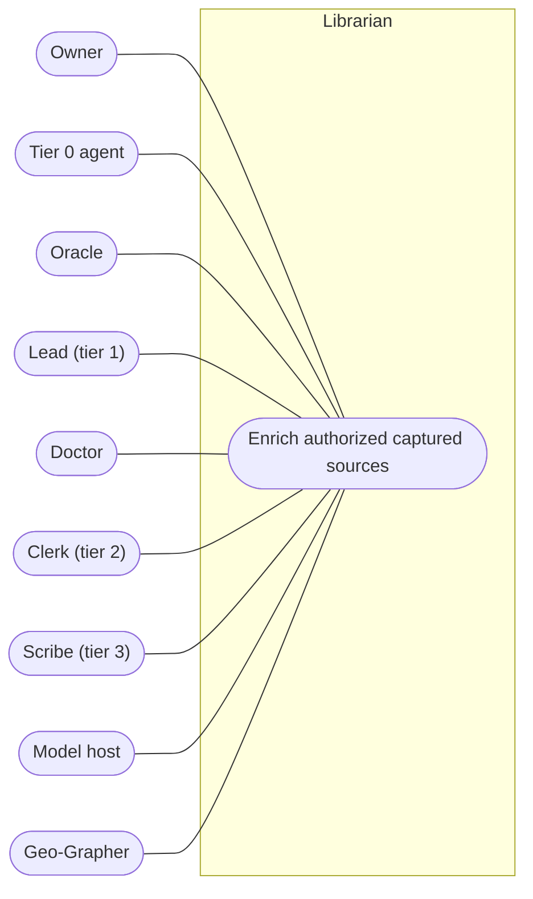

<!-- generated by render_proposal.py using the supplied render_spec.py; edit the spec -->
# Proposed to-be enrichment views

**Status:** proposed behavior for review. The [proposal](PROPOSAL.md) supplies the nine-field use case, current-versus-proposed comparison, source evidence and implementation boundaries.

These scenarios use the supplied prototype's extension-and-rejoin logic. They are not all combinations of repeated sources and faults, or evidence that the proposed pipeline has executed.

## Validation

No structural problems or cross-view/reference flags.

## Use case diagram



## Activity diagram

```mermaid
flowchart TD
  subgraph Owner["Owner"]
    a1["1. sets or has already authorized the enrichment goal, captured sources, required outputs, coverage and spending"]
    direct["commissions the Lead directly and owns the run specification"]
    ownerstart["decides the missing start, sensitivity or spending authority; existing authority is not asked for again"]
    downerstart{"authorized?"}
    repairperson["decides the explicit re-approval or additional authority needed for the affected repair work"]
    drepairperson{"repair re-entry approved?"}
    directreport["receives the Lead's enrichment result and Oracle verdict directly"]
    critical["receives critical security, data-loss or authority-boundary evidence immediately, with tier 0 when present"]
    critical_at_5709aeb668["receives critical security, data-loss or authority-boundary evidence immediately, with tier 0 when present"]
  end
  subgraph Tier_0_agent["Tier 0 agent"]
    a2["2. delegates the bounded enrichment to a Lead and sets its specification, including when supporting another project"]
    a22["22. reviews the handback once against the delegated goal without repeating the workers' tasks"]
    dhandback{"handback meets the delegated goal?"}
    tidy["returns evidence for one bounded tidy-up and independent recheck; the Lead and Doctor do work, the Oracle judges"]
    a23["23. returns the result to its active project or reports it to the Owner, with the remaining acceptance step explicit"]
  end
  subgraph Oracle["Oracle"]
    a20["20. judges the enrichment package against its specification: deterministic checks first, then isolated model judgement, with evidence for the verdict"]
    dverdict{"enrichment verdict?"}
  end
  subgraph Lead_tier_1_["Lead (tier 1)"]
    a3["3. owns completion and plans the run from accepted components without widening the parent's mandate"]
    nowork["returns no-source-work to the invoking parent or standalone commissioner; preserves the parent's pending decisions and original item accounting"]
    conversionroute{"retry affected conversion within the grant, retain fallback, or pause the affected work?"}
    readroute{"retry only pending affected tasks within the grant, keep queued gaps, or pause?"}
    realign["re-aligns within the specification using permitted actions; proposes new remedies for Owner acceptance rather than adding them itself"]
    drealign{"does the proposed correction address the cause with evidence of progress?"}
    partialreport["returns partial coverage and verdict to the invoking parent or standalone commissioner, with separate Source/lens worklists, named owners and known/unknown spend"]
    a21["21. hands back verdict, evidence, coverage, known/unknown spend and tickets; names separate owners and current states for Source and lens decisions"]
    paused["explains the pause, retained work and next decision or continuation needed; submits the checkpoint notice for delivery"]
    escalated["explains the unresolved issue, evidence and required intervention to tier 0 or the Owner, with completed and partial work accounted for"]
  end
  subgraph Doctor["Doctor"]
    radmit[["UC-D: resolves a mapped qualification or admission fault using an accepted remedy within scope"]]
    rwork[["UC-D: remedies a mapped enrichment shortfall, then returns the repair for independent Oracle recheck"]]
  end
  subgraph Clerk_tier_2_["Clerk (tier 2)"]
    conversionplan["assigns needed model-assisted transcription or cleanup to a Scribe within the approved route and allowance"]
    conversionreview["checks available conversion against original evidence for fidelity; records uncertainty and missing material; does not attest unread pages"]
    a7["7. assigns bounded part-reading tasks to Scribes, keeping source description separate from the requesting project's fit judgement"]
    a10["10. proofreads the readings and directs the existing lens chain: perspective, attention, blind challenge, role, probe and synthesis"]
    a11["11. reconciles the accumulated readings across the source, corroborates supported stances and resolves probes; records unfinished required derivations separately"]
    a13["13. data: proposes the organization of components, chapters and source claims using the readings and script-derived source structure"]
    a14["14. relate: relates fully read components with evidence, preserving inferred document relations and structurally observed repository relations"]
    a15["15. metadata: proposes content-model field values from the evidence, explains Unknowns and submits the proposal for acceptance"]
    a16["16. review: produces a grounded, kind-specific source draft and Bottom Line with evidence, coverage and explicit unread material"]
    a19["19. assembles the source enrichment proposal and reconciles its content, explaining gaps in reading, derivations, drafts or publication for the Oracle"]
    scout["investigates an unmapped shortfall from evidence and directs bounded Scribe scouting tasks"]
  end
  subgraph Scribe_tier_3_["Scribe (tier 3)"]
    conversionwork["transcribes or cleans the supplied material, preserves page or part anchors and explains any uncertain or missing content"]
    a8["8. reads assigned parts and returns located source-stated points, limits, term usages and candidate reasoning stances"]
  end
  subgraph Core["Core"]
    dentry{"recorded parent invocation or standalone commissioner?"}
    parentbind["binds the child to its invoking parent's authorized specification, Lead, source subset and receipt keys; no repeated Owner or tier-0 commissioning"]
    a4["4. checks specification schema, pinned IDs, recorded start authority, role qualifications, grants and counters; preserves the parent's batch ledger"]
    dadmit{"run admitted?"}
    stagecontract>"Target integration: Core checks grants, counters and critical flags at every dispatch/commit. Agents own meaning. Deferred routes return queued tasks; no silent model substitution."]
    a5["5. validate: checks source hashes, evidence, paths and compatible recipe/route receipts; applies stops and spend controls; old publication never bypasses fresh admission"]
    dvalidate{"source validation result?"}
    a6["6. parse: runs scripted AST, text or PDF extraction and page mapping; retains original evidence and records extraction limits"]
    dparse{"scripted extraction result?"}
    conversioncheck["checks returned fields, hashes and literal anchors; stores task outcomes and the Clerk's fidelity verdict with actual representation coverage"]
    dconversion{"conversion task and anchor-check status?"}
    conversiongap["retains returned cleanup-error partial or missing-material partial/queued status and usable raw extraction; absent content receives no reading credit"]
    conversionfallback["keeps unmapped cleanup unused; restores original page-mapped text; parse may complete only when usable text and no other gap remain"]
    conversionoutage["records transport code, attempts, retry-after and known/unknown cost; defers further equivalent calls on the failed route pending bounded direction"]
    dconversionretry{"retry counter, backoff, current qualification and existing grant permit this same-route attempt?"}
    a9["9. checks task schemas, literal quote locations and current-text receipt keys; counts completed parts and records queued or refused tasks"]
    dreadtransport{"recorded transport incident, critical flag or application task result?"}
    readoutage["records 429/timeout/unavailable route and bounded attempts; defers equivalent failed-route calls; retains task gaps, receipts and unpriced cost"]
    dreadretry{"same-route pending-task retry within counters, backoff, qualification and existing authority?"}
    dread{"recorded part-reading and required-derivation status?"}
    partialread["keeps completed part coverage separate from queued derivations and unread parts; later applicable stages use only the evidence actually obtained"]
    a12["12. lenses: schema-checks and persists agent-submitted proposals, dispositions, citations and discard reasons; keeps acceptance separate"]
    dlenses{"lenses stage failed?"}
    ddata{"Data proposal schema, reference and write status?"}
    drelate{"relate stage failed?"}
    dmetadata{"metadata proposal field, schema and write status?"}
    dreview{"source review failed?"}
    a17["17. publish: checks full reading/conversion, artifact binding and projection compatibility; freshly validates enabled, accepted, current, trusted folder assignment"]
    dpublication{"paper publication applicability and preparation?"}
    dpubresult{"publication result?"}
    pubna["records publication as not applicable for a non-PDF or a fully read PDF lacking a full-conversion artifact; retains its limitation"]
    pubgap["retains reading and the exact publication gap: FOLDER_STALE, awaiting_accepted_folder, disabled Geo, stale artifact or returned/caught failure"]
    itemfailed["records the failed stage and noncritical ticket; retains the item's completed work and leaves other frozen items runnable"]
    dmore{"unprocessed entries remain in the pinned source list?"}
    resume["checks requested scope and compatible receipts; unfinished work resumes pinned inputs; finished partials need re-approval/new batch; publication gets fresh admission"]
    dresume{"repair re-entry authorized and within the remaining allowance?"}
    drecipient{"recorded invoking parent or standalone specification owner?"}
    parentreturn["returns the child package and verdict to the invoking parent, which owns acceptance and the final Owner or tier-0 handoff"]
    dtidy{"within the declared tidy-up and final-pass allowance?"}
    delivered["records handback and separate Source-acceptance/lens-review worklists with actual states and owners; neither decision is implied by enrichment"]
  end
  subgraph Model_host["Model host"]
    host["answers the bounded tasks through qualified role assignments and the existing task pool"]
  end
  subgraph Geo_Grapher["Geo-Grapher"]
    a18["18. revalidates folder/artifact admission and publishes the eligible reading claims; reports actual result or late refusal; Source acceptance is separate"]
  end
  s(("start"))
  e1((("the enrichment specification is met; grounded outputs and the separate acceptance obligation are handed back")))
  epartial((("a permitted partial enrichment is returned with its true coverage and remaining work")))
  enowork((("no source work was admitted; the caller retains the accounted no-work result")))
  epaused((("the affected enrichment is paused for an explicit decision or authorized continuation")))
  eescalated((("the accountable actor receives the unresolved or critical enrichment failure")))
  eescalated_at_5709aeb668((("the accountable actor receives the unresolved or critical enrichment failure")))
  s --> a1
  a1 --> dentry
  dentry -->|"[standalone commission delegated by tier 0]"| a2
  dentry -->|"[standalone commission directly from Owner] 1a"| direct
  dentry -->|"[invoking parent supplies an existing authorized commission] 1b"| parentbind
  parentbind --> a3
  direct --> a3
  a2 --> a3
  a3 --> a4
  a4 --> dadmit
  dadmit -->|"[admitted nonempty source selection]"| stagecontract
  dadmit -->|"[noncritical missing explicit authority or reserved decision] 4a"| ownerstart
  dadmit -->|"[noncritical mapped admission fault with an accepted remedy] 4b"| radmit
  dadmit -->|"[noncritical unmapped admission fault or no suitable qualified independent assignment] 4c"| escalated
  dadmit -->|"[critical security, data-loss or authority-boundary fault] 4d"| critical
  dadmit -->|"[normal outcome: no source work selected or all selected work already settled] 4e"| nowork
  nowork --> enowork
  ownerstart --> downerstart
  downerstart -->|"[authorized]"| a4
  downerstart -->|"[declined or waiting]"| paused
  radmit -->|"[resolved]"| a4
  radmit -->|"[declined]"| paused
  radmit -->|"[escalated]"| escalated
  stagecontract --> a5
  a5 --> dvalidate
  dvalidate -->|"[valid and permitted]"| a6
  dvalidate -->|"[noncritical source validation failed] 5a"| itemfailed
  dvalidate -->|"[cancelled, interrupted or spending stop] 5b"| paused
  dvalidate -->|"[critical security, data-loss or boundary fault] 5c"| critical_at_5709aeb668
  a6 --> dparse
  dparse -->|"[noncritical and not failed; no model conversion requested; preserve actual partial or queued extraction status]"| a7
  dparse -->|"[noncritical uncaught stage failure] 6a"| itemfailed
  dparse -->|"[noncritical permitted model transcription or cleanup requested] 6b"| conversionplan
  dparse -->|"[critical integrity or authority-boundary finding] 6c"| critical
  conversionplan --> conversionwork
  conversionwork --> conversionreview
  conversionreview --> conversioncheck
  conversioncheck --> dconversion
  dconversion -->|"[noncritical usable mapped representation and Clerk review; retain actual complete or partial coverage]"| a7
  dconversion -->|"[noncritical, no transport outage: returned task error/refusal, or unusable representation without usable-original anchor fallback; retain partial/queued gaps]"| conversiongap
  dconversion -->|"[noncritical successful cleanup loses anchors; usable original page-mapped text and no transport outage]"| conversionfallback
  conversionfallback --> a7
  dconversion -->|"[noncritical uncaught stage/writer failure]"| itemfailed
  dconversion -->|"[critical integrity or authority-boundary finding]"| critical
  dconversion -->|"[noncritical transport 429, timeout or unavailable route]"| conversionoutage
  conversionoutage --> conversionroute
  conversionroute -->|"[Lead requests bounded same-route retry]"| dconversionretry
  dconversionretry -->|"[permitted bounded parse re-entry; reuse compatible extraction and retry only affected conversion work]"| a6
  dconversionretry -->|"[retry not currently permitted; retain returned-error partial or missing-material gaps]"| conversiongap
  conversionroute -->|"[retain usable fallback and exact returned-error partial or missing-material gaps]"| conversiongap
  conversionroute -->|"[pause affected work; no silent model substitution]"| paused
  conversiongap --> a7
  a7 --> a8
  a8 --> host
  host --> a9
  a9 --> dreadtransport
  dreadtransport -->|"[noncritical application task result; invalid JSON or grounding refusal remains task evidence, not transport success]"| a10
  dreadtransport -->|"[noncritical 429, timeout or unavailable route] 9a"| readoutage
  dreadtransport -->|"[critical integrity, false attestation or boundary finding] 9b"| critical
  readoutage --> readroute
  readroute -->|"[Lead requests bounded retry of pending tasks only]"| dreadretry
  dreadretry -->|"[permitted attempt; reuse matching completed tasks]"| a7
  dreadretry -->|"[retry not currently permitted; keep task gaps and defer failed-route dispatch]"| a10
  readroute -->|"[continue with actual queued gaps and completed evidence; failed route stays deferred]"| a10
  readroute -->|"[pause affected work; route reassignment requires fresh authorized qualification]"| paused
  a10 --> a11
  a11 --> dread
  dread -->|"[noncritical; parts read and required derivations complete or explicitly inapplicable]"| a12
  dread -->|"[noncritical, nonfailed and no new transport incident; unread parts or required derivations remain] 11a"| partialread
  dread -->|"[noncritical reading stage failed] 11b"| itemfailed
  dread -->|"[critical integrity, false attestation or boundary finding] 11c"| critical
  dread -->|"[noncritical new transport incident during lens or source-wide work] 11d"| readoutage
  partialread --> a12
  a12 --> dlenses
  dlenses -->|"[noncritical and not failed; optional rejection or none found is valid]"| a13
  dlenses -->|"[noncritical failed stage] 12a"| itemfailed
  dlenses -->|"[critical integrity, false attestation or boundary finding] 12b"| critical
  a13 --> ddata
  ddata -->|"[noncritical and not failed; preserve partial or inapplicable outcomes]"| a14
  ddata -->|"[noncritical failed stage] 13a"| itemfailed
  ddata -->|"[critical integrity, false attestation or boundary finding] 13b"| critical
  a14 --> drelate
  drelate -->|"[noncritical and not failed; preserve inferred origin, queued or inapplicable outcomes]"| a15
  drelate -->|"[noncritical failed stage] 14a"| itemfailed
  drelate -->|"[critical integrity, false attestation or boundary finding] 14b"| critical
  a15 --> dmetadata
  dmetadata -->|"[noncritical and not failed; unknown fields remain explicit]"| a16
  dmetadata -->|"[noncritical failed stage] 15a"| itemfailed
  dmetadata -->|"[critical integrity, false attestation or boundary finding] 15b"| critical
  a16 --> dreview
  dreview -->|"[noncritical and not failed; retain low confidence, partial or queued draft status]"| a17
  dreview -->|"[noncritical failed or refused source review] 16a"| itemfailed
  dreview -->|"[critical integrity, false attestation or boundary finding] 16b"| critical
  a17 --> dpublication
  dpublication -->|"[noncritical fully read PDF, compatible full conversion/artifact and freshly enabled, accepted, current, trusted folder assignment]"| a18
  dpublication -->|"[noncritical normal outcome: non-PDF, or fully read PDF without full conversion] 17a"| pubna
  dpublication -->|"[noncritical PDF reading incomplete, or full-reading/full-conversion artifact/folder admission blocked; preserve exact reason] 17b"| pubgap
  dpublication -->|"[noncritical uncaught publication preparation exception] 17c"| itemfailed
  dpublication -->|"[critical integrity or authority-boundary finding] 17d"| critical
  a18 --> dpubresult
  dpubresult -->|"[published with no critical finding]"| a19
  dpubresult -->|"[noncritical returned disabled/refused, late FOLDER_STALE/awaiting_accepted_folder/artifact mismatch or caught publication error] 18a"| pubgap
  dpubresult -->|"[noncritical uncaught stage failure] 18b"| itemfailed
  dpubresult -->|"[critical integrity, false attestation or boundary finding] 18c"| critical
  pubna --> a19
  pubgap --> a19
  itemfailed --> a19
  a19 --> dmore
  dmore -->|"[noncritical initial frozen set accounted for]"| a20
  dmore -->|"[noncritical another frozen source] 19a"| a5
  dmore -->|"[critical integrity, false attestation or boundary finding in package assembly] 19b"| critical
  a20 --> dverdict
  dverdict -->|"[specification met with no outstanding required output or declared partial-result gap]"| a21
  dverdict -->|"[only explicitly permitted declared gaps remain] 20a"| partialreport
  dverdict -->|"[noncritical mapped shortfall with an accepted bounded remedy] 20b"| rwork
  dverdict -->|"[noncritical unmapped shortfall, uncertainty or no accepted remedy] 20c"| scout
  dverdict -->|"[critical security, data-loss, attestation or authority-boundary finding] 20d"| critical
  rwork -->|"[resolved]"| resume
  rwork -->|"[declined]"| paused
  rwork -->|"[escalated]"| escalated
  resume --> dresume
  dresume -->|"[authorized affected work and allowance remaining]"| a5
  dresume -->|"[person re-approval or explicit authority needed]"| repairperson
  dresume -->|"[allowance exhausted, no progress or outside mandate]"| escalated
  repairperson --> drepairperson
  drepairperson -->|"[approved; re-admit changed authority and affected work]"| a4
  drepairperson -->|"[declined or waiting]"| paused
  scout --> realign
  realign --> drealign
  drealign -->|"[evidence supports a correction; request scripted authority and allowance checks]"| resume
  drealign -->|"[needs a code change, lacks a justified correction or shows no progress]"| escalated
  partialreport --> epartial
  a21 --> drecipient
  drecipient -->|"[standalone run; tier 0 owns this specification]"| a22
  drecipient -->|"[standalone run; Owner owns this specification] 21a"| directreport
  drecipient -->|"[invoked as a child of the parent process] 21b"| parentreturn
  parentreturn --> delivered
  a22 --> dhandback
  dhandback -->|"[ready]"| a23
  dhandback -->|"[bounded correction or recheck needed] 22a"| tidy
  tidy --> dtidy
  dtidy -->|"[one tidy-up remains; Oracle judges the submitted evidence]"| a20
  dtidy -->|"[final pass still fails or allowance exhausted]"| escalated
  a23 --> delivered
  directreport --> delivered
  delivered --> e1
  paused --> epaused
  escalated --> eescalated
  critical --> eescalated
  critical_at_5709aeb668 --> eescalated_at_5709aeb668
  classDef ext stroke:#d9534f,stroke-width:2px
```

## Written use case

The [use-case description](PROPOSAL.md#use-case-description) defines the goal, actors, preconditions, guarantee and assumptions.

**Main success scenario** (generated: the guard-true path, in step order)

1. The Owner sets or has already authorized the enrichment goal, captured sources, required outputs, coverage and spending.
2. The Tier 0 agent delegates the bounded enrichment to a Lead and sets its specification, including when supporting another project.
3. The Lead (tier 1) owns completion and plans the run from accepted components without widening the parent's mandate.
4. The Core checks specification schema, pinned IDs, recorded start authority, role qualifications, grants and counters; preserves the parent's batch ledger.
5. The Core validate: checks source hashes, evidence, paths and compatible recipe/route receipts; applies stops and spend controls; old publication never bypasses fresh admission.
6. The Core parse: runs scripted AST, text or PDF extraction and page mapping; retains original evidence and records extraction limits.
7. The Clerk (tier 2) assigns bounded part-reading tasks to Scribes, keeping source description separate from the requesting project's fit judgement.
8. The Scribe (tier 3) reads assigned parts and returns located source-stated points, limits, term usages and candidate reasoning stances.
9. The Core checks task schemas, literal quote locations and current-text receipt keys; counts completed parts and records queued or refused tasks.
10. The Clerk (tier 2) proofreads the readings and directs the existing lens chain: perspective, attention, blind challenge, role, probe and synthesis.
11. The Clerk (tier 2) reconciles the accumulated readings across the source, corroborates supported stances and resolves probes; records unfinished required derivations separately.
12. The Core lenses: schema-checks and persists agent-submitted proposals, dispositions, citations and discard reasons; keeps acceptance separate.
13. The Clerk (tier 2) data: proposes the organization of components, chapters and source claims using the readings and script-derived source structure.
14. The Clerk (tier 2) relate: relates fully read components with evidence, preserving inferred document relations and structurally observed repository relations.
15. The Clerk (tier 2) metadata: proposes content-model field values from the evidence, explains Unknowns and submits the proposal for acceptance.
16. The Clerk (tier 2) review: produces a grounded, kind-specific source draft and Bottom Line with evidence, coverage and explicit unread material.
17. The Core publish: checks full reading/conversion, artifact binding and projection compatibility; freshly validates enabled, accepted, current, trusted folder assignment.
18. The Geo-Grapher revalidates folder/artifact admission and publishes the eligible reading claims; reports actual result or late refusal; Source acceptance is separate.
19. The Clerk (tier 2) assembles the source enrichment proposal and reconciles its content, explaining gaps in reading, derivations, drafts or publication for the Oracle.
20. The Oracle judges the enrichment package against its specification: deterministic checks first, then isolated model judgement, with evidence for the verdict.
21. The Lead (tier 1) hands back verdict, evidence, coverage, known/unknown spend and tickets; names separate owners and current states for Source and lens decisions.
22. The Tier 0 agent reviews the handback once against the delegated goal without repeating the workers' tasks.
23. The Tier 0 agent returns the result to its active project or reports it to the Owner, with the remaining acceptance step explicit.

**Extensions** (generated: one per non-happy guard; numbered by the step it leaves)

- **1a** (from: recorded parent invocation or standalone commissioner?) *anticipated*
  - `1a1` Standalone commission directly from Owner.
  - `1a2` The Owner commissions the Lead directly and owns the run specification.
  - `1a3` Rejoin at 3.
- **1b** (from: recorded parent invocation or standalone commissioner?) *anticipated*
  - `1b1` Invoking parent supplies an existing authorized commission.
  - `1b2` The Core binds the child to its invoking parent's authorized specification, Lead, source subset and receipt keys; no repeated Owner or tier-0 commissioning.
  - `1b3` Rejoin at 3.
- **4a** (from: run admitted?) *anticipated*
  - `4a1` Noncritical missing explicit authority or reserved decision.
  - `4a2` The Owner decides the missing start, sensitivity or spending authority; existing authority is not asked for again.
  - `4a3` The Owner decides: authorized?
  - `4a3a` If declined or waiting: explains the pause, retained work and next decision or continuation needed; submits the checkpoint notice for delivery.
  - `4a4` If authorized:
  - `4a5` Rejoin at 4.
- **4b** (from: run admitted?) *anticipated*
  - `4b1` Noncritical mapped admission fault with an accepted remedy.
  - `4b2` The Doctor resolves a mapped qualification or admission fault using an accepted remedy within scope (continues in UC-D).
  - `4b2a` If declined: explains the pause, retained work and next decision or continuation needed; submits the checkpoint notice for delivery.
  - `4b2a` If escalated: explains the unresolved issue, evidence and required intervention to tier 0 or the Owner, with completed and partial work accounted for.
  - `4b3` If resolved:
  - `4b4` Rejoin at 4.
- **4c** (from: run admitted?) *anticipated*
  - `4c1` Noncritical unmapped admission fault or no suitable qualified independent assignment.
  - `4c2` The Lead (tier 1) explains the unresolved issue, evidence and required intervention to tier 0 or the Owner, with completed and partial work accounted for.
  - `4c3` The use case ends: the accountable actor receives the unresolved or critical enrichment failure.
- **4d** (from: run admitted?) *anticipated*
  - `4d1` Critical security, data-loss or authority-boundary fault.
  - `4d2` The Owner receives critical security, data-loss or authority-boundary evidence immediately, with tier 0 when present.
  - `4d3` The use case ends: the accountable actor receives the unresolved or critical enrichment failure.
- **4e** (from: run admitted?) *anticipated*
  - `4e1` Normal outcome: no source work selected or all selected work already settled.
  - `4e2` The Lead (tier 1) returns no-source-work to the invoking parent or standalone commissioner; preserves the parent's pending decisions and original item accounting.
  - `4e3` The use case ends: no source work was admitted; the caller retains the accounted no-work result.
- **5a** (from: source validation result?) *anticipated*
  - `5a1` Noncritical source validation failed.
  - `5a2` The Core records the failed stage and noncritical ticket; retains the item's completed work and leaves other frozen items runnable.
  - `5a3` Rejoin at 19.
- **5b** (from: source validation result?) *anticipated*
  - `5b1` Cancelled, interrupted or spending stop.
  - `5b2` The Lead (tier 1) explains the pause, retained work and next decision or continuation needed; submits the checkpoint notice for delivery.
  - `5b3` The use case ends: the affected enrichment is paused for an explicit decision or authorized continuation.
- **5c** (from: source validation result?) *anticipated*
  - `5c1` Critical security, data-loss or boundary fault.
  - `5c2` The Owner receives critical security, data-loss or authority-boundary evidence immediately, with tier 0 when present.
  - `5c3` The use case ends: the accountable actor receives the unresolved or critical enrichment failure.
- **6a** (from: scripted extraction result?) *anticipated*
  - `6a1` Noncritical uncaught stage failure.
  - `6a2` The Core records the failed stage and noncritical ticket; retains the item's completed work and leaves other frozen items runnable.
  - `6a3` Rejoin at 19.
- **6b** (from: scripted extraction result?) *anticipated*
  - `6b1` Noncritical permitted model transcription or cleanup requested.
  - `6b2` The Clerk (tier 2) assigns needed model-assisted transcription or cleanup to a Scribe within the approved route and allowance.
  - `6b3` The Scribe (tier 3) transcribes or cleans the supplied material, preserves page or part anchors and explains any uncertain or missing content.
  - `6b4` The Clerk (tier 2) checks available conversion against original evidence for fidelity; records uncertainty and missing material; does not attest unread pages.
  - `6b5` The Core checks returned fields, hashes and literal anchors; stores task outcomes and the Clerk's fidelity verdict with actual representation coverage.
  - `6b6` The Core decides: conversion task and anchor-check status?
  - `6b6a` If noncritical, no transport outage: returned task error/refusal, or unusable representation without usable-original anchor fallback; retain partial/queued gaps: retains returned cleanup-error partial or missing-material partial/queued status and usable raw extraction; absent content receives no reading credit.
  - `6b6a` If noncritical successful cleanup loses anchors; usable original page-mapped text and no transport outage: keeps unmapped cleanup unused; restores original page-mapped text; parse may complete only when usable text and no other gap remain.
  - `6b6a` If noncritical uncaught stage/writer failure: records the failed stage and noncritical ticket; retains the item's completed work and leaves other frozen items runnable.
  - `6b6a` If critical integrity or authority-boundary finding: receives critical security, data-loss or authority-boundary evidence immediately, with tier 0 when present.
  - `6b6a` If noncritical transport 429, timeout or unavailable route: records transport code, attempts, retry-after and known/unknown cost; defers further equivalent calls on the failed route pending bounded direction.
  - `6b7` If noncritical usable mapped representation and Clerk review; retain actual complete or partial coverage:
  - `6b8` Rejoin at 7.
- **6c** (from: scripted extraction result?) *anticipated*
  - `6c1` Critical integrity or authority-boundary finding.
  - `6c2` The Owner receives critical security, data-loss or authority-boundary evidence immediately, with tier 0 when present.
  - `6c3` The use case ends: the accountable actor receives the unresolved or critical enrichment failure.
- **9a** (from: recorded transport incident, critical flag or application task result?) *anticipated*
  - `9a1` Noncritical 429, timeout or unavailable route.
  - `9a2` The Core records 429/timeout/unavailable route and bounded attempts; defers equivalent failed-route calls; retains task gaps, receipts and unpriced cost.
  - `9a3` The Lead (tier 1) decides: retry only pending affected tasks within the grant, keep queued gaps, or pause?
  - `9a3a` If continue with actual queued gaps and completed evidence; failed route stays deferred: rejoin at 10.
  - `9a3a` If pause affected work; route reassignment requires fresh authorized qualification: explains the pause, retained work and next decision or continuation needed; submits the checkpoint notice for delivery.
  - `9a4` If Lead requests bounded retry of pending tasks only:
  - `9a5` The Core decides: same-route pending-task retry within counters, backoff, qualification and existing authority?
  - `9a5a` If retry not currently permitted; keep task gaps and defer failed-route dispatch: rejoin at 10.
  - `9a6` If permitted attempt; reuse matching completed tasks:
  - `9a7` Rejoin at 7.
- **9b** (from: recorded transport incident, critical flag or application task result?) *anticipated*
  - `9b1` Critical integrity, false attestation or boundary finding.
  - `9b2` The Owner receives critical security, data-loss or authority-boundary evidence immediately, with tier 0 when present.
  - `9b3` The use case ends: the accountable actor receives the unresolved or critical enrichment failure.
- **11a** (from: recorded part-reading and required-derivation status?) *anticipated*
  - `11a1` Noncritical, nonfailed and no new transport incident; unread parts or required derivations remain.
  - `11a2` The Core keeps completed part coverage separate from queued derivations and unread parts; later applicable stages use only the evidence actually obtained.
  - `11a3` Rejoin at 12.
- **11b** (from: recorded part-reading and required-derivation status?) *anticipated*
  - `11b1` Noncritical reading stage failed.
  - `11b2` The Core records the failed stage and noncritical ticket; retains the item's completed work and leaves other frozen items runnable.
  - `11b3` Rejoin at 19.
- **11c** (from: recorded part-reading and required-derivation status?) *anticipated*
  - `11c1` Critical integrity, false attestation or boundary finding.
  - `11c2` The Owner receives critical security, data-loss or authority-boundary evidence immediately, with tier 0 when present.
  - `11c3` The use case ends: the accountable actor receives the unresolved or critical enrichment failure.
- **11d** (from: recorded part-reading and required-derivation status?) *anticipated*
  - `11d1` Noncritical new transport incident during lens or source-wide work.
  - `11d2` The Core records 429/timeout/unavailable route and bounded attempts; defers equivalent failed-route calls; retains task gaps, receipts and unpriced cost.
  - `11d3` The Lead (tier 1) decides: retry only pending affected tasks within the grant, keep queued gaps, or pause?
  - `11d3a` If continue with actual queued gaps and completed evidence; failed route stays deferred: rejoin at 10.
  - `11d3a` If pause affected work; route reassignment requires fresh authorized qualification: explains the pause, retained work and next decision or continuation needed; submits the checkpoint notice for delivery.
  - `11d4` If Lead requests bounded retry of pending tasks only:
  - `11d5` The Core decides: same-route pending-task retry within counters, backoff, qualification and existing authority?
  - `11d5a` If retry not currently permitted; keep task gaps and defer failed-route dispatch: rejoin at 10.
  - `11d6` If permitted attempt; reuse matching completed tasks:
  - `11d7` Rejoin at 7.
- **12a** (from: lenses stage failed?) *anticipated*
  - `12a1` Noncritical failed stage.
  - `12a2` The Core records the failed stage and noncritical ticket; retains the item's completed work and leaves other frozen items runnable.
  - `12a3` Rejoin at 19.
- **12b** (from: lenses stage failed?) *anticipated*
  - `12b1` Critical integrity, false attestation or boundary finding.
  - `12b2` The Owner receives critical security, data-loss or authority-boundary evidence immediately, with tier 0 when present.
  - `12b3` The use case ends: the accountable actor receives the unresolved or critical enrichment failure.
- **13a** (from: Data proposal schema, reference and write status?) *anticipated*
  - `13a1` Noncritical failed stage.
  - `13a2` The Core records the failed stage and noncritical ticket; retains the item's completed work and leaves other frozen items runnable.
  - `13a3` Rejoin at 19.
- **13b** (from: Data proposal schema, reference and write status?) *anticipated*
  - `13b1` Critical integrity, false attestation or boundary finding.
  - `13b2` The Owner receives critical security, data-loss or authority-boundary evidence immediately, with tier 0 when present.
  - `13b3` The use case ends: the accountable actor receives the unresolved or critical enrichment failure.
- **14a** (from: relate stage failed?) *anticipated*
  - `14a1` Noncritical failed stage.
  - `14a2` The Core records the failed stage and noncritical ticket; retains the item's completed work and leaves other frozen items runnable.
  - `14a3` Rejoin at 19.
- **14b** (from: relate stage failed?) *anticipated*
  - `14b1` Critical integrity, false attestation or boundary finding.
  - `14b2` The Owner receives critical security, data-loss or authority-boundary evidence immediately, with tier 0 when present.
  - `14b3` The use case ends: the accountable actor receives the unresolved or critical enrichment failure.
- **15a** (from: metadata proposal field, schema and write status?) *anticipated*
  - `15a1` Noncritical failed stage.
  - `15a2` The Core records the failed stage and noncritical ticket; retains the item's completed work and leaves other frozen items runnable.
  - `15a3` Rejoin at 19.
- **15b** (from: metadata proposal field, schema and write status?) *anticipated*
  - `15b1` Critical integrity, false attestation or boundary finding.
  - `15b2` The Owner receives critical security, data-loss or authority-boundary evidence immediately, with tier 0 when present.
  - `15b3` The use case ends: the accountable actor receives the unresolved or critical enrichment failure.
- **16a** (from: source review failed?) *anticipated*
  - `16a1` Noncritical failed or refused source review.
  - `16a2` The Core records the failed stage and noncritical ticket; retains the item's completed work and leaves other frozen items runnable.
  - `16a3` Rejoin at 19.
- **16b** (from: source review failed?) *anticipated*
  - `16b1` Critical integrity, false attestation or boundary finding.
  - `16b2` The Owner receives critical security, data-loss or authority-boundary evidence immediately, with tier 0 when present.
  - `16b3` The use case ends: the accountable actor receives the unresolved or critical enrichment failure.
- **17a** (from: paper publication applicability and preparation?) *anticipated*
  - `17a1` Noncritical normal outcome: non-PDF, or fully read PDF without full conversion.
  - `17a2` The Core records publication as not applicable for a non-PDF or a fully read PDF lacking a full-conversion artifact; retains its limitation.
  - `17a3` Rejoin at 19.
- **17b** (from: paper publication applicability and preparation?) *anticipated*
  - `17b1` Noncritical PDF reading incomplete, or full-reading/full-conversion artifact/folder admission blocked; preserve exact reason.
  - `17b2` The Core retains reading and the exact publication gap: FOLDER_STALE, awaiting_accepted_folder, disabled Geo, stale artifact or returned/caught failure.
  - `17b3` Rejoin at 19.
- **17c** (from: paper publication applicability and preparation?) *anticipated*
  - `17c1` Noncritical uncaught publication preparation exception.
  - `17c2` The Core records the failed stage and noncritical ticket; retains the item's completed work and leaves other frozen items runnable.
  - `17c3` Rejoin at 19.
- **17d** (from: paper publication applicability and preparation?) *anticipated*
  - `17d1` Critical integrity or authority-boundary finding.
  - `17d2` The Owner receives critical security, data-loss or authority-boundary evidence immediately, with tier 0 when present.
  - `17d3` The use case ends: the accountable actor receives the unresolved or critical enrichment failure.
- **18a** (from: publication result?) *anticipated*
  - `18a1` Noncritical returned disabled/refused, late FOLDER_STALE/awaiting_accepted_folder/artifact mismatch or caught publication error.
  - `18a2` The Core retains reading and the exact publication gap: FOLDER_STALE, awaiting_accepted_folder, disabled Geo, stale artifact or returned/caught failure.
  - `18a3` Rejoin at 19.
- **18b** (from: publication result?) *anticipated*
  - `18b1` Noncritical uncaught stage failure.
  - `18b2` The Core records the failed stage and noncritical ticket; retains the item's completed work and leaves other frozen items runnable.
  - `18b3` Rejoin at 19.
- **18c** (from: publication result?) *anticipated*
  - `18c1` Critical integrity, false attestation or boundary finding.
  - `18c2` The Owner receives critical security, data-loss or authority-boundary evidence immediately, with tier 0 when present.
  - `18c3` The use case ends: the accountable actor receives the unresolved or critical enrichment failure.
- **19a** (from: unprocessed entries remain in the pinned source list?) *anticipated*
  - `19a1` Noncritical another frozen source.
  - `19a2` Rejoin at 5.
- **19b** (from: unprocessed entries remain in the pinned source list?) *anticipated*
  - `19b1` Critical integrity, false attestation or boundary finding in package assembly.
  - `19b2` The Owner receives critical security, data-loss or authority-boundary evidence immediately, with tier 0 when present.
  - `19b3` The use case ends: the accountable actor receives the unresolved or critical enrichment failure.
- **20a** (from: enrichment verdict?) *anticipated*
  - `20a1` Only explicitly permitted declared gaps remain.
  - `20a2` The Lead (tier 1) returns partial coverage and verdict to the invoking parent or standalone commissioner, with separate Source/lens worklists, named owners and known/unknown spend.
  - `20a3` The use case ends: a permitted partial enrichment is returned with its true coverage and remaining work.
- **20b** (from: enrichment verdict?) *anticipated*
  - `20b1` Noncritical mapped shortfall with an accepted bounded remedy.
  - `20b2` The Doctor remedies a mapped enrichment shortfall, then returns the repair for independent Oracle recheck (continues in UC-D).
  - `20b2a` If declined: explains the pause, retained work and next decision or continuation needed; submits the checkpoint notice for delivery.
  - `20b2a` If escalated: explains the unresolved issue, evidence and required intervention to tier 0 or the Owner, with completed and partial work accounted for.
  - `20b3` If resolved:
  - `20b4` The Core checks requested scope and compatible receipts; unfinished work resumes pinned inputs; finished partials need re-approval/new batch; publication gets fresh admission.
  - `20b5` The Core decides: repair re-entry authorized and within the remaining allowance?
  - `20b5a` If person re-approval or explicit authority needed: decides the explicit re-approval or additional authority needed for the affected repair work.
  - `20b5a` If allowance exhausted, no progress or outside mandate: explains the unresolved issue, evidence and required intervention to tier 0 or the Owner, with completed and partial work accounted for.
  - `20b6` If authorized affected work and allowance remaining:
  - `20b7` Rejoin at 5.
- **20c** (from: enrichment verdict?) *anticipated*
  - `20c1` Noncritical unmapped shortfall, uncertainty or no accepted remedy.
  - `20c2` The Clerk (tier 2) investigates an unmapped shortfall from evidence and directs bounded Scribe scouting tasks.
  - `20c3` The Lead (tier 1) re-aligns within the specification using permitted actions; proposes new remedies for Owner acceptance rather than adding them itself.
  - `20c4` The Lead (tier 1) decides: does the proposed correction address the cause with evidence of progress?
  - `20c4a` If needs a code change, lacks a justified correction or shows no progress: explains the unresolved issue, evidence and required intervention to tier 0 or the Owner, with completed and partial work accounted for.
  - `20c5` If evidence supports a correction; request scripted authority and allowance checks:
  - `20c6` The Core checks requested scope and compatible receipts; unfinished work resumes pinned inputs; finished partials need re-approval/new batch; publication gets fresh admission.
  - `20c7` The Core decides: repair re-entry authorized and within the remaining allowance?
  - `20c7a` If person re-approval or explicit authority needed: decides the explicit re-approval or additional authority needed for the affected repair work.
  - `20c7a` If allowance exhausted, no progress or outside mandate: explains the unresolved issue, evidence and required intervention to tier 0 or the Owner, with completed and partial work accounted for.
  - `20c8` If authorized affected work and allowance remaining:
  - `20c9` Rejoin at 5.
- **20d** (from: enrichment verdict?) *anticipated*
  - `20d1` Critical security, data-loss, attestation or authority-boundary finding.
  - `20d2` The Owner receives critical security, data-loss or authority-boundary evidence immediately, with tier 0 when present.
  - `20d3` The use case ends: the accountable actor receives the unresolved or critical enrichment failure.
- **21a** (from: recorded invoking parent or standalone specification owner?) *anticipated*
  - `21a1` Standalone run; Owner owns this specification.
  - `21a2` The Owner receives the Lead's enrichment result and Oracle verdict directly.
  - `21a3` The Core records handback and separate Source-acceptance/lens-review worklists with actual states and owners; neither decision is implied by enrichment.
  - `21a4` The use case ends: the enrichment specification is met; grounded outputs and the separate acceptance obligation are handed back.
- **21b** (from: recorded invoking parent or standalone specification owner?) *anticipated*
  - `21b1` Invoked as a child of the parent process.
  - `21b2` The Core returns the child package and verdict to the invoking parent, which owns acceptance and the final Owner or tier-0 handoff.
  - `21b3` The Core records handback and separate Source-acceptance/lens-review worklists with actual states and owners; neither decision is implied by enrichment.
  - `21b4` The use case ends: the enrichment specification is met; grounded outputs and the separate acceptance obligation are handed back.
- **22a** (from: handback meets the delegated goal?) *anticipated*
  - `22a1` Bounded correction or recheck needed.
  - `22a2` The Tier 0 agent returns evidence for one bounded tidy-up and independent recheck; the Lead and Doctor do work, the Oracle judges.
  - `22a3` The Core decides: within the declared tidy-up and final-pass allowance?
  - `22a3a` If final pass still fails or allowance exhausted: explains the unresolved issue, evidence and required intervention to tier 0 or the Owner, with completed and partial work accounted for.
  - `22a4` If one tidy-up remains; Oracle judges the submitted evidence:
  - `22a5` Rejoin at 20.

## Lane load

| Lane | On the main success scenario | Anywhere in the diagram |
|---|---|---|
| Owner | 1 | 9 |
| Tier 0 agent | 4 | 5 |
| Oracle | 2 | 2 |
| Lead (tier 1) | 2 | 10 |
| Doctor | 0 | 2 |
| Clerk (tier 2) | 8 | 11 |
| Scribe (tier 3) | 1 | 2 |
| Core | 22 | 39 |
| Model host | 1 | 1 |
| Geo-Grapher | 1 | 1 |

**Tier-0 turns** (each return of control to tier 0; owner's scale: 2 ideal, 3 expected, 4 rusty, 5–10 bad, more: might as well have done it themselves). Main success scenario: **2 (ideal)**. Worst path: T73, **3 (expected)**. Paths by grade: ideal 50, expected 1; escalated 22 (failures, not graded).

Paths by how they end: **escalated** 22, **partial** 1, **paused** 9, **reused** 1, **success** 1. Every *escalated* path is a failure of this use case: the work went back to tier 0.

## Decision tree with 73 extension scenarios

```text
start: Proposed to-be enrichment
                                  └─ T1: standalone commission delegated by tier 0 / admitted nonempty source selection / valid and permitted / noncritical and not failed; no model conversion requested; preserve actual partial or queued extraction status / noncritical application task result; invalid JSON or grounding refusal remains task evidence, not transport success / noncritical; parts read and required derivations complete or explicitly inapplicable / noncritical and not failed; optional rejection or none found is valid / noncritical and not failed; preserve partial or inapplicable outcomes / noncritical and not failed; preserve inferred origin, queued or inapplicable outcomes / noncritical and not failed; unknown fields remain explicit / noncritical and not failed; retain low confidence, partial or queued draft status / noncritical fully read PDF, compatible full conversion/artifact and freshly enabled, accepted, current, trusted folder assignment / published with no critical finding / noncritical initial frozen set accounted for / specification met with no outstanding required output or declared partial-result gap / standalone run; tier 0 owns this specification / ready  ⇒ the enrichment specification is met; grounded outputs and the separate acceptance obligation are handed back
  └─ T2: standalone commission directly from Owner  ⇒ rejoins at step 3
  └─ T3: invoking parent supplies an existing authorized commission  ⇒ rejoins at step 3
      └─ T4: standalone commission delegated by tier 0 / noncritical missing explicit authority or reserved decision / declined or waiting  ⇒ the affected enrichment is paused for an explicit decision or authorized continuation
      └─ T5: standalone commission delegated by tier 0 / noncritical missing explicit authority or reserved decision / authorized  ⇒ rejoins at step 4
      └─ T6: standalone commission delegated by tier 0 / noncritical mapped admission fault with an accepted remedy / declined  ⇒ the affected enrichment is paused for an explicit decision or authorized continuation
      └─ T7: standalone commission delegated by tier 0 / noncritical mapped admission fault with an accepted remedy / escalated  ⇒ the accountable actor receives the unresolved or critical enrichment failure
      └─ T8: standalone commission delegated by tier 0 / noncritical mapped admission fault with an accepted remedy / resolved  ⇒ rejoins at step 4
    └─ T9: standalone commission delegated by tier 0 / noncritical unmapped admission fault or no suitable qualified independent assignment  ⇒ the accountable actor receives the unresolved or critical enrichment failure
    └─ T10: standalone commission delegated by tier 0 / critical security, data-loss or authority-boundary fault  ⇒ the accountable actor receives the unresolved or critical enrichment failure
    └─ T11: standalone commission delegated by tier 0 / normal outcome: no source work selected or all selected work already settled  ⇒ no source work was admitted; the caller retains the accounted no-work result
      └─ T12: standalone commission delegated by tier 0 / admitted nonempty source selection / noncritical source validation failed  ⇒ rejoins at step 19
      └─ T13: standalone commission delegated by tier 0 / admitted nonempty source selection / cancelled, interrupted or spending stop  ⇒ the affected enrichment is paused for an explicit decision or authorized continuation
      └─ T14: standalone commission delegated by tier 0 / admitted nonempty source selection / critical security, data-loss or boundary fault  ⇒ the accountable actor receives the unresolved or critical enrichment failure
        └─ T15: standalone commission delegated by tier 0 / admitted nonempty source selection / valid and permitted / noncritical uncaught stage failure  ⇒ rejoins at step 19
          └─ T16: standalone commission delegated by tier 0 / admitted nonempty source selection / valid and permitted / noncritical permitted model transcription or cleanup requested / noncritical, no transport outage: returned task error/refusal, or unusable representation without usable-original anchor fallback; retain partial/queued gaps  ⇒ rejoins at step 7
          └─ T17: standalone commission delegated by tier 0 / admitted nonempty source selection / valid and permitted / noncritical permitted model transcription or cleanup requested / noncritical successful cleanup loses anchors; usable original page-mapped text and no transport outage  ⇒ rejoins at step 7
          └─ T18: standalone commission delegated by tier 0 / admitted nonempty source selection / valid and permitted / noncritical permitted model transcription or cleanup requested / noncritical uncaught stage/writer failure  ⇒ rejoins at step 19
          └─ T19: standalone commission delegated by tier 0 / admitted nonempty source selection / valid and permitted / noncritical permitted model transcription or cleanup requested / critical integrity or authority-boundary finding  ⇒ the accountable actor receives the unresolved or critical enrichment failure
            └─ T20: standalone commission delegated by tier 0 / admitted nonempty source selection / valid and permitted / noncritical permitted model transcription or cleanup requested / noncritical transport 429, timeout or unavailable route / retain usable fallback and exact returned-error partial or missing-material gaps  ⇒ rejoins at step 7
            └─ T21: standalone commission delegated by tier 0 / admitted nonempty source selection / valid and permitted / noncritical permitted model transcription or cleanup requested / noncritical transport 429, timeout or unavailable route / pause affected work; no silent model substitution  ⇒ the affected enrichment is paused for an explicit decision or authorized continuation
              └─ T22: standalone commission delegated by tier 0 / admitted nonempty source selection / valid and permitted / noncritical permitted model transcription or cleanup requested / noncritical transport 429, timeout or unavailable route / Lead requests bounded same-route retry / retry not currently permitted; retain returned-error partial or missing-material gaps  ⇒ rejoins at step 7
              └─ T23: standalone commission delegated by tier 0 / admitted nonempty source selection / valid and permitted / noncritical permitted model transcription or cleanup requested / noncritical transport 429, timeout or unavailable route / Lead requests bounded same-route retry / permitted bounded parse re-entry; reuse compatible extraction and retry only affected conversion work  ⇒ rejoins at step 6
          └─ T24: standalone commission delegated by tier 0 / admitted nonempty source selection / valid and permitted / noncritical permitted model transcription or cleanup requested / noncritical usable mapped representation and Clerk review; retain actual complete or partial coverage  ⇒ rejoins at step 7
        └─ T25: standalone commission delegated by tier 0 / admitted nonempty source selection / valid and permitted / critical integrity or authority-boundary finding  ⇒ the accountable actor receives the unresolved or critical enrichment failure
            └─ T26: standalone commission delegated by tier 0 / admitted nonempty source selection / valid and permitted / noncritical and not failed; no model conversion requested; preserve actual partial or queued extraction status / noncritical 429, timeout or unavailable route / continue with actual queued gaps and completed evidence; failed route stays deferred  ⇒ rejoins at step 10
            └─ T27: standalone commission delegated by tier 0 / admitted nonempty source selection / valid and permitted / noncritical and not failed; no model conversion requested; preserve actual partial or queued extraction status / noncritical 429, timeout or unavailable route / pause affected work; route reassignment requires fresh authorized qualification  ⇒ the affected enrichment is paused for an explicit decision or authorized continuation
              └─ T28: standalone commission delegated by tier 0 / admitted nonempty source selection / valid and permitted / noncritical and not failed; no model conversion requested; preserve actual partial or queued extraction status / noncritical 429, timeout or unavailable route / Lead requests bounded retry of pending tasks only / retry not currently permitted; keep task gaps and defer failed-route dispatch  ⇒ rejoins at step 10
              └─ T29: standalone commission delegated by tier 0 / admitted nonempty source selection / valid and permitted / noncritical and not failed; no model conversion requested; preserve actual partial or queued extraction status / noncritical 429, timeout or unavailable route / Lead requests bounded retry of pending tasks only / permitted attempt; reuse matching completed tasks  ⇒ rejoins at step 7
          └─ T30: standalone commission delegated by tier 0 / admitted nonempty source selection / valid and permitted / noncritical and not failed; no model conversion requested; preserve actual partial or queued extraction status / critical integrity, false attestation or boundary finding  ⇒ the accountable actor receives the unresolved or critical enrichment failure
            └─ T31: standalone commission delegated by tier 0 / admitted nonempty source selection / valid and permitted / noncritical and not failed; no model conversion requested; preserve actual partial or queued extraction status / noncritical application task result; invalid JSON or grounding refusal remains task evidence, not transport success / noncritical, nonfailed and no new transport incident; unread parts or required derivations remain  ⇒ rejoins at step 12
            └─ T32: standalone commission delegated by tier 0 / admitted nonempty source selection / valid and permitted / noncritical and not failed; no model conversion requested; preserve actual partial or queued extraction status / noncritical application task result; invalid JSON or grounding refusal remains task evidence, not transport success / noncritical reading stage failed  ⇒ rejoins at step 19
            └─ T33: standalone commission delegated by tier 0 / admitted nonempty source selection / valid and permitted / noncritical and not failed; no model conversion requested; preserve actual partial or queued extraction status / noncritical application task result; invalid JSON or grounding refusal remains task evidence, not transport success / critical integrity, false attestation or boundary finding  ⇒ the accountable actor receives the unresolved or critical enrichment failure
              └─ T34: standalone commission delegated by tier 0 / admitted nonempty source selection / valid and permitted / noncritical and not failed; no model conversion requested; preserve actual partial or queued extraction status / noncritical application task result; invalid JSON or grounding refusal remains task evidence, not transport success / noncritical new transport incident during lens or source-wide work / continue with actual queued gaps and completed evidence; failed route stays deferred  ⇒ rejoins at step 10
              └─ T35: standalone commission delegated by tier 0 / admitted nonempty source selection / valid and permitted / noncritical and not failed; no model conversion requested; preserve actual partial or queued extraction status / noncritical application task result; invalid JSON or grounding refusal remains task evidence, not transport success / noncritical new transport incident during lens or source-wide work / pause affected work; route reassignment requires fresh authorized qualification  ⇒ the affected enrichment is paused for an explicit decision or authorized continuation
                └─ T36: standalone commission delegated by tier 0 / admitted nonempty source selection / valid and permitted / noncritical and not failed; no model conversion requested; preserve actual partial or queued extraction status / noncritical application task result; invalid JSON or grounding refusal remains task evidence, not transport success / noncritical new transport incident during lens or source-wide work / Lead requests bounded retry of pending tasks only / retry not currently permitted; keep task gaps and defer failed-route dispatch  ⇒ rejoins at step 10
                └─ T37: standalone commission delegated by tier 0 / admitted nonempty source selection / valid and permitted / noncritical and not failed; no model conversion requested; preserve actual partial or queued extraction status / noncritical application task result; invalid JSON or grounding refusal remains task evidence, not transport success / noncritical new transport incident during lens or source-wide work / Lead requests bounded retry of pending tasks only / permitted attempt; reuse matching completed tasks  ⇒ rejoins at step 7
              └─ T38: standalone commission delegated by tier 0 / admitted nonempty source selection / valid and permitted / noncritical and not failed; no model conversion requested; preserve actual partial or queued extraction status / noncritical application task result; invalid JSON or grounding refusal remains task evidence, not transport success / noncritical; parts read and required derivations complete or explicitly inapplicable / noncritical failed stage  ⇒ rejoins at step 19
              └─ T39: standalone commission delegated by tier 0 / admitted nonempty source selection / valid and permitted / noncritical and not failed; no model conversion requested; preserve actual partial or queued extraction status / noncritical application task result; invalid JSON or grounding refusal remains task evidence, not transport success / noncritical; parts read and required derivations complete or explicitly inapplicable / critical integrity, false attestation or boundary finding  ⇒ the accountable actor receives the unresolved or critical enrichment failure
                └─ T40: standalone commission delegated by tier 0 / admitted nonempty source selection / valid and permitted / noncritical and not failed; no model conversion requested; preserve actual partial or queued extraction status / noncritical application task result; invalid JSON or grounding refusal remains task evidence, not transport success / noncritical; parts read and required derivations complete or explicitly inapplicable / noncritical and not failed; optional rejection or none found is valid / noncritical failed stage  ⇒ rejoins at step 19
                └─ T41: standalone commission delegated by tier 0 / admitted nonempty source selection / valid and permitted / noncritical and not failed; no model conversion requested; preserve actual partial or queued extraction status / noncritical application task result; invalid JSON or grounding refusal remains task evidence, not transport success / noncritical; parts read and required derivations complete or explicitly inapplicable / noncritical and not failed; optional rejection or none found is valid / critical integrity, false attestation or boundary finding  ⇒ the accountable actor receives the unresolved or critical enrichment failure
                  └─ T42: standalone commission delegated by tier 0 / admitted nonempty source selection / valid and permitted / noncritical and not failed; no model conversion requested; preserve actual partial or queued extraction status / noncritical application task result; invalid JSON or grounding refusal remains task evidence, not transport success / noncritical; parts read and required derivations complete or explicitly inapplicable / noncritical and not failed; optional rejection or none found is valid / noncritical and not failed; preserve partial or inapplicable outcomes / noncritical failed stage  ⇒ rejoins at step 19
                  └─ T43: standalone commission delegated by tier 0 / admitted nonempty source selection / valid and permitted / noncritical and not failed; no model conversion requested; preserve actual partial or queued extraction status / noncritical application task result; invalid JSON or grounding refusal remains task evidence, not transport success / noncritical; parts read and required derivations complete or explicitly inapplicable / noncritical and not failed; optional rejection or none found is valid / noncritical and not failed; preserve partial or inapplicable outcomes / critical integrity, false attestation or boundary finding  ⇒ the accountable actor receives the unresolved or critical enrichment failure
                    └─ T44: standalone commission delegated by tier 0 / admitted nonempty source selection / valid and permitted / noncritical and not failed; no model conversion requested; preserve actual partial or queued extraction status / noncritical application task result; invalid JSON or grounding refusal remains task evidence, not transport success / noncritical; parts read and required derivations complete or explicitly inapplicable / noncritical and not failed; optional rejection or none found is valid / noncritical and not failed; preserve partial or inapplicable outcomes / noncritical and not failed; preserve inferred origin, queued or inapplicable outcomes / noncritical failed stage  ⇒ rejoins at step 19
                    └─ T45: standalone commission delegated by tier 0 / admitted nonempty source selection / valid and permitted / noncritical and not failed; no model conversion requested; preserve actual partial or queued extraction status / noncritical application task result; invalid JSON or grounding refusal remains task evidence, not transport success / noncritical; parts read and required derivations complete or explicitly inapplicable / noncritical and not failed; optional rejection or none found is valid / noncritical and not failed; preserve partial or inapplicable outcomes / noncritical and not failed; preserve inferred origin, queued or inapplicable outcomes / critical integrity, false attestation or boundary finding  ⇒ the accountable actor receives the unresolved or critical enrichment failure
                      └─ T46: standalone commission delegated by tier 0 / admitted nonempty source selection / valid and permitted / noncritical and not failed; no model conversion requested; preserve actual partial or queued extraction status / noncritical application task result; invalid JSON or grounding refusal remains task evidence, not transport success / noncritical; parts read and required derivations complete or explicitly inapplicable / noncritical and not failed; optional rejection or none found is valid / noncritical and not failed; preserve partial or inapplicable outcomes / noncritical and not failed; preserve inferred origin, queued or inapplicable outcomes / noncritical and not failed; unknown fields remain explicit / noncritical failed or refused source review  ⇒ rejoins at step 19
                      └─ T47: standalone commission delegated by tier 0 / admitted nonempty source selection / valid and permitted / noncritical and not failed; no model conversion requested; preserve actual partial or queued extraction status / noncritical application task result; invalid JSON or grounding refusal remains task evidence, not transport success / noncritical; parts read and required derivations complete or explicitly inapplicable / noncritical and not failed; optional rejection or none found is valid / noncritical and not failed; preserve partial or inapplicable outcomes / noncritical and not failed; preserve inferred origin, queued or inapplicable outcomes / noncritical and not failed; unknown fields remain explicit / critical integrity, false attestation or boundary finding  ⇒ the accountable actor receives the unresolved or critical enrichment failure
                        └─ T48: standalone commission delegated by tier 0 / admitted nonempty source selection / valid and permitted / noncritical and not failed; no model conversion requested; preserve actual partial or queued extraction status / noncritical application task result; invalid JSON or grounding refusal remains task evidence, not transport success / noncritical; parts read and required derivations complete or explicitly inapplicable / noncritical and not failed; optional rejection or none found is valid / noncritical and not failed; preserve partial or inapplicable outcomes / noncritical and not failed; preserve inferred origin, queued or inapplicable outcomes / noncritical and not failed; unknown fields remain explicit / noncritical and not failed; retain low confidence, partial or queued draft status / noncritical normal outcome: non-PDF, or fully read PDF without full conversion  ⇒ rejoins at step 19
                        └─ T49: standalone commission delegated by tier 0 / admitted nonempty source selection / valid and permitted / noncritical and not failed; no model conversion requested; preserve actual partial or queued extraction status / noncritical application task result; invalid JSON or grounding refusal remains task evidence, not transport success / noncritical; parts read and required derivations complete or explicitly inapplicable / noncritical and not failed; optional rejection or none found is valid / noncritical and not failed; preserve partial or inapplicable outcomes / noncritical and not failed; preserve inferred origin, queued or inapplicable outcomes / noncritical and not failed; unknown fields remain explicit / noncritical and not failed; retain low confidence, partial or queued draft status / noncritical PDF reading incomplete, or full-reading/full-conversion artifact/folder admission blocked; preserve exact reason  ⇒ rejoins at step 19
                        └─ T50: standalone commission delegated by tier 0 / admitted nonempty source selection / valid and permitted / noncritical and not failed; no model conversion requested; preserve actual partial or queued extraction status / noncritical application task result; invalid JSON or grounding refusal remains task evidence, not transport success / noncritical; parts read and required derivations complete or explicitly inapplicable / noncritical and not failed; optional rejection or none found is valid / noncritical and not failed; preserve partial or inapplicable outcomes / noncritical and not failed; preserve inferred origin, queued or inapplicable outcomes / noncritical and not failed; unknown fields remain explicit / noncritical and not failed; retain low confidence, partial or queued draft status / noncritical uncaught publication preparation exception  ⇒ rejoins at step 19
                        └─ T51: standalone commission delegated by tier 0 / admitted nonempty source selection / valid and permitted / noncritical and not failed; no model conversion requested; preserve actual partial or queued extraction status / noncritical application task result; invalid JSON or grounding refusal remains task evidence, not transport success / noncritical; parts read and required derivations complete or explicitly inapplicable / noncritical and not failed; optional rejection or none found is valid / noncritical and not failed; preserve partial or inapplicable outcomes / noncritical and not failed; preserve inferred origin, queued or inapplicable outcomes / noncritical and not failed; unknown fields remain explicit / noncritical and not failed; retain low confidence, partial or queued draft status / critical integrity or authority-boundary finding  ⇒ the accountable actor receives the unresolved or critical enrichment failure
                          └─ T52: standalone commission delegated by tier 0 / admitted nonempty source selection / valid and permitted / noncritical and not failed; no model conversion requested; preserve actual partial or queued extraction status / noncritical application task result; invalid JSON or grounding refusal remains task evidence, not transport success / noncritical; parts read and required derivations complete or explicitly inapplicable / noncritical and not failed; optional rejection or none found is valid / noncritical and not failed; preserve partial or inapplicable outcomes / noncritical and not failed; preserve inferred origin, queued or inapplicable outcomes / noncritical and not failed; unknown fields remain explicit / noncritical and not failed; retain low confidence, partial or queued draft status / noncritical fully read PDF, compatible full conversion/artifact and freshly enabled, accepted, current, trusted folder assignment / noncritical returned disabled/refused, late FOLDER_STALE/awaiting_accepted_folder/artifact mismatch or caught publication error  ⇒ rejoins at step 19
                          └─ T53: standalone commission delegated by tier 0 / admitted nonempty source selection / valid and permitted / noncritical and not failed; no model conversion requested; preserve actual partial or queued extraction status / noncritical application task result; invalid JSON or grounding refusal remains task evidence, not transport success / noncritical; parts read and required derivations complete or explicitly inapplicable / noncritical and not failed; optional rejection or none found is valid / noncritical and not failed; preserve partial or inapplicable outcomes / noncritical and not failed; preserve inferred origin, queued or inapplicable outcomes / noncritical and not failed; unknown fields remain explicit / noncritical and not failed; retain low confidence, partial or queued draft status / noncritical fully read PDF, compatible full conversion/artifact and freshly enabled, accepted, current, trusted folder assignment / noncritical uncaught stage failure  ⇒ rejoins at step 19
                          └─ T54: standalone commission delegated by tier 0 / admitted nonempty source selection / valid and permitted / noncritical and not failed; no model conversion requested; preserve actual partial or queued extraction status / noncritical application task result; invalid JSON or grounding refusal remains task evidence, not transport success / noncritical; parts read and required derivations complete or explicitly inapplicable / noncritical and not failed; optional rejection or none found is valid / noncritical and not failed; preserve partial or inapplicable outcomes / noncritical and not failed; preserve inferred origin, queued or inapplicable outcomes / noncritical and not failed; unknown fields remain explicit / noncritical and not failed; retain low confidence, partial or queued draft status / noncritical fully read PDF, compatible full conversion/artifact and freshly enabled, accepted, current, trusted folder assignment / critical integrity, false attestation or boundary finding  ⇒ the accountable actor receives the unresolved or critical enrichment failure
                            └─ T55: standalone commission delegated by tier 0 / admitted nonempty source selection / valid and permitted / noncritical and not failed; no model conversion requested; preserve actual partial or queued extraction status / noncritical application task result; invalid JSON or grounding refusal remains task evidence, not transport success / noncritical; parts read and required derivations complete or explicitly inapplicable / noncritical and not failed; optional rejection or none found is valid / noncritical and not failed; preserve partial or inapplicable outcomes / noncritical and not failed; preserve inferred origin, queued or inapplicable outcomes / noncritical and not failed; unknown fields remain explicit / noncritical and not failed; retain low confidence, partial or queued draft status / noncritical fully read PDF, compatible full conversion/artifact and freshly enabled, accepted, current, trusted folder assignment / published with no critical finding / noncritical another frozen source  ⇒ rejoins at step 5
                            └─ T56: standalone commission delegated by tier 0 / admitted nonempty source selection / valid and permitted / noncritical and not failed; no model conversion requested; preserve actual partial or queued extraction status / noncritical application task result; invalid JSON or grounding refusal remains task evidence, not transport success / noncritical; parts read and required derivations complete or explicitly inapplicable / noncritical and not failed; optional rejection or none found is valid / noncritical and not failed; preserve partial or inapplicable outcomes / noncritical and not failed; preserve inferred origin, queued or inapplicable outcomes / noncritical and not failed; unknown fields remain explicit / noncritical and not failed; retain low confidence, partial or queued draft status / noncritical fully read PDF, compatible full conversion/artifact and freshly enabled, accepted, current, trusted folder assignment / published with no critical finding / critical integrity, false attestation or boundary finding in package assembly  ⇒ the accountable actor receives the unresolved or critical enrichment failure
                              └─ T57: standalone commission delegated by tier 0 / admitted nonempty source selection / valid and permitted / noncritical and not failed; no model conversion requested; preserve actual partial or queued extraction status / noncritical application task result; invalid JSON or grounding refusal remains task evidence, not transport success / noncritical; parts read and required derivations complete or explicitly inapplicable / noncritical and not failed; optional rejection or none found is valid / noncritical and not failed; preserve partial or inapplicable outcomes / noncritical and not failed; preserve inferred origin, queued or inapplicable outcomes / noncritical and not failed; unknown fields remain explicit / noncritical and not failed; retain low confidence, partial or queued draft status / noncritical fully read PDF, compatible full conversion/artifact and freshly enabled, accepted, current, trusted folder assignment / published with no critical finding / noncritical initial frozen set accounted for / only explicitly permitted declared gaps remain  ⇒ a permitted partial enrichment is returned with its true coverage and remaining work
                                └─ T58: standalone commission delegated by tier 0 / admitted nonempty source selection / valid and permitted / noncritical and not failed; no model conversion requested; preserve actual partial or queued extraction status / noncritical application task result; invalid JSON or grounding refusal remains task evidence, not transport success / noncritical; parts read and required derivations complete or explicitly inapplicable / noncritical and not failed; optional rejection or none found is valid / noncritical and not failed; preserve partial or inapplicable outcomes / noncritical and not failed; preserve inferred origin, queued or inapplicable outcomes / noncritical and not failed; unknown fields remain explicit / noncritical and not failed; retain low confidence, partial or queued draft status / noncritical fully read PDF, compatible full conversion/artifact and freshly enabled, accepted, current, trusted folder assignment / published with no critical finding / noncritical initial frozen set accounted for / noncritical mapped shortfall with an accepted bounded remedy / declined  ⇒ the affected enrichment is paused for an explicit decision or authorized continuation
                                └─ T59: standalone commission delegated by tier 0 / admitted nonempty source selection / valid and permitted / noncritical and not failed; no model conversion requested; preserve actual partial or queued extraction status / noncritical application task result; invalid JSON or grounding refusal remains task evidence, not transport success / noncritical; parts read and required derivations complete or explicitly inapplicable / noncritical and not failed; optional rejection or none found is valid / noncritical and not failed; preserve partial or inapplicable outcomes / noncritical and not failed; preserve inferred origin, queued or inapplicable outcomes / noncritical and not failed; unknown fields remain explicit / noncritical and not failed; retain low confidence, partial or queued draft status / noncritical fully read PDF, compatible full conversion/artifact and freshly enabled, accepted, current, trusted folder assignment / published with no critical finding / noncritical initial frozen set accounted for / noncritical mapped shortfall with an accepted bounded remedy / escalated  ⇒ the accountable actor receives the unresolved or critical enrichment failure
                                    └─ T60: standalone commission delegated by tier 0 / admitted nonempty source selection / valid and permitted / noncritical and not failed; no model conversion requested; preserve actual partial or queued extraction status / noncritical application task result; invalid JSON or grounding refusal remains task evidence, not transport success / noncritical; parts read and required derivations complete or explicitly inapplicable / noncritical and not failed; optional rejection or none found is valid / noncritical and not failed; preserve partial or inapplicable outcomes / noncritical and not failed; preserve inferred origin, queued or inapplicable outcomes / noncritical and not failed; unknown fields remain explicit / noncritical and not failed; retain low confidence, partial or queued draft status / noncritical fully read PDF, compatible full conversion/artifact and freshly enabled, accepted, current, trusted folder assignment / published with no critical finding / noncritical initial frozen set accounted for / noncritical mapped shortfall with an accepted bounded remedy / resolved / person re-approval or explicit authority needed / declined or waiting  ⇒ the affected enrichment is paused for an explicit decision or authorized continuation
                                    └─ T61: standalone commission delegated by tier 0 / admitted nonempty source selection / valid and permitted / noncritical and not failed; no model conversion requested; preserve actual partial or queued extraction status / noncritical application task result; invalid JSON or grounding refusal remains task evidence, not transport success / noncritical; parts read and required derivations complete or explicitly inapplicable / noncritical and not failed; optional rejection or none found is valid / noncritical and not failed; preserve partial or inapplicable outcomes / noncritical and not failed; preserve inferred origin, queued or inapplicable outcomes / noncritical and not failed; unknown fields remain explicit / noncritical and not failed; retain low confidence, partial or queued draft status / noncritical fully read PDF, compatible full conversion/artifact and freshly enabled, accepted, current, trusted folder assignment / published with no critical finding / noncritical initial frozen set accounted for / noncritical mapped shortfall with an accepted bounded remedy / resolved / person re-approval or explicit authority needed / approved; re-admit changed authority and affected work  ⇒ rejoins at step 4
                                  └─ T62: standalone commission delegated by tier 0 / admitted nonempty source selection / valid and permitted / noncritical and not failed; no model conversion requested; preserve actual partial or queued extraction status / noncritical application task result; invalid JSON or grounding refusal remains task evidence, not transport success / noncritical; parts read and required derivations complete or explicitly inapplicable / noncritical and not failed; optional rejection or none found is valid / noncritical and not failed; preserve partial or inapplicable outcomes / noncritical and not failed; preserve inferred origin, queued or inapplicable outcomes / noncritical and not failed; unknown fields remain explicit / noncritical and not failed; retain low confidence, partial or queued draft status / noncritical fully read PDF, compatible full conversion/artifact and freshly enabled, accepted, current, trusted folder assignment / published with no critical finding / noncritical initial frozen set accounted for / noncritical mapped shortfall with an accepted bounded remedy / resolved / allowance exhausted, no progress or outside mandate  ⇒ the accountable actor receives the unresolved or critical enrichment failure
                                  └─ T63: standalone commission delegated by tier 0 / admitted nonempty source selection / valid and permitted / noncritical and not failed; no model conversion requested; preserve actual partial or queued extraction status / noncritical application task result; invalid JSON or grounding refusal remains task evidence, not transport success / noncritical; parts read and required derivations complete or explicitly inapplicable / noncritical and not failed; optional rejection or none found is valid / noncritical and not failed; preserve partial or inapplicable outcomes / noncritical and not failed; preserve inferred origin, queued or inapplicable outcomes / noncritical and not failed; unknown fields remain explicit / noncritical and not failed; retain low confidence, partial or queued draft status / noncritical fully read PDF, compatible full conversion/artifact and freshly enabled, accepted, current, trusted folder assignment / published with no critical finding / noncritical initial frozen set accounted for / noncritical mapped shortfall with an accepted bounded remedy / resolved / authorized affected work and allowance remaining  ⇒ rejoins at step 5
                                └─ T64: standalone commission delegated by tier 0 / admitted nonempty source selection / valid and permitted / noncritical and not failed; no model conversion requested; preserve actual partial or queued extraction status / noncritical application task result; invalid JSON or grounding refusal remains task evidence, not transport success / noncritical; parts read and required derivations complete or explicitly inapplicable / noncritical and not failed; optional rejection or none found is valid / noncritical and not failed; preserve partial or inapplicable outcomes / noncritical and not failed; preserve inferred origin, queued or inapplicable outcomes / noncritical and not failed; unknown fields remain explicit / noncritical and not failed; retain low confidence, partial or queued draft status / noncritical fully read PDF, compatible full conversion/artifact and freshly enabled, accepted, current, trusted folder assignment / published with no critical finding / noncritical initial frozen set accounted for / noncritical unmapped shortfall, uncertainty or no accepted remedy / needs a code change, lacks a justified correction or shows no progress  ⇒ the accountable actor receives the unresolved or critical enrichment failure
                                    └─ T65: standalone commission delegated by tier 0 / admitted nonempty source selection / valid and permitted / noncritical and not failed; no model conversion requested; preserve actual partial or queued extraction status / noncritical application task result; invalid JSON or grounding refusal remains task evidence, not transport success / noncritical; parts read and required derivations complete or explicitly inapplicable / noncritical and not failed; optional rejection or none found is valid / noncritical and not failed; preserve partial or inapplicable outcomes / noncritical and not failed; preserve inferred origin, queued or inapplicable outcomes / noncritical and not failed; unknown fields remain explicit / noncritical and not failed; retain low confidence, partial or queued draft status / noncritical fully read PDF, compatible full conversion/artifact and freshly enabled, accepted, current, trusted folder assignment / published with no critical finding / noncritical initial frozen set accounted for / noncritical unmapped shortfall, uncertainty or no accepted remedy / evidence supports a correction; request scripted authority and allowance checks / person re-approval or explicit authority needed / declined or waiting  ⇒ the affected enrichment is paused for an explicit decision or authorized continuation
                                    └─ T66: standalone commission delegated by tier 0 / admitted nonempty source selection / valid and permitted / noncritical and not failed; no model conversion requested; preserve actual partial or queued extraction status / noncritical application task result; invalid JSON or grounding refusal remains task evidence, not transport success / noncritical; parts read and required derivations complete or explicitly inapplicable / noncritical and not failed; optional rejection or none found is valid / noncritical and not failed; preserve partial or inapplicable outcomes / noncritical and not failed; preserve inferred origin, queued or inapplicable outcomes / noncritical and not failed; unknown fields remain explicit / noncritical and not failed; retain low confidence, partial or queued draft status / noncritical fully read PDF, compatible full conversion/artifact and freshly enabled, accepted, current, trusted folder assignment / published with no critical finding / noncritical initial frozen set accounted for / noncritical unmapped shortfall, uncertainty or no accepted remedy / evidence supports a correction; request scripted authority and allowance checks / person re-approval or explicit authority needed / approved; re-admit changed authority and affected work  ⇒ rejoins at step 4
                                  └─ T67: standalone commission delegated by tier 0 / admitted nonempty source selection / valid and permitted / noncritical and not failed; no model conversion requested; preserve actual partial or queued extraction status / noncritical application task result; invalid JSON or grounding refusal remains task evidence, not transport success / noncritical; parts read and required derivations complete or explicitly inapplicable / noncritical and not failed; optional rejection or none found is valid / noncritical and not failed; preserve partial or inapplicable outcomes / noncritical and not failed; preserve inferred origin, queued or inapplicable outcomes / noncritical and not failed; unknown fields remain explicit / noncritical and not failed; retain low confidence, partial or queued draft status / noncritical fully read PDF, compatible full conversion/artifact and freshly enabled, accepted, current, trusted folder assignment / published with no critical finding / noncritical initial frozen set accounted for / noncritical unmapped shortfall, uncertainty or no accepted remedy / evidence supports a correction; request scripted authority and allowance checks / allowance exhausted, no progress or outside mandate  ⇒ the accountable actor receives the unresolved or critical enrichment failure
                                  └─ T68: standalone commission delegated by tier 0 / admitted nonempty source selection / valid and permitted / noncritical and not failed; no model conversion requested; preserve actual partial or queued extraction status / noncritical application task result; invalid JSON or grounding refusal remains task evidence, not transport success / noncritical; parts read and required derivations complete or explicitly inapplicable / noncritical and not failed; optional rejection or none found is valid / noncritical and not failed; preserve partial or inapplicable outcomes / noncritical and not failed; preserve inferred origin, queued or inapplicable outcomes / noncritical and not failed; unknown fields remain explicit / noncritical and not failed; retain low confidence, partial or queued draft status / noncritical fully read PDF, compatible full conversion/artifact and freshly enabled, accepted, current, trusted folder assignment / published with no critical finding / noncritical initial frozen set accounted for / noncritical unmapped shortfall, uncertainty or no accepted remedy / evidence supports a correction; request scripted authority and allowance checks / authorized affected work and allowance remaining  ⇒ rejoins at step 5
                              └─ T69: standalone commission delegated by tier 0 / admitted nonempty source selection / valid and permitted / noncritical and not failed; no model conversion requested; preserve actual partial or queued extraction status / noncritical application task result; invalid JSON or grounding refusal remains task evidence, not transport success / noncritical; parts read and required derivations complete or explicitly inapplicable / noncritical and not failed; optional rejection or none found is valid / noncritical and not failed; preserve partial or inapplicable outcomes / noncritical and not failed; preserve inferred origin, queued or inapplicable outcomes / noncritical and not failed; unknown fields remain explicit / noncritical and not failed; retain low confidence, partial or queued draft status / noncritical fully read PDF, compatible full conversion/artifact and freshly enabled, accepted, current, trusted folder assignment / published with no critical finding / noncritical initial frozen set accounted for / critical security, data-loss, attestation or authority-boundary finding  ⇒ the accountable actor receives the unresolved or critical enrichment failure
                                └─ T70: standalone commission delegated by tier 0 / admitted nonempty source selection / valid and permitted / noncritical and not failed; no model conversion requested; preserve actual partial or queued extraction status / noncritical application task result; invalid JSON or grounding refusal remains task evidence, not transport success / noncritical; parts read and required derivations complete or explicitly inapplicable / noncritical and not failed; optional rejection or none found is valid / noncritical and not failed; preserve partial or inapplicable outcomes / noncritical and not failed; preserve inferred origin, queued or inapplicable outcomes / noncritical and not failed; unknown fields remain explicit / noncritical and not failed; retain low confidence, partial or queued draft status / noncritical fully read PDF, compatible full conversion/artifact and freshly enabled, accepted, current, trusted folder assignment / published with no critical finding / noncritical initial frozen set accounted for / specification met with no outstanding required output or declared partial-result gap / standalone run; Owner owns this specification  ⇒ rejoins at 'records handback and separate Source-acceptance/lens-review worklists with actual states and owners; neither decision is implied by enrichment' (before step None)
                                └─ T71: standalone commission delegated by tier 0 / admitted nonempty source selection / valid and permitted / noncritical and not failed; no model conversion requested; preserve actual partial or queued extraction status / noncritical application task result; invalid JSON or grounding refusal remains task evidence, not transport success / noncritical; parts read and required derivations complete or explicitly inapplicable / noncritical and not failed; optional rejection or none found is valid / noncritical and not failed; preserve partial or inapplicable outcomes / noncritical and not failed; preserve inferred origin, queued or inapplicable outcomes / noncritical and not failed; unknown fields remain explicit / noncritical and not failed; retain low confidence, partial or queued draft status / noncritical fully read PDF, compatible full conversion/artifact and freshly enabled, accepted, current, trusted folder assignment / published with no critical finding / noncritical initial frozen set accounted for / specification met with no outstanding required output or declared partial-result gap / invoked as a child of the parent process  ⇒ rejoins at 'records handback and separate Source-acceptance/lens-review worklists with actual states and owners; neither decision is implied by enrichment' (before step None)
                                    └─ T72: standalone commission delegated by tier 0 / admitted nonempty source selection / valid and permitted / noncritical and not failed; no model conversion requested; preserve actual partial or queued extraction status / noncritical application task result; invalid JSON or grounding refusal remains task evidence, not transport success / noncritical; parts read and required derivations complete or explicitly inapplicable / noncritical and not failed; optional rejection or none found is valid / noncritical and not failed; preserve partial or inapplicable outcomes / noncritical and not failed; preserve inferred origin, queued or inapplicable outcomes / noncritical and not failed; unknown fields remain explicit / noncritical and not failed; retain low confidence, partial or queued draft status / noncritical fully read PDF, compatible full conversion/artifact and freshly enabled, accepted, current, trusted folder assignment / published with no critical finding / noncritical initial frozen set accounted for / specification met with no outstanding required output or declared partial-result gap / standalone run; tier 0 owns this specification / bounded correction or recheck needed / final pass still fails or allowance exhausted  ⇒ the accountable actor receives the unresolved or critical enrichment failure
                                    └─ T73: standalone commission delegated by tier 0 / admitted nonempty source selection / valid and permitted / noncritical and not failed; no model conversion requested; preserve actual partial or queued extraction status / noncritical application task result; invalid JSON or grounding refusal remains task evidence, not transport success / noncritical; parts read and required derivations complete or explicitly inapplicable / noncritical and not failed; optional rejection or none found is valid / noncritical and not failed; preserve partial or inapplicable outcomes / noncritical and not failed; preserve inferred origin, queued or inapplicable outcomes / noncritical and not failed; unknown fields remain explicit / noncritical and not failed; retain low confidence, partial or queued draft status / noncritical fully read PDF, compatible full conversion/artifact and freshly enabled, accepted, current, trusted folder assignment / published with no critical finding / noncritical initial frozen set accounted for / specification met with no outstanding required output or declared partial-result gap / standalone run; tier 0 owns this specification / bounded correction or recheck needed / one tidy-up remains; Oracle judges the submitted evidence  ⇒ rejoins at step 20
```

## Scenario test table

| Test | Path (guards taken) | Extension | Expected outcome | Tier-0 turns |
|---|---|---|---|---|
| T1 | recorded parent invocation or standalone commissioner? → standalone commission delegated by tier 0; run admitted? → admitted nonempty source selection; source validation result? → valid and permitted; scripted extraction result? → noncritical and not failed; no model conversion requested; preserve actual partial or queued extraction status; recorded transport incident, critical flag or application task result? → noncritical application task result; invalid JSON or grounding refusal remains task evidence, not transport success; recorded part-reading and required-derivation status? → noncritical; parts read and required derivations complete or explicitly inapplicable; lenses stage failed? → noncritical and not failed; optional rejection or none found is valid; Data proposal schema, reference and write status? → noncritical and not failed; preserve partial or inapplicable outcomes; relate stage failed? → noncritical and not failed; preserve inferred origin, queued or inapplicable outcomes; metadata proposal field, schema and write status? → noncritical and not failed; unknown fields remain explicit; source review failed? → noncritical and not failed; retain low confidence, partial or queued draft status; paper publication applicability and preparation? → noncritical fully read PDF, compatible full conversion/artifact and freshly enabled, accepted, current, trusted folder assignment; publication result? → published with no critical finding; unprocessed entries remain in the pinned source list? → noncritical initial frozen set accounted for; enrichment verdict? → specification met with no outstanding required output or declared partial-result gap; recorded invoking parent or standalone specification owner? → standalone run; tier 0 owns this specification; handback meets the delegated goal? → ready | MSS | the enrichment specification is met; grounded outputs and the separate acceptance obligation are handed back | 2 (ideal) |
| T2 | recorded parent invocation or standalone commissioner? → standalone commission directly from Owner | 1a | rejoins at step 3 | 1 (ideal) |
| T3 | recorded parent invocation or standalone commissioner? → invoking parent supplies an existing authorized commission | 1b | rejoins at step 3 | 1 (ideal) |
| T4 | recorded parent invocation or standalone commissioner? → standalone commission delegated by tier 0; run admitted? → noncritical missing explicit authority or reserved decision; authorized? → declined or waiting | 4a | the affected enrichment is paused for an explicit decision or authorized continuation | 1 (ideal) |
| T5 | recorded parent invocation or standalone commissioner? → standalone commission delegated by tier 0; run admitted? → noncritical missing explicit authority or reserved decision; authorized? → authorized | 4a | rejoins at step 4 | 2 (ideal) |
| T6 | recorded parent invocation or standalone commissioner? → standalone commission delegated by tier 0; run admitted? → noncritical mapped admission fault with an accepted remedy; resolves a mapped qualification or admission fault using an accepted remedy within scope → declined | 4b | the affected enrichment is paused for an explicit decision or authorized continuation | 1 (ideal) |
| T7 | recorded parent invocation or standalone commissioner? → standalone commission delegated by tier 0; run admitted? → noncritical mapped admission fault with an accepted remedy; resolves a mapped qualification or admission fault using an accepted remedy within scope → escalated | 4b | the accountable actor receives the unresolved or critical enrichment failure | 1 (escalated: a failure) |
| T8 | recorded parent invocation or standalone commissioner? → standalone commission delegated by tier 0; run admitted? → noncritical mapped admission fault with an accepted remedy; resolves a mapped qualification or admission fault using an accepted remedy within scope → resolved | 4b | rejoins at step 4 | 2 (ideal) |
| T9 | recorded parent invocation or standalone commissioner? → standalone commission delegated by tier 0; run admitted? → noncritical unmapped admission fault or no suitable qualified independent assignment | 4c | the accountable actor receives the unresolved or critical enrichment failure | 1 (escalated: a failure) |
| T10 | recorded parent invocation or standalone commissioner? → standalone commission delegated by tier 0; run admitted? → critical security, data-loss or authority-boundary fault | 4d | the accountable actor receives the unresolved or critical enrichment failure | 1 (escalated: a failure) |
| T11 | recorded parent invocation or standalone commissioner? → standalone commission delegated by tier 0; run admitted? → normal outcome: no source work selected or all selected work already settled | 4e | no source work was admitted; the caller retains the accounted no-work result | 1 (ideal) |
| T12 | recorded parent invocation or standalone commissioner? → standalone commission delegated by tier 0; run admitted? → admitted nonempty source selection; source validation result? → noncritical source validation failed | 5a | rejoins at step 19 | 2 (ideal) |
| T13 | recorded parent invocation or standalone commissioner? → standalone commission delegated by tier 0; run admitted? → admitted nonempty source selection; source validation result? → cancelled, interrupted or spending stop | 5b | the affected enrichment is paused for an explicit decision or authorized continuation | 1 (ideal) |
| T14 | recorded parent invocation or standalone commissioner? → standalone commission delegated by tier 0; run admitted? → admitted nonempty source selection; source validation result? → critical security, data-loss or boundary fault | 5c | the accountable actor receives the unresolved or critical enrichment failure | 1 (escalated: a failure) |
| T15 | recorded parent invocation or standalone commissioner? → standalone commission delegated by tier 0; run admitted? → admitted nonempty source selection; source validation result? → valid and permitted; scripted extraction result? → noncritical uncaught stage failure | 6a | rejoins at step 19 | 2 (ideal) |
| T16 | recorded parent invocation or standalone commissioner? → standalone commission delegated by tier 0; run admitted? → admitted nonempty source selection; source validation result? → valid and permitted; scripted extraction result? → noncritical permitted model transcription or cleanup requested; conversion task and anchor-check status? → noncritical, no transport outage: returned task error/refusal, or unusable representation without usable-original anchor fallback; retain partial/queued gaps | 6b | rejoins at step 7 | 2 (ideal) |
| T17 | recorded parent invocation or standalone commissioner? → standalone commission delegated by tier 0; run admitted? → admitted nonempty source selection; source validation result? → valid and permitted; scripted extraction result? → noncritical permitted model transcription or cleanup requested; conversion task and anchor-check status? → noncritical successful cleanup loses anchors; usable original page-mapped text and no transport outage | 6b | rejoins at step 7 | 2 (ideal) |
| T18 | recorded parent invocation or standalone commissioner? → standalone commission delegated by tier 0; run admitted? → admitted nonempty source selection; source validation result? → valid and permitted; scripted extraction result? → noncritical permitted model transcription or cleanup requested; conversion task and anchor-check status? → noncritical uncaught stage/writer failure | 6b | rejoins at step 19 | 2 (ideal) |
| T19 | recorded parent invocation or standalone commissioner? → standalone commission delegated by tier 0; run admitted? → admitted nonempty source selection; source validation result? → valid and permitted; scripted extraction result? → noncritical permitted model transcription or cleanup requested; conversion task and anchor-check status? → critical integrity or authority-boundary finding | 6b | the accountable actor receives the unresolved or critical enrichment failure | 1 (escalated: a failure) |
| T20 | recorded parent invocation or standalone commissioner? → standalone commission delegated by tier 0; run admitted? → admitted nonempty source selection; source validation result? → valid and permitted; scripted extraction result? → noncritical permitted model transcription or cleanup requested; conversion task and anchor-check status? → noncritical transport 429, timeout or unavailable route; retry affected conversion within the grant, retain fallback, or pause the affected work? → retain usable fallback and exact returned-error partial or missing-material gaps | 6b | rejoins at step 7 | 2 (ideal) |
| T21 | recorded parent invocation or standalone commissioner? → standalone commission delegated by tier 0; run admitted? → admitted nonempty source selection; source validation result? → valid and permitted; scripted extraction result? → noncritical permitted model transcription or cleanup requested; conversion task and anchor-check status? → noncritical transport 429, timeout or unavailable route; retry affected conversion within the grant, retain fallback, or pause the affected work? → pause affected work; no silent model substitution | 6b | the affected enrichment is paused for an explicit decision or authorized continuation | 1 (ideal) |
| T22 | recorded parent invocation or standalone commissioner? → standalone commission delegated by tier 0; run admitted? → admitted nonempty source selection; source validation result? → valid and permitted; scripted extraction result? → noncritical permitted model transcription or cleanup requested; conversion task and anchor-check status? → noncritical transport 429, timeout or unavailable route; retry affected conversion within the grant, retain fallback, or pause the affected work? → Lead requests bounded same-route retry; retry counter, backoff, current qualification and existing grant permit this same-route attempt? → retry not currently permitted; retain returned-error partial or missing-material gaps | 6b | rejoins at step 7 | 2 (ideal) |
| T23 | recorded parent invocation or standalone commissioner? → standalone commission delegated by tier 0; run admitted? → admitted nonempty source selection; source validation result? → valid and permitted; scripted extraction result? → noncritical permitted model transcription or cleanup requested; conversion task and anchor-check status? → noncritical transport 429, timeout or unavailable route; retry affected conversion within the grant, retain fallback, or pause the affected work? → Lead requests bounded same-route retry; retry counter, backoff, current qualification and existing grant permit this same-route attempt? → permitted bounded parse re-entry; reuse compatible extraction and retry only affected conversion work | 6b | rejoins at step 6 | 2 (ideal) |
| T24 | recorded parent invocation or standalone commissioner? → standalone commission delegated by tier 0; run admitted? → admitted nonempty source selection; source validation result? → valid and permitted; scripted extraction result? → noncritical permitted model transcription or cleanup requested; conversion task and anchor-check status? → noncritical usable mapped representation and Clerk review; retain actual complete or partial coverage | 6b | rejoins at step 7 | 2 (ideal) |
| T25 | recorded parent invocation or standalone commissioner? → standalone commission delegated by tier 0; run admitted? → admitted nonempty source selection; source validation result? → valid and permitted; scripted extraction result? → critical integrity or authority-boundary finding | 6c | the accountable actor receives the unresolved or critical enrichment failure | 1 (escalated: a failure) |
| T26 | recorded parent invocation or standalone commissioner? → standalone commission delegated by tier 0; run admitted? → admitted nonempty source selection; source validation result? → valid and permitted; scripted extraction result? → noncritical and not failed; no model conversion requested; preserve actual partial or queued extraction status; recorded transport incident, critical flag or application task result? → noncritical 429, timeout or unavailable route; retry only pending affected tasks within the grant, keep queued gaps, or pause? → continue with actual queued gaps and completed evidence; failed route stays deferred | 9a | rejoins at step 10 | 2 (ideal) |
| T27 | recorded parent invocation or standalone commissioner? → standalone commission delegated by tier 0; run admitted? → admitted nonempty source selection; source validation result? → valid and permitted; scripted extraction result? → noncritical and not failed; no model conversion requested; preserve actual partial or queued extraction status; recorded transport incident, critical flag or application task result? → noncritical 429, timeout or unavailable route; retry only pending affected tasks within the grant, keep queued gaps, or pause? → pause affected work; route reassignment requires fresh authorized qualification | 9a | the affected enrichment is paused for an explicit decision or authorized continuation | 1 (ideal) |
| T28 | recorded parent invocation or standalone commissioner? → standalone commission delegated by tier 0; run admitted? → admitted nonempty source selection; source validation result? → valid and permitted; scripted extraction result? → noncritical and not failed; no model conversion requested; preserve actual partial or queued extraction status; recorded transport incident, critical flag or application task result? → noncritical 429, timeout or unavailable route; retry only pending affected tasks within the grant, keep queued gaps, or pause? → Lead requests bounded retry of pending tasks only; same-route pending-task retry within counters, backoff, qualification and existing authority? → retry not currently permitted; keep task gaps and defer failed-route dispatch | 9a | rejoins at step 10 | 2 (ideal) |
| T29 | recorded parent invocation or standalone commissioner? → standalone commission delegated by tier 0; run admitted? → admitted nonempty source selection; source validation result? → valid and permitted; scripted extraction result? → noncritical and not failed; no model conversion requested; preserve actual partial or queued extraction status; recorded transport incident, critical flag or application task result? → noncritical 429, timeout or unavailable route; retry only pending affected tasks within the grant, keep queued gaps, or pause? → Lead requests bounded retry of pending tasks only; same-route pending-task retry within counters, backoff, qualification and existing authority? → permitted attempt; reuse matching completed tasks | 9a | rejoins at step 7 | 2 (ideal) |
| T30 | recorded parent invocation or standalone commissioner? → standalone commission delegated by tier 0; run admitted? → admitted nonempty source selection; source validation result? → valid and permitted; scripted extraction result? → noncritical and not failed; no model conversion requested; preserve actual partial or queued extraction status; recorded transport incident, critical flag or application task result? → critical integrity, false attestation or boundary finding | 9b | the accountable actor receives the unresolved or critical enrichment failure | 1 (escalated: a failure) |
| T31 | recorded parent invocation or standalone commissioner? → standalone commission delegated by tier 0; run admitted? → admitted nonempty source selection; source validation result? → valid and permitted; scripted extraction result? → noncritical and not failed; no model conversion requested; preserve actual partial or queued extraction status; recorded transport incident, critical flag or application task result? → noncritical application task result; invalid JSON or grounding refusal remains task evidence, not transport success; recorded part-reading and required-derivation status? → noncritical, nonfailed and no new transport incident; unread parts or required derivations remain | 11a | rejoins at step 12 | 2 (ideal) |
| T32 | recorded parent invocation or standalone commissioner? → standalone commission delegated by tier 0; run admitted? → admitted nonempty source selection; source validation result? → valid and permitted; scripted extraction result? → noncritical and not failed; no model conversion requested; preserve actual partial or queued extraction status; recorded transport incident, critical flag or application task result? → noncritical application task result; invalid JSON or grounding refusal remains task evidence, not transport success; recorded part-reading and required-derivation status? → noncritical reading stage failed | 11b | rejoins at step 19 | 2 (ideal) |
| T33 | recorded parent invocation or standalone commissioner? → standalone commission delegated by tier 0; run admitted? → admitted nonempty source selection; source validation result? → valid and permitted; scripted extraction result? → noncritical and not failed; no model conversion requested; preserve actual partial or queued extraction status; recorded transport incident, critical flag or application task result? → noncritical application task result; invalid JSON or grounding refusal remains task evidence, not transport success; recorded part-reading and required-derivation status? → critical integrity, false attestation or boundary finding | 11c | the accountable actor receives the unresolved or critical enrichment failure | 1 (escalated: a failure) |
| T34 | recorded parent invocation or standalone commissioner? → standalone commission delegated by tier 0; run admitted? → admitted nonempty source selection; source validation result? → valid and permitted; scripted extraction result? → noncritical and not failed; no model conversion requested; preserve actual partial or queued extraction status; recorded transport incident, critical flag or application task result? → noncritical application task result; invalid JSON or grounding refusal remains task evidence, not transport success; recorded part-reading and required-derivation status? → noncritical new transport incident during lens or source-wide work; retry only pending affected tasks within the grant, keep queued gaps, or pause? → continue with actual queued gaps and completed evidence; failed route stays deferred | 11d | rejoins at step 10 | 2 (ideal) |
| T35 | recorded parent invocation or standalone commissioner? → standalone commission delegated by tier 0; run admitted? → admitted nonempty source selection; source validation result? → valid and permitted; scripted extraction result? → noncritical and not failed; no model conversion requested; preserve actual partial or queued extraction status; recorded transport incident, critical flag or application task result? → noncritical application task result; invalid JSON or grounding refusal remains task evidence, not transport success; recorded part-reading and required-derivation status? → noncritical new transport incident during lens or source-wide work; retry only pending affected tasks within the grant, keep queued gaps, or pause? → pause affected work; route reassignment requires fresh authorized qualification | 11d | the affected enrichment is paused for an explicit decision or authorized continuation | 1 (ideal) |
| T36 | recorded parent invocation or standalone commissioner? → standalone commission delegated by tier 0; run admitted? → admitted nonempty source selection; source validation result? → valid and permitted; scripted extraction result? → noncritical and not failed; no model conversion requested; preserve actual partial or queued extraction status; recorded transport incident, critical flag or application task result? → noncritical application task result; invalid JSON or grounding refusal remains task evidence, not transport success; recorded part-reading and required-derivation status? → noncritical new transport incident during lens or source-wide work; retry only pending affected tasks within the grant, keep queued gaps, or pause? → Lead requests bounded retry of pending tasks only; same-route pending-task retry within counters, backoff, qualification and existing authority? → retry not currently permitted; keep task gaps and defer failed-route dispatch | 11d | rejoins at step 10 | 2 (ideal) |
| T37 | recorded parent invocation or standalone commissioner? → standalone commission delegated by tier 0; run admitted? → admitted nonempty source selection; source validation result? → valid and permitted; scripted extraction result? → noncritical and not failed; no model conversion requested; preserve actual partial or queued extraction status; recorded transport incident, critical flag or application task result? → noncritical application task result; invalid JSON or grounding refusal remains task evidence, not transport success; recorded part-reading and required-derivation status? → noncritical new transport incident during lens or source-wide work; retry only pending affected tasks within the grant, keep queued gaps, or pause? → Lead requests bounded retry of pending tasks only; same-route pending-task retry within counters, backoff, qualification and existing authority? → permitted attempt; reuse matching completed tasks | 11d | rejoins at step 7 | 2 (ideal) |
| T38 | recorded parent invocation or standalone commissioner? → standalone commission delegated by tier 0; run admitted? → admitted nonempty source selection; source validation result? → valid and permitted; scripted extraction result? → noncritical and not failed; no model conversion requested; preserve actual partial or queued extraction status; recorded transport incident, critical flag or application task result? → noncritical application task result; invalid JSON or grounding refusal remains task evidence, not transport success; recorded part-reading and required-derivation status? → noncritical; parts read and required derivations complete or explicitly inapplicable; lenses stage failed? → noncritical failed stage | 12a | rejoins at step 19 | 2 (ideal) |
| T39 | recorded parent invocation or standalone commissioner? → standalone commission delegated by tier 0; run admitted? → admitted nonempty source selection; source validation result? → valid and permitted; scripted extraction result? → noncritical and not failed; no model conversion requested; preserve actual partial or queued extraction status; recorded transport incident, critical flag or application task result? → noncritical application task result; invalid JSON or grounding refusal remains task evidence, not transport success; recorded part-reading and required-derivation status? → noncritical; parts read and required derivations complete or explicitly inapplicable; lenses stage failed? → critical integrity, false attestation or boundary finding | 12b | the accountable actor receives the unresolved or critical enrichment failure | 1 (escalated: a failure) |
| T40 | recorded parent invocation or standalone commissioner? → standalone commission delegated by tier 0; run admitted? → admitted nonempty source selection; source validation result? → valid and permitted; scripted extraction result? → noncritical and not failed; no model conversion requested; preserve actual partial or queued extraction status; recorded transport incident, critical flag or application task result? → noncritical application task result; invalid JSON or grounding refusal remains task evidence, not transport success; recorded part-reading and required-derivation status? → noncritical; parts read and required derivations complete or explicitly inapplicable; lenses stage failed? → noncritical and not failed; optional rejection or none found is valid; Data proposal schema, reference and write status? → noncritical failed stage | 13a | rejoins at step 19 | 2 (ideal) |
| T41 | recorded parent invocation or standalone commissioner? → standalone commission delegated by tier 0; run admitted? → admitted nonempty source selection; source validation result? → valid and permitted; scripted extraction result? → noncritical and not failed; no model conversion requested; preserve actual partial or queued extraction status; recorded transport incident, critical flag or application task result? → noncritical application task result; invalid JSON or grounding refusal remains task evidence, not transport success; recorded part-reading and required-derivation status? → noncritical; parts read and required derivations complete or explicitly inapplicable; lenses stage failed? → noncritical and not failed; optional rejection or none found is valid; Data proposal schema, reference and write status? → critical integrity, false attestation or boundary finding | 13b | the accountable actor receives the unresolved or critical enrichment failure | 1 (escalated: a failure) |
| T42 | recorded parent invocation or standalone commissioner? → standalone commission delegated by tier 0; run admitted? → admitted nonempty source selection; source validation result? → valid and permitted; scripted extraction result? → noncritical and not failed; no model conversion requested; preserve actual partial or queued extraction status; recorded transport incident, critical flag or application task result? → noncritical application task result; invalid JSON or grounding refusal remains task evidence, not transport success; recorded part-reading and required-derivation status? → noncritical; parts read and required derivations complete or explicitly inapplicable; lenses stage failed? → noncritical and not failed; optional rejection or none found is valid; Data proposal schema, reference and write status? → noncritical and not failed; preserve partial or inapplicable outcomes; relate stage failed? → noncritical failed stage | 14a | rejoins at step 19 | 2 (ideal) |
| T43 | recorded parent invocation or standalone commissioner? → standalone commission delegated by tier 0; run admitted? → admitted nonempty source selection; source validation result? → valid and permitted; scripted extraction result? → noncritical and not failed; no model conversion requested; preserve actual partial or queued extraction status; recorded transport incident, critical flag or application task result? → noncritical application task result; invalid JSON or grounding refusal remains task evidence, not transport success; recorded part-reading and required-derivation status? → noncritical; parts read and required derivations complete or explicitly inapplicable; lenses stage failed? → noncritical and not failed; optional rejection or none found is valid; Data proposal schema, reference and write status? → noncritical and not failed; preserve partial or inapplicable outcomes; relate stage failed? → critical integrity, false attestation or boundary finding | 14b | the accountable actor receives the unresolved or critical enrichment failure | 1 (escalated: a failure) |
| T44 | recorded parent invocation or standalone commissioner? → standalone commission delegated by tier 0; run admitted? → admitted nonempty source selection; source validation result? → valid and permitted; scripted extraction result? → noncritical and not failed; no model conversion requested; preserve actual partial or queued extraction status; recorded transport incident, critical flag or application task result? → noncritical application task result; invalid JSON or grounding refusal remains task evidence, not transport success; recorded part-reading and required-derivation status? → noncritical; parts read and required derivations complete or explicitly inapplicable; lenses stage failed? → noncritical and not failed; optional rejection or none found is valid; Data proposal schema, reference and write status? → noncritical and not failed; preserve partial or inapplicable outcomes; relate stage failed? → noncritical and not failed; preserve inferred origin, queued or inapplicable outcomes; metadata proposal field, schema and write status? → noncritical failed stage | 15a | rejoins at step 19 | 2 (ideal) |
| T45 | recorded parent invocation or standalone commissioner? → standalone commission delegated by tier 0; run admitted? → admitted nonempty source selection; source validation result? → valid and permitted; scripted extraction result? → noncritical and not failed; no model conversion requested; preserve actual partial or queued extraction status; recorded transport incident, critical flag or application task result? → noncritical application task result; invalid JSON or grounding refusal remains task evidence, not transport success; recorded part-reading and required-derivation status? → noncritical; parts read and required derivations complete or explicitly inapplicable; lenses stage failed? → noncritical and not failed; optional rejection or none found is valid; Data proposal schema, reference and write status? → noncritical and not failed; preserve partial or inapplicable outcomes; relate stage failed? → noncritical and not failed; preserve inferred origin, queued or inapplicable outcomes; metadata proposal field, schema and write status? → critical integrity, false attestation or boundary finding | 15b | the accountable actor receives the unresolved or critical enrichment failure | 1 (escalated: a failure) |
| T46 | recorded parent invocation or standalone commissioner? → standalone commission delegated by tier 0; run admitted? → admitted nonempty source selection; source validation result? → valid and permitted; scripted extraction result? → noncritical and not failed; no model conversion requested; preserve actual partial or queued extraction status; recorded transport incident, critical flag or application task result? → noncritical application task result; invalid JSON or grounding refusal remains task evidence, not transport success; recorded part-reading and required-derivation status? → noncritical; parts read and required derivations complete or explicitly inapplicable; lenses stage failed? → noncritical and not failed; optional rejection or none found is valid; Data proposal schema, reference and write status? → noncritical and not failed; preserve partial or inapplicable outcomes; relate stage failed? → noncritical and not failed; preserve inferred origin, queued or inapplicable outcomes; metadata proposal field, schema and write status? → noncritical and not failed; unknown fields remain explicit; source review failed? → noncritical failed or refused source review | 16a | rejoins at step 19 | 2 (ideal) |
| T47 | recorded parent invocation or standalone commissioner? → standalone commission delegated by tier 0; run admitted? → admitted nonempty source selection; source validation result? → valid and permitted; scripted extraction result? → noncritical and not failed; no model conversion requested; preserve actual partial or queued extraction status; recorded transport incident, critical flag or application task result? → noncritical application task result; invalid JSON or grounding refusal remains task evidence, not transport success; recorded part-reading and required-derivation status? → noncritical; parts read and required derivations complete or explicitly inapplicable; lenses stage failed? → noncritical and not failed; optional rejection or none found is valid; Data proposal schema, reference and write status? → noncritical and not failed; preserve partial or inapplicable outcomes; relate stage failed? → noncritical and not failed; preserve inferred origin, queued or inapplicable outcomes; metadata proposal field, schema and write status? → noncritical and not failed; unknown fields remain explicit; source review failed? → critical integrity, false attestation or boundary finding | 16b | the accountable actor receives the unresolved or critical enrichment failure | 1 (escalated: a failure) |
| T48 | recorded parent invocation or standalone commissioner? → standalone commission delegated by tier 0; run admitted? → admitted nonempty source selection; source validation result? → valid and permitted; scripted extraction result? → noncritical and not failed; no model conversion requested; preserve actual partial or queued extraction status; recorded transport incident, critical flag or application task result? → noncritical application task result; invalid JSON or grounding refusal remains task evidence, not transport success; recorded part-reading and required-derivation status? → noncritical; parts read and required derivations complete or explicitly inapplicable; lenses stage failed? → noncritical and not failed; optional rejection or none found is valid; Data proposal schema, reference and write status? → noncritical and not failed; preserve partial or inapplicable outcomes; relate stage failed? → noncritical and not failed; preserve inferred origin, queued or inapplicable outcomes; metadata proposal field, schema and write status? → noncritical and not failed; unknown fields remain explicit; source review failed? → noncritical and not failed; retain low confidence, partial or queued draft status; paper publication applicability and preparation? → noncritical normal outcome: non-PDF, or fully read PDF without full conversion | 17a | rejoins at step 19 | 2 (ideal) |
| T49 | recorded parent invocation or standalone commissioner? → standalone commission delegated by tier 0; run admitted? → admitted nonempty source selection; source validation result? → valid and permitted; scripted extraction result? → noncritical and not failed; no model conversion requested; preserve actual partial or queued extraction status; recorded transport incident, critical flag or application task result? → noncritical application task result; invalid JSON or grounding refusal remains task evidence, not transport success; recorded part-reading and required-derivation status? → noncritical; parts read and required derivations complete or explicitly inapplicable; lenses stage failed? → noncritical and not failed; optional rejection or none found is valid; Data proposal schema, reference and write status? → noncritical and not failed; preserve partial or inapplicable outcomes; relate stage failed? → noncritical and not failed; preserve inferred origin, queued or inapplicable outcomes; metadata proposal field, schema and write status? → noncritical and not failed; unknown fields remain explicit; source review failed? → noncritical and not failed; retain low confidence, partial or queued draft status; paper publication applicability and preparation? → noncritical PDF reading incomplete, or full-reading/full-conversion artifact/folder admission blocked; preserve exact reason | 17b | rejoins at step 19 | 2 (ideal) |
| T50 | recorded parent invocation or standalone commissioner? → standalone commission delegated by tier 0; run admitted? → admitted nonempty source selection; source validation result? → valid and permitted; scripted extraction result? → noncritical and not failed; no model conversion requested; preserve actual partial or queued extraction status; recorded transport incident, critical flag or application task result? → noncritical application task result; invalid JSON or grounding refusal remains task evidence, not transport success; recorded part-reading and required-derivation status? → noncritical; parts read and required derivations complete or explicitly inapplicable; lenses stage failed? → noncritical and not failed; optional rejection or none found is valid; Data proposal schema, reference and write status? → noncritical and not failed; preserve partial or inapplicable outcomes; relate stage failed? → noncritical and not failed; preserve inferred origin, queued or inapplicable outcomes; metadata proposal field, schema and write status? → noncritical and not failed; unknown fields remain explicit; source review failed? → noncritical and not failed; retain low confidence, partial or queued draft status; paper publication applicability and preparation? → noncritical uncaught publication preparation exception | 17c | rejoins at step 19 | 2 (ideal) |
| T51 | recorded parent invocation or standalone commissioner? → standalone commission delegated by tier 0; run admitted? → admitted nonempty source selection; source validation result? → valid and permitted; scripted extraction result? → noncritical and not failed; no model conversion requested; preserve actual partial or queued extraction status; recorded transport incident, critical flag or application task result? → noncritical application task result; invalid JSON or grounding refusal remains task evidence, not transport success; recorded part-reading and required-derivation status? → noncritical; parts read and required derivations complete or explicitly inapplicable; lenses stage failed? → noncritical and not failed; optional rejection or none found is valid; Data proposal schema, reference and write status? → noncritical and not failed; preserve partial or inapplicable outcomes; relate stage failed? → noncritical and not failed; preserve inferred origin, queued or inapplicable outcomes; metadata proposal field, schema and write status? → noncritical and not failed; unknown fields remain explicit; source review failed? → noncritical and not failed; retain low confidence, partial or queued draft status; paper publication applicability and preparation? → critical integrity or authority-boundary finding | 17d | the accountable actor receives the unresolved or critical enrichment failure | 1 (escalated: a failure) |
| T52 | recorded parent invocation or standalone commissioner? → standalone commission delegated by tier 0; run admitted? → admitted nonempty source selection; source validation result? → valid and permitted; scripted extraction result? → noncritical and not failed; no model conversion requested; preserve actual partial or queued extraction status; recorded transport incident, critical flag or application task result? → noncritical application task result; invalid JSON or grounding refusal remains task evidence, not transport success; recorded part-reading and required-derivation status? → noncritical; parts read and required derivations complete or explicitly inapplicable; lenses stage failed? → noncritical and not failed; optional rejection or none found is valid; Data proposal schema, reference and write status? → noncritical and not failed; preserve partial or inapplicable outcomes; relate stage failed? → noncritical and not failed; preserve inferred origin, queued or inapplicable outcomes; metadata proposal field, schema and write status? → noncritical and not failed; unknown fields remain explicit; source review failed? → noncritical and not failed; retain low confidence, partial or queued draft status; paper publication applicability and preparation? → noncritical fully read PDF, compatible full conversion/artifact and freshly enabled, accepted, current, trusted folder assignment; publication result? → noncritical returned disabled/refused, late FOLDER_STALE/awaiting_accepted_folder/artifact mismatch or caught publication error | 18a | rejoins at step 19 | 2 (ideal) |
| T53 | recorded parent invocation or standalone commissioner? → standalone commission delegated by tier 0; run admitted? → admitted nonempty source selection; source validation result? → valid and permitted; scripted extraction result? → noncritical and not failed; no model conversion requested; preserve actual partial or queued extraction status; recorded transport incident, critical flag or application task result? → noncritical application task result; invalid JSON or grounding refusal remains task evidence, not transport success; recorded part-reading and required-derivation status? → noncritical; parts read and required derivations complete or explicitly inapplicable; lenses stage failed? → noncritical and not failed; optional rejection or none found is valid; Data proposal schema, reference and write status? → noncritical and not failed; preserve partial or inapplicable outcomes; relate stage failed? → noncritical and not failed; preserve inferred origin, queued or inapplicable outcomes; metadata proposal field, schema and write status? → noncritical and not failed; unknown fields remain explicit; source review failed? → noncritical and not failed; retain low confidence, partial or queued draft status; paper publication applicability and preparation? → noncritical fully read PDF, compatible full conversion/artifact and freshly enabled, accepted, current, trusted folder assignment; publication result? → noncritical uncaught stage failure | 18b | rejoins at step 19 | 2 (ideal) |
| T54 | recorded parent invocation or standalone commissioner? → standalone commission delegated by tier 0; run admitted? → admitted nonempty source selection; source validation result? → valid and permitted; scripted extraction result? → noncritical and not failed; no model conversion requested; preserve actual partial or queued extraction status; recorded transport incident, critical flag or application task result? → noncritical application task result; invalid JSON or grounding refusal remains task evidence, not transport success; recorded part-reading and required-derivation status? → noncritical; parts read and required derivations complete or explicitly inapplicable; lenses stage failed? → noncritical and not failed; optional rejection or none found is valid; Data proposal schema, reference and write status? → noncritical and not failed; preserve partial or inapplicable outcomes; relate stage failed? → noncritical and not failed; preserve inferred origin, queued or inapplicable outcomes; metadata proposal field, schema and write status? → noncritical and not failed; unknown fields remain explicit; source review failed? → noncritical and not failed; retain low confidence, partial or queued draft status; paper publication applicability and preparation? → noncritical fully read PDF, compatible full conversion/artifact and freshly enabled, accepted, current, trusted folder assignment; publication result? → critical integrity, false attestation or boundary finding | 18c | the accountable actor receives the unresolved or critical enrichment failure | 1 (escalated: a failure) |
| T55 | recorded parent invocation or standalone commissioner? → standalone commission delegated by tier 0; run admitted? → admitted nonempty source selection; source validation result? → valid and permitted; scripted extraction result? → noncritical and not failed; no model conversion requested; preserve actual partial or queued extraction status; recorded transport incident, critical flag or application task result? → noncritical application task result; invalid JSON or grounding refusal remains task evidence, not transport success; recorded part-reading and required-derivation status? → noncritical; parts read and required derivations complete or explicitly inapplicable; lenses stage failed? → noncritical and not failed; optional rejection or none found is valid; Data proposal schema, reference and write status? → noncritical and not failed; preserve partial or inapplicable outcomes; relate stage failed? → noncritical and not failed; preserve inferred origin, queued or inapplicable outcomes; metadata proposal field, schema and write status? → noncritical and not failed; unknown fields remain explicit; source review failed? → noncritical and not failed; retain low confidence, partial or queued draft status; paper publication applicability and preparation? → noncritical fully read PDF, compatible full conversion/artifact and freshly enabled, accepted, current, trusted folder assignment; publication result? → published with no critical finding; unprocessed entries remain in the pinned source list? → noncritical another frozen source | 19a | rejoins at step 5 | 2 (ideal) |
| T56 | recorded parent invocation or standalone commissioner? → standalone commission delegated by tier 0; run admitted? → admitted nonempty source selection; source validation result? → valid and permitted; scripted extraction result? → noncritical and not failed; no model conversion requested; preserve actual partial or queued extraction status; recorded transport incident, critical flag or application task result? → noncritical application task result; invalid JSON or grounding refusal remains task evidence, not transport success; recorded part-reading and required-derivation status? → noncritical; parts read and required derivations complete or explicitly inapplicable; lenses stage failed? → noncritical and not failed; optional rejection or none found is valid; Data proposal schema, reference and write status? → noncritical and not failed; preserve partial or inapplicable outcomes; relate stage failed? → noncritical and not failed; preserve inferred origin, queued or inapplicable outcomes; metadata proposal field, schema and write status? → noncritical and not failed; unknown fields remain explicit; source review failed? → noncritical and not failed; retain low confidence, partial or queued draft status; paper publication applicability and preparation? → noncritical fully read PDF, compatible full conversion/artifact and freshly enabled, accepted, current, trusted folder assignment; publication result? → published with no critical finding; unprocessed entries remain in the pinned source list? → critical integrity, false attestation or boundary finding in package assembly | 19b | the accountable actor receives the unresolved or critical enrichment failure | 1 (escalated: a failure) |
| T57 | recorded parent invocation or standalone commissioner? → standalone commission delegated by tier 0; run admitted? → admitted nonempty source selection; source validation result? → valid and permitted; scripted extraction result? → noncritical and not failed; no model conversion requested; preserve actual partial or queued extraction status; recorded transport incident, critical flag or application task result? → noncritical application task result; invalid JSON or grounding refusal remains task evidence, not transport success; recorded part-reading and required-derivation status? → noncritical; parts read and required derivations complete or explicitly inapplicable; lenses stage failed? → noncritical and not failed; optional rejection or none found is valid; Data proposal schema, reference and write status? → noncritical and not failed; preserve partial or inapplicable outcomes; relate stage failed? → noncritical and not failed; preserve inferred origin, queued or inapplicable outcomes; metadata proposal field, schema and write status? → noncritical and not failed; unknown fields remain explicit; source review failed? → noncritical and not failed; retain low confidence, partial or queued draft status; paper publication applicability and preparation? → noncritical fully read PDF, compatible full conversion/artifact and freshly enabled, accepted, current, trusted folder assignment; publication result? → published with no critical finding; unprocessed entries remain in the pinned source list? → noncritical initial frozen set accounted for; enrichment verdict? → only explicitly permitted declared gaps remain | 20a | a permitted partial enrichment is returned with its true coverage and remaining work | 1 (ideal) |
| T58 | recorded parent invocation or standalone commissioner? → standalone commission delegated by tier 0; run admitted? → admitted nonempty source selection; source validation result? → valid and permitted; scripted extraction result? → noncritical and not failed; no model conversion requested; preserve actual partial or queued extraction status; recorded transport incident, critical flag or application task result? → noncritical application task result; invalid JSON or grounding refusal remains task evidence, not transport success; recorded part-reading and required-derivation status? → noncritical; parts read and required derivations complete or explicitly inapplicable; lenses stage failed? → noncritical and not failed; optional rejection or none found is valid; Data proposal schema, reference and write status? → noncritical and not failed; preserve partial or inapplicable outcomes; relate stage failed? → noncritical and not failed; preserve inferred origin, queued or inapplicable outcomes; metadata proposal field, schema and write status? → noncritical and not failed; unknown fields remain explicit; source review failed? → noncritical and not failed; retain low confidence, partial or queued draft status; paper publication applicability and preparation? → noncritical fully read PDF, compatible full conversion/artifact and freshly enabled, accepted, current, trusted folder assignment; publication result? → published with no critical finding; unprocessed entries remain in the pinned source list? → noncritical initial frozen set accounted for; enrichment verdict? → noncritical mapped shortfall with an accepted bounded remedy; remedies a mapped enrichment shortfall, then returns the repair for independent Oracle recheck → declined | 20b | the affected enrichment is paused for an explicit decision or authorized continuation | 1 (ideal) |
| T59 | recorded parent invocation or standalone commissioner? → standalone commission delegated by tier 0; run admitted? → admitted nonempty source selection; source validation result? → valid and permitted; scripted extraction result? → noncritical and not failed; no model conversion requested; preserve actual partial or queued extraction status; recorded transport incident, critical flag or application task result? → noncritical application task result; invalid JSON or grounding refusal remains task evidence, not transport success; recorded part-reading and required-derivation status? → noncritical; parts read and required derivations complete or explicitly inapplicable; lenses stage failed? → noncritical and not failed; optional rejection or none found is valid; Data proposal schema, reference and write status? → noncritical and not failed; preserve partial or inapplicable outcomes; relate stage failed? → noncritical and not failed; preserve inferred origin, queued or inapplicable outcomes; metadata proposal field, schema and write status? → noncritical and not failed; unknown fields remain explicit; source review failed? → noncritical and not failed; retain low confidence, partial or queued draft status; paper publication applicability and preparation? → noncritical fully read PDF, compatible full conversion/artifact and freshly enabled, accepted, current, trusted folder assignment; publication result? → published with no critical finding; unprocessed entries remain in the pinned source list? → noncritical initial frozen set accounted for; enrichment verdict? → noncritical mapped shortfall with an accepted bounded remedy; remedies a mapped enrichment shortfall, then returns the repair for independent Oracle recheck → escalated | 20b | the accountable actor receives the unresolved or critical enrichment failure | 1 (escalated: a failure) |
| T60 | recorded parent invocation or standalone commissioner? → standalone commission delegated by tier 0; run admitted? → admitted nonempty source selection; source validation result? → valid and permitted; scripted extraction result? → noncritical and not failed; no model conversion requested; preserve actual partial or queued extraction status; recorded transport incident, critical flag or application task result? → noncritical application task result; invalid JSON or grounding refusal remains task evidence, not transport success; recorded part-reading and required-derivation status? → noncritical; parts read and required derivations complete or explicitly inapplicable; lenses stage failed? → noncritical and not failed; optional rejection or none found is valid; Data proposal schema, reference and write status? → noncritical and not failed; preserve partial or inapplicable outcomes; relate stage failed? → noncritical and not failed; preserve inferred origin, queued or inapplicable outcomes; metadata proposal field, schema and write status? → noncritical and not failed; unknown fields remain explicit; source review failed? → noncritical and not failed; retain low confidence, partial or queued draft status; paper publication applicability and preparation? → noncritical fully read PDF, compatible full conversion/artifact and freshly enabled, accepted, current, trusted folder assignment; publication result? → published with no critical finding; unprocessed entries remain in the pinned source list? → noncritical initial frozen set accounted for; enrichment verdict? → noncritical mapped shortfall with an accepted bounded remedy; remedies a mapped enrichment shortfall, then returns the repair for independent Oracle recheck → resolved; repair re-entry authorized and within the remaining allowance? → person re-approval or explicit authority needed; repair re-entry approved? → declined or waiting | 20b | the affected enrichment is paused for an explicit decision or authorized continuation | 1 (ideal) |
| T61 | recorded parent invocation or standalone commissioner? → standalone commission delegated by tier 0; run admitted? → admitted nonempty source selection; source validation result? → valid and permitted; scripted extraction result? → noncritical and not failed; no model conversion requested; preserve actual partial or queued extraction status; recorded transport incident, critical flag or application task result? → noncritical application task result; invalid JSON or grounding refusal remains task evidence, not transport success; recorded part-reading and required-derivation status? → noncritical; parts read and required derivations complete or explicitly inapplicable; lenses stage failed? → noncritical and not failed; optional rejection or none found is valid; Data proposal schema, reference and write status? → noncritical and not failed; preserve partial or inapplicable outcomes; relate stage failed? → noncritical and not failed; preserve inferred origin, queued or inapplicable outcomes; metadata proposal field, schema and write status? → noncritical and not failed; unknown fields remain explicit; source review failed? → noncritical and not failed; retain low confidence, partial or queued draft status; paper publication applicability and preparation? → noncritical fully read PDF, compatible full conversion/artifact and freshly enabled, accepted, current, trusted folder assignment; publication result? → published with no critical finding; unprocessed entries remain in the pinned source list? → noncritical initial frozen set accounted for; enrichment verdict? → noncritical mapped shortfall with an accepted bounded remedy; remedies a mapped enrichment shortfall, then returns the repair for independent Oracle recheck → resolved; repair re-entry authorized and within the remaining allowance? → person re-approval or explicit authority needed; repair re-entry approved? → approved; re-admit changed authority and affected work | 20b | rejoins at step 4 | 2 (ideal) |
| T62 | recorded parent invocation or standalone commissioner? → standalone commission delegated by tier 0; run admitted? → admitted nonempty source selection; source validation result? → valid and permitted; scripted extraction result? → noncritical and not failed; no model conversion requested; preserve actual partial or queued extraction status; recorded transport incident, critical flag or application task result? → noncritical application task result; invalid JSON or grounding refusal remains task evidence, not transport success; recorded part-reading and required-derivation status? → noncritical; parts read and required derivations complete or explicitly inapplicable; lenses stage failed? → noncritical and not failed; optional rejection or none found is valid; Data proposal schema, reference and write status? → noncritical and not failed; preserve partial or inapplicable outcomes; relate stage failed? → noncritical and not failed; preserve inferred origin, queued or inapplicable outcomes; metadata proposal field, schema and write status? → noncritical and not failed; unknown fields remain explicit; source review failed? → noncritical and not failed; retain low confidence, partial or queued draft status; paper publication applicability and preparation? → noncritical fully read PDF, compatible full conversion/artifact and freshly enabled, accepted, current, trusted folder assignment; publication result? → published with no critical finding; unprocessed entries remain in the pinned source list? → noncritical initial frozen set accounted for; enrichment verdict? → noncritical mapped shortfall with an accepted bounded remedy; remedies a mapped enrichment shortfall, then returns the repair for independent Oracle recheck → resolved; repair re-entry authorized and within the remaining allowance? → allowance exhausted, no progress or outside mandate | 20b | the accountable actor receives the unresolved or critical enrichment failure | 1 (escalated: a failure) |
| T63 | recorded parent invocation or standalone commissioner? → standalone commission delegated by tier 0; run admitted? → admitted nonempty source selection; source validation result? → valid and permitted; scripted extraction result? → noncritical and not failed; no model conversion requested; preserve actual partial or queued extraction status; recorded transport incident, critical flag or application task result? → noncritical application task result; invalid JSON or grounding refusal remains task evidence, not transport success; recorded part-reading and required-derivation status? → noncritical; parts read and required derivations complete or explicitly inapplicable; lenses stage failed? → noncritical and not failed; optional rejection or none found is valid; Data proposal schema, reference and write status? → noncritical and not failed; preserve partial or inapplicable outcomes; relate stage failed? → noncritical and not failed; preserve inferred origin, queued or inapplicable outcomes; metadata proposal field, schema and write status? → noncritical and not failed; unknown fields remain explicit; source review failed? → noncritical and not failed; retain low confidence, partial or queued draft status; paper publication applicability and preparation? → noncritical fully read PDF, compatible full conversion/artifact and freshly enabled, accepted, current, trusted folder assignment; publication result? → published with no critical finding; unprocessed entries remain in the pinned source list? → noncritical initial frozen set accounted for; enrichment verdict? → noncritical mapped shortfall with an accepted bounded remedy; remedies a mapped enrichment shortfall, then returns the repair for independent Oracle recheck → resolved; repair re-entry authorized and within the remaining allowance? → authorized affected work and allowance remaining | 20b | rejoins at step 5 | 2 (ideal) |
| T64 | recorded parent invocation or standalone commissioner? → standalone commission delegated by tier 0; run admitted? → admitted nonempty source selection; source validation result? → valid and permitted; scripted extraction result? → noncritical and not failed; no model conversion requested; preserve actual partial or queued extraction status; recorded transport incident, critical flag or application task result? → noncritical application task result; invalid JSON or grounding refusal remains task evidence, not transport success; recorded part-reading and required-derivation status? → noncritical; parts read and required derivations complete or explicitly inapplicable; lenses stage failed? → noncritical and not failed; optional rejection or none found is valid; Data proposal schema, reference and write status? → noncritical and not failed; preserve partial or inapplicable outcomes; relate stage failed? → noncritical and not failed; preserve inferred origin, queued or inapplicable outcomes; metadata proposal field, schema and write status? → noncritical and not failed; unknown fields remain explicit; source review failed? → noncritical and not failed; retain low confidence, partial or queued draft status; paper publication applicability and preparation? → noncritical fully read PDF, compatible full conversion/artifact and freshly enabled, accepted, current, trusted folder assignment; publication result? → published with no critical finding; unprocessed entries remain in the pinned source list? → noncritical initial frozen set accounted for; enrichment verdict? → noncritical unmapped shortfall, uncertainty or no accepted remedy; does the proposed correction address the cause with evidence of progress? → needs a code change, lacks a justified correction or shows no progress | 20c | the accountable actor receives the unresolved or critical enrichment failure | 1 (escalated: a failure) |
| T65 | recorded parent invocation or standalone commissioner? → standalone commission delegated by tier 0; run admitted? → admitted nonempty source selection; source validation result? → valid and permitted; scripted extraction result? → noncritical and not failed; no model conversion requested; preserve actual partial or queued extraction status; recorded transport incident, critical flag or application task result? → noncritical application task result; invalid JSON or grounding refusal remains task evidence, not transport success; recorded part-reading and required-derivation status? → noncritical; parts read and required derivations complete or explicitly inapplicable; lenses stage failed? → noncritical and not failed; optional rejection or none found is valid; Data proposal schema, reference and write status? → noncritical and not failed; preserve partial or inapplicable outcomes; relate stage failed? → noncritical and not failed; preserve inferred origin, queued or inapplicable outcomes; metadata proposal field, schema and write status? → noncritical and not failed; unknown fields remain explicit; source review failed? → noncritical and not failed; retain low confidence, partial or queued draft status; paper publication applicability and preparation? → noncritical fully read PDF, compatible full conversion/artifact and freshly enabled, accepted, current, trusted folder assignment; publication result? → published with no critical finding; unprocessed entries remain in the pinned source list? → noncritical initial frozen set accounted for; enrichment verdict? → noncritical unmapped shortfall, uncertainty or no accepted remedy; does the proposed correction address the cause with evidence of progress? → evidence supports a correction; request scripted authority and allowance checks; repair re-entry authorized and within the remaining allowance? → person re-approval or explicit authority needed; repair re-entry approved? → declined or waiting | 20c | the affected enrichment is paused for an explicit decision or authorized continuation | 1 (ideal) |
| T66 | recorded parent invocation or standalone commissioner? → standalone commission delegated by tier 0; run admitted? → admitted nonempty source selection; source validation result? → valid and permitted; scripted extraction result? → noncritical and not failed; no model conversion requested; preserve actual partial or queued extraction status; recorded transport incident, critical flag or application task result? → noncritical application task result; invalid JSON or grounding refusal remains task evidence, not transport success; recorded part-reading and required-derivation status? → noncritical; parts read and required derivations complete or explicitly inapplicable; lenses stage failed? → noncritical and not failed; optional rejection or none found is valid; Data proposal schema, reference and write status? → noncritical and not failed; preserve partial or inapplicable outcomes; relate stage failed? → noncritical and not failed; preserve inferred origin, queued or inapplicable outcomes; metadata proposal field, schema and write status? → noncritical and not failed; unknown fields remain explicit; source review failed? → noncritical and not failed; retain low confidence, partial or queued draft status; paper publication applicability and preparation? → noncritical fully read PDF, compatible full conversion/artifact and freshly enabled, accepted, current, trusted folder assignment; publication result? → published with no critical finding; unprocessed entries remain in the pinned source list? → noncritical initial frozen set accounted for; enrichment verdict? → noncritical unmapped shortfall, uncertainty or no accepted remedy; does the proposed correction address the cause with evidence of progress? → evidence supports a correction; request scripted authority and allowance checks; repair re-entry authorized and within the remaining allowance? → person re-approval or explicit authority needed; repair re-entry approved? → approved; re-admit changed authority and affected work | 20c | rejoins at step 4 | 2 (ideal) |
| T67 | recorded parent invocation or standalone commissioner? → standalone commission delegated by tier 0; run admitted? → admitted nonempty source selection; source validation result? → valid and permitted; scripted extraction result? → noncritical and not failed; no model conversion requested; preserve actual partial or queued extraction status; recorded transport incident, critical flag or application task result? → noncritical application task result; invalid JSON or grounding refusal remains task evidence, not transport success; recorded part-reading and required-derivation status? → noncritical; parts read and required derivations complete or explicitly inapplicable; lenses stage failed? → noncritical and not failed; optional rejection or none found is valid; Data proposal schema, reference and write status? → noncritical and not failed; preserve partial or inapplicable outcomes; relate stage failed? → noncritical and not failed; preserve inferred origin, queued or inapplicable outcomes; metadata proposal field, schema and write status? → noncritical and not failed; unknown fields remain explicit; source review failed? → noncritical and not failed; retain low confidence, partial or queued draft status; paper publication applicability and preparation? → noncritical fully read PDF, compatible full conversion/artifact and freshly enabled, accepted, current, trusted folder assignment; publication result? → published with no critical finding; unprocessed entries remain in the pinned source list? → noncritical initial frozen set accounted for; enrichment verdict? → noncritical unmapped shortfall, uncertainty or no accepted remedy; does the proposed correction address the cause with evidence of progress? → evidence supports a correction; request scripted authority and allowance checks; repair re-entry authorized and within the remaining allowance? → allowance exhausted, no progress or outside mandate | 20c | the accountable actor receives the unresolved or critical enrichment failure | 1 (escalated: a failure) |
| T68 | recorded parent invocation or standalone commissioner? → standalone commission delegated by tier 0; run admitted? → admitted nonempty source selection; source validation result? → valid and permitted; scripted extraction result? → noncritical and not failed; no model conversion requested; preserve actual partial or queued extraction status; recorded transport incident, critical flag or application task result? → noncritical application task result; invalid JSON or grounding refusal remains task evidence, not transport success; recorded part-reading and required-derivation status? → noncritical; parts read and required derivations complete or explicitly inapplicable; lenses stage failed? → noncritical and not failed; optional rejection or none found is valid; Data proposal schema, reference and write status? → noncritical and not failed; preserve partial or inapplicable outcomes; relate stage failed? → noncritical and not failed; preserve inferred origin, queued or inapplicable outcomes; metadata proposal field, schema and write status? → noncritical and not failed; unknown fields remain explicit; source review failed? → noncritical and not failed; retain low confidence, partial or queued draft status; paper publication applicability and preparation? → noncritical fully read PDF, compatible full conversion/artifact and freshly enabled, accepted, current, trusted folder assignment; publication result? → published with no critical finding; unprocessed entries remain in the pinned source list? → noncritical initial frozen set accounted for; enrichment verdict? → noncritical unmapped shortfall, uncertainty or no accepted remedy; does the proposed correction address the cause with evidence of progress? → evidence supports a correction; request scripted authority and allowance checks; repair re-entry authorized and within the remaining allowance? → authorized affected work and allowance remaining | 20c | rejoins at step 5 | 2 (ideal) |
| T69 | recorded parent invocation or standalone commissioner? → standalone commission delegated by tier 0; run admitted? → admitted nonempty source selection; source validation result? → valid and permitted; scripted extraction result? → noncritical and not failed; no model conversion requested; preserve actual partial or queued extraction status; recorded transport incident, critical flag or application task result? → noncritical application task result; invalid JSON or grounding refusal remains task evidence, not transport success; recorded part-reading and required-derivation status? → noncritical; parts read and required derivations complete or explicitly inapplicable; lenses stage failed? → noncritical and not failed; optional rejection or none found is valid; Data proposal schema, reference and write status? → noncritical and not failed; preserve partial or inapplicable outcomes; relate stage failed? → noncritical and not failed; preserve inferred origin, queued or inapplicable outcomes; metadata proposal field, schema and write status? → noncritical and not failed; unknown fields remain explicit; source review failed? → noncritical and not failed; retain low confidence, partial or queued draft status; paper publication applicability and preparation? → noncritical fully read PDF, compatible full conversion/artifact and freshly enabled, accepted, current, trusted folder assignment; publication result? → published with no critical finding; unprocessed entries remain in the pinned source list? → noncritical initial frozen set accounted for; enrichment verdict? → critical security, data-loss, attestation or authority-boundary finding | 20d | the accountable actor receives the unresolved or critical enrichment failure | 1 (escalated: a failure) |
| T70 | recorded parent invocation or standalone commissioner? → standalone commission delegated by tier 0; run admitted? → admitted nonempty source selection; source validation result? → valid and permitted; scripted extraction result? → noncritical and not failed; no model conversion requested; preserve actual partial or queued extraction status; recorded transport incident, critical flag or application task result? → noncritical application task result; invalid JSON or grounding refusal remains task evidence, not transport success; recorded part-reading and required-derivation status? → noncritical; parts read and required derivations complete or explicitly inapplicable; lenses stage failed? → noncritical and not failed; optional rejection or none found is valid; Data proposal schema, reference and write status? → noncritical and not failed; preserve partial or inapplicable outcomes; relate stage failed? → noncritical and not failed; preserve inferred origin, queued or inapplicable outcomes; metadata proposal field, schema and write status? → noncritical and not failed; unknown fields remain explicit; source review failed? → noncritical and not failed; retain low confidence, partial or queued draft status; paper publication applicability and preparation? → noncritical fully read PDF, compatible full conversion/artifact and freshly enabled, accepted, current, trusted folder assignment; publication result? → published with no critical finding; unprocessed entries remain in the pinned source list? → noncritical initial frozen set accounted for; enrichment verdict? → specification met with no outstanding required output or declared partial-result gap; recorded invoking parent or standalone specification owner? → standalone run; Owner owns this specification | 21a | rejoins at 'records handback and separate Source-acceptance/lens-review worklists with actual states and owners; neither decision is implied by enrichment' (before step None) | 1 (ideal) |
| T71 | recorded parent invocation or standalone commissioner? → standalone commission delegated by tier 0; run admitted? → admitted nonempty source selection; source validation result? → valid and permitted; scripted extraction result? → noncritical and not failed; no model conversion requested; preserve actual partial or queued extraction status; recorded transport incident, critical flag or application task result? → noncritical application task result; invalid JSON or grounding refusal remains task evidence, not transport success; recorded part-reading and required-derivation status? → noncritical; parts read and required derivations complete or explicitly inapplicable; lenses stage failed? → noncritical and not failed; optional rejection or none found is valid; Data proposal schema, reference and write status? → noncritical and not failed; preserve partial or inapplicable outcomes; relate stage failed? → noncritical and not failed; preserve inferred origin, queued or inapplicable outcomes; metadata proposal field, schema and write status? → noncritical and not failed; unknown fields remain explicit; source review failed? → noncritical and not failed; retain low confidence, partial or queued draft status; paper publication applicability and preparation? → noncritical fully read PDF, compatible full conversion/artifact and freshly enabled, accepted, current, trusted folder assignment; publication result? → published with no critical finding; unprocessed entries remain in the pinned source list? → noncritical initial frozen set accounted for; enrichment verdict? → specification met with no outstanding required output or declared partial-result gap; recorded invoking parent or standalone specification owner? → invoked as a child of the parent process | 21b | rejoins at 'records handback and separate Source-acceptance/lens-review worklists with actual states and owners; neither decision is implied by enrichment' (before step None) | 1 (ideal) |
| T72 | recorded parent invocation or standalone commissioner? → standalone commission delegated by tier 0; run admitted? → admitted nonempty source selection; source validation result? → valid and permitted; scripted extraction result? → noncritical and not failed; no model conversion requested; preserve actual partial or queued extraction status; recorded transport incident, critical flag or application task result? → noncritical application task result; invalid JSON or grounding refusal remains task evidence, not transport success; recorded part-reading and required-derivation status? → noncritical; parts read and required derivations complete or explicitly inapplicable; lenses stage failed? → noncritical and not failed; optional rejection or none found is valid; Data proposal schema, reference and write status? → noncritical and not failed; preserve partial or inapplicable outcomes; relate stage failed? → noncritical and not failed; preserve inferred origin, queued or inapplicable outcomes; metadata proposal field, schema and write status? → noncritical and not failed; unknown fields remain explicit; source review failed? → noncritical and not failed; retain low confidence, partial or queued draft status; paper publication applicability and preparation? → noncritical fully read PDF, compatible full conversion/artifact and freshly enabled, accepted, current, trusted folder assignment; publication result? → published with no critical finding; unprocessed entries remain in the pinned source list? → noncritical initial frozen set accounted for; enrichment verdict? → specification met with no outstanding required output or declared partial-result gap; recorded invoking parent or standalone specification owner? → standalone run; tier 0 owns this specification; handback meets the delegated goal? → bounded correction or recheck needed; within the declared tidy-up and final-pass allowance? → final pass still fails or allowance exhausted | 22a | the accountable actor receives the unresolved or critical enrichment failure | 2 (escalated: a failure) |
| T73 | recorded parent invocation or standalone commissioner? → standalone commission delegated by tier 0; run admitted? → admitted nonempty source selection; source validation result? → valid and permitted; scripted extraction result? → noncritical and not failed; no model conversion requested; preserve actual partial or queued extraction status; recorded transport incident, critical flag or application task result? → noncritical application task result; invalid JSON or grounding refusal remains task evidence, not transport success; recorded part-reading and required-derivation status? → noncritical; parts read and required derivations complete or explicitly inapplicable; lenses stage failed? → noncritical and not failed; optional rejection or none found is valid; Data proposal schema, reference and write status? → noncritical and not failed; preserve partial or inapplicable outcomes; relate stage failed? → noncritical and not failed; preserve inferred origin, queued or inapplicable outcomes; metadata proposal field, schema and write status? → noncritical and not failed; unknown fields remain explicit; source review failed? → noncritical and not failed; retain low confidence, partial or queued draft status; paper publication applicability and preparation? → noncritical fully read PDF, compatible full conversion/artifact and freshly enabled, accepted, current, trusted folder assignment; publication result? → published with no critical finding; unprocessed entries remain in the pinned source list? → noncritical initial frozen set accounted for; enrichment verdict? → specification met with no outstanding required output or declared partial-result gap; recorded invoking parent or standalone specification owner? → standalone run; tier 0 owns this specification; handback meets the delegated goal? → bounded correction or recheck needed; within the declared tidy-up and final-pass allowance? → one tidy-up remains; Oracle judges the submitted evidence | 22a | rejoins at step 20 | 3 (expected) |

## Cross view check

No flags.

The two Doctor references handle exactly the existing UC-D outcomes: resolved, declined and escalated. Their execution is governed by current role/composition policy; the old prototype's automatic-rollback wording is not adopted.
