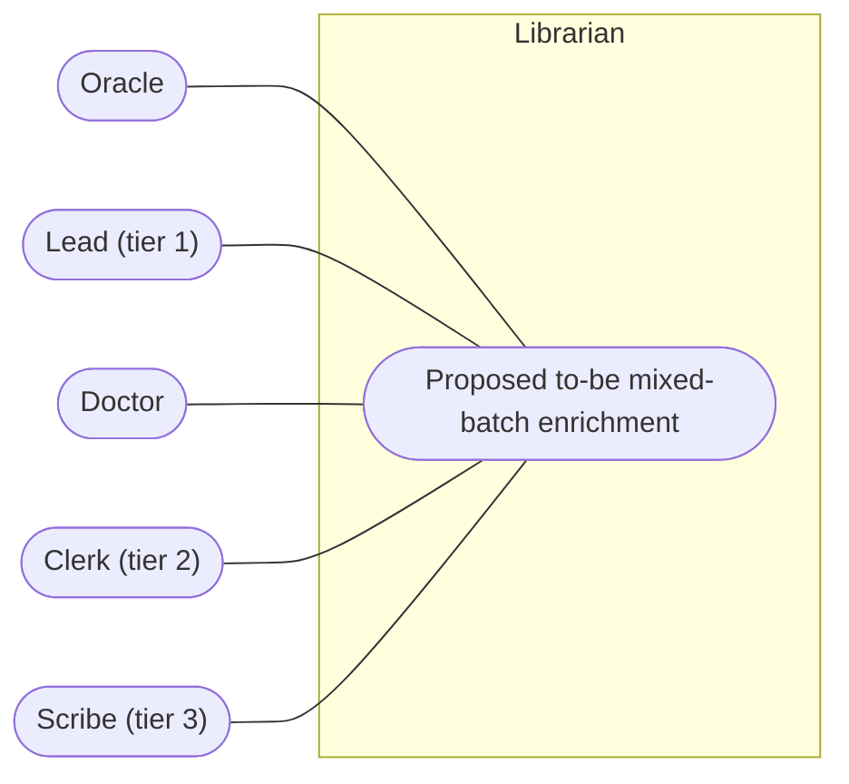

<!-- generated by build_family.py through the supplied render_spec.py; edit the spec -->
# Proposed to-be mixed-batch enrichment

**Status:** proposed behavioral integration. [Use-case description](proposed-batch-enrichment.md) · [Family](README.md).

Local report/end copies express the same guarded exit at different departures; they are not extra runtime actions. The presentation proof folds them back to the original model. Scenarios describe guarded departures/rejoins, not all repeated execution combinations.

## Validation

No structural, reference, card-overlap or preview edge/card intersection flags.

## Use-case diagram



## Activity diagram

```mermaid
flowchart TD
  subgraph Oracle["Oracle"]
    oracle["8. judges the mixed child contract from checks and isolated evidence review; verifies item accounting, coverage distinctions and outstanding obligations"]
    dverdict{"mixed child-contract verdict?"}
    recheck["independently rechecks the original shortfall and affected child obligations; a Doctor result alone does not close the ticket"]
    drecheck{"repair independently verified within the bounded attempt policy?"}
  end
  subgraph Lead_tier_1_["Lead (tier 1)"]
    contract>"Proposed child of ingestion. It inherits one commission, Lead and mixed ledger; source references describe the selected item's work, not another batch worker."]
    bind["1. owns the parent's admitted mixed work and required child outputs; plans accepted components within the existing mandate"]
    unmapped["owns unmapped diagnosis from bounded Clerk or Scribe evidence; proposes a new remedy or authority request to the invoking parent"]
    dunmapped{"truthful handback for the unresolved requirement?"}
    fullhandoff["9. returns the verified mixed package to the invoking parent with true decision actors and pending Source, folder and lens worklists"]
    partialhandoff["returns completed work, explicit unmet child outputs and accountable tickets; retains the parent's pending decisions and original mixed accounting"]
    pausehandoff["returns the stop reason, retained receipts and exact continuation or reserved-authority request to the parent; does not commission another run"]
    escalatehandoff["immediately reports critical or run-wide trust failure to the invoking parent for its Owner or tier-0 route, preserving evidence and completed work"]
    noworkhandoff["returns no fresh child work and reconciled receipt states; outstanding parent decisions remain outstanding rather than becoming implied success"]
    pausehandoff_at_bdfe8aaefe["returns the stop reason, retained receipts and exact continuation or reserved-authority request to the parent; does not commission another run"]
    escalatehandoff_at_d74d2f9cb5["immediately reports critical or run-wide trust failure to the invoking parent for its Owner or tier-0 route, preserving evidence and completed work"]
    pausehandoff_at_3c589ea0dc["returns the stop reason, retained receipts and exact continuation or reserved-authority request to the parent; does not commission another run"]
    escalatehandoff_at_b1dc83cf39["immediately reports critical or run-wide trust failure to the invoking parent for its Owner or tier-0 route, preserving evidence and completed work"]
  end
  subgraph Doctor["Doctor"]
    doctor["executes only the accepted mapped remedy within the admitted scope; unavailable authority stays unresolved and new remedies remain proposals"]
  end
  subgraph Clerk_tier_2_["Clerk (tier 2)"]
    folderplan["directs bounded Scribe description work from approved inventory metadata; retains the folder's actual purpose and withheld content"]
    folderreview["proofreads the draft against inventory evidence, authors the folder proposal and records uncertainty or sensitivity requiring a parent decision"]
    assess["7. reconciles source and metadata-only folder packages against the required outputs; explains gaps without granting reading credit or accepting proposals"]
  end
  subgraph Scribe_tier_3_["Scribe (tier 3)"]
    folderscribe["drafts inventory-grounded folder description and sensitivity findings with supporting locators and explicit unknowns; documents remain unread"]
  end
  subgraph Core["Core"]
    admit["2. checks recorded parent specification, approved selection, start grants, role assignments and receipt keys; keeps the original mixed ledger"]
    dadmit{"recorded admission and frozen work?"}
    nextitem["3. selects the next frozen item in mixed order; retains completed siblings and each item's original identity"]
    controls["4. checks spend before the item and writer, cancellation, grants and critical flags at every dispatch or commit; reuses only compatible receipts"]
    dcontrols{"recorded controls permit this item?"}
    dkind{"recorded staged-item kind?"}
    source[["5. proposed-source-enrichment: dispatches the selected Source item's proposed contract under the same recorded specification, Lead and ledger"]]
    foldervalidate["folder_validate: checks inventory evidence, fingerprints, access and recorded sensitivity restrictions before drafting"]
    dfoldervalidate{"folder validation result?"}
    folderroute["checks the assigned qualified route, production-drafting grant and remaining allowance; an unavailable route earns no task completion"]
    dfolderroute{"recorded folder drafting route and grant available?"}
    foldercheck["checks returned schema, literal inventory provenance and current fingerprints; stores the agent-authored proposal and actual task status"]
    dfoldercheck{"folder description checks and task status?"}
    folderdata["folder_data: materializes inventory Data and the submitted proposal through the existing guarded writer"]
    dfolderdata{"folder Data write result?"}
    foldercoverage["records metadata-only folder coverage, source content not examined, with the exact complete, queued or partial stage status"]
    folderqueued["retains deferred or disabled drafting with its route, task gaps, attempts and known or unknown cost; applicable inventory work stays explicit"]
    folderfault["records the originating stage, existing refusal or fault flag, actor, evidence and accountable ticket owner; does not invent another fault taxonomy"]
    ditemcritical{"existing flag requires immediate critical stop?"}
    faileditem["retains this item's failed stage and earlier receipts, skips its remaining stages and leaves completed siblings intact"]
    account["6. updates the original mixed ledger with actual source or folder results, reading and derivation gaps, publication and separate pending decisions"]
    dmore{"another frozen item?"}
    ticket["links the verified shortfall to its existing stage ticket, evidence and responsible tier; keeps required repair visible in the original ledger"]
    dremedymatch{"an accepted remedy maps to the existing symptom and extension?"}
    scope["computes affected records, actual blast radius and recorded remedy grant; finished partial processing still requires its real re-approval"]
    dremedygrant{"accepted remedy within recorded scope, authority and attempt allowance?"}
    repaircheck["reruns affected deterministic checks and records actual remedy result, changed evidence, remaining allowance and unresolved task outcomes"]
  end
  s(("start"))
  e1((("required mixed child outputs satisfied; parent acceptance and final specification verdict remain separate")))
  epartial((("mixed work accounted for with explicit unmet child outputs or repair obligations")))
  enowork((("no fresh admitted child work; parent must still account for its remaining obligations")))
  epaused((("retained work awaits explicit continuation, a reserved decision or required authority from the parent")))
  eescalated((("critical or run-wide failure prevents a trustworthy child completion handback")))
  epaused_at_bdfe8aaefe((("retained work awaits explicit continuation, a reserved decision or required authority from the parent")))
  eescalated_at_d74d2f9cb5((("critical or run-wide failure prevents a trustworthy child completion handback")))
  epaused_at_3c589ea0dc((("retained work awaits explicit continuation, a reserved decision or required authority from the parent")))
  eescalated_at_b1dc83cf39((("critical or run-wide failure prevents a trustworthy child completion handback")))
  s --> contract
  contract --> bind
  bind --> admit
  admit --> dadmit
  dadmit -->|"[admitted nonempty frozen set]"| nextitem
  dadmit -->|"[no fresh approved work; parent ledger reconciled] 2a"| noworkhandoff
  dadmit -->|"[missing or reserved authority] 2b"| pausehandoff_at_bdfe8aaefe
  dadmit -->|"[run-wide state or authority-integrity failure] 2c"| escalatehandoff_at_d74d2f9cb5
  nextitem --> controls
  controls --> dcontrols
  dcontrols -->|"[active within recorded controls]"| dkind
  dcontrols -->|"[cancelled, interrupted, grant withheld or spend ceiling reached] 4a"| pausehandoff_at_3c589ea0dc
  dcontrols -->|"[critical integrity or run-wide writer failure] 4b"| escalatehandoff_at_b1dc83cf39
  dkind -->|"[source]"| source
  dkind -->|"[folder metadata card] 4c"| foldervalidate
  source -->|"[success]"| account
  source -->|"[partial] 5a"| account
  source -->|"[reused] 5b"| account
  source -->|"[paused] 5c"| pausehandoff
  source -->|"[escalated] 5d"| escalatehandoff
  foldervalidate --> dfoldervalidate
  dfoldervalidate -->|"[valid current inventory and access]"| folderroute
  dfoldervalidate -->|"[failed or stale]"| folderfault
  folderroute --> dfolderroute
  dfolderroute -->|"[qualified assigned route and drafting authority available]"| folderplan
  dfolderroute -->|"[disabled, deferred or unavailable within bounded route policy]"| folderqueued
  dfolderroute -->|"[invalid grant, returned refusal or route-integrity failure]"| folderfault
  folderplan --> folderscribe
  folderscribe --> folderreview
  folderreview --> foldercheck
  foldercheck --> dfoldercheck
  dfoldercheck -->|"[valid proposal or explicit unresolved fields]"| folderdata
  dfoldercheck -->|"[pending required task or recoverable transport outage]"| folderqueued
  dfoldercheck -->|"[failed, including FOLDER_PROVENANCE or FOLDER_DRAFT_FAILED]"| folderfault
  folderqueued --> folderdata
  folderdata --> dfolderdata
  dfolderdata -->|"[write succeeded]"| foldercoverage
  dfolderdata -->|"[write failed or state changed]"| folderfault
  foldercoverage --> account
  folderfault --> ditemcritical
  ditemcritical -->|"[noncritical item failure]"| faileditem
  ditemcritical -->|"[critical flag requires immediate stop]"| escalatehandoff
  faileditem --> account
  account --> dmore
  dmore -->|"[frozen set accounted for]"| assess
  dmore -->|"[another frozen item] 6a"| nextitem
  assess --> oracle
  oracle --> dverdict
  dverdict -->|"[required child outputs satisfied]"| fullhandoff
  dverdict -->|"[truthful partial package with no authorized repair now] 8a"| partialhandoff
  dverdict -->|"[actionable required shortfall with retained evidence] 8b"| ticket
  dverdict -->|"[critical or run-wide trust failure] 8c"| escalatehandoff
  ticket --> dremedymatch
  dremedymatch -->|"[accepted remedy mapped]"| scope
  dremedymatch -->|"[unmapped or remedy only proposed]"| unmapped
  scope --> dremedygrant
  dremedygrant -->|"[existing mandate and accepted bounded attempt permit remedy]"| doctor
  dremedygrant -->|"[reserved, too wide, exhausted, or fresh processing approval required]"| pausehandoff
  doctor --> repaircheck
  repaircheck --> recheck
  recheck --> drecheck
  drecheck -->|"[verified repair; reconcile affected package before handback]"| assess
  drecheck -->|"[unresolved or bounded attempt exhausted; preserve ticket]"| partialhandoff
  drecheck -->|"[critical integrity failure]"| escalatehandoff
  unmapped --> dunmapped
  dunmapped -->|"[return unmet requirement with diagnosis and proposed next step]"| partialhandoff
  dunmapped -->|"[parent decision or accepted remedy required to continue]"| pausehandoff
  fullhandoff --> e1
  partialhandoff --> epartial
  pausehandoff --> epaused
  escalatehandoff --> eescalated
  noworkhandoff --> enowork
  pausehandoff_at_bdfe8aaefe --> epaused_at_bdfe8aaefe
  escalatehandoff_at_d74d2f9cb5 --> eescalated_at_d74d2f9cb5
  pausehandoff_at_3c589ea0dc --> epaused_at_3c589ea0dc
  escalatehandoff_at_b1dc83cf39 --> eescalated_at_b1dc83cf39
  classDef ext stroke:#d9534f,stroke-width:2px
```



## Written use case

**Main success scenario** (generated: the guard-true path, in step order)

1. The Lead (tier 1) owns the parent's admitted mixed work and required child outputs; plans accepted components within the existing mandate.
2. The Core checks recorded parent specification, approved selection, start grants, role assignments and receipt keys; keeps the original mixed ledger.
3. The Core selects the next frozen item in mixed order; retains completed siblings and each item's original identity.
4. The Core checks spend before the item and writer, cancellation, grants and critical flags at every dispatch or commit; reuses only compatible receipts.
5. The Core dispatches the selected Source item's proposed contract under the same recorded specification, Lead and ledger.
6. The Core updates the original mixed ledger with actual source or folder results, reading and derivation gaps, publication and separate pending decisions.
7. The Clerk (tier 2) reconciles source and metadata-only folder packages against the required outputs; explains gaps without granting reading credit or accepting proposals.
8. The Oracle judges the mixed child contract from checks and isolated evidence review; verifies item accounting, coverage distinctions and outstanding obligations.
9. The Lead (tier 1) returns the verified mixed package to the invoking parent with true decision actors and pending Source, folder and lens worklists.

**Extensions** (generated: one per non-happy guard; numbered by the step it leaves)

- **2a** (from: recorded admission and frozen work?) *anticipated*
  - `2a1` No fresh approved work; parent ledger reconciled.
  - `2a2` The Lead (tier 1) returns no fresh child work and reconciled receipt states; outstanding parent decisions remain outstanding rather than becoming implied success.
  - `2a3` The use case ends: no fresh admitted child work; parent must still account for its remaining obligations.
- **2b** (from: recorded admission and frozen work?) *anticipated*
  - `2b1` Missing or reserved authority.
  - `2b2` The Lead (tier 1) returns the stop reason, retained receipts and exact continuation or reserved-authority request to the parent; does not commission another run.
  - `2b3` The use case ends: retained work awaits explicit continuation, a reserved decision or required authority from the parent.
- **2c** (from: recorded admission and frozen work?) *anticipated*
  - `2c1` Run-wide state or authority-integrity failure.
  - `2c2` The Lead (tier 1) immediately reports critical or run-wide trust failure to the invoking parent for its Owner or tier-0 route, preserving evidence and completed work.
  - `2c3` The use case ends: critical or run-wide failure prevents a trustworthy child completion handback.
- **4a** (from: recorded controls permit this item?) *anticipated*
  - `4a1` Cancelled, interrupted, grant withheld or spend ceiling reached.
  - `4a2` The Lead (tier 1) returns the stop reason, retained receipts and exact continuation or reserved-authority request to the parent; does not commission another run.
  - `4a3` The use case ends: retained work awaits explicit continuation, a reserved decision or required authority from the parent.
- **4b** (from: recorded controls permit this item?) *anticipated*
  - `4b1` Critical integrity or run-wide writer failure.
  - `4b2` The Lead (tier 1) immediately reports critical or run-wide trust failure to the invoking parent for its Owner or tier-0 route, preserving evidence and completed work.
  - `4b3` The use case ends: critical or run-wide failure prevents a trustworthy child completion handback.
- **4c** (from: recorded staged-item kind?) *anticipated*
  - `4c1` Folder metadata card.
  - `4c2` The Core folder_validate: checks inventory evidence, fingerprints, access and recorded sensitivity restrictions before drafting.
  - `4c3` The Core decides: folder validation result?
  - `4c3a` If failed or stale: records the originating stage, existing refusal or fault flag, actor, evidence and accountable ticket owner; does not invent another fault taxonomy.
  - `4c4` If valid current inventory and access:
  - `4c5` The Core checks the assigned qualified route, production-drafting grant and remaining allowance; an unavailable route earns no task completion.
  - `4c6` The Core decides: recorded folder drafting route and grant available?
  - `4c6a` If disabled, deferred or unavailable within bounded route policy: retains deferred or disabled drafting with its route, task gaps, attempts and known or unknown cost; applicable inventory work stays explicit.
  - `4c6a` If invalid grant, returned refusal or route-integrity failure: records the originating stage, existing refusal or fault flag, actor, evidence and accountable ticket owner; does not invent another fault taxonomy.
  - `4c7` If qualified assigned route and drafting authority available:
  - `4c8` The Clerk (tier 2) directs bounded Scribe description work from approved inventory metadata; retains the folder's actual purpose and withheld content.
  - `4c9` The Scribe (tier 3) drafts inventory-grounded folder description and sensitivity findings with supporting locators and explicit unknowns; documents remain unread.
  - `4c10` The Clerk (tier 2) proofreads the draft against inventory evidence, authors the folder proposal and records uncertainty or sensitivity requiring a parent decision.
  - `4c11` The Core checks returned schema, literal inventory provenance and current fingerprints; stores the agent-authored proposal and actual task status.
  - `4c12` The Core decides: folder description checks and task status?
  - `4c12a` If pending required task or recoverable transport outage: retains deferred or disabled drafting with its route, task gaps, attempts and known or unknown cost; applicable inventory work stays explicit.
  - `4c12a` If failed, including FOLDER_PROVENANCE or FOLDER_DRAFT_FAILED: records the originating stage, existing refusal or fault flag, actor, evidence and accountable ticket owner; does not invent another fault taxonomy.
  - `4c13` If valid proposal or explicit unresolved fields:
  - `4c14` The Core folder_data: materializes inventory Data and the submitted proposal through the existing guarded writer.
  - `4c15` The Core decides: folder Data write result?
  - `4c15a` If write failed or state changed: records the originating stage, existing refusal or fault flag, actor, evidence and accountable ticket owner; does not invent another fault taxonomy.
  - `4c16` If write succeeded:
  - `4c17` The Core records metadata-only folder coverage, source content not examined, with the exact complete, queued or partial stage status.
  - `4c18` Rejoin at 6.
- **5a** (from: dispatches the selected Source item's proposed contract under the same recorded specification, Lead and ledger) *anticipated*
  - `5a1` Partial.
  - `5a2` Rejoin at 6.
- **5b** (from: dispatches the selected Source item's proposed contract under the same recorded specification, Lead and ledger) *anticipated*
  - `5b1` Reused.
  - `5b2` Rejoin at 6.
- **5c** (from: dispatches the selected Source item's proposed contract under the same recorded specification, Lead and ledger) *anticipated*
  - `5c1` Paused.
  - `5c2` The Lead (tier 1) returns the stop reason, retained receipts and exact continuation or reserved-authority request to the parent; does not commission another run.
  - `5c3` The use case ends: retained work awaits explicit continuation, a reserved decision or required authority from the parent.
- **5d** (from: dispatches the selected Source item's proposed contract under the same recorded specification, Lead and ledger) *anticipated*
  - `5d1` Escalated.
  - `5d2` The Lead (tier 1) immediately reports critical or run-wide trust failure to the invoking parent for its Owner or tier-0 route, preserving evidence and completed work.
  - `5d3` The use case ends: critical or run-wide failure prevents a trustworthy child completion handback.
- **6a** (from: another frozen item?) *anticipated*
  - `6a1` Another frozen item.
  - `6a2` Rejoin at 3.
- **8a** (from: mixed child-contract verdict?) *anticipated*
  - `8a1` Truthful partial package with no authorized repair now.
  - `8a2` The Lead (tier 1) returns completed work, explicit unmet child outputs and accountable tickets; retains the parent's pending decisions and original mixed accounting.
  - `8a3` The use case ends: mixed work accounted for with explicit unmet child outputs or repair obligations.
- **8b** (from: mixed child-contract verdict?) *anticipated*
  - `8b1` Actionable required shortfall with retained evidence.
  - `8b2` The Core links the verified shortfall to its existing stage ticket, evidence and responsible tier; keeps required repair visible in the original ledger.
  - `8b3` The Core decides: an accepted remedy maps to the existing symptom and extension?
  - `8b3a` If unmapped or remedy only proposed: owns unmapped diagnosis from bounded Clerk or Scribe evidence; proposes a new remedy or authority request to the invoking parent.
  - `8b4` If accepted remedy mapped:
  - `8b5` The Core computes affected records, actual blast radius and recorded remedy grant; finished partial processing still requires its real re-approval.
  - `8b6` The Core decides: accepted remedy within recorded scope, authority and attempt allowance?
  - `8b6a` If reserved, too wide, exhausted, or fresh processing approval required: returns the stop reason, retained receipts and exact continuation or reserved-authority request to the parent; does not commission another run.
  - `8b7` If existing mandate and accepted bounded attempt permit remedy:
  - `8b8` The Doctor executes only the accepted mapped remedy within the admitted scope; unavailable authority stays unresolved and new remedies remain proposals.
  - `8b9` The Core reruns affected deterministic checks and records actual remedy result, changed evidence, remaining allowance and unresolved task outcomes.
  - `8b10` The Oracle independently rechecks the original shortfall and affected child obligations; a Doctor result alone does not close the ticket.
  - `8b11` The Oracle decides: repair independently verified within the bounded attempt policy?
  - `8b11a` If unresolved or bounded attempt exhausted; preserve ticket: returns completed work, explicit unmet child outputs and accountable tickets; retains the parent's pending decisions and original mixed accounting.
  - `8b11a` If critical integrity failure: immediately reports critical or run-wide trust failure to the invoking parent for its Owner or tier-0 route, preserving evidence and completed work.
  - `8b12` If verified repair; reconcile affected package before handback:
  - `8b13` Rejoin at 7.
- **8c** (from: mixed child-contract verdict?) *anticipated*
  - `8c1` Critical or run-wide trust failure.
  - `8c2` The Lead (tier 1) immediately reports critical or run-wide trust failure to the invoking parent for its Owner or tier-0 route, preserving evidence and completed work.
  - `8c3` The use case ends: critical or run-wide failure prevents a trustworthy child completion handback.

## Lane load

| Lane | On the main success scenario | Anywhere in the diagram |
|---|---|---|
| Oracle | 2 | 4 |
| Lead (tier 1) | 2 | 12 |
| Doctor | 0 | 1 |
| Clerk (tier 2) | 1 | 3 |
| Scribe (tier 3) | 0 | 1 |
| Core | 9 | 27 |

Paths by how they end: **escalated** 11, **partial** 3, **paused** 5, **reused** 1, **success** 1. Every *escalated* path is a failure of this use case: the work went back to tier 0.

## Decision tree with 34 extension scenarios

```text
start: Proposed to-be mixed-batch enrichment
            └─ T1: admitted nonempty frozen set / active within recorded controls / source / success / frozen set accounted for / required child outputs satisfied  ⇒ required mixed child outputs satisfied; parent acceptance and final specification verdict remain separate
  └─ T2: no fresh approved work; parent ledger reconciled  ⇒ no fresh admitted child work; parent must still account for its remaining obligations
  └─ T3: missing or reserved authority  ⇒ retained work awaits explicit continuation, a reserved decision or required authority from the parent
  └─ T4: run-wide state or authority-integrity failure  ⇒ critical or run-wide failure prevents a trustworthy child completion handback
    └─ T5: admitted nonempty frozen set / cancelled, interrupted, grant withheld or spend ceiling reached  ⇒ retained work awaits explicit continuation, a reserved decision or required authority from the parent
    └─ T6: admitted nonempty frozen set / critical integrity or run-wide writer failure  ⇒ critical or run-wide failure prevents a trustworthy child completion handback
          └─ T7: admitted nonempty frozen set / active within recorded controls / folder metadata card / failed or stale / critical flag requires immediate stop  ⇒ critical or run-wide failure prevents a trustworthy child completion handback
          └─ T8: admitted nonempty frozen set / active within recorded controls / folder metadata card / failed or stale / noncritical item failure  ⇒ rejoins at step 6
              └─ T9: admitted nonempty frozen set / active within recorded controls / folder metadata card / valid current inventory and access / disabled, deferred or unavailable within bounded route policy / write failed or state changed / critical flag requires immediate stop  ⇒ critical or run-wide failure prevents a trustworthy child completion handback
              └─ T10: admitted nonempty frozen set / active within recorded controls / folder metadata card / valid current inventory and access / disabled, deferred or unavailable within bounded route policy / write failed or state changed / noncritical item failure  ⇒ rejoins at step 6
            └─ T11: admitted nonempty frozen set / active within recorded controls / folder metadata card / valid current inventory and access / disabled, deferred or unavailable within bounded route policy / write succeeded  ⇒ rejoins at step 6
            └─ T12: admitted nonempty frozen set / active within recorded controls / folder metadata card / valid current inventory and access / invalid grant, returned refusal or route-integrity failure / critical flag requires immediate stop  ⇒ critical or run-wide failure prevents a trustworthy child completion handback
            └─ T13: admitted nonempty frozen set / active within recorded controls / folder metadata card / valid current inventory and access / invalid grant, returned refusal or route-integrity failure / noncritical item failure  ⇒ rejoins at step 6
                └─ T14: admitted nonempty frozen set / active within recorded controls / folder metadata card / valid current inventory and access / qualified assigned route and drafting authority available / pending required task or recoverable transport outage / write failed or state changed / critical flag requires immediate stop  ⇒ critical or run-wide failure prevents a trustworthy child completion handback
                └─ T15: admitted nonempty frozen set / active within recorded controls / folder metadata card / valid current inventory and access / qualified assigned route and drafting authority available / pending required task or recoverable transport outage / write failed or state changed / noncritical item failure  ⇒ rejoins at step 6
              └─ T16: admitted nonempty frozen set / active within recorded controls / folder metadata card / valid current inventory and access / qualified assigned route and drafting authority available / pending required task or recoverable transport outage / write succeeded  ⇒ rejoins at step 6
              └─ T17: admitted nonempty frozen set / active within recorded controls / folder metadata card / valid current inventory and access / qualified assigned route and drafting authority available / failed, including FOLDER_PROVENANCE or FOLDER_DRAFT_FAILED / critical flag requires immediate stop  ⇒ critical or run-wide failure prevents a trustworthy child completion handback
              └─ T18: admitted nonempty frozen set / active within recorded controls / folder metadata card / valid current inventory and access / qualified assigned route and drafting authority available / failed, including FOLDER_PROVENANCE or FOLDER_DRAFT_FAILED / noncritical item failure  ⇒ rejoins at step 6
                └─ T19: admitted nonempty frozen set / active within recorded controls / folder metadata card / valid current inventory and access / qualified assigned route and drafting authority available / valid proposal or explicit unresolved fields / write failed or state changed / critical flag requires immediate stop  ⇒ critical or run-wide failure prevents a trustworthy child completion handback
                └─ T20: admitted nonempty frozen set / active within recorded controls / folder metadata card / valid current inventory and access / qualified assigned route and drafting authority available / valid proposal or explicit unresolved fields / write failed or state changed / noncritical item failure  ⇒ rejoins at step 6
              └─ T21: admitted nonempty frozen set / active within recorded controls / folder metadata card / valid current inventory and access / qualified assigned route and drafting authority available / valid proposal or explicit unresolved fields / write succeeded  ⇒ rejoins at step 6
        └─ T22: admitted nonempty frozen set / active within recorded controls / source / partial  ⇒ rejoins at step 6
        └─ T23: admitted nonempty frozen set / active within recorded controls / source / reused  ⇒ rejoins at step 6
        └─ T24: admitted nonempty frozen set / active within recorded controls / source / paused  ⇒ retained work awaits explicit continuation, a reserved decision or required authority from the parent
        └─ T25: admitted nonempty frozen set / active within recorded controls / source / escalated  ⇒ critical or run-wide failure prevents a trustworthy child completion handback
          └─ T26: admitted nonempty frozen set / active within recorded controls / source / success / another frozen item  ⇒ rejoins at step 3
            └─ T27: admitted nonempty frozen set / active within recorded controls / source / success / frozen set accounted for / truthful partial package with no authorized repair now  ⇒ mixed work accounted for with explicit unmet child outputs or repair obligations
                └─ T28: admitted nonempty frozen set / active within recorded controls / source / success / frozen set accounted for / actionable required shortfall with retained evidence / unmapped or remedy only proposed / parent decision or accepted remedy required to continue  ⇒ retained work awaits explicit continuation, a reserved decision or required authority from the parent
                └─ T29: admitted nonempty frozen set / active within recorded controls / source / success / frozen set accounted for / actionable required shortfall with retained evidence / unmapped or remedy only proposed / return unmet requirement with diagnosis and proposed next step  ⇒ mixed work accounted for with explicit unmet child outputs or repair obligations
                └─ T30: admitted nonempty frozen set / active within recorded controls / source / success / frozen set accounted for / actionable required shortfall with retained evidence / accepted remedy mapped / reserved, too wide, exhausted, or fresh processing approval required  ⇒ retained work awaits explicit continuation, a reserved decision or required authority from the parent
                  └─ T31: admitted nonempty frozen set / active within recorded controls / source / success / frozen set accounted for / actionable required shortfall with retained evidence / accepted remedy mapped / existing mandate and accepted bounded attempt permit remedy / unresolved or bounded attempt exhausted; preserve ticket  ⇒ mixed work accounted for with explicit unmet child outputs or repair obligations
                  └─ T32: admitted nonempty frozen set / active within recorded controls / source / success / frozen set accounted for / actionable required shortfall with retained evidence / accepted remedy mapped / existing mandate and accepted bounded attempt permit remedy / critical integrity failure  ⇒ critical or run-wide failure prevents a trustworthy child completion handback
                  └─ T33: admitted nonempty frozen set / active within recorded controls / source / success / frozen set accounted for / actionable required shortfall with retained evidence / accepted remedy mapped / existing mandate and accepted bounded attempt permit remedy / verified repair; reconcile affected package before handback  ⇒ rejoins at step 7
            └─ T34: admitted nonempty frozen set / active within recorded controls / source / success / frozen set accounted for / critical or run-wide trust failure  ⇒ critical or run-wide failure prevents a trustworthy child completion handback
```

## Scenario test table

| Test | Path (guards taken) | Extension | Expected outcome |
|---|---|---|---|
| T1 | recorded admission and frozen work? → admitted nonempty frozen set; recorded controls permit this item? → active within recorded controls; recorded staged-item kind? → source; dispatches the selected Source item's proposed contract under the same recorded specification, Lead and ledger → success; another frozen item? → frozen set accounted for; mixed child-contract verdict? → required child outputs satisfied | MSS | required mixed child outputs satisfied; parent acceptance and final specification verdict remain separate |
| T2 | recorded admission and frozen work? → no fresh approved work; parent ledger reconciled | 2a | no fresh admitted child work; parent must still account for its remaining obligations |
| T3 | recorded admission and frozen work? → missing or reserved authority | 2b | retained work awaits explicit continuation, a reserved decision or required authority from the parent |
| T4 | recorded admission and frozen work? → run-wide state or authority-integrity failure | 2c | critical or run-wide failure prevents a trustworthy child completion handback |
| T5 | recorded admission and frozen work? → admitted nonempty frozen set; recorded controls permit this item? → cancelled, interrupted, grant withheld or spend ceiling reached | 4a | retained work awaits explicit continuation, a reserved decision or required authority from the parent |
| T6 | recorded admission and frozen work? → admitted nonempty frozen set; recorded controls permit this item? → critical integrity or run-wide writer failure | 4b | critical or run-wide failure prevents a trustworthy child completion handback |
| T7 | recorded admission and frozen work? → admitted nonempty frozen set; recorded controls permit this item? → active within recorded controls; recorded staged-item kind? → folder metadata card; folder validation result? → failed or stale; existing flag requires immediate critical stop? → critical flag requires immediate stop | 4c | critical or run-wide failure prevents a trustworthy child completion handback |
| T8 | recorded admission and frozen work? → admitted nonempty frozen set; recorded controls permit this item? → active within recorded controls; recorded staged-item kind? → folder metadata card; folder validation result? → failed or stale; existing flag requires immediate critical stop? → noncritical item failure | 4c | rejoins at step 6 |
| T9 | recorded admission and frozen work? → admitted nonempty frozen set; recorded controls permit this item? → active within recorded controls; recorded staged-item kind? → folder metadata card; folder validation result? → valid current inventory and access; recorded folder drafting route and grant available? → disabled, deferred or unavailable within bounded route policy; folder Data write result? → write failed or state changed; existing flag requires immediate critical stop? → critical flag requires immediate stop | 4c | critical or run-wide failure prevents a trustworthy child completion handback |
| T10 | recorded admission and frozen work? → admitted nonempty frozen set; recorded controls permit this item? → active within recorded controls; recorded staged-item kind? → folder metadata card; folder validation result? → valid current inventory and access; recorded folder drafting route and grant available? → disabled, deferred or unavailable within bounded route policy; folder Data write result? → write failed or state changed; existing flag requires immediate critical stop? → noncritical item failure | 4c | rejoins at step 6 |
| T11 | recorded admission and frozen work? → admitted nonempty frozen set; recorded controls permit this item? → active within recorded controls; recorded staged-item kind? → folder metadata card; folder validation result? → valid current inventory and access; recorded folder drafting route and grant available? → disabled, deferred or unavailable within bounded route policy; folder Data write result? → write succeeded | 4c | rejoins at step 6 |
| T12 | recorded admission and frozen work? → admitted nonempty frozen set; recorded controls permit this item? → active within recorded controls; recorded staged-item kind? → folder metadata card; folder validation result? → valid current inventory and access; recorded folder drafting route and grant available? → invalid grant, returned refusal or route-integrity failure; existing flag requires immediate critical stop? → critical flag requires immediate stop | 4c | critical or run-wide failure prevents a trustworthy child completion handback |
| T13 | recorded admission and frozen work? → admitted nonempty frozen set; recorded controls permit this item? → active within recorded controls; recorded staged-item kind? → folder metadata card; folder validation result? → valid current inventory and access; recorded folder drafting route and grant available? → invalid grant, returned refusal or route-integrity failure; existing flag requires immediate critical stop? → noncritical item failure | 4c | rejoins at step 6 |
| T14 | recorded admission and frozen work? → admitted nonempty frozen set; recorded controls permit this item? → active within recorded controls; recorded staged-item kind? → folder metadata card; folder validation result? → valid current inventory and access; recorded folder drafting route and grant available? → qualified assigned route and drafting authority available; folder description checks and task status? → pending required task or recoverable transport outage; folder Data write result? → write failed or state changed; existing flag requires immediate critical stop? → critical flag requires immediate stop | 4c | critical or run-wide failure prevents a trustworthy child completion handback |
| T15 | recorded admission and frozen work? → admitted nonempty frozen set; recorded controls permit this item? → active within recorded controls; recorded staged-item kind? → folder metadata card; folder validation result? → valid current inventory and access; recorded folder drafting route and grant available? → qualified assigned route and drafting authority available; folder description checks and task status? → pending required task or recoverable transport outage; folder Data write result? → write failed or state changed; existing flag requires immediate critical stop? → noncritical item failure | 4c | rejoins at step 6 |
| T16 | recorded admission and frozen work? → admitted nonempty frozen set; recorded controls permit this item? → active within recorded controls; recorded staged-item kind? → folder metadata card; folder validation result? → valid current inventory and access; recorded folder drafting route and grant available? → qualified assigned route and drafting authority available; folder description checks and task status? → pending required task or recoverable transport outage; folder Data write result? → write succeeded | 4c | rejoins at step 6 |
| T17 | recorded admission and frozen work? → admitted nonempty frozen set; recorded controls permit this item? → active within recorded controls; recorded staged-item kind? → folder metadata card; folder validation result? → valid current inventory and access; recorded folder drafting route and grant available? → qualified assigned route and drafting authority available; folder description checks and task status? → failed, including FOLDER_PROVENANCE or FOLDER_DRAFT_FAILED; existing flag requires immediate critical stop? → critical flag requires immediate stop | 4c | critical or run-wide failure prevents a trustworthy child completion handback |
| T18 | recorded admission and frozen work? → admitted nonempty frozen set; recorded controls permit this item? → active within recorded controls; recorded staged-item kind? → folder metadata card; folder validation result? → valid current inventory and access; recorded folder drafting route and grant available? → qualified assigned route and drafting authority available; folder description checks and task status? → failed, including FOLDER_PROVENANCE or FOLDER_DRAFT_FAILED; existing flag requires immediate critical stop? → noncritical item failure | 4c | rejoins at step 6 |
| T19 | recorded admission and frozen work? → admitted nonempty frozen set; recorded controls permit this item? → active within recorded controls; recorded staged-item kind? → folder metadata card; folder validation result? → valid current inventory and access; recorded folder drafting route and grant available? → qualified assigned route and drafting authority available; folder description checks and task status? → valid proposal or explicit unresolved fields; folder Data write result? → write failed or state changed; existing flag requires immediate critical stop? → critical flag requires immediate stop | 4c | critical or run-wide failure prevents a trustworthy child completion handback |
| T20 | recorded admission and frozen work? → admitted nonempty frozen set; recorded controls permit this item? → active within recorded controls; recorded staged-item kind? → folder metadata card; folder validation result? → valid current inventory and access; recorded folder drafting route and grant available? → qualified assigned route and drafting authority available; folder description checks and task status? → valid proposal or explicit unresolved fields; folder Data write result? → write failed or state changed; existing flag requires immediate critical stop? → noncritical item failure | 4c | rejoins at step 6 |
| T21 | recorded admission and frozen work? → admitted nonempty frozen set; recorded controls permit this item? → active within recorded controls; recorded staged-item kind? → folder metadata card; folder validation result? → valid current inventory and access; recorded folder drafting route and grant available? → qualified assigned route and drafting authority available; folder description checks and task status? → valid proposal or explicit unresolved fields; folder Data write result? → write succeeded | 4c | rejoins at step 6 |
| T22 | recorded admission and frozen work? → admitted nonempty frozen set; recorded controls permit this item? → active within recorded controls; recorded staged-item kind? → source; dispatches the selected Source item's proposed contract under the same recorded specification, Lead and ledger → partial | 5a | rejoins at step 6 |
| T23 | recorded admission and frozen work? → admitted nonempty frozen set; recorded controls permit this item? → active within recorded controls; recorded staged-item kind? → source; dispatches the selected Source item's proposed contract under the same recorded specification, Lead and ledger → reused | 5b | rejoins at step 6 |
| T24 | recorded admission and frozen work? → admitted nonempty frozen set; recorded controls permit this item? → active within recorded controls; recorded staged-item kind? → source; dispatches the selected Source item's proposed contract under the same recorded specification, Lead and ledger → paused | 5c | retained work awaits explicit continuation, a reserved decision or required authority from the parent |
| T25 | recorded admission and frozen work? → admitted nonempty frozen set; recorded controls permit this item? → active within recorded controls; recorded staged-item kind? → source; dispatches the selected Source item's proposed contract under the same recorded specification, Lead and ledger → escalated | 5d | critical or run-wide failure prevents a trustworthy child completion handback |
| T26 | recorded admission and frozen work? → admitted nonempty frozen set; recorded controls permit this item? → active within recorded controls; recorded staged-item kind? → source; dispatches the selected Source item's proposed contract under the same recorded specification, Lead and ledger → success; another frozen item? → another frozen item | 6a | rejoins at step 3 |
| T27 | recorded admission and frozen work? → admitted nonempty frozen set; recorded controls permit this item? → active within recorded controls; recorded staged-item kind? → source; dispatches the selected Source item's proposed contract under the same recorded specification, Lead and ledger → success; another frozen item? → frozen set accounted for; mixed child-contract verdict? → truthful partial package with no authorized repair now | 8a | mixed work accounted for with explicit unmet child outputs or repair obligations |
| T28 | recorded admission and frozen work? → admitted nonempty frozen set; recorded controls permit this item? → active within recorded controls; recorded staged-item kind? → source; dispatches the selected Source item's proposed contract under the same recorded specification, Lead and ledger → success; another frozen item? → frozen set accounted for; mixed child-contract verdict? → actionable required shortfall with retained evidence; an accepted remedy maps to the existing symptom and extension? → unmapped or remedy only proposed; truthful handback for the unresolved requirement? → parent decision or accepted remedy required to continue | 8b | retained work awaits explicit continuation, a reserved decision or required authority from the parent |
| T29 | recorded admission and frozen work? → admitted nonempty frozen set; recorded controls permit this item? → active within recorded controls; recorded staged-item kind? → source; dispatches the selected Source item's proposed contract under the same recorded specification, Lead and ledger → success; another frozen item? → frozen set accounted for; mixed child-contract verdict? → actionable required shortfall with retained evidence; an accepted remedy maps to the existing symptom and extension? → unmapped or remedy only proposed; truthful handback for the unresolved requirement? → return unmet requirement with diagnosis and proposed next step | 8b | mixed work accounted for with explicit unmet child outputs or repair obligations |
| T30 | recorded admission and frozen work? → admitted nonempty frozen set; recorded controls permit this item? → active within recorded controls; recorded staged-item kind? → source; dispatches the selected Source item's proposed contract under the same recorded specification, Lead and ledger → success; another frozen item? → frozen set accounted for; mixed child-contract verdict? → actionable required shortfall with retained evidence; an accepted remedy maps to the existing symptom and extension? → accepted remedy mapped; accepted remedy within recorded scope, authority and attempt allowance? → reserved, too wide, exhausted, or fresh processing approval required | 8b | retained work awaits explicit continuation, a reserved decision or required authority from the parent |
| T31 | recorded admission and frozen work? → admitted nonempty frozen set; recorded controls permit this item? → active within recorded controls; recorded staged-item kind? → source; dispatches the selected Source item's proposed contract under the same recorded specification, Lead and ledger → success; another frozen item? → frozen set accounted for; mixed child-contract verdict? → actionable required shortfall with retained evidence; an accepted remedy maps to the existing symptom and extension? → accepted remedy mapped; accepted remedy within recorded scope, authority and attempt allowance? → existing mandate and accepted bounded attempt permit remedy; repair independently verified within the bounded attempt policy? → unresolved or bounded attempt exhausted; preserve ticket | 8b | mixed work accounted for with explicit unmet child outputs or repair obligations |
| T32 | recorded admission and frozen work? → admitted nonempty frozen set; recorded controls permit this item? → active within recorded controls; recorded staged-item kind? → source; dispatches the selected Source item's proposed contract under the same recorded specification, Lead and ledger → success; another frozen item? → frozen set accounted for; mixed child-contract verdict? → actionable required shortfall with retained evidence; an accepted remedy maps to the existing symptom and extension? → accepted remedy mapped; accepted remedy within recorded scope, authority and attempt allowance? → existing mandate and accepted bounded attempt permit remedy; repair independently verified within the bounded attempt policy? → critical integrity failure | 8b | critical or run-wide failure prevents a trustworthy child completion handback |
| T33 | recorded admission and frozen work? → admitted nonempty frozen set; recorded controls permit this item? → active within recorded controls; recorded staged-item kind? → source; dispatches the selected Source item's proposed contract under the same recorded specification, Lead and ledger → success; another frozen item? → frozen set accounted for; mixed child-contract verdict? → actionable required shortfall with retained evidence; an accepted remedy maps to the existing symptom and extension? → accepted remedy mapped; accepted remedy within recorded scope, authority and attempt allowance? → existing mandate and accepted bounded attempt permit remedy; repair independently verified within the bounded attempt policy? → verified repair; reconcile affected package before handback | 8b | rejoins at step 7 |
| T34 | recorded admission and frozen work? → admitted nonempty frozen set; recorded controls permit this item? → active within recorded controls; recorded staged-item kind? → source; dispatches the selected Source item's proposed contract under the same recorded specification, Lead and ledger → success; another frozen item? → frozen set accounted for; mixed child-contract verdict? → critical or run-wide trust failure | 8c | critical or run-wide failure prevents a trustworthy child completion handback |

These are artifact consistency cases, not executed runtime tests.
