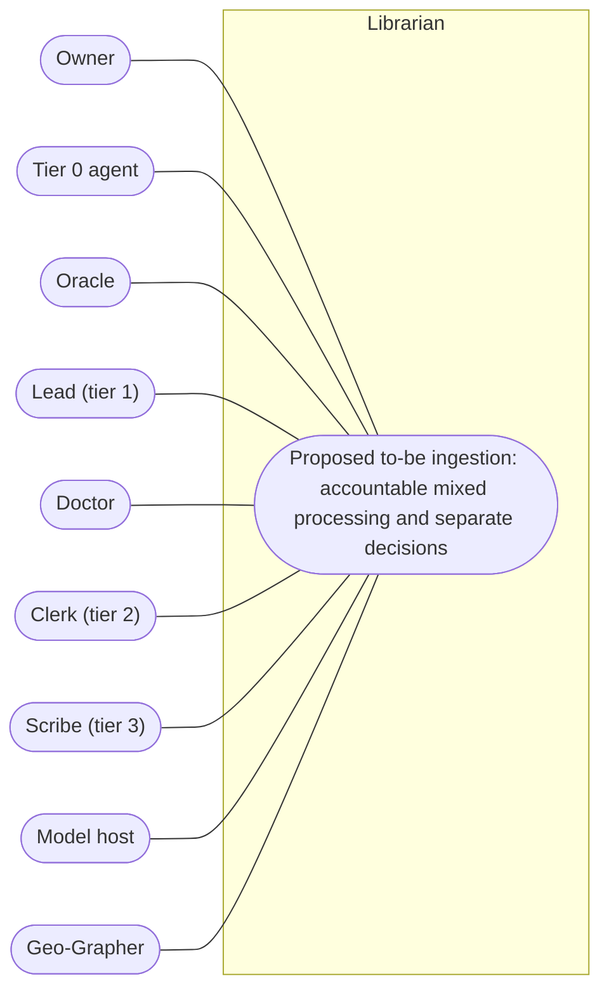

<!-- generated by build_family.py through the supplied render_spec.py; edit the spec -->
# Proposed to-be ingestion: accountable mixed processing and separate decisions

**Status:** proposed behavioral integration. [Use-case description](proposed-ingestion.md) · [Family](README.md).

Local report/end copies express the same guarded exit at different departures; they are not extra runtime actions. The presentation proof folds them back to the original model. Scenarios describe guarded departures/rejoins, not all repeated execution combinations.

## Validation

No structural, reference, card-overlap or preview edge/card intersection flags.

## Use-case diagram



## Activity diagram

```mermaid
flowchart TD
  subgraph Owner["Owner"]
    ownerreport["receives the Lead result and Oracle verdict directly, without an absent tier-0 intermediary"]
    a1["1. states the ingestion goal, roots, pre-read exclusions, required outputs, permitted partials and budget; grants only the intended authority"]
    directowner["commissions the Lead directly and supplies or approves the obligations; no tier-0 agent is required"]
    x3{"Owner's held-folder decision?"}
    approvalowner{"Owner's staged-work approval?"}
    startowner{"grant processing start for this approved selection?"}
    x7{"Owner's Source decision?"}
    writeowner{"Owner's bounded decision for the held or unconfirmed Source write?"}
    folderowner{"Owner decision in Folders review on the current fingerprint?"}
    lensowner["makes the reserved lens accept/reject/defer decisions; no implied consent from a pending worklist"]
  end
  subgraph Tier_0_agent["Tier 0 agent"]
    a2["2. commissions the Lead on the Owner's behalf and supplies the agent-authored obligations for independent Oracle review"]
    x2["relays the reserved folder decision to the Owner"]
    a20["23. reviews the Lead's result and independent verdict against the commissioned specification"]
    d9{"ready to return to the Owner?"}
    x10["returns the remaining obligations to the Lead for bounded correction and requests an independent Oracle recheck"]
    x14["makes the final review of the corrected result"]
    x5["relays a reserved budget or continuation decision to the Owner when acting as overseer"]
  end
  subgraph Oracle["Oracle"]
    a18["21. independently judges parent decisions, required findability and commissioned obligations; uses child verdicts without repeating their full source reviews"]
    d8{"parent specification met?"}
    x13["judges the corrected obligations and returns its verdict to the specification owner"]
    dlast{"corrected required obligations met?"}
  end
  subgraph Lead_tier_1_["Lead (tier 1)"]
    a3["3. owns execution against the commissioned specification; asks Core to store its version, grants and actual specification owner"]
    a5["5. binds the Owner's exclusions, purpose constraints and decision grants to the eligible worklist"]
    draftfault["diagnoses the actual post-draft transport, schema, provenance or missing-output failure from recorded evidence; retains existing flags and reports the unresolved scope without assuming qualification loss"]
    x1["reports the held folder, evidence and required decision to the actual specification owner"]
    folderapprove["7. makes normal folder decisions within grant and preserves the Owner's explicit reserved decisions; supplies actual actors/reasons for Core to apply"]
    folderfault["retains GEOGRAPHER_CALL_FAILED or other folder refusal; requests capability/scope diagnosis and a mapped accepted remedy only when applicable"]
    capturefault["reports required capture gaps with existing flags; chooses authorized bounded retry or a truthful held/escalated result"]
    a11["14. approves the staged selection within the ingestion grant; supplies the actual authority, executor and reason to the approval action"]
    startrequest["15. requests explicit processing start for the approved set within its recorded grant"]
    d5{"child verdicts and mixed-item evidence satisfy the actual parent processing obligations?"}
    partialchoice["retains explicit partial coverage/publication gaps; checks whether the parent permits accepting those particular Sources"]
    a16["19. makes affirmative Source acceptance decisions only within grant, for full or explicitly permitted partial outputs; no lens is accepted implicitly"]
    x9["coordinates authorized correction from Oracle evidence and Clerk scouting; asks Oracle to judge the revised evidence"]
    a19["22. hands one truthful result package and Oracle verdict to the recorded specification owner"]
    x11["coordinates the approved correction through the assigned agents and accepted Doctor remedies"]
    x12["submits changed artifacts and evidence for independent review; Oracle does not issue worker orders"]
    a21["24. returns the result to the Owner directly or with the tier-0 reviewed report, retaining all remaining decision owners and limitations"]
    x4["reports actual stop reason, spend evidence, completed items and remaining work; distinguishes cancellation, interruption and before-item ceiling stop"]
    xp["returns the paused package and named required decision directly to the Owner or through the overseer; retains completed work"]
    xe["returns unresolved fault evidence to the actual specification owner and immediately notifies the Owner/overseer for critical findings"]
    publicationdiagnosis["diagnoses required publication-only gaps from current admission, artifact and Geo evidence; never treats them as an automatic reread"]
    dindex{"reported extraction quality meets the commissioned allowance, with remaining gaps explicit?"}
    indexfault["holds unmet extraction quality with the Lead; proposes qualified bounded repair or returns the unmet requirement and actual scope"]
    folderquality{"folder application evidence meets the same commissioned extraction allowance?"}
    repairapprove["submits finished partial work for actual affected-subset approval and explicit start; retains old batch evidence and avoids recapture or replacement of the parent ledger"]
    xp_at_5b075aa469["returns the paused package and named required decision directly to the Owner or through the overseer; retains completed work"]
    xp_at_28b89735bd["returns the paused package and named required decision directly to the Owner or through the overseer; retains completed work"]
    xp_at_70f85b1c1a["returns the paused package and named required decision directly to the Owner or through the overseer; retains completed work"]
    xp_at_e41e73667e["returns the paused package and named required decision directly to the Owner or through the overseer; retains completed work"]
    xe_at_1020338efc["returns unresolved fault evidence to the actual specification owner and immediately notifies the Owner/overseer for critical findings"]
    xp_at_bd1c221f4a["returns the paused package and named required decision directly to the Owner or through the overseer; retains completed work"]
    xp_at_ec937217a7["returns the paused package and named required decision directly to the Owner or through the overseer; retains completed work"]
    xe_at_6b561aa06e["returns unresolved fault evidence to the actual specification owner and immediately notifies the Owner/overseer for critical findings"]
    xe_at_b2c32ae828["returns unresolved fault evidence to the actual specification owner and immediately notifies the Owner/overseer for critical findings"]
    xe_at_0930a97e8a["returns unresolved fault evidence to the actual specification owner and immediately notifies the Owner/overseer for critical findings"]
    xp_at_8ccb73d0cf["returns the paused package and named required decision directly to the Owner or through the overseer; retains completed work"]
    xp_at_851951d0e1["returns the paused package and named required decision directly to the Owner or through the overseer; retains completed work"]
    xe_at_a35069041c["returns unresolved fault evidence to the actual specification owner and immediately notifies the Owner/overseer for critical findings"]
    xp_at_a356314b53["returns the paused package and named required decision directly to the Owner or through the overseer; retains completed work"]
  end
  subgraph Doctor["Doctor"]
    r1[["UC-D: evaluates accepted R1 for stale evidence using its actual whole-library radius; a local mandate cannot silently permit a global rebuild"]]
    r2[["UC-D: restores confirmed lost qualification with accepted R2; provider timeouts and parser faults retain their distinct evidence"]]
    r3[["UC-D: applies accepted R3 only for a matching per-root queue defect, retaining the mismatch evidence"]]
    r4[["UC-D: requests accepted bounded R4 for required partial reading; any finished-partial reapproval/start remains authorized and independent checks rerun"]]
    r5[["UC-D: evaluates accepted R5 against the actual failed index obligation; reindexing is not assumed to cure every content/retrieval miss"]]
    r6[["UC-D: evaluates the accepted catalogued remedy for a mapped shortfall, with actual radius and independent verification"]]
    r1application[["UC-D: handles application-stage FOLDER_STALE through the same scoped R1 remedy; no local mandate authorizes a global rebuild"]]
  end
  subgraph Clerk_tier_2_["Clerk (tier 2)"]
    a6["6. interprets folder purpose, proposes descriptions and judges sensitivity; may direct bounded Scribe tasks"]
    d3{"folder decision reserved or sensitive?"}
    countdiagnosis["investigates unexplained count mismatch read-only; distinguishes historical queued keys from current pending items"]
    capturedescribe["12. writes neutral evidence-based Source descriptions, directing Scribes only for bounded drafting"]
    contentdiagnosis["diagnoses content-related retrieval gaps read-only; never manufactures concepts or enables vectors merely to force a pass"]
    x8["scouts an unmapped shortfall and its actual affected scope read-only"]
    folderreview["reviews inventory-grounded folder proposals and identifies the exact pending Folders review decision; documents remain unread"]
    lensreview["reviews grounded lens candidates and makes authorized accept/reject/defer decisions independently of Source acceptance"]
  end
  subgraph Scribe_tier_3_["Scribe (tier 3)"]
  end
  subgraph Core["Core"]
    delivery["records the parent result delivered to its actual specification owner; retains outstanding decisions and limitations"]
    dentry{"commissioning route?"}
    a4["4. inventories roots, fingerprints and literal facts; excludes hidden/scratch content before reading and resolves deepest-root ownership"]
    d1{"reviewed roots current?"}
    d2{"assigned folder-review role qualified on its selected route?"}
    dheldroute{"tier-0 overseer present for this run?"}
    exclude["records the excluded subtree; removes it from eligible work without reading it"]
    a7["8. submits affirmative folder decisions and read barriers for group application; acceptance is recorded only after the CLI succeeds"]
    dfolder{"folder application result?"}
    dinput{"requested Source-eligible subset remains after common folder-group application?"}
    a8["9. queues Source-eligible third-party, research-docs and own-docs inputs per deepest accepted root; retains enqueue history"]
    a9["10. reconciles literal eligible counts with current staging/processing state and the parent mixed-item ledger"]
    d4{"current eligible count and queue reconcile?"}
    a10["11. captures immutable evidence and per-reference outcomes; isolates parser/quarantine failures and preserves successful siblings"]
    dcapture{"usable captured Sources remain?"}
    capturestore["13. stages Source records and records their parent ledger keys; folder metadata retains folder_validate, folder_describe and folder_data with separate review"]
    dapprove{"ingestion approval delegated and unreserved?"}
    approvalrecord["records the affirmative authorized ingestion approval; queues work without starting processing"]
    dstartauthority{"explicit processing-start authority available?"}
    startrun["16. validates start authority and freezes selection/settings; returns the existing active run instead of dispatching another"]
    enrich[["17. proposed-batch-enrichment: dispatches the admitted mixed source/folder child against the original ledger; each selected Source uses its singleton nine-stage child"]]
    ledger["18. reconciles original mixed-item results; names separate Source, folder-card and lens decision worklists with actors and remaining obligations"]
    d6{"Source promotion mode, sensitivity, interruption state and delegated acceptance authority?"}
    x6["keeps the Source decision on the named Owner's agenda/context; independently routes required lens accept/reject/defer work"]
    acceptrecord["records only affirmative authorized Source decisions with actual actor/reason; separately retains pending, rejected or deferred lens decisions"]
    a17["20. applies the guarded Source writer and retains the actual commit/refusal/attempt state; Source acceptance does not accept lenses"]
    d7{"required retrieval checks pass for written notes?"}
    dresultroute{"result owner is a tier-0 overseer?"}
    dpauseroute{"tier-0 overseer present for paused result?"}
    reuseledger["reconciles no-new-work results against current Source, folder and lens decisions; reuse never silently completes pending parent obligations"]
    nonsource["accounts for common folder application; no Source intake applies to this purpose, while remaining requirements still reach Oracle review"]
    draftcheck["validates the returned draft status, required fields and literal provenance; records provider, schema and missing-evidence flags without judging semantic adequacy"]
    ddraft{"returned folder draft structurally valid with the Clerk's explicit sensitivity finding?"}
    dwrite{"guarded Source write result and current commit state?"}
    findcheck["checks required title, Bottom-Line and concept retrieval only for a confirmed committed Source note; records actual searches"]
    writestate["reconciles the attempt, lease, current note/hash and commit evidence read-only; preserves human edits and records the reserved write checkpoint without assuming a commit"]
    indexcheck["compares explicit capability, parse-failure and coverage receipts with recorded requirements; current CLI requires this additional reporting integration"]
    dreuse{"reconciled current states leave any in-scope parent obligation?"}
    dsourcework{"reconciled current worklist contains a decidable Source acceptance still owed?"}
    applicationreceipt["validates CLI/version, group bindings, snapshot references and declared coverage/failure fields; persists the actual group application receipt"]
    dfolderpending{"a required folder-card decision remains in the mixed ledger?"}
    folderapply["applies affirmative current folder decisions through FolderReview barriers and the target explicit group-receipt contract; never promotes a Source note"]
    dfolderapply{"folder application result and changed source scope?"}
    folderreceipt["validates the actual post-review group receipt, parser failures, coverage, snapshot bindings and version; retains refusals without assuming completion"]
    dlenspending{"a required independent lens decision remains?"}
    dlensauthority{"lens decision ordinary and delegated, or reserved for the Owner?"}
    lensrecord["checks recorded lens authority and applies explicit decisions through existing staging; persists pending/deferred work without changing Source acceptance"]
    dlensrecord{"actual required lens-decision result?"}
    repairadmit["checks actual repaired subset, unfinished versus finished batch state, compatible receipts and current grants; preserves the original parent mixed ledger"]
    drepairadmit{"recorded affected-work re-entry admission?"}
  end
  subgraph Model_host["Model host"]
  end
  subgraph Geo_Grapher["Geo-Grapher"]
    applygroups["indexes affected accepted groups; reuses compatible unchanged snapshots; returns parser failures, coverage, versions and actual complete/degraded/failed receipts"]
  end
  s(("start"))
  e1((("Owner receives the specified result: actual Source acceptance/findability, per-item coverage/publication and independent lens decisions are explicit")))
  e2((("unresolved or critical fault escalated to the actual specification owner; completed work and existing flags retained")))
  e3((("paused for a named Owner/authority decision, cancellation, interruption or ceiling stop; truthful continuation retained")))
  reused((("existing or excluded work reconciled; no duplicate processing or implicit acceptance")))
  e3_at_5b075aa469((("paused for a named Owner/authority decision, cancellation, interruption or ceiling stop; truthful continuation retained")))
  e3_at_28b89735bd((("paused for a named Owner/authority decision, cancellation, interruption or ceiling stop; truthful continuation retained")))
  e3_at_70f85b1c1a((("paused for a named Owner/authority decision, cancellation, interruption or ceiling stop; truthful continuation retained")))
  e3_at_e41e73667e((("paused for a named Owner/authority decision, cancellation, interruption or ceiling stop; truthful continuation retained")))
  e2_at_1020338efc((("unresolved or critical fault escalated to the actual specification owner; completed work and existing flags retained")))
  e3_at_bd1c221f4a((("paused for a named Owner/authority decision, cancellation, interruption or ceiling stop; truthful continuation retained")))
  e3_at_ec937217a7((("paused for a named Owner/authority decision, cancellation, interruption or ceiling stop; truthful continuation retained")))
  e2_at_6b561aa06e((("unresolved or critical fault escalated to the actual specification owner; completed work and existing flags retained")))
  e2_at_b2c32ae828((("unresolved or critical fault escalated to the actual specification owner; completed work and existing flags retained")))
  e2_at_0930a97e8a((("unresolved or critical fault escalated to the actual specification owner; completed work and existing flags retained")))
  e3_at_8ccb73d0cf((("paused for a named Owner/authority decision, cancellation, interruption or ceiling stop; truthful continuation retained")))
  e3_at_851951d0e1((("paused for a named Owner/authority decision, cancellation, interruption or ceiling stop; truthful continuation retained")))
  e2_at_a35069041c((("unresolved or critical fault escalated to the actual specification owner; completed work and existing flags retained")))
  e3_at_a356314b53((("paused for a named Owner/authority decision, cancellation, interruption or ceiling stop; truthful continuation retained")))
  s --> a1
  a1 --> dentry
  dentry -->|"[tier-0 overseer commissions]"| a2
  dentry -->|"[Owner commissions directly] 1a"| directowner
  directowner --> a3
  a2 --> a3
  a3 --> a4
  a4 --> d1
  d1 -->|"[current]"| a5
  d1 -->|"[stale root] 4a"| r1
  a5 --> d2
  a6 --> draftcheck
  d2 -->|"[qualified]"| a6
  d2 -->|"[confirmed lost qualification] 5a"| r2
  draftfault --> xe
  d3 -->|"[normal and delegated]"| folderapprove
  d3 -->|"[reserved or sensitive] 6a"| x1
  x1 --> dheldroute
  dheldroute -->|"[overseer present]"| x2
  dheldroute -->|"[direct Owner run]"| x3
  x2 --> x3
  x3 -->|"[approve/apply]"| folderapprove
  x3 -->|"[exclude]"| exclude
  x3 -->|"[decline]"| xp_at_5b075aa469
  x3 -->|"[hold]"| xp_at_28b89735bd
  exclude --> folderapprove
  folderapprove --> a7
  dfolder -->|"[application returned an explicit group receipt]"| indexcheck
  dfolder -->|"[FOLDER_STALE] 8a"| r1application
  dfolder -->|"[GEOGRAPHER_CALL_FAILED or another refusal] 8b"| folderfault
  folderfault --> xe
  dinput -->|"[nonempty Source-eligible requested subset]"| a8
  dinput -->|"[excluded or no eligible input] 8d"| reuseledger
  a8 --> a9
  a9 --> d4
  d4 -->|"[reconciles]"| a10
  d4 -->|"[unexplained mismatch] 10a"| countdiagnosis
  countdiagnosis --> r3
  a10 --> dcapture
  dcapture -->|"[usable Sources with per-reference outcomes]"| capturedescribe
  dcapture -->|"[required capture gaps] 11a"| capturefault
  dcapture -->|"[duplicates/exclusions only; no new source] 11b"| reuseledger
  capturefault --> xe
  capturedescribe --> capturestore
  capturestore --> dapprove
  dapprove -->|"[delegated and unreserved]"| a11
  dapprove -->|"[person mode, sensitive or reserved approval] 14a"| approvalowner
  approvalowner -->|"[approve]"| approvalrecord
  approvalowner -->|"[decline or hold]"| xp_at_70f85b1c1a
  a11 --> approvalrecord
  approvalrecord --> startrequest
  startrequest --> dstartauthority
  dstartauthority -->|"[explicit grant valid]"| startrun
  dstartauthority -->|"[reserved or absent start grant] 15a"| startowner
  startowner -->|"[grant]"| startrun
  startowner -->|"[decline or hold]"| xp_at_e41e73667e
  startrun --> enrich
  enrich -->|"[success]"| d5
  enrich -->|"[partial] 17a"| partialchoice
  enrich -->|"[reused] 17b"| reuseledger
  enrich -->|"[paused] 17c"| x4
  enrich -->|"[escalated] 17d"| xe_at_1020338efc
  partialchoice --> d5
  d5 -->|"[full or expressly permitted partial meets parent obligations]"| ledger
  d5 -->|"[required partial reading has a matching accepted bounded R4] 17e"| r4
  d5 -->|"[required work failed/pending without permitted continuation] 17f"| xp
  ledger --> dfolderpending
  d6 -->|"[agent mode; delegated, non-sensitive and not interrupted]"| a16
  d6 -->|"[person mode, sensitive, interrupted or otherwise reserved] 19a"| x6
  x6 --> x7
  x7 -->|"[accept specified full/permitted-partial Sources]"| acceptrecord
  x7 -->|"[decline]"| xp
  x7 -->|"[hold]"| xp
  a16 --> acceptrecord
  acceptrecord --> a17
  a17 --> dwrite
  d7 -->|"[required checks pass]"| dlenspending
  d7 -->|"[written note fails candidate index obligation] 20a"| r5
  d7 -->|"[written note has an unmapped content/retrieval gap] 20b"| contentdiagnosis
  contentdiagnosis --> x9
  a18 --> d8
  d8 -->|"[met]"| a19
  d8 -->|"[mapped failure shortfall, excluding legitimate pending/reserved decisions] 21a"| r6
  d8 -->|"[unmapped failure or misalignment, excluding legitimate pending/reserved decisions] 21b"| x8
  x8 --> x9
  x9 --> a18
  a19 --> dresultroute
  dresultroute -->|"[tier-0 specification owner]"| a20
  dresultroute -->|"[direct Owner specification owner] 22a"| ownerreport
  ownerreport --> delivery
  a20 --> d9
  d9 -->|"[ready]"| a21
  d9 -->|"[needs bounded correction] 23a"| x10
  x10 --> x11
  x11 --> x12
  x12 --> x13
  x13 --> dlast
  dlast -->|"[met]"| x14
  dlast -->|"[not met; further authority or work needed]"| xp
  x14 --> a21
  a21 --> delivery
  delivery --> e1
  x4 --> dpauseroute
  dpauseroute -->|"[overseer present]"| x5
  dpauseroute -->|"[direct Owner run]"| xp_at_bd1c221f4a
  x5 --> xp_at_ec937217a7
  xp --> e3
  xe --> e2
  reuseledger --> dreuse
  r1 -->|"[resolved]"| a4
  r1 -->|"[declined]"| xp
  r1 -->|"[escalated]"| xe
  r2 -->|"[resolved]"| d2
  r2 -->|"[declined]"| xp
  r2 -->|"[escalated]"| xe
  r3 -->|"[resolved]"| a8
  r3 -->|"[declined]"| xp
  r3 -->|"[escalated]"| xe
  r4 -->|"[resolved]"| repairadmit
  r4 -->|"[declined]"| xp
  r4 -->|"[escalated]"| xe
  r5 -->|"[resolved]"| d7
  r5 -->|"[declined]"| xp
  r5 -->|"[escalated]"| xe
  r6 -->|"[resolved]"| a18
  r6 -->|"[declined]"| xp
  r6 -->|"[escalated]"| xe
  d5 -->|"[required publication-only gap without matching reading fault] 17g"| publicationdiagnosis
  publicationdiagnosis --> xp
  draftcheck --> ddraft
  ddraft -->|"[usable returned draft, required fields/provenance valid and sensitivity finding recorded]"| d3
  ddraft -->|"[transport refusal, invalid schema/provenance or partial/queued/failed draft] 6b"| draftfault
  ddraft -->|"[critical integrity or authority-boundary evidence in draft] 6c"| xe_at_6b561aa06e
  dwrite -->|"[confirmed committed, including a committed note already flagged written-but-not-findable]"| findcheck
  findcheck --> d7
  dwrite -->|"[unknown/interrupted outcome, human-edit conflict or unconfirmed/uncommitted refusal] 20c"| writestate
  dwrite -->|"[critical integrity or authority-boundary evidence in write] 20d"| xe_at_b2c32ae828
  writestate --> writeowner
  writeowner -->|"[specific bounded guarded retry authorized after compatible-state reconciliation; no unresolved human edit]"| a17
  writeowner -->|"[decline, hold or follow-on recovery/compensation needs separate scope]"| xp
  writeowner -->|"[unresolved integrity/scope finding requires escalation]"| xe_at_0930a97e8a
  indexcheck --> dindex
  dindex -->|"[Lead accepts evidence under the recorded allowance; independent final review still required]"| dinput
  dindex -->|"[required evidence unavailable, degraded beyond allowance or failed] 8e"| indexfault
  dindex -->|"[critical integrity or authority-boundary finding] 8f"| xe
  indexfault --> xp
  nonsource --> a18
  dreuse -->|"[no in-scope source, lens, folder or required result obligation remains; existing evidence already settles the parent contract]"| reused
  dreuse -->|"[Source/lens/folder decisions or result checks remain; no duplicate child execution]"| ledger
  dsourcework -->|"[yes; actually decidable Source acceptance remains]"| d6
  dsourcework -->|"[no Source acceptance owed; preserve any independent lens/folder/result obligations for Oracle] 18a"| dlenspending
  dsourcework -->|"[Source acceptance not currently decidable; preserve state and required continuation] 18b"| xp_at_8ccb73d0cf
  d8 -->|"[remaining requirement is a legitimate pending/reserved decision, not a repair fault] 21c"| xp
  a7 --> applygroups
  applygroups --> applicationreceipt
  applicationreceipt --> dfolder
  dinput -->|"[own-code/data/log purpose only; no Source-eligible requested subset] 8c"| nonsource
  r1application -->|"[resolved]"| a7
  r1application -->|"[declined]"| xp
  r1application -->|"[escalated]"| xe
  dfolderpending -->|"[no required folder decision remains]"| dsourcework
  dfolderpending -->|"[a required folder decision remains] 18f"| folderreview
  folderreview --> folderowner
  folderowner -->|"[affirmative current authorized decision]"| folderapply
  folderowner -->|"[reserved decision held, declined or deferred]"| xp
  folderapply --> folderreceipt
  dfolderapply -->|"[applied; no newly commissioned source scope]"| dsourcework
  dfolderapply -->|"[freshly authorized source scope must be reconciled]"| a8
  dfolderapply -->|"[stale, refused or blocked; preserve current work]"| xp_at_851951d0e1
  folderreceipt --> folderquality
  folderquality -->|"[explicit evidence accepted within allowance]"| dfolderapply
  folderquality -->|"[ordinary blocked or missing quality evidence; retain completed siblings]"| xp
  folderquality -->|"[critical integrity or authority finding]"| xe
  dlenspending -->|"[zero lenses or no required outstanding decision]"| a18
  dlenspending -->|"[required independent decision remains] 20h"| dlensauthority
  dlensauthority -->|"[ordinary delegated Clerk decision]"| lensreview
  dlensauthority -->|"[reserved Owner decision or missing delegation]"| lensowner
  lensreview --> lensrecord
  lensowner --> lensrecord
  lensrecord --> dlensrecord
  dlensrecord -->|"[required decisions recorded or explicit deferral permitted by specification]"| a18
  dlensrecord -->|"[a required decision is pending, deferred or blocked beyond allowance]"| xp
  dlensrecord -->|"[critical integrity or authority finding]"| xe_at_a35069041c
  repairadmit --> drepairadmit
  drepairadmit -->|"[unfinished admitted work and compatible authority; resume pinned selection]"| enrich
  drepairadmit -->|"[finished partial subset requires actual re-approval and a new admitted batch]"| repairapprove
  repairapprove --> dapprove
  drepairadmit -->|"[missing, reserved or exhausted continuation authority]"| xp_at_a356314b53
  drepairadmit -->|"[critical integrity or authority-boundary finding]"| xe
  xp_at_5b075aa469 --> e3_at_5b075aa469
  xp_at_28b89735bd --> e3_at_28b89735bd
  xp_at_70f85b1c1a --> e3_at_70f85b1c1a
  xp_at_e41e73667e --> e3_at_e41e73667e
  xe_at_1020338efc --> e2_at_1020338efc
  xp_at_bd1c221f4a --> e3_at_bd1c221f4a
  xp_at_ec937217a7 --> e3_at_ec937217a7
  xe_at_6b561aa06e --> e2_at_6b561aa06e
  xe_at_b2c32ae828 --> e2_at_b2c32ae828
  xe_at_0930a97e8a --> e2_at_0930a97e8a
  xp_at_8ccb73d0cf --> e3_at_8ccb73d0cf
  xp_at_851951d0e1 --> e3_at_851951d0e1
  xe_at_a35069041c --> e2_at_a35069041c
  xp_at_a356314b53 --> e3_at_a356314b53
  classDef ext stroke:#d9534f,stroke-width:2px
```

## Written use case

**Main success scenario** (generated: the guard-true path, in step order)

1. The Owner states the ingestion goal, roots, pre-read exclusions, required outputs, permitted partials and budget; grants only the intended authority.
2. The Tier 0 agent commissions the Lead on the Owner's behalf and supplies the agent-authored obligations for independent Oracle review.
3. The Lead (tier 1) owns execution against the commissioned specification; asks Core to store its version, grants and actual specification owner.
4. The Core inventories roots, fingerprints and literal facts; excludes hidden/scratch content before reading and resolves deepest-root ownership.
5. The Lead (tier 1) binds the Owner's exclusions, purpose constraints and decision grants to the eligible worklist.
6. The Clerk (tier 2) interprets folder purpose, proposes descriptions and judges sensitivity; may direct bounded Scribe tasks.
7. The Lead (tier 1) makes normal folder decisions within grant and preserves the Owner's explicit reserved decisions; supplies actual actors/reasons for Core to apply.
8. The Core submits affirmative folder decisions and read barriers for group application; acceptance is recorded only after the CLI succeeds.
9. The Core queues Source-eligible third-party, research-docs and own-docs inputs per deepest accepted root; retains enqueue history.
10. The Core reconciles literal eligible counts with current staging/processing state and the parent mixed-item ledger.
11. The Core captures immutable evidence and per-reference outcomes; isolates parser/quarantine failures and preserves successful siblings.
12. The Clerk (tier 2) writes neutral evidence-based Source descriptions, directing Scribes only for bounded drafting.
13. The Core stages Source records and records their parent ledger keys; folder metadata retains folder_validate, folder_describe and folder_data with separate review.
14. The Lead (tier 1) approves the staged selection within the ingestion grant; supplies the actual authority, executor and reason to the approval action.
15. The Lead (tier 1) requests explicit processing start for the approved set within its recorded grant.
16. The Core validates start authority and freezes selection/settings; returns the existing active run instead of dispatching another.
17. The Core dispatches the admitted mixed source/folder child against the original ledger; each selected Source uses its singleton nine-stage child.
18. The Core reconciles original mixed-item results; names separate Source, folder-card and lens decision worklists with actors and remaining obligations.
19. The Lead (tier 1) makes affirmative Source acceptance decisions only within grant, for full or explicitly permitted partial outputs; no lens is accepted implicitly.
20. The Core applies the guarded Source writer and retains the actual commit/refusal/attempt state; Source acceptance does not accept lenses.
21. The Oracle independently judges parent decisions, required findability and commissioned obligations; uses child verdicts without repeating their full source reviews.
22. The Lead (tier 1) hands one truthful result package and Oracle verdict to the recorded specification owner.
23. The Tier 0 agent reviews the Lead's result and independent verdict against the commissioned specification.
24. The Lead (tier 1) returns the result to the Owner directly or with the tier-0 reviewed report, retaining all remaining decision owners and limitations.

**Extensions** (generated: one per non-happy guard; numbered by the step it leaves)

- **1a** (from: commissioning route?) *anticipated*
  - `1a1` Owner commissions directly.
  - `1a2` The Owner commissions the Lead directly and supplies or approves the obligations; no tier-0 agent is required.
  - `1a3` Rejoin at 3.
- **4a** (from: reviewed roots current?) *observed: historical 3a*
  - `4a1` Stale root.
  - `4a2` The Doctor evaluates accepted R1 for stale evidence using its actual whole-library radius; a local mandate cannot silently permit a global rebuild (continues in UC-D).
  - `4a2a` If declined: returns the paused package and named required decision directly to the Owner or through the overseer; retains completed work.
  - `4a2a` If escalated: returns unresolved fault evidence to the actual specification owner and immediately notifies the Owner/overseer for critical findings.
  - `4a3` If resolved:
  - `4a4` Rejoin at 4.
- **5a** (from: assigned folder-review role qualified on its selected route?) *observed: historical 5a*
  - `5a1` Confirmed lost qualification.
  - `5a2` The Doctor restores confirmed lost qualification with accepted R2; provider timeouts and parser faults retain their distinct evidence (continues in UC-D).
  - `5a2a` If declined: returns the paused package and named required decision directly to the Owner or through the overseer; retains completed work.
  - `5a2a` If escalated: returns unresolved fault evidence to the actual specification owner and immediately notifies the Owner/overseer for critical findings.
  - `5a3` If resolved:
  - `5a4` The Core decides: assigned folder-review role qualified on its selected route?
  - `5a4a` If confirmed lost qualification: restores confirmed lost qualification with accepted R2; provider timeouts and parser faults retain their distinct evidence.
  - `5a5` If qualified:
  - `5a6` Rejoin at 6.
- **6a** (from: folder decision reserved or sensitive?) *anticipated*
  - `6a1` Reserved or sensitive.
  - `6a2` The Lead (tier 1) reports the held folder, evidence and required decision to the actual specification owner.
  - `6a3` The Core decides: tier-0 overseer present for this run?
  - `6a3a` If direct Owner run: Owner's held-folder decision?.
  - `6a4` If overseer present:
  - `6a5` The Tier 0 agent relays the reserved folder decision to the Owner.
  - `6a6` The Owner decides: Owner's held-folder decision?
  - `6a6a` If exclude: records the excluded subtree; removes it from eligible work without reading it.
  - `6a6a` If decline: returns the paused package and named required decision directly to the Owner or through the overseer; retains completed work.
  - `6a6a` If hold: returns the paused package and named required decision directly to the Owner or through the overseer; retains completed work.
  - `6a7` If approve/apply:
  - `6a8` Rejoin at 7.
- **8a** (from: folder application result?) *anticipated*
  - `8a1` FOLDER_STALE.
  - `8a2` The Doctor handles application-stage FOLDER_STALE through the same scoped R1 remedy; no local mandate authorizes a global rebuild (continues in UC-D).
  - `8a2a` If declined: returns the paused package and named required decision directly to the Owner or through the overseer; retains completed work.
  - `8a2a` If escalated: returns unresolved fault evidence to the actual specification owner and immediately notifies the Owner/overseer for critical findings.
  - `8a3` If resolved:
  - `8a4` Rejoin at 8.
- **8b** (from: folder application result?) *anticipated*
  - `8b1` GEOGRAPHER_CALL_FAILED or another refusal.
  - `8b2` The Lead (tier 1) retains GEOGRAPHER_CALL_FAILED or other folder refusal; requests capability/scope diagnosis and a mapped accepted remedy only when applicable.
  - `8b3` The Lead (tier 1) returns unresolved fault evidence to the actual specification owner and immediately notifies the Owner/overseer for critical findings.
  - `8b4` The use case ends: unresolved or critical fault escalated to the actual specification owner; completed work and existing flags retained.
- **8d** (from: requested Source-eligible subset remains after common folder-group application?) *anticipated*
  - `8d1` Excluded or no eligible input.
  - `8d2` The Core reconciles no-new-work results against current Source, folder and lens decisions; reuse never silently completes pending parent obligations.
  - `8d3` The Core decides: reconciled current states leave any in-scope parent obligation?
  - `8d3a` If Source/lens/folder decisions or result checks remain; no duplicate child execution: rejoin at 18.
  - `8d4` If no in-scope source, lens, folder or required result obligation remains; existing evidence already settles the parent contract:
  - `8d5` The use case ends: existing or excluded work reconciled; no duplicate processing or implicit acceptance.
- **10a** (from: current eligible count and queue reconcile?) *observed: historical 8a: zero top-level then 96 per-root*
  - `10a1` Unexplained mismatch.
  - `10a2` The Clerk (tier 2) investigates unexplained count mismatch read-only; distinguishes historical queued keys from current pending items.
  - `10a3` The Doctor applies accepted R3 only for a matching per-root queue defect, retaining the mismatch evidence (continues in UC-D).
  - `10a3a` If declined: returns the paused package and named required decision directly to the Owner or through the overseer; retains completed work.
  - `10a3a` If escalated: returns unresolved fault evidence to the actual specification owner and immediately notifies the Owner/overseer for critical findings.
  - `10a4` If resolved:
  - `10a5` Rejoin at 9.
- **11a** (from: usable captured Sources remain?) *anticipated*
  - `11a1` Required capture gaps.
  - `11a2` The Lead (tier 1) reports required capture gaps with existing flags; chooses authorized bounded retry or a truthful held/escalated result.
  - `11a3` The Lead (tier 1) returns unresolved fault evidence to the actual specification owner and immediately notifies the Owner/overseer for critical findings.
  - `11a4` The use case ends: unresolved or critical fault escalated to the actual specification owner; completed work and existing flags retained.
- **11b** (from: usable captured Sources remain?) *anticipated*
  - `11b1` Duplicates/exclusions only; no new source.
  - `11b2` The Core reconciles no-new-work results against current Source, folder and lens decisions; reuse never silently completes pending parent obligations.
  - `11b3` The Core decides: reconciled current states leave any in-scope parent obligation?
  - `11b3a` If Source/lens/folder decisions or result checks remain; no duplicate child execution: rejoin at 18.
  - `11b4` If no in-scope source, lens, folder or required result obligation remains; existing evidence already settles the parent contract:
  - `11b5` The use case ends: existing or excluded work reconciled; no duplicate processing or implicit acceptance.
- **14a** (from: ingestion approval delegated and unreserved?) *anticipated*
  - `14a1` Person mode, sensitive or reserved approval.
  - `14a2` The Owner decides: Owner's staged-work approval?
  - `14a2a` If decline or hold: returns the paused package and named required decision directly to the Owner or through the overseer; retains completed work.
  - `14a3` If approve:
  - `14a4` The Core records the affirmative authorized ingestion approval; queues work without starting processing.
  - `14a5` Rejoin at 15.
- **15a** (from: explicit processing-start authority available?) *anticipated*
  - `15a1` Reserved or absent start grant.
  - `15a2` The Owner decides: grant processing start for this approved selection?
  - `15a2a` If decline or hold: returns the paused package and named required decision directly to the Owner or through the overseer; retains completed work.
  - `15a3` If grant:
  - `15a4` Rejoin at 16.
- **17a** (from: dispatches the admitted mixed source/folder child against the original ledger; each selected Source uses its singleton nine-stage child) *anticipated*
  - `17a1` Partial.
  - `17a2` The Lead (tier 1) retains explicit partial coverage/publication gaps; checks whether the parent permits accepting those particular Sources.
  - `17a3` The Lead (tier 1) decides: child verdicts and mixed-item evidence satisfy the actual parent processing obligations?
  - `17a3a` If required partial reading has a matching accepted bounded R4: requests accepted bounded R4 for required partial reading; any finished-partial reapproval/start remains authorized and independent checks rerun.
  - `17a3a` If required work failed/pending without permitted continuation: returns the paused package and named required decision directly to the Owner or through the overseer; retains completed work.
  - `17a3a` If required publication-only gap without matching reading fault: diagnoses required publication-only gaps from current admission, artifact and Geo evidence; never treats them as an automatic reread.
  - `17a4` If full or expressly permitted partial meets parent obligations:
  - `17a5` Rejoin at 18.
- **17b** (from: dispatches the admitted mixed source/folder child against the original ledger; each selected Source uses its singleton nine-stage child) *anticipated*
  - `17b1` Reused.
  - `17b2` The Core reconciles no-new-work results against current Source, folder and lens decisions; reuse never silently completes pending parent obligations.
  - `17b3` The Core decides: reconciled current states leave any in-scope parent obligation?
  - `17b3a` If Source/lens/folder decisions or result checks remain; no duplicate child execution: rejoin at 18.
  - `17b4` If no in-scope source, lens, folder or required result obligation remains; existing evidence already settles the parent contract:
  - `17b5` The use case ends: existing or excluded work reconciled; no duplicate processing or implicit acceptance.
- **17c** (from: dispatches the admitted mixed source/folder child against the original ledger; each selected Source uses its singleton nine-stage child) *anticipated*
  - `17c1` Paused.
  - `17c2` The Lead (tier 1) reports actual stop reason, spend evidence, completed items and remaining work; distinguishes cancellation, interruption and before-item ceiling stop.
  - `17c3` The Core decides: tier-0 overseer present for paused result?
  - `17c3a` If direct Owner run: returns the paused package and named required decision directly to the Owner or through the overseer; retains completed work.
  - `17c4` If overseer present:
  - `17c5` The Tier 0 agent relays a reserved budget or continuation decision to the Owner when acting as overseer.
  - `17c6` The Lead (tier 1) returns the paused package and named required decision directly to the Owner or through the overseer; retains completed work.
  - `17c7` The use case ends: paused for a named Owner/authority decision, cancellation, interruption or ceiling stop; truthful continuation retained.
- **17d** (from: dispatches the admitted mixed source/folder child against the original ledger; each selected Source uses its singleton nine-stage child) *anticipated*
  - `17d1` Escalated.
  - `17d2` The Lead (tier 1) returns unresolved fault evidence to the actual specification owner and immediately notifies the Owner/overseer for critical findings.
  - `17d3` The use case ends: unresolved or critical fault escalated to the actual specification owner; completed work and existing flags retained.
- **17e** (from: child verdicts and mixed-item evidence satisfy the actual parent processing obligations?) *observed: historical 12b*
  - `17e1` Required partial reading has a matching accepted bounded R4.
  - `17e2` The Doctor requests accepted bounded R4 for required partial reading; any finished-partial reapproval/start remains authorized and independent checks rerun (continues in UC-D).
  - `17e2a` If declined: returns the paused package and named required decision directly to the Owner or through the overseer; retains completed work.
  - `17e2a` If escalated: returns unresolved fault evidence to the actual specification owner and immediately notifies the Owner/overseer for critical findings.
  - `17e3` If resolved:
  - `17e4` The Core checks actual repaired subset, unfinished versus finished batch state, compatible receipts and current grants; preserves the original parent mixed ledger.
  - `17e5` The Core decides: recorded affected-work re-entry admission?
  - `17e5a` If finished partial subset requires actual re-approval and a new admitted batch: submits finished partial work for actual affected-subset approval and explicit start; retains old batch evidence and avoids recapture or replacement of the parent ledger.
  - `17e5a` If missing, reserved or exhausted continuation authority: returns the paused package and named required decision directly to the Owner or through the overseer; retains completed work.
  - `17e5a` If critical integrity or authority-boundary finding: returns unresolved fault evidence to the actual specification owner and immediately notifies the Owner/overseer for critical findings.
  - `17e6` If unfinished admitted work and compatible authority; resume pinned selection:
  - `17e7` Rejoin at 17.
- **17f** (from: child verdicts and mixed-item evidence satisfy the actual parent processing obligations?) *anticipated*
  - `17f1` Required work failed/pending without permitted continuation.
  - `17f2` The Lead (tier 1) returns the paused package and named required decision directly to the Owner or through the overseer; retains completed work.
  - `17f3` The use case ends: paused for a named Owner/authority decision, cancellation, interruption or ceiling stop; truthful continuation retained.
- **19a** (from: Source promotion mode, sensitivity, interruption state and delegated acceptance authority?) *observed: historical 15a unowned acceptance*
  - `19a1` Person mode, sensitive, interrupted or otherwise reserved.
  - `19a2` The Core keeps the Source decision on the named Owner's agenda/context; independently routes required lens accept/reject/defer work.
  - `19a3` The Owner decides: Owner's Source decision?
  - `19a3a` If decline: returns the paused package and named required decision directly to the Owner or through the overseer; retains completed work.
  - `19a3a` If hold: returns the paused package and named required decision directly to the Owner or through the overseer; retains completed work.
  - `19a4` If accept specified full/permitted-partial Sources:
  - `19a5` The Core records only affirmative authorized Source decisions with actual actor/reason; separately retains pending, rejected or deferred lens decisions.
  - `19a6` Rejoin at 20.
- **20a** (from: required retrieval checks pass for written notes?) *anticipated*
  - `20a1` Written note fails candidate index obligation.
  - `20a2` The Doctor evaluates accepted R5 against the actual failed index obligation; reindexing is not assumed to cure every content/retrieval miss (continues in UC-D).
  - `20a2a` If declined: returns the paused package and named required decision directly to the Owner or through the overseer; retains completed work.
  - `20a2a` If escalated: returns unresolved fault evidence to the actual specification owner and immediately notifies the Owner/overseer for critical findings.
  - `20a3` If resolved:
  - `20a4` The Core decides: required retrieval checks pass for written notes?
  - `20a4a` If written note fails candidate index obligation: evaluates accepted R5 against the actual failed index obligation; reindexing is not assumed to cure every content/retrieval miss.
  - `20a4a` If written note has an unmapped content/retrieval gap: diagnoses content-related retrieval gaps read-only; never manufactures concepts or enables vectors merely to force a pass.
  - `20a5` If required checks pass:
  - `20a6` The Core decides: a required independent lens decision remains?
  - `20a6a` If required independent decision remains: lens decision ordinary and delegated, or reserved for the Owner?.
  - `20a7` If zero lenses or no required outstanding decision:
  - `20a8` Rejoin at 21.
- **20b** (from: required retrieval checks pass for written notes?) *anticipated*
  - `20b1` Written note has an unmapped content/retrieval gap.
  - `20b2` The Clerk (tier 2) diagnoses content-related retrieval gaps read-only; never manufactures concepts or enables vectors merely to force a pass.
  - `20b3` The Lead (tier 1) coordinates authorized correction from Oracle evidence and Clerk scouting; asks Oracle to judge the revised evidence.
  - `20b4` Rejoin at 21.
- **21a** (from: parent specification met?) *anticipated*
  - `21a1` Mapped failure shortfall, excluding legitimate pending/reserved decisions.
  - `21a2` The Doctor evaluates the accepted catalogued remedy for a mapped shortfall, with actual radius and independent verification (continues in UC-D).
  - `21a2a` If declined: returns the paused package and named required decision directly to the Owner or through the overseer; retains completed work.
  - `21a2a` If escalated: returns unresolved fault evidence to the actual specification owner and immediately notifies the Owner/overseer for critical findings.
  - `21a3` If resolved:
  - `21a4` Rejoin at 21.
- **21b** (from: parent specification met?) *anticipated*
  - `21b1` Unmapped failure or misalignment, excluding legitimate pending/reserved decisions.
  - `21b2` The Clerk (tier 2) scouts an unmapped shortfall and its actual affected scope read-only.
  - `21b3` The Lead (tier 1) coordinates authorized correction from Oracle evidence and Clerk scouting; asks Oracle to judge the revised evidence.
  - `21b4` Rejoin at 21.
- **22a** (from: result owner is a tier-0 overseer?) *anticipated*
  - `22a1` Direct Owner specification owner.
  - `22a2` The Owner receives the Lead result and Oracle verdict directly, without an absent tier-0 intermediary.
  - `22a3` The Core records the parent result delivered to its actual specification owner; retains outstanding decisions and limitations.
  - `22a4` The use case ends: Owner receives the specified result: actual Source acceptance/findability, per-item coverage/publication and independent lens decisions are explicit.
- **23a** (from: ready to return to the Owner?) *anticipated*
  - `23a1` Needs bounded correction.
  - `23a2` The Tier 0 agent returns the remaining obligations to the Lead for bounded correction and requests an independent Oracle recheck.
  - `23a3` The Lead (tier 1) coordinates the approved correction through the assigned agents and accepted Doctor remedies.
  - `23a4` The Lead (tier 1) submits changed artifacts and evidence for independent review; Oracle does not issue worker orders.
  - `23a5` The Oracle judges the corrected obligations and returns its verdict to the specification owner.
  - `23a6` The Oracle decides: corrected required obligations met?
  - `23a6a` If not met; further authority or work needed: returns the paused package and named required decision directly to the Owner or through the overseer; retains completed work.
  - `23a7` If met:
  - `23a8` The Tier 0 agent makes the final review of the corrected result.
  - `23a9` Rejoin at 24.
- **17g** (from: child verdicts and mixed-item evidence satisfy the actual parent processing obligations?) *anticipated*
  - `17g1` Required publication-only gap without matching reading fault.
  - `17g2` The Lead (tier 1) diagnoses required publication-only gaps from current admission, artifact and Geo evidence; never treats them as an automatic reread.
  - `17g3` The Lead (tier 1) returns the paused package and named required decision directly to the Owner or through the overseer; retains completed work.
  - `17g4` The use case ends: paused for a named Owner/authority decision, cancellation, interruption or ceiling stop; truthful continuation retained.
- **6b** (from: returned folder draft structurally valid with the Clerk's explicit sensitivity finding?) *anticipated*
  - `6b1` Transport refusal, invalid schema/provenance or partial/queued/failed draft.
  - `6b2` The Lead (tier 1) diagnoses the actual post-draft transport, schema, provenance or missing-output failure from recorded evidence; retains existing flags and reports the unresolved scope without assuming qualification loss.
  - `6b3` The Lead (tier 1) returns unresolved fault evidence to the actual specification owner and immediately notifies the Owner/overseer for critical findings.
  - `6b4` The use case ends: unresolved or critical fault escalated to the actual specification owner; completed work and existing flags retained.
- **6c** (from: returned folder draft structurally valid with the Clerk's explicit sensitivity finding?) *anticipated*
  - `6c1` Critical integrity or authority-boundary evidence in draft.
  - `6c2` The Lead (tier 1) returns unresolved fault evidence to the actual specification owner and immediately notifies the Owner/overseer for critical findings.
  - `6c3` The use case ends: unresolved or critical fault escalated to the actual specification owner; completed work and existing flags retained.
- **20c** (from: guarded Source write result and current commit state?) *anticipated*
  - `20c1` Unknown/interrupted outcome, human-edit conflict or unconfirmed/uncommitted refusal.
  - `20c2` The Core reconciles the attempt, lease, current note/hash and commit evidence read-only; preserves human edits and records the reserved write checkpoint without assuming a commit.
  - `20c3` The Owner decides: Owner's bounded decision for the held or unconfirmed Source write?
  - `20c3a` If decline, hold or follow-on recovery/compensation needs separate scope: returns the paused package and named required decision directly to the Owner or through the overseer; retains completed work.
  - `20c3a` If unresolved integrity/scope finding requires escalation: returns unresolved fault evidence to the actual specification owner and immediately notifies the Owner/overseer for critical findings.
  - `20c4` If specific bounded guarded retry authorized after compatible-state reconciliation; no unresolved human edit:
  - `20c5` Rejoin at 20.
- **20d** (from: guarded Source write result and current commit state?) *anticipated*
  - `20d1` Critical integrity or authority-boundary evidence in write.
  - `20d2` The Lead (tier 1) returns unresolved fault evidence to the actual specification owner and immediately notifies the Owner/overseer for critical findings.
  - `20d3` The use case ends: unresolved or critical fault escalated to the actual specification owner; completed work and existing flags retained.
- **8e** (from: reported extraction quality meets the commissioned allowance, with remaining gaps explicit?) *anticipated*
  - `8e1` Required evidence unavailable, degraded beyond allowance or failed.
  - `8e2` The Lead (tier 1) holds unmet extraction quality with the Lead; proposes qualified bounded repair or returns the unmet requirement and actual scope.
  - `8e3` The Lead (tier 1) returns the paused package and named required decision directly to the Owner or through the overseer; retains completed work.
  - `8e4` The use case ends: paused for a named Owner/authority decision, cancellation, interruption or ceiling stop; truthful continuation retained.
- **8f** (from: reported extraction quality meets the commissioned allowance, with remaining gaps explicit?) *anticipated*
  - `8f1` Critical integrity or authority-boundary finding.
  - `8f2` The Lead (tier 1) returns unresolved fault evidence to the actual specification owner and immediately notifies the Owner/overseer for critical findings.
  - `8f3` The use case ends: unresolved or critical fault escalated to the actual specification owner; completed work and existing flags retained.
- **18a** (from: reconciled current worklist contains a decidable Source acceptance still owed?) *anticipated*
  - `18a1` No Source acceptance owed; preserve any independent lens/folder/result obligations for Oracle.
  - `18a2` The Core decides: a required independent lens decision remains?
  - `18a2a` If required independent decision remains: lens decision ordinary and delegated, or reserved for the Owner?.
  - `18a3` If zero lenses or no required outstanding decision:
  - `18a4` Rejoin at 21.
- **18b** (from: reconciled current worklist contains a decidable Source acceptance still owed?) *anticipated*
  - `18b1` Source acceptance not currently decidable; preserve state and required continuation.
  - `18b2` The Lead (tier 1) returns the paused package and named required decision directly to the Owner or through the overseer; retains completed work.
  - `18b3` The use case ends: paused for a named Owner/authority decision, cancellation, interruption or ceiling stop; truthful continuation retained.
- **21c** (from: parent specification met?) *anticipated*
  - `21c1` Remaining requirement is a legitimate pending/reserved decision, not a repair fault.
  - `21c2` The Lead (tier 1) returns the paused package and named required decision directly to the Owner or through the overseer; retains completed work.
  - `21c3` The use case ends: paused for a named Owner/authority decision, cancellation, interruption or ceiling stop; truthful continuation retained.
- **8c** (from: requested Source-eligible subset remains after common folder-group application?) *anticipated*
  - `8c1` Own-code/data/log purpose only; no Source-eligible requested subset.
  - `8c2` The Core accounts for common folder application; no Source intake applies to this purpose, while remaining requirements still reach Oracle review.
  - `8c3` Rejoin at 21.
- **18f** (from: a required folder-card decision remains in the mixed ledger?) *anticipated*
  - `18f1` A required folder decision remains.
  - `18f2` The Clerk (tier 2) reviews inventory-grounded folder proposals and identifies the exact pending Folders review decision; documents remain unread.
  - `18f3` The Owner decides: Owner decision in Folders review on the current fingerprint?
  - `18f3a` If reserved decision held, declined or deferred: returns the paused package and named required decision directly to the Owner or through the overseer; retains completed work.
  - `18f4` If affirmative current authorized decision:
  - `18f5` The Core applies affirmative current folder decisions through FolderReview barriers and the target explicit group-receipt contract; never promotes a Source note.
  - `18f6` The Core validates the actual post-review group receipt, parser failures, coverage, snapshot bindings and version; retains refusals without assuming completion.
  - `18f7` The Lead (tier 1) decides: folder application evidence meets the same commissioned extraction allowance?
  - `18f7a` If ordinary blocked or missing quality evidence; retain completed siblings: returns the paused package and named required decision directly to the Owner or through the overseer; retains completed work.
  - `18f7a` If critical integrity or authority finding: returns unresolved fault evidence to the actual specification owner and immediately notifies the Owner/overseer for critical findings.
  - `18f8` If explicit evidence accepted within allowance:
  - `18f9` The Core decides: folder application result and changed source scope?
  - `18f9a` If freshly authorized source scope must be reconciled: rejoin at 9.
  - `18f9a` If stale, refused or blocked; preserve current work: returns the paused package and named required decision directly to the Owner or through the overseer; retains completed work.
  - `18f10` If applied; no newly commissioned source scope:
  - `18f11` The Core decides: reconciled current worklist contains a decidable Source acceptance still owed?
  - `18f11a` If no Source acceptance owed; preserve any independent lens/folder/result obligations for Oracle: a required independent lens decision remains?.
  - `18f11a` If Source acceptance not currently decidable; preserve state and required continuation: returns the paused package and named required decision directly to the Owner or through the overseer; retains completed work.
  - `18f12` If yes; actually decidable Source acceptance remains:
  - `18f13` The Core decides: Source promotion mode, sensitivity, interruption state and delegated acceptance authority?
  - `18f13a` If person mode, sensitive, interrupted or otherwise reserved: keeps the Source decision on the named Owner's agenda/context; independently routes required lens accept/reject/defer work.
  - `18f14` If agent mode; delegated, non-sensitive and not interrupted:
  - `18f15` Rejoin at 19.
- **20h** (from: a required independent lens decision remains?) *anticipated*
  - `20h1` Required independent decision remains.
  - `20h2` The Core decides: lens decision ordinary and delegated, or reserved for the Owner?
  - `20h2a` If reserved Owner decision or missing delegation: makes the reserved lens accept/reject/defer decisions; no implied consent from a pending worklist.
  - `20h3` If ordinary delegated Clerk decision:
  - `20h4` The Clerk (tier 2) reviews grounded lens candidates and makes authorized accept/reject/defer decisions independently of Source acceptance.
  - `20h5` The Core checks recorded lens authority and applies explicit decisions through existing staging; persists pending/deferred work without changing Source acceptance.
  - `20h6` The Core decides: actual required lens-decision result?
  - `20h6a` If a required decision is pending, deferred or blocked beyond allowance: returns the paused package and named required decision directly to the Owner or through the overseer; retains completed work.
  - `20h6a` If critical integrity or authority finding: returns unresolved fault evidence to the actual specification owner and immediately notifies the Owner/overseer for critical findings.
  - `20h7` If required decisions recorded or explicit deferral permitted by specification:
  - `20h8` Rejoin at 21.

## Lane load

| Lane | On the main success scenario | Anywhere in the diagram |
|---|---|---|
| Owner | 1 | 10 |
| Tier 0 agent | 3 | 7 |
| Oracle | 2 | 4 |
| Lead (tier 1) | 10 | 39 |
| Doctor | 0 | 7 |
| Clerk (tier 2) | 3 | 8 |
| Scribe (tier 3) | 0 | 0 |
| Core | 34 | 50 |
| Model host | 0 | 0 |
| Geo-Grapher | 1 | 1 |

**Tier-0 turns** (each return of control to tier 0; owner's scale: 2 ideal, 3 expected, 4 rusty, 5–10 bad, more: might as well have done it themselves). Main success scenario: **2 (ideal)**. Worst path: T84, **3 (expected)**. Paths by grade: ideal 62, expected 3; escalated 19 (failures, not graded).

Paths by how they end: **escalated** 19, **paused** 30, **reused** 3, **success** 1. Every *escalated* path is a failure of this use case: the work went back to tier 0.

## Decision tree with 84 extension scenarios

```text
start: Proposed to-be ingestion: accountable mixed processing and separate decisions
                                              └─ T1: tier-0 overseer commissions / current / qualified / usable returned draft, required fields/provenance valid and sensitivity finding recorded / normal and delegated / application returned an explicit group receipt / Lead accepts evidence under the recorded allowance; independent final review still required / nonempty Source-eligible requested subset / reconciles / usable Sources with per-reference outcomes / delegated and unreserved / explicit grant valid / success / full or expressly permitted partial meets parent obligations / no required folder decision remains / yes; actually decidable Source acceptance remains / agent mode; delegated, non-sensitive and not interrupted / confirmed committed, including a committed note already flagged written-but-not-findable / required checks pass / zero lenses or no required outstanding decision / met / tier-0 specification owner / ready  ⇒ Owner receives the specified result: actual Source acceptance/findability, per-item coverage/publication and independent lens decisions are explicit
  └─ T2: Owner commissions directly  ⇒ rejoins at step 3
      └─ T3: tier-0 overseer commissions / stale root / declined  ⇒ paused for a named Owner/authority decision, cancellation, interruption or ceiling stop; truthful continuation retained
      └─ T4: tier-0 overseer commissions / stale root / escalated  ⇒ unresolved or critical fault escalated to the actual specification owner; completed work and existing flags retained
      └─ T5: tier-0 overseer commissions / stale root / resolved  ⇒ rejoins at step 4
        └─ T6: tier-0 overseer commissions / current / confirmed lost qualification / declined  ⇒ paused for a named Owner/authority decision, cancellation, interruption or ceiling stop; truthful continuation retained
        └─ T7: tier-0 overseer commissions / current / confirmed lost qualification / escalated  ⇒ unresolved or critical fault escalated to the actual specification owner; completed work and existing flags retained
        └─ T8: tier-0 overseer commissions / current / confirmed lost qualification / resolved  ⇒ rejoins at 'assigned folder-review role qualified on its selected route?' (before step 6)
        └─ T9: tier-0 overseer commissions / current / qualified / transport refusal, invalid schema/provenance or partial/queued/failed draft  ⇒ unresolved or critical fault escalated to the actual specification owner; completed work and existing flags retained
        └─ T10: tier-0 overseer commissions / current / qualified / critical integrity or authority-boundary evidence in draft  ⇒ unresolved or critical fault escalated to the actual specification owner; completed work and existing flags retained
              └─ T11: tier-0 overseer commissions / current / qualified / usable returned draft, required fields/provenance valid and sensitivity finding recorded / reserved or sensitive / direct Owner run / exclude  ⇒ rejoins at step 7
              └─ T12: tier-0 overseer commissions / current / qualified / usable returned draft, required fields/provenance valid and sensitivity finding recorded / reserved or sensitive / direct Owner run / decline  ⇒ paused for a named Owner/authority decision, cancellation, interruption or ceiling stop; truthful continuation retained
              └─ T13: tier-0 overseer commissions / current / qualified / usable returned draft, required fields/provenance valid and sensitivity finding recorded / reserved or sensitive / direct Owner run / hold  ⇒ paused for a named Owner/authority decision, cancellation, interruption or ceiling stop; truthful continuation retained
              └─ T14: tier-0 overseer commissions / current / qualified / usable returned draft, required fields/provenance valid and sensitivity finding recorded / reserved or sensitive / direct Owner run / approve/apply  ⇒ rejoins at step 7
              └─ T15: tier-0 overseer commissions / current / qualified / usable returned draft, required fields/provenance valid and sensitivity finding recorded / reserved or sensitive / overseer present / exclude  ⇒ rejoins at step 7
              └─ T16: tier-0 overseer commissions / current / qualified / usable returned draft, required fields/provenance valid and sensitivity finding recorded / reserved or sensitive / overseer present / decline  ⇒ paused for a named Owner/authority decision, cancellation, interruption or ceiling stop; truthful continuation retained
              └─ T17: tier-0 overseer commissions / current / qualified / usable returned draft, required fields/provenance valid and sensitivity finding recorded / reserved or sensitive / overseer present / hold  ⇒ paused for a named Owner/authority decision, cancellation, interruption or ceiling stop; truthful continuation retained
              └─ T18: tier-0 overseer commissions / current / qualified / usable returned draft, required fields/provenance valid and sensitivity finding recorded / reserved or sensitive / overseer present / approve/apply  ⇒ rejoins at step 7
              └─ T19: tier-0 overseer commissions / current / qualified / usable returned draft, required fields/provenance valid and sensitivity finding recorded / normal and delegated / FOLDER_STALE / declined  ⇒ paused for a named Owner/authority decision, cancellation, interruption or ceiling stop; truthful continuation retained
              └─ T20: tier-0 overseer commissions / current / qualified / usable returned draft, required fields/provenance valid and sensitivity finding recorded / normal and delegated / FOLDER_STALE / escalated  ⇒ unresolved or critical fault escalated to the actual specification owner; completed work and existing flags retained
              └─ T21: tier-0 overseer commissions / current / qualified / usable returned draft, required fields/provenance valid and sensitivity finding recorded / normal and delegated / FOLDER_STALE / resolved  ⇒ rejoins at step 8
            └─ T22: tier-0 overseer commissions / current / qualified / usable returned draft, required fields/provenance valid and sensitivity finding recorded / normal and delegated / GEOGRAPHER_CALL_FAILED or another refusal  ⇒ unresolved or critical fault escalated to the actual specification owner; completed work and existing flags retained
              └─ T23: tier-0 overseer commissions / current / qualified / usable returned draft, required fields/provenance valid and sensitivity finding recorded / normal and delegated / application returned an explicit group receipt / required evidence unavailable, degraded beyond allowance or failed  ⇒ paused for a named Owner/authority decision, cancellation, interruption or ceiling stop; truthful continuation retained
              └─ T24: tier-0 overseer commissions / current / qualified / usable returned draft, required fields/provenance valid and sensitivity finding recorded / normal and delegated / application returned an explicit group receipt / critical integrity or authority-boundary finding  ⇒ unresolved or critical fault escalated to the actual specification owner; completed work and existing flags retained
                  └─ T25: tier-0 overseer commissions / current / qualified / usable returned draft, required fields/provenance valid and sensitivity finding recorded / normal and delegated / application returned an explicit group receipt / Lead accepts evidence under the recorded allowance; independent final review still required / excluded or no eligible input / Source/lens/folder decisions or result checks remain; no duplicate child execution  ⇒ rejoins at step 18
                  └─ T26: tier-0 overseer commissions / current / qualified / usable returned draft, required fields/provenance valid and sensitivity finding recorded / normal and delegated / application returned an explicit group receipt / Lead accepts evidence under the recorded allowance; independent final review still required / excluded or no eligible input / no in-scope source, lens, folder or required result obligation remains; existing evidence already settles the parent contract  ⇒ existing or excluded work reconciled; no duplicate processing or implicit acceptance
                └─ T27: tier-0 overseer commissions / current / qualified / usable returned draft, required fields/provenance valid and sensitivity finding recorded / normal and delegated / application returned an explicit group receipt / Lead accepts evidence under the recorded allowance; independent final review still required / own-code/data/log purpose only; no Source-eligible requested subset  ⇒ rejoins at step 21
                    └─ T28: tier-0 overseer commissions / current / qualified / usable returned draft, required fields/provenance valid and sensitivity finding recorded / normal and delegated / application returned an explicit group receipt / Lead accepts evidence under the recorded allowance; independent final review still required / nonempty Source-eligible requested subset / unexplained mismatch / declined  ⇒ paused for a named Owner/authority decision, cancellation, interruption or ceiling stop; truthful continuation retained
                    └─ T29: tier-0 overseer commissions / current / qualified / usable returned draft, required fields/provenance valid and sensitivity finding recorded / normal and delegated / application returned an explicit group receipt / Lead accepts evidence under the recorded allowance; independent final review still required / nonempty Source-eligible requested subset / unexplained mismatch / escalated  ⇒ unresolved or critical fault escalated to the actual specification owner; completed work and existing flags retained
                    └─ T30: tier-0 overseer commissions / current / qualified / usable returned draft, required fields/provenance valid and sensitivity finding recorded / normal and delegated / application returned an explicit group receipt / Lead accepts evidence under the recorded allowance; independent final review still required / nonempty Source-eligible requested subset / unexplained mismatch / resolved  ⇒ rejoins at step 9
                    └─ T31: tier-0 overseer commissions / current / qualified / usable returned draft, required fields/provenance valid and sensitivity finding recorded / normal and delegated / application returned an explicit group receipt / Lead accepts evidence under the recorded allowance; independent final review still required / nonempty Source-eligible requested subset / reconciles / required capture gaps  ⇒ unresolved or critical fault escalated to the actual specification owner; completed work and existing flags retained
                      └─ T32: tier-0 overseer commissions / current / qualified / usable returned draft, required fields/provenance valid and sensitivity finding recorded / normal and delegated / application returned an explicit group receipt / Lead accepts evidence under the recorded allowance; independent final review still required / nonempty Source-eligible requested subset / reconciles / duplicates/exclusions only; no new source / Source/lens/folder decisions or result checks remain; no duplicate child execution  ⇒ rejoins at step 18
                      └─ T33: tier-0 overseer commissions / current / qualified / usable returned draft, required fields/provenance valid and sensitivity finding recorded / normal and delegated / application returned an explicit group receipt / Lead accepts evidence under the recorded allowance; independent final review still required / nonempty Source-eligible requested subset / reconciles / duplicates/exclusions only; no new source / no in-scope source, lens, folder or required result obligation remains; existing evidence already settles the parent contract  ⇒ existing or excluded work reconciled; no duplicate processing or implicit acceptance
                        └─ T34: tier-0 overseer commissions / current / qualified / usable returned draft, required fields/provenance valid and sensitivity finding recorded / normal and delegated / application returned an explicit group receipt / Lead accepts evidence under the recorded allowance; independent final review still required / nonempty Source-eligible requested subset / reconciles / usable Sources with per-reference outcomes / person mode, sensitive or reserved approval / decline or hold  ⇒ paused for a named Owner/authority decision, cancellation, interruption or ceiling stop; truthful continuation retained
                        └─ T35: tier-0 overseer commissions / current / qualified / usable returned draft, required fields/provenance valid and sensitivity finding recorded / normal and delegated / application returned an explicit group receipt / Lead accepts evidence under the recorded allowance; independent final review still required / nonempty Source-eligible requested subset / reconciles / usable Sources with per-reference outcomes / person mode, sensitive or reserved approval / approve  ⇒ rejoins at 'records the affirmative authorized ingestion approval; queues work without starting processing' (before step 15)
                          └─ T36: tier-0 overseer commissions / current / qualified / usable returned draft, required fields/provenance valid and sensitivity finding recorded / normal and delegated / application returned an explicit group receipt / Lead accepts evidence under the recorded allowance; independent final review still required / nonempty Source-eligible requested subset / reconciles / usable Sources with per-reference outcomes / delegated and unreserved / reserved or absent start grant / decline or hold  ⇒ paused for a named Owner/authority decision, cancellation, interruption or ceiling stop; truthful continuation retained
                          └─ T37: tier-0 overseer commissions / current / qualified / usable returned draft, required fields/provenance valid and sensitivity finding recorded / normal and delegated / application returned an explicit group receipt / Lead accepts evidence under the recorded allowance; independent final review still required / nonempty Source-eligible requested subset / reconciles / usable Sources with per-reference outcomes / delegated and unreserved / reserved or absent start grant / grant  ⇒ rejoins at step 16
                          └─ T38: tier-0 overseer commissions / current / qualified / usable returned draft, required fields/provenance valid and sensitivity finding recorded / normal and delegated / application returned an explicit group receipt / Lead accepts evidence under the recorded allowance; independent final review still required / nonempty Source-eligible requested subset / reconciles / usable Sources with per-reference outcomes / delegated and unreserved / explicit grant valid / partial  ⇒ rejoins at 'child verdicts and mixed-item evidence satisfy the actual parent processing obligations?' (before step 18)
                            └─ T39: tier-0 overseer commissions / current / qualified / usable returned draft, required fields/provenance valid and sensitivity finding recorded / normal and delegated / application returned an explicit group receipt / Lead accepts evidence under the recorded allowance; independent final review still required / nonempty Source-eligible requested subset / reconciles / usable Sources with per-reference outcomes / delegated and unreserved / explicit grant valid / reused / Source/lens/folder decisions or result checks remain; no duplicate child execution  ⇒ rejoins at step 18
                            └─ T40: tier-0 overseer commissions / current / qualified / usable returned draft, required fields/provenance valid and sensitivity finding recorded / normal and delegated / application returned an explicit group receipt / Lead accepts evidence under the recorded allowance; independent final review still required / nonempty Source-eligible requested subset / reconciles / usable Sources with per-reference outcomes / delegated and unreserved / explicit grant valid / reused / no in-scope source, lens, folder or required result obligation remains; existing evidence already settles the parent contract  ⇒ existing or excluded work reconciled; no duplicate processing or implicit acceptance
                            └─ T41: tier-0 overseer commissions / current / qualified / usable returned draft, required fields/provenance valid and sensitivity finding recorded / normal and delegated / application returned an explicit group receipt / Lead accepts evidence under the recorded allowance; independent final review still required / nonempty Source-eligible requested subset / reconciles / usable Sources with per-reference outcomes / delegated and unreserved / explicit grant valid / paused / direct Owner run  ⇒ paused for a named Owner/authority decision, cancellation, interruption or ceiling stop; truthful continuation retained
                            └─ T42: tier-0 overseer commissions / current / qualified / usable returned draft, required fields/provenance valid and sensitivity finding recorded / normal and delegated / application returned an explicit group receipt / Lead accepts evidence under the recorded allowance; independent final review still required / nonempty Source-eligible requested subset / reconciles / usable Sources with per-reference outcomes / delegated and unreserved / explicit grant valid / paused / overseer present  ⇒ paused for a named Owner/authority decision, cancellation, interruption or ceiling stop; truthful continuation retained
                          └─ T43: tier-0 overseer commissions / current / qualified / usable returned draft, required fields/provenance valid and sensitivity finding recorded / normal and delegated / application returned an explicit group receipt / Lead accepts evidence under the recorded allowance; independent final review still required / nonempty Source-eligible requested subset / reconciles / usable Sources with per-reference outcomes / delegated and unreserved / explicit grant valid / escalated  ⇒ unresolved or critical fault escalated to the actual specification owner; completed work and existing flags retained
                              └─ T44: tier-0 overseer commissions / current / qualified / usable returned draft, required fields/provenance valid and sensitivity finding recorded / normal and delegated / application returned an explicit group receipt / Lead accepts evidence under the recorded allowance; independent final review still required / nonempty Source-eligible requested subset / reconciles / usable Sources with per-reference outcomes / delegated and unreserved / explicit grant valid / success / required partial reading has a matching accepted bounded R4 / declined  ⇒ paused for a named Owner/authority decision, cancellation, interruption or ceiling stop; truthful continuation retained
                              └─ T45: tier-0 overseer commissions / current / qualified / usable returned draft, required fields/provenance valid and sensitivity finding recorded / normal and delegated / application returned an explicit group receipt / Lead accepts evidence under the recorded allowance; independent final review still required / nonempty Source-eligible requested subset / reconciles / usable Sources with per-reference outcomes / delegated and unreserved / explicit grant valid / success / required partial reading has a matching accepted bounded R4 / escalated  ⇒ unresolved or critical fault escalated to the actual specification owner; completed work and existing flags retained
                                └─ T46: tier-0 overseer commissions / current / qualified / usable returned draft, required fields/provenance valid and sensitivity finding recorded / normal and delegated / application returned an explicit group receipt / Lead accepts evidence under the recorded allowance; independent final review still required / nonempty Source-eligible requested subset / reconciles / usable Sources with per-reference outcomes / delegated and unreserved / explicit grant valid / success / required partial reading has a matching accepted bounded R4 / resolved / finished partial subset requires actual re-approval and a new admitted batch  ⇒ rejoins at 'ingestion approval delegated and unreserved?' (before step 14)
                                └─ T47: tier-0 overseer commissions / current / qualified / usable returned draft, required fields/provenance valid and sensitivity finding recorded / normal and delegated / application returned an explicit group receipt / Lead accepts evidence under the recorded allowance; independent final review still required / nonempty Source-eligible requested subset / reconciles / usable Sources with per-reference outcomes / delegated and unreserved / explicit grant valid / success / required partial reading has a matching accepted bounded R4 / resolved / missing, reserved or exhausted continuation authority  ⇒ paused for a named Owner/authority decision, cancellation, interruption or ceiling stop; truthful continuation retained
                                └─ T48: tier-0 overseer commissions / current / qualified / usable returned draft, required fields/provenance valid and sensitivity finding recorded / normal and delegated / application returned an explicit group receipt / Lead accepts evidence under the recorded allowance; independent final review still required / nonempty Source-eligible requested subset / reconciles / usable Sources with per-reference outcomes / delegated and unreserved / explicit grant valid / success / required partial reading has a matching accepted bounded R4 / resolved / critical integrity or authority-boundary finding  ⇒ unresolved or critical fault escalated to the actual specification owner; completed work and existing flags retained
                                └─ T49: tier-0 overseer commissions / current / qualified / usable returned draft, required fields/provenance valid and sensitivity finding recorded / normal and delegated / application returned an explicit group receipt / Lead accepts evidence under the recorded allowance; independent final review still required / nonempty Source-eligible requested subset / reconciles / usable Sources with per-reference outcomes / delegated and unreserved / explicit grant valid / success / required partial reading has a matching accepted bounded R4 / resolved / unfinished admitted work and compatible authority; resume pinned selection  ⇒ rejoins at step 17
                            └─ T50: tier-0 overseer commissions / current / qualified / usable returned draft, required fields/provenance valid and sensitivity finding recorded / normal and delegated / application returned an explicit group receipt / Lead accepts evidence under the recorded allowance; independent final review still required / nonempty Source-eligible requested subset / reconciles / usable Sources with per-reference outcomes / delegated and unreserved / explicit grant valid / success / required work failed/pending without permitted continuation  ⇒ paused for a named Owner/authority decision, cancellation, interruption or ceiling stop; truthful continuation retained
                            └─ T51: tier-0 overseer commissions / current / qualified / usable returned draft, required fields/provenance valid and sensitivity finding recorded / normal and delegated / application returned an explicit group receipt / Lead accepts evidence under the recorded allowance; independent final review still required / nonempty Source-eligible requested subset / reconciles / usable Sources with per-reference outcomes / delegated and unreserved / explicit grant valid / success / required publication-only gap without matching reading fault  ⇒ paused for a named Owner/authority decision, cancellation, interruption or ceiling stop; truthful continuation retained
                                └─ T52: tier-0 overseer commissions / current / qualified / usable returned draft, required fields/provenance valid and sensitivity finding recorded / normal and delegated / application returned an explicit group receipt / Lead accepts evidence under the recorded allowance; independent final review still required / nonempty Source-eligible requested subset / reconciles / usable Sources with per-reference outcomes / delegated and unreserved / explicit grant valid / success / full or expressly permitted partial meets parent obligations / a required folder decision remains / reserved decision held, declined or deferred  ⇒ paused for a named Owner/authority decision, cancellation, interruption or ceiling stop; truthful continuation retained
                                  └─ T53: tier-0 overseer commissions / current / qualified / usable returned draft, required fields/provenance valid and sensitivity finding recorded / normal and delegated / application returned an explicit group receipt / Lead accepts evidence under the recorded allowance; independent final review still required / nonempty Source-eligible requested subset / reconciles / usable Sources with per-reference outcomes / delegated and unreserved / explicit grant valid / success / full or expressly permitted partial meets parent obligations / a required folder decision remains / affirmative current authorized decision / ordinary blocked or missing quality evidence; retain completed siblings  ⇒ paused for a named Owner/authority decision, cancellation, interruption or ceiling stop; truthful continuation retained
                                  └─ T54: tier-0 overseer commissions / current / qualified / usable returned draft, required fields/provenance valid and sensitivity finding recorded / normal and delegated / application returned an explicit group receipt / Lead accepts evidence under the recorded allowance; independent final review still required / nonempty Source-eligible requested subset / reconciles / usable Sources with per-reference outcomes / delegated and unreserved / explicit grant valid / success / full or expressly permitted partial meets parent obligations / a required folder decision remains / affirmative current authorized decision / critical integrity or authority finding  ⇒ unresolved or critical fault escalated to the actual specification owner; completed work and existing flags retained
                                    └─ T55: tier-0 overseer commissions / current / qualified / usable returned draft, required fields/provenance valid and sensitivity finding recorded / normal and delegated / application returned an explicit group receipt / Lead accepts evidence under the recorded allowance; independent final review still required / nonempty Source-eligible requested subset / reconciles / usable Sources with per-reference outcomes / delegated and unreserved / explicit grant valid / success / full or expressly permitted partial meets parent obligations / a required folder decision remains / affirmative current authorized decision / explicit evidence accepted within allowance / freshly authorized source scope must be reconciled  ⇒ rejoins at step 9
                                    └─ T56: tier-0 overseer commissions / current / qualified / usable returned draft, required fields/provenance valid and sensitivity finding recorded / normal and delegated / application returned an explicit group receipt / Lead accepts evidence under the recorded allowance; independent final review still required / nonempty Source-eligible requested subset / reconciles / usable Sources with per-reference outcomes / delegated and unreserved / explicit grant valid / success / full or expressly permitted partial meets parent obligations / a required folder decision remains / affirmative current authorized decision / explicit evidence accepted within allowance / stale, refused or blocked; preserve current work  ⇒ paused for a named Owner/authority decision, cancellation, interruption or ceiling stop; truthful continuation retained
                                    └─ T57: tier-0 overseer commissions / current / qualified / usable returned draft, required fields/provenance valid and sensitivity finding recorded / normal and delegated / application returned an explicit group receipt / Lead accepts evidence under the recorded allowance; independent final review still required / nonempty Source-eligible requested subset / reconciles / usable Sources with per-reference outcomes / delegated and unreserved / explicit grant valid / success / full or expressly permitted partial meets parent obligations / a required folder decision remains / affirmative current authorized decision / explicit evidence accepted within allowance / applied; no newly commissioned source scope  ⇒ rejoins at 'reconciled current worklist contains a decidable Source acceptance still owed?' (before step 19)
                                └─ T58: tier-0 overseer commissions / current / qualified / usable returned draft, required fields/provenance valid and sensitivity finding recorded / normal and delegated / application returned an explicit group receipt / Lead accepts evidence under the recorded allowance; independent final review still required / nonempty Source-eligible requested subset / reconciles / usable Sources with per-reference outcomes / delegated and unreserved / explicit grant valid / success / full or expressly permitted partial meets parent obligations / no required folder decision remains / no Source acceptance owed; preserve any independent lens/folder/result obligations for Oracle  ⇒ rejoins at 'a required independent lens decision remains?' (before step 21)
                                └─ T59: tier-0 overseer commissions / current / qualified / usable returned draft, required fields/provenance valid and sensitivity finding recorded / normal and delegated / application returned an explicit group receipt / Lead accepts evidence under the recorded allowance; independent final review still required / nonempty Source-eligible requested subset / reconciles / usable Sources with per-reference outcomes / delegated and unreserved / explicit grant valid / success / full or expressly permitted partial meets parent obligations / no required folder decision remains / Source acceptance not currently decidable; preserve state and required continuation  ⇒ paused for a named Owner/authority decision, cancellation, interruption or ceiling stop; truthful continuation retained
                                    └─ T60: tier-0 overseer commissions / current / qualified / usable returned draft, required fields/provenance valid and sensitivity finding recorded / normal and delegated / application returned an explicit group receipt / Lead accepts evidence under the recorded allowance; independent final review still required / nonempty Source-eligible requested subset / reconciles / usable Sources with per-reference outcomes / delegated and unreserved / explicit grant valid / success / full or expressly permitted partial meets parent obligations / no required folder decision remains / yes; actually decidable Source acceptance remains / person mode, sensitive, interrupted or otherwise reserved / decline  ⇒ paused for a named Owner/authority decision, cancellation, interruption or ceiling stop; truthful continuation retained
                                    └─ T61: tier-0 overseer commissions / current / qualified / usable returned draft, required fields/provenance valid and sensitivity finding recorded / normal and delegated / application returned an explicit group receipt / Lead accepts evidence under the recorded allowance; independent final review still required / nonempty Source-eligible requested subset / reconciles / usable Sources with per-reference outcomes / delegated and unreserved / explicit grant valid / success / full or expressly permitted partial meets parent obligations / no required folder decision remains / yes; actually decidable Source acceptance remains / person mode, sensitive, interrupted or otherwise reserved / hold  ⇒ paused for a named Owner/authority decision, cancellation, interruption or ceiling stop; truthful continuation retained
                                    └─ T62: tier-0 overseer commissions / current / qualified / usable returned draft, required fields/provenance valid and sensitivity finding recorded / normal and delegated / application returned an explicit group receipt / Lead accepts evidence under the recorded allowance; independent final review still required / nonempty Source-eligible requested subset / reconciles / usable Sources with per-reference outcomes / delegated and unreserved / explicit grant valid / success / full or expressly permitted partial meets parent obligations / no required folder decision remains / yes; actually decidable Source acceptance remains / person mode, sensitive, interrupted or otherwise reserved / accept specified full/permitted-partial Sources  ⇒ rejoins at 'records only affirmative authorized Source decisions with actual actor/reason; separately retains pending, rejected or deferred lens decisions' (before step 20)
                                      └─ T63: tier-0 overseer commissions / current / qualified / usable returned draft, required fields/provenance valid and sensitivity finding recorded / normal and delegated / application returned an explicit group receipt / Lead accepts evidence under the recorded allowance; independent final review still required / nonempty Source-eligible requested subset / reconciles / usable Sources with per-reference outcomes / delegated and unreserved / explicit grant valid / success / full or expressly permitted partial meets parent obligations / no required folder decision remains / yes; actually decidable Source acceptance remains / agent mode; delegated, non-sensitive and not interrupted / unknown/interrupted outcome, human-edit conflict or unconfirmed/uncommitted refusal / decline, hold or follow-on recovery/compensation needs separate scope  ⇒ paused for a named Owner/authority decision, cancellation, interruption or ceiling stop; truthful continuation retained
                                      └─ T64: tier-0 overseer commissions / current / qualified / usable returned draft, required fields/provenance valid and sensitivity finding recorded / normal and delegated / application returned an explicit group receipt / Lead accepts evidence under the recorded allowance; independent final review still required / nonempty Source-eligible requested subset / reconciles / usable Sources with per-reference outcomes / delegated and unreserved / explicit grant valid / success / full or expressly permitted partial meets parent obligations / no required folder decision remains / yes; actually decidable Source acceptance remains / agent mode; delegated, non-sensitive and not interrupted / unknown/interrupted outcome, human-edit conflict or unconfirmed/uncommitted refusal / unresolved integrity/scope finding requires escalation  ⇒ unresolved or critical fault escalated to the actual specification owner; completed work and existing flags retained
                                      └─ T65: tier-0 overseer commissions / current / qualified / usable returned draft, required fields/provenance valid and sensitivity finding recorded / normal and delegated / application returned an explicit group receipt / Lead accepts evidence under the recorded allowance; independent final review still required / nonempty Source-eligible requested subset / reconciles / usable Sources with per-reference outcomes / delegated and unreserved / explicit grant valid / success / full or expressly permitted partial meets parent obligations / no required folder decision remains / yes; actually decidable Source acceptance remains / agent mode; delegated, non-sensitive and not interrupted / unknown/interrupted outcome, human-edit conflict or unconfirmed/uncommitted refusal / specific bounded guarded retry authorized after compatible-state reconciliation; no unresolved human edit  ⇒ rejoins at step 20
                                    └─ T66: tier-0 overseer commissions / current / qualified / usable returned draft, required fields/provenance valid and sensitivity finding recorded / normal and delegated / application returned an explicit group receipt / Lead accepts evidence under the recorded allowance; independent final review still required / nonempty Source-eligible requested subset / reconciles / usable Sources with per-reference outcomes / delegated and unreserved / explicit grant valid / success / full or expressly permitted partial meets parent obligations / no required folder decision remains / yes; actually decidable Source acceptance remains / agent mode; delegated, non-sensitive and not interrupted / critical integrity or authority-boundary evidence in write  ⇒ unresolved or critical fault escalated to the actual specification owner; completed work and existing flags retained
                                        └─ T67: tier-0 overseer commissions / current / qualified / usable returned draft, required fields/provenance valid and sensitivity finding recorded / normal and delegated / application returned an explicit group receipt / Lead accepts evidence under the recorded allowance; independent final review still required / nonempty Source-eligible requested subset / reconciles / usable Sources with per-reference outcomes / delegated and unreserved / explicit grant valid / success / full or expressly permitted partial meets parent obligations / no required folder decision remains / yes; actually decidable Source acceptance remains / agent mode; delegated, non-sensitive and not interrupted / confirmed committed, including a committed note already flagged written-but-not-findable / written note fails candidate index obligation / declined  ⇒ paused for a named Owner/authority decision, cancellation, interruption or ceiling stop; truthful continuation retained
                                        └─ T68: tier-0 overseer commissions / current / qualified / usable returned draft, required fields/provenance valid and sensitivity finding recorded / normal and delegated / application returned an explicit group receipt / Lead accepts evidence under the recorded allowance; independent final review still required / nonempty Source-eligible requested subset / reconciles / usable Sources with per-reference outcomes / delegated and unreserved / explicit grant valid / success / full or expressly permitted partial meets parent obligations / no required folder decision remains / yes; actually decidable Source acceptance remains / agent mode; delegated, non-sensitive and not interrupted / confirmed committed, including a committed note already flagged written-but-not-findable / written note fails candidate index obligation / escalated  ⇒ unresolved or critical fault escalated to the actual specification owner; completed work and existing flags retained
                                        └─ T69: tier-0 overseer commissions / current / qualified / usable returned draft, required fields/provenance valid and sensitivity finding recorded / normal and delegated / application returned an explicit group receipt / Lead accepts evidence under the recorded allowance; independent final review still required / nonempty Source-eligible requested subset / reconciles / usable Sources with per-reference outcomes / delegated and unreserved / explicit grant valid / success / full or expressly permitted partial meets parent obligations / no required folder decision remains / yes; actually decidable Source acceptance remains / agent mode; delegated, non-sensitive and not interrupted / confirmed committed, including a committed note already flagged written-but-not-findable / written note fails candidate index obligation / resolved  ⇒ rejoins at 'required retrieval checks pass for written notes?' (before step 21)
                                      └─ T70: tier-0 overseer commissions / current / qualified / usable returned draft, required fields/provenance valid and sensitivity finding recorded / normal and delegated / application returned an explicit group receipt / Lead accepts evidence under the recorded allowance; independent final review still required / nonempty Source-eligible requested subset / reconciles / usable Sources with per-reference outcomes / delegated and unreserved / explicit grant valid / success / full or expressly permitted partial meets parent obligations / no required folder decision remains / yes; actually decidable Source acceptance remains / agent mode; delegated, non-sensitive and not interrupted / confirmed committed, including a committed note already flagged written-but-not-findable / written note has an unmapped content/retrieval gap  ⇒ rejoins at step 21
                                            └─ T71: tier-0 overseer commissions / current / qualified / usable returned draft, required fields/provenance valid and sensitivity finding recorded / normal and delegated / application returned an explicit group receipt / Lead accepts evidence under the recorded allowance; independent final review still required / nonempty Source-eligible requested subset / reconciles / usable Sources with per-reference outcomes / delegated and unreserved / explicit grant valid / success / full or expressly permitted partial meets parent obligations / no required folder decision remains / yes; actually decidable Source acceptance remains / agent mode; delegated, non-sensitive and not interrupted / confirmed committed, including a committed note already flagged written-but-not-findable / required checks pass / required independent decision remains / reserved Owner decision or missing delegation / a required decision is pending, deferred or blocked beyond allowance  ⇒ paused for a named Owner/authority decision, cancellation, interruption or ceiling stop; truthful continuation retained
                                            └─ T72: tier-0 overseer commissions / current / qualified / usable returned draft, required fields/provenance valid and sensitivity finding recorded / normal and delegated / application returned an explicit group receipt / Lead accepts evidence under the recorded allowance; independent final review still required / nonempty Source-eligible requested subset / reconciles / usable Sources with per-reference outcomes / delegated and unreserved / explicit grant valid / success / full or expressly permitted partial meets parent obligations / no required folder decision remains / yes; actually decidable Source acceptance remains / agent mode; delegated, non-sensitive and not interrupted / confirmed committed, including a committed note already flagged written-but-not-findable / required checks pass / required independent decision remains / reserved Owner decision or missing delegation / critical integrity or authority finding  ⇒ unresolved or critical fault escalated to the actual specification owner; completed work and existing flags retained
                                            └─ T73: tier-0 overseer commissions / current / qualified / usable returned draft, required fields/provenance valid and sensitivity finding recorded / normal and delegated / application returned an explicit group receipt / Lead accepts evidence under the recorded allowance; independent final review still required / nonempty Source-eligible requested subset / reconciles / usable Sources with per-reference outcomes / delegated and unreserved / explicit grant valid / success / full or expressly permitted partial meets parent obligations / no required folder decision remains / yes; actually decidable Source acceptance remains / agent mode; delegated, non-sensitive and not interrupted / confirmed committed, including a committed note already flagged written-but-not-findable / required checks pass / required independent decision remains / reserved Owner decision or missing delegation / required decisions recorded or explicit deferral permitted by specification  ⇒ rejoins at step 21
                                            └─ T74: tier-0 overseer commissions / current / qualified / usable returned draft, required fields/provenance valid and sensitivity finding recorded / normal and delegated / application returned an explicit group receipt / Lead accepts evidence under the recorded allowance; independent final review still required / nonempty Source-eligible requested subset / reconciles / usable Sources with per-reference outcomes / delegated and unreserved / explicit grant valid / success / full or expressly permitted partial meets parent obligations / no required folder decision remains / yes; actually decidable Source acceptance remains / agent mode; delegated, non-sensitive and not interrupted / confirmed committed, including a committed note already flagged written-but-not-findable / required checks pass / required independent decision remains / ordinary delegated Clerk decision / a required decision is pending, deferred or blocked beyond allowance  ⇒ paused for a named Owner/authority decision, cancellation, interruption or ceiling stop; truthful continuation retained
                                            └─ T75: tier-0 overseer commissions / current / qualified / usable returned draft, required fields/provenance valid and sensitivity finding recorded / normal and delegated / application returned an explicit group receipt / Lead accepts evidence under the recorded allowance; independent final review still required / nonempty Source-eligible requested subset / reconciles / usable Sources with per-reference outcomes / delegated and unreserved / explicit grant valid / success / full or expressly permitted partial meets parent obligations / no required folder decision remains / yes; actually decidable Source acceptance remains / agent mode; delegated, non-sensitive and not interrupted / confirmed committed, including a committed note already flagged written-but-not-findable / required checks pass / required independent decision remains / ordinary delegated Clerk decision / critical integrity or authority finding  ⇒ unresolved or critical fault escalated to the actual specification owner; completed work and existing flags retained
                                            └─ T76: tier-0 overseer commissions / current / qualified / usable returned draft, required fields/provenance valid and sensitivity finding recorded / normal and delegated / application returned an explicit group receipt / Lead accepts evidence under the recorded allowance; independent final review still required / nonempty Source-eligible requested subset / reconciles / usable Sources with per-reference outcomes / delegated and unreserved / explicit grant valid / success / full or expressly permitted partial meets parent obligations / no required folder decision remains / yes; actually decidable Source acceptance remains / agent mode; delegated, non-sensitive and not interrupted / confirmed committed, including a committed note already flagged written-but-not-findable / required checks pass / required independent decision remains / ordinary delegated Clerk decision / required decisions recorded or explicit deferral permitted by specification  ⇒ rejoins at step 21
                                            └─ T77: tier-0 overseer commissions / current / qualified / usable returned draft, required fields/provenance valid and sensitivity finding recorded / normal and delegated / application returned an explicit group receipt / Lead accepts evidence under the recorded allowance; independent final review still required / nonempty Source-eligible requested subset / reconciles / usable Sources with per-reference outcomes / delegated and unreserved / explicit grant valid / success / full or expressly permitted partial meets parent obligations / no required folder decision remains / yes; actually decidable Source acceptance remains / agent mode; delegated, non-sensitive and not interrupted / confirmed committed, including a committed note already flagged written-but-not-findable / required checks pass / zero lenses or no required outstanding decision / mapped failure shortfall, excluding legitimate pending/reserved decisions / declined  ⇒ paused for a named Owner/authority decision, cancellation, interruption or ceiling stop; truthful continuation retained
                                            └─ T78: tier-0 overseer commissions / current / qualified / usable returned draft, required fields/provenance valid and sensitivity finding recorded / normal and delegated / application returned an explicit group receipt / Lead accepts evidence under the recorded allowance; independent final review still required / nonempty Source-eligible requested subset / reconciles / usable Sources with per-reference outcomes / delegated and unreserved / explicit grant valid / success / full or expressly permitted partial meets parent obligations / no required folder decision remains / yes; actually decidable Source acceptance remains / agent mode; delegated, non-sensitive and not interrupted / confirmed committed, including a committed note already flagged written-but-not-findable / required checks pass / zero lenses or no required outstanding decision / mapped failure shortfall, excluding legitimate pending/reserved decisions / escalated  ⇒ unresolved or critical fault escalated to the actual specification owner; completed work and existing flags retained
                                            └─ T79: tier-0 overseer commissions / current / qualified / usable returned draft, required fields/provenance valid and sensitivity finding recorded / normal and delegated / application returned an explicit group receipt / Lead accepts evidence under the recorded allowance; independent final review still required / nonempty Source-eligible requested subset / reconciles / usable Sources with per-reference outcomes / delegated and unreserved / explicit grant valid / success / full or expressly permitted partial meets parent obligations / no required folder decision remains / yes; actually decidable Source acceptance remains / agent mode; delegated, non-sensitive and not interrupted / confirmed committed, including a committed note already flagged written-but-not-findable / required checks pass / zero lenses or no required outstanding decision / mapped failure shortfall, excluding legitimate pending/reserved decisions / resolved  ⇒ rejoins at step 21
                                          └─ T80: tier-0 overseer commissions / current / qualified / usable returned draft, required fields/provenance valid and sensitivity finding recorded / normal and delegated / application returned an explicit group receipt / Lead accepts evidence under the recorded allowance; independent final review still required / nonempty Source-eligible requested subset / reconciles / usable Sources with per-reference outcomes / delegated and unreserved / explicit grant valid / success / full or expressly permitted partial meets parent obligations / no required folder decision remains / yes; actually decidable Source acceptance remains / agent mode; delegated, non-sensitive and not interrupted / confirmed committed, including a committed note already flagged written-but-not-findable / required checks pass / zero lenses or no required outstanding decision / unmapped failure or misalignment, excluding legitimate pending/reserved decisions  ⇒ rejoins at step 21
                                          └─ T81: tier-0 overseer commissions / current / qualified / usable returned draft, required fields/provenance valid and sensitivity finding recorded / normal and delegated / application returned an explicit group receipt / Lead accepts evidence under the recorded allowance; independent final review still required / nonempty Source-eligible requested subset / reconciles / usable Sources with per-reference outcomes / delegated and unreserved / explicit grant valid / success / full or expressly permitted partial meets parent obligations / no required folder decision remains / yes; actually decidable Source acceptance remains / agent mode; delegated, non-sensitive and not interrupted / confirmed committed, including a committed note already flagged written-but-not-findable / required checks pass / zero lenses or no required outstanding decision / remaining requirement is a legitimate pending/reserved decision, not a repair fault  ⇒ paused for a named Owner/authority decision, cancellation, interruption or ceiling stop; truthful continuation retained
                                            └─ T82: tier-0 overseer commissions / current / qualified / usable returned draft, required fields/provenance valid and sensitivity finding recorded / normal and delegated / application returned an explicit group receipt / Lead accepts evidence under the recorded allowance; independent final review still required / nonempty Source-eligible requested subset / reconciles / usable Sources with per-reference outcomes / delegated and unreserved / explicit grant valid / success / full or expressly permitted partial meets parent obligations / no required folder decision remains / yes; actually decidable Source acceptance remains / agent mode; delegated, non-sensitive and not interrupted / confirmed committed, including a committed note already flagged written-but-not-findable / required checks pass / zero lenses or no required outstanding decision / met / direct Owner specification owner  ⇒ rejoins at 'records the parent result delivered to its actual specification owner; retains outstanding decisions and limitations' (before step None)
                                                └─ T83: tier-0 overseer commissions / current / qualified / usable returned draft, required fields/provenance valid and sensitivity finding recorded / normal and delegated / application returned an explicit group receipt / Lead accepts evidence under the recorded allowance; independent final review still required / nonempty Source-eligible requested subset / reconciles / usable Sources with per-reference outcomes / delegated and unreserved / explicit grant valid / success / full or expressly permitted partial meets parent obligations / no required folder decision remains / yes; actually decidable Source acceptance remains / agent mode; delegated, non-sensitive and not interrupted / confirmed committed, including a committed note already flagged written-but-not-findable / required checks pass / zero lenses or no required outstanding decision / met / tier-0 specification owner / needs bounded correction / not met; further authority or work needed  ⇒ paused for a named Owner/authority decision, cancellation, interruption or ceiling stop; truthful continuation retained
                                                └─ T84: tier-0 overseer commissions / current / qualified / usable returned draft, required fields/provenance valid and sensitivity finding recorded / normal and delegated / application returned an explicit group receipt / Lead accepts evidence under the recorded allowance; independent final review still required / nonempty Source-eligible requested subset / reconciles / usable Sources with per-reference outcomes / delegated and unreserved / explicit grant valid / success / full or expressly permitted partial meets parent obligations / no required folder decision remains / yes; actually decidable Source acceptance remains / agent mode; delegated, non-sensitive and not interrupted / confirmed committed, including a committed note already flagged written-but-not-findable / required checks pass / zero lenses or no required outstanding decision / met / tier-0 specification owner / needs bounded correction / met  ⇒ rejoins at step 24
```

## Scenario test table

| Test | Path (guards taken) | Extension | Expected outcome | Tier-0 turns |
|---|---|---|---|---|
| T1 | commissioning route? → tier-0 overseer commissions; reviewed roots current? → current; assigned folder-review role qualified on its selected route? → qualified; returned folder draft structurally valid with the Clerk's explicit sensitivity finding? → usable returned draft, required fields/provenance valid and sensitivity finding recorded; folder decision reserved or sensitive? → normal and delegated; folder application result? → application returned an explicit group receipt; reported extraction quality meets the commissioned allowance, with remaining gaps explicit? → Lead accepts evidence under the recorded allowance; independent final review still required; requested Source-eligible subset remains after common folder-group application? → nonempty Source-eligible requested subset; current eligible count and queue reconcile? → reconciles; usable captured Sources remain? → usable Sources with per-reference outcomes; ingestion approval delegated and unreserved? → delegated and unreserved; explicit processing-start authority available? → explicit grant valid; dispatches the admitted mixed source/folder child against the original ledger; each selected Source uses its singleton nine-stage child → success; child verdicts and mixed-item evidence satisfy the actual parent processing obligations? → full or expressly permitted partial meets parent obligations; a required folder-card decision remains in the mixed ledger? → no required folder decision remains; reconciled current worklist contains a decidable Source acceptance still owed? → yes; actually decidable Source acceptance remains; Source promotion mode, sensitivity, interruption state and delegated acceptance authority? → agent mode; delegated, non-sensitive and not interrupted; guarded Source write result and current commit state? → confirmed committed, including a committed note already flagged written-but-not-findable; required retrieval checks pass for written notes? → required checks pass; a required independent lens decision remains? → zero lenses or no required outstanding decision; parent specification met? → met; result owner is a tier-0 overseer? → tier-0 specification owner; ready to return to the Owner? → ready | MSS | Owner receives the specified result: actual Source acceptance/findability, per-item coverage/publication and independent lens decisions are explicit | 2 (ideal) |
| T2 | commissioning route? → Owner commissions directly | 1a | rejoins at step 3 | 1 (ideal) |
| T3 | commissioning route? → tier-0 overseer commissions; reviewed roots current? → stale root; evaluates accepted R1 for stale evidence using its actual whole-library radius; a local mandate cannot silently permit a global rebuild → declined | 4a | paused for a named Owner/authority decision, cancellation, interruption or ceiling stop; truthful continuation retained | 1 (ideal) |
| T4 | commissioning route? → tier-0 overseer commissions; reviewed roots current? → stale root; evaluates accepted R1 for stale evidence using its actual whole-library radius; a local mandate cannot silently permit a global rebuild → escalated | 4a | unresolved or critical fault escalated to the actual specification owner; completed work and existing flags retained | 1 (escalated: a failure) |
| T5 | commissioning route? → tier-0 overseer commissions; reviewed roots current? → stale root; evaluates accepted R1 for stale evidence using its actual whole-library radius; a local mandate cannot silently permit a global rebuild → resolved | 4a | rejoins at step 4 | 2 (ideal) |
| T6 | commissioning route? → tier-0 overseer commissions; reviewed roots current? → current; assigned folder-review role qualified on its selected route? → confirmed lost qualification; restores confirmed lost qualification with accepted R2; provider timeouts and parser faults retain their distinct evidence → declined | 5a | paused for a named Owner/authority decision, cancellation, interruption or ceiling stop; truthful continuation retained | 1 (ideal) |
| T7 | commissioning route? → tier-0 overseer commissions; reviewed roots current? → current; assigned folder-review role qualified on its selected route? → confirmed lost qualification; restores confirmed lost qualification with accepted R2; provider timeouts and parser faults retain their distinct evidence → escalated | 5a | unresolved or critical fault escalated to the actual specification owner; completed work and existing flags retained | 1 (escalated: a failure) |
| T8 | commissioning route? → tier-0 overseer commissions; reviewed roots current? → current; assigned folder-review role qualified on its selected route? → confirmed lost qualification; restores confirmed lost qualification with accepted R2; provider timeouts and parser faults retain their distinct evidence → resolved | 5a | rejoins at 'assigned folder-review role qualified on its selected route?' (before step 6) | 2 (ideal) |
| T9 | commissioning route? → tier-0 overseer commissions; reviewed roots current? → current; assigned folder-review role qualified on its selected route? → qualified; returned folder draft structurally valid with the Clerk's explicit sensitivity finding? → transport refusal, invalid schema/provenance or partial/queued/failed draft | 6b | unresolved or critical fault escalated to the actual specification owner; completed work and existing flags retained | 1 (escalated: a failure) |
| T10 | commissioning route? → tier-0 overseer commissions; reviewed roots current? → current; assigned folder-review role qualified on its selected route? → qualified; returned folder draft structurally valid with the Clerk's explicit sensitivity finding? → critical integrity or authority-boundary evidence in draft | 6c | unresolved or critical fault escalated to the actual specification owner; completed work and existing flags retained | 1 (escalated: a failure) |
| T11 | commissioning route? → tier-0 overseer commissions; reviewed roots current? → current; assigned folder-review role qualified on its selected route? → qualified; returned folder draft structurally valid with the Clerk's explicit sensitivity finding? → usable returned draft, required fields/provenance valid and sensitivity finding recorded; folder decision reserved or sensitive? → reserved or sensitive; tier-0 overseer present for this run? → direct Owner run; Owner's held-folder decision? → exclude | 6a | rejoins at step 7 | 2 (ideal) |
| T12 | commissioning route? → tier-0 overseer commissions; reviewed roots current? → current; assigned folder-review role qualified on its selected route? → qualified; returned folder draft structurally valid with the Clerk's explicit sensitivity finding? → usable returned draft, required fields/provenance valid and sensitivity finding recorded; folder decision reserved or sensitive? → reserved or sensitive; tier-0 overseer present for this run? → direct Owner run; Owner's held-folder decision? → decline | 6a | paused for a named Owner/authority decision, cancellation, interruption or ceiling stop; truthful continuation retained | 1 (ideal) |
| T13 | commissioning route? → tier-0 overseer commissions; reviewed roots current? → current; assigned folder-review role qualified on its selected route? → qualified; returned folder draft structurally valid with the Clerk's explicit sensitivity finding? → usable returned draft, required fields/provenance valid and sensitivity finding recorded; folder decision reserved or sensitive? → reserved or sensitive; tier-0 overseer present for this run? → direct Owner run; Owner's held-folder decision? → hold | 6a | paused for a named Owner/authority decision, cancellation, interruption or ceiling stop; truthful continuation retained | 1 (ideal) |
| T14 | commissioning route? → tier-0 overseer commissions; reviewed roots current? → current; assigned folder-review role qualified on its selected route? → qualified; returned folder draft structurally valid with the Clerk's explicit sensitivity finding? → usable returned draft, required fields/provenance valid and sensitivity finding recorded; folder decision reserved or sensitive? → reserved or sensitive; tier-0 overseer present for this run? → direct Owner run; Owner's held-folder decision? → approve/apply | 6a | rejoins at step 7 | 2 (ideal) |
| T15 | commissioning route? → tier-0 overseer commissions; reviewed roots current? → current; assigned folder-review role qualified on its selected route? → qualified; returned folder draft structurally valid with the Clerk's explicit sensitivity finding? → usable returned draft, required fields/provenance valid and sensitivity finding recorded; folder decision reserved or sensitive? → reserved or sensitive; tier-0 overseer present for this run? → overseer present; Owner's held-folder decision? → exclude | 6a | rejoins at step 7 | 3 (expected) |
| T16 | commissioning route? → tier-0 overseer commissions; reviewed roots current? → current; assigned folder-review role qualified on its selected route? → qualified; returned folder draft structurally valid with the Clerk's explicit sensitivity finding? → usable returned draft, required fields/provenance valid and sensitivity finding recorded; folder decision reserved or sensitive? → reserved or sensitive; tier-0 overseer present for this run? → overseer present; Owner's held-folder decision? → decline | 6a | paused for a named Owner/authority decision, cancellation, interruption or ceiling stop; truthful continuation retained | 2 (ideal) |
| T17 | commissioning route? → tier-0 overseer commissions; reviewed roots current? → current; assigned folder-review role qualified on its selected route? → qualified; returned folder draft structurally valid with the Clerk's explicit sensitivity finding? → usable returned draft, required fields/provenance valid and sensitivity finding recorded; folder decision reserved or sensitive? → reserved or sensitive; tier-0 overseer present for this run? → overseer present; Owner's held-folder decision? → hold | 6a | paused for a named Owner/authority decision, cancellation, interruption or ceiling stop; truthful continuation retained | 2 (ideal) |
| T18 | commissioning route? → tier-0 overseer commissions; reviewed roots current? → current; assigned folder-review role qualified on its selected route? → qualified; returned folder draft structurally valid with the Clerk's explicit sensitivity finding? → usable returned draft, required fields/provenance valid and sensitivity finding recorded; folder decision reserved or sensitive? → reserved or sensitive; tier-0 overseer present for this run? → overseer present; Owner's held-folder decision? → approve/apply | 6a | rejoins at step 7 | 3 (expected) |
| T19 | commissioning route? → tier-0 overseer commissions; reviewed roots current? → current; assigned folder-review role qualified on its selected route? → qualified; returned folder draft structurally valid with the Clerk's explicit sensitivity finding? → usable returned draft, required fields/provenance valid and sensitivity finding recorded; folder decision reserved or sensitive? → normal and delegated; folder application result? → FOLDER_STALE; handles application-stage FOLDER_STALE through the same scoped R1 remedy; no local mandate authorizes a global rebuild → declined | 8a | paused for a named Owner/authority decision, cancellation, interruption or ceiling stop; truthful continuation retained | 1 (ideal) |
| T20 | commissioning route? → tier-0 overseer commissions; reviewed roots current? → current; assigned folder-review role qualified on its selected route? → qualified; returned folder draft structurally valid with the Clerk's explicit sensitivity finding? → usable returned draft, required fields/provenance valid and sensitivity finding recorded; folder decision reserved or sensitive? → normal and delegated; folder application result? → FOLDER_STALE; handles application-stage FOLDER_STALE through the same scoped R1 remedy; no local mandate authorizes a global rebuild → escalated | 8a | unresolved or critical fault escalated to the actual specification owner; completed work and existing flags retained | 1 (escalated: a failure) |
| T21 | commissioning route? → tier-0 overseer commissions; reviewed roots current? → current; assigned folder-review role qualified on its selected route? → qualified; returned folder draft structurally valid with the Clerk's explicit sensitivity finding? → usable returned draft, required fields/provenance valid and sensitivity finding recorded; folder decision reserved or sensitive? → normal and delegated; folder application result? → FOLDER_STALE; handles application-stage FOLDER_STALE through the same scoped R1 remedy; no local mandate authorizes a global rebuild → resolved | 8a | rejoins at step 8 | 2 (ideal) |
| T22 | commissioning route? → tier-0 overseer commissions; reviewed roots current? → current; assigned folder-review role qualified on its selected route? → qualified; returned folder draft structurally valid with the Clerk's explicit sensitivity finding? → usable returned draft, required fields/provenance valid and sensitivity finding recorded; folder decision reserved or sensitive? → normal and delegated; folder application result? → GEOGRAPHER_CALL_FAILED or another refusal | 8b | unresolved or critical fault escalated to the actual specification owner; completed work and existing flags retained | 1 (escalated: a failure) |
| T23 | commissioning route? → tier-0 overseer commissions; reviewed roots current? → current; assigned folder-review role qualified on its selected route? → qualified; returned folder draft structurally valid with the Clerk's explicit sensitivity finding? → usable returned draft, required fields/provenance valid and sensitivity finding recorded; folder decision reserved or sensitive? → normal and delegated; folder application result? → application returned an explicit group receipt; reported extraction quality meets the commissioned allowance, with remaining gaps explicit? → required evidence unavailable, degraded beyond allowance or failed | 8e | paused for a named Owner/authority decision, cancellation, interruption or ceiling stop; truthful continuation retained | 1 (ideal) |
| T24 | commissioning route? → tier-0 overseer commissions; reviewed roots current? → current; assigned folder-review role qualified on its selected route? → qualified; returned folder draft structurally valid with the Clerk's explicit sensitivity finding? → usable returned draft, required fields/provenance valid and sensitivity finding recorded; folder decision reserved or sensitive? → normal and delegated; folder application result? → application returned an explicit group receipt; reported extraction quality meets the commissioned allowance, with remaining gaps explicit? → critical integrity or authority-boundary finding | 8f | unresolved or critical fault escalated to the actual specification owner; completed work and existing flags retained | 1 (escalated: a failure) |
| T25 | commissioning route? → tier-0 overseer commissions; reviewed roots current? → current; assigned folder-review role qualified on its selected route? → qualified; returned folder draft structurally valid with the Clerk's explicit sensitivity finding? → usable returned draft, required fields/provenance valid and sensitivity finding recorded; folder decision reserved or sensitive? → normal and delegated; folder application result? → application returned an explicit group receipt; reported extraction quality meets the commissioned allowance, with remaining gaps explicit? → Lead accepts evidence under the recorded allowance; independent final review still required; requested Source-eligible subset remains after common folder-group application? → excluded or no eligible input; reconciled current states leave any in-scope parent obligation? → Source/lens/folder decisions or result checks remain; no duplicate child execution | 8d | rejoins at step 18 | 2 (ideal) |
| T26 | commissioning route? → tier-0 overseer commissions; reviewed roots current? → current; assigned folder-review role qualified on its selected route? → qualified; returned folder draft structurally valid with the Clerk's explicit sensitivity finding? → usable returned draft, required fields/provenance valid and sensitivity finding recorded; folder decision reserved or sensitive? → normal and delegated; folder application result? → application returned an explicit group receipt; reported extraction quality meets the commissioned allowance, with remaining gaps explicit? → Lead accepts evidence under the recorded allowance; independent final review still required; requested Source-eligible subset remains after common folder-group application? → excluded or no eligible input; reconciled current states leave any in-scope parent obligation? → no in-scope source, lens, folder or required result obligation remains; existing evidence already settles the parent contract | 8d | existing or excluded work reconciled; no duplicate processing or implicit acceptance | 1 (ideal) |
| T27 | commissioning route? → tier-0 overseer commissions; reviewed roots current? → current; assigned folder-review role qualified on its selected route? → qualified; returned folder draft structurally valid with the Clerk's explicit sensitivity finding? → usable returned draft, required fields/provenance valid and sensitivity finding recorded; folder decision reserved or sensitive? → normal and delegated; folder application result? → application returned an explicit group receipt; reported extraction quality meets the commissioned allowance, with remaining gaps explicit? → Lead accepts evidence under the recorded allowance; independent final review still required; requested Source-eligible subset remains after common folder-group application? → own-code/data/log purpose only; no Source-eligible requested subset | 8c | rejoins at step 21 | 2 (ideal) |
| T28 | commissioning route? → tier-0 overseer commissions; reviewed roots current? → current; assigned folder-review role qualified on its selected route? → qualified; returned folder draft structurally valid with the Clerk's explicit sensitivity finding? → usable returned draft, required fields/provenance valid and sensitivity finding recorded; folder decision reserved or sensitive? → normal and delegated; folder application result? → application returned an explicit group receipt; reported extraction quality meets the commissioned allowance, with remaining gaps explicit? → Lead accepts evidence under the recorded allowance; independent final review still required; requested Source-eligible subset remains after common folder-group application? → nonempty Source-eligible requested subset; current eligible count and queue reconcile? → unexplained mismatch; applies accepted R3 only for a matching per-root queue defect, retaining the mismatch evidence → declined | 10a | paused for a named Owner/authority decision, cancellation, interruption or ceiling stop; truthful continuation retained | 1 (ideal) |
| T29 | commissioning route? → tier-0 overseer commissions; reviewed roots current? → current; assigned folder-review role qualified on its selected route? → qualified; returned folder draft structurally valid with the Clerk's explicit sensitivity finding? → usable returned draft, required fields/provenance valid and sensitivity finding recorded; folder decision reserved or sensitive? → normal and delegated; folder application result? → application returned an explicit group receipt; reported extraction quality meets the commissioned allowance, with remaining gaps explicit? → Lead accepts evidence under the recorded allowance; independent final review still required; requested Source-eligible subset remains after common folder-group application? → nonempty Source-eligible requested subset; current eligible count and queue reconcile? → unexplained mismatch; applies accepted R3 only for a matching per-root queue defect, retaining the mismatch evidence → escalated | 10a | unresolved or critical fault escalated to the actual specification owner; completed work and existing flags retained | 1 (escalated: a failure) |
| T30 | commissioning route? → tier-0 overseer commissions; reviewed roots current? → current; assigned folder-review role qualified on its selected route? → qualified; returned folder draft structurally valid with the Clerk's explicit sensitivity finding? → usable returned draft, required fields/provenance valid and sensitivity finding recorded; folder decision reserved or sensitive? → normal and delegated; folder application result? → application returned an explicit group receipt; reported extraction quality meets the commissioned allowance, with remaining gaps explicit? → Lead accepts evidence under the recorded allowance; independent final review still required; requested Source-eligible subset remains after common folder-group application? → nonempty Source-eligible requested subset; current eligible count and queue reconcile? → unexplained mismatch; applies accepted R3 only for a matching per-root queue defect, retaining the mismatch evidence → resolved | 10a | rejoins at step 9 | 2 (ideal) |
| T31 | commissioning route? → tier-0 overseer commissions; reviewed roots current? → current; assigned folder-review role qualified on its selected route? → qualified; returned folder draft structurally valid with the Clerk's explicit sensitivity finding? → usable returned draft, required fields/provenance valid and sensitivity finding recorded; folder decision reserved or sensitive? → normal and delegated; folder application result? → application returned an explicit group receipt; reported extraction quality meets the commissioned allowance, with remaining gaps explicit? → Lead accepts evidence under the recorded allowance; independent final review still required; requested Source-eligible subset remains after common folder-group application? → nonempty Source-eligible requested subset; current eligible count and queue reconcile? → reconciles; usable captured Sources remain? → required capture gaps | 11a | unresolved or critical fault escalated to the actual specification owner; completed work and existing flags retained | 1 (escalated: a failure) |
| T32 | commissioning route? → tier-0 overseer commissions; reviewed roots current? → current; assigned folder-review role qualified on its selected route? → qualified; returned folder draft structurally valid with the Clerk's explicit sensitivity finding? → usable returned draft, required fields/provenance valid and sensitivity finding recorded; folder decision reserved or sensitive? → normal and delegated; folder application result? → application returned an explicit group receipt; reported extraction quality meets the commissioned allowance, with remaining gaps explicit? → Lead accepts evidence under the recorded allowance; independent final review still required; requested Source-eligible subset remains after common folder-group application? → nonempty Source-eligible requested subset; current eligible count and queue reconcile? → reconciles; usable captured Sources remain? → duplicates/exclusions only; no new source; reconciled current states leave any in-scope parent obligation? → Source/lens/folder decisions or result checks remain; no duplicate child execution | 11b | rejoins at step 18 | 2 (ideal) |
| T33 | commissioning route? → tier-0 overseer commissions; reviewed roots current? → current; assigned folder-review role qualified on its selected route? → qualified; returned folder draft structurally valid with the Clerk's explicit sensitivity finding? → usable returned draft, required fields/provenance valid and sensitivity finding recorded; folder decision reserved or sensitive? → normal and delegated; folder application result? → application returned an explicit group receipt; reported extraction quality meets the commissioned allowance, with remaining gaps explicit? → Lead accepts evidence under the recorded allowance; independent final review still required; requested Source-eligible subset remains after common folder-group application? → nonempty Source-eligible requested subset; current eligible count and queue reconcile? → reconciles; usable captured Sources remain? → duplicates/exclusions only; no new source; reconciled current states leave any in-scope parent obligation? → no in-scope source, lens, folder or required result obligation remains; existing evidence already settles the parent contract | 11b | existing or excluded work reconciled; no duplicate processing or implicit acceptance | 1 (ideal) |
| T34 | commissioning route? → tier-0 overseer commissions; reviewed roots current? → current; assigned folder-review role qualified on its selected route? → qualified; returned folder draft structurally valid with the Clerk's explicit sensitivity finding? → usable returned draft, required fields/provenance valid and sensitivity finding recorded; folder decision reserved or sensitive? → normal and delegated; folder application result? → application returned an explicit group receipt; reported extraction quality meets the commissioned allowance, with remaining gaps explicit? → Lead accepts evidence under the recorded allowance; independent final review still required; requested Source-eligible subset remains after common folder-group application? → nonempty Source-eligible requested subset; current eligible count and queue reconcile? → reconciles; usable captured Sources remain? → usable Sources with per-reference outcomes; ingestion approval delegated and unreserved? → person mode, sensitive or reserved approval; Owner's staged-work approval? → decline or hold | 14a | paused for a named Owner/authority decision, cancellation, interruption or ceiling stop; truthful continuation retained | 1 (ideal) |
| T35 | commissioning route? → tier-0 overseer commissions; reviewed roots current? → current; assigned folder-review role qualified on its selected route? → qualified; returned folder draft structurally valid with the Clerk's explicit sensitivity finding? → usable returned draft, required fields/provenance valid and sensitivity finding recorded; folder decision reserved or sensitive? → normal and delegated; folder application result? → application returned an explicit group receipt; reported extraction quality meets the commissioned allowance, with remaining gaps explicit? → Lead accepts evidence under the recorded allowance; independent final review still required; requested Source-eligible subset remains after common folder-group application? → nonempty Source-eligible requested subset; current eligible count and queue reconcile? → reconciles; usable captured Sources remain? → usable Sources with per-reference outcomes; ingestion approval delegated and unreserved? → person mode, sensitive or reserved approval; Owner's staged-work approval? → approve | 14a | rejoins at 'records the affirmative authorized ingestion approval; queues work without starting processing' (before step 15) | 2 (ideal) |
| T36 | commissioning route? → tier-0 overseer commissions; reviewed roots current? → current; assigned folder-review role qualified on its selected route? → qualified; returned folder draft structurally valid with the Clerk's explicit sensitivity finding? → usable returned draft, required fields/provenance valid and sensitivity finding recorded; folder decision reserved or sensitive? → normal and delegated; folder application result? → application returned an explicit group receipt; reported extraction quality meets the commissioned allowance, with remaining gaps explicit? → Lead accepts evidence under the recorded allowance; independent final review still required; requested Source-eligible subset remains after common folder-group application? → nonempty Source-eligible requested subset; current eligible count and queue reconcile? → reconciles; usable captured Sources remain? → usable Sources with per-reference outcomes; ingestion approval delegated and unreserved? → delegated and unreserved; explicit processing-start authority available? → reserved or absent start grant; grant processing start for this approved selection? → decline or hold | 15a | paused for a named Owner/authority decision, cancellation, interruption or ceiling stop; truthful continuation retained | 1 (ideal) |
| T37 | commissioning route? → tier-0 overseer commissions; reviewed roots current? → current; assigned folder-review role qualified on its selected route? → qualified; returned folder draft structurally valid with the Clerk's explicit sensitivity finding? → usable returned draft, required fields/provenance valid and sensitivity finding recorded; folder decision reserved or sensitive? → normal and delegated; folder application result? → application returned an explicit group receipt; reported extraction quality meets the commissioned allowance, with remaining gaps explicit? → Lead accepts evidence under the recorded allowance; independent final review still required; requested Source-eligible subset remains after common folder-group application? → nonempty Source-eligible requested subset; current eligible count and queue reconcile? → reconciles; usable captured Sources remain? → usable Sources with per-reference outcomes; ingestion approval delegated and unreserved? → delegated and unreserved; explicit processing-start authority available? → reserved or absent start grant; grant processing start for this approved selection? → grant | 15a | rejoins at step 16 | 2 (ideal) |
| T38 | commissioning route? → tier-0 overseer commissions; reviewed roots current? → current; assigned folder-review role qualified on its selected route? → qualified; returned folder draft structurally valid with the Clerk's explicit sensitivity finding? → usable returned draft, required fields/provenance valid and sensitivity finding recorded; folder decision reserved or sensitive? → normal and delegated; folder application result? → application returned an explicit group receipt; reported extraction quality meets the commissioned allowance, with remaining gaps explicit? → Lead accepts evidence under the recorded allowance; independent final review still required; requested Source-eligible subset remains after common folder-group application? → nonempty Source-eligible requested subset; current eligible count and queue reconcile? → reconciles; usable captured Sources remain? → usable Sources with per-reference outcomes; ingestion approval delegated and unreserved? → delegated and unreserved; explicit processing-start authority available? → explicit grant valid; dispatches the admitted mixed source/folder child against the original ledger; each selected Source uses its singleton nine-stage child → partial | 17a | rejoins at 'child verdicts and mixed-item evidence satisfy the actual parent processing obligations?' (before step 18) | 2 (ideal) |
| T39 | commissioning route? → tier-0 overseer commissions; reviewed roots current? → current; assigned folder-review role qualified on its selected route? → qualified; returned folder draft structurally valid with the Clerk's explicit sensitivity finding? → usable returned draft, required fields/provenance valid and sensitivity finding recorded; folder decision reserved or sensitive? → normal and delegated; folder application result? → application returned an explicit group receipt; reported extraction quality meets the commissioned allowance, with remaining gaps explicit? → Lead accepts evidence under the recorded allowance; independent final review still required; requested Source-eligible subset remains after common folder-group application? → nonempty Source-eligible requested subset; current eligible count and queue reconcile? → reconciles; usable captured Sources remain? → usable Sources with per-reference outcomes; ingestion approval delegated and unreserved? → delegated and unreserved; explicit processing-start authority available? → explicit grant valid; dispatches the admitted mixed source/folder child against the original ledger; each selected Source uses its singleton nine-stage child → reused; reconciled current states leave any in-scope parent obligation? → Source/lens/folder decisions or result checks remain; no duplicate child execution | 17b | rejoins at step 18 | 2 (ideal) |
| T40 | commissioning route? → tier-0 overseer commissions; reviewed roots current? → current; assigned folder-review role qualified on its selected route? → qualified; returned folder draft structurally valid with the Clerk's explicit sensitivity finding? → usable returned draft, required fields/provenance valid and sensitivity finding recorded; folder decision reserved or sensitive? → normal and delegated; folder application result? → application returned an explicit group receipt; reported extraction quality meets the commissioned allowance, with remaining gaps explicit? → Lead accepts evidence under the recorded allowance; independent final review still required; requested Source-eligible subset remains after common folder-group application? → nonempty Source-eligible requested subset; current eligible count and queue reconcile? → reconciles; usable captured Sources remain? → usable Sources with per-reference outcomes; ingestion approval delegated and unreserved? → delegated and unreserved; explicit processing-start authority available? → explicit grant valid; dispatches the admitted mixed source/folder child against the original ledger; each selected Source uses its singleton nine-stage child → reused; reconciled current states leave any in-scope parent obligation? → no in-scope source, lens, folder or required result obligation remains; existing evidence already settles the parent contract | 17b | existing or excluded work reconciled; no duplicate processing or implicit acceptance | 1 (ideal) |
| T41 | commissioning route? → tier-0 overseer commissions; reviewed roots current? → current; assigned folder-review role qualified on its selected route? → qualified; returned folder draft structurally valid with the Clerk's explicit sensitivity finding? → usable returned draft, required fields/provenance valid and sensitivity finding recorded; folder decision reserved or sensitive? → normal and delegated; folder application result? → application returned an explicit group receipt; reported extraction quality meets the commissioned allowance, with remaining gaps explicit? → Lead accepts evidence under the recorded allowance; independent final review still required; requested Source-eligible subset remains after common folder-group application? → nonempty Source-eligible requested subset; current eligible count and queue reconcile? → reconciles; usable captured Sources remain? → usable Sources with per-reference outcomes; ingestion approval delegated and unreserved? → delegated and unreserved; explicit processing-start authority available? → explicit grant valid; dispatches the admitted mixed source/folder child against the original ledger; each selected Source uses its singleton nine-stage child → paused; tier-0 overseer present for paused result? → direct Owner run | 17c | paused for a named Owner/authority decision, cancellation, interruption or ceiling stop; truthful continuation retained | 1 (ideal) |
| T42 | commissioning route? → tier-0 overseer commissions; reviewed roots current? → current; assigned folder-review role qualified on its selected route? → qualified; returned folder draft structurally valid with the Clerk's explicit sensitivity finding? → usable returned draft, required fields/provenance valid and sensitivity finding recorded; folder decision reserved or sensitive? → normal and delegated; folder application result? → application returned an explicit group receipt; reported extraction quality meets the commissioned allowance, with remaining gaps explicit? → Lead accepts evidence under the recorded allowance; independent final review still required; requested Source-eligible subset remains after common folder-group application? → nonempty Source-eligible requested subset; current eligible count and queue reconcile? → reconciles; usable captured Sources remain? → usable Sources with per-reference outcomes; ingestion approval delegated and unreserved? → delegated and unreserved; explicit processing-start authority available? → explicit grant valid; dispatches the admitted mixed source/folder child against the original ledger; each selected Source uses its singleton nine-stage child → paused; tier-0 overseer present for paused result? → overseer present | 17c | paused for a named Owner/authority decision, cancellation, interruption or ceiling stop; truthful continuation retained | 2 (ideal) |
| T43 | commissioning route? → tier-0 overseer commissions; reviewed roots current? → current; assigned folder-review role qualified on its selected route? → qualified; returned folder draft structurally valid with the Clerk's explicit sensitivity finding? → usable returned draft, required fields/provenance valid and sensitivity finding recorded; folder decision reserved or sensitive? → normal and delegated; folder application result? → application returned an explicit group receipt; reported extraction quality meets the commissioned allowance, with remaining gaps explicit? → Lead accepts evidence under the recorded allowance; independent final review still required; requested Source-eligible subset remains after common folder-group application? → nonempty Source-eligible requested subset; current eligible count and queue reconcile? → reconciles; usable captured Sources remain? → usable Sources with per-reference outcomes; ingestion approval delegated and unreserved? → delegated and unreserved; explicit processing-start authority available? → explicit grant valid; dispatches the admitted mixed source/folder child against the original ledger; each selected Source uses its singleton nine-stage child → escalated | 17d | unresolved or critical fault escalated to the actual specification owner; completed work and existing flags retained | 1 (escalated: a failure) |
| T44 | commissioning route? → tier-0 overseer commissions; reviewed roots current? → current; assigned folder-review role qualified on its selected route? → qualified; returned folder draft structurally valid with the Clerk's explicit sensitivity finding? → usable returned draft, required fields/provenance valid and sensitivity finding recorded; folder decision reserved or sensitive? → normal and delegated; folder application result? → application returned an explicit group receipt; reported extraction quality meets the commissioned allowance, with remaining gaps explicit? → Lead accepts evidence under the recorded allowance; independent final review still required; requested Source-eligible subset remains after common folder-group application? → nonempty Source-eligible requested subset; current eligible count and queue reconcile? → reconciles; usable captured Sources remain? → usable Sources with per-reference outcomes; ingestion approval delegated and unreserved? → delegated and unreserved; explicit processing-start authority available? → explicit grant valid; dispatches the admitted mixed source/folder child against the original ledger; each selected Source uses its singleton nine-stage child → success; child verdicts and mixed-item evidence satisfy the actual parent processing obligations? → required partial reading has a matching accepted bounded R4; requests accepted bounded R4 for required partial reading; any finished-partial reapproval/start remains authorized and independent checks rerun → declined | 17e | paused for a named Owner/authority decision, cancellation, interruption or ceiling stop; truthful continuation retained | 1 (ideal) |
| T45 | commissioning route? → tier-0 overseer commissions; reviewed roots current? → current; assigned folder-review role qualified on its selected route? → qualified; returned folder draft structurally valid with the Clerk's explicit sensitivity finding? → usable returned draft, required fields/provenance valid and sensitivity finding recorded; folder decision reserved or sensitive? → normal and delegated; folder application result? → application returned an explicit group receipt; reported extraction quality meets the commissioned allowance, with remaining gaps explicit? → Lead accepts evidence under the recorded allowance; independent final review still required; requested Source-eligible subset remains after common folder-group application? → nonempty Source-eligible requested subset; current eligible count and queue reconcile? → reconciles; usable captured Sources remain? → usable Sources with per-reference outcomes; ingestion approval delegated and unreserved? → delegated and unreserved; explicit processing-start authority available? → explicit grant valid; dispatches the admitted mixed source/folder child against the original ledger; each selected Source uses its singleton nine-stage child → success; child verdicts and mixed-item evidence satisfy the actual parent processing obligations? → required partial reading has a matching accepted bounded R4; requests accepted bounded R4 for required partial reading; any finished-partial reapproval/start remains authorized and independent checks rerun → escalated | 17e | unresolved or critical fault escalated to the actual specification owner; completed work and existing flags retained | 1 (escalated: a failure) |
| T46 | commissioning route? → tier-0 overseer commissions; reviewed roots current? → current; assigned folder-review role qualified on its selected route? → qualified; returned folder draft structurally valid with the Clerk's explicit sensitivity finding? → usable returned draft, required fields/provenance valid and sensitivity finding recorded; folder decision reserved or sensitive? → normal and delegated; folder application result? → application returned an explicit group receipt; reported extraction quality meets the commissioned allowance, with remaining gaps explicit? → Lead accepts evidence under the recorded allowance; independent final review still required; requested Source-eligible subset remains after common folder-group application? → nonempty Source-eligible requested subset; current eligible count and queue reconcile? → reconciles; usable captured Sources remain? → usable Sources with per-reference outcomes; ingestion approval delegated and unreserved? → delegated and unreserved; explicit processing-start authority available? → explicit grant valid; dispatches the admitted mixed source/folder child against the original ledger; each selected Source uses its singleton nine-stage child → success; child verdicts and mixed-item evidence satisfy the actual parent processing obligations? → required partial reading has a matching accepted bounded R4; requests accepted bounded R4 for required partial reading; any finished-partial reapproval/start remains authorized and independent checks rerun → resolved; recorded affected-work re-entry admission? → finished partial subset requires actual re-approval and a new admitted batch | 17e | rejoins at 'ingestion approval delegated and unreserved?' (before step 14) | 2 (ideal) |
| T47 | commissioning route? → tier-0 overseer commissions; reviewed roots current? → current; assigned folder-review role qualified on its selected route? → qualified; returned folder draft structurally valid with the Clerk's explicit sensitivity finding? → usable returned draft, required fields/provenance valid and sensitivity finding recorded; folder decision reserved or sensitive? → normal and delegated; folder application result? → application returned an explicit group receipt; reported extraction quality meets the commissioned allowance, with remaining gaps explicit? → Lead accepts evidence under the recorded allowance; independent final review still required; requested Source-eligible subset remains after common folder-group application? → nonempty Source-eligible requested subset; current eligible count and queue reconcile? → reconciles; usable captured Sources remain? → usable Sources with per-reference outcomes; ingestion approval delegated and unreserved? → delegated and unreserved; explicit processing-start authority available? → explicit grant valid; dispatches the admitted mixed source/folder child against the original ledger; each selected Source uses its singleton nine-stage child → success; child verdicts and mixed-item evidence satisfy the actual parent processing obligations? → required partial reading has a matching accepted bounded R4; requests accepted bounded R4 for required partial reading; any finished-partial reapproval/start remains authorized and independent checks rerun → resolved; recorded affected-work re-entry admission? → missing, reserved or exhausted continuation authority | 17e | paused for a named Owner/authority decision, cancellation, interruption or ceiling stop; truthful continuation retained | 1 (ideal) |
| T48 | commissioning route? → tier-0 overseer commissions; reviewed roots current? → current; assigned folder-review role qualified on its selected route? → qualified; returned folder draft structurally valid with the Clerk's explicit sensitivity finding? → usable returned draft, required fields/provenance valid and sensitivity finding recorded; folder decision reserved or sensitive? → normal and delegated; folder application result? → application returned an explicit group receipt; reported extraction quality meets the commissioned allowance, with remaining gaps explicit? → Lead accepts evidence under the recorded allowance; independent final review still required; requested Source-eligible subset remains after common folder-group application? → nonempty Source-eligible requested subset; current eligible count and queue reconcile? → reconciles; usable captured Sources remain? → usable Sources with per-reference outcomes; ingestion approval delegated and unreserved? → delegated and unreserved; explicit processing-start authority available? → explicit grant valid; dispatches the admitted mixed source/folder child against the original ledger; each selected Source uses its singleton nine-stage child → success; child verdicts and mixed-item evidence satisfy the actual parent processing obligations? → required partial reading has a matching accepted bounded R4; requests accepted bounded R4 for required partial reading; any finished-partial reapproval/start remains authorized and independent checks rerun → resolved; recorded affected-work re-entry admission? → critical integrity or authority-boundary finding | 17e | unresolved or critical fault escalated to the actual specification owner; completed work and existing flags retained | 1 (escalated: a failure) |
| T49 | commissioning route? → tier-0 overseer commissions; reviewed roots current? → current; assigned folder-review role qualified on its selected route? → qualified; returned folder draft structurally valid with the Clerk's explicit sensitivity finding? → usable returned draft, required fields/provenance valid and sensitivity finding recorded; folder decision reserved or sensitive? → normal and delegated; folder application result? → application returned an explicit group receipt; reported extraction quality meets the commissioned allowance, with remaining gaps explicit? → Lead accepts evidence under the recorded allowance; independent final review still required; requested Source-eligible subset remains after common folder-group application? → nonempty Source-eligible requested subset; current eligible count and queue reconcile? → reconciles; usable captured Sources remain? → usable Sources with per-reference outcomes; ingestion approval delegated and unreserved? → delegated and unreserved; explicit processing-start authority available? → explicit grant valid; dispatches the admitted mixed source/folder child against the original ledger; each selected Source uses its singleton nine-stage child → success; child verdicts and mixed-item evidence satisfy the actual parent processing obligations? → required partial reading has a matching accepted bounded R4; requests accepted bounded R4 for required partial reading; any finished-partial reapproval/start remains authorized and independent checks rerun → resolved; recorded affected-work re-entry admission? → unfinished admitted work and compatible authority; resume pinned selection | 17e | rejoins at step 17 | 2 (ideal) |
| T50 | commissioning route? → tier-0 overseer commissions; reviewed roots current? → current; assigned folder-review role qualified on its selected route? → qualified; returned folder draft structurally valid with the Clerk's explicit sensitivity finding? → usable returned draft, required fields/provenance valid and sensitivity finding recorded; folder decision reserved or sensitive? → normal and delegated; folder application result? → application returned an explicit group receipt; reported extraction quality meets the commissioned allowance, with remaining gaps explicit? → Lead accepts evidence under the recorded allowance; independent final review still required; requested Source-eligible subset remains after common folder-group application? → nonempty Source-eligible requested subset; current eligible count and queue reconcile? → reconciles; usable captured Sources remain? → usable Sources with per-reference outcomes; ingestion approval delegated and unreserved? → delegated and unreserved; explicit processing-start authority available? → explicit grant valid; dispatches the admitted mixed source/folder child against the original ledger; each selected Source uses its singleton nine-stage child → success; child verdicts and mixed-item evidence satisfy the actual parent processing obligations? → required work failed/pending without permitted continuation | 17f | paused for a named Owner/authority decision, cancellation, interruption or ceiling stop; truthful continuation retained | 1 (ideal) |
| T51 | commissioning route? → tier-0 overseer commissions; reviewed roots current? → current; assigned folder-review role qualified on its selected route? → qualified; returned folder draft structurally valid with the Clerk's explicit sensitivity finding? → usable returned draft, required fields/provenance valid and sensitivity finding recorded; folder decision reserved or sensitive? → normal and delegated; folder application result? → application returned an explicit group receipt; reported extraction quality meets the commissioned allowance, with remaining gaps explicit? → Lead accepts evidence under the recorded allowance; independent final review still required; requested Source-eligible subset remains after common folder-group application? → nonempty Source-eligible requested subset; current eligible count and queue reconcile? → reconciles; usable captured Sources remain? → usable Sources with per-reference outcomes; ingestion approval delegated and unreserved? → delegated and unreserved; explicit processing-start authority available? → explicit grant valid; dispatches the admitted mixed source/folder child against the original ledger; each selected Source uses its singleton nine-stage child → success; child verdicts and mixed-item evidence satisfy the actual parent processing obligations? → required publication-only gap without matching reading fault | 17g | paused for a named Owner/authority decision, cancellation, interruption or ceiling stop; truthful continuation retained | 1 (ideal) |
| T52 | commissioning route? → tier-0 overseer commissions; reviewed roots current? → current; assigned folder-review role qualified on its selected route? → qualified; returned folder draft structurally valid with the Clerk's explicit sensitivity finding? → usable returned draft, required fields/provenance valid and sensitivity finding recorded; folder decision reserved or sensitive? → normal and delegated; folder application result? → application returned an explicit group receipt; reported extraction quality meets the commissioned allowance, with remaining gaps explicit? → Lead accepts evidence under the recorded allowance; independent final review still required; requested Source-eligible subset remains after common folder-group application? → nonempty Source-eligible requested subset; current eligible count and queue reconcile? → reconciles; usable captured Sources remain? → usable Sources with per-reference outcomes; ingestion approval delegated and unreserved? → delegated and unreserved; explicit processing-start authority available? → explicit grant valid; dispatches the admitted mixed source/folder child against the original ledger; each selected Source uses its singleton nine-stage child → success; child verdicts and mixed-item evidence satisfy the actual parent processing obligations? → full or expressly permitted partial meets parent obligations; a required folder-card decision remains in the mixed ledger? → a required folder decision remains; Owner decision in Folders review on the current fingerprint? → reserved decision held, declined or deferred | 18f | paused for a named Owner/authority decision, cancellation, interruption or ceiling stop; truthful continuation retained | 1 (ideal) |
| T53 | commissioning route? → tier-0 overseer commissions; reviewed roots current? → current; assigned folder-review role qualified on its selected route? → qualified; returned folder draft structurally valid with the Clerk's explicit sensitivity finding? → usable returned draft, required fields/provenance valid and sensitivity finding recorded; folder decision reserved or sensitive? → normal and delegated; folder application result? → application returned an explicit group receipt; reported extraction quality meets the commissioned allowance, with remaining gaps explicit? → Lead accepts evidence under the recorded allowance; independent final review still required; requested Source-eligible subset remains after common folder-group application? → nonempty Source-eligible requested subset; current eligible count and queue reconcile? → reconciles; usable captured Sources remain? → usable Sources with per-reference outcomes; ingestion approval delegated and unreserved? → delegated and unreserved; explicit processing-start authority available? → explicit grant valid; dispatches the admitted mixed source/folder child against the original ledger; each selected Source uses its singleton nine-stage child → success; child verdicts and mixed-item evidence satisfy the actual parent processing obligations? → full or expressly permitted partial meets parent obligations; a required folder-card decision remains in the mixed ledger? → a required folder decision remains; Owner decision in Folders review on the current fingerprint? → affirmative current authorized decision; folder application evidence meets the same commissioned extraction allowance? → ordinary blocked or missing quality evidence; retain completed siblings | 18f | paused for a named Owner/authority decision, cancellation, interruption or ceiling stop; truthful continuation retained | 1 (ideal) |
| T54 | commissioning route? → tier-0 overseer commissions; reviewed roots current? → current; assigned folder-review role qualified on its selected route? → qualified; returned folder draft structurally valid with the Clerk's explicit sensitivity finding? → usable returned draft, required fields/provenance valid and sensitivity finding recorded; folder decision reserved or sensitive? → normal and delegated; folder application result? → application returned an explicit group receipt; reported extraction quality meets the commissioned allowance, with remaining gaps explicit? → Lead accepts evidence under the recorded allowance; independent final review still required; requested Source-eligible subset remains after common folder-group application? → nonempty Source-eligible requested subset; current eligible count and queue reconcile? → reconciles; usable captured Sources remain? → usable Sources with per-reference outcomes; ingestion approval delegated and unreserved? → delegated and unreserved; explicit processing-start authority available? → explicit grant valid; dispatches the admitted mixed source/folder child against the original ledger; each selected Source uses its singleton nine-stage child → success; child verdicts and mixed-item evidence satisfy the actual parent processing obligations? → full or expressly permitted partial meets parent obligations; a required folder-card decision remains in the mixed ledger? → a required folder decision remains; Owner decision in Folders review on the current fingerprint? → affirmative current authorized decision; folder application evidence meets the same commissioned extraction allowance? → critical integrity or authority finding | 18f | unresolved or critical fault escalated to the actual specification owner; completed work and existing flags retained | 1 (escalated: a failure) |
| T55 | commissioning route? → tier-0 overseer commissions; reviewed roots current? → current; assigned folder-review role qualified on its selected route? → qualified; returned folder draft structurally valid with the Clerk's explicit sensitivity finding? → usable returned draft, required fields/provenance valid and sensitivity finding recorded; folder decision reserved or sensitive? → normal and delegated; folder application result? → application returned an explicit group receipt; reported extraction quality meets the commissioned allowance, with remaining gaps explicit? → Lead accepts evidence under the recorded allowance; independent final review still required; requested Source-eligible subset remains after common folder-group application? → nonempty Source-eligible requested subset; current eligible count and queue reconcile? → reconciles; usable captured Sources remain? → usable Sources with per-reference outcomes; ingestion approval delegated and unreserved? → delegated and unreserved; explicit processing-start authority available? → explicit grant valid; dispatches the admitted mixed source/folder child against the original ledger; each selected Source uses its singleton nine-stage child → success; child verdicts and mixed-item evidence satisfy the actual parent processing obligations? → full or expressly permitted partial meets parent obligations; a required folder-card decision remains in the mixed ledger? → a required folder decision remains; Owner decision in Folders review on the current fingerprint? → affirmative current authorized decision; folder application evidence meets the same commissioned extraction allowance? → explicit evidence accepted within allowance; folder application result and changed source scope? → freshly authorized source scope must be reconciled | 18f | rejoins at step 9 | 2 (ideal) |
| T56 | commissioning route? → tier-0 overseer commissions; reviewed roots current? → current; assigned folder-review role qualified on its selected route? → qualified; returned folder draft structurally valid with the Clerk's explicit sensitivity finding? → usable returned draft, required fields/provenance valid and sensitivity finding recorded; folder decision reserved or sensitive? → normal and delegated; folder application result? → application returned an explicit group receipt; reported extraction quality meets the commissioned allowance, with remaining gaps explicit? → Lead accepts evidence under the recorded allowance; independent final review still required; requested Source-eligible subset remains after common folder-group application? → nonempty Source-eligible requested subset; current eligible count and queue reconcile? → reconciles; usable captured Sources remain? → usable Sources with per-reference outcomes; ingestion approval delegated and unreserved? → delegated and unreserved; explicit processing-start authority available? → explicit grant valid; dispatches the admitted mixed source/folder child against the original ledger; each selected Source uses its singleton nine-stage child → success; child verdicts and mixed-item evidence satisfy the actual parent processing obligations? → full or expressly permitted partial meets parent obligations; a required folder-card decision remains in the mixed ledger? → a required folder decision remains; Owner decision in Folders review on the current fingerprint? → affirmative current authorized decision; folder application evidence meets the same commissioned extraction allowance? → explicit evidence accepted within allowance; folder application result and changed source scope? → stale, refused or blocked; preserve current work | 18f | paused for a named Owner/authority decision, cancellation, interruption or ceiling stop; truthful continuation retained | 1 (ideal) |
| T57 | commissioning route? → tier-0 overseer commissions; reviewed roots current? → current; assigned folder-review role qualified on its selected route? → qualified; returned folder draft structurally valid with the Clerk's explicit sensitivity finding? → usable returned draft, required fields/provenance valid and sensitivity finding recorded; folder decision reserved or sensitive? → normal and delegated; folder application result? → application returned an explicit group receipt; reported extraction quality meets the commissioned allowance, with remaining gaps explicit? → Lead accepts evidence under the recorded allowance; independent final review still required; requested Source-eligible subset remains after common folder-group application? → nonempty Source-eligible requested subset; current eligible count and queue reconcile? → reconciles; usable captured Sources remain? → usable Sources with per-reference outcomes; ingestion approval delegated and unreserved? → delegated and unreserved; explicit processing-start authority available? → explicit grant valid; dispatches the admitted mixed source/folder child against the original ledger; each selected Source uses its singleton nine-stage child → success; child verdicts and mixed-item evidence satisfy the actual parent processing obligations? → full or expressly permitted partial meets parent obligations; a required folder-card decision remains in the mixed ledger? → a required folder decision remains; Owner decision in Folders review on the current fingerprint? → affirmative current authorized decision; folder application evidence meets the same commissioned extraction allowance? → explicit evidence accepted within allowance; folder application result and changed source scope? → applied; no newly commissioned source scope | 18f | rejoins at 'reconciled current worklist contains a decidable Source acceptance still owed?' (before step 19) | 2 (ideal) |
| T58 | commissioning route? → tier-0 overseer commissions; reviewed roots current? → current; assigned folder-review role qualified on its selected route? → qualified; returned folder draft structurally valid with the Clerk's explicit sensitivity finding? → usable returned draft, required fields/provenance valid and sensitivity finding recorded; folder decision reserved or sensitive? → normal and delegated; folder application result? → application returned an explicit group receipt; reported extraction quality meets the commissioned allowance, with remaining gaps explicit? → Lead accepts evidence under the recorded allowance; independent final review still required; requested Source-eligible subset remains after common folder-group application? → nonempty Source-eligible requested subset; current eligible count and queue reconcile? → reconciles; usable captured Sources remain? → usable Sources with per-reference outcomes; ingestion approval delegated and unreserved? → delegated and unreserved; explicit processing-start authority available? → explicit grant valid; dispatches the admitted mixed source/folder child against the original ledger; each selected Source uses its singleton nine-stage child → success; child verdicts and mixed-item evidence satisfy the actual parent processing obligations? → full or expressly permitted partial meets parent obligations; a required folder-card decision remains in the mixed ledger? → no required folder decision remains; reconciled current worklist contains a decidable Source acceptance still owed? → no Source acceptance owed; preserve any independent lens/folder/result obligations for Oracle | 18a | rejoins at 'a required independent lens decision remains?' (before step 21) | 2 (ideal) |
| T59 | commissioning route? → tier-0 overseer commissions; reviewed roots current? → current; assigned folder-review role qualified on its selected route? → qualified; returned folder draft structurally valid with the Clerk's explicit sensitivity finding? → usable returned draft, required fields/provenance valid and sensitivity finding recorded; folder decision reserved or sensitive? → normal and delegated; folder application result? → application returned an explicit group receipt; reported extraction quality meets the commissioned allowance, with remaining gaps explicit? → Lead accepts evidence under the recorded allowance; independent final review still required; requested Source-eligible subset remains after common folder-group application? → nonempty Source-eligible requested subset; current eligible count and queue reconcile? → reconciles; usable captured Sources remain? → usable Sources with per-reference outcomes; ingestion approval delegated and unreserved? → delegated and unreserved; explicit processing-start authority available? → explicit grant valid; dispatches the admitted mixed source/folder child against the original ledger; each selected Source uses its singleton nine-stage child → success; child verdicts and mixed-item evidence satisfy the actual parent processing obligations? → full or expressly permitted partial meets parent obligations; a required folder-card decision remains in the mixed ledger? → no required folder decision remains; reconciled current worklist contains a decidable Source acceptance still owed? → Source acceptance not currently decidable; preserve state and required continuation | 18b | paused for a named Owner/authority decision, cancellation, interruption or ceiling stop; truthful continuation retained | 1 (ideal) |
| T60 | commissioning route? → tier-0 overseer commissions; reviewed roots current? → current; assigned folder-review role qualified on its selected route? → qualified; returned folder draft structurally valid with the Clerk's explicit sensitivity finding? → usable returned draft, required fields/provenance valid and sensitivity finding recorded; folder decision reserved or sensitive? → normal and delegated; folder application result? → application returned an explicit group receipt; reported extraction quality meets the commissioned allowance, with remaining gaps explicit? → Lead accepts evidence under the recorded allowance; independent final review still required; requested Source-eligible subset remains after common folder-group application? → nonempty Source-eligible requested subset; current eligible count and queue reconcile? → reconciles; usable captured Sources remain? → usable Sources with per-reference outcomes; ingestion approval delegated and unreserved? → delegated and unreserved; explicit processing-start authority available? → explicit grant valid; dispatches the admitted mixed source/folder child against the original ledger; each selected Source uses its singleton nine-stage child → success; child verdicts and mixed-item evidence satisfy the actual parent processing obligations? → full or expressly permitted partial meets parent obligations; a required folder-card decision remains in the mixed ledger? → no required folder decision remains; reconciled current worklist contains a decidable Source acceptance still owed? → yes; actually decidable Source acceptance remains; Source promotion mode, sensitivity, interruption state and delegated acceptance authority? → person mode, sensitive, interrupted or otherwise reserved; Owner's Source decision? → decline | 19a | paused for a named Owner/authority decision, cancellation, interruption or ceiling stop; truthful continuation retained | 1 (ideal) |
| T61 | commissioning route? → tier-0 overseer commissions; reviewed roots current? → current; assigned folder-review role qualified on its selected route? → qualified; returned folder draft structurally valid with the Clerk's explicit sensitivity finding? → usable returned draft, required fields/provenance valid and sensitivity finding recorded; folder decision reserved or sensitive? → normal and delegated; folder application result? → application returned an explicit group receipt; reported extraction quality meets the commissioned allowance, with remaining gaps explicit? → Lead accepts evidence under the recorded allowance; independent final review still required; requested Source-eligible subset remains after common folder-group application? → nonempty Source-eligible requested subset; current eligible count and queue reconcile? → reconciles; usable captured Sources remain? → usable Sources with per-reference outcomes; ingestion approval delegated and unreserved? → delegated and unreserved; explicit processing-start authority available? → explicit grant valid; dispatches the admitted mixed source/folder child against the original ledger; each selected Source uses its singleton nine-stage child → success; child verdicts and mixed-item evidence satisfy the actual parent processing obligations? → full or expressly permitted partial meets parent obligations; a required folder-card decision remains in the mixed ledger? → no required folder decision remains; reconciled current worklist contains a decidable Source acceptance still owed? → yes; actually decidable Source acceptance remains; Source promotion mode, sensitivity, interruption state and delegated acceptance authority? → person mode, sensitive, interrupted or otherwise reserved; Owner's Source decision? → hold | 19a | paused for a named Owner/authority decision, cancellation, interruption or ceiling stop; truthful continuation retained | 1 (ideal) |
| T62 | commissioning route? → tier-0 overseer commissions; reviewed roots current? → current; assigned folder-review role qualified on its selected route? → qualified; returned folder draft structurally valid with the Clerk's explicit sensitivity finding? → usable returned draft, required fields/provenance valid and sensitivity finding recorded; folder decision reserved or sensitive? → normal and delegated; folder application result? → application returned an explicit group receipt; reported extraction quality meets the commissioned allowance, with remaining gaps explicit? → Lead accepts evidence under the recorded allowance; independent final review still required; requested Source-eligible subset remains after common folder-group application? → nonempty Source-eligible requested subset; current eligible count and queue reconcile? → reconciles; usable captured Sources remain? → usable Sources with per-reference outcomes; ingestion approval delegated and unreserved? → delegated and unreserved; explicit processing-start authority available? → explicit grant valid; dispatches the admitted mixed source/folder child against the original ledger; each selected Source uses its singleton nine-stage child → success; child verdicts and mixed-item evidence satisfy the actual parent processing obligations? → full or expressly permitted partial meets parent obligations; a required folder-card decision remains in the mixed ledger? → no required folder decision remains; reconciled current worklist contains a decidable Source acceptance still owed? → yes; actually decidable Source acceptance remains; Source promotion mode, sensitivity, interruption state and delegated acceptance authority? → person mode, sensitive, interrupted or otherwise reserved; Owner's Source decision? → accept specified full/permitted-partial Sources | 19a | rejoins at 'records only affirmative authorized Source decisions with actual actor/reason; separately retains pending, rejected or deferred lens decisions' (before step 20) | 2 (ideal) |
| T63 | commissioning route? → tier-0 overseer commissions; reviewed roots current? → current; assigned folder-review role qualified on its selected route? → qualified; returned folder draft structurally valid with the Clerk's explicit sensitivity finding? → usable returned draft, required fields/provenance valid and sensitivity finding recorded; folder decision reserved or sensitive? → normal and delegated; folder application result? → application returned an explicit group receipt; reported extraction quality meets the commissioned allowance, with remaining gaps explicit? → Lead accepts evidence under the recorded allowance; independent final review still required; requested Source-eligible subset remains after common folder-group application? → nonempty Source-eligible requested subset; current eligible count and queue reconcile? → reconciles; usable captured Sources remain? → usable Sources with per-reference outcomes; ingestion approval delegated and unreserved? → delegated and unreserved; explicit processing-start authority available? → explicit grant valid; dispatches the admitted mixed source/folder child against the original ledger; each selected Source uses its singleton nine-stage child → success; child verdicts and mixed-item evidence satisfy the actual parent processing obligations? → full or expressly permitted partial meets parent obligations; a required folder-card decision remains in the mixed ledger? → no required folder decision remains; reconciled current worklist contains a decidable Source acceptance still owed? → yes; actually decidable Source acceptance remains; Source promotion mode, sensitivity, interruption state and delegated acceptance authority? → agent mode; delegated, non-sensitive and not interrupted; guarded Source write result and current commit state? → unknown/interrupted outcome, human-edit conflict or unconfirmed/uncommitted refusal; Owner's bounded decision for the held or unconfirmed Source write? → decline, hold or follow-on recovery/compensation needs separate scope | 20c | paused for a named Owner/authority decision, cancellation, interruption or ceiling stop; truthful continuation retained | 1 (ideal) |
| T64 | commissioning route? → tier-0 overseer commissions; reviewed roots current? → current; assigned folder-review role qualified on its selected route? → qualified; returned folder draft structurally valid with the Clerk's explicit sensitivity finding? → usable returned draft, required fields/provenance valid and sensitivity finding recorded; folder decision reserved or sensitive? → normal and delegated; folder application result? → application returned an explicit group receipt; reported extraction quality meets the commissioned allowance, with remaining gaps explicit? → Lead accepts evidence under the recorded allowance; independent final review still required; requested Source-eligible subset remains after common folder-group application? → nonempty Source-eligible requested subset; current eligible count and queue reconcile? → reconciles; usable captured Sources remain? → usable Sources with per-reference outcomes; ingestion approval delegated and unreserved? → delegated and unreserved; explicit processing-start authority available? → explicit grant valid; dispatches the admitted mixed source/folder child against the original ledger; each selected Source uses its singleton nine-stage child → success; child verdicts and mixed-item evidence satisfy the actual parent processing obligations? → full or expressly permitted partial meets parent obligations; a required folder-card decision remains in the mixed ledger? → no required folder decision remains; reconciled current worklist contains a decidable Source acceptance still owed? → yes; actually decidable Source acceptance remains; Source promotion mode, sensitivity, interruption state and delegated acceptance authority? → agent mode; delegated, non-sensitive and not interrupted; guarded Source write result and current commit state? → unknown/interrupted outcome, human-edit conflict or unconfirmed/uncommitted refusal; Owner's bounded decision for the held or unconfirmed Source write? → unresolved integrity/scope finding requires escalation | 20c | unresolved or critical fault escalated to the actual specification owner; completed work and existing flags retained | 1 (escalated: a failure) |
| T65 | commissioning route? → tier-0 overseer commissions; reviewed roots current? → current; assigned folder-review role qualified on its selected route? → qualified; returned folder draft structurally valid with the Clerk's explicit sensitivity finding? → usable returned draft, required fields/provenance valid and sensitivity finding recorded; folder decision reserved or sensitive? → normal and delegated; folder application result? → application returned an explicit group receipt; reported extraction quality meets the commissioned allowance, with remaining gaps explicit? → Lead accepts evidence under the recorded allowance; independent final review still required; requested Source-eligible subset remains after common folder-group application? → nonempty Source-eligible requested subset; current eligible count and queue reconcile? → reconciles; usable captured Sources remain? → usable Sources with per-reference outcomes; ingestion approval delegated and unreserved? → delegated and unreserved; explicit processing-start authority available? → explicit grant valid; dispatches the admitted mixed source/folder child against the original ledger; each selected Source uses its singleton nine-stage child → success; child verdicts and mixed-item evidence satisfy the actual parent processing obligations? → full or expressly permitted partial meets parent obligations; a required folder-card decision remains in the mixed ledger? → no required folder decision remains; reconciled current worklist contains a decidable Source acceptance still owed? → yes; actually decidable Source acceptance remains; Source promotion mode, sensitivity, interruption state and delegated acceptance authority? → agent mode; delegated, non-sensitive and not interrupted; guarded Source write result and current commit state? → unknown/interrupted outcome, human-edit conflict or unconfirmed/uncommitted refusal; Owner's bounded decision for the held or unconfirmed Source write? → specific bounded guarded retry authorized after compatible-state reconciliation; no unresolved human edit | 20c | rejoins at step 20 | 2 (ideal) |
| T66 | commissioning route? → tier-0 overseer commissions; reviewed roots current? → current; assigned folder-review role qualified on its selected route? → qualified; returned folder draft structurally valid with the Clerk's explicit sensitivity finding? → usable returned draft, required fields/provenance valid and sensitivity finding recorded; folder decision reserved or sensitive? → normal and delegated; folder application result? → application returned an explicit group receipt; reported extraction quality meets the commissioned allowance, with remaining gaps explicit? → Lead accepts evidence under the recorded allowance; independent final review still required; requested Source-eligible subset remains after common folder-group application? → nonempty Source-eligible requested subset; current eligible count and queue reconcile? → reconciles; usable captured Sources remain? → usable Sources with per-reference outcomes; ingestion approval delegated and unreserved? → delegated and unreserved; explicit processing-start authority available? → explicit grant valid; dispatches the admitted mixed source/folder child against the original ledger; each selected Source uses its singleton nine-stage child → success; child verdicts and mixed-item evidence satisfy the actual parent processing obligations? → full or expressly permitted partial meets parent obligations; a required folder-card decision remains in the mixed ledger? → no required folder decision remains; reconciled current worklist contains a decidable Source acceptance still owed? → yes; actually decidable Source acceptance remains; Source promotion mode, sensitivity, interruption state and delegated acceptance authority? → agent mode; delegated, non-sensitive and not interrupted; guarded Source write result and current commit state? → critical integrity or authority-boundary evidence in write | 20d | unresolved or critical fault escalated to the actual specification owner; completed work and existing flags retained | 1 (escalated: a failure) |
| T67 | commissioning route? → tier-0 overseer commissions; reviewed roots current? → current; assigned folder-review role qualified on its selected route? → qualified; returned folder draft structurally valid with the Clerk's explicit sensitivity finding? → usable returned draft, required fields/provenance valid and sensitivity finding recorded; folder decision reserved or sensitive? → normal and delegated; folder application result? → application returned an explicit group receipt; reported extraction quality meets the commissioned allowance, with remaining gaps explicit? → Lead accepts evidence under the recorded allowance; independent final review still required; requested Source-eligible subset remains after common folder-group application? → nonempty Source-eligible requested subset; current eligible count and queue reconcile? → reconciles; usable captured Sources remain? → usable Sources with per-reference outcomes; ingestion approval delegated and unreserved? → delegated and unreserved; explicit processing-start authority available? → explicit grant valid; dispatches the admitted mixed source/folder child against the original ledger; each selected Source uses its singleton nine-stage child → success; child verdicts and mixed-item evidence satisfy the actual parent processing obligations? → full or expressly permitted partial meets parent obligations; a required folder-card decision remains in the mixed ledger? → no required folder decision remains; reconciled current worklist contains a decidable Source acceptance still owed? → yes; actually decidable Source acceptance remains; Source promotion mode, sensitivity, interruption state and delegated acceptance authority? → agent mode; delegated, non-sensitive and not interrupted; guarded Source write result and current commit state? → confirmed committed, including a committed note already flagged written-but-not-findable; required retrieval checks pass for written notes? → written note fails candidate index obligation; evaluates accepted R5 against the actual failed index obligation; reindexing is not assumed to cure every content/retrieval miss → declined | 20a | paused for a named Owner/authority decision, cancellation, interruption or ceiling stop; truthful continuation retained | 1 (ideal) |
| T68 | commissioning route? → tier-0 overseer commissions; reviewed roots current? → current; assigned folder-review role qualified on its selected route? → qualified; returned folder draft structurally valid with the Clerk's explicit sensitivity finding? → usable returned draft, required fields/provenance valid and sensitivity finding recorded; folder decision reserved or sensitive? → normal and delegated; folder application result? → application returned an explicit group receipt; reported extraction quality meets the commissioned allowance, with remaining gaps explicit? → Lead accepts evidence under the recorded allowance; independent final review still required; requested Source-eligible subset remains after common folder-group application? → nonempty Source-eligible requested subset; current eligible count and queue reconcile? → reconciles; usable captured Sources remain? → usable Sources with per-reference outcomes; ingestion approval delegated and unreserved? → delegated and unreserved; explicit processing-start authority available? → explicit grant valid; dispatches the admitted mixed source/folder child against the original ledger; each selected Source uses its singleton nine-stage child → success; child verdicts and mixed-item evidence satisfy the actual parent processing obligations? → full or expressly permitted partial meets parent obligations; a required folder-card decision remains in the mixed ledger? → no required folder decision remains; reconciled current worklist contains a decidable Source acceptance still owed? → yes; actually decidable Source acceptance remains; Source promotion mode, sensitivity, interruption state and delegated acceptance authority? → agent mode; delegated, non-sensitive and not interrupted; guarded Source write result and current commit state? → confirmed committed, including a committed note already flagged written-but-not-findable; required retrieval checks pass for written notes? → written note fails candidate index obligation; evaluates accepted R5 against the actual failed index obligation; reindexing is not assumed to cure every content/retrieval miss → escalated | 20a | unresolved or critical fault escalated to the actual specification owner; completed work and existing flags retained | 1 (escalated: a failure) |
| T69 | commissioning route? → tier-0 overseer commissions; reviewed roots current? → current; assigned folder-review role qualified on its selected route? → qualified; returned folder draft structurally valid with the Clerk's explicit sensitivity finding? → usable returned draft, required fields/provenance valid and sensitivity finding recorded; folder decision reserved or sensitive? → normal and delegated; folder application result? → application returned an explicit group receipt; reported extraction quality meets the commissioned allowance, with remaining gaps explicit? → Lead accepts evidence under the recorded allowance; independent final review still required; requested Source-eligible subset remains after common folder-group application? → nonempty Source-eligible requested subset; current eligible count and queue reconcile? → reconciles; usable captured Sources remain? → usable Sources with per-reference outcomes; ingestion approval delegated and unreserved? → delegated and unreserved; explicit processing-start authority available? → explicit grant valid; dispatches the admitted mixed source/folder child against the original ledger; each selected Source uses its singleton nine-stage child → success; child verdicts and mixed-item evidence satisfy the actual parent processing obligations? → full or expressly permitted partial meets parent obligations; a required folder-card decision remains in the mixed ledger? → no required folder decision remains; reconciled current worklist contains a decidable Source acceptance still owed? → yes; actually decidable Source acceptance remains; Source promotion mode, sensitivity, interruption state and delegated acceptance authority? → agent mode; delegated, non-sensitive and not interrupted; guarded Source write result and current commit state? → confirmed committed, including a committed note already flagged written-but-not-findable; required retrieval checks pass for written notes? → written note fails candidate index obligation; evaluates accepted R5 against the actual failed index obligation; reindexing is not assumed to cure every content/retrieval miss → resolved | 20a | rejoins at 'required retrieval checks pass for written notes?' (before step 21) | 2 (ideal) |
| T70 | commissioning route? → tier-0 overseer commissions; reviewed roots current? → current; assigned folder-review role qualified on its selected route? → qualified; returned folder draft structurally valid with the Clerk's explicit sensitivity finding? → usable returned draft, required fields/provenance valid and sensitivity finding recorded; folder decision reserved or sensitive? → normal and delegated; folder application result? → application returned an explicit group receipt; reported extraction quality meets the commissioned allowance, with remaining gaps explicit? → Lead accepts evidence under the recorded allowance; independent final review still required; requested Source-eligible subset remains after common folder-group application? → nonempty Source-eligible requested subset; current eligible count and queue reconcile? → reconciles; usable captured Sources remain? → usable Sources with per-reference outcomes; ingestion approval delegated and unreserved? → delegated and unreserved; explicit processing-start authority available? → explicit grant valid; dispatches the admitted mixed source/folder child against the original ledger; each selected Source uses its singleton nine-stage child → success; child verdicts and mixed-item evidence satisfy the actual parent processing obligations? → full or expressly permitted partial meets parent obligations; a required folder-card decision remains in the mixed ledger? → no required folder decision remains; reconciled current worklist contains a decidable Source acceptance still owed? → yes; actually decidable Source acceptance remains; Source promotion mode, sensitivity, interruption state and delegated acceptance authority? → agent mode; delegated, non-sensitive and not interrupted; guarded Source write result and current commit state? → confirmed committed, including a committed note already flagged written-but-not-findable; required retrieval checks pass for written notes? → written note has an unmapped content/retrieval gap | 20b | rejoins at step 21 | 2 (ideal) |
| T71 | commissioning route? → tier-0 overseer commissions; reviewed roots current? → current; assigned folder-review role qualified on its selected route? → qualified; returned folder draft structurally valid with the Clerk's explicit sensitivity finding? → usable returned draft, required fields/provenance valid and sensitivity finding recorded; folder decision reserved or sensitive? → normal and delegated; folder application result? → application returned an explicit group receipt; reported extraction quality meets the commissioned allowance, with remaining gaps explicit? → Lead accepts evidence under the recorded allowance; independent final review still required; requested Source-eligible subset remains after common folder-group application? → nonempty Source-eligible requested subset; current eligible count and queue reconcile? → reconciles; usable captured Sources remain? → usable Sources with per-reference outcomes; ingestion approval delegated and unreserved? → delegated and unreserved; explicit processing-start authority available? → explicit grant valid; dispatches the admitted mixed source/folder child against the original ledger; each selected Source uses its singleton nine-stage child → success; child verdicts and mixed-item evidence satisfy the actual parent processing obligations? → full or expressly permitted partial meets parent obligations; a required folder-card decision remains in the mixed ledger? → no required folder decision remains; reconciled current worklist contains a decidable Source acceptance still owed? → yes; actually decidable Source acceptance remains; Source promotion mode, sensitivity, interruption state and delegated acceptance authority? → agent mode; delegated, non-sensitive and not interrupted; guarded Source write result and current commit state? → confirmed committed, including a committed note already flagged written-but-not-findable; required retrieval checks pass for written notes? → required checks pass; a required independent lens decision remains? → required independent decision remains; lens decision ordinary and delegated, or reserved for the Owner? → reserved Owner decision or missing delegation; actual required lens-decision result? → a required decision is pending, deferred or blocked beyond allowance | 20h | paused for a named Owner/authority decision, cancellation, interruption or ceiling stop; truthful continuation retained | 1 (ideal) |
| T72 | commissioning route? → tier-0 overseer commissions; reviewed roots current? → current; assigned folder-review role qualified on its selected route? → qualified; returned folder draft structurally valid with the Clerk's explicit sensitivity finding? → usable returned draft, required fields/provenance valid and sensitivity finding recorded; folder decision reserved or sensitive? → normal and delegated; folder application result? → application returned an explicit group receipt; reported extraction quality meets the commissioned allowance, with remaining gaps explicit? → Lead accepts evidence under the recorded allowance; independent final review still required; requested Source-eligible subset remains after common folder-group application? → nonempty Source-eligible requested subset; current eligible count and queue reconcile? → reconciles; usable captured Sources remain? → usable Sources with per-reference outcomes; ingestion approval delegated and unreserved? → delegated and unreserved; explicit processing-start authority available? → explicit grant valid; dispatches the admitted mixed source/folder child against the original ledger; each selected Source uses its singleton nine-stage child → success; child verdicts and mixed-item evidence satisfy the actual parent processing obligations? → full or expressly permitted partial meets parent obligations; a required folder-card decision remains in the mixed ledger? → no required folder decision remains; reconciled current worklist contains a decidable Source acceptance still owed? → yes; actually decidable Source acceptance remains; Source promotion mode, sensitivity, interruption state and delegated acceptance authority? → agent mode; delegated, non-sensitive and not interrupted; guarded Source write result and current commit state? → confirmed committed, including a committed note already flagged written-but-not-findable; required retrieval checks pass for written notes? → required checks pass; a required independent lens decision remains? → required independent decision remains; lens decision ordinary and delegated, or reserved for the Owner? → reserved Owner decision or missing delegation; actual required lens-decision result? → critical integrity or authority finding | 20h | unresolved or critical fault escalated to the actual specification owner; completed work and existing flags retained | 1 (escalated: a failure) |
| T73 | commissioning route? → tier-0 overseer commissions; reviewed roots current? → current; assigned folder-review role qualified on its selected route? → qualified; returned folder draft structurally valid with the Clerk's explicit sensitivity finding? → usable returned draft, required fields/provenance valid and sensitivity finding recorded; folder decision reserved or sensitive? → normal and delegated; folder application result? → application returned an explicit group receipt; reported extraction quality meets the commissioned allowance, with remaining gaps explicit? → Lead accepts evidence under the recorded allowance; independent final review still required; requested Source-eligible subset remains after common folder-group application? → nonempty Source-eligible requested subset; current eligible count and queue reconcile? → reconciles; usable captured Sources remain? → usable Sources with per-reference outcomes; ingestion approval delegated and unreserved? → delegated and unreserved; explicit processing-start authority available? → explicit grant valid; dispatches the admitted mixed source/folder child against the original ledger; each selected Source uses its singleton nine-stage child → success; child verdicts and mixed-item evidence satisfy the actual parent processing obligations? → full or expressly permitted partial meets parent obligations; a required folder-card decision remains in the mixed ledger? → no required folder decision remains; reconciled current worklist contains a decidable Source acceptance still owed? → yes; actually decidable Source acceptance remains; Source promotion mode, sensitivity, interruption state and delegated acceptance authority? → agent mode; delegated, non-sensitive and not interrupted; guarded Source write result and current commit state? → confirmed committed, including a committed note already flagged written-but-not-findable; required retrieval checks pass for written notes? → required checks pass; a required independent lens decision remains? → required independent decision remains; lens decision ordinary and delegated, or reserved for the Owner? → reserved Owner decision or missing delegation; actual required lens-decision result? → required decisions recorded or explicit deferral permitted by specification | 20h | rejoins at step 21 | 2 (ideal) |
| T74 | commissioning route? → tier-0 overseer commissions; reviewed roots current? → current; assigned folder-review role qualified on its selected route? → qualified; returned folder draft structurally valid with the Clerk's explicit sensitivity finding? → usable returned draft, required fields/provenance valid and sensitivity finding recorded; folder decision reserved or sensitive? → normal and delegated; folder application result? → application returned an explicit group receipt; reported extraction quality meets the commissioned allowance, with remaining gaps explicit? → Lead accepts evidence under the recorded allowance; independent final review still required; requested Source-eligible subset remains after common folder-group application? → nonempty Source-eligible requested subset; current eligible count and queue reconcile? → reconciles; usable captured Sources remain? → usable Sources with per-reference outcomes; ingestion approval delegated and unreserved? → delegated and unreserved; explicit processing-start authority available? → explicit grant valid; dispatches the admitted mixed source/folder child against the original ledger; each selected Source uses its singleton nine-stage child → success; child verdicts and mixed-item evidence satisfy the actual parent processing obligations? → full or expressly permitted partial meets parent obligations; a required folder-card decision remains in the mixed ledger? → no required folder decision remains; reconciled current worklist contains a decidable Source acceptance still owed? → yes; actually decidable Source acceptance remains; Source promotion mode, sensitivity, interruption state and delegated acceptance authority? → agent mode; delegated, non-sensitive and not interrupted; guarded Source write result and current commit state? → confirmed committed, including a committed note already flagged written-but-not-findable; required retrieval checks pass for written notes? → required checks pass; a required independent lens decision remains? → required independent decision remains; lens decision ordinary and delegated, or reserved for the Owner? → ordinary delegated Clerk decision; actual required lens-decision result? → a required decision is pending, deferred or blocked beyond allowance | 20h | paused for a named Owner/authority decision, cancellation, interruption or ceiling stop; truthful continuation retained | 1 (ideal) |
| T75 | commissioning route? → tier-0 overseer commissions; reviewed roots current? → current; assigned folder-review role qualified on its selected route? → qualified; returned folder draft structurally valid with the Clerk's explicit sensitivity finding? → usable returned draft, required fields/provenance valid and sensitivity finding recorded; folder decision reserved or sensitive? → normal and delegated; folder application result? → application returned an explicit group receipt; reported extraction quality meets the commissioned allowance, with remaining gaps explicit? → Lead accepts evidence under the recorded allowance; independent final review still required; requested Source-eligible subset remains after common folder-group application? → nonempty Source-eligible requested subset; current eligible count and queue reconcile? → reconciles; usable captured Sources remain? → usable Sources with per-reference outcomes; ingestion approval delegated and unreserved? → delegated and unreserved; explicit processing-start authority available? → explicit grant valid; dispatches the admitted mixed source/folder child against the original ledger; each selected Source uses its singleton nine-stage child → success; child verdicts and mixed-item evidence satisfy the actual parent processing obligations? → full or expressly permitted partial meets parent obligations; a required folder-card decision remains in the mixed ledger? → no required folder decision remains; reconciled current worklist contains a decidable Source acceptance still owed? → yes; actually decidable Source acceptance remains; Source promotion mode, sensitivity, interruption state and delegated acceptance authority? → agent mode; delegated, non-sensitive and not interrupted; guarded Source write result and current commit state? → confirmed committed, including a committed note already flagged written-but-not-findable; required retrieval checks pass for written notes? → required checks pass; a required independent lens decision remains? → required independent decision remains; lens decision ordinary and delegated, or reserved for the Owner? → ordinary delegated Clerk decision; actual required lens-decision result? → critical integrity or authority finding | 20h | unresolved or critical fault escalated to the actual specification owner; completed work and existing flags retained | 1 (escalated: a failure) |
| T76 | commissioning route? → tier-0 overseer commissions; reviewed roots current? → current; assigned folder-review role qualified on its selected route? → qualified; returned folder draft structurally valid with the Clerk's explicit sensitivity finding? → usable returned draft, required fields/provenance valid and sensitivity finding recorded; folder decision reserved or sensitive? → normal and delegated; folder application result? → application returned an explicit group receipt; reported extraction quality meets the commissioned allowance, with remaining gaps explicit? → Lead accepts evidence under the recorded allowance; independent final review still required; requested Source-eligible subset remains after common folder-group application? → nonempty Source-eligible requested subset; current eligible count and queue reconcile? → reconciles; usable captured Sources remain? → usable Sources with per-reference outcomes; ingestion approval delegated and unreserved? → delegated and unreserved; explicit processing-start authority available? → explicit grant valid; dispatches the admitted mixed source/folder child against the original ledger; each selected Source uses its singleton nine-stage child → success; child verdicts and mixed-item evidence satisfy the actual parent processing obligations? → full or expressly permitted partial meets parent obligations; a required folder-card decision remains in the mixed ledger? → no required folder decision remains; reconciled current worklist contains a decidable Source acceptance still owed? → yes; actually decidable Source acceptance remains; Source promotion mode, sensitivity, interruption state and delegated acceptance authority? → agent mode; delegated, non-sensitive and not interrupted; guarded Source write result and current commit state? → confirmed committed, including a committed note already flagged written-but-not-findable; required retrieval checks pass for written notes? → required checks pass; a required independent lens decision remains? → required independent decision remains; lens decision ordinary and delegated, or reserved for the Owner? → ordinary delegated Clerk decision; actual required lens-decision result? → required decisions recorded or explicit deferral permitted by specification | 20h | rejoins at step 21 | 2 (ideal) |
| T77 | commissioning route? → tier-0 overseer commissions; reviewed roots current? → current; assigned folder-review role qualified on its selected route? → qualified; returned folder draft structurally valid with the Clerk's explicit sensitivity finding? → usable returned draft, required fields/provenance valid and sensitivity finding recorded; folder decision reserved or sensitive? → normal and delegated; folder application result? → application returned an explicit group receipt; reported extraction quality meets the commissioned allowance, with remaining gaps explicit? → Lead accepts evidence under the recorded allowance; independent final review still required; requested Source-eligible subset remains after common folder-group application? → nonempty Source-eligible requested subset; current eligible count and queue reconcile? → reconciles; usable captured Sources remain? → usable Sources with per-reference outcomes; ingestion approval delegated and unreserved? → delegated and unreserved; explicit processing-start authority available? → explicit grant valid; dispatches the admitted mixed source/folder child against the original ledger; each selected Source uses its singleton nine-stage child → success; child verdicts and mixed-item evidence satisfy the actual parent processing obligations? → full or expressly permitted partial meets parent obligations; a required folder-card decision remains in the mixed ledger? → no required folder decision remains; reconciled current worklist contains a decidable Source acceptance still owed? → yes; actually decidable Source acceptance remains; Source promotion mode, sensitivity, interruption state and delegated acceptance authority? → agent mode; delegated, non-sensitive and not interrupted; guarded Source write result and current commit state? → confirmed committed, including a committed note already flagged written-but-not-findable; required retrieval checks pass for written notes? → required checks pass; a required independent lens decision remains? → zero lenses or no required outstanding decision; parent specification met? → mapped failure shortfall, excluding legitimate pending/reserved decisions; evaluates the accepted catalogued remedy for a mapped shortfall, with actual radius and independent verification → declined | 21a | paused for a named Owner/authority decision, cancellation, interruption or ceiling stop; truthful continuation retained | 1 (ideal) |
| T78 | commissioning route? → tier-0 overseer commissions; reviewed roots current? → current; assigned folder-review role qualified on its selected route? → qualified; returned folder draft structurally valid with the Clerk's explicit sensitivity finding? → usable returned draft, required fields/provenance valid and sensitivity finding recorded; folder decision reserved or sensitive? → normal and delegated; folder application result? → application returned an explicit group receipt; reported extraction quality meets the commissioned allowance, with remaining gaps explicit? → Lead accepts evidence under the recorded allowance; independent final review still required; requested Source-eligible subset remains after common folder-group application? → nonempty Source-eligible requested subset; current eligible count and queue reconcile? → reconciles; usable captured Sources remain? → usable Sources with per-reference outcomes; ingestion approval delegated and unreserved? → delegated and unreserved; explicit processing-start authority available? → explicit grant valid; dispatches the admitted mixed source/folder child against the original ledger; each selected Source uses its singleton nine-stage child → success; child verdicts and mixed-item evidence satisfy the actual parent processing obligations? → full or expressly permitted partial meets parent obligations; a required folder-card decision remains in the mixed ledger? → no required folder decision remains; reconciled current worklist contains a decidable Source acceptance still owed? → yes; actually decidable Source acceptance remains; Source promotion mode, sensitivity, interruption state and delegated acceptance authority? → agent mode; delegated, non-sensitive and not interrupted; guarded Source write result and current commit state? → confirmed committed, including a committed note already flagged written-but-not-findable; required retrieval checks pass for written notes? → required checks pass; a required independent lens decision remains? → zero lenses or no required outstanding decision; parent specification met? → mapped failure shortfall, excluding legitimate pending/reserved decisions; evaluates the accepted catalogued remedy for a mapped shortfall, with actual radius and independent verification → escalated | 21a | unresolved or critical fault escalated to the actual specification owner; completed work and existing flags retained | 1 (escalated: a failure) |
| T79 | commissioning route? → tier-0 overseer commissions; reviewed roots current? → current; assigned folder-review role qualified on its selected route? → qualified; returned folder draft structurally valid with the Clerk's explicit sensitivity finding? → usable returned draft, required fields/provenance valid and sensitivity finding recorded; folder decision reserved or sensitive? → normal and delegated; folder application result? → application returned an explicit group receipt; reported extraction quality meets the commissioned allowance, with remaining gaps explicit? → Lead accepts evidence under the recorded allowance; independent final review still required; requested Source-eligible subset remains after common folder-group application? → nonempty Source-eligible requested subset; current eligible count and queue reconcile? → reconciles; usable captured Sources remain? → usable Sources with per-reference outcomes; ingestion approval delegated and unreserved? → delegated and unreserved; explicit processing-start authority available? → explicit grant valid; dispatches the admitted mixed source/folder child against the original ledger; each selected Source uses its singleton nine-stage child → success; child verdicts and mixed-item evidence satisfy the actual parent processing obligations? → full or expressly permitted partial meets parent obligations; a required folder-card decision remains in the mixed ledger? → no required folder decision remains; reconciled current worklist contains a decidable Source acceptance still owed? → yes; actually decidable Source acceptance remains; Source promotion mode, sensitivity, interruption state and delegated acceptance authority? → agent mode; delegated, non-sensitive and not interrupted; guarded Source write result and current commit state? → confirmed committed, including a committed note already flagged written-but-not-findable; required retrieval checks pass for written notes? → required checks pass; a required independent lens decision remains? → zero lenses or no required outstanding decision; parent specification met? → mapped failure shortfall, excluding legitimate pending/reserved decisions; evaluates the accepted catalogued remedy for a mapped shortfall, with actual radius and independent verification → resolved | 21a | rejoins at step 21 | 2 (ideal) |
| T80 | commissioning route? → tier-0 overseer commissions; reviewed roots current? → current; assigned folder-review role qualified on its selected route? → qualified; returned folder draft structurally valid with the Clerk's explicit sensitivity finding? → usable returned draft, required fields/provenance valid and sensitivity finding recorded; folder decision reserved or sensitive? → normal and delegated; folder application result? → application returned an explicit group receipt; reported extraction quality meets the commissioned allowance, with remaining gaps explicit? → Lead accepts evidence under the recorded allowance; independent final review still required; requested Source-eligible subset remains after common folder-group application? → nonempty Source-eligible requested subset; current eligible count and queue reconcile? → reconciles; usable captured Sources remain? → usable Sources with per-reference outcomes; ingestion approval delegated and unreserved? → delegated and unreserved; explicit processing-start authority available? → explicit grant valid; dispatches the admitted mixed source/folder child against the original ledger; each selected Source uses its singleton nine-stage child → success; child verdicts and mixed-item evidence satisfy the actual parent processing obligations? → full or expressly permitted partial meets parent obligations; a required folder-card decision remains in the mixed ledger? → no required folder decision remains; reconciled current worklist contains a decidable Source acceptance still owed? → yes; actually decidable Source acceptance remains; Source promotion mode, sensitivity, interruption state and delegated acceptance authority? → agent mode; delegated, non-sensitive and not interrupted; guarded Source write result and current commit state? → confirmed committed, including a committed note already flagged written-but-not-findable; required retrieval checks pass for written notes? → required checks pass; a required independent lens decision remains? → zero lenses or no required outstanding decision; parent specification met? → unmapped failure or misalignment, excluding legitimate pending/reserved decisions | 21b | rejoins at step 21 | 2 (ideal) |
| T81 | commissioning route? → tier-0 overseer commissions; reviewed roots current? → current; assigned folder-review role qualified on its selected route? → qualified; returned folder draft structurally valid with the Clerk's explicit sensitivity finding? → usable returned draft, required fields/provenance valid and sensitivity finding recorded; folder decision reserved or sensitive? → normal and delegated; folder application result? → application returned an explicit group receipt; reported extraction quality meets the commissioned allowance, with remaining gaps explicit? → Lead accepts evidence under the recorded allowance; independent final review still required; requested Source-eligible subset remains after common folder-group application? → nonempty Source-eligible requested subset; current eligible count and queue reconcile? → reconciles; usable captured Sources remain? → usable Sources with per-reference outcomes; ingestion approval delegated and unreserved? → delegated and unreserved; explicit processing-start authority available? → explicit grant valid; dispatches the admitted mixed source/folder child against the original ledger; each selected Source uses its singleton nine-stage child → success; child verdicts and mixed-item evidence satisfy the actual parent processing obligations? → full or expressly permitted partial meets parent obligations; a required folder-card decision remains in the mixed ledger? → no required folder decision remains; reconciled current worklist contains a decidable Source acceptance still owed? → yes; actually decidable Source acceptance remains; Source promotion mode, sensitivity, interruption state and delegated acceptance authority? → agent mode; delegated, non-sensitive and not interrupted; guarded Source write result and current commit state? → confirmed committed, including a committed note already flagged written-but-not-findable; required retrieval checks pass for written notes? → required checks pass; a required independent lens decision remains? → zero lenses or no required outstanding decision; parent specification met? → remaining requirement is a legitimate pending/reserved decision, not a repair fault | 21c | paused for a named Owner/authority decision, cancellation, interruption or ceiling stop; truthful continuation retained | 1 (ideal) |
| T82 | commissioning route? → tier-0 overseer commissions; reviewed roots current? → current; assigned folder-review role qualified on its selected route? → qualified; returned folder draft structurally valid with the Clerk's explicit sensitivity finding? → usable returned draft, required fields/provenance valid and sensitivity finding recorded; folder decision reserved or sensitive? → normal and delegated; folder application result? → application returned an explicit group receipt; reported extraction quality meets the commissioned allowance, with remaining gaps explicit? → Lead accepts evidence under the recorded allowance; independent final review still required; requested Source-eligible subset remains after common folder-group application? → nonempty Source-eligible requested subset; current eligible count and queue reconcile? → reconciles; usable captured Sources remain? → usable Sources with per-reference outcomes; ingestion approval delegated and unreserved? → delegated and unreserved; explicit processing-start authority available? → explicit grant valid; dispatches the admitted mixed source/folder child against the original ledger; each selected Source uses its singleton nine-stage child → success; child verdicts and mixed-item evidence satisfy the actual parent processing obligations? → full or expressly permitted partial meets parent obligations; a required folder-card decision remains in the mixed ledger? → no required folder decision remains; reconciled current worklist contains a decidable Source acceptance still owed? → yes; actually decidable Source acceptance remains; Source promotion mode, sensitivity, interruption state and delegated acceptance authority? → agent mode; delegated, non-sensitive and not interrupted; guarded Source write result and current commit state? → confirmed committed, including a committed note already flagged written-but-not-findable; required retrieval checks pass for written notes? → required checks pass; a required independent lens decision remains? → zero lenses or no required outstanding decision; parent specification met? → met; result owner is a tier-0 overseer? → direct Owner specification owner | 22a | rejoins at 'records the parent result delivered to its actual specification owner; retains outstanding decisions and limitations' (before step None) | 1 (ideal) |
| T83 | commissioning route? → tier-0 overseer commissions; reviewed roots current? → current; assigned folder-review role qualified on its selected route? → qualified; returned folder draft structurally valid with the Clerk's explicit sensitivity finding? → usable returned draft, required fields/provenance valid and sensitivity finding recorded; folder decision reserved or sensitive? → normal and delegated; folder application result? → application returned an explicit group receipt; reported extraction quality meets the commissioned allowance, with remaining gaps explicit? → Lead accepts evidence under the recorded allowance; independent final review still required; requested Source-eligible subset remains after common folder-group application? → nonempty Source-eligible requested subset; current eligible count and queue reconcile? → reconciles; usable captured Sources remain? → usable Sources with per-reference outcomes; ingestion approval delegated and unreserved? → delegated and unreserved; explicit processing-start authority available? → explicit grant valid; dispatches the admitted mixed source/folder child against the original ledger; each selected Source uses its singleton nine-stage child → success; child verdicts and mixed-item evidence satisfy the actual parent processing obligations? → full or expressly permitted partial meets parent obligations; a required folder-card decision remains in the mixed ledger? → no required folder decision remains; reconciled current worklist contains a decidable Source acceptance still owed? → yes; actually decidable Source acceptance remains; Source promotion mode, sensitivity, interruption state and delegated acceptance authority? → agent mode; delegated, non-sensitive and not interrupted; guarded Source write result and current commit state? → confirmed committed, including a committed note already flagged written-but-not-findable; required retrieval checks pass for written notes? → required checks pass; a required independent lens decision remains? → zero lenses or no required outstanding decision; parent specification met? → met; result owner is a tier-0 overseer? → tier-0 specification owner; ready to return to the Owner? → needs bounded correction; corrected required obligations met? → not met; further authority or work needed | 23a | paused for a named Owner/authority decision, cancellation, interruption or ceiling stop; truthful continuation retained | 2 (ideal) |
| T84 | commissioning route? → tier-0 overseer commissions; reviewed roots current? → current; assigned folder-review role qualified on its selected route? → qualified; returned folder draft structurally valid with the Clerk's explicit sensitivity finding? → usable returned draft, required fields/provenance valid and sensitivity finding recorded; folder decision reserved or sensitive? → normal and delegated; folder application result? → application returned an explicit group receipt; reported extraction quality meets the commissioned allowance, with remaining gaps explicit? → Lead accepts evidence under the recorded allowance; independent final review still required; requested Source-eligible subset remains after common folder-group application? → nonempty Source-eligible requested subset; current eligible count and queue reconcile? → reconciles; usable captured Sources remain? → usable Sources with per-reference outcomes; ingestion approval delegated and unreserved? → delegated and unreserved; explicit processing-start authority available? → explicit grant valid; dispatches the admitted mixed source/folder child against the original ledger; each selected Source uses its singleton nine-stage child → success; child verdicts and mixed-item evidence satisfy the actual parent processing obligations? → full or expressly permitted partial meets parent obligations; a required folder-card decision remains in the mixed ledger? → no required folder decision remains; reconciled current worklist contains a decidable Source acceptance still owed? → yes; actually decidable Source acceptance remains; Source promotion mode, sensitivity, interruption state and delegated acceptance authority? → agent mode; delegated, non-sensitive and not interrupted; guarded Source write result and current commit state? → confirmed committed, including a committed note already flagged written-but-not-findable; required retrieval checks pass for written notes? → required checks pass; a required independent lens decision remains? → zero lenses or no required outstanding decision; parent specification met? → met; result owner is a tier-0 overseer? → tier-0 specification owner; ready to return to the Owner? → needs bounded correction; corrected required obligations met? → met | 23a | rejoins at step 24 | 3 (expected) |

These are artifact consistency cases, not executed runtime tests.
