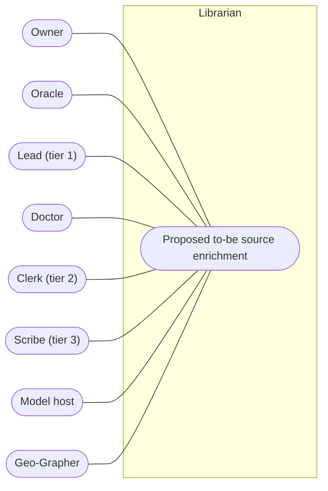

<!-- generated by build_family.py through the supplied render_spec.py; edit the spec -->
# Proposed to-be source enrichment

**Status:** proposed behavioral integration. [Use-case description](proposed-source-enrichment.md) · [Family](README.md).

Local report/end copies express the same guarded exit at different departures; they are not extra runtime actions. The presentation proof folds them back to the original model. Scenarios describe guarded departures/rejoins, not all repeated execution combinations.

## Validation

No structural, reference, card-overlap or preview edge/card intersection flags.

## Use-case diagram



## Activity diagram

```mermaid
flowchart TD
  subgraph Owner["Owner"]
    critical["receives existing critical integrity, data-loss, false-attestation or authority-boundary evidence immediately through the parent notification path, with tier 0 when present"]
    critical_at_082eb1e9e8["receives existing critical integrity, data-loss, false-attestation or authority-boundary evidence immediately through the parent notification path, with tier 0 when present"]
    critical_at_84834aba8e["receives existing critical integrity, data-loss, false-attestation or authority-boundary evidence immediately through the parent notification path, with tier 0 when present"]
    critical_at_21ac1dd149["receives existing critical integrity, data-loss, false-attestation or authority-boundary evidence immediately through the parent notification path, with tier 0 when present"]
    critical_at_70138e5e7f["receives existing critical integrity, data-loss, false-attestation or authority-boundary evidence immediately through the parent notification path, with tier 0 when present"]
    critical_at_12ca5746cd["receives existing critical integrity, data-loss, false-attestation or authority-boundary evidence immediately through the parent notification path, with tier 0 when present"]
    critical_at_d58f1c5e42["receives existing critical integrity, data-loss, false-attestation or authority-boundary evidence immediately through the parent notification path, with tier 0 when present"]
    critical_at_f908e42c8c["receives existing critical integrity, data-loss, false-attestation or authority-boundary evidence immediately through the parent notification path, with tier 0 when present"]
    critical_at_f1ee331a36["receives existing critical integrity, data-loss, false-attestation or authority-boundary evidence immediately through the parent notification path, with tier 0 when present"]
    critical_at_32afc38531["receives existing critical integrity, data-loss, false-attestation or authority-boundary evidence immediately through the parent notification path, with tier 0 when present"]
    critical_at_6c831f6dee["receives existing critical integrity, data-loss, false-attestation or authority-boundary evidence immediately through the parent notification path, with tier 0 when present"]
    critical_at_b16d607888["receives existing critical integrity, data-loss, false-attestation or authority-boundary evidence immediately through the parent notification path, with tier 0 when present"]
    critical_at_3b7680bae7["receives existing critical integrity, data-loss, false-attestation or authority-boundary evidence immediately through the parent notification path, with tier 0 when present"]
    critical_at_551635187c["receives existing critical integrity, data-loss, false-attestation or authority-boundary evidence immediately through the parent notification path, with tier 0 when present"]
    critical_at_1161cb252f["receives existing critical integrity, data-loss, false-attestation or authority-boundary evidence immediately through the parent notification path, with tier 0 when present"]
  end
  subgraph Oracle["Oracle"]
    oracle["17. judges this Source package against inherited requirements: deterministic evidence first, isolated semantic review second; parts, required derivations and publication obligations are distinct"]
    dverdict{"Source package verdict?"}
    roles>"Proposed roles use configurable qualified adapters. Doctor and Oracle currently use GLM-5.3 with separate contexts; assignments remain revisable and independence must be checked."]
  end
  subgraph Lead_tier_1_["Lead (tier 1)"]
    boundary>"Proposed child of the mixed dispatcher for one selected Source. Inherits its Lead, Core-stored specification, grants and ledger; returns to that caller. No second worker or commission."]
    conversionroute{"bounded same-route retry, preserve actual fallback, or pause?"}
    readroute{"retry only affected pending tasks, retain queued gaps, or pause?"}
    unmapped["owns unmapped diagnosis and bounded Clerk/Scribe investigation; proposes new remedies for acceptance and never installs a remedy on its own"]
    dreconcile{"evidence supports an in-scope correction with progress?"}
    handback["18. returns the Source verdict, evidence, actual coverage, pending independent decisions, tickets and known or unknown spend to the invoking mixed dispatcher"]
    partialreport["returns an ordinary noncritical partial item with every unmet requirement, retained receipt and decision owner explicit; the mixed parent may continue siblings without claiming required work complete"]
    paused["returns a pause checkpoint and the exact continuation or reserved authority needed to the parent; reuses already granted authority without asking again"]
    escalated["returns unresolved cause, evidence, retained work and intervention needed to the parent; code changes or exhausted/no-progress repairs are not silent retries"]
    paused_at_72362cad54["returns a pause checkpoint and the exact continuation or reserved authority needed to the parent; reuses already granted authority without asking again"]
    escalated_at_a2bce665b2["returns unresolved cause, evidence, retained work and intervention needed to the parent; code changes or exhausted/no-progress repairs are not silent retries"]
  end
  subgraph Doctor["Doctor"]
    dremedy{"accepted mapped remedy fits the actual grant and blast radius?"}
    repair[["UC-D: uses only the accepted mapped remedy within scope; returns evidence for independent Oracle recheck and cannot declare the Source complete"]]
  end
  subgraph Clerk_tier_2_["Clerk (tier 2)"]
    conversionplan["assigns bounded cleanup or transcription to a Scribe under the approved qualified role assignment and allowance"]
    conversionreview["checks conversion fidelity against available original evidence; retains uncertain or missing material and never attests unread pages"]
    readplan["5. read: assigns bounded part and required source-wide tasks to Scribes; reuses only compatible completed evidence and retains pending task identities"]
    readproof["8. proofreads and reconciles readings across the source; directs grounded lens challenges, probes and synthesis; records unfinished source-wide work explicitly"]
    data["10. Data: proposes meaningful component and chapter organization from source evidence and script-derived structure; preserves unsupported kinds and partial coverage"]
    relate["11. relate: proposes evidence-based relations between eligible fully read document components; static repository relations retain their structurally observed origin"]
    metadata["12. metadata: proposes content-model fields from evidence, explains Unknown where appropriate and leaves confirmation to parent acceptance"]
    review["13. review: authors the kind-specific Source draft and Bottom Line with grounded claims, sensitivity judgment, actual coverage and explicit unread material"]
    package["16. assembles this Source's evidence package and explains actual reading, derivation, draft and publication outcomes; Source and lens decisions remain independent parent worklists"]
  end
  subgraph Scribe_tier_3_["Scribe (tier 3)"]
    convert["returns transcription or cleanup with page anchors, actual covered material, uncertainties and explicit errors"]
    read["6. reads assigned material and returns located points, limits, term usages and reasoning candidates; task parallelism stays inside this Source's stage"]
  end
  subgraph Core["Core"]
    bind["1. binds the selected Source and required outputs to the admitted parent specification, current hashes, role assignments, grants and exact receipt keys"]
    dwork{"an admitted Source item is selected?"}
    controls["2. applies the existing worker controls and proposed dispatch grants: cancellation, writer state, attempts, known spend and recorded allowance; checks critical flags at every dispatch and commit"]
    dcontrols{"recorded controls permit this work?"}
    validate["3. validate: checks evidence, source identity, source/artifact/recipe/route compatibility and matching task receipts; completed work still gets fresh publication admission"]
    dvalidate{"validation result?"}
    parse["4. parse: runs scripted fetch, AST or text/PDF extraction and page mapping, retaining originals, quality evidence and the recorded branch that returned"]
    dparse{"extraction result and permitted conversion request?"}
    conversioncheck["checks fields, hashes and literal page anchors; persists conversion evidence and the Clerk verdict without owning that judgment"]
    dconversion{"recorded conversion result?"}
    fallback["keeps unusable generated text unused and restores original extraction; cleanup error remains partial, while lost anchors can permit complete parse if original text is usable and no gap remains"]
    conversionoutage["records 429, timeout or unavailable route, attempts, backoff and known or unknown cost; defers equivalent calls to the failed route"]
    conversionretry{"retry attempt, backoff, current qualification and recorded grant permit the request?"}
    dconversionreturn{"recorded failed conversion was cleanup or OCR?"}
    parsegap["records early fetch/OCR partial return or later missing units; unread material receives no reading credit and remains a required-work gap"]
    dprojection{"parse reached provisional projection and source is PDF or paper?"}
    preproject["writes provisional paper .nodes.json with text_layer=False before reading; catalogue-only or zero-claim output is not publication or reading evidence"]
    dpreproject{"provisional projection write result?"}
    parsefinal{"usable units and actual post-projection quality verdict?"}
    dreadwork{"pending bounded tasks have available permitted input?"}
    readcheck["7. checks task schemas, literal quotes, anchors and receipt keys; records part coverage and each required derivation's actual status separately"]
    dreadtransport{"transport incident, task result or critical flag?"}
    dread{"recorded reading and required-derivation status?"}
    partialread["retains unread parts, refused tasks and pending required derivations separately; later stages use only evidence actually obtained"]
    readoutage["records the failed route and bounded attempts; retains completed tasks and queued gaps, defers equivalent calls and preserves unknown costs"]
    readretry{"same-route retry within backoff, attempts, qualified assignment and existing grant?"}
    lenses["9. lenses: schema-checks and persists Clerk-submitted grounded proposals, citations and dispositions; none found or rejected optional candidates may be valid; acceptance stays with the parent"]
    dlenses{"lenses persistence result?"}
    datastore["checks Data proposal fields and literal references, materializes declared scripted records and stores the agent-authored proposal"]
    ddata{"Data write status and recorded relation applicability?"}
    relatestatic["retains scripted static relations or records inapplicability; does not invent a semantic model task"]
    relationstore["checks relation fields and source references, then stores the authored proposal or declared static result"]
    drelate{"relation record result?"}
    metadatastore["checks metadata schema, permitted fields and literal evidence references; stores the submitted proposal without authoring its meaning"]
    dmetadata{"metadata write result?"}
    reviewcheck["checks draft structure, literal support and recorded coverage, then stores the Clerk's draft and judgment"]
    dreview{"draft record result?"}
    pubcheck["14. publish: checks full reading, required projection-task status, persistent conversion and artifact binding; freshly checks enabled, accepted, current, trusted folder assignment"]
    dpublication{"publication admission and applicability?"}
    dpubresult{"publication call result?"}
    pubna["records non-PDF or fully read PDF without full conversion as not applicable, retaining the actual limitation and any required parent obligation"]
    pubgap["retains completed reading and exact publication gap: incomplete required work, disabled Geo, stale/missing folder assignment, artifact mismatch or caught call failure"]
    itemfailed["records the failed stage and existing ticket flag; stops remaining stages for this item, retains completed receipts and leaves sibling accounting with the mixed parent"]
    ticket["records the shortfall with its originating stage, existing refusal/extension flags, evidence, accountable actor and attempt history"]
    reentry["checks affected scope, compatibility, remaining attempts and authority; unfinished work resumes pinned inputs, finished partials require actual re-approval before a new batch"]
    dreentry{"affected re-entry admitted under existing authority?"}
  end
  subgraph Model_host["Model host"]
    host["answers bounded tasks through qualified configurable role assignments and the existing task pool; transport completion is not task completion"]
  end
  subgraph Geo_Grapher["Geo-Grapher"]
    publish["15. revalidates folder/artifact admission, copies the prior paper DB into a new generation, imports eligible claims and conditionally switches the catalog pointer"]
    publishstorage>"Candidate paper DB is checkpointed; catalog uses WAL. Copy, import or registration may fail and leave old or failed candidates. No automatic pruning or graph rebuild is authorized."]
  end
  s(("start"))
  e1((("the Source package satisfies inherited requirements; no Source or lens acceptance is implied")))
  epartial((("noncritical partial Source package returned; unmet required work remains a parent obligation")))
  enowork((("no Source item admitted; the parent retains all mixed work and outstanding decisions")))
  epaused((("retained Source work returned for explicit continuation or reserved authority")))
  eescalated((("unresolved or critical Source failure returned with evidence and retained work")))
  epaused_at_72362cad54((("retained Source work returned for explicit continuation or reserved authority")))
  eescalated_at_a2bce665b2((("unresolved or critical Source failure returned with evidence and retained work")))
  eescalated_at_082eb1e9e8((("unresolved or critical Source failure returned with evidence and retained work")))
  eescalated_at_84834aba8e((("unresolved or critical Source failure returned with evidence and retained work")))
  eescalated_at_21ac1dd149((("unresolved or critical Source failure returned with evidence and retained work")))
  eescalated_at_70138e5e7f((("unresolved or critical Source failure returned with evidence and retained work")))
  eescalated_at_12ca5746cd((("unresolved or critical Source failure returned with evidence and retained work")))
  eescalated_at_d58f1c5e42((("unresolved or critical Source failure returned with evidence and retained work")))
  eescalated_at_f908e42c8c((("unresolved or critical Source failure returned with evidence and retained work")))
  eescalated_at_f1ee331a36((("unresolved or critical Source failure returned with evidence and retained work")))
  eescalated_at_32afc38531((("unresolved or critical Source failure returned with evidence and retained work")))
  eescalated_at_6c831f6dee((("unresolved or critical Source failure returned with evidence and retained work")))
  eescalated_at_b16d607888((("unresolved or critical Source failure returned with evidence and retained work")))
  eescalated_at_3b7680bae7((("unresolved or critical Source failure returned with evidence and retained work")))
  eescalated_at_551635187c((("unresolved or critical Source failure returned with evidence and retained work")))
  eescalated_at_1161cb252f((("unresolved or critical Source failure returned with evidence and retained work")))
  s --> boundary
  boundary --> bind
  bind --> dwork
  dwork -->|"[one selected Source item]"| controls
  dwork -->|"[no Source item admitted] 1a"| enowork
  controls --> dcontrols
  dcontrols -->|"[permitted and active]"| validate
  dcontrols -->|"[cancelled, interrupted, ceiling stop or missing/reserved authority] 2a"| paused_at_72362cad54
  dcontrols -->|"[run-wide writer/state failure or unavailable qualified assignment] 2b"| escalated_at_a2bce665b2
  dcontrols -->|"[critical flag] 2c"| critical_at_082eb1e9e8
  validate --> dvalidate
  dvalidate -->|"[noncritical permitted Source evidence]"| parse
  dvalidate -->|"[noncritical validation failure] 3a"| itemfailed
  dvalidate -->|"[critical flag] 3b"| critical_at_84834aba8e
  parse --> dparse
  dparse -->|"[noncritical scripted parse continued without model conversion]"| dprojection
  dparse -->|"[noncritical permitted model conversion requested] 4a"| conversionplan
  dparse -->|"[noncritical fetch or OCR precondition returned partial before projection] 4b"| parsegap
  dparse -->|"[noncritical uncaught stage failure] 4c"| itemfailed
  dparse -->|"[critical flag] 4d"| critical_at_21ac1dd149
  conversionplan --> convert
  convert --> conversionreview
  conversionreview --> conversioncheck
  conversioncheck --> dconversion
  dconversion -->|"[noncritical usable mapped cleanup or complete OCR, with reviewed coverage]"| dprojection
  dconversion -->|"[noncritical cleanup task error or unusable generated anchors/representation; no transport outage]"| fallback
  dconversion -->|"[noncritical OCR partial return before projection]"| parsegap
  dconversion -->|"[noncritical transport 429, timeout or unavailable route]"| conversionoutage
  dconversion -->|"[noncritical uncaught stage/writer failure]"| itemfailed
  dconversion -->|"[critical flag]"| critical_at_70138e5e7f
  fallback --> dprojection
  conversionoutage --> conversionroute
  conversionroute -->|"[request bounded retry of affected work]"| conversionretry
  conversionroute -->|"[retain actual fallback or missing-material gap]"| dconversionreturn
  conversionroute -->|"[pause; any changed assignment needs fresh authorization and qualification]"| paused
  conversionretry -->|"[permitted retry; reuse compatible extraction and retry only affected conversion]"| parse
  conversionretry -->|"[not currently permitted; retain exact task outcome]"| dconversionreturn
  dconversionreturn -->|"[returned cleanup error; keep partial even with usable raw text]"| fallback
  dconversionreturn -->|"[OCR partial return; provisional projection not reached]"| parsegap
  dprojection -->|"[PDF or paper and parse did not return early]"| preproject
  dprojection -->|"[other source kind] 4e"| parsefinal
  preproject --> dpreproject
  dpreproject -->|"[written; still provisional]"| parsefinal
  dpreproject -->|"[noncritical write failure] 4f"| itemfailed
  dpreproject -->|"[critical flag] 4g"| critical_at_12ca5746cd
  parsefinal -->|"[usable units; retain any cleanup-error partial status]"| readplan
  parsefinal -->|"[no usable units or needs_ocr/js_shell remains] 4h"| parsegap
  parsegap --> readplan
  readplan --> dreadwork
  dreadwork -->|"[pending bounded tasks with available permitted input]"| read
  dreadwork -->|"[no dispatchable task; retain compatible completed receipts or absent-input gaps distinctly] 5a"| readcheck
  read --> host
  host --> readcheck
  readcheck --> dreadtransport
  dreadtransport -->|"[noncritical application task result; invalid JSON/refusal remains an unmet task]"| readproof
  dreadtransport -->|"[noncritical transport 429, timeout or unavailable route] 7a"| readoutage
  dreadtransport -->|"[critical flag] 7b"| critical_at_d58f1c5e42
  readproof --> dread
  dread -->|"[noncritical parts and required source-wide work complete or explicitly inapplicable]"| lenses
  dread -->|"[noncritical, nonfailed and no new transport incident; required tasks or unread parts remain] 8a"| partialread
  dread -->|"[noncritical new transport incident during source-wide work] 8b"| readoutage
  dread -->|"[noncritical reading stage failure] 8c"| itemfailed
  dread -->|"[critical flag] 8d"| critical_at_f908e42c8c
  partialread --> lenses
  readoutage --> readroute
  readroute -->|"[request bounded pending-task retry]"| readretry
  readroute -->|"[retain completed tasks and explicit queued gaps]"| partialread
  readroute -->|"[pause; route change requires fresh authorized qualification]"| paused
  readretry -->|"[permitted; retry only affected pending tasks]"| readplan
  readretry -->|"[retry not currently permitted; retain every queued gap and deferred route]"| lenses
  lenses --> dlenses
  dlenses -->|"[noncritical stored or legitimately empty/inapplicable]"| data
  dlenses -->|"[noncritical persistence failure] 9a"| itemfailed
  dlenses -->|"[critical flag] 9b"| critical_at_f1ee331a36
  data --> datastore
  datastore --> ddata
  ddata -->|"[noncritical stored; eligible fully read document components for semantic relation work]"| relate
  ddata -->|"[noncritical static or inapplicable relations] 10a"| relatestatic
  ddata -->|"[noncritical proposal/write failure] 10b"| itemfailed
  ddata -->|"[critical flag] 10c"| critical_at_32afc38531
  relate --> relationstore
  relatestatic --> relationstore
  relationstore --> drelate
  drelate -->|"[noncritical recorded, partial or inapplicable]"| metadata
  drelate -->|"[noncritical proposal/write failure] 11a"| itemfailed
  drelate -->|"[critical flag] 11b"| critical_at_6c831f6dee
  metadata --> metadatastore
  metadatastore --> dmetadata
  dmetadata -->|"[noncritical stored; Unknown remains valid]"| review
  dmetadata -->|"[noncritical proposal/write failure] 12a"| itemfailed
  dmetadata -->|"[critical flag] 12b"| critical_at_b16d607888
  review --> reviewcheck
  reviewcheck --> dreview
  dreview -->|"[noncritical draft recorded; retain actual confidence and gaps]"| pubcheck
  dreview -->|"[noncritical review/write failure] 13a"| itemfailed
  dreview -->|"[critical flag] 13b"| critical_at_3b7680bae7
  pubcheck --> dpublication
  dpublication -->|"[noncritical eligible fully read PDF, required projection tasks complete, compatible full conversion/artifact and current trusted accepted folder]"| publish
  dpublication -->|"[noncritical non-PDF or fully read PDF without full conversion] 14a"| pubna
  dpublication -->|"[noncritical incomplete required work, disabled Geo or refused folder/artifact admission] 14b"| pubgap
  dpublication -->|"[noncritical uncaught preparation failure] 14c"| itemfailed
  dpublication -->|"[critical flag] 14d"| critical_at_551635187c
  publish --> publishstorage
  publishstorage --> dpubresult
  dpubresult -->|"[published with no critical flag]"| package
  dpubresult -->|"[noncritical late refusal or caught call failure] 15a"| pubgap
  dpubresult -->|"[noncritical uncaught stage failure] 15b"| itemfailed
  dpubresult -->|"[critical flag] 15c"| critical_at_1161cb252f
  pubna --> package
  pubgap --> package
  itemfailed --> package
  package --> oracle
  oracle --> roles
  roles --> dverdict
  dverdict -->|"[inherited requirements satisfied; legitimate optional rejection/inapplicability accounted for]"| handback
  dverdict -->|"[noncritical item gaps; inherited handback policy permits partial return without repair now; unmet requirements remain explicit] 17a"| partialreport
  dverdict -->|"[noncritical required shortfall needs bounded remedy assessment before handback] 17b"| ticket
  dverdict -->|"[critical finding] 17c"| critical
  ticket --> dremedy
  dremedy -->|"[accepted mapped remedy and actual scope fit]"| repair
  dremedy -->|"[unmapped, unaccepted remedy or outside current scope]"| unmapped
  repair -->|"[resolved]"| reentry
  repair -->|"[declined]"| unmapped
  repair -->|"[escalated]"| unmapped
  unmapped --> dreconcile
  dreconcile -->|"[supported in-scope correction; request mechanical re-entry checks]"| reentry
  dreconcile -->|"[ordinary noncritical item shortfall; no accepted correction now or no progress; preserve unmet work for the parent]"| partialreport
  dreconcile -->|"[required reserved authority or an explicit parent decision blocks continuation]"| paused
  dreconcile -->|"[run-wide trust failure or unsafe out-of-scope intervention required]"| escalated
  reentry --> dreentry
  dreentry -->|"[authorized affected work and allowance remain; later Oracle rechecks independently]"| validate
  dreentry -->|"[parent must obtain reserved authority or actual partial re-approval]"| paused
  dreentry -->|"[ordinary noncritical item repair exhausted, made no progress or has incompatible receipts; retain required gap]"| partialreport
  dreentry -->|"[run-wide trust failure or unsafe out-of-scope intervention required]"| escalated
  handback --> e1
  partialreport --> epartial
  paused --> epaused
  escalated --> eescalated
  critical --> eescalated
  paused_at_72362cad54 --> epaused_at_72362cad54
  escalated_at_a2bce665b2 --> eescalated_at_a2bce665b2
  critical_at_082eb1e9e8 --> eescalated_at_082eb1e9e8
  critical_at_84834aba8e --> eescalated_at_84834aba8e
  critical_at_21ac1dd149 --> eescalated_at_21ac1dd149
  critical_at_70138e5e7f --> eescalated_at_70138e5e7f
  critical_at_12ca5746cd --> eescalated_at_12ca5746cd
  critical_at_d58f1c5e42 --> eescalated_at_d58f1c5e42
  critical_at_f908e42c8c --> eescalated_at_f908e42c8c
  critical_at_f1ee331a36 --> eescalated_at_f1ee331a36
  critical_at_32afc38531 --> eescalated_at_32afc38531
  critical_at_6c831f6dee --> eescalated_at_6c831f6dee
  critical_at_b16d607888 --> eescalated_at_b16d607888
  critical_at_3b7680bae7 --> eescalated_at_3b7680bae7
  critical_at_551635187c --> eescalated_at_551635187c
  critical_at_1161cb252f --> eescalated_at_1161cb252f
  classDef ext stroke:#d9534f,stroke-width:2px
```

## Written use case

**Main success scenario** (generated: the guard-true path, in step order)

1. The Core binds the selected Source and required outputs to the admitted parent specification, current hashes, role assignments, grants and exact receipt keys.
2. The Core applies the existing worker controls and proposed dispatch grants: cancellation, writer state, attempts, known spend and recorded allowance; checks critical flags at every dispatch and commit.
3. The Core validate: checks evidence, source identity, source/artifact/recipe/route compatibility and matching task receipts; completed work still gets fresh publication admission.
4. The Core parse: runs scripted fetch, AST or text/PDF extraction and page mapping, retaining originals, quality evidence and the recorded branch that returned.
5. The Clerk (tier 2) read: assigns bounded part and required source-wide tasks to Scribes; reuses only compatible completed evidence and retains pending task identities.
6. The Scribe (tier 3) reads assigned material and returns located points, limits, term usages and reasoning candidates; task parallelism stays inside this Source's stage.
7. The Core checks task schemas, literal quotes, anchors and receipt keys; records part coverage and each required derivation's actual status separately.
8. The Clerk (tier 2) proofreads and reconciles readings across the source; directs grounded lens challenges, probes and synthesis; records unfinished source-wide work explicitly.
9. The Core lenses: schema-checks and persists Clerk-submitted grounded proposals, citations and dispositions; none found or rejected optional candidates may be valid; acceptance stays with the parent.
10. The Clerk (tier 2) Data: proposes meaningful component and chapter organization from source evidence and script-derived structure; preserves unsupported kinds and partial coverage.
11. The Clerk (tier 2) relate: proposes evidence-based relations between eligible fully read document components; static repository relations retain their structurally observed origin.
12. The Clerk (tier 2) metadata: proposes content-model fields from evidence, explains Unknown where appropriate and leaves confirmation to parent acceptance.
13. The Clerk (tier 2) review: authors the kind-specific Source draft and Bottom Line with grounded claims, sensitivity judgment, actual coverage and explicit unread material.
14. The Core publish: checks full reading, required projection-task status, persistent conversion and artifact binding; freshly checks enabled, accepted, current, trusted folder assignment.
15. The Geo-Grapher revalidates folder/artifact admission, copies the prior paper DB into a new generation, imports eligible claims and conditionally switches the catalog pointer.
16. The Clerk (tier 2) assembles this Source's evidence package and explains actual reading, derivation, draft and publication outcomes; Source and lens decisions remain independent parent worklists.
17. The Oracle judges this Source package against inherited requirements: deterministic evidence first, isolated semantic review second; parts, required derivations and publication obligations are distinct.
18. The Lead (tier 1) returns the Source verdict, evidence, actual coverage, pending independent decisions, tickets and known or unknown spend to the invoking mixed dispatcher.

**Extensions** (generated: one per non-happy guard; numbered by the step it leaves)

- **1a** (from: an admitted Source item is selected?) *anticipated*
  - `1a1` No Source item admitted.
  - `1a2` The use case ends: no Source item admitted; the parent retains all mixed work and outstanding decisions.
- **2a** (from: recorded controls permit this work?) *anticipated*
  - `2a1` Cancelled, interrupted, ceiling stop or missing/reserved authority.
  - `2a2` The Lead (tier 1) returns a pause checkpoint and the exact continuation or reserved authority needed to the parent; reuses already granted authority without asking again.
  - `2a3` The use case ends: retained Source work returned for explicit continuation or reserved authority.
- **2b** (from: recorded controls permit this work?) *anticipated*
  - `2b1` Run-wide writer/state failure or unavailable qualified assignment.
  - `2b2` The Lead (tier 1) returns unresolved cause, evidence, retained work and intervention needed to the parent; code changes or exhausted/no-progress repairs are not silent retries.
  - `2b3` The use case ends: unresolved or critical Source failure returned with evidence and retained work.
- **2c** (from: recorded controls permit this work?) *anticipated*
  - `2c1` Critical flag.
  - `2c2` The Owner receives existing critical integrity, data-loss, false-attestation or authority-boundary evidence immediately through the parent notification path, with tier 0 when present.
  - `2c3` The use case ends: unresolved or critical Source failure returned with evidence and retained work.
- **3a** (from: validation result?) *anticipated*
  - `3a1` Noncritical validation failure.
  - `3a2` The Core records the failed stage and existing ticket flag; stops remaining stages for this item, retains completed receipts and leaves sibling accounting with the mixed parent.
  - `3a3` Rejoin at 16.
- **3b** (from: validation result?) *anticipated*
  - `3b1` Critical flag.
  - `3b2` The Owner receives existing critical integrity, data-loss, false-attestation or authority-boundary evidence immediately through the parent notification path, with tier 0 when present.
  - `3b3` The use case ends: unresolved or critical Source failure returned with evidence and retained work.
- **4a** (from: extraction result and permitted conversion request?) *anticipated*
  - `4a1` Noncritical permitted model conversion requested.
  - `4a2` The Clerk (tier 2) assigns bounded cleanup or transcription to a Scribe under the approved qualified role assignment and allowance.
  - `4a3` The Scribe (tier 3) returns transcription or cleanup with page anchors, actual covered material, uncertainties and explicit errors.
  - `4a4` The Clerk (tier 2) checks conversion fidelity against available original evidence; retains uncertain or missing material and never attests unread pages.
  - `4a5` The Core checks fields, hashes and literal page anchors; persists conversion evidence and the Clerk verdict without owning that judgment.
  - `4a6` The Core decides: recorded conversion result?
  - `4a6a` If noncritical cleanup task error or unusable generated anchors/representation; no transport outage: keeps unusable generated text unused and restores original extraction; cleanup error remains partial, while lost anchors can permit complete parse if original text is usable and no gap remains.
  - `4a6a` If noncritical OCR partial return before projection: records early fetch/OCR partial return or later missing units; unread material receives no reading credit and remains a required-work gap.
  - `4a6a` If noncritical transport 429, timeout or unavailable route: records 429, timeout or unavailable route, attempts, backoff and known or unknown cost; defers equivalent calls to the failed route.
  - `4a6a` If noncritical uncaught stage/writer failure: records the failed stage and existing ticket flag; stops remaining stages for this item, retains completed receipts and leaves sibling accounting with the mixed parent.
  - `4a6a` If critical flag: receives existing critical integrity, data-loss, false-attestation or authority-boundary evidence immediately through the parent notification path, with tier 0 when present.
  - `4a7` If noncritical usable mapped cleanup or complete OCR, with reviewed coverage:
  - `4a8` The Core decides: parse reached provisional projection and source is PDF or paper?
  - `4a8a` If other source kind: usable units and actual post-projection quality verdict?.
  - `4a9` If PDF or paper and parse did not return early:
  - `4a10` The Core writes provisional paper .nodes.json with text_layer=False before reading; catalogue-only or zero-claim output is not publication or reading evidence.
  - `4a11` The Core decides: provisional projection write result?
  - `4a11a` If noncritical write failure: records the failed stage and existing ticket flag; stops remaining stages for this item, retains completed receipts and leaves sibling accounting with the mixed parent.
  - `4a11a` If critical flag: receives existing critical integrity, data-loss, false-attestation or authority-boundary evidence immediately through the parent notification path, with tier 0 when present.
  - `4a12` If written; still provisional:
  - `4a13` The Core decides: usable units and actual post-projection quality verdict?
  - `4a13a` If no usable units or needs_ocr/js_shell remains: records early fetch/OCR partial return or later missing units; unread material receives no reading credit and remains a required-work gap.
  - `4a14` If usable units; retain any cleanup-error partial status:
  - `4a15` Rejoin at 5.
- **4b** (from: extraction result and permitted conversion request?) *anticipated*
  - `4b1` Noncritical fetch or OCR precondition returned partial before projection.
  - `4b2` The Core records early fetch/OCR partial return or later missing units; unread material receives no reading credit and remains a required-work gap.
  - `4b3` Rejoin at 5.
- **4c** (from: extraction result and permitted conversion request?) *anticipated*
  - `4c1` Noncritical uncaught stage failure.
  - `4c2` The Core records the failed stage and existing ticket flag; stops remaining stages for this item, retains completed receipts and leaves sibling accounting with the mixed parent.
  - `4c3` Rejoin at 16.
- **4d** (from: extraction result and permitted conversion request?) *anticipated*
  - `4d1` Critical flag.
  - `4d2` The Owner receives existing critical integrity, data-loss, false-attestation or authority-boundary evidence immediately through the parent notification path, with tier 0 when present.
  - `4d3` The use case ends: unresolved or critical Source failure returned with evidence and retained work.
- **4e** (from: parse reached provisional projection and source is PDF or paper?) *anticipated*
  - `4e1` Other source kind.
  - `4e2` The Core decides: usable units and actual post-projection quality verdict?
  - `4e2a` If no usable units or needs_ocr/js_shell remains: records early fetch/OCR partial return or later missing units; unread material receives no reading credit and remains a required-work gap.
  - `4e3` If usable units; retain any cleanup-error partial status:
  - `4e4` Rejoin at 5.
- **4f** (from: provisional projection write result?) *anticipated*
  - `4f1` Noncritical write failure.
  - `4f2` The Core records the failed stage and existing ticket flag; stops remaining stages for this item, retains completed receipts and leaves sibling accounting with the mixed parent.
  - `4f3` Rejoin at 16.
- **4g** (from: provisional projection write result?) *anticipated*
  - `4g1` Critical flag.
  - `4g2` The Owner receives existing critical integrity, data-loss, false-attestation or authority-boundary evidence immediately through the parent notification path, with tier 0 when present.
  - `4g3` The use case ends: unresolved or critical Source failure returned with evidence and retained work.
- **4h** (from: usable units and actual post-projection quality verdict?) *anticipated*
  - `4h1` No usable units or needs_ocr/js_shell remains.
  - `4h2` The Core records early fetch/OCR partial return or later missing units; unread material receives no reading credit and remains a required-work gap.
  - `4h3` Rejoin at 5.
- **5a** (from: pending bounded tasks have available permitted input?) *anticipated*
  - `5a1` No dispatchable task; retain compatible completed receipts or absent-input gaps distinctly.
  - `5a2` Rejoin at 7.
- **7a** (from: transport incident, task result or critical flag?) *anticipated*
  - `7a1` Noncritical transport 429, timeout or unavailable route.
  - `7a2` The Core records the failed route and bounded attempts; retains completed tasks and queued gaps, defers equivalent calls and preserves unknown costs.
  - `7a3` The Lead (tier 1) decides: retry only affected pending tasks, retain queued gaps, or pause?
  - `7a3a` If retain completed tasks and explicit queued gaps: retains unread parts, refused tasks and pending required derivations separately; later stages use only evidence actually obtained.
  - `7a3a` If pause; route change requires fresh authorized qualification: returns a pause checkpoint and the exact continuation or reserved authority needed to the parent; reuses already granted authority without asking again.
  - `7a4` If request bounded pending-task retry:
  - `7a5` The Core decides: same-route retry within backoff, attempts, qualified assignment and existing grant?
  - `7a5a` If retry not currently permitted; retain every queued gap and deferred route: rejoin at 9.
  - `7a6` If permitted; retry only affected pending tasks:
  - `7a7` Rejoin at 5.
- **7b** (from: transport incident, task result or critical flag?) *anticipated*
  - `7b1` Critical flag.
  - `7b2` The Owner receives existing critical integrity, data-loss, false-attestation or authority-boundary evidence immediately through the parent notification path, with tier 0 when present.
  - `7b3` The use case ends: unresolved or critical Source failure returned with evidence and retained work.
- **8a** (from: recorded reading and required-derivation status?) *anticipated*
  - `8a1` Noncritical, nonfailed and no new transport incident; required tasks or unread parts remain.
  - `8a2` The Core retains unread parts, refused tasks and pending required derivations separately; later stages use only evidence actually obtained.
  - `8a3` Rejoin at 9.
- **8b** (from: recorded reading and required-derivation status?) *anticipated*
  - `8b1` Noncritical new transport incident during source-wide work.
  - `8b2` The Core records the failed route and bounded attempts; retains completed tasks and queued gaps, defers equivalent calls and preserves unknown costs.
  - `8b3` The Lead (tier 1) decides: retry only affected pending tasks, retain queued gaps, or pause?
  - `8b3a` If retain completed tasks and explicit queued gaps: retains unread parts, refused tasks and pending required derivations separately; later stages use only evidence actually obtained.
  - `8b3a` If pause; route change requires fresh authorized qualification: returns a pause checkpoint and the exact continuation or reserved authority needed to the parent; reuses already granted authority without asking again.
  - `8b4` If request bounded pending-task retry:
  - `8b5` The Core decides: same-route retry within backoff, attempts, qualified assignment and existing grant?
  - `8b5a` If retry not currently permitted; retain every queued gap and deferred route: rejoin at 9.
  - `8b6` If permitted; retry only affected pending tasks:
  - `8b7` Rejoin at 5.
- **8c** (from: recorded reading and required-derivation status?) *anticipated*
  - `8c1` Noncritical reading stage failure.
  - `8c2` The Core records the failed stage and existing ticket flag; stops remaining stages for this item, retains completed receipts and leaves sibling accounting with the mixed parent.
  - `8c3` Rejoin at 16.
- **8d** (from: recorded reading and required-derivation status?) *anticipated*
  - `8d1` Critical flag.
  - `8d2` The Owner receives existing critical integrity, data-loss, false-attestation or authority-boundary evidence immediately through the parent notification path, with tier 0 when present.
  - `8d3` The use case ends: unresolved or critical Source failure returned with evidence and retained work.
- **9a** (from: lenses persistence result?) *anticipated*
  - `9a1` Noncritical persistence failure.
  - `9a2` The Core records the failed stage and existing ticket flag; stops remaining stages for this item, retains completed receipts and leaves sibling accounting with the mixed parent.
  - `9a3` Rejoin at 16.
- **9b** (from: lenses persistence result?) *anticipated*
  - `9b1` Critical flag.
  - `9b2` The Owner receives existing critical integrity, data-loss, false-attestation or authority-boundary evidence immediately through the parent notification path, with tier 0 when present.
  - `9b3` The use case ends: unresolved or critical Source failure returned with evidence and retained work.
- **10a** (from: Data write status and recorded relation applicability?) *anticipated*
  - `10a1` Noncritical static or inapplicable relations.
  - `10a2` The Core retains scripted static relations or records inapplicability; does not invent a semantic model task.
  - `10a3` The Core checks relation fields and source references, then stores the authored proposal or declared static result.
  - `10a4` The Core decides: relation record result?
  - `10a4a` If noncritical proposal/write failure: records the failed stage and existing ticket flag; stops remaining stages for this item, retains completed receipts and leaves sibling accounting with the mixed parent.
  - `10a4a` If critical flag: receives existing critical integrity, data-loss, false-attestation or authority-boundary evidence immediately through the parent notification path, with tier 0 when present.
  - `10a5` If noncritical recorded, partial or inapplicable:
  - `10a6` Rejoin at 12.
- **10b** (from: Data write status and recorded relation applicability?) *anticipated*
  - `10b1` Noncritical proposal/write failure.
  - `10b2` The Core records the failed stage and existing ticket flag; stops remaining stages for this item, retains completed receipts and leaves sibling accounting with the mixed parent.
  - `10b3` Rejoin at 16.
- **10c** (from: Data write status and recorded relation applicability?) *anticipated*
  - `10c1` Critical flag.
  - `10c2` The Owner receives existing critical integrity, data-loss, false-attestation or authority-boundary evidence immediately through the parent notification path, with tier 0 when present.
  - `10c3` The use case ends: unresolved or critical Source failure returned with evidence and retained work.
- **11a** (from: relation record result?) *anticipated*
  - `11a1` Noncritical proposal/write failure.
  - `11a2` The Core records the failed stage and existing ticket flag; stops remaining stages for this item, retains completed receipts and leaves sibling accounting with the mixed parent.
  - `11a3` Rejoin at 16.
- **11b** (from: relation record result?) *anticipated*
  - `11b1` Critical flag.
  - `11b2` The Owner receives existing critical integrity, data-loss, false-attestation or authority-boundary evidence immediately through the parent notification path, with tier 0 when present.
  - `11b3` The use case ends: unresolved or critical Source failure returned with evidence and retained work.
- **12a** (from: metadata write result?) *anticipated*
  - `12a1` Noncritical proposal/write failure.
  - `12a2` The Core records the failed stage and existing ticket flag; stops remaining stages for this item, retains completed receipts and leaves sibling accounting with the mixed parent.
  - `12a3` Rejoin at 16.
- **12b** (from: metadata write result?) *anticipated*
  - `12b1` Critical flag.
  - `12b2` The Owner receives existing critical integrity, data-loss, false-attestation or authority-boundary evidence immediately through the parent notification path, with tier 0 when present.
  - `12b3` The use case ends: unresolved or critical Source failure returned with evidence and retained work.
- **13a** (from: draft record result?) *anticipated*
  - `13a1` Noncritical review/write failure.
  - `13a2` The Core records the failed stage and existing ticket flag; stops remaining stages for this item, retains completed receipts and leaves sibling accounting with the mixed parent.
  - `13a3` Rejoin at 16.
- **13b** (from: draft record result?) *anticipated*
  - `13b1` Critical flag.
  - `13b2` The Owner receives existing critical integrity, data-loss, false-attestation or authority-boundary evidence immediately through the parent notification path, with tier 0 when present.
  - `13b3` The use case ends: unresolved or critical Source failure returned with evidence and retained work.
- **14a** (from: publication admission and applicability?) *anticipated*
  - `14a1` Noncritical non-PDF or fully read PDF without full conversion.
  - `14a2` The Core records non-PDF or fully read PDF without full conversion as not applicable, retaining the actual limitation and any required parent obligation.
  - `14a3` Rejoin at 16.
- **14b** (from: publication admission and applicability?) *anticipated*
  - `14b1` Noncritical incomplete required work, disabled Geo or refused folder/artifact admission.
  - `14b2` The Core retains completed reading and exact publication gap: incomplete required work, disabled Geo, stale/missing folder assignment, artifact mismatch or caught call failure.
  - `14b3` Rejoin at 16.
- **14c** (from: publication admission and applicability?) *anticipated*
  - `14c1` Noncritical uncaught preparation failure.
  - `14c2` The Core records the failed stage and existing ticket flag; stops remaining stages for this item, retains completed receipts and leaves sibling accounting with the mixed parent.
  - `14c3` Rejoin at 16.
- **14d** (from: publication admission and applicability?) *anticipated*
  - `14d1` Critical flag.
  - `14d2` The Owner receives existing critical integrity, data-loss, false-attestation or authority-boundary evidence immediately through the parent notification path, with tier 0 when present.
  - `14d3` The use case ends: unresolved or critical Source failure returned with evidence and retained work.
- **15a** (from: publication call result?) *anticipated*
  - `15a1` Noncritical late refusal or caught call failure.
  - `15a2` The Core retains completed reading and exact publication gap: incomplete required work, disabled Geo, stale/missing folder assignment, artifact mismatch or caught call failure.
  - `15a3` Rejoin at 16.
- **15b** (from: publication call result?) *anticipated*
  - `15b1` Noncritical uncaught stage failure.
  - `15b2` The Core records the failed stage and existing ticket flag; stops remaining stages for this item, retains completed receipts and leaves sibling accounting with the mixed parent.
  - `15b3` Rejoin at 16.
- **15c** (from: publication call result?) *anticipated*
  - `15c1` Critical flag.
  - `15c2` The Owner receives existing critical integrity, data-loss, false-attestation or authority-boundary evidence immediately through the parent notification path, with tier 0 when present.
  - `15c3` The use case ends: unresolved or critical Source failure returned with evidence and retained work.
- **17a** (from: Source package verdict?) *anticipated*
  - `17a1` Noncritical item gaps; inherited handback policy permits partial return without repair now; unmet requirements remain explicit.
  - `17a2` The Lead (tier 1) returns an ordinary noncritical partial item with every unmet requirement, retained receipt and decision owner explicit; the mixed parent may continue siblings without claiming required work complete.
  - `17a3` The use case ends: noncritical partial Source package returned; unmet required work remains a parent obligation.
- **17b** (from: Source package verdict?) *anticipated*
  - `17b1` Noncritical required shortfall needs bounded remedy assessment before handback.
  - `17b2` The Core records the shortfall with its originating stage, existing refusal/extension flags, evidence, accountable actor and attempt history.
  - `17b3` The Doctor decides: accepted mapped remedy fits the actual grant and blast radius?
  - `17b3a` If unmapped, unaccepted remedy or outside current scope: owns unmapped diagnosis and bounded Clerk/Scribe investigation; proposes new remedies for acceptance and never installs a remedy on its own.
  - `17b4` If accepted mapped remedy and actual scope fit:
  - `17b5` The Doctor uses only the accepted mapped remedy within scope; returns evidence for independent Oracle recheck and cannot declare the Source complete (continues in UC-D).
  - `17b5a` If declined: owns unmapped diagnosis and bounded Clerk/Scribe investigation; proposes new remedies for acceptance and never installs a remedy on its own.
  - `17b5a` If escalated: owns unmapped diagnosis and bounded Clerk/Scribe investigation; proposes new remedies for acceptance and never installs a remedy on its own.
  - `17b6` If resolved:
  - `17b7` The Core checks affected scope, compatibility, remaining attempts and authority; unfinished work resumes pinned inputs, finished partials require actual re-approval before a new batch.
  - `17b8` The Core decides: affected re-entry admitted under existing authority?
  - `17b8a` If parent must obtain reserved authority or actual partial re-approval: returns a pause checkpoint and the exact continuation or reserved authority needed to the parent; reuses already granted authority without asking again.
  - `17b8a` If ordinary noncritical item repair exhausted, made no progress or has incompatible receipts; retain required gap: returns an ordinary noncritical partial item with every unmet requirement, retained receipt and decision owner explicit; the mixed parent may continue siblings without claiming required work complete.
  - `17b8a` If run-wide trust failure or unsafe out-of-scope intervention required: returns unresolved cause, evidence, retained work and intervention needed to the parent; code changes or exhausted/no-progress repairs are not silent retries.
  - `17b9` If authorized affected work and allowance remain; later Oracle rechecks independently:
  - `17b10` Rejoin at 3.
- **17c** (from: Source package verdict?) *anticipated*
  - `17c1` Critical finding.
  - `17c2` The Owner receives existing critical integrity, data-loss, false-attestation or authority-boundary evidence immediately through the parent notification path, with tier 0 when present.
  - `17c3` The use case ends: unresolved or critical Source failure returned with evidence and retained work.

## Lane load

| Lane | On the main success scenario | Anywhere in the diagram |
|---|---|---|
| Owner | 0 | 15 |
| Oracle | 2 | 2 |
| Lead (tier 1) | 1 | 10 |
| Doctor | 0 | 2 |
| Clerk (tier 2) | 7 | 9 |
| Scribe (tier 3) | 1 | 2 |
| Core | 29 | 46 |
| Model host | 1 | 1 |
| Geo-Grapher | 1 | 1 |

Paths by how they end: **escalated** 23, **partial** 8, **paused** 11, **reused** 1, **success** 1. Every *escalated* path is a failure of this use case: the work went back to tier 0.

## Decision tree with 83 extension scenarios

```text
start: Proposed to-be source enrichment
                                    └─ T1: one selected Source item / permitted and active / noncritical permitted Source evidence / noncritical scripted parse continued without model conversion / PDF or paper and parse did not return early / written; still provisional / usable units; retain any cleanup-error partial status / pending bounded tasks with available permitted input / noncritical application task result; invalid JSON/refusal remains an unmet task / noncritical parts and required source-wide work complete or explicitly inapplicable / noncritical stored or legitimately empty/inapplicable / noncritical stored; eligible fully read document components for semantic relation work / noncritical recorded, partial or inapplicable / noncritical stored; Unknown remains valid / noncritical draft recorded; retain actual confidence and gaps / noncritical eligible fully read PDF, required projection tasks complete, compatible full conversion/artifact and current trusted accepted folder / published with no critical flag / inherited requirements satisfied; legitimate optional rejection/inapplicability accounted for  ⇒ the Source package satisfies inherited requirements; no Source or lens acceptance is implied
  └─ T2: no Source item admitted  ⇒ no Source item admitted; the parent retains all mixed work and outstanding decisions
    └─ T3: one selected Source item / cancelled, interrupted, ceiling stop or missing/reserved authority  ⇒ retained Source work returned for explicit continuation or reserved authority
    └─ T4: one selected Source item / run-wide writer/state failure or unavailable qualified assignment  ⇒ unresolved or critical Source failure returned with evidence and retained work
    └─ T5: one selected Source item / critical flag  ⇒ unresolved or critical Source failure returned with evidence and retained work
      └─ T6: one selected Source item / permitted and active / noncritical validation failure  ⇒ rejoins at step 16
      └─ T7: one selected Source item / permitted and active / critical flag  ⇒ unresolved or critical Source failure returned with evidence and retained work
          └─ T8: one selected Source item / permitted and active / noncritical permitted Source evidence / noncritical permitted model conversion requested / noncritical cleanup task error or unusable generated anchors/representation; no transport outage  ⇒ rejoins at 'parse reached provisional projection and source is PDF or paper?' (before step 5)
          └─ T9: one selected Source item / permitted and active / noncritical permitted Source evidence / noncritical permitted model conversion requested / noncritical OCR partial return before projection  ⇒ rejoins at step 5
              └─ T10: one selected Source item / permitted and active / noncritical permitted Source evidence / noncritical permitted model conversion requested / noncritical transport 429, timeout or unavailable route / retain actual fallback or missing-material gap / OCR partial return; provisional projection not reached  ⇒ rejoins at step 5
              └─ T11: one selected Source item / permitted and active / noncritical permitted Source evidence / noncritical permitted model conversion requested / noncritical transport 429, timeout or unavailable route / retain actual fallback or missing-material gap / returned cleanup error; keep partial even with usable raw text  ⇒ rejoins at 'parse reached provisional projection and source is PDF or paper?' (before step 5)
            └─ T12: one selected Source item / permitted and active / noncritical permitted Source evidence / noncritical permitted model conversion requested / noncritical transport 429, timeout or unavailable route / pause; any changed assignment needs fresh authorization and qualification  ⇒ retained Source work returned for explicit continuation or reserved authority
                └─ T13: one selected Source item / permitted and active / noncritical permitted Source evidence / noncritical permitted model conversion requested / noncritical transport 429, timeout or unavailable route / request bounded retry of affected work / not currently permitted; retain exact task outcome / OCR partial return; provisional projection not reached  ⇒ rejoins at step 5
                └─ T14: one selected Source item / permitted and active / noncritical permitted Source evidence / noncritical permitted model conversion requested / noncritical transport 429, timeout or unavailable route / request bounded retry of affected work / not currently permitted; retain exact task outcome / returned cleanup error; keep partial even with usable raw text  ⇒ rejoins at 'parse reached provisional projection and source is PDF or paper?' (before step 5)
              └─ T15: one selected Source item / permitted and active / noncritical permitted Source evidence / noncritical permitted model conversion requested / noncritical transport 429, timeout or unavailable route / request bounded retry of affected work / permitted retry; reuse compatible extraction and retry only affected conversion  ⇒ rejoins at step 4
          └─ T16: one selected Source item / permitted and active / noncritical permitted Source evidence / noncritical permitted model conversion requested / noncritical uncaught stage/writer failure  ⇒ rejoins at step 16
          └─ T17: one selected Source item / permitted and active / noncritical permitted Source evidence / noncritical permitted model conversion requested / critical flag  ⇒ unresolved or critical Source failure returned with evidence and retained work
          └─ T18: one selected Source item / permitted and active / noncritical permitted Source evidence / noncritical permitted model conversion requested / noncritical usable mapped cleanup or complete OCR, with reviewed coverage  ⇒ rejoins at 'parse reached provisional projection and source is PDF or paper?' (before step 5)
        └─ T19: one selected Source item / permitted and active / noncritical permitted Source evidence / noncritical fetch or OCR precondition returned partial before projection  ⇒ rejoins at step 5
        └─ T20: one selected Source item / permitted and active / noncritical permitted Source evidence / noncritical uncaught stage failure  ⇒ rejoins at step 16
        └─ T21: one selected Source item / permitted and active / noncritical permitted Source evidence / critical flag  ⇒ unresolved or critical Source failure returned with evidence and retained work
          └─ T22: one selected Source item / permitted and active / noncritical permitted Source evidence / noncritical scripted parse continued without model conversion / other source kind  ⇒ rejoins at 'usable units and actual post-projection quality verdict?' (before step 5)
            └─ T23: one selected Source item / permitted and active / noncritical permitted Source evidence / noncritical scripted parse continued without model conversion / PDF or paper and parse did not return early / noncritical write failure  ⇒ rejoins at step 16
            └─ T24: one selected Source item / permitted and active / noncritical permitted Source evidence / noncritical scripted parse continued without model conversion / PDF or paper and parse did not return early / critical flag  ⇒ unresolved or critical Source failure returned with evidence and retained work
              └─ T25: one selected Source item / permitted and active / noncritical permitted Source evidence / noncritical scripted parse continued without model conversion / PDF or paper and parse did not return early / written; still provisional / no usable units or needs_ocr/js_shell remains  ⇒ rejoins at step 5
                └─ T26: one selected Source item / permitted and active / noncritical permitted Source evidence / noncritical scripted parse continued without model conversion / PDF or paper and parse did not return early / written; still provisional / usable units; retain any cleanup-error partial status / no dispatchable task; retain compatible completed receipts or absent-input gaps distinctly  ⇒ rejoins at step 7
                    └─ T27: one selected Source item / permitted and active / noncritical permitted Source evidence / noncritical scripted parse continued without model conversion / PDF or paper and parse did not return early / written; still provisional / usable units; retain any cleanup-error partial status / pending bounded tasks with available permitted input / noncritical transport 429, timeout or unavailable route / retain completed tasks and explicit queued gaps  ⇒ rejoins at step 9
                    └─ T28: one selected Source item / permitted and active / noncritical permitted Source evidence / noncritical scripted parse continued without model conversion / PDF or paper and parse did not return early / written; still provisional / usable units; retain any cleanup-error partial status / pending bounded tasks with available permitted input / noncritical transport 429, timeout or unavailable route / pause; route change requires fresh authorized qualification  ⇒ retained Source work returned for explicit continuation or reserved authority
                      └─ T29: one selected Source item / permitted and active / noncritical permitted Source evidence / noncritical scripted parse continued without model conversion / PDF or paper and parse did not return early / written; still provisional / usable units; retain any cleanup-error partial status / pending bounded tasks with available permitted input / noncritical transport 429, timeout or unavailable route / request bounded pending-task retry / retry not currently permitted; retain every queued gap and deferred route  ⇒ rejoins at step 9
                      └─ T30: one selected Source item / permitted and active / noncritical permitted Source evidence / noncritical scripted parse continued without model conversion / PDF or paper and parse did not return early / written; still provisional / usable units; retain any cleanup-error partial status / pending bounded tasks with available permitted input / noncritical transport 429, timeout or unavailable route / request bounded pending-task retry / permitted; retry only affected pending tasks  ⇒ rejoins at step 5
                  └─ T31: one selected Source item / permitted and active / noncritical permitted Source evidence / noncritical scripted parse continued without model conversion / PDF or paper and parse did not return early / written; still provisional / usable units; retain any cleanup-error partial status / pending bounded tasks with available permitted input / critical flag  ⇒ unresolved or critical Source failure returned with evidence and retained work
                    └─ T32: one selected Source item / permitted and active / noncritical permitted Source evidence / noncritical scripted parse continued without model conversion / PDF or paper and parse did not return early / written; still provisional / usable units; retain any cleanup-error partial status / pending bounded tasks with available permitted input / noncritical application task result; invalid JSON/refusal remains an unmet task / noncritical, nonfailed and no new transport incident; required tasks or unread parts remain  ⇒ rejoins at step 9
                      └─ T33: one selected Source item / permitted and active / noncritical permitted Source evidence / noncritical scripted parse continued without model conversion / PDF or paper and parse did not return early / written; still provisional / usable units; retain any cleanup-error partial status / pending bounded tasks with available permitted input / noncritical application task result; invalid JSON/refusal remains an unmet task / noncritical new transport incident during source-wide work / retain completed tasks and explicit queued gaps  ⇒ rejoins at step 9
                      └─ T34: one selected Source item / permitted and active / noncritical permitted Source evidence / noncritical scripted parse continued without model conversion / PDF or paper and parse did not return early / written; still provisional / usable units; retain any cleanup-error partial status / pending bounded tasks with available permitted input / noncritical application task result; invalid JSON/refusal remains an unmet task / noncritical new transport incident during source-wide work / pause; route change requires fresh authorized qualification  ⇒ retained Source work returned for explicit continuation or reserved authority
                        └─ T35: one selected Source item / permitted and active / noncritical permitted Source evidence / noncritical scripted parse continued without model conversion / PDF or paper and parse did not return early / written; still provisional / usable units; retain any cleanup-error partial status / pending bounded tasks with available permitted input / noncritical application task result; invalid JSON/refusal remains an unmet task / noncritical new transport incident during source-wide work / request bounded pending-task retry / retry not currently permitted; retain every queued gap and deferred route  ⇒ rejoins at step 9
                        └─ T36: one selected Source item / permitted and active / noncritical permitted Source evidence / noncritical scripted parse continued without model conversion / PDF or paper and parse did not return early / written; still provisional / usable units; retain any cleanup-error partial status / pending bounded tasks with available permitted input / noncritical application task result; invalid JSON/refusal remains an unmet task / noncritical new transport incident during source-wide work / request bounded pending-task retry / permitted; retry only affected pending tasks  ⇒ rejoins at step 5
                    └─ T37: one selected Source item / permitted and active / noncritical permitted Source evidence / noncritical scripted parse continued without model conversion / PDF or paper and parse did not return early / written; still provisional / usable units; retain any cleanup-error partial status / pending bounded tasks with available permitted input / noncritical application task result; invalid JSON/refusal remains an unmet task / noncritical reading stage failure  ⇒ rejoins at step 16
                    └─ T38: one selected Source item / permitted and active / noncritical permitted Source evidence / noncritical scripted parse continued without model conversion / PDF or paper and parse did not return early / written; still provisional / usable units; retain any cleanup-error partial status / pending bounded tasks with available permitted input / noncritical application task result; invalid JSON/refusal remains an unmet task / critical flag  ⇒ unresolved or critical Source failure returned with evidence and retained work
                      └─ T39: one selected Source item / permitted and active / noncritical permitted Source evidence / noncritical scripted parse continued without model conversion / PDF or paper and parse did not return early / written; still provisional / usable units; retain any cleanup-error partial status / pending bounded tasks with available permitted input / noncritical application task result; invalid JSON/refusal remains an unmet task / noncritical parts and required source-wide work complete or explicitly inapplicable / noncritical persistence failure  ⇒ rejoins at step 16
                      └─ T40: one selected Source item / permitted and active / noncritical permitted Source evidence / noncritical scripted parse continued without model conversion / PDF or paper and parse did not return early / written; still provisional / usable units; retain any cleanup-error partial status / pending bounded tasks with available permitted input / noncritical application task result; invalid JSON/refusal remains an unmet task / noncritical parts and required source-wide work complete or explicitly inapplicable / critical flag  ⇒ unresolved or critical Source failure returned with evidence and retained work
                        └─ T41: one selected Source item / permitted and active / noncritical permitted Source evidence / noncritical scripted parse continued without model conversion / PDF or paper and parse did not return early / written; still provisional / usable units; retain any cleanup-error partial status / pending bounded tasks with available permitted input / noncritical application task result; invalid JSON/refusal remains an unmet task / noncritical parts and required source-wide work complete or explicitly inapplicable / noncritical stored or legitimately empty/inapplicable / noncritical static or inapplicable relations  ⇒ rejoins at 'checks relation fields and source references, then stores the authored proposal or declared static result' (before step 12)
                        └─ T42: one selected Source item / permitted and active / noncritical permitted Source evidence / noncritical scripted parse continued without model conversion / PDF or paper and parse did not return early / written; still provisional / usable units; retain any cleanup-error partial status / pending bounded tasks with available permitted input / noncritical application task result; invalid JSON/refusal remains an unmet task / noncritical parts and required source-wide work complete or explicitly inapplicable / noncritical stored or legitimately empty/inapplicable / noncritical proposal/write failure  ⇒ rejoins at step 16
                        └─ T43: one selected Source item / permitted and active / noncritical permitted Source evidence / noncritical scripted parse continued without model conversion / PDF or paper and parse did not return early / written; still provisional / usable units; retain any cleanup-error partial status / pending bounded tasks with available permitted input / noncritical application task result; invalid JSON/refusal remains an unmet task / noncritical parts and required source-wide work complete or explicitly inapplicable / noncritical stored or legitimately empty/inapplicable / critical flag  ⇒ unresolved or critical Source failure returned with evidence and retained work
                          └─ T44: one selected Source item / permitted and active / noncritical permitted Source evidence / noncritical scripted parse continued without model conversion / PDF or paper and parse did not return early / written; still provisional / usable units; retain any cleanup-error partial status / pending bounded tasks with available permitted input / noncritical application task result; invalid JSON/refusal remains an unmet task / noncritical parts and required source-wide work complete or explicitly inapplicable / noncritical stored or legitimately empty/inapplicable / noncritical stored; eligible fully read document components for semantic relation work / noncritical proposal/write failure  ⇒ rejoins at step 16
                          └─ T45: one selected Source item / permitted and active / noncritical permitted Source evidence / noncritical scripted parse continued without model conversion / PDF or paper and parse did not return early / written; still provisional / usable units; retain any cleanup-error partial status / pending bounded tasks with available permitted input / noncritical application task result; invalid JSON/refusal remains an unmet task / noncritical parts and required source-wide work complete or explicitly inapplicable / noncritical stored or legitimately empty/inapplicable / noncritical stored; eligible fully read document components for semantic relation work / critical flag  ⇒ unresolved or critical Source failure returned with evidence and retained work
                            └─ T46: one selected Source item / permitted and active / noncritical permitted Source evidence / noncritical scripted parse continued without model conversion / PDF or paper and parse did not return early / written; still provisional / usable units; retain any cleanup-error partial status / pending bounded tasks with available permitted input / noncritical application task result; invalid JSON/refusal remains an unmet task / noncritical parts and required source-wide work complete or explicitly inapplicable / noncritical stored or legitimately empty/inapplicable / noncritical stored; eligible fully read document components for semantic relation work / noncritical recorded, partial or inapplicable / noncritical proposal/write failure  ⇒ rejoins at step 16
                            └─ T47: one selected Source item / permitted and active / noncritical permitted Source evidence / noncritical scripted parse continued without model conversion / PDF or paper and parse did not return early / written; still provisional / usable units; retain any cleanup-error partial status / pending bounded tasks with available permitted input / noncritical application task result; invalid JSON/refusal remains an unmet task / noncritical parts and required source-wide work complete or explicitly inapplicable / noncritical stored or legitimately empty/inapplicable / noncritical stored; eligible fully read document components for semantic relation work / noncritical recorded, partial or inapplicable / critical flag  ⇒ unresolved or critical Source failure returned with evidence and retained work
                              └─ T48: one selected Source item / permitted and active / noncritical permitted Source evidence / noncritical scripted parse continued without model conversion / PDF or paper and parse did not return early / written; still provisional / usable units; retain any cleanup-error partial status / pending bounded tasks with available permitted input / noncritical application task result; invalid JSON/refusal remains an unmet task / noncritical parts and required source-wide work complete or explicitly inapplicable / noncritical stored or legitimately empty/inapplicable / noncritical stored; eligible fully read document components for semantic relation work / noncritical recorded, partial or inapplicable / noncritical stored; Unknown remains valid / noncritical review/write failure  ⇒ rejoins at step 16
                              └─ T49: one selected Source item / permitted and active / noncritical permitted Source evidence / noncritical scripted parse continued without model conversion / PDF or paper and parse did not return early / written; still provisional / usable units; retain any cleanup-error partial status / pending bounded tasks with available permitted input / noncritical application task result; invalid JSON/refusal remains an unmet task / noncritical parts and required source-wide work complete or explicitly inapplicable / noncritical stored or legitimately empty/inapplicable / noncritical stored; eligible fully read document components for semantic relation work / noncritical recorded, partial or inapplicable / noncritical stored; Unknown remains valid / critical flag  ⇒ unresolved or critical Source failure returned with evidence and retained work
                                └─ T50: one selected Source item / permitted and active / noncritical permitted Source evidence / noncritical scripted parse continued without model conversion / PDF or paper and parse did not return early / written; still provisional / usable units; retain any cleanup-error partial status / pending bounded tasks with available permitted input / noncritical application task result; invalid JSON/refusal remains an unmet task / noncritical parts and required source-wide work complete or explicitly inapplicable / noncritical stored or legitimately empty/inapplicable / noncritical stored; eligible fully read document components for semantic relation work / noncritical recorded, partial or inapplicable / noncritical stored; Unknown remains valid / noncritical draft recorded; retain actual confidence and gaps / noncritical non-PDF or fully read PDF without full conversion  ⇒ rejoins at step 16
                                └─ T51: one selected Source item / permitted and active / noncritical permitted Source evidence / noncritical scripted parse continued without model conversion / PDF or paper and parse did not return early / written; still provisional / usable units; retain any cleanup-error partial status / pending bounded tasks with available permitted input / noncritical application task result; invalid JSON/refusal remains an unmet task / noncritical parts and required source-wide work complete or explicitly inapplicable / noncritical stored or legitimately empty/inapplicable / noncritical stored; eligible fully read document components for semantic relation work / noncritical recorded, partial or inapplicable / noncritical stored; Unknown remains valid / noncritical draft recorded; retain actual confidence and gaps / noncritical incomplete required work, disabled Geo or refused folder/artifact admission  ⇒ rejoins at step 16
                                └─ T52: one selected Source item / permitted and active / noncritical permitted Source evidence / noncritical scripted parse continued without model conversion / PDF or paper and parse did not return early / written; still provisional / usable units; retain any cleanup-error partial status / pending bounded tasks with available permitted input / noncritical application task result; invalid JSON/refusal remains an unmet task / noncritical parts and required source-wide work complete or explicitly inapplicable / noncritical stored or legitimately empty/inapplicable / noncritical stored; eligible fully read document components for semantic relation work / noncritical recorded, partial or inapplicable / noncritical stored; Unknown remains valid / noncritical draft recorded; retain actual confidence and gaps / noncritical uncaught preparation failure  ⇒ rejoins at step 16
                                └─ T53: one selected Source item / permitted and active / noncritical permitted Source evidence / noncritical scripted parse continued without model conversion / PDF or paper and parse did not return early / written; still provisional / usable units; retain any cleanup-error partial status / pending bounded tasks with available permitted input / noncritical application task result; invalid JSON/refusal remains an unmet task / noncritical parts and required source-wide work complete or explicitly inapplicable / noncritical stored or legitimately empty/inapplicable / noncritical stored; eligible fully read document components for semantic relation work / noncritical recorded, partial or inapplicable / noncritical stored; Unknown remains valid / noncritical draft recorded; retain actual confidence and gaps / critical flag  ⇒ unresolved or critical Source failure returned with evidence and retained work
                                  └─ T54: one selected Source item / permitted and active / noncritical permitted Source evidence / noncritical scripted parse continued without model conversion / PDF or paper and parse did not return early / written; still provisional / usable units; retain any cleanup-error partial status / pending bounded tasks with available permitted input / noncritical application task result; invalid JSON/refusal remains an unmet task / noncritical parts and required source-wide work complete or explicitly inapplicable / noncritical stored or legitimately empty/inapplicable / noncritical stored; eligible fully read document components for semantic relation work / noncritical recorded, partial or inapplicable / noncritical stored; Unknown remains valid / noncritical draft recorded; retain actual confidence and gaps / noncritical eligible fully read PDF, required projection tasks complete, compatible full conversion/artifact and current trusted accepted folder / noncritical late refusal or caught call failure  ⇒ rejoins at step 16
                                  └─ T55: one selected Source item / permitted and active / noncritical permitted Source evidence / noncritical scripted parse continued without model conversion / PDF or paper and parse did not return early / written; still provisional / usable units; retain any cleanup-error partial status / pending bounded tasks with available permitted input / noncritical application task result; invalid JSON/refusal remains an unmet task / noncritical parts and required source-wide work complete or explicitly inapplicable / noncritical stored or legitimately empty/inapplicable / noncritical stored; eligible fully read document components for semantic relation work / noncritical recorded, partial or inapplicable / noncritical stored; Unknown remains valid / noncritical draft recorded; retain actual confidence and gaps / noncritical eligible fully read PDF, required projection tasks complete, compatible full conversion/artifact and current trusted accepted folder / noncritical uncaught stage failure  ⇒ rejoins at step 16
                                  └─ T56: one selected Source item / permitted and active / noncritical permitted Source evidence / noncritical scripted parse continued without model conversion / PDF or paper and parse did not return early / written; still provisional / usable units; retain any cleanup-error partial status / pending bounded tasks with available permitted input / noncritical application task result; invalid JSON/refusal remains an unmet task / noncritical parts and required source-wide work complete or explicitly inapplicable / noncritical stored or legitimately empty/inapplicable / noncritical stored; eligible fully read document components for semantic relation work / noncritical recorded, partial or inapplicable / noncritical stored; Unknown remains valid / noncritical draft recorded; retain actual confidence and gaps / noncritical eligible fully read PDF, required projection tasks complete, compatible full conversion/artifact and current trusted accepted folder / critical flag  ⇒ unresolved or critical Source failure returned with evidence and retained work
                                    └─ T57: one selected Source item / permitted and active / noncritical permitted Source evidence / noncritical scripted parse continued without model conversion / PDF or paper and parse did not return early / written; still provisional / usable units; retain any cleanup-error partial status / pending bounded tasks with available permitted input / noncritical application task result; invalid JSON/refusal remains an unmet task / noncritical parts and required source-wide work complete or explicitly inapplicable / noncritical stored or legitimately empty/inapplicable / noncritical stored; eligible fully read document components for semantic relation work / noncritical recorded, partial or inapplicable / noncritical stored; Unknown remains valid / noncritical draft recorded; retain actual confidence and gaps / noncritical eligible fully read PDF, required projection tasks complete, compatible full conversion/artifact and current trusted accepted folder / published with no critical flag / noncritical item gaps; inherited handback policy permits partial return without repair now; unmet requirements remain explicit  ⇒ noncritical partial Source package returned; unmet required work remains a parent obligation
                                        └─ T58: one selected Source item / permitted and active / noncritical permitted Source evidence / noncritical scripted parse continued without model conversion / PDF or paper and parse did not return early / written; still provisional / usable units; retain any cleanup-error partial status / pending bounded tasks with available permitted input / noncritical application task result; invalid JSON/refusal remains an unmet task / noncritical parts and required source-wide work complete or explicitly inapplicable / noncritical stored or legitimately empty/inapplicable / noncritical stored; eligible fully read document components for semantic relation work / noncritical recorded, partial or inapplicable / noncritical stored; Unknown remains valid / noncritical draft recorded; retain actual confidence and gaps / noncritical eligible fully read PDF, required projection tasks complete, compatible full conversion/artifact and current trusted accepted folder / published with no critical flag / noncritical required shortfall needs bounded remedy assessment before handback / unmapped, unaccepted remedy or outside current scope / ordinary noncritical item shortfall; no accepted correction now or no progress; preserve unmet work for the parent  ⇒ noncritical partial Source package returned; unmet required work remains a parent obligation
                                        └─ T59: one selected Source item / permitted and active / noncritical permitted Source evidence / noncritical scripted parse continued without model conversion / PDF or paper and parse did not return early / written; still provisional / usable units; retain any cleanup-error partial status / pending bounded tasks with available permitted input / noncritical application task result; invalid JSON/refusal remains an unmet task / noncritical parts and required source-wide work complete or explicitly inapplicable / noncritical stored or legitimately empty/inapplicable / noncritical stored; eligible fully read document components for semantic relation work / noncritical recorded, partial or inapplicable / noncritical stored; Unknown remains valid / noncritical draft recorded; retain actual confidence and gaps / noncritical eligible fully read PDF, required projection tasks complete, compatible full conversion/artifact and current trusted accepted folder / published with no critical flag / noncritical required shortfall needs bounded remedy assessment before handback / unmapped, unaccepted remedy or outside current scope / required reserved authority or an explicit parent decision blocks continuation  ⇒ retained Source work returned for explicit continuation or reserved authority
                                        └─ T60: one selected Source item / permitted and active / noncritical permitted Source evidence / noncritical scripted parse continued without model conversion / PDF or paper and parse did not return early / written; still provisional / usable units; retain any cleanup-error partial status / pending bounded tasks with available permitted input / noncritical application task result; invalid JSON/refusal remains an unmet task / noncritical parts and required source-wide work complete or explicitly inapplicable / noncritical stored or legitimately empty/inapplicable / noncritical stored; eligible fully read document components for semantic relation work / noncritical recorded, partial or inapplicable / noncritical stored; Unknown remains valid / noncritical draft recorded; retain actual confidence and gaps / noncritical eligible fully read PDF, required projection tasks complete, compatible full conversion/artifact and current trusted accepted folder / published with no critical flag / noncritical required shortfall needs bounded remedy assessment before handback / unmapped, unaccepted remedy or outside current scope / run-wide trust failure or unsafe out-of-scope intervention required  ⇒ unresolved or critical Source failure returned with evidence and retained work
                                          └─ T61: one selected Source item / permitted and active / noncritical permitted Source evidence / noncritical scripted parse continued without model conversion / PDF or paper and parse did not return early / written; still provisional / usable units; retain any cleanup-error partial status / pending bounded tasks with available permitted input / noncritical application task result; invalid JSON/refusal remains an unmet task / noncritical parts and required source-wide work complete or explicitly inapplicable / noncritical stored or legitimately empty/inapplicable / noncritical stored; eligible fully read document components for semantic relation work / noncritical recorded, partial or inapplicable / noncritical stored; Unknown remains valid / noncritical draft recorded; retain actual confidence and gaps / noncritical eligible fully read PDF, required projection tasks complete, compatible full conversion/artifact and current trusted accepted folder / published with no critical flag / noncritical required shortfall needs bounded remedy assessment before handback / unmapped, unaccepted remedy or outside current scope / supported in-scope correction; request mechanical re-entry checks / parent must obtain reserved authority or actual partial re-approval  ⇒ retained Source work returned for explicit continuation or reserved authority
                                          └─ T62: one selected Source item / permitted and active / noncritical permitted Source evidence / noncritical scripted parse continued without model conversion / PDF or paper and parse did not return early / written; still provisional / usable units; retain any cleanup-error partial status / pending bounded tasks with available permitted input / noncritical application task result; invalid JSON/refusal remains an unmet task / noncritical parts and required source-wide work complete or explicitly inapplicable / noncritical stored or legitimately empty/inapplicable / noncritical stored; eligible fully read document components for semantic relation work / noncritical recorded, partial or inapplicable / noncritical stored; Unknown remains valid / noncritical draft recorded; retain actual confidence and gaps / noncritical eligible fully read PDF, required projection tasks complete, compatible full conversion/artifact and current trusted accepted folder / published with no critical flag / noncritical required shortfall needs bounded remedy assessment before handback / unmapped, unaccepted remedy or outside current scope / supported in-scope correction; request mechanical re-entry checks / ordinary noncritical item repair exhausted, made no progress or has incompatible receipts; retain required gap  ⇒ noncritical partial Source package returned; unmet required work remains a parent obligation
                                          └─ T63: one selected Source item / permitted and active / noncritical permitted Source evidence / noncritical scripted parse continued without model conversion / PDF or paper and parse did not return early / written; still provisional / usable units; retain any cleanup-error partial status / pending bounded tasks with available permitted input / noncritical application task result; invalid JSON/refusal remains an unmet task / noncritical parts and required source-wide work complete or explicitly inapplicable / noncritical stored or legitimately empty/inapplicable / noncritical stored; eligible fully read document components for semantic relation work / noncritical recorded, partial or inapplicable / noncritical stored; Unknown remains valid / noncritical draft recorded; retain actual confidence and gaps / noncritical eligible fully read PDF, required projection tasks complete, compatible full conversion/artifact and current trusted accepted folder / published with no critical flag / noncritical required shortfall needs bounded remedy assessment before handback / unmapped, unaccepted remedy or outside current scope / supported in-scope correction; request mechanical re-entry checks / run-wide trust failure or unsafe out-of-scope intervention required  ⇒ unresolved or critical Source failure returned with evidence and retained work
                                          └─ T64: one selected Source item / permitted and active / noncritical permitted Source evidence / noncritical scripted parse continued without model conversion / PDF or paper and parse did not return early / written; still provisional / usable units; retain any cleanup-error partial status / pending bounded tasks with available permitted input / noncritical application task result; invalid JSON/refusal remains an unmet task / noncritical parts and required source-wide work complete or explicitly inapplicable / noncritical stored or legitimately empty/inapplicable / noncritical stored; eligible fully read document components for semantic relation work / noncritical recorded, partial or inapplicable / noncritical stored; Unknown remains valid / noncritical draft recorded; retain actual confidence and gaps / noncritical eligible fully read PDF, required projection tasks complete, compatible full conversion/artifact and current trusted accepted folder / published with no critical flag / noncritical required shortfall needs bounded remedy assessment before handback / unmapped, unaccepted remedy or outside current scope / supported in-scope correction; request mechanical re-entry checks / authorized affected work and allowance remain; later Oracle rechecks independently  ⇒ rejoins at step 3
                                          └─ T65: one selected Source item / permitted and active / noncritical permitted Source evidence / noncritical scripted parse continued without model conversion / PDF or paper and parse did not return early / written; still provisional / usable units; retain any cleanup-error partial status / pending bounded tasks with available permitted input / noncritical application task result; invalid JSON/refusal remains an unmet task / noncritical parts and required source-wide work complete or explicitly inapplicable / noncritical stored or legitimately empty/inapplicable / noncritical stored; eligible fully read document components for semantic relation work / noncritical recorded, partial or inapplicable / noncritical stored; Unknown remains valid / noncritical draft recorded; retain actual confidence and gaps / noncritical eligible fully read PDF, required projection tasks complete, compatible full conversion/artifact and current trusted accepted folder / published with no critical flag / noncritical required shortfall needs bounded remedy assessment before handback / accepted mapped remedy and actual scope fit / declined / ordinary noncritical item shortfall; no accepted correction now or no progress; preserve unmet work for the parent  ⇒ noncritical partial Source package returned; unmet required work remains a parent obligation
                                          └─ T66: one selected Source item / permitted and active / noncritical permitted Source evidence / noncritical scripted parse continued without model conversion / PDF or paper and parse did not return early / written; still provisional / usable units; retain any cleanup-error partial status / pending bounded tasks with available permitted input / noncritical application task result; invalid JSON/refusal remains an unmet task / noncritical parts and required source-wide work complete or explicitly inapplicable / noncritical stored or legitimately empty/inapplicable / noncritical stored; eligible fully read document components for semantic relation work / noncritical recorded, partial or inapplicable / noncritical stored; Unknown remains valid / noncritical draft recorded; retain actual confidence and gaps / noncritical eligible fully read PDF, required projection tasks complete, compatible full conversion/artifact and current trusted accepted folder / published with no critical flag / noncritical required shortfall needs bounded remedy assessment before handback / accepted mapped remedy and actual scope fit / declined / required reserved authority or an explicit parent decision blocks continuation  ⇒ retained Source work returned for explicit continuation or reserved authority
                                          └─ T67: one selected Source item / permitted and active / noncritical permitted Source evidence / noncritical scripted parse continued without model conversion / PDF or paper and parse did not return early / written; still provisional / usable units; retain any cleanup-error partial status / pending bounded tasks with available permitted input / noncritical application task result; invalid JSON/refusal remains an unmet task / noncritical parts and required source-wide work complete or explicitly inapplicable / noncritical stored or legitimately empty/inapplicable / noncritical stored; eligible fully read document components for semantic relation work / noncritical recorded, partial or inapplicable / noncritical stored; Unknown remains valid / noncritical draft recorded; retain actual confidence and gaps / noncritical eligible fully read PDF, required projection tasks complete, compatible full conversion/artifact and current trusted accepted folder / published with no critical flag / noncritical required shortfall needs bounded remedy assessment before handback / accepted mapped remedy and actual scope fit / declined / run-wide trust failure or unsafe out-of-scope intervention required  ⇒ unresolved or critical Source failure returned with evidence and retained work
                                            └─ T68: one selected Source item / permitted and active / noncritical permitted Source evidence / noncritical scripted parse continued without model conversion / PDF or paper and parse did not return early / written; still provisional / usable units; retain any cleanup-error partial status / pending bounded tasks with available permitted input / noncritical application task result; invalid JSON/refusal remains an unmet task / noncritical parts and required source-wide work complete or explicitly inapplicable / noncritical stored or legitimately empty/inapplicable / noncritical stored; eligible fully read document components for semantic relation work / noncritical recorded, partial or inapplicable / noncritical stored; Unknown remains valid / noncritical draft recorded; retain actual confidence and gaps / noncritical eligible fully read PDF, required projection tasks complete, compatible full conversion/artifact and current trusted accepted folder / published with no critical flag / noncritical required shortfall needs bounded remedy assessment before handback / accepted mapped remedy and actual scope fit / declined / supported in-scope correction; request mechanical re-entry checks / parent must obtain reserved authority or actual partial re-approval  ⇒ retained Source work returned for explicit continuation or reserved authority
                                            └─ T69: one selected Source item / permitted and active / noncritical permitted Source evidence / noncritical scripted parse continued without model conversion / PDF or paper and parse did not return early / written; still provisional / usable units; retain any cleanup-error partial status / pending bounded tasks with available permitted input / noncritical application task result; invalid JSON/refusal remains an unmet task / noncritical parts and required source-wide work complete or explicitly inapplicable / noncritical stored or legitimately empty/inapplicable / noncritical stored; eligible fully read document components for semantic relation work / noncritical recorded, partial or inapplicable / noncritical stored; Unknown remains valid / noncritical draft recorded; retain actual confidence and gaps / noncritical eligible fully read PDF, required projection tasks complete, compatible full conversion/artifact and current trusted accepted folder / published with no critical flag / noncritical required shortfall needs bounded remedy assessment before handback / accepted mapped remedy and actual scope fit / declined / supported in-scope correction; request mechanical re-entry checks / ordinary noncritical item repair exhausted, made no progress or has incompatible receipts; retain required gap  ⇒ noncritical partial Source package returned; unmet required work remains a parent obligation
                                            └─ T70: one selected Source item / permitted and active / noncritical permitted Source evidence / noncritical scripted parse continued without model conversion / PDF or paper and parse did not return early / written; still provisional / usable units; retain any cleanup-error partial status / pending bounded tasks with available permitted input / noncritical application task result; invalid JSON/refusal remains an unmet task / noncritical parts and required source-wide work complete or explicitly inapplicable / noncritical stored or legitimately empty/inapplicable / noncritical stored; eligible fully read document components for semantic relation work / noncritical recorded, partial or inapplicable / noncritical stored; Unknown remains valid / noncritical draft recorded; retain actual confidence and gaps / noncritical eligible fully read PDF, required projection tasks complete, compatible full conversion/artifact and current trusted accepted folder / published with no critical flag / noncritical required shortfall needs bounded remedy assessment before handback / accepted mapped remedy and actual scope fit / declined / supported in-scope correction; request mechanical re-entry checks / run-wide trust failure or unsafe out-of-scope intervention required  ⇒ unresolved or critical Source failure returned with evidence and retained work
                                            └─ T71: one selected Source item / permitted and active / noncritical permitted Source evidence / noncritical scripted parse continued without model conversion / PDF or paper and parse did not return early / written; still provisional / usable units; retain any cleanup-error partial status / pending bounded tasks with available permitted input / noncritical application task result; invalid JSON/refusal remains an unmet task / noncritical parts and required source-wide work complete or explicitly inapplicable / noncritical stored or legitimately empty/inapplicable / noncritical stored; eligible fully read document components for semantic relation work / noncritical recorded, partial or inapplicable / noncritical stored; Unknown remains valid / noncritical draft recorded; retain actual confidence and gaps / noncritical eligible fully read PDF, required projection tasks complete, compatible full conversion/artifact and current trusted accepted folder / published with no critical flag / noncritical required shortfall needs bounded remedy assessment before handback / accepted mapped remedy and actual scope fit / declined / supported in-scope correction; request mechanical re-entry checks / authorized affected work and allowance remain; later Oracle rechecks independently  ⇒ rejoins at step 3
                                          └─ T72: one selected Source item / permitted and active / noncritical permitted Source evidence / noncritical scripted parse continued without model conversion / PDF or paper and parse did not return early / written; still provisional / usable units; retain any cleanup-error partial status / pending bounded tasks with available permitted input / noncritical application task result; invalid JSON/refusal remains an unmet task / noncritical parts and required source-wide work complete or explicitly inapplicable / noncritical stored or legitimately empty/inapplicable / noncritical stored; eligible fully read document components for semantic relation work / noncritical recorded, partial or inapplicable / noncritical stored; Unknown remains valid / noncritical draft recorded; retain actual confidence and gaps / noncritical eligible fully read PDF, required projection tasks complete, compatible full conversion/artifact and current trusted accepted folder / published with no critical flag / noncritical required shortfall needs bounded remedy assessment before handback / accepted mapped remedy and actual scope fit / escalated / ordinary noncritical item shortfall; no accepted correction now or no progress; preserve unmet work for the parent  ⇒ noncritical partial Source package returned; unmet required work remains a parent obligation
                                          └─ T73: one selected Source item / permitted and active / noncritical permitted Source evidence / noncritical scripted parse continued without model conversion / PDF or paper and parse did not return early / written; still provisional / usable units; retain any cleanup-error partial status / pending bounded tasks with available permitted input / noncritical application task result; invalid JSON/refusal remains an unmet task / noncritical parts and required source-wide work complete or explicitly inapplicable / noncritical stored or legitimately empty/inapplicable / noncritical stored; eligible fully read document components for semantic relation work / noncritical recorded, partial or inapplicable / noncritical stored; Unknown remains valid / noncritical draft recorded; retain actual confidence and gaps / noncritical eligible fully read PDF, required projection tasks complete, compatible full conversion/artifact and current trusted accepted folder / published with no critical flag / noncritical required shortfall needs bounded remedy assessment before handback / accepted mapped remedy and actual scope fit / escalated / required reserved authority or an explicit parent decision blocks continuation  ⇒ retained Source work returned for explicit continuation or reserved authority
                                          └─ T74: one selected Source item / permitted and active / noncritical permitted Source evidence / noncritical scripted parse continued without model conversion / PDF or paper and parse did not return early / written; still provisional / usable units; retain any cleanup-error partial status / pending bounded tasks with available permitted input / noncritical application task result; invalid JSON/refusal remains an unmet task / noncritical parts and required source-wide work complete or explicitly inapplicable / noncritical stored or legitimately empty/inapplicable / noncritical stored; eligible fully read document components for semantic relation work / noncritical recorded, partial or inapplicable / noncritical stored; Unknown remains valid / noncritical draft recorded; retain actual confidence and gaps / noncritical eligible fully read PDF, required projection tasks complete, compatible full conversion/artifact and current trusted accepted folder / published with no critical flag / noncritical required shortfall needs bounded remedy assessment before handback / accepted mapped remedy and actual scope fit / escalated / run-wide trust failure or unsafe out-of-scope intervention required  ⇒ unresolved or critical Source failure returned with evidence and retained work
                                            └─ T75: one selected Source item / permitted and active / noncritical permitted Source evidence / noncritical scripted parse continued without model conversion / PDF or paper and parse did not return early / written; still provisional / usable units; retain any cleanup-error partial status / pending bounded tasks with available permitted input / noncritical application task result; invalid JSON/refusal remains an unmet task / noncritical parts and required source-wide work complete or explicitly inapplicable / noncritical stored or legitimately empty/inapplicable / noncritical stored; eligible fully read document components for semantic relation work / noncritical recorded, partial or inapplicable / noncritical stored; Unknown remains valid / noncritical draft recorded; retain actual confidence and gaps / noncritical eligible fully read PDF, required projection tasks complete, compatible full conversion/artifact and current trusted accepted folder / published with no critical flag / noncritical required shortfall needs bounded remedy assessment before handback / accepted mapped remedy and actual scope fit / escalated / supported in-scope correction; request mechanical re-entry checks / parent must obtain reserved authority or actual partial re-approval  ⇒ retained Source work returned for explicit continuation or reserved authority
                                            └─ T76: one selected Source item / permitted and active / noncritical permitted Source evidence / noncritical scripted parse continued without model conversion / PDF or paper and parse did not return early / written; still provisional / usable units; retain any cleanup-error partial status / pending bounded tasks with available permitted input / noncritical application task result; invalid JSON/refusal remains an unmet task / noncritical parts and required source-wide work complete or explicitly inapplicable / noncritical stored or legitimately empty/inapplicable / noncritical stored; eligible fully read document components for semantic relation work / noncritical recorded, partial or inapplicable / noncritical stored; Unknown remains valid / noncritical draft recorded; retain actual confidence and gaps / noncritical eligible fully read PDF, required projection tasks complete, compatible full conversion/artifact and current trusted accepted folder / published with no critical flag / noncritical required shortfall needs bounded remedy assessment before handback / accepted mapped remedy and actual scope fit / escalated / supported in-scope correction; request mechanical re-entry checks / ordinary noncritical item repair exhausted, made no progress or has incompatible receipts; retain required gap  ⇒ noncritical partial Source package returned; unmet required work remains a parent obligation
                                            └─ T77: one selected Source item / permitted and active / noncritical permitted Source evidence / noncritical scripted parse continued without model conversion / PDF or paper and parse did not return early / written; still provisional / usable units; retain any cleanup-error partial status / pending bounded tasks with available permitted input / noncritical application task result; invalid JSON/refusal remains an unmet task / noncritical parts and required source-wide work complete or explicitly inapplicable / noncritical stored or legitimately empty/inapplicable / noncritical stored; eligible fully read document components for semantic relation work / noncritical recorded, partial or inapplicable / noncritical stored; Unknown remains valid / noncritical draft recorded; retain actual confidence and gaps / noncritical eligible fully read PDF, required projection tasks complete, compatible full conversion/artifact and current trusted accepted folder / published with no critical flag / noncritical required shortfall needs bounded remedy assessment before handback / accepted mapped remedy and actual scope fit / escalated / supported in-scope correction; request mechanical re-entry checks / run-wide trust failure or unsafe out-of-scope intervention required  ⇒ unresolved or critical Source failure returned with evidence and retained work
                                            └─ T78: one selected Source item / permitted and active / noncritical permitted Source evidence / noncritical scripted parse continued without model conversion / PDF or paper and parse did not return early / written; still provisional / usable units; retain any cleanup-error partial status / pending bounded tasks with available permitted input / noncritical application task result; invalid JSON/refusal remains an unmet task / noncritical parts and required source-wide work complete or explicitly inapplicable / noncritical stored or legitimately empty/inapplicable / noncritical stored; eligible fully read document components for semantic relation work / noncritical recorded, partial or inapplicable / noncritical stored; Unknown remains valid / noncritical draft recorded; retain actual confidence and gaps / noncritical eligible fully read PDF, required projection tasks complete, compatible full conversion/artifact and current trusted accepted folder / published with no critical flag / noncritical required shortfall needs bounded remedy assessment before handback / accepted mapped remedy and actual scope fit / escalated / supported in-scope correction; request mechanical re-entry checks / authorized affected work and allowance remain; later Oracle rechecks independently  ⇒ rejoins at step 3
                                          └─ T79: one selected Source item / permitted and active / noncritical permitted Source evidence / noncritical scripted parse continued without model conversion / PDF or paper and parse did not return early / written; still provisional / usable units; retain any cleanup-error partial status / pending bounded tasks with available permitted input / noncritical application task result; invalid JSON/refusal remains an unmet task / noncritical parts and required source-wide work complete or explicitly inapplicable / noncritical stored or legitimately empty/inapplicable / noncritical stored; eligible fully read document components for semantic relation work / noncritical recorded, partial or inapplicable / noncritical stored; Unknown remains valid / noncritical draft recorded; retain actual confidence and gaps / noncritical eligible fully read PDF, required projection tasks complete, compatible full conversion/artifact and current trusted accepted folder / published with no critical flag / noncritical required shortfall needs bounded remedy assessment before handback / accepted mapped remedy and actual scope fit / resolved / parent must obtain reserved authority or actual partial re-approval  ⇒ retained Source work returned for explicit continuation or reserved authority
                                          └─ T80: one selected Source item / permitted and active / noncritical permitted Source evidence / noncritical scripted parse continued without model conversion / PDF or paper and parse did not return early / written; still provisional / usable units; retain any cleanup-error partial status / pending bounded tasks with available permitted input / noncritical application task result; invalid JSON/refusal remains an unmet task / noncritical parts and required source-wide work complete or explicitly inapplicable / noncritical stored or legitimately empty/inapplicable / noncritical stored; eligible fully read document components for semantic relation work / noncritical recorded, partial or inapplicable / noncritical stored; Unknown remains valid / noncritical draft recorded; retain actual confidence and gaps / noncritical eligible fully read PDF, required projection tasks complete, compatible full conversion/artifact and current trusted accepted folder / published with no critical flag / noncritical required shortfall needs bounded remedy assessment before handback / accepted mapped remedy and actual scope fit / resolved / ordinary noncritical item repair exhausted, made no progress or has incompatible receipts; retain required gap  ⇒ noncritical partial Source package returned; unmet required work remains a parent obligation
                                          └─ T81: one selected Source item / permitted and active / noncritical permitted Source evidence / noncritical scripted parse continued without model conversion / PDF or paper and parse did not return early / written; still provisional / usable units; retain any cleanup-error partial status / pending bounded tasks with available permitted input / noncritical application task result; invalid JSON/refusal remains an unmet task / noncritical parts and required source-wide work complete or explicitly inapplicable / noncritical stored or legitimately empty/inapplicable / noncritical stored; eligible fully read document components for semantic relation work / noncritical recorded, partial or inapplicable / noncritical stored; Unknown remains valid / noncritical draft recorded; retain actual confidence and gaps / noncritical eligible fully read PDF, required projection tasks complete, compatible full conversion/artifact and current trusted accepted folder / published with no critical flag / noncritical required shortfall needs bounded remedy assessment before handback / accepted mapped remedy and actual scope fit / resolved / run-wide trust failure or unsafe out-of-scope intervention required  ⇒ unresolved or critical Source failure returned with evidence and retained work
                                          └─ T82: one selected Source item / permitted and active / noncritical permitted Source evidence / noncritical scripted parse continued without model conversion / PDF or paper and parse did not return early / written; still provisional / usable units; retain any cleanup-error partial status / pending bounded tasks with available permitted input / noncritical application task result; invalid JSON/refusal remains an unmet task / noncritical parts and required source-wide work complete or explicitly inapplicable / noncritical stored or legitimately empty/inapplicable / noncritical stored; eligible fully read document components for semantic relation work / noncritical recorded, partial or inapplicable / noncritical stored; Unknown remains valid / noncritical draft recorded; retain actual confidence and gaps / noncritical eligible fully read PDF, required projection tasks complete, compatible full conversion/artifact and current trusted accepted folder / published with no critical flag / noncritical required shortfall needs bounded remedy assessment before handback / accepted mapped remedy and actual scope fit / resolved / authorized affected work and allowance remain; later Oracle rechecks independently  ⇒ rejoins at step 3
                                    └─ T83: one selected Source item / permitted and active / noncritical permitted Source evidence / noncritical scripted parse continued without model conversion / PDF or paper and parse did not return early / written; still provisional / usable units; retain any cleanup-error partial status / pending bounded tasks with available permitted input / noncritical application task result; invalid JSON/refusal remains an unmet task / noncritical parts and required source-wide work complete or explicitly inapplicable / noncritical stored or legitimately empty/inapplicable / noncritical stored; eligible fully read document components for semantic relation work / noncritical recorded, partial or inapplicable / noncritical stored; Unknown remains valid / noncritical draft recorded; retain actual confidence and gaps / noncritical eligible fully read PDF, required projection tasks complete, compatible full conversion/artifact and current trusted accepted folder / published with no critical flag / critical finding  ⇒ unresolved or critical Source failure returned with evidence and retained work
```

## Scenario test table

| Test | Path (guards taken) | Extension | Expected outcome |
|---|---|---|---|
| T1 | an admitted Source item is selected? → one selected Source item; recorded controls permit this work? → permitted and active; validation result? → noncritical permitted Source evidence; extraction result and permitted conversion request? → noncritical scripted parse continued without model conversion; parse reached provisional projection and source is PDF or paper? → PDF or paper and parse did not return early; provisional projection write result? → written; still provisional; usable units and actual post-projection quality verdict? → usable units; retain any cleanup-error partial status; pending bounded tasks have available permitted input? → pending bounded tasks with available permitted input; transport incident, task result or critical flag? → noncritical application task result; invalid JSON/refusal remains an unmet task; recorded reading and required-derivation status? → noncritical parts and required source-wide work complete or explicitly inapplicable; lenses persistence result? → noncritical stored or legitimately empty/inapplicable; Data write status and recorded relation applicability? → noncritical stored; eligible fully read document components for semantic relation work; relation record result? → noncritical recorded, partial or inapplicable; metadata write result? → noncritical stored; Unknown remains valid; draft record result? → noncritical draft recorded; retain actual confidence and gaps; publication admission and applicability? → noncritical eligible fully read PDF, required projection tasks complete, compatible full conversion/artifact and current trusted accepted folder; publication call result? → published with no critical flag; Source package verdict? → inherited requirements satisfied; legitimate optional rejection/inapplicability accounted for | MSS | the Source package satisfies inherited requirements; no Source or lens acceptance is implied |
| T2 | an admitted Source item is selected? → no Source item admitted | 1a | no Source item admitted; the parent retains all mixed work and outstanding decisions |
| T3 | an admitted Source item is selected? → one selected Source item; recorded controls permit this work? → cancelled, interrupted, ceiling stop or missing/reserved authority | 2a | retained Source work returned for explicit continuation or reserved authority |
| T4 | an admitted Source item is selected? → one selected Source item; recorded controls permit this work? → run-wide writer/state failure or unavailable qualified assignment | 2b | unresolved or critical Source failure returned with evidence and retained work |
| T5 | an admitted Source item is selected? → one selected Source item; recorded controls permit this work? → critical flag | 2c | unresolved or critical Source failure returned with evidence and retained work |
| T6 | an admitted Source item is selected? → one selected Source item; recorded controls permit this work? → permitted and active; validation result? → noncritical validation failure | 3a | rejoins at step 16 |
| T7 | an admitted Source item is selected? → one selected Source item; recorded controls permit this work? → permitted and active; validation result? → critical flag | 3b | unresolved or critical Source failure returned with evidence and retained work |
| T8 | an admitted Source item is selected? → one selected Source item; recorded controls permit this work? → permitted and active; validation result? → noncritical permitted Source evidence; extraction result and permitted conversion request? → noncritical permitted model conversion requested; recorded conversion result? → noncritical cleanup task error or unusable generated anchors/representation; no transport outage | 4a | rejoins at 'parse reached provisional projection and source is PDF or paper?' (before step 5) |
| T9 | an admitted Source item is selected? → one selected Source item; recorded controls permit this work? → permitted and active; validation result? → noncritical permitted Source evidence; extraction result and permitted conversion request? → noncritical permitted model conversion requested; recorded conversion result? → noncritical OCR partial return before projection | 4a | rejoins at step 5 |
| T10 | an admitted Source item is selected? → one selected Source item; recorded controls permit this work? → permitted and active; validation result? → noncritical permitted Source evidence; extraction result and permitted conversion request? → noncritical permitted model conversion requested; recorded conversion result? → noncritical transport 429, timeout or unavailable route; bounded same-route retry, preserve actual fallback, or pause? → retain actual fallback or missing-material gap; recorded failed conversion was cleanup or OCR? → OCR partial return; provisional projection not reached | 4a | rejoins at step 5 |
| T11 | an admitted Source item is selected? → one selected Source item; recorded controls permit this work? → permitted and active; validation result? → noncritical permitted Source evidence; extraction result and permitted conversion request? → noncritical permitted model conversion requested; recorded conversion result? → noncritical transport 429, timeout or unavailable route; bounded same-route retry, preserve actual fallback, or pause? → retain actual fallback or missing-material gap; recorded failed conversion was cleanup or OCR? → returned cleanup error; keep partial even with usable raw text | 4a | rejoins at 'parse reached provisional projection and source is PDF or paper?' (before step 5) |
| T12 | an admitted Source item is selected? → one selected Source item; recorded controls permit this work? → permitted and active; validation result? → noncritical permitted Source evidence; extraction result and permitted conversion request? → noncritical permitted model conversion requested; recorded conversion result? → noncritical transport 429, timeout or unavailable route; bounded same-route retry, preserve actual fallback, or pause? → pause; any changed assignment needs fresh authorization and qualification | 4a | retained Source work returned for explicit continuation or reserved authority |
| T13 | an admitted Source item is selected? → one selected Source item; recorded controls permit this work? → permitted and active; validation result? → noncritical permitted Source evidence; extraction result and permitted conversion request? → noncritical permitted model conversion requested; recorded conversion result? → noncritical transport 429, timeout or unavailable route; bounded same-route retry, preserve actual fallback, or pause? → request bounded retry of affected work; retry attempt, backoff, current qualification and recorded grant permit the request? → not currently permitted; retain exact task outcome; recorded failed conversion was cleanup or OCR? → OCR partial return; provisional projection not reached | 4a | rejoins at step 5 |
| T14 | an admitted Source item is selected? → one selected Source item; recorded controls permit this work? → permitted and active; validation result? → noncritical permitted Source evidence; extraction result and permitted conversion request? → noncritical permitted model conversion requested; recorded conversion result? → noncritical transport 429, timeout or unavailable route; bounded same-route retry, preserve actual fallback, or pause? → request bounded retry of affected work; retry attempt, backoff, current qualification and recorded grant permit the request? → not currently permitted; retain exact task outcome; recorded failed conversion was cleanup or OCR? → returned cleanup error; keep partial even with usable raw text | 4a | rejoins at 'parse reached provisional projection and source is PDF or paper?' (before step 5) |
| T15 | an admitted Source item is selected? → one selected Source item; recorded controls permit this work? → permitted and active; validation result? → noncritical permitted Source evidence; extraction result and permitted conversion request? → noncritical permitted model conversion requested; recorded conversion result? → noncritical transport 429, timeout or unavailable route; bounded same-route retry, preserve actual fallback, or pause? → request bounded retry of affected work; retry attempt, backoff, current qualification and recorded grant permit the request? → permitted retry; reuse compatible extraction and retry only affected conversion | 4a | rejoins at step 4 |
| T16 | an admitted Source item is selected? → one selected Source item; recorded controls permit this work? → permitted and active; validation result? → noncritical permitted Source evidence; extraction result and permitted conversion request? → noncritical permitted model conversion requested; recorded conversion result? → noncritical uncaught stage/writer failure | 4a | rejoins at step 16 |
| T17 | an admitted Source item is selected? → one selected Source item; recorded controls permit this work? → permitted and active; validation result? → noncritical permitted Source evidence; extraction result and permitted conversion request? → noncritical permitted model conversion requested; recorded conversion result? → critical flag | 4a | unresolved or critical Source failure returned with evidence and retained work |
| T18 | an admitted Source item is selected? → one selected Source item; recorded controls permit this work? → permitted and active; validation result? → noncritical permitted Source evidence; extraction result and permitted conversion request? → noncritical permitted model conversion requested; recorded conversion result? → noncritical usable mapped cleanup or complete OCR, with reviewed coverage | 4a | rejoins at 'parse reached provisional projection and source is PDF or paper?' (before step 5) |
| T19 | an admitted Source item is selected? → one selected Source item; recorded controls permit this work? → permitted and active; validation result? → noncritical permitted Source evidence; extraction result and permitted conversion request? → noncritical fetch or OCR precondition returned partial before projection | 4b | rejoins at step 5 |
| T20 | an admitted Source item is selected? → one selected Source item; recorded controls permit this work? → permitted and active; validation result? → noncritical permitted Source evidence; extraction result and permitted conversion request? → noncritical uncaught stage failure | 4c | rejoins at step 16 |
| T21 | an admitted Source item is selected? → one selected Source item; recorded controls permit this work? → permitted and active; validation result? → noncritical permitted Source evidence; extraction result and permitted conversion request? → critical flag | 4d | unresolved or critical Source failure returned with evidence and retained work |
| T22 | an admitted Source item is selected? → one selected Source item; recorded controls permit this work? → permitted and active; validation result? → noncritical permitted Source evidence; extraction result and permitted conversion request? → noncritical scripted parse continued without model conversion; parse reached provisional projection and source is PDF or paper? → other source kind | 4e | rejoins at 'usable units and actual post-projection quality verdict?' (before step 5) |
| T23 | an admitted Source item is selected? → one selected Source item; recorded controls permit this work? → permitted and active; validation result? → noncritical permitted Source evidence; extraction result and permitted conversion request? → noncritical scripted parse continued without model conversion; parse reached provisional projection and source is PDF or paper? → PDF or paper and parse did not return early; provisional projection write result? → noncritical write failure | 4f | rejoins at step 16 |
| T24 | an admitted Source item is selected? → one selected Source item; recorded controls permit this work? → permitted and active; validation result? → noncritical permitted Source evidence; extraction result and permitted conversion request? → noncritical scripted parse continued without model conversion; parse reached provisional projection and source is PDF or paper? → PDF or paper and parse did not return early; provisional projection write result? → critical flag | 4g | unresolved or critical Source failure returned with evidence and retained work |
| T25 | an admitted Source item is selected? → one selected Source item; recorded controls permit this work? → permitted and active; validation result? → noncritical permitted Source evidence; extraction result and permitted conversion request? → noncritical scripted parse continued without model conversion; parse reached provisional projection and source is PDF or paper? → PDF or paper and parse did not return early; provisional projection write result? → written; still provisional; usable units and actual post-projection quality verdict? → no usable units or needs_ocr/js_shell remains | 4h | rejoins at step 5 |
| T26 | an admitted Source item is selected? → one selected Source item; recorded controls permit this work? → permitted and active; validation result? → noncritical permitted Source evidence; extraction result and permitted conversion request? → noncritical scripted parse continued without model conversion; parse reached provisional projection and source is PDF or paper? → PDF or paper and parse did not return early; provisional projection write result? → written; still provisional; usable units and actual post-projection quality verdict? → usable units; retain any cleanup-error partial status; pending bounded tasks have available permitted input? → no dispatchable task; retain compatible completed receipts or absent-input gaps distinctly | 5a | rejoins at step 7 |
| T27 | an admitted Source item is selected? → one selected Source item; recorded controls permit this work? → permitted and active; validation result? → noncritical permitted Source evidence; extraction result and permitted conversion request? → noncritical scripted parse continued without model conversion; parse reached provisional projection and source is PDF or paper? → PDF or paper and parse did not return early; provisional projection write result? → written; still provisional; usable units and actual post-projection quality verdict? → usable units; retain any cleanup-error partial status; pending bounded tasks have available permitted input? → pending bounded tasks with available permitted input; transport incident, task result or critical flag? → noncritical transport 429, timeout or unavailable route; retry only affected pending tasks, retain queued gaps, or pause? → retain completed tasks and explicit queued gaps | 7a | rejoins at step 9 |
| T28 | an admitted Source item is selected? → one selected Source item; recorded controls permit this work? → permitted and active; validation result? → noncritical permitted Source evidence; extraction result and permitted conversion request? → noncritical scripted parse continued without model conversion; parse reached provisional projection and source is PDF or paper? → PDF or paper and parse did not return early; provisional projection write result? → written; still provisional; usable units and actual post-projection quality verdict? → usable units; retain any cleanup-error partial status; pending bounded tasks have available permitted input? → pending bounded tasks with available permitted input; transport incident, task result or critical flag? → noncritical transport 429, timeout or unavailable route; retry only affected pending tasks, retain queued gaps, or pause? → pause; route change requires fresh authorized qualification | 7a | retained Source work returned for explicit continuation or reserved authority |
| T29 | an admitted Source item is selected? → one selected Source item; recorded controls permit this work? → permitted and active; validation result? → noncritical permitted Source evidence; extraction result and permitted conversion request? → noncritical scripted parse continued without model conversion; parse reached provisional projection and source is PDF or paper? → PDF or paper and parse did not return early; provisional projection write result? → written; still provisional; usable units and actual post-projection quality verdict? → usable units; retain any cleanup-error partial status; pending bounded tasks have available permitted input? → pending bounded tasks with available permitted input; transport incident, task result or critical flag? → noncritical transport 429, timeout or unavailable route; retry only affected pending tasks, retain queued gaps, or pause? → request bounded pending-task retry; same-route retry within backoff, attempts, qualified assignment and existing grant? → retry not currently permitted; retain every queued gap and deferred route | 7a | rejoins at step 9 |
| T30 | an admitted Source item is selected? → one selected Source item; recorded controls permit this work? → permitted and active; validation result? → noncritical permitted Source evidence; extraction result and permitted conversion request? → noncritical scripted parse continued without model conversion; parse reached provisional projection and source is PDF or paper? → PDF or paper and parse did not return early; provisional projection write result? → written; still provisional; usable units and actual post-projection quality verdict? → usable units; retain any cleanup-error partial status; pending bounded tasks have available permitted input? → pending bounded tasks with available permitted input; transport incident, task result or critical flag? → noncritical transport 429, timeout or unavailable route; retry only affected pending tasks, retain queued gaps, or pause? → request bounded pending-task retry; same-route retry within backoff, attempts, qualified assignment and existing grant? → permitted; retry only affected pending tasks | 7a | rejoins at step 5 |
| T31 | an admitted Source item is selected? → one selected Source item; recorded controls permit this work? → permitted and active; validation result? → noncritical permitted Source evidence; extraction result and permitted conversion request? → noncritical scripted parse continued without model conversion; parse reached provisional projection and source is PDF or paper? → PDF or paper and parse did not return early; provisional projection write result? → written; still provisional; usable units and actual post-projection quality verdict? → usable units; retain any cleanup-error partial status; pending bounded tasks have available permitted input? → pending bounded tasks with available permitted input; transport incident, task result or critical flag? → critical flag | 7b | unresolved or critical Source failure returned with evidence and retained work |
| T32 | an admitted Source item is selected? → one selected Source item; recorded controls permit this work? → permitted and active; validation result? → noncritical permitted Source evidence; extraction result and permitted conversion request? → noncritical scripted parse continued without model conversion; parse reached provisional projection and source is PDF or paper? → PDF or paper and parse did not return early; provisional projection write result? → written; still provisional; usable units and actual post-projection quality verdict? → usable units; retain any cleanup-error partial status; pending bounded tasks have available permitted input? → pending bounded tasks with available permitted input; transport incident, task result or critical flag? → noncritical application task result; invalid JSON/refusal remains an unmet task; recorded reading and required-derivation status? → noncritical, nonfailed and no new transport incident; required tasks or unread parts remain | 8a | rejoins at step 9 |
| T33 | an admitted Source item is selected? → one selected Source item; recorded controls permit this work? → permitted and active; validation result? → noncritical permitted Source evidence; extraction result and permitted conversion request? → noncritical scripted parse continued without model conversion; parse reached provisional projection and source is PDF or paper? → PDF or paper and parse did not return early; provisional projection write result? → written; still provisional; usable units and actual post-projection quality verdict? → usable units; retain any cleanup-error partial status; pending bounded tasks have available permitted input? → pending bounded tasks with available permitted input; transport incident, task result or critical flag? → noncritical application task result; invalid JSON/refusal remains an unmet task; recorded reading and required-derivation status? → noncritical new transport incident during source-wide work; retry only affected pending tasks, retain queued gaps, or pause? → retain completed tasks and explicit queued gaps | 8b | rejoins at step 9 |
| T34 | an admitted Source item is selected? → one selected Source item; recorded controls permit this work? → permitted and active; validation result? → noncritical permitted Source evidence; extraction result and permitted conversion request? → noncritical scripted parse continued without model conversion; parse reached provisional projection and source is PDF or paper? → PDF or paper and parse did not return early; provisional projection write result? → written; still provisional; usable units and actual post-projection quality verdict? → usable units; retain any cleanup-error partial status; pending bounded tasks have available permitted input? → pending bounded tasks with available permitted input; transport incident, task result or critical flag? → noncritical application task result; invalid JSON/refusal remains an unmet task; recorded reading and required-derivation status? → noncritical new transport incident during source-wide work; retry only affected pending tasks, retain queued gaps, or pause? → pause; route change requires fresh authorized qualification | 8b | retained Source work returned for explicit continuation or reserved authority |
| T35 | an admitted Source item is selected? → one selected Source item; recorded controls permit this work? → permitted and active; validation result? → noncritical permitted Source evidence; extraction result and permitted conversion request? → noncritical scripted parse continued without model conversion; parse reached provisional projection and source is PDF or paper? → PDF or paper and parse did not return early; provisional projection write result? → written; still provisional; usable units and actual post-projection quality verdict? → usable units; retain any cleanup-error partial status; pending bounded tasks have available permitted input? → pending bounded tasks with available permitted input; transport incident, task result or critical flag? → noncritical application task result; invalid JSON/refusal remains an unmet task; recorded reading and required-derivation status? → noncritical new transport incident during source-wide work; retry only affected pending tasks, retain queued gaps, or pause? → request bounded pending-task retry; same-route retry within backoff, attempts, qualified assignment and existing grant? → retry not currently permitted; retain every queued gap and deferred route | 8b | rejoins at step 9 |
| T36 | an admitted Source item is selected? → one selected Source item; recorded controls permit this work? → permitted and active; validation result? → noncritical permitted Source evidence; extraction result and permitted conversion request? → noncritical scripted parse continued without model conversion; parse reached provisional projection and source is PDF or paper? → PDF or paper and parse did not return early; provisional projection write result? → written; still provisional; usable units and actual post-projection quality verdict? → usable units; retain any cleanup-error partial status; pending bounded tasks have available permitted input? → pending bounded tasks with available permitted input; transport incident, task result or critical flag? → noncritical application task result; invalid JSON/refusal remains an unmet task; recorded reading and required-derivation status? → noncritical new transport incident during source-wide work; retry only affected pending tasks, retain queued gaps, or pause? → request bounded pending-task retry; same-route retry within backoff, attempts, qualified assignment and existing grant? → permitted; retry only affected pending tasks | 8b | rejoins at step 5 |
| T37 | an admitted Source item is selected? → one selected Source item; recorded controls permit this work? → permitted and active; validation result? → noncritical permitted Source evidence; extraction result and permitted conversion request? → noncritical scripted parse continued without model conversion; parse reached provisional projection and source is PDF or paper? → PDF or paper and parse did not return early; provisional projection write result? → written; still provisional; usable units and actual post-projection quality verdict? → usable units; retain any cleanup-error partial status; pending bounded tasks have available permitted input? → pending bounded tasks with available permitted input; transport incident, task result or critical flag? → noncritical application task result; invalid JSON/refusal remains an unmet task; recorded reading and required-derivation status? → noncritical reading stage failure | 8c | rejoins at step 16 |
| T38 | an admitted Source item is selected? → one selected Source item; recorded controls permit this work? → permitted and active; validation result? → noncritical permitted Source evidence; extraction result and permitted conversion request? → noncritical scripted parse continued without model conversion; parse reached provisional projection and source is PDF or paper? → PDF or paper and parse did not return early; provisional projection write result? → written; still provisional; usable units and actual post-projection quality verdict? → usable units; retain any cleanup-error partial status; pending bounded tasks have available permitted input? → pending bounded tasks with available permitted input; transport incident, task result or critical flag? → noncritical application task result; invalid JSON/refusal remains an unmet task; recorded reading and required-derivation status? → critical flag | 8d | unresolved or critical Source failure returned with evidence and retained work |
| T39 | an admitted Source item is selected? → one selected Source item; recorded controls permit this work? → permitted and active; validation result? → noncritical permitted Source evidence; extraction result and permitted conversion request? → noncritical scripted parse continued without model conversion; parse reached provisional projection and source is PDF or paper? → PDF or paper and parse did not return early; provisional projection write result? → written; still provisional; usable units and actual post-projection quality verdict? → usable units; retain any cleanup-error partial status; pending bounded tasks have available permitted input? → pending bounded tasks with available permitted input; transport incident, task result or critical flag? → noncritical application task result; invalid JSON/refusal remains an unmet task; recorded reading and required-derivation status? → noncritical parts and required source-wide work complete or explicitly inapplicable; lenses persistence result? → noncritical persistence failure | 9a | rejoins at step 16 |
| T40 | an admitted Source item is selected? → one selected Source item; recorded controls permit this work? → permitted and active; validation result? → noncritical permitted Source evidence; extraction result and permitted conversion request? → noncritical scripted parse continued without model conversion; parse reached provisional projection and source is PDF or paper? → PDF or paper and parse did not return early; provisional projection write result? → written; still provisional; usable units and actual post-projection quality verdict? → usable units; retain any cleanup-error partial status; pending bounded tasks have available permitted input? → pending bounded tasks with available permitted input; transport incident, task result or critical flag? → noncritical application task result; invalid JSON/refusal remains an unmet task; recorded reading and required-derivation status? → noncritical parts and required source-wide work complete or explicitly inapplicable; lenses persistence result? → critical flag | 9b | unresolved or critical Source failure returned with evidence and retained work |
| T41 | an admitted Source item is selected? → one selected Source item; recorded controls permit this work? → permitted and active; validation result? → noncritical permitted Source evidence; extraction result and permitted conversion request? → noncritical scripted parse continued without model conversion; parse reached provisional projection and source is PDF or paper? → PDF or paper and parse did not return early; provisional projection write result? → written; still provisional; usable units and actual post-projection quality verdict? → usable units; retain any cleanup-error partial status; pending bounded tasks have available permitted input? → pending bounded tasks with available permitted input; transport incident, task result or critical flag? → noncritical application task result; invalid JSON/refusal remains an unmet task; recorded reading and required-derivation status? → noncritical parts and required source-wide work complete or explicitly inapplicable; lenses persistence result? → noncritical stored or legitimately empty/inapplicable; Data write status and recorded relation applicability? → noncritical static or inapplicable relations | 10a | rejoins at 'checks relation fields and source references, then stores the authored proposal or declared static result' (before step 12) |
| T42 | an admitted Source item is selected? → one selected Source item; recorded controls permit this work? → permitted and active; validation result? → noncritical permitted Source evidence; extraction result and permitted conversion request? → noncritical scripted parse continued without model conversion; parse reached provisional projection and source is PDF or paper? → PDF or paper and parse did not return early; provisional projection write result? → written; still provisional; usable units and actual post-projection quality verdict? → usable units; retain any cleanup-error partial status; pending bounded tasks have available permitted input? → pending bounded tasks with available permitted input; transport incident, task result or critical flag? → noncritical application task result; invalid JSON/refusal remains an unmet task; recorded reading and required-derivation status? → noncritical parts and required source-wide work complete or explicitly inapplicable; lenses persistence result? → noncritical stored or legitimately empty/inapplicable; Data write status and recorded relation applicability? → noncritical proposal/write failure | 10b | rejoins at step 16 |
| T43 | an admitted Source item is selected? → one selected Source item; recorded controls permit this work? → permitted and active; validation result? → noncritical permitted Source evidence; extraction result and permitted conversion request? → noncritical scripted parse continued without model conversion; parse reached provisional projection and source is PDF or paper? → PDF or paper and parse did not return early; provisional projection write result? → written; still provisional; usable units and actual post-projection quality verdict? → usable units; retain any cleanup-error partial status; pending bounded tasks have available permitted input? → pending bounded tasks with available permitted input; transport incident, task result or critical flag? → noncritical application task result; invalid JSON/refusal remains an unmet task; recorded reading and required-derivation status? → noncritical parts and required source-wide work complete or explicitly inapplicable; lenses persistence result? → noncritical stored or legitimately empty/inapplicable; Data write status and recorded relation applicability? → critical flag | 10c | unresolved or critical Source failure returned with evidence and retained work |
| T44 | an admitted Source item is selected? → one selected Source item; recorded controls permit this work? → permitted and active; validation result? → noncritical permitted Source evidence; extraction result and permitted conversion request? → noncritical scripted parse continued without model conversion; parse reached provisional projection and source is PDF or paper? → PDF or paper and parse did not return early; provisional projection write result? → written; still provisional; usable units and actual post-projection quality verdict? → usable units; retain any cleanup-error partial status; pending bounded tasks have available permitted input? → pending bounded tasks with available permitted input; transport incident, task result or critical flag? → noncritical application task result; invalid JSON/refusal remains an unmet task; recorded reading and required-derivation status? → noncritical parts and required source-wide work complete or explicitly inapplicable; lenses persistence result? → noncritical stored or legitimately empty/inapplicable; Data write status and recorded relation applicability? → noncritical stored; eligible fully read document components for semantic relation work; relation record result? → noncritical proposal/write failure | 11a | rejoins at step 16 |
| T45 | an admitted Source item is selected? → one selected Source item; recorded controls permit this work? → permitted and active; validation result? → noncritical permitted Source evidence; extraction result and permitted conversion request? → noncritical scripted parse continued without model conversion; parse reached provisional projection and source is PDF or paper? → PDF or paper and parse did not return early; provisional projection write result? → written; still provisional; usable units and actual post-projection quality verdict? → usable units; retain any cleanup-error partial status; pending bounded tasks have available permitted input? → pending bounded tasks with available permitted input; transport incident, task result or critical flag? → noncritical application task result; invalid JSON/refusal remains an unmet task; recorded reading and required-derivation status? → noncritical parts and required source-wide work complete or explicitly inapplicable; lenses persistence result? → noncritical stored or legitimately empty/inapplicable; Data write status and recorded relation applicability? → noncritical stored; eligible fully read document components for semantic relation work; relation record result? → critical flag | 11b | unresolved or critical Source failure returned with evidence and retained work |
| T46 | an admitted Source item is selected? → one selected Source item; recorded controls permit this work? → permitted and active; validation result? → noncritical permitted Source evidence; extraction result and permitted conversion request? → noncritical scripted parse continued without model conversion; parse reached provisional projection and source is PDF or paper? → PDF or paper and parse did not return early; provisional projection write result? → written; still provisional; usable units and actual post-projection quality verdict? → usable units; retain any cleanup-error partial status; pending bounded tasks have available permitted input? → pending bounded tasks with available permitted input; transport incident, task result or critical flag? → noncritical application task result; invalid JSON/refusal remains an unmet task; recorded reading and required-derivation status? → noncritical parts and required source-wide work complete or explicitly inapplicable; lenses persistence result? → noncritical stored or legitimately empty/inapplicable; Data write status and recorded relation applicability? → noncritical stored; eligible fully read document components for semantic relation work; relation record result? → noncritical recorded, partial or inapplicable; metadata write result? → noncritical proposal/write failure | 12a | rejoins at step 16 |
| T47 | an admitted Source item is selected? → one selected Source item; recorded controls permit this work? → permitted and active; validation result? → noncritical permitted Source evidence; extraction result and permitted conversion request? → noncritical scripted parse continued without model conversion; parse reached provisional projection and source is PDF or paper? → PDF or paper and parse did not return early; provisional projection write result? → written; still provisional; usable units and actual post-projection quality verdict? → usable units; retain any cleanup-error partial status; pending bounded tasks have available permitted input? → pending bounded tasks with available permitted input; transport incident, task result or critical flag? → noncritical application task result; invalid JSON/refusal remains an unmet task; recorded reading and required-derivation status? → noncritical parts and required source-wide work complete or explicitly inapplicable; lenses persistence result? → noncritical stored or legitimately empty/inapplicable; Data write status and recorded relation applicability? → noncritical stored; eligible fully read document components for semantic relation work; relation record result? → noncritical recorded, partial or inapplicable; metadata write result? → critical flag | 12b | unresolved or critical Source failure returned with evidence and retained work |
| T48 | an admitted Source item is selected? → one selected Source item; recorded controls permit this work? → permitted and active; validation result? → noncritical permitted Source evidence; extraction result and permitted conversion request? → noncritical scripted parse continued without model conversion; parse reached provisional projection and source is PDF or paper? → PDF or paper and parse did not return early; provisional projection write result? → written; still provisional; usable units and actual post-projection quality verdict? → usable units; retain any cleanup-error partial status; pending bounded tasks have available permitted input? → pending bounded tasks with available permitted input; transport incident, task result or critical flag? → noncritical application task result; invalid JSON/refusal remains an unmet task; recorded reading and required-derivation status? → noncritical parts and required source-wide work complete or explicitly inapplicable; lenses persistence result? → noncritical stored or legitimately empty/inapplicable; Data write status and recorded relation applicability? → noncritical stored; eligible fully read document components for semantic relation work; relation record result? → noncritical recorded, partial or inapplicable; metadata write result? → noncritical stored; Unknown remains valid; draft record result? → noncritical review/write failure | 13a | rejoins at step 16 |
| T49 | an admitted Source item is selected? → one selected Source item; recorded controls permit this work? → permitted and active; validation result? → noncritical permitted Source evidence; extraction result and permitted conversion request? → noncritical scripted parse continued without model conversion; parse reached provisional projection and source is PDF or paper? → PDF or paper and parse did not return early; provisional projection write result? → written; still provisional; usable units and actual post-projection quality verdict? → usable units; retain any cleanup-error partial status; pending bounded tasks have available permitted input? → pending bounded tasks with available permitted input; transport incident, task result or critical flag? → noncritical application task result; invalid JSON/refusal remains an unmet task; recorded reading and required-derivation status? → noncritical parts and required source-wide work complete or explicitly inapplicable; lenses persistence result? → noncritical stored or legitimately empty/inapplicable; Data write status and recorded relation applicability? → noncritical stored; eligible fully read document components for semantic relation work; relation record result? → noncritical recorded, partial or inapplicable; metadata write result? → noncritical stored; Unknown remains valid; draft record result? → critical flag | 13b | unresolved or critical Source failure returned with evidence and retained work |
| T50 | an admitted Source item is selected? → one selected Source item; recorded controls permit this work? → permitted and active; validation result? → noncritical permitted Source evidence; extraction result and permitted conversion request? → noncritical scripted parse continued without model conversion; parse reached provisional projection and source is PDF or paper? → PDF or paper and parse did not return early; provisional projection write result? → written; still provisional; usable units and actual post-projection quality verdict? → usable units; retain any cleanup-error partial status; pending bounded tasks have available permitted input? → pending bounded tasks with available permitted input; transport incident, task result or critical flag? → noncritical application task result; invalid JSON/refusal remains an unmet task; recorded reading and required-derivation status? → noncritical parts and required source-wide work complete or explicitly inapplicable; lenses persistence result? → noncritical stored or legitimately empty/inapplicable; Data write status and recorded relation applicability? → noncritical stored; eligible fully read document components for semantic relation work; relation record result? → noncritical recorded, partial or inapplicable; metadata write result? → noncritical stored; Unknown remains valid; draft record result? → noncritical draft recorded; retain actual confidence and gaps; publication admission and applicability? → noncritical non-PDF or fully read PDF without full conversion | 14a | rejoins at step 16 |
| T51 | an admitted Source item is selected? → one selected Source item; recorded controls permit this work? → permitted and active; validation result? → noncritical permitted Source evidence; extraction result and permitted conversion request? → noncritical scripted parse continued without model conversion; parse reached provisional projection and source is PDF or paper? → PDF or paper and parse did not return early; provisional projection write result? → written; still provisional; usable units and actual post-projection quality verdict? → usable units; retain any cleanup-error partial status; pending bounded tasks have available permitted input? → pending bounded tasks with available permitted input; transport incident, task result or critical flag? → noncritical application task result; invalid JSON/refusal remains an unmet task; recorded reading and required-derivation status? → noncritical parts and required source-wide work complete or explicitly inapplicable; lenses persistence result? → noncritical stored or legitimately empty/inapplicable; Data write status and recorded relation applicability? → noncritical stored; eligible fully read document components for semantic relation work; relation record result? → noncritical recorded, partial or inapplicable; metadata write result? → noncritical stored; Unknown remains valid; draft record result? → noncritical draft recorded; retain actual confidence and gaps; publication admission and applicability? → noncritical incomplete required work, disabled Geo or refused folder/artifact admission | 14b | rejoins at step 16 |
| T52 | an admitted Source item is selected? → one selected Source item; recorded controls permit this work? → permitted and active; validation result? → noncritical permitted Source evidence; extraction result and permitted conversion request? → noncritical scripted parse continued without model conversion; parse reached provisional projection and source is PDF or paper? → PDF or paper and parse did not return early; provisional projection write result? → written; still provisional; usable units and actual post-projection quality verdict? → usable units; retain any cleanup-error partial status; pending bounded tasks have available permitted input? → pending bounded tasks with available permitted input; transport incident, task result or critical flag? → noncritical application task result; invalid JSON/refusal remains an unmet task; recorded reading and required-derivation status? → noncritical parts and required source-wide work complete or explicitly inapplicable; lenses persistence result? → noncritical stored or legitimately empty/inapplicable; Data write status and recorded relation applicability? → noncritical stored; eligible fully read document components for semantic relation work; relation record result? → noncritical recorded, partial or inapplicable; metadata write result? → noncritical stored; Unknown remains valid; draft record result? → noncritical draft recorded; retain actual confidence and gaps; publication admission and applicability? → noncritical uncaught preparation failure | 14c | rejoins at step 16 |
| T53 | an admitted Source item is selected? → one selected Source item; recorded controls permit this work? → permitted and active; validation result? → noncritical permitted Source evidence; extraction result and permitted conversion request? → noncritical scripted parse continued without model conversion; parse reached provisional projection and source is PDF or paper? → PDF or paper and parse did not return early; provisional projection write result? → written; still provisional; usable units and actual post-projection quality verdict? → usable units; retain any cleanup-error partial status; pending bounded tasks have available permitted input? → pending bounded tasks with available permitted input; transport incident, task result or critical flag? → noncritical application task result; invalid JSON/refusal remains an unmet task; recorded reading and required-derivation status? → noncritical parts and required source-wide work complete or explicitly inapplicable; lenses persistence result? → noncritical stored or legitimately empty/inapplicable; Data write status and recorded relation applicability? → noncritical stored; eligible fully read document components for semantic relation work; relation record result? → noncritical recorded, partial or inapplicable; metadata write result? → noncritical stored; Unknown remains valid; draft record result? → noncritical draft recorded; retain actual confidence and gaps; publication admission and applicability? → critical flag | 14d | unresolved or critical Source failure returned with evidence and retained work |
| T54 | an admitted Source item is selected? → one selected Source item; recorded controls permit this work? → permitted and active; validation result? → noncritical permitted Source evidence; extraction result and permitted conversion request? → noncritical scripted parse continued without model conversion; parse reached provisional projection and source is PDF or paper? → PDF or paper and parse did not return early; provisional projection write result? → written; still provisional; usable units and actual post-projection quality verdict? → usable units; retain any cleanup-error partial status; pending bounded tasks have available permitted input? → pending bounded tasks with available permitted input; transport incident, task result or critical flag? → noncritical application task result; invalid JSON/refusal remains an unmet task; recorded reading and required-derivation status? → noncritical parts and required source-wide work complete or explicitly inapplicable; lenses persistence result? → noncritical stored or legitimately empty/inapplicable; Data write status and recorded relation applicability? → noncritical stored; eligible fully read document components for semantic relation work; relation record result? → noncritical recorded, partial or inapplicable; metadata write result? → noncritical stored; Unknown remains valid; draft record result? → noncritical draft recorded; retain actual confidence and gaps; publication admission and applicability? → noncritical eligible fully read PDF, required projection tasks complete, compatible full conversion/artifact and current trusted accepted folder; publication call result? → noncritical late refusal or caught call failure | 15a | rejoins at step 16 |
| T55 | an admitted Source item is selected? → one selected Source item; recorded controls permit this work? → permitted and active; validation result? → noncritical permitted Source evidence; extraction result and permitted conversion request? → noncritical scripted parse continued without model conversion; parse reached provisional projection and source is PDF or paper? → PDF or paper and parse did not return early; provisional projection write result? → written; still provisional; usable units and actual post-projection quality verdict? → usable units; retain any cleanup-error partial status; pending bounded tasks have available permitted input? → pending bounded tasks with available permitted input; transport incident, task result or critical flag? → noncritical application task result; invalid JSON/refusal remains an unmet task; recorded reading and required-derivation status? → noncritical parts and required source-wide work complete or explicitly inapplicable; lenses persistence result? → noncritical stored or legitimately empty/inapplicable; Data write status and recorded relation applicability? → noncritical stored; eligible fully read document components for semantic relation work; relation record result? → noncritical recorded, partial or inapplicable; metadata write result? → noncritical stored; Unknown remains valid; draft record result? → noncritical draft recorded; retain actual confidence and gaps; publication admission and applicability? → noncritical eligible fully read PDF, required projection tasks complete, compatible full conversion/artifact and current trusted accepted folder; publication call result? → noncritical uncaught stage failure | 15b | rejoins at step 16 |
| T56 | an admitted Source item is selected? → one selected Source item; recorded controls permit this work? → permitted and active; validation result? → noncritical permitted Source evidence; extraction result and permitted conversion request? → noncritical scripted parse continued without model conversion; parse reached provisional projection and source is PDF or paper? → PDF or paper and parse did not return early; provisional projection write result? → written; still provisional; usable units and actual post-projection quality verdict? → usable units; retain any cleanup-error partial status; pending bounded tasks have available permitted input? → pending bounded tasks with available permitted input; transport incident, task result or critical flag? → noncritical application task result; invalid JSON/refusal remains an unmet task; recorded reading and required-derivation status? → noncritical parts and required source-wide work complete or explicitly inapplicable; lenses persistence result? → noncritical stored or legitimately empty/inapplicable; Data write status and recorded relation applicability? → noncritical stored; eligible fully read document components for semantic relation work; relation record result? → noncritical recorded, partial or inapplicable; metadata write result? → noncritical stored; Unknown remains valid; draft record result? → noncritical draft recorded; retain actual confidence and gaps; publication admission and applicability? → noncritical eligible fully read PDF, required projection tasks complete, compatible full conversion/artifact and current trusted accepted folder; publication call result? → critical flag | 15c | unresolved or critical Source failure returned with evidence and retained work |
| T57 | an admitted Source item is selected? → one selected Source item; recorded controls permit this work? → permitted and active; validation result? → noncritical permitted Source evidence; extraction result and permitted conversion request? → noncritical scripted parse continued without model conversion; parse reached provisional projection and source is PDF or paper? → PDF or paper and parse did not return early; provisional projection write result? → written; still provisional; usable units and actual post-projection quality verdict? → usable units; retain any cleanup-error partial status; pending bounded tasks have available permitted input? → pending bounded tasks with available permitted input; transport incident, task result or critical flag? → noncritical application task result; invalid JSON/refusal remains an unmet task; recorded reading and required-derivation status? → noncritical parts and required source-wide work complete or explicitly inapplicable; lenses persistence result? → noncritical stored or legitimately empty/inapplicable; Data write status and recorded relation applicability? → noncritical stored; eligible fully read document components for semantic relation work; relation record result? → noncritical recorded, partial or inapplicable; metadata write result? → noncritical stored; Unknown remains valid; draft record result? → noncritical draft recorded; retain actual confidence and gaps; publication admission and applicability? → noncritical eligible fully read PDF, required projection tasks complete, compatible full conversion/artifact and current trusted accepted folder; publication call result? → published with no critical flag; Source package verdict? → noncritical item gaps; inherited handback policy permits partial return without repair now; unmet requirements remain explicit | 17a | noncritical partial Source package returned; unmet required work remains a parent obligation |
| T58 | an admitted Source item is selected? → one selected Source item; recorded controls permit this work? → permitted and active; validation result? → noncritical permitted Source evidence; extraction result and permitted conversion request? → noncritical scripted parse continued without model conversion; parse reached provisional projection and source is PDF or paper? → PDF or paper and parse did not return early; provisional projection write result? → written; still provisional; usable units and actual post-projection quality verdict? → usable units; retain any cleanup-error partial status; pending bounded tasks have available permitted input? → pending bounded tasks with available permitted input; transport incident, task result or critical flag? → noncritical application task result; invalid JSON/refusal remains an unmet task; recorded reading and required-derivation status? → noncritical parts and required source-wide work complete or explicitly inapplicable; lenses persistence result? → noncritical stored or legitimately empty/inapplicable; Data write status and recorded relation applicability? → noncritical stored; eligible fully read document components for semantic relation work; relation record result? → noncritical recorded, partial or inapplicable; metadata write result? → noncritical stored; Unknown remains valid; draft record result? → noncritical draft recorded; retain actual confidence and gaps; publication admission and applicability? → noncritical eligible fully read PDF, required projection tasks complete, compatible full conversion/artifact and current trusted accepted folder; publication call result? → published with no critical flag; Source package verdict? → noncritical required shortfall needs bounded remedy assessment before handback; accepted mapped remedy fits the actual grant and blast radius? → unmapped, unaccepted remedy or outside current scope; evidence supports an in-scope correction with progress? → ordinary noncritical item shortfall; no accepted correction now or no progress; preserve unmet work for the parent | 17b | noncritical partial Source package returned; unmet required work remains a parent obligation |
| T59 | an admitted Source item is selected? → one selected Source item; recorded controls permit this work? → permitted and active; validation result? → noncritical permitted Source evidence; extraction result and permitted conversion request? → noncritical scripted parse continued without model conversion; parse reached provisional projection and source is PDF or paper? → PDF or paper and parse did not return early; provisional projection write result? → written; still provisional; usable units and actual post-projection quality verdict? → usable units; retain any cleanup-error partial status; pending bounded tasks have available permitted input? → pending bounded tasks with available permitted input; transport incident, task result or critical flag? → noncritical application task result; invalid JSON/refusal remains an unmet task; recorded reading and required-derivation status? → noncritical parts and required source-wide work complete or explicitly inapplicable; lenses persistence result? → noncritical stored or legitimately empty/inapplicable; Data write status and recorded relation applicability? → noncritical stored; eligible fully read document components for semantic relation work; relation record result? → noncritical recorded, partial or inapplicable; metadata write result? → noncritical stored; Unknown remains valid; draft record result? → noncritical draft recorded; retain actual confidence and gaps; publication admission and applicability? → noncritical eligible fully read PDF, required projection tasks complete, compatible full conversion/artifact and current trusted accepted folder; publication call result? → published with no critical flag; Source package verdict? → noncritical required shortfall needs bounded remedy assessment before handback; accepted mapped remedy fits the actual grant and blast radius? → unmapped, unaccepted remedy or outside current scope; evidence supports an in-scope correction with progress? → required reserved authority or an explicit parent decision blocks continuation | 17b | retained Source work returned for explicit continuation or reserved authority |
| T60 | an admitted Source item is selected? → one selected Source item; recorded controls permit this work? → permitted and active; validation result? → noncritical permitted Source evidence; extraction result and permitted conversion request? → noncritical scripted parse continued without model conversion; parse reached provisional projection and source is PDF or paper? → PDF or paper and parse did not return early; provisional projection write result? → written; still provisional; usable units and actual post-projection quality verdict? → usable units; retain any cleanup-error partial status; pending bounded tasks have available permitted input? → pending bounded tasks with available permitted input; transport incident, task result or critical flag? → noncritical application task result; invalid JSON/refusal remains an unmet task; recorded reading and required-derivation status? → noncritical parts and required source-wide work complete or explicitly inapplicable; lenses persistence result? → noncritical stored or legitimately empty/inapplicable; Data write status and recorded relation applicability? → noncritical stored; eligible fully read document components for semantic relation work; relation record result? → noncritical recorded, partial or inapplicable; metadata write result? → noncritical stored; Unknown remains valid; draft record result? → noncritical draft recorded; retain actual confidence and gaps; publication admission and applicability? → noncritical eligible fully read PDF, required projection tasks complete, compatible full conversion/artifact and current trusted accepted folder; publication call result? → published with no critical flag; Source package verdict? → noncritical required shortfall needs bounded remedy assessment before handback; accepted mapped remedy fits the actual grant and blast radius? → unmapped, unaccepted remedy or outside current scope; evidence supports an in-scope correction with progress? → run-wide trust failure or unsafe out-of-scope intervention required | 17b | unresolved or critical Source failure returned with evidence and retained work |
| T61 | an admitted Source item is selected? → one selected Source item; recorded controls permit this work? → permitted and active; validation result? → noncritical permitted Source evidence; extraction result and permitted conversion request? → noncritical scripted parse continued without model conversion; parse reached provisional projection and source is PDF or paper? → PDF or paper and parse did not return early; provisional projection write result? → written; still provisional; usable units and actual post-projection quality verdict? → usable units; retain any cleanup-error partial status; pending bounded tasks have available permitted input? → pending bounded tasks with available permitted input; transport incident, task result or critical flag? → noncritical application task result; invalid JSON/refusal remains an unmet task; recorded reading and required-derivation status? → noncritical parts and required source-wide work complete or explicitly inapplicable; lenses persistence result? → noncritical stored or legitimately empty/inapplicable; Data write status and recorded relation applicability? → noncritical stored; eligible fully read document components for semantic relation work; relation record result? → noncritical recorded, partial or inapplicable; metadata write result? → noncritical stored; Unknown remains valid; draft record result? → noncritical draft recorded; retain actual confidence and gaps; publication admission and applicability? → noncritical eligible fully read PDF, required projection tasks complete, compatible full conversion/artifact and current trusted accepted folder; publication call result? → published with no critical flag; Source package verdict? → noncritical required shortfall needs bounded remedy assessment before handback; accepted mapped remedy fits the actual grant and blast radius? → unmapped, unaccepted remedy or outside current scope; evidence supports an in-scope correction with progress? → supported in-scope correction; request mechanical re-entry checks; affected re-entry admitted under existing authority? → parent must obtain reserved authority or actual partial re-approval | 17b | retained Source work returned for explicit continuation or reserved authority |
| T62 | an admitted Source item is selected? → one selected Source item; recorded controls permit this work? → permitted and active; validation result? → noncritical permitted Source evidence; extraction result and permitted conversion request? → noncritical scripted parse continued without model conversion; parse reached provisional projection and source is PDF or paper? → PDF or paper and parse did not return early; provisional projection write result? → written; still provisional; usable units and actual post-projection quality verdict? → usable units; retain any cleanup-error partial status; pending bounded tasks have available permitted input? → pending bounded tasks with available permitted input; transport incident, task result or critical flag? → noncritical application task result; invalid JSON/refusal remains an unmet task; recorded reading and required-derivation status? → noncritical parts and required source-wide work complete or explicitly inapplicable; lenses persistence result? → noncritical stored or legitimately empty/inapplicable; Data write status and recorded relation applicability? → noncritical stored; eligible fully read document components for semantic relation work; relation record result? → noncritical recorded, partial or inapplicable; metadata write result? → noncritical stored; Unknown remains valid; draft record result? → noncritical draft recorded; retain actual confidence and gaps; publication admission and applicability? → noncritical eligible fully read PDF, required projection tasks complete, compatible full conversion/artifact and current trusted accepted folder; publication call result? → published with no critical flag; Source package verdict? → noncritical required shortfall needs bounded remedy assessment before handback; accepted mapped remedy fits the actual grant and blast radius? → unmapped, unaccepted remedy or outside current scope; evidence supports an in-scope correction with progress? → supported in-scope correction; request mechanical re-entry checks; affected re-entry admitted under existing authority? → ordinary noncritical item repair exhausted, made no progress or has incompatible receipts; retain required gap | 17b | noncritical partial Source package returned; unmet required work remains a parent obligation |
| T63 | an admitted Source item is selected? → one selected Source item; recorded controls permit this work? → permitted and active; validation result? → noncritical permitted Source evidence; extraction result and permitted conversion request? → noncritical scripted parse continued without model conversion; parse reached provisional projection and source is PDF or paper? → PDF or paper and parse did not return early; provisional projection write result? → written; still provisional; usable units and actual post-projection quality verdict? → usable units; retain any cleanup-error partial status; pending bounded tasks have available permitted input? → pending bounded tasks with available permitted input; transport incident, task result or critical flag? → noncritical application task result; invalid JSON/refusal remains an unmet task; recorded reading and required-derivation status? → noncritical parts and required source-wide work complete or explicitly inapplicable; lenses persistence result? → noncritical stored or legitimately empty/inapplicable; Data write status and recorded relation applicability? → noncritical stored; eligible fully read document components for semantic relation work; relation record result? → noncritical recorded, partial or inapplicable; metadata write result? → noncritical stored; Unknown remains valid; draft record result? → noncritical draft recorded; retain actual confidence and gaps; publication admission and applicability? → noncritical eligible fully read PDF, required projection tasks complete, compatible full conversion/artifact and current trusted accepted folder; publication call result? → published with no critical flag; Source package verdict? → noncritical required shortfall needs bounded remedy assessment before handback; accepted mapped remedy fits the actual grant and blast radius? → unmapped, unaccepted remedy or outside current scope; evidence supports an in-scope correction with progress? → supported in-scope correction; request mechanical re-entry checks; affected re-entry admitted under existing authority? → run-wide trust failure or unsafe out-of-scope intervention required | 17b | unresolved or critical Source failure returned with evidence and retained work |
| T64 | an admitted Source item is selected? → one selected Source item; recorded controls permit this work? → permitted and active; validation result? → noncritical permitted Source evidence; extraction result and permitted conversion request? → noncritical scripted parse continued without model conversion; parse reached provisional projection and source is PDF or paper? → PDF or paper and parse did not return early; provisional projection write result? → written; still provisional; usable units and actual post-projection quality verdict? → usable units; retain any cleanup-error partial status; pending bounded tasks have available permitted input? → pending bounded tasks with available permitted input; transport incident, task result or critical flag? → noncritical application task result; invalid JSON/refusal remains an unmet task; recorded reading and required-derivation status? → noncritical parts and required source-wide work complete or explicitly inapplicable; lenses persistence result? → noncritical stored or legitimately empty/inapplicable; Data write status and recorded relation applicability? → noncritical stored; eligible fully read document components for semantic relation work; relation record result? → noncritical recorded, partial or inapplicable; metadata write result? → noncritical stored; Unknown remains valid; draft record result? → noncritical draft recorded; retain actual confidence and gaps; publication admission and applicability? → noncritical eligible fully read PDF, required projection tasks complete, compatible full conversion/artifact and current trusted accepted folder; publication call result? → published with no critical flag; Source package verdict? → noncritical required shortfall needs bounded remedy assessment before handback; accepted mapped remedy fits the actual grant and blast radius? → unmapped, unaccepted remedy or outside current scope; evidence supports an in-scope correction with progress? → supported in-scope correction; request mechanical re-entry checks; affected re-entry admitted under existing authority? → authorized affected work and allowance remain; later Oracle rechecks independently | 17b | rejoins at step 3 |
| T65 | an admitted Source item is selected? → one selected Source item; recorded controls permit this work? → permitted and active; validation result? → noncritical permitted Source evidence; extraction result and permitted conversion request? → noncritical scripted parse continued without model conversion; parse reached provisional projection and source is PDF or paper? → PDF or paper and parse did not return early; provisional projection write result? → written; still provisional; usable units and actual post-projection quality verdict? → usable units; retain any cleanup-error partial status; pending bounded tasks have available permitted input? → pending bounded tasks with available permitted input; transport incident, task result or critical flag? → noncritical application task result; invalid JSON/refusal remains an unmet task; recorded reading and required-derivation status? → noncritical parts and required source-wide work complete or explicitly inapplicable; lenses persistence result? → noncritical stored or legitimately empty/inapplicable; Data write status and recorded relation applicability? → noncritical stored; eligible fully read document components for semantic relation work; relation record result? → noncritical recorded, partial or inapplicable; metadata write result? → noncritical stored; Unknown remains valid; draft record result? → noncritical draft recorded; retain actual confidence and gaps; publication admission and applicability? → noncritical eligible fully read PDF, required projection tasks complete, compatible full conversion/artifact and current trusted accepted folder; publication call result? → published with no critical flag; Source package verdict? → noncritical required shortfall needs bounded remedy assessment before handback; accepted mapped remedy fits the actual grant and blast radius? → accepted mapped remedy and actual scope fit; uses only the accepted mapped remedy within scope; returns evidence for independent Oracle recheck and cannot declare the Source complete → declined; evidence supports an in-scope correction with progress? → ordinary noncritical item shortfall; no accepted correction now or no progress; preserve unmet work for the parent | 17b | noncritical partial Source package returned; unmet required work remains a parent obligation |
| T66 | an admitted Source item is selected? → one selected Source item; recorded controls permit this work? → permitted and active; validation result? → noncritical permitted Source evidence; extraction result and permitted conversion request? → noncritical scripted parse continued without model conversion; parse reached provisional projection and source is PDF or paper? → PDF or paper and parse did not return early; provisional projection write result? → written; still provisional; usable units and actual post-projection quality verdict? → usable units; retain any cleanup-error partial status; pending bounded tasks have available permitted input? → pending bounded tasks with available permitted input; transport incident, task result or critical flag? → noncritical application task result; invalid JSON/refusal remains an unmet task; recorded reading and required-derivation status? → noncritical parts and required source-wide work complete or explicitly inapplicable; lenses persistence result? → noncritical stored or legitimately empty/inapplicable; Data write status and recorded relation applicability? → noncritical stored; eligible fully read document components for semantic relation work; relation record result? → noncritical recorded, partial or inapplicable; metadata write result? → noncritical stored; Unknown remains valid; draft record result? → noncritical draft recorded; retain actual confidence and gaps; publication admission and applicability? → noncritical eligible fully read PDF, required projection tasks complete, compatible full conversion/artifact and current trusted accepted folder; publication call result? → published with no critical flag; Source package verdict? → noncritical required shortfall needs bounded remedy assessment before handback; accepted mapped remedy fits the actual grant and blast radius? → accepted mapped remedy and actual scope fit; uses only the accepted mapped remedy within scope; returns evidence for independent Oracle recheck and cannot declare the Source complete → declined; evidence supports an in-scope correction with progress? → required reserved authority or an explicit parent decision blocks continuation | 17b | retained Source work returned for explicit continuation or reserved authority |
| T67 | an admitted Source item is selected? → one selected Source item; recorded controls permit this work? → permitted and active; validation result? → noncritical permitted Source evidence; extraction result and permitted conversion request? → noncritical scripted parse continued without model conversion; parse reached provisional projection and source is PDF or paper? → PDF or paper and parse did not return early; provisional projection write result? → written; still provisional; usable units and actual post-projection quality verdict? → usable units; retain any cleanup-error partial status; pending bounded tasks have available permitted input? → pending bounded tasks with available permitted input; transport incident, task result or critical flag? → noncritical application task result; invalid JSON/refusal remains an unmet task; recorded reading and required-derivation status? → noncritical parts and required source-wide work complete or explicitly inapplicable; lenses persistence result? → noncritical stored or legitimately empty/inapplicable; Data write status and recorded relation applicability? → noncritical stored; eligible fully read document components for semantic relation work; relation record result? → noncritical recorded, partial or inapplicable; metadata write result? → noncritical stored; Unknown remains valid; draft record result? → noncritical draft recorded; retain actual confidence and gaps; publication admission and applicability? → noncritical eligible fully read PDF, required projection tasks complete, compatible full conversion/artifact and current trusted accepted folder; publication call result? → published with no critical flag; Source package verdict? → noncritical required shortfall needs bounded remedy assessment before handback; accepted mapped remedy fits the actual grant and blast radius? → accepted mapped remedy and actual scope fit; uses only the accepted mapped remedy within scope; returns evidence for independent Oracle recheck and cannot declare the Source complete → declined; evidence supports an in-scope correction with progress? → run-wide trust failure or unsafe out-of-scope intervention required | 17b | unresolved or critical Source failure returned with evidence and retained work |
| T68 | an admitted Source item is selected? → one selected Source item; recorded controls permit this work? → permitted and active; validation result? → noncritical permitted Source evidence; extraction result and permitted conversion request? → noncritical scripted parse continued without model conversion; parse reached provisional projection and source is PDF or paper? → PDF or paper and parse did not return early; provisional projection write result? → written; still provisional; usable units and actual post-projection quality verdict? → usable units; retain any cleanup-error partial status; pending bounded tasks have available permitted input? → pending bounded tasks with available permitted input; transport incident, task result or critical flag? → noncritical application task result; invalid JSON/refusal remains an unmet task; recorded reading and required-derivation status? → noncritical parts and required source-wide work complete or explicitly inapplicable; lenses persistence result? → noncritical stored or legitimately empty/inapplicable; Data write status and recorded relation applicability? → noncritical stored; eligible fully read document components for semantic relation work; relation record result? → noncritical recorded, partial or inapplicable; metadata write result? → noncritical stored; Unknown remains valid; draft record result? → noncritical draft recorded; retain actual confidence and gaps; publication admission and applicability? → noncritical eligible fully read PDF, required projection tasks complete, compatible full conversion/artifact and current trusted accepted folder; publication call result? → published with no critical flag; Source package verdict? → noncritical required shortfall needs bounded remedy assessment before handback; accepted mapped remedy fits the actual grant and blast radius? → accepted mapped remedy and actual scope fit; uses only the accepted mapped remedy within scope; returns evidence for independent Oracle recheck and cannot declare the Source complete → declined; evidence supports an in-scope correction with progress? → supported in-scope correction; request mechanical re-entry checks; affected re-entry admitted under existing authority? → parent must obtain reserved authority or actual partial re-approval | 17b | retained Source work returned for explicit continuation or reserved authority |
| T69 | an admitted Source item is selected? → one selected Source item; recorded controls permit this work? → permitted and active; validation result? → noncritical permitted Source evidence; extraction result and permitted conversion request? → noncritical scripted parse continued without model conversion; parse reached provisional projection and source is PDF or paper? → PDF or paper and parse did not return early; provisional projection write result? → written; still provisional; usable units and actual post-projection quality verdict? → usable units; retain any cleanup-error partial status; pending bounded tasks have available permitted input? → pending bounded tasks with available permitted input; transport incident, task result or critical flag? → noncritical application task result; invalid JSON/refusal remains an unmet task; recorded reading and required-derivation status? → noncritical parts and required source-wide work complete or explicitly inapplicable; lenses persistence result? → noncritical stored or legitimately empty/inapplicable; Data write status and recorded relation applicability? → noncritical stored; eligible fully read document components for semantic relation work; relation record result? → noncritical recorded, partial or inapplicable; metadata write result? → noncritical stored; Unknown remains valid; draft record result? → noncritical draft recorded; retain actual confidence and gaps; publication admission and applicability? → noncritical eligible fully read PDF, required projection tasks complete, compatible full conversion/artifact and current trusted accepted folder; publication call result? → published with no critical flag; Source package verdict? → noncritical required shortfall needs bounded remedy assessment before handback; accepted mapped remedy fits the actual grant and blast radius? → accepted mapped remedy and actual scope fit; uses only the accepted mapped remedy within scope; returns evidence for independent Oracle recheck and cannot declare the Source complete → declined; evidence supports an in-scope correction with progress? → supported in-scope correction; request mechanical re-entry checks; affected re-entry admitted under existing authority? → ordinary noncritical item repair exhausted, made no progress or has incompatible receipts; retain required gap | 17b | noncritical partial Source package returned; unmet required work remains a parent obligation |
| T70 | an admitted Source item is selected? → one selected Source item; recorded controls permit this work? → permitted and active; validation result? → noncritical permitted Source evidence; extraction result and permitted conversion request? → noncritical scripted parse continued without model conversion; parse reached provisional projection and source is PDF or paper? → PDF or paper and parse did not return early; provisional projection write result? → written; still provisional; usable units and actual post-projection quality verdict? → usable units; retain any cleanup-error partial status; pending bounded tasks have available permitted input? → pending bounded tasks with available permitted input; transport incident, task result or critical flag? → noncritical application task result; invalid JSON/refusal remains an unmet task; recorded reading and required-derivation status? → noncritical parts and required source-wide work complete or explicitly inapplicable; lenses persistence result? → noncritical stored or legitimately empty/inapplicable; Data write status and recorded relation applicability? → noncritical stored; eligible fully read document components for semantic relation work; relation record result? → noncritical recorded, partial or inapplicable; metadata write result? → noncritical stored; Unknown remains valid; draft record result? → noncritical draft recorded; retain actual confidence and gaps; publication admission and applicability? → noncritical eligible fully read PDF, required projection tasks complete, compatible full conversion/artifact and current trusted accepted folder; publication call result? → published with no critical flag; Source package verdict? → noncritical required shortfall needs bounded remedy assessment before handback; accepted mapped remedy fits the actual grant and blast radius? → accepted mapped remedy and actual scope fit; uses only the accepted mapped remedy within scope; returns evidence for independent Oracle recheck and cannot declare the Source complete → declined; evidence supports an in-scope correction with progress? → supported in-scope correction; request mechanical re-entry checks; affected re-entry admitted under existing authority? → run-wide trust failure or unsafe out-of-scope intervention required | 17b | unresolved or critical Source failure returned with evidence and retained work |
| T71 | an admitted Source item is selected? → one selected Source item; recorded controls permit this work? → permitted and active; validation result? → noncritical permitted Source evidence; extraction result and permitted conversion request? → noncritical scripted parse continued without model conversion; parse reached provisional projection and source is PDF or paper? → PDF or paper and parse did not return early; provisional projection write result? → written; still provisional; usable units and actual post-projection quality verdict? → usable units; retain any cleanup-error partial status; pending bounded tasks have available permitted input? → pending bounded tasks with available permitted input; transport incident, task result or critical flag? → noncritical application task result; invalid JSON/refusal remains an unmet task; recorded reading and required-derivation status? → noncritical parts and required source-wide work complete or explicitly inapplicable; lenses persistence result? → noncritical stored or legitimately empty/inapplicable; Data write status and recorded relation applicability? → noncritical stored; eligible fully read document components for semantic relation work; relation record result? → noncritical recorded, partial or inapplicable; metadata write result? → noncritical stored; Unknown remains valid; draft record result? → noncritical draft recorded; retain actual confidence and gaps; publication admission and applicability? → noncritical eligible fully read PDF, required projection tasks complete, compatible full conversion/artifact and current trusted accepted folder; publication call result? → published with no critical flag; Source package verdict? → noncritical required shortfall needs bounded remedy assessment before handback; accepted mapped remedy fits the actual grant and blast radius? → accepted mapped remedy and actual scope fit; uses only the accepted mapped remedy within scope; returns evidence for independent Oracle recheck and cannot declare the Source complete → declined; evidence supports an in-scope correction with progress? → supported in-scope correction; request mechanical re-entry checks; affected re-entry admitted under existing authority? → authorized affected work and allowance remain; later Oracle rechecks independently | 17b | rejoins at step 3 |
| T72 | an admitted Source item is selected? → one selected Source item; recorded controls permit this work? → permitted and active; validation result? → noncritical permitted Source evidence; extraction result and permitted conversion request? → noncritical scripted parse continued without model conversion; parse reached provisional projection and source is PDF or paper? → PDF or paper and parse did not return early; provisional projection write result? → written; still provisional; usable units and actual post-projection quality verdict? → usable units; retain any cleanup-error partial status; pending bounded tasks have available permitted input? → pending bounded tasks with available permitted input; transport incident, task result or critical flag? → noncritical application task result; invalid JSON/refusal remains an unmet task; recorded reading and required-derivation status? → noncritical parts and required source-wide work complete or explicitly inapplicable; lenses persistence result? → noncritical stored or legitimately empty/inapplicable; Data write status and recorded relation applicability? → noncritical stored; eligible fully read document components for semantic relation work; relation record result? → noncritical recorded, partial or inapplicable; metadata write result? → noncritical stored; Unknown remains valid; draft record result? → noncritical draft recorded; retain actual confidence and gaps; publication admission and applicability? → noncritical eligible fully read PDF, required projection tasks complete, compatible full conversion/artifact and current trusted accepted folder; publication call result? → published with no critical flag; Source package verdict? → noncritical required shortfall needs bounded remedy assessment before handback; accepted mapped remedy fits the actual grant and blast radius? → accepted mapped remedy and actual scope fit; uses only the accepted mapped remedy within scope; returns evidence for independent Oracle recheck and cannot declare the Source complete → escalated; evidence supports an in-scope correction with progress? → ordinary noncritical item shortfall; no accepted correction now or no progress; preserve unmet work for the parent | 17b | noncritical partial Source package returned; unmet required work remains a parent obligation |
| T73 | an admitted Source item is selected? → one selected Source item; recorded controls permit this work? → permitted and active; validation result? → noncritical permitted Source evidence; extraction result and permitted conversion request? → noncritical scripted parse continued without model conversion; parse reached provisional projection and source is PDF or paper? → PDF or paper and parse did not return early; provisional projection write result? → written; still provisional; usable units and actual post-projection quality verdict? → usable units; retain any cleanup-error partial status; pending bounded tasks have available permitted input? → pending bounded tasks with available permitted input; transport incident, task result or critical flag? → noncritical application task result; invalid JSON/refusal remains an unmet task; recorded reading and required-derivation status? → noncritical parts and required source-wide work complete or explicitly inapplicable; lenses persistence result? → noncritical stored or legitimately empty/inapplicable; Data write status and recorded relation applicability? → noncritical stored; eligible fully read document components for semantic relation work; relation record result? → noncritical recorded, partial or inapplicable; metadata write result? → noncritical stored; Unknown remains valid; draft record result? → noncritical draft recorded; retain actual confidence and gaps; publication admission and applicability? → noncritical eligible fully read PDF, required projection tasks complete, compatible full conversion/artifact and current trusted accepted folder; publication call result? → published with no critical flag; Source package verdict? → noncritical required shortfall needs bounded remedy assessment before handback; accepted mapped remedy fits the actual grant and blast radius? → accepted mapped remedy and actual scope fit; uses only the accepted mapped remedy within scope; returns evidence for independent Oracle recheck and cannot declare the Source complete → escalated; evidence supports an in-scope correction with progress? → required reserved authority or an explicit parent decision blocks continuation | 17b | retained Source work returned for explicit continuation or reserved authority |
| T74 | an admitted Source item is selected? → one selected Source item; recorded controls permit this work? → permitted and active; validation result? → noncritical permitted Source evidence; extraction result and permitted conversion request? → noncritical scripted parse continued without model conversion; parse reached provisional projection and source is PDF or paper? → PDF or paper and parse did not return early; provisional projection write result? → written; still provisional; usable units and actual post-projection quality verdict? → usable units; retain any cleanup-error partial status; pending bounded tasks have available permitted input? → pending bounded tasks with available permitted input; transport incident, task result or critical flag? → noncritical application task result; invalid JSON/refusal remains an unmet task; recorded reading and required-derivation status? → noncritical parts and required source-wide work complete or explicitly inapplicable; lenses persistence result? → noncritical stored or legitimately empty/inapplicable; Data write status and recorded relation applicability? → noncritical stored; eligible fully read document components for semantic relation work; relation record result? → noncritical recorded, partial or inapplicable; metadata write result? → noncritical stored; Unknown remains valid; draft record result? → noncritical draft recorded; retain actual confidence and gaps; publication admission and applicability? → noncritical eligible fully read PDF, required projection tasks complete, compatible full conversion/artifact and current trusted accepted folder; publication call result? → published with no critical flag; Source package verdict? → noncritical required shortfall needs bounded remedy assessment before handback; accepted mapped remedy fits the actual grant and blast radius? → accepted mapped remedy and actual scope fit; uses only the accepted mapped remedy within scope; returns evidence for independent Oracle recheck and cannot declare the Source complete → escalated; evidence supports an in-scope correction with progress? → run-wide trust failure or unsafe out-of-scope intervention required | 17b | unresolved or critical Source failure returned with evidence and retained work |
| T75 | an admitted Source item is selected? → one selected Source item; recorded controls permit this work? → permitted and active; validation result? → noncritical permitted Source evidence; extraction result and permitted conversion request? → noncritical scripted parse continued without model conversion; parse reached provisional projection and source is PDF or paper? → PDF or paper and parse did not return early; provisional projection write result? → written; still provisional; usable units and actual post-projection quality verdict? → usable units; retain any cleanup-error partial status; pending bounded tasks have available permitted input? → pending bounded tasks with available permitted input; transport incident, task result or critical flag? → noncritical application task result; invalid JSON/refusal remains an unmet task; recorded reading and required-derivation status? → noncritical parts and required source-wide work complete or explicitly inapplicable; lenses persistence result? → noncritical stored or legitimately empty/inapplicable; Data write status and recorded relation applicability? → noncritical stored; eligible fully read document components for semantic relation work; relation record result? → noncritical recorded, partial or inapplicable; metadata write result? → noncritical stored; Unknown remains valid; draft record result? → noncritical draft recorded; retain actual confidence and gaps; publication admission and applicability? → noncritical eligible fully read PDF, required projection tasks complete, compatible full conversion/artifact and current trusted accepted folder; publication call result? → published with no critical flag; Source package verdict? → noncritical required shortfall needs bounded remedy assessment before handback; accepted mapped remedy fits the actual grant and blast radius? → accepted mapped remedy and actual scope fit; uses only the accepted mapped remedy within scope; returns evidence for independent Oracle recheck and cannot declare the Source complete → escalated; evidence supports an in-scope correction with progress? → supported in-scope correction; request mechanical re-entry checks; affected re-entry admitted under existing authority? → parent must obtain reserved authority or actual partial re-approval | 17b | retained Source work returned for explicit continuation or reserved authority |
| T76 | an admitted Source item is selected? → one selected Source item; recorded controls permit this work? → permitted and active; validation result? → noncritical permitted Source evidence; extraction result and permitted conversion request? → noncritical scripted parse continued without model conversion; parse reached provisional projection and source is PDF or paper? → PDF or paper and parse did not return early; provisional projection write result? → written; still provisional; usable units and actual post-projection quality verdict? → usable units; retain any cleanup-error partial status; pending bounded tasks have available permitted input? → pending bounded tasks with available permitted input; transport incident, task result or critical flag? → noncritical application task result; invalid JSON/refusal remains an unmet task; recorded reading and required-derivation status? → noncritical parts and required source-wide work complete or explicitly inapplicable; lenses persistence result? → noncritical stored or legitimately empty/inapplicable; Data write status and recorded relation applicability? → noncritical stored; eligible fully read document components for semantic relation work; relation record result? → noncritical recorded, partial or inapplicable; metadata write result? → noncritical stored; Unknown remains valid; draft record result? → noncritical draft recorded; retain actual confidence and gaps; publication admission and applicability? → noncritical eligible fully read PDF, required projection tasks complete, compatible full conversion/artifact and current trusted accepted folder; publication call result? → published with no critical flag; Source package verdict? → noncritical required shortfall needs bounded remedy assessment before handback; accepted mapped remedy fits the actual grant and blast radius? → accepted mapped remedy and actual scope fit; uses only the accepted mapped remedy within scope; returns evidence for independent Oracle recheck and cannot declare the Source complete → escalated; evidence supports an in-scope correction with progress? → supported in-scope correction; request mechanical re-entry checks; affected re-entry admitted under existing authority? → ordinary noncritical item repair exhausted, made no progress or has incompatible receipts; retain required gap | 17b | noncritical partial Source package returned; unmet required work remains a parent obligation |
| T77 | an admitted Source item is selected? → one selected Source item; recorded controls permit this work? → permitted and active; validation result? → noncritical permitted Source evidence; extraction result and permitted conversion request? → noncritical scripted parse continued without model conversion; parse reached provisional projection and source is PDF or paper? → PDF or paper and parse did not return early; provisional projection write result? → written; still provisional; usable units and actual post-projection quality verdict? → usable units; retain any cleanup-error partial status; pending bounded tasks have available permitted input? → pending bounded tasks with available permitted input; transport incident, task result or critical flag? → noncritical application task result; invalid JSON/refusal remains an unmet task; recorded reading and required-derivation status? → noncritical parts and required source-wide work complete or explicitly inapplicable; lenses persistence result? → noncritical stored or legitimately empty/inapplicable; Data write status and recorded relation applicability? → noncritical stored; eligible fully read document components for semantic relation work; relation record result? → noncritical recorded, partial or inapplicable; metadata write result? → noncritical stored; Unknown remains valid; draft record result? → noncritical draft recorded; retain actual confidence and gaps; publication admission and applicability? → noncritical eligible fully read PDF, required projection tasks complete, compatible full conversion/artifact and current trusted accepted folder; publication call result? → published with no critical flag; Source package verdict? → noncritical required shortfall needs bounded remedy assessment before handback; accepted mapped remedy fits the actual grant and blast radius? → accepted mapped remedy and actual scope fit; uses only the accepted mapped remedy within scope; returns evidence for independent Oracle recheck and cannot declare the Source complete → escalated; evidence supports an in-scope correction with progress? → supported in-scope correction; request mechanical re-entry checks; affected re-entry admitted under existing authority? → run-wide trust failure or unsafe out-of-scope intervention required | 17b | unresolved or critical Source failure returned with evidence and retained work |
| T78 | an admitted Source item is selected? → one selected Source item; recorded controls permit this work? → permitted and active; validation result? → noncritical permitted Source evidence; extraction result and permitted conversion request? → noncritical scripted parse continued without model conversion; parse reached provisional projection and source is PDF or paper? → PDF or paper and parse did not return early; provisional projection write result? → written; still provisional; usable units and actual post-projection quality verdict? → usable units; retain any cleanup-error partial status; pending bounded tasks have available permitted input? → pending bounded tasks with available permitted input; transport incident, task result or critical flag? → noncritical application task result; invalid JSON/refusal remains an unmet task; recorded reading and required-derivation status? → noncritical parts and required source-wide work complete or explicitly inapplicable; lenses persistence result? → noncritical stored or legitimately empty/inapplicable; Data write status and recorded relation applicability? → noncritical stored; eligible fully read document components for semantic relation work; relation record result? → noncritical recorded, partial or inapplicable; metadata write result? → noncritical stored; Unknown remains valid; draft record result? → noncritical draft recorded; retain actual confidence and gaps; publication admission and applicability? → noncritical eligible fully read PDF, required projection tasks complete, compatible full conversion/artifact and current trusted accepted folder; publication call result? → published with no critical flag; Source package verdict? → noncritical required shortfall needs bounded remedy assessment before handback; accepted mapped remedy fits the actual grant and blast radius? → accepted mapped remedy and actual scope fit; uses only the accepted mapped remedy within scope; returns evidence for independent Oracle recheck and cannot declare the Source complete → escalated; evidence supports an in-scope correction with progress? → supported in-scope correction; request mechanical re-entry checks; affected re-entry admitted under existing authority? → authorized affected work and allowance remain; later Oracle rechecks independently | 17b | rejoins at step 3 |
| T79 | an admitted Source item is selected? → one selected Source item; recorded controls permit this work? → permitted and active; validation result? → noncritical permitted Source evidence; extraction result and permitted conversion request? → noncritical scripted parse continued without model conversion; parse reached provisional projection and source is PDF or paper? → PDF or paper and parse did not return early; provisional projection write result? → written; still provisional; usable units and actual post-projection quality verdict? → usable units; retain any cleanup-error partial status; pending bounded tasks have available permitted input? → pending bounded tasks with available permitted input; transport incident, task result or critical flag? → noncritical application task result; invalid JSON/refusal remains an unmet task; recorded reading and required-derivation status? → noncritical parts and required source-wide work complete or explicitly inapplicable; lenses persistence result? → noncritical stored or legitimately empty/inapplicable; Data write status and recorded relation applicability? → noncritical stored; eligible fully read document components for semantic relation work; relation record result? → noncritical recorded, partial or inapplicable; metadata write result? → noncritical stored; Unknown remains valid; draft record result? → noncritical draft recorded; retain actual confidence and gaps; publication admission and applicability? → noncritical eligible fully read PDF, required projection tasks complete, compatible full conversion/artifact and current trusted accepted folder; publication call result? → published with no critical flag; Source package verdict? → noncritical required shortfall needs bounded remedy assessment before handback; accepted mapped remedy fits the actual grant and blast radius? → accepted mapped remedy and actual scope fit; uses only the accepted mapped remedy within scope; returns evidence for independent Oracle recheck and cannot declare the Source complete → resolved; affected re-entry admitted under existing authority? → parent must obtain reserved authority or actual partial re-approval | 17b | retained Source work returned for explicit continuation or reserved authority |
| T80 | an admitted Source item is selected? → one selected Source item; recorded controls permit this work? → permitted and active; validation result? → noncritical permitted Source evidence; extraction result and permitted conversion request? → noncritical scripted parse continued without model conversion; parse reached provisional projection and source is PDF or paper? → PDF or paper and parse did not return early; provisional projection write result? → written; still provisional; usable units and actual post-projection quality verdict? → usable units; retain any cleanup-error partial status; pending bounded tasks have available permitted input? → pending bounded tasks with available permitted input; transport incident, task result or critical flag? → noncritical application task result; invalid JSON/refusal remains an unmet task; recorded reading and required-derivation status? → noncritical parts and required source-wide work complete or explicitly inapplicable; lenses persistence result? → noncritical stored or legitimately empty/inapplicable; Data write status and recorded relation applicability? → noncritical stored; eligible fully read document components for semantic relation work; relation record result? → noncritical recorded, partial or inapplicable; metadata write result? → noncritical stored; Unknown remains valid; draft record result? → noncritical draft recorded; retain actual confidence and gaps; publication admission and applicability? → noncritical eligible fully read PDF, required projection tasks complete, compatible full conversion/artifact and current trusted accepted folder; publication call result? → published with no critical flag; Source package verdict? → noncritical required shortfall needs bounded remedy assessment before handback; accepted mapped remedy fits the actual grant and blast radius? → accepted mapped remedy and actual scope fit; uses only the accepted mapped remedy within scope; returns evidence for independent Oracle recheck and cannot declare the Source complete → resolved; affected re-entry admitted under existing authority? → ordinary noncritical item repair exhausted, made no progress or has incompatible receipts; retain required gap | 17b | noncritical partial Source package returned; unmet required work remains a parent obligation |
| T81 | an admitted Source item is selected? → one selected Source item; recorded controls permit this work? → permitted and active; validation result? → noncritical permitted Source evidence; extraction result and permitted conversion request? → noncritical scripted parse continued without model conversion; parse reached provisional projection and source is PDF or paper? → PDF or paper and parse did not return early; provisional projection write result? → written; still provisional; usable units and actual post-projection quality verdict? → usable units; retain any cleanup-error partial status; pending bounded tasks have available permitted input? → pending bounded tasks with available permitted input; transport incident, task result or critical flag? → noncritical application task result; invalid JSON/refusal remains an unmet task; recorded reading and required-derivation status? → noncritical parts and required source-wide work complete or explicitly inapplicable; lenses persistence result? → noncritical stored or legitimately empty/inapplicable; Data write status and recorded relation applicability? → noncritical stored; eligible fully read document components for semantic relation work; relation record result? → noncritical recorded, partial or inapplicable; metadata write result? → noncritical stored; Unknown remains valid; draft record result? → noncritical draft recorded; retain actual confidence and gaps; publication admission and applicability? → noncritical eligible fully read PDF, required projection tasks complete, compatible full conversion/artifact and current trusted accepted folder; publication call result? → published with no critical flag; Source package verdict? → noncritical required shortfall needs bounded remedy assessment before handback; accepted mapped remedy fits the actual grant and blast radius? → accepted mapped remedy and actual scope fit; uses only the accepted mapped remedy within scope; returns evidence for independent Oracle recheck and cannot declare the Source complete → resolved; affected re-entry admitted under existing authority? → run-wide trust failure or unsafe out-of-scope intervention required | 17b | unresolved or critical Source failure returned with evidence and retained work |
| T82 | an admitted Source item is selected? → one selected Source item; recorded controls permit this work? → permitted and active; validation result? → noncritical permitted Source evidence; extraction result and permitted conversion request? → noncritical scripted parse continued without model conversion; parse reached provisional projection and source is PDF or paper? → PDF or paper and parse did not return early; provisional projection write result? → written; still provisional; usable units and actual post-projection quality verdict? → usable units; retain any cleanup-error partial status; pending bounded tasks have available permitted input? → pending bounded tasks with available permitted input; transport incident, task result or critical flag? → noncritical application task result; invalid JSON/refusal remains an unmet task; recorded reading and required-derivation status? → noncritical parts and required source-wide work complete or explicitly inapplicable; lenses persistence result? → noncritical stored or legitimately empty/inapplicable; Data write status and recorded relation applicability? → noncritical stored; eligible fully read document components for semantic relation work; relation record result? → noncritical recorded, partial or inapplicable; metadata write result? → noncritical stored; Unknown remains valid; draft record result? → noncritical draft recorded; retain actual confidence and gaps; publication admission and applicability? → noncritical eligible fully read PDF, required projection tasks complete, compatible full conversion/artifact and current trusted accepted folder; publication call result? → published with no critical flag; Source package verdict? → noncritical required shortfall needs bounded remedy assessment before handback; accepted mapped remedy fits the actual grant and blast radius? → accepted mapped remedy and actual scope fit; uses only the accepted mapped remedy within scope; returns evidence for independent Oracle recheck and cannot declare the Source complete → resolved; affected re-entry admitted under existing authority? → authorized affected work and allowance remain; later Oracle rechecks independently | 17b | rejoins at step 3 |
| T83 | an admitted Source item is selected? → one selected Source item; recorded controls permit this work? → permitted and active; validation result? → noncritical permitted Source evidence; extraction result and permitted conversion request? → noncritical scripted parse continued without model conversion; parse reached provisional projection and source is PDF or paper? → PDF or paper and parse did not return early; provisional projection write result? → written; still provisional; usable units and actual post-projection quality verdict? → usable units; retain any cleanup-error partial status; pending bounded tasks have available permitted input? → pending bounded tasks with available permitted input; transport incident, task result or critical flag? → noncritical application task result; invalid JSON/refusal remains an unmet task; recorded reading and required-derivation status? → noncritical parts and required source-wide work complete or explicitly inapplicable; lenses persistence result? → noncritical stored or legitimately empty/inapplicable; Data write status and recorded relation applicability? → noncritical stored; eligible fully read document components for semantic relation work; relation record result? → noncritical recorded, partial or inapplicable; metadata write result? → noncritical stored; Unknown remains valid; draft record result? → noncritical draft recorded; retain actual confidence and gaps; publication admission and applicability? → noncritical eligible fully read PDF, required projection tasks complete, compatible full conversion/artifact and current trusted accepted folder; publication call result? → published with no critical flag; Source package verdict? → critical finding | 17c | unresolved or critical Source failure returned with evidence and retained work |

These are artifact consistency cases, not executed runtime tests.
