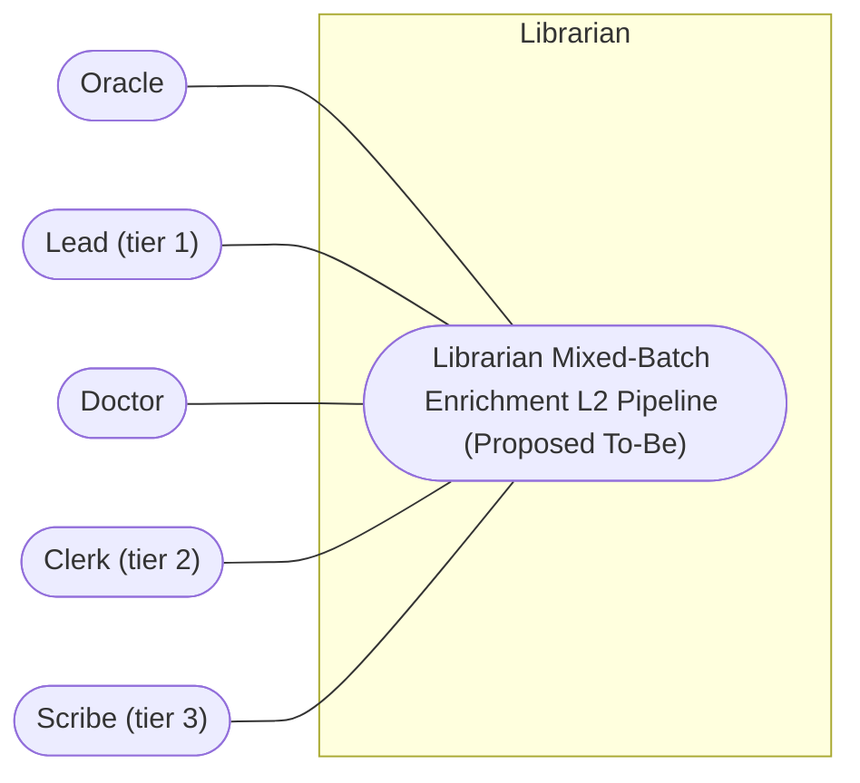
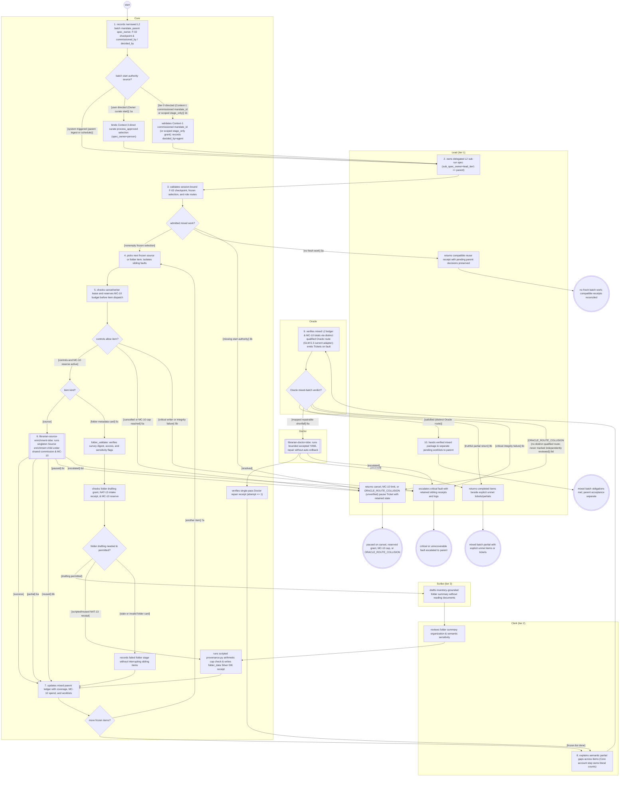

<!-- generated by build_and_validate_diagrams.py using accepted render_spec.py; edit the spec -->
# Librarian Mixed-Batch Enrichment L2 Pipeline (Proposed To-Be)

**Status:** `PROPOSED_UNACCEPTED` refined to-be behavioral specification (clone-free YAML; NOT accepted by Owner and NOT implemented in runtime code). See [05-policy-and-behaviour-reconstruction.md](../05-policy-and-behaviour-reconstruction.md) · [03-proposed-librarian-tobe.md](../03-proposed-librarian-tobe.md) · [Diagrams Index](README.md).

## Validation

No structural problems, cross-view flags, card overlaps, edge/card intersections, text overflows, ownership violations, or `_at_` spec clones.

## Use-case diagram



## Activity diagram



## Written use case

**Main success scenario** (generated: the guard-true path, in step order)

1. The Core records narrowed L2 batch mandate, parent spec_owner, F-02 checkpoint & commissioned_by / decided_by.
2. The Lead (tier 1) owns delegated L2 sub-run spec (sub_spec_owner=lead_tier1 <= parent).
3. The Core validates session-bound F-02 checkpoint, frozen selection, and role routes.
4. The Core picks next frozen source or folder item; isolates sibling faults.
5. The Core checks cancel/writer lease and reserves MC-10 budget before item dispatch.
6. The Core runs singleton Source enrichment child under shared commission & MC-10.
7. The Core updates mixed parent ledger with coverage, MC-10 spend, and worklists.
8. The Clerk (tier 2) explains semantic partial gaps across items (Core account step owns literal counts).
9. The Oracle verifies mixed L2 ledger & MC-10 totals via distinct qualified Oracle route (GLM-5.3 current adapter); emits Tickets on fault.
10. The Lead (tier 1) hands verified mixed package & separate pending worklists to parent.

**Extensions** (generated: one per non-happy guard; numbered by the step it leaves)

- **1a** (from: batch start authority source?) *anticipated*
  - `1a1` User directed (Owner curate start).
  - `1a2` The Core binds Context 3 direct curate process_approved selection (spec_owner=person).
  - `1a3` Rejoin at 2.
- **1b** (from: batch start authority source?) *anticipated*
  - `1b1` Tier 0 directed (Context-1 commissioned mandate_id or scoped stage_only).
  - `1b2` The Core validates Context-1 commissioned mandate_id (or scoped stage_only grant); records decided_by=agent.
  - `1b3` Rejoin at 2.
- **3a** (from: admitted mixed work?) *anticipated*
  - `3a1` No fresh work.
  - `3a2` The Lead (tier 1) returns compatible reuse receipt with pending parent decisions preserved.
  - `3a3` The use case ends: no fresh batch work; compatible receipts reconciled.
- **3b** (from: admitted mixed work?) *anticipated*
  - `3b1` Missing start authority.
  - `3b2` The Lead (tier 1) returns cancel, MC-10 limit, or ORACLE_ROUTE_COLLISION (unverified) pause Ticket with retained state.
  - `3b3` The use case ends: paused on cancel, reserved grant, MC-10 cap, or ORACLE_ROUTE_COLLISION.
- **5a** (from: controls allow item?) *anticipated*
  - `5a1` Cancelled or MC-10 cap reached.
  - `5a2` The Lead (tier 1) returns cancel, MC-10 limit, or ORACLE_ROUTE_COLLISION (unverified) pause Ticket with retained state.
  - `5a3` The use case ends: paused on cancel, reserved grant, MC-10 cap, or ORACLE_ROUTE_COLLISION.
- **5b** (from: controls allow item?) *anticipated*
  - `5b1` Critical writer or integrity failure.
  - `5b2` The Lead (tier 1) escalates critical fault with retained sibling receipts and logs.
  - `5b3` The use case ends: critical or unrecoverable fault escalated to parent.
- **5c** (from: item kind?) *anticipated*
  - `5c1` Folder metadata card.
  - `5c2` The Core folder_validate: verifies survey digest, access, and sensitivity flags.
  - `5c3` The Core checks folder drafting grant, NAT-13 intake receipt, & MC-10 reserve.
  - `5c4` The Core decides: folder drafting needed & permitted?
  - `5c4a` If scripted/reused NAT-13 receipt: runs scripted provenance.py arithmetic cap check & writes folder_data Silver DIK receipt.
  - `5c4a` If stale or invalid folder card: records failed folder stage without interrupting sibling items.
  - `5c5` If drafting permitted:
  - `5c6` The Scribe (tier 3) drafts inventory-grounded folder summary without reading documents.
  - `5c7` The Clerk (tier 2) reviews folder summary organization & semantic sensitivity.
  - `5c8` The Core runs scripted provenance.py arithmetic cap check & writes folder_data Silver DIK receipt.
  - `5c9` Rejoin at 7.
- **6a** (from: runs singleton Source enrichment child under shared commission & MC-10) *anticipated*
  - `6a1` Partial.
  - `6a2` Rejoin at 7.
- **6b** (from: runs singleton Source enrichment child under shared commission & MC-10) *anticipated*
  - `6b1` Reused.
  - `6b2` Rejoin at 7.
- **6c** (from: runs singleton Source enrichment child under shared commission & MC-10) *anticipated*
  - `6c1` Paused.
  - `6c2` The Lead (tier 1) returns cancel, MC-10 limit, or ORACLE_ROUTE_COLLISION (unverified) pause Ticket with retained state.
  - `6c3` The use case ends: paused on cancel, reserved grant, MC-10 cap, or ORACLE_ROUTE_COLLISION.
- **6d** (from: runs singleton Source enrichment child under shared commission & MC-10) *anticipated*
  - `6d1` Escalated.
  - `6d2` The Lead (tier 1) escalates critical fault with retained sibling receipts and logs.
  - `6d3` The use case ends: critical or unrecoverable fault escalated to parent.
- **7a** (from: more frozen items?) *anticipated*
  - `7a1` Another item.
  - `7a2` Rejoin at 4.
- **9a** (from: Oracle mixed-batch verdict?) *anticipated*
  - `9a1` Mapped repairable shortfall.
  - `9a2` The Doctor runs bounded accepted YAML repair without auto-rollback (continues in librarian-doctor-tobe).
  - `9a2a` If declined: returns completed items beside explicit unmet tickets/partials.
  - `9a2a` If escalated: escalates critical fault with retained sibling receipts and logs.
  - `9a3` If resolved:
  - `9a4` The Core verifies single-pass Doctor repair receipt (attempt <= 1).
  - `9a5` Rejoin at 8.
- **9b** (from: Oracle mixed-batch verdict?) *anticipated*
  - `9b1` Truthful partial return.
  - `9b2` The Lead (tier 1) returns completed items beside explicit unmet tickets/partials.
  - `9b3` The use case ends: mixed batch partial with explicit unmet items or tickets.
- **9c** (from: Oracle mixed-batch verdict?) *anticipated*
  - `9c1` Critical integrity failure.
  - `9c2` The Lead (tier 1) escalates critical fault with retained sibling receipts and logs.
  - `9c3` The use case ends: critical or unrecoverable fault escalated to parent.
- **9d** (from: Oracle mixed-batch verdict?) *anticipated*
  - `9d1` ORACLE_ROUTE_COLLISION (no distinct qualified route; never marked independently reviewed).
  - `9d2` The Lead (tier 1) returns cancel, MC-10 limit, or ORACLE_ROUTE_COLLISION (unverified) pause Ticket with retained state.
  - `9d3` The use case ends: paused on cancel, reserved grant, MC-10 cap, or ORACLE_ROUTE_COLLISION.

## Lane load

| Lane | On the main success scenario | Anywhere in the diagram |
|---|---|---|
| Oracle | 2 | 2 |
| Lead (tier 1) | 2 | 6 |
| Doctor | 0 | 1 |
| Clerk (tier 2) | 1 | 2 |
| Scribe (tier 3) | 0 | 1 |
| Core | 11 | 19 |

Paths by how they end: **escalated** 4, **partial** 2, **paused** 4, **reused** 1, **success** 1. Every *escalated* path is a failure of this use case: the work went back to tier 0.

## Decision tree with 21 extension scenarios

```text
start: Librarian Mixed-Batch Enrichment L2 Pipeline (Proposed To-Be)
              └─ T1: system triggered (parent ingest or schedule) / nonempty frozen selection / controls and MC-10 reserve active / source / success / frozen list done / satisfied (distinct Oracle route)  ⇒ mixed batch obligations met; parent acceptance separate
  └─ T2: user directed (Owner curate start)  ⇒ rejoins at step 2
  └─ T3: tier 0 directed (Context-1 commissioned mandate_id or scoped stage_only)  ⇒ rejoins at step 2
    └─ T4: system triggered (parent ingest or schedule) / no fresh work  ⇒ no fresh batch work; compatible receipts reconciled
    └─ T5: system triggered (parent ingest or schedule) / missing start authority  ⇒ paused on cancel, reserved grant, MC-10 cap, or ORACLE_ROUTE_COLLISION
      └─ T6: system triggered (parent ingest or schedule) / nonempty frozen selection / cancelled or MC-10 cap reached  ⇒ paused on cancel, reserved grant, MC-10 cap, or ORACLE_ROUTE_COLLISION
      └─ T7: system triggered (parent ingest or schedule) / nonempty frozen selection / critical writer or integrity failure  ⇒ critical or unrecoverable fault escalated to parent
          └─ T8: system triggered (parent ingest or schedule) / nonempty frozen selection / controls and MC-10 reserve active / folder metadata card / scripted/reused NAT-13 receipt  ⇒ rejoins at step 7
          └─ T9: system triggered (parent ingest or schedule) / nonempty frozen selection / controls and MC-10 reserve active / folder metadata card / stale or invalid folder card  ⇒ rejoins at step 7
          └─ T10: system triggered (parent ingest or schedule) / nonempty frozen selection / controls and MC-10 reserve active / folder metadata card / drafting permitted  ⇒ rejoins at step 7
          └─ T11: system triggered (parent ingest or schedule) / nonempty frozen selection / controls and MC-10 reserve active / source / partial  ⇒ rejoins at step 7
          └─ T12: system triggered (parent ingest or schedule) / nonempty frozen selection / controls and MC-10 reserve active / source / reused  ⇒ rejoins at step 7
          └─ T13: system triggered (parent ingest or schedule) / nonempty frozen selection / controls and MC-10 reserve active / source / paused  ⇒ paused on cancel, reserved grant, MC-10 cap, or ORACLE_ROUTE_COLLISION
          └─ T14: system triggered (parent ingest or schedule) / nonempty frozen selection / controls and MC-10 reserve active / source / escalated  ⇒ critical or unrecoverable fault escalated to parent
            └─ T15: system triggered (parent ingest or schedule) / nonempty frozen selection / controls and MC-10 reserve active / source / success / another item  ⇒ rejoins at step 4
                └─ T16: system triggered (parent ingest or schedule) / nonempty frozen selection / controls and MC-10 reserve active / source / success / frozen list done / mapped repairable shortfall / declined  ⇒ mixed batch partial with explicit unmet items or tickets
                └─ T17: system triggered (parent ingest or schedule) / nonempty frozen selection / controls and MC-10 reserve active / source / success / frozen list done / mapped repairable shortfall / escalated  ⇒ critical or unrecoverable fault escalated to parent
                └─ T18: system triggered (parent ingest or schedule) / nonempty frozen selection / controls and MC-10 reserve active / source / success / frozen list done / mapped repairable shortfall / resolved  ⇒ rejoins at step 8
              └─ T19: system triggered (parent ingest or schedule) / nonempty frozen selection / controls and MC-10 reserve active / source / success / frozen list done / truthful partial return  ⇒ mixed batch partial with explicit unmet items or tickets
              └─ T20: system triggered (parent ingest or schedule) / nonempty frozen selection / controls and MC-10 reserve active / source / success / frozen list done / critical integrity failure  ⇒ critical or unrecoverable fault escalated to parent
              └─ T21: system triggered (parent ingest or schedule) / nonempty frozen selection / controls and MC-10 reserve active / source / success / frozen list done / ORACLE_ROUTE_COLLISION (no distinct qualified route; never marked independently reviewed)  ⇒ paused on cancel, reserved grant, MC-10 cap, or ORACLE_ROUTE_COLLISION
```

## Scenario test table

| Test | Path (guards taken) | Extension | Expected outcome |
|---|---|---|---|
| T1 | batch start authority source? → system triggered (parent ingest or schedule); admitted mixed work? → nonempty frozen selection; controls allow item? → controls and MC-10 reserve active; item kind? → source; runs singleton Source enrichment child under shared commission & MC-10 → success; more frozen items? → frozen list done; Oracle mixed-batch verdict? → satisfied (distinct Oracle route) | MSS | mixed batch obligations met; parent acceptance separate |
| T2 | batch start authority source? → user directed (Owner curate start) | 1a | rejoins at step 2 |
| T3 | batch start authority source? → tier 0 directed (Context-1 commissioned mandate_id or scoped stage_only) | 1b | rejoins at step 2 |
| T4 | batch start authority source? → system triggered (parent ingest or schedule); admitted mixed work? → no fresh work | 3a | no fresh batch work; compatible receipts reconciled |
| T5 | batch start authority source? → system triggered (parent ingest or schedule); admitted mixed work? → missing start authority | 3b | paused on cancel, reserved grant, MC-10 cap, or ORACLE_ROUTE_COLLISION |
| T6 | batch start authority source? → system triggered (parent ingest or schedule); admitted mixed work? → nonempty frozen selection; controls allow item? → cancelled or MC-10 cap reached | 5a | paused on cancel, reserved grant, MC-10 cap, or ORACLE_ROUTE_COLLISION |
| T7 | batch start authority source? → system triggered (parent ingest or schedule); admitted mixed work? → nonempty frozen selection; controls allow item? → critical writer or integrity failure | 5b | critical or unrecoverable fault escalated to parent |
| T8 | batch start authority source? → system triggered (parent ingest or schedule); admitted mixed work? → nonempty frozen selection; controls allow item? → controls and MC-10 reserve active; item kind? → folder metadata card; folder drafting needed & permitted? → scripted/reused NAT-13 receipt | 5c | rejoins at step 7 |
| T9 | batch start authority source? → system triggered (parent ingest or schedule); admitted mixed work? → nonempty frozen selection; controls allow item? → controls and MC-10 reserve active; item kind? → folder metadata card; folder drafting needed & permitted? → stale or invalid folder card | 5c | rejoins at step 7 |
| T10 | batch start authority source? → system triggered (parent ingest or schedule); admitted mixed work? → nonempty frozen selection; controls allow item? → controls and MC-10 reserve active; item kind? → folder metadata card; folder drafting needed & permitted? → drafting permitted | 5c | rejoins at step 7 |
| T11 | batch start authority source? → system triggered (parent ingest or schedule); admitted mixed work? → nonempty frozen selection; controls allow item? → controls and MC-10 reserve active; item kind? → source; runs singleton Source enrichment child under shared commission & MC-10 → partial | 6a | rejoins at step 7 |
| T12 | batch start authority source? → system triggered (parent ingest or schedule); admitted mixed work? → nonempty frozen selection; controls allow item? → controls and MC-10 reserve active; item kind? → source; runs singleton Source enrichment child under shared commission & MC-10 → reused | 6b | rejoins at step 7 |
| T13 | batch start authority source? → system triggered (parent ingest or schedule); admitted mixed work? → nonempty frozen selection; controls allow item? → controls and MC-10 reserve active; item kind? → source; runs singleton Source enrichment child under shared commission & MC-10 → paused | 6c | paused on cancel, reserved grant, MC-10 cap, or ORACLE_ROUTE_COLLISION |
| T14 | batch start authority source? → system triggered (parent ingest or schedule); admitted mixed work? → nonempty frozen selection; controls allow item? → controls and MC-10 reserve active; item kind? → source; runs singleton Source enrichment child under shared commission & MC-10 → escalated | 6d | critical or unrecoverable fault escalated to parent |
| T15 | batch start authority source? → system triggered (parent ingest or schedule); admitted mixed work? → nonempty frozen selection; controls allow item? → controls and MC-10 reserve active; item kind? → source; runs singleton Source enrichment child under shared commission & MC-10 → success; more frozen items? → another item | 7a | rejoins at step 4 |
| T16 | batch start authority source? → system triggered (parent ingest or schedule); admitted mixed work? → nonempty frozen selection; controls allow item? → controls and MC-10 reserve active; item kind? → source; runs singleton Source enrichment child under shared commission & MC-10 → success; more frozen items? → frozen list done; Oracle mixed-batch verdict? → mapped repairable shortfall; runs bounded accepted YAML repair without auto-rollback → declined | 9a | mixed batch partial with explicit unmet items or tickets |
| T17 | batch start authority source? → system triggered (parent ingest or schedule); admitted mixed work? → nonempty frozen selection; controls allow item? → controls and MC-10 reserve active; item kind? → source; runs singleton Source enrichment child under shared commission & MC-10 → success; more frozen items? → frozen list done; Oracle mixed-batch verdict? → mapped repairable shortfall; runs bounded accepted YAML repair without auto-rollback → escalated | 9a | critical or unrecoverable fault escalated to parent |
| T18 | batch start authority source? → system triggered (parent ingest or schedule); admitted mixed work? → nonempty frozen selection; controls allow item? → controls and MC-10 reserve active; item kind? → source; runs singleton Source enrichment child under shared commission & MC-10 → success; more frozen items? → frozen list done; Oracle mixed-batch verdict? → mapped repairable shortfall; runs bounded accepted YAML repair without auto-rollback → resolved | 9a | rejoins at step 8 |
| T19 | batch start authority source? → system triggered (parent ingest or schedule); admitted mixed work? → nonempty frozen selection; controls allow item? → controls and MC-10 reserve active; item kind? → source; runs singleton Source enrichment child under shared commission & MC-10 → success; more frozen items? → frozen list done; Oracle mixed-batch verdict? → truthful partial return | 9b | mixed batch partial with explicit unmet items or tickets |
| T20 | batch start authority source? → system triggered (parent ingest or schedule); admitted mixed work? → nonempty frozen selection; controls allow item? → controls and MC-10 reserve active; item kind? → source; runs singleton Source enrichment child under shared commission & MC-10 → success; more frozen items? → frozen list done; Oracle mixed-batch verdict? → critical integrity failure | 9c | critical or unrecoverable fault escalated to parent |
| T21 | batch start authority source? → system triggered (parent ingest or schedule); admitted mixed work? → nonempty frozen selection; controls allow item? → controls and MC-10 reserve active; item kind? → source; runs singleton Source enrichment child under shared commission & MC-10 → success; more frozen items? → frozen list done; Oracle mixed-batch verdict? → ORACLE_ROUTE_COLLISION (no distinct qualified route; never marked independently reviewed) | 9d | paused on cancel, reserved grant, MC-10 cap, or ORACLE_ROUTE_COLLISION |

_Note: Scenario tests verify static graph reachability and guarded path coverage in this proposed spec only; they do NOT execute or verify live Web UI, MCP server, Broker, Geo-Grapher, or DeepInfra runtime behaviour._
