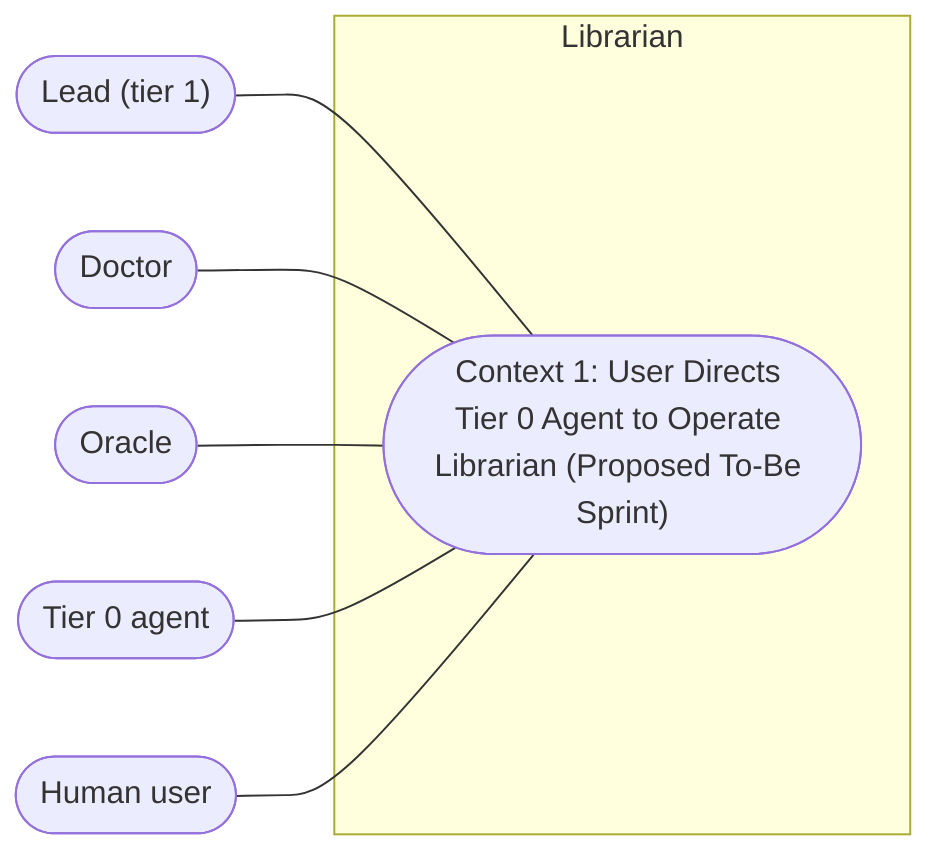
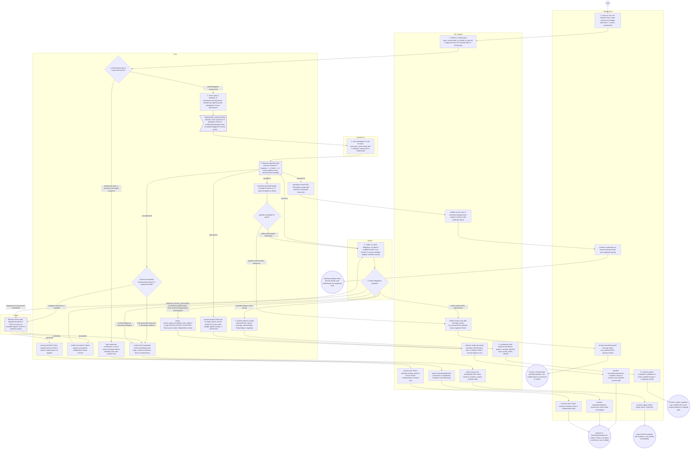

<!-- generated by build_and_validate_diagrams.py using accepted render_spec.py; edit the spec -->
# Context 1: User Directs Tier 0 Agent to Operate Librarian (Proposed To-Be Sprint)

**Status:** `PROPOSED_UNACCEPTED` refined to-be behavioral specification (clone-free YAML; NOT accepted by Owner and NOT implemented in runtime code). See [05-policy-and-behaviour-reconstruction.md](../05-policy-and-behaviour-reconstruction.md) · [03-proposed-librarian-tobe.md](../03-proposed-librarian-tobe.md) · [Diagrams Index](README.md).

## Validation

No structural problems, cross-view flags, card overlaps, edge/card intersections, text overflows, ownership violations, or `_at_` spec clones.

## Use-case diagram



## Activity diagram



## Written use case

**Main success scenario** (generated: the guard-true path, in step order)

1. The Human user instructs Tier 0 on Librarian task, scope, exclusions & budget (instruction + scope = commission).
2. The Tier 0 agent authors L3 sprint spec (spec_owner=tier0_on_behalf_of_person) & approves Rule-15 envelope with no 2nd prompt.
3. The Core stores spec & mandate_id (commissioned_by=person, decided_by=agent); grants delegated in-scope permissions.
4. The Lead (tier 1) owns delegated L2 sub-run spec (sub_spec_owner=lead_tier1 <= parent); routes work to Clerk/Scribe.
5. The Core executes shared L2 ingestion -> L2 batch -> L1 source pipeline under commissioned mandate.
6. The Oracle audits L3 sprint obligations via distinct qualified Oracle route (GLM-5.3 current revisable adapter; isolated context).
7. The Core commits delivery receipt (promoted IDs, spend, coverage, deferred tabs, Ticket ledger & Agenda).
8. The Tier 0 agent synthesizes final handover (evidence, spend, coverage, deferred work, review_status, Tickets).
9. The Human user receives explicit completion notification in active chat/IDE session + UI Agenda receipt.

**Extensions** (generated: one per non-happy guard; numbered by the step it leaves)

- **2a** (from: commissioned spec & scope well-formed?) *anticipated*
  - `2a1` Malformed spec or exceeds user-stated scope.
  - `2a2` The Core logs malformed commission or out-of-scope mismatch without mutating vault; sets resume note.
  - `2a3` The Tier 0 agent reports rejected/malformed commission & clarification needed to user ($0 spent).
  - `2a4` The Human user receives rejected/clarification commission notice (vault unchanged).
  - `2a5` The use case ends: paused on boundary/hazard/route-collision Ticket or declined commission; user notified.
- **5a** (from: executes shared L2 ingestion -> L2 batch -> L1 source pipeline under commissioned mandate) *anticipated*
  - `5a1` Partial.
  - `5a2` The Core evaluates permitted partial coverage & spend vs L3 sprint acceptance criteria.
  - `5a3` The Core decides: partials acceptable for sprint?
  - `5a3a` If partial exceeds sprint tolerance: notifies human user with coverage, spend, not_examined list, deferred tabs & Agenda Tickets.
  - `5a4` If within sprint partial allowance:
  - `5a5` Rejoin at 6.
- **5b** (from: executes shared L2 ingestion -> L2 batch -> L1 source pipeline under commissioned mandate) *anticipated*
  - `5b1` Reused.
  - `5b2` The Core packages reused NAT-13/existing receipts ($0 spend) & unchanged Source list.
  - `5b3` The Tier 0 agent notifies human user of reused/unchanged state, evidence hashes & $0 duplicate spend.
  - `5b4` The Human user receives confirmation of reused catalogue state (zero duplicate spend).
  - `5b5` The use case ends: existing catalogue state reused cleanly; user notified with zero duplicate work.
- **5c** (from: executes shared L2 ingestion -> L2 batch -> L1 source pipeline under commissioned mandate) *anticipated*
  - `5c1` Paused.
  - `5c2` The Core records paused Ticket (ext ID, flags, spend, resume target) for out-of-scope, budget, global change, or OD-05 hold.
  - `5c3` The Tier 0 agent surfaces single structured boundary, OD-05 policy hold, or collision Ticket + resume target to user.
  - `5c4` The Human user decides boundary/hazard/route exception cleanly & receives exact Agenda resume path.
  - `5c5` The use case ends: paused on boundary/hazard/route-collision Ticket or declined commission; user notified.
- **5d** (from: executes shared L2 ingestion -> L2 batch -> L1 source pipeline under commissioned mandate) *anticipated*
  - `5d1` Escalated.
  - `5d2` The Core decides: critical security/data-loss/boundary breach vs mapped shortfall?
  - `5d2a` If mapped noncritical L3 shortfall: attempts bounded L3 Ticket recovery via revisable adapter (GLM-5.3 isolated context).
  - `5d3` If critical security, data-loss, or boundary violation:
  - `5d4` The Core routes critical escalated Ticket immediately with flags, evidence hashes & Rule-8 compensation.
  - `5d5` The Tier 0 agent alerts human user immediately with critical Ticket ID, evidence, spend & failure state.
  - `5d6` The Human user receives urgent critical failure alert & Ticket link.
  - `5d7` The use case ends: critical Ticket escalated with evidence; user alerted immediately.
- **6a** (from: L3 sprint obligations satisfied?) *anticipated*
  - `6a1` Minor partial within tolerance.
  - `6a2` The Tier 0 agent notifies human user with coverage, spend, not_examined list, deferred tabs & Agenda Tickets.
  - `6a3` The Human user receives permitted partial coverage report, not_examined list & Agenda Tickets.
  - `6a4` The use case ends: Context 1 finished with permitted partials; user notified with not_examined & Tickets.
- **6b** (from: L3 sprint obligations satisfied?) *anticipated*
  - `6b1` Mapped noncritical sprint shortfall.
  - `6b2` The Doctor attempts bounded L3 Ticket recovery via revisable adapter (GLM-5.3 isolated context) (continues in librarian-doctor-tobe).
  - `6b2a` If declined: persists declined Ticket, attempt history & Rule-8 shown compensation on Agenda.
  - `6b2a` If escalated: routes critical escalated Ticket immediately with flags, evidence hashes & Rule-8 compensation.
  - `6b3` If resolved:
  - `6b4` The Core verifies bounded L3 repair progress & prepares independent Oracle recheck.
  - `6b5` Rejoin at 6.
- **6c** (from: L3 sprint obligations satisfied?) *anticipated*
  - `6c1` Critical integrity or boundary finding.
  - `6c2` The Core routes critical escalated Ticket immediately with flags, evidence hashes & Rule-8 compensation.
  - `6c3` The Tier 0 agent alerts human user immediately with critical Ticket ID, evidence, spend & failure state.
  - `6c4` The Human user receives urgent critical failure alert & Ticket link.
  - `6c5` The use case ends: critical Ticket escalated with evidence; user alerted immediately.
- **6d** (from: L3 sprint obligations satisfied?) *anticipated*
  - `6d1` ORACLE_ROUTE_COLLISION (no distinct qualified route; never marked independently reviewed).
  - `6d2` The Core marks review_status=unverified_route_collision & logs ORACLE_ROUTE_COLLISION Ticket (never claims independent review).
  - `6d3` The Tier 0 agent surfaces single structured boundary, OD-05 policy hold, or collision Ticket + resume target to user.
  - `6d4` The Human user decides boundary/hazard/route exception cleanly & receives exact Agenda resume path.
  - `6d5` The use case ends: paused on boundary/hazard/route-collision Ticket or declined commission; user notified.

## Lane load

| Lane | On the main success scenario | Anywhere in the diagram |
|---|---|---|
| Lead (tier 1) | 1 | 1 |
| Doctor | 0 | 1 |
| Oracle | 2 | 2 |
| Core | 4 | 14 |
| Tier 0 agent | 2 | 8 |
| Human user | 2 | 8 |

**Tier-0 turns** (each return of control to tier 0; owner's scale: 2 ideal, 3 expected, 4 rusty, 5–10 bad, more: might as well have done it themselves). Main success scenario: **2 (ideal)**. Worst path: T16, **2 (ideal)**. Paths by grade: ideal 12; escalated 4 (failures, not graded).

Paths by how they end: **escalated** 4, **partial** 2, **paused** 5, **reused** 1, **success** 1. Every *escalated* path is a failure of this use case: the work went back to tier 0.

## Decision tree with 16 extension scenarios

```text
start: Context 1: User Directs Tier 0 Agent to Operate Librarian (Proposed To-Be Sprint)
      └─ T1: valid delegated commission / success / satisfied (distinct route pass)  ⇒ Context 1 sprint complete; user notified with Oracle-verified evidence & Agenda state
  └─ T2: malformed spec or exceeds user-stated scope  ⇒ paused on boundary/hazard/route-collision Ticket or declined commission; user notified
      └─ T3: valid delegated commission / partial / partial exceeds sprint tolerance  ⇒ Context 1 finished with permitted partials; user notified with not_examined & Tickets
      └─ T4: valid delegated commission / partial / within sprint partial allowance  ⇒ rejoins at step 6
    └─ T5: valid delegated commission / reused  ⇒ existing catalogue state reused cleanly; user notified with zero duplicate work
    └─ T6: valid delegated commission / paused  ⇒ paused on boundary/hazard/route-collision Ticket or declined commission; user notified
        └─ T7: valid delegated commission / escalated / mapped noncritical L3 shortfall / declined  ⇒ paused on boundary/hazard/route-collision Ticket or declined commission; user notified
        └─ T8: valid delegated commission / escalated / mapped noncritical L3 shortfall / escalated  ⇒ critical Ticket escalated with evidence; user alerted immediately
        └─ T9: valid delegated commission / escalated / mapped noncritical L3 shortfall / resolved  ⇒ rejoins at step 6
      └─ T10: valid delegated commission / escalated / critical security, data-loss, or boundary violation  ⇒ critical Ticket escalated with evidence; user alerted immediately
      └─ T11: valid delegated commission / success / minor partial within tolerance  ⇒ Context 1 finished with permitted partials; user notified with not_examined & Tickets
        └─ T12: valid delegated commission / success / mapped noncritical sprint shortfall / declined  ⇒ paused on boundary/hazard/route-collision Ticket or declined commission; user notified
        └─ T13: valid delegated commission / success / mapped noncritical sprint shortfall / escalated  ⇒ critical Ticket escalated with evidence; user alerted immediately
        └─ T14: valid delegated commission / success / mapped noncritical sprint shortfall / resolved  ⇒ rejoins at step 6
      └─ T15: valid delegated commission / success / critical integrity or boundary finding  ⇒ critical Ticket escalated with evidence; user alerted immediately
      └─ T16: valid delegated commission / success / ORACLE_ROUTE_COLLISION (no distinct qualified route; never marked independently reviewed)  ⇒ paused on boundary/hazard/route-collision Ticket or declined commission; user notified
```

## Scenario test table

| Test | Path (guards taken) | Extension | Expected outcome | Tier-0 turns |
|---|---|---|---|---|
| T1 | commissioned spec & scope well-formed? → valid delegated commission; executes shared L2 ingestion -> L2 batch -> L1 source pipeline under commissioned mandate → success; L3 sprint obligations satisfied? → satisfied (distinct route pass) | MSS | Context 1 sprint complete; user notified with Oracle-verified evidence & Agenda state | 2 (ideal) |
| T2 | commissioned spec & scope well-formed? → malformed spec or exceeds user-stated scope | 2a | paused on boundary/hazard/route-collision Ticket or declined commission; user notified | 2 (ideal) |
| T3 | commissioned spec & scope well-formed? → valid delegated commission; executes shared L2 ingestion -> L2 batch -> L1 source pipeline under commissioned mandate → partial; partials acceptable for sprint? → partial exceeds sprint tolerance | 5a | Context 1 finished with permitted partials; user notified with not_examined & Tickets | 2 (ideal) |
| T4 | commissioned spec & scope well-formed? → valid delegated commission; executes shared L2 ingestion -> L2 batch -> L1 source pipeline under commissioned mandate → partial; partials acceptable for sprint? → within sprint partial allowance | 5a | rejoins at step 6 | 2 (ideal) |
| T5 | commissioned spec & scope well-formed? → valid delegated commission; executes shared L2 ingestion -> L2 batch -> L1 source pipeline under commissioned mandate → reused | 5b | existing catalogue state reused cleanly; user notified with zero duplicate work | 2 (ideal) |
| T6 | commissioned spec & scope well-formed? → valid delegated commission; executes shared L2 ingestion -> L2 batch -> L1 source pipeline under commissioned mandate → paused | 5c | paused on boundary/hazard/route-collision Ticket or declined commission; user notified | 2 (ideal) |
| T7 | commissioned spec & scope well-formed? → valid delegated commission; executes shared L2 ingestion -> L2 batch -> L1 source pipeline under commissioned mandate → escalated; critical security/data-loss/boundary breach vs mapped shortfall? → mapped noncritical L3 shortfall; attempts bounded L3 Ticket recovery via revisable adapter (GLM-5.3 isolated context) → declined | 5d | paused on boundary/hazard/route-collision Ticket or declined commission; user notified | 2 (ideal) |
| T8 | commissioned spec & scope well-formed? → valid delegated commission; executes shared L2 ingestion -> L2 batch -> L1 source pipeline under commissioned mandate → escalated; critical security/data-loss/boundary breach vs mapped shortfall? → mapped noncritical L3 shortfall; attempts bounded L3 Ticket recovery via revisable adapter (GLM-5.3 isolated context) → escalated | 5d | critical Ticket escalated with evidence; user alerted immediately | 2 (escalated: a failure) |
| T9 | commissioned spec & scope well-formed? → valid delegated commission; executes shared L2 ingestion -> L2 batch -> L1 source pipeline under commissioned mandate → escalated; critical security/data-loss/boundary breach vs mapped shortfall? → mapped noncritical L3 shortfall; attempts bounded L3 Ticket recovery via revisable adapter (GLM-5.3 isolated context) → resolved | 5d | rejoins at step 6 | 2 (ideal) |
| T10 | commissioned spec & scope well-formed? → valid delegated commission; executes shared L2 ingestion -> L2 batch -> L1 source pipeline under commissioned mandate → escalated; critical security/data-loss/boundary breach vs mapped shortfall? → critical security, data-loss, or boundary violation | 5d | critical Ticket escalated with evidence; user alerted immediately | 2 (escalated: a failure) |
| T11 | commissioned spec & scope well-formed? → valid delegated commission; executes shared L2 ingestion -> L2 batch -> L1 source pipeline under commissioned mandate → success; L3 sprint obligations satisfied? → minor partial within tolerance | 6a | Context 1 finished with permitted partials; user notified with not_examined & Tickets | 2 (ideal) |
| T12 | commissioned spec & scope well-formed? → valid delegated commission; executes shared L2 ingestion -> L2 batch -> L1 source pipeline under commissioned mandate → success; L3 sprint obligations satisfied? → mapped noncritical sprint shortfall; attempts bounded L3 Ticket recovery via revisable adapter (GLM-5.3 isolated context) → declined | 6b | paused on boundary/hazard/route-collision Ticket or declined commission; user notified | 2 (ideal) |
| T13 | commissioned spec & scope well-formed? → valid delegated commission; executes shared L2 ingestion -> L2 batch -> L1 source pipeline under commissioned mandate → success; L3 sprint obligations satisfied? → mapped noncritical sprint shortfall; attempts bounded L3 Ticket recovery via revisable adapter (GLM-5.3 isolated context) → escalated | 6b | critical Ticket escalated with evidence; user alerted immediately | 2 (escalated: a failure) |
| T14 | commissioned spec & scope well-formed? → valid delegated commission; executes shared L2 ingestion -> L2 batch -> L1 source pipeline under commissioned mandate → success; L3 sprint obligations satisfied? → mapped noncritical sprint shortfall; attempts bounded L3 Ticket recovery via revisable adapter (GLM-5.3 isolated context) → resolved | 6b | rejoins at step 6 | 2 (ideal) |
| T15 | commissioned spec & scope well-formed? → valid delegated commission; executes shared L2 ingestion -> L2 batch -> L1 source pipeline under commissioned mandate → success; L3 sprint obligations satisfied? → critical integrity or boundary finding | 6c | critical Ticket escalated with evidence; user alerted immediately | 2 (escalated: a failure) |
| T16 | commissioned spec & scope well-formed? → valid delegated commission; executes shared L2 ingestion -> L2 batch -> L1 source pipeline under commissioned mandate → success; L3 sprint obligations satisfied? → ORACLE_ROUTE_COLLISION (no distinct qualified route; never marked independently reviewed) | 6d | paused on boundary/hazard/route-collision Ticket or declined commission; user notified | 2 (ideal) |

_Note: Scenario tests verify static graph reachability and guarded path coverage in this proposed spec only; they do NOT execute or verify live Web UI, MCP server, Broker, Geo-Grapher, or DeepInfra runtime behaviour._
