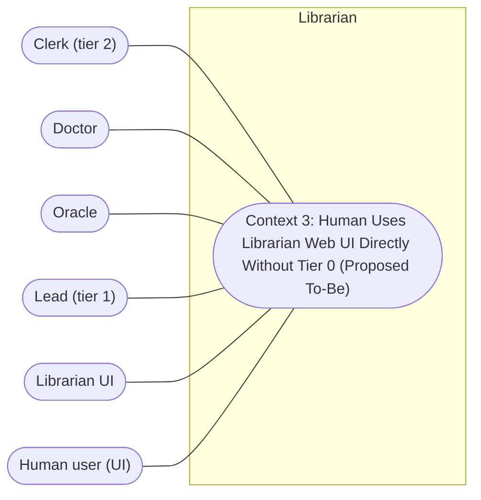
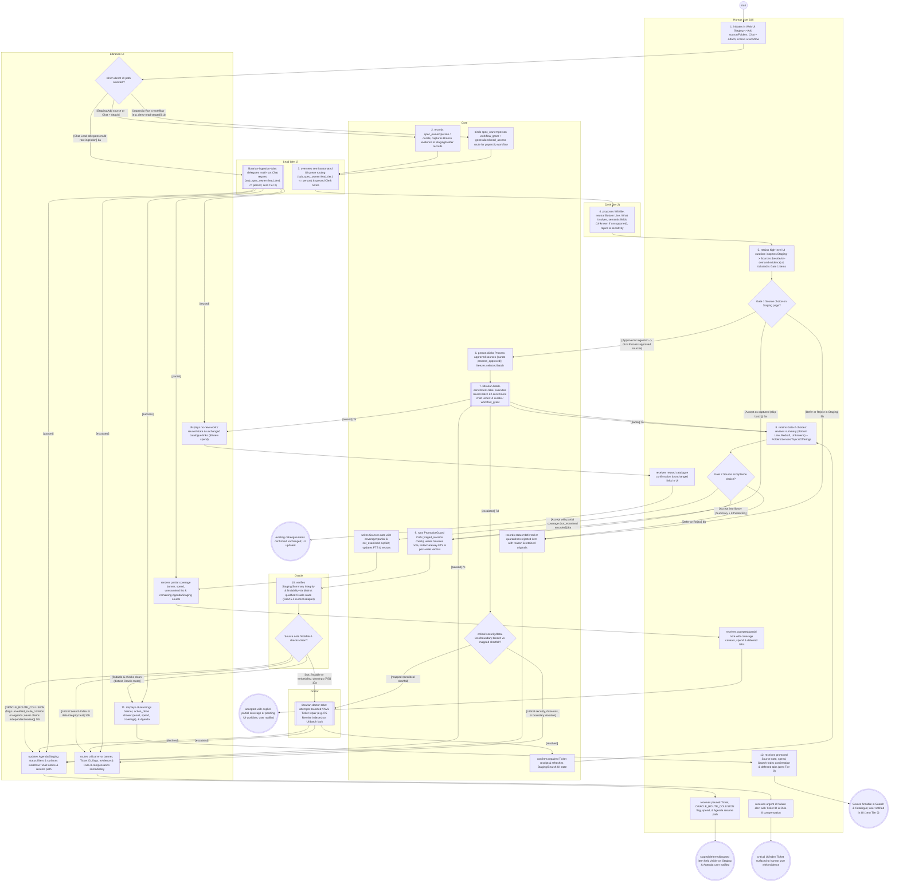

<!-- generated by build_and_validate_diagrams.py using accepted render_spec.py; edit the spec -->
# Context 3: Human Uses Librarian Web UI Directly Without Tier 0 (Proposed To-Be)

**Status:** `PROPOSED_UNACCEPTED` refined to-be behavioral specification (clone-free YAML; NOT accepted by Owner and NOT implemented in runtime code). See [05-policy-and-behaviour-reconstruction.md](../05-policy-and-behaviour-reconstruction.md) · [03-proposed-librarian-tobe.md](../03-proposed-librarian-tobe.md) · [Diagrams Index](README.md).

## Validation

No structural problems, cross-view flags, card overlaps, edge/card intersections, text overflows, ownership violations, or `_at_` spec clones.

## Use-case diagram



## Activity diagram



## Written use case

**Main success scenario** (generated: the guard-true path, in step order)

1. The Human user (UI) initiates in Web UI: Staging -> Add source/Folders, Chat + Attach, or Run a workflow.
2. The Core records spec_owner=person / curate; captures Bronze evidence & Staging/Folder records.
3. The Lead (tier 1) oversees semi-automated UI queue routing (sub_spec_owner=lead_tier1 <= person) & queued Clerk notice.
4. The Clerk (tier 2) proposes W8 title, neutral Bottom Line, What it solves, semantic fields (Unknown if unsupported), topics & sensitivity.
5. The Human user (UI) retains high-level UI curation: inspects Staging -> Sources (beside/on-demand evidence) & ticks/edits Gate 1 items.
6. The Core person clicks Process approved sources (curate process_approved); freezes selected batch.
7. The Core executes mixed-batch L2 enrichment child under UI curate / workflow_grant.
8. The Human user (UI) retains Gate-2 choices: reviews summary (Bottom Line, Redraft, Unknowns) + Folders/Lenses/Topics/Offerings.
9. The Core runs PromotionGuard CAS (staged_revision check), writes Sources note, IndexGateway FTS & post-write vectors.
10. The Oracle verifies Staging/Summary integrity & findability via distinct qualified Oracle route (GLM-5.3 current adapter).
11. The Librarian UI displays ok/warnings banner, action_done drawer (result, spend, coverage), & Agenda.
12. The Human user (UI) receives promoted Source note, spend, Search-Index confirmation & deferred tabs (zero Tier 0).

**Extensions** (generated: one per non-happy guard; numbered by the step it leaves)

- **1a** (from: which direct UI path selected?) *anticipated*
  - `1a1` Chat Lead delegates multi-root ingestion.
  - `1a2` The Lead (tier 1) delegates multi-root Chat request (sub_spec_owner=lead_tier1 <= person; zero Tier 0) (continues in librarian-ingestion-tobe).
  - `1a2a` If partial: renders partial coverage banner, spend, unexamined list & remaining Agenda/Staging counts.
  - `1a2a` If reused: displays no-new-work / reused state & unchanged catalogue links ($0 new spend).
  - `1a2a` If paused: updates Agenda/Staging status filters & surfaces workflow/Ticket notice & resume path.
  - `1a2a` If escalated: routes critical error banner, Ticket ID, flags, evidence & Rule-8 compensation immediately.
  - `1a3` If success:
  - `1a4` Rejoin at 11.
- **1b** (from: which direct UI path selected?) *anticipated*
  - `1b1` Paperclip Run a workflow (e.g. deep-read-staged).
  - `1b2` The Core binds spec_owner=person workflow_grant + generalized read_access route for paperclip workflow.
  - `1b3` Rejoin at 3.
- **5a** (from: Gate 1 Source choice on Staging page?) *anticipated*
  - `5a1` Accept as captured (skip batch).
  - `5a2` Rejoin at 9.
- **5b** (from: Gate 1 Source choice on Staging page?) *anticipated*
  - `5b1` Defer or Reject in Staging.
  - `5b2` The Core records status=deferred or quarantines rejected item with reason & retained originals.
  - `5b3` The Librarian UI updates Agenda/Staging status filters & surfaces workflow/Ticket notice & resume path.
  - `5b4` The Human user (UI) receives paused Ticket, ORACLE_ROUTE_COLLISION flag, spend, & Agenda resume path.
  - `5b5` The use case ends: staged/deferred/paused item held visibly on Staging & Agenda; user notified.
- **7a** (from: executes mixed-batch L2 enrichment child under UI curate / workflow_grant) *anticipated*
  - `7a1` Partial.
  - `7a2` Rejoin at 8.
- **7b** (from: executes mixed-batch L2 enrichment child under UI curate / workflow_grant) *anticipated*
  - `7b1` Reused.
  - `7b2` The Librarian UI displays no-new-work / reused state & unchanged catalogue links ($0 new spend).
  - `7b3` The Human user (UI) receives reused catalogue confirmation & unchanged links in UI.
  - `7b4` The use case ends: existing catalogue items confirmed unchanged; UI updated.
- **7c** (from: executes mixed-batch L2 enrichment child under UI curate / workflow_grant) *anticipated*
  - `7c1` Paused.
  - `7c2` The Librarian UI updates Agenda/Staging status filters & surfaces workflow/Ticket notice & resume path.
  - `7c3` The Human user (UI) receives paused Ticket, ORACLE_ROUTE_COLLISION flag, spend, & Agenda resume path.
  - `7c4` The use case ends: staged/deferred/paused item held visibly on Staging & Agenda; user notified.
- **7d** (from: executes mixed-batch L2 enrichment child under UI curate / workflow_grant) *anticipated*
  - `7d1` Escalated.
  - `7d2` The Core decides: critical security/data-loss/boundary breach vs mapped shortfall?
  - `7d2a` If mapped noncritical shortfall: attempts bounded YAML Ticket repair (e.g. R5 Rewrite indexes) on UI/batch fault.
  - `7d3` If critical security, data-loss, or boundary violation:
  - `7d4` The Librarian UI routes critical error banner, Ticket ID, flags, evidence & Rule-8 compensation immediately.
  - `7d5` The Human user (UI) receives urgent UI failure alert with Ticket ID & Rule-8 compensation.
  - `7d6` The use case ends: critical UI/index Ticket surfaced to human user with evidence.
- **8a** (from: Gate 2 Source acceptance choice?) *anticipated*
  - `8a1` Accept with partial coverage (not_examined recorded).
  - `8a2` The Core writes Sources note with coverage=partial & not_examined explicit; updates FTS & vectors.
  - `8a3` The Librarian UI renders partial coverage banner, spend, unexamined list & remaining Agenda/Staging counts.
  - `8a4` The Human user (UI) receives accepted/partial note with coverage caveats, spend & deferred tabs.
  - `8a5` The use case ends: accepted with explicit partial coverage or pending UI worklists; user notified.
- **8b** (from: Gate 2 Source acceptance choice?) *anticipated*
  - `8b1` Defer or Reject.
  - `8b2` The Core records status=deferred or quarantines rejected item with reason & retained originals.
  - `8b3` The Librarian UI updates Agenda/Staging status filters & surfaces workflow/Ticket notice & resume path.
  - `8b4` The Human user (UI) receives paused Ticket, ORACLE_ROUTE_COLLISION flag, spend, & Agenda resume path.
  - `8b5` The use case ends: staged/deferred/paused item held visibly on Staging & Agenda; user notified.
- **10a** (from: Source note findable & checks clean?) *anticipated*
  - `10a1` Not_findable or embedding_warnings (R5).
  - `10a2` The Doctor attempts bounded YAML Ticket repair (e.g. R5 Rewrite indexes) on UI/batch fault (continues in librarian-doctor-tobe).
  - `10a2a` If declined: updates Agenda/Staging status filters & surfaces workflow/Ticket notice & resume path.
  - `10a2a` If escalated: routes critical error banner, Ticket ID, flags, evidence & Rule-8 compensation immediately.
  - `10a3` If resolved:
  - `10a4` The Core confirms repaired Ticket receipt & refreshes Staging/Search UI state.
  - `10a5` Rejoin at 8.
- **10b** (from: Source note findable & checks clean?) *anticipated*
  - `10b1` Critical Search-Index or data integrity fault.
  - `10b2` The Librarian UI routes critical error banner, Ticket ID, flags, evidence & Rule-8 compensation immediately.
  - `10b3` The Human user (UI) receives urgent UI failure alert with Ticket ID & Rule-8 compensation.
  - `10b4` The use case ends: critical UI/index Ticket surfaced to human user with evidence.
- **10c** (from: Source note findable & checks clean?) *anticipated*
  - `10c1` ORACLE_ROUTE_COLLISION (flags unverified_route_collision on Agenda; never claims independent review).
  - `10c2` The Librarian UI updates Agenda/Staging status filters & surfaces workflow/Ticket notice & resume path.
  - `10c3` The Human user (UI) receives paused Ticket, ORACLE_ROUTE_COLLISION flag, spend, & Agenda resume path.
  - `10c4` The use case ends: staged/deferred/paused item held visibly on Staging & Agenda; user notified.

## Lane load

| Lane | On the main success scenario | Anywhere in the diagram |
|---|---|---|
| Clerk (tier 2) | 1 | 1 |
| Doctor | 0 | 1 |
| Oracle | 2 | 2 |
| Core | 4 | 9 |
| Lead (tier 1) | 1 | 2 |
| Librarian UI | 2 | 6 |
| Human user (UI) | 6 | 10 |

Paths by how they end: **escalated** 5, **partial** 2, **paused** 7, **reused** 2, **success** 1. Every *escalated* path is a failure of this use case: the work went back to tier 0.

## Decision tree with 23 extension scenarios

```text
start: Context 3: Human Uses Librarian Web UI Directly Without Tier 0 (Proposed To-Be)
          └─ T1: Staging Add source or Chat + Attach / Approve for ingestion -> click Process approved sources / success / Accept into library (Summary + FTS/Vector) / findable & checks clean (distinct Oracle route)  ⇒ Source findable in Search & Catalogue; user notified in UI (zero Tier 0)
    └─ T2: Chat Lead delegates multi-root ingestion / partial  ⇒ accepted with explicit partial coverage or pending UI worklists; user notified
    └─ T3: Chat Lead delegates multi-root ingestion / reused  ⇒ existing catalogue items confirmed unchanged; UI updated
    └─ T4: Chat Lead delegates multi-root ingestion / paused  ⇒ staged/deferred/paused item held visibly on Staging & Agenda; user notified
    └─ T5: Chat Lead delegates multi-root ingestion / escalated  ⇒ critical UI/index Ticket surfaced to human user with evidence
    └─ T6: Chat Lead delegates multi-root ingestion / success  ⇒ rejoins at step 11
  └─ T7: paperclip Run a workflow (e.g. deep-read-staged)  ⇒ rejoins at step 3
    └─ T8: Staging Add source or Chat + Attach / Accept as captured (skip batch)  ⇒ rejoins at step 9
    └─ T9: Staging Add source or Chat + Attach / Defer or Reject in Staging  ⇒ staged/deferred/paused item held visibly on Staging & Agenda; user notified
      └─ T10: Staging Add source or Chat + Attach / Approve for ingestion -> click Process approved sources / partial  ⇒ rejoins at step 8
      └─ T11: Staging Add source or Chat + Attach / Approve for ingestion -> click Process approved sources / reused  ⇒ existing catalogue items confirmed unchanged; UI updated
      └─ T12: Staging Add source or Chat + Attach / Approve for ingestion -> click Process approved sources / paused  ⇒ staged/deferred/paused item held visibly on Staging & Agenda; user notified
          └─ T13: Staging Add source or Chat + Attach / Approve for ingestion -> click Process approved sources / escalated / mapped noncritical shortfall / declined  ⇒ staged/deferred/paused item held visibly on Staging & Agenda; user notified
          └─ T14: Staging Add source or Chat + Attach / Approve for ingestion -> click Process approved sources / escalated / mapped noncritical shortfall / escalated  ⇒ critical UI/index Ticket surfaced to human user with evidence
          └─ T15: Staging Add source or Chat + Attach / Approve for ingestion -> click Process approved sources / escalated / mapped noncritical shortfall / resolved  ⇒ rejoins at step 8
        └─ T16: Staging Add source or Chat + Attach / Approve for ingestion -> click Process approved sources / escalated / critical security, data-loss, or boundary violation  ⇒ critical UI/index Ticket surfaced to human user with evidence
        └─ T17: Staging Add source or Chat + Attach / Approve for ingestion -> click Process approved sources / success / Accept with partial coverage (not_examined recorded)  ⇒ accepted with explicit partial coverage or pending UI worklists; user notified
        └─ T18: Staging Add source or Chat + Attach / Approve for ingestion -> click Process approved sources / success / Defer or Reject  ⇒ staged/deferred/paused item held visibly on Staging & Agenda; user notified
            └─ T19: Staging Add source or Chat + Attach / Approve for ingestion -> click Process approved sources / success / Accept into library (Summary + FTS/Vector) / not_findable or embedding_warnings (R5) / declined  ⇒ staged/deferred/paused item held visibly on Staging & Agenda; user notified
            └─ T20: Staging Add source or Chat + Attach / Approve for ingestion -> click Process approved sources / success / Accept into library (Summary + FTS/Vector) / not_findable or embedding_warnings (R5) / escalated  ⇒ critical UI/index Ticket surfaced to human user with evidence
            └─ T21: Staging Add source or Chat + Attach / Approve for ingestion -> click Process approved sources / success / Accept into library (Summary + FTS/Vector) / not_findable or embedding_warnings (R5) / resolved  ⇒ rejoins at step 8
          └─ T22: Staging Add source or Chat + Attach / Approve for ingestion -> click Process approved sources / success / Accept into library (Summary + FTS/Vector) / critical Search-Index or data integrity fault  ⇒ critical UI/index Ticket surfaced to human user with evidence
          └─ T23: Staging Add source or Chat + Attach / Approve for ingestion -> click Process approved sources / success / Accept into library (Summary + FTS/Vector) / ORACLE_ROUTE_COLLISION (flags unverified_route_collision on Agenda; never claims independent review)  ⇒ staged/deferred/paused item held visibly on Staging & Agenda; user notified
```

## Scenario test table

| Test | Path (guards taken) | Extension | Expected outcome |
|---|---|---|---|
| T1 | which direct UI path selected? → Staging Add source or Chat + Attach; Gate 1 Source choice on Staging page? → Approve for ingestion -> click Process approved sources; executes mixed-batch L2 enrichment child under UI curate / workflow_grant → success; Gate 2 Source acceptance choice? → Accept into library (Summary + FTS/Vector); Source note findable & checks clean? → findable & checks clean (distinct Oracle route) | MSS | Source findable in Search & Catalogue; user notified in UI (zero Tier 0) |
| T2 | which direct UI path selected? → Chat Lead delegates multi-root ingestion; delegates multi-root Chat request (sub_spec_owner=lead_tier1 <= person; zero Tier 0) → partial | 1a | accepted with explicit partial coverage or pending UI worklists; user notified |
| T3 | which direct UI path selected? → Chat Lead delegates multi-root ingestion; delegates multi-root Chat request (sub_spec_owner=lead_tier1 <= person; zero Tier 0) → reused | 1a | existing catalogue items confirmed unchanged; UI updated |
| T4 | which direct UI path selected? → Chat Lead delegates multi-root ingestion; delegates multi-root Chat request (sub_spec_owner=lead_tier1 <= person; zero Tier 0) → paused | 1a | staged/deferred/paused item held visibly on Staging & Agenda; user notified |
| T5 | which direct UI path selected? → Chat Lead delegates multi-root ingestion; delegates multi-root Chat request (sub_spec_owner=lead_tier1 <= person; zero Tier 0) → escalated | 1a | critical UI/index Ticket surfaced to human user with evidence |
| T6 | which direct UI path selected? → Chat Lead delegates multi-root ingestion; delegates multi-root Chat request (sub_spec_owner=lead_tier1 <= person; zero Tier 0) → success | 1a | rejoins at step 11 |
| T7 | which direct UI path selected? → paperclip Run a workflow (e.g. deep-read-staged) | 1b | rejoins at step 3 |
| T8 | which direct UI path selected? → Staging Add source or Chat + Attach; Gate 1 Source choice on Staging page? → Accept as captured (skip batch) | 5a | rejoins at step 9 |
| T9 | which direct UI path selected? → Staging Add source or Chat + Attach; Gate 1 Source choice on Staging page? → Defer or Reject in Staging | 5b | staged/deferred/paused item held visibly on Staging & Agenda; user notified |
| T10 | which direct UI path selected? → Staging Add source or Chat + Attach; Gate 1 Source choice on Staging page? → Approve for ingestion -> click Process approved sources; executes mixed-batch L2 enrichment child under UI curate / workflow_grant → partial | 7a | rejoins at step 8 |
| T11 | which direct UI path selected? → Staging Add source or Chat + Attach; Gate 1 Source choice on Staging page? → Approve for ingestion -> click Process approved sources; executes mixed-batch L2 enrichment child under UI curate / workflow_grant → reused | 7b | existing catalogue items confirmed unchanged; UI updated |
| T12 | which direct UI path selected? → Staging Add source or Chat + Attach; Gate 1 Source choice on Staging page? → Approve for ingestion -> click Process approved sources; executes mixed-batch L2 enrichment child under UI curate / workflow_grant → paused | 7c | staged/deferred/paused item held visibly on Staging & Agenda; user notified |
| T13 | which direct UI path selected? → Staging Add source or Chat + Attach; Gate 1 Source choice on Staging page? → Approve for ingestion -> click Process approved sources; executes mixed-batch L2 enrichment child under UI curate / workflow_grant → escalated; critical security/data-loss/boundary breach vs mapped shortfall? → mapped noncritical shortfall; attempts bounded YAML Ticket repair (e.g. R5 Rewrite indexes) on UI/batch fault → declined | 7d | staged/deferred/paused item held visibly on Staging & Agenda; user notified |
| T14 | which direct UI path selected? → Staging Add source or Chat + Attach; Gate 1 Source choice on Staging page? → Approve for ingestion -> click Process approved sources; executes mixed-batch L2 enrichment child under UI curate / workflow_grant → escalated; critical security/data-loss/boundary breach vs mapped shortfall? → mapped noncritical shortfall; attempts bounded YAML Ticket repair (e.g. R5 Rewrite indexes) on UI/batch fault → escalated | 7d | critical UI/index Ticket surfaced to human user with evidence |
| T15 | which direct UI path selected? → Staging Add source or Chat + Attach; Gate 1 Source choice on Staging page? → Approve for ingestion -> click Process approved sources; executes mixed-batch L2 enrichment child under UI curate / workflow_grant → escalated; critical security/data-loss/boundary breach vs mapped shortfall? → mapped noncritical shortfall; attempts bounded YAML Ticket repair (e.g. R5 Rewrite indexes) on UI/batch fault → resolved | 7d | rejoins at step 8 |
| T16 | which direct UI path selected? → Staging Add source or Chat + Attach; Gate 1 Source choice on Staging page? → Approve for ingestion -> click Process approved sources; executes mixed-batch L2 enrichment child under UI curate / workflow_grant → escalated; critical security/data-loss/boundary breach vs mapped shortfall? → critical security, data-loss, or boundary violation | 7d | critical UI/index Ticket surfaced to human user with evidence |
| T17 | which direct UI path selected? → Staging Add source or Chat + Attach; Gate 1 Source choice on Staging page? → Approve for ingestion -> click Process approved sources; executes mixed-batch L2 enrichment child under UI curate / workflow_grant → success; Gate 2 Source acceptance choice? → Accept with partial coverage (not_examined recorded) | 8a | accepted with explicit partial coverage or pending UI worklists; user notified |
| T18 | which direct UI path selected? → Staging Add source or Chat + Attach; Gate 1 Source choice on Staging page? → Approve for ingestion -> click Process approved sources; executes mixed-batch L2 enrichment child under UI curate / workflow_grant → success; Gate 2 Source acceptance choice? → Defer or Reject | 8b | staged/deferred/paused item held visibly on Staging & Agenda; user notified |
| T19 | which direct UI path selected? → Staging Add source or Chat + Attach; Gate 1 Source choice on Staging page? → Approve for ingestion -> click Process approved sources; executes mixed-batch L2 enrichment child under UI curate / workflow_grant → success; Gate 2 Source acceptance choice? → Accept into library (Summary + FTS/Vector); Source note findable & checks clean? → not_findable or embedding_warnings (R5); attempts bounded YAML Ticket repair (e.g. R5 Rewrite indexes) on UI/batch fault → declined | 10a | staged/deferred/paused item held visibly on Staging & Agenda; user notified |
| T20 | which direct UI path selected? → Staging Add source or Chat + Attach; Gate 1 Source choice on Staging page? → Approve for ingestion -> click Process approved sources; executes mixed-batch L2 enrichment child under UI curate / workflow_grant → success; Gate 2 Source acceptance choice? → Accept into library (Summary + FTS/Vector); Source note findable & checks clean? → not_findable or embedding_warnings (R5); attempts bounded YAML Ticket repair (e.g. R5 Rewrite indexes) on UI/batch fault → escalated | 10a | critical UI/index Ticket surfaced to human user with evidence |
| T21 | which direct UI path selected? → Staging Add source or Chat + Attach; Gate 1 Source choice on Staging page? → Approve for ingestion -> click Process approved sources; executes mixed-batch L2 enrichment child under UI curate / workflow_grant → success; Gate 2 Source acceptance choice? → Accept into library (Summary + FTS/Vector); Source note findable & checks clean? → not_findable or embedding_warnings (R5); attempts bounded YAML Ticket repair (e.g. R5 Rewrite indexes) on UI/batch fault → resolved | 10a | rejoins at step 8 |
| T22 | which direct UI path selected? → Staging Add source or Chat + Attach; Gate 1 Source choice on Staging page? → Approve for ingestion -> click Process approved sources; executes mixed-batch L2 enrichment child under UI curate / workflow_grant → success; Gate 2 Source acceptance choice? → Accept into library (Summary + FTS/Vector); Source note findable & checks clean? → critical Search-Index or data integrity fault | 10b | critical UI/index Ticket surfaced to human user with evidence |
| T23 | which direct UI path selected? → Staging Add source or Chat + Attach; Gate 1 Source choice on Staging page? → Approve for ingestion -> click Process approved sources; executes mixed-batch L2 enrichment child under UI curate / workflow_grant → success; Gate 2 Source acceptance choice? → Accept into library (Summary + FTS/Vector); Source note findable & checks clean? → ORACLE_ROUTE_COLLISION (flags unverified_route_collision on Agenda; never claims independent review) | 10c | staged/deferred/paused item held visibly on Staging & Agenda; user notified |

_Note: Scenario tests verify static graph reachability and guarded path coverage in this proposed spec only; they do NOT execute or verify live Web UI, MCP server, Broker, Geo-Grapher, or DeepInfra runtime behaviour._
