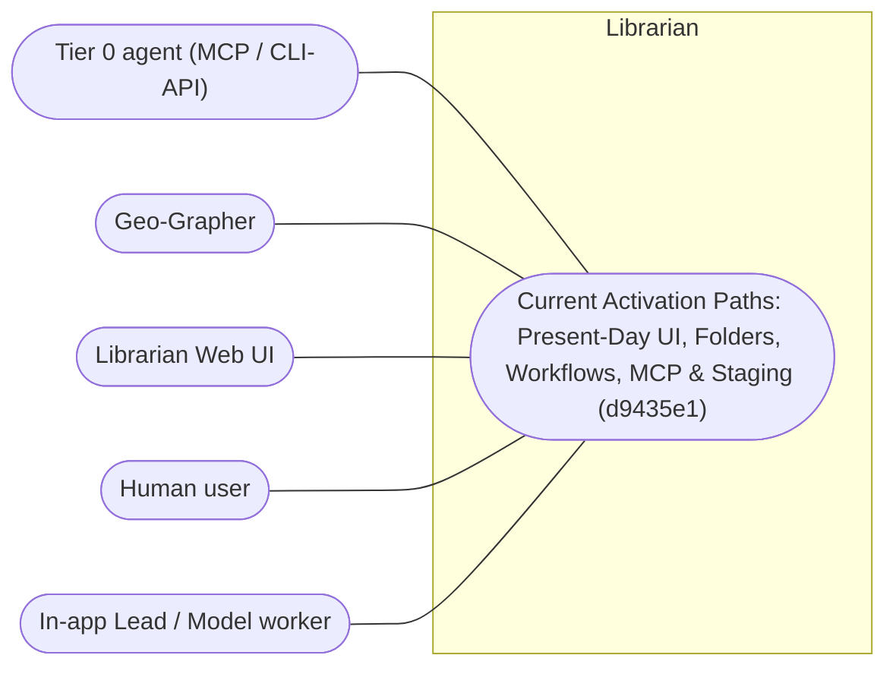

<!-- generated by build_and_validate_diagrams.py using accepted render_spec.py; edit the spec -->
# Current Activation Paths: Present-Day UI, Folders, Workflows, MCP & Staging (d9435e1)

**Status:** `IMPLEMENTED_VERIFIED` descriptive present-day behavioural specification at commit `d9435e1` (links to `batch-enrichment-current` and `source-enrichment-current`; preserves historical `DataManagement` `ingestion.canvas` unmodified). See [librarian-current-activation.md](librarian-current-activation.md) · [05-policy-and-behaviour-reconstruction.md](../05-policy-and-behaviour-reconstruction.md) · [Diagrams Index](README.md).

## Validation

No structural problems, cross-view flags, card overlaps, edge/card intersections, text overflows, ownership violations, or `_at_` spec clones.

## Use-case diagram



## Activity diagram

```mermaid
flowchart TD
  subgraph Tier_0_agent_MCP_CLI_API_["Tier 0 agent (MCP / CLI-API)"]
    c1_call["calls MCP capped at contribute (0 folder MCP tools; process_approved refused) or declared actor=agent /api/tool CLI"]
    c1_refusal["stops at TIER_REFUSED / 0 MCP folder tools / Plan deny / 150s PERMISSION_UNANSWERED; reports manual UI step"]
    c2_call["calls search/read_source_section, delegate/dispatch_plan, queue_source, ingest, or record_application"]
    c2_deliver_reuse["delivers ext-project result + Applications/ link (no snapshot hashes/locators/verification schema)"]
    c2_deliver_partial["returns external workaround/gap notice & queued unresolved lead IDs to user"]
    c2_refusal["stops on consult delegate TIER_REFUSED, raw 3rd-party THIRD_PARTY_ROUTE_REQUIRED, or 150s Ask timeout"]
  end
  subgraph Geo_Grapher["Geo-Grapher"]
    geo_folder_apply["runs apply-folder-review CLI across all accepted non-excluded library groups & writes graph snapshots"]
  end
  subgraph Core["Core"]
    hist_note>"d9435e1 current-state map; separates Folder review/Geo apply from Source intake, connects them only via /api/folders/sources, and preserves historical ingestion.canvas."]
    dcontext{"which present-day activation surface enters Core?"}
    dc1_broker{"Context 1 surface, tier & Broker Ask check?"}
    dc2_gate{"Context 2 MCP tier & S1-S6b third-party check?"}
    dc2_outcome{"Context 2 source readiness & Applications/ path?"}
    c2_record_app["writes append-only Applications/ note (attested_by=agent, [[note]]) + sidecar & auto-enqueues unresolved_sources"]
    c2_queue_only["refuses empty sources_used (TypeError) or leaves queued leads for later intake without blocking ext task"]
    folder_stage_cards["FolderReview.survey records fingerprints, suggested purpose & stratum graph on folder cards (0 Source items created)"]
    dfolder_action{"folder action on /api/folders/*?"}
    folder_draft_check{"POST /api/folders/draft: production_drafting & provenance arithmetic ok?"}
    folder_draft_hold["retains folder card in Folders awaiting person Accept folder decision (or records FOLDER_DRAFT_DISABLED / provenance refusal)"]
    folder_batch_approve["POST /api/folders/approve-batch (person=True) marks 1-100 non-sensitive folder cards approved (not accepted)"]
    dfolder_batch_go{"person submits Process approved in Staging for approved folder cards?"}
    folder_accept_prep["accept (person=True) or accept-policy (promotion.mode=agent): checks all-groups FOLDER_STALE & writes content-roots.json barrier"]
    dfolder_prep{"folder validation, policy & group check?"}
    dfolder_post{"Geo apply result & accepted folder purpose?"}
    folder_queue_sources["separate click POST /api/folders/sources: folder_sources.queue calls ingest(defer=true) per document (UI button: third-party/research-docs; API also own-docs); writes folder-sources.json, status=queued"]
    dqueue_drain{"queued intake refs drained via intake_run / run-queue?"}
    dchat_broker{"Chat tool target & Broker Ask/Plan check?"}
    ui_wf_start["App.start_action starts paperclip workflow at tier=contribute with workflow_grant (read_access exempts deep_read only)"]
    dwf_route{"which paperclip workflow & grant check?"}
    dwf_outcome{"workflows.Runner status on action_done?"}
    dwf_followup{"person submits Staging decision on still-staged items?"}
    wf_refused["App._run_action catches Refusal/DefinitionError (TIER_REFUSED, PERSON_CONFIRMS, or non-deep_read THIRD_PARTY_ROUTE_REQUIRED) -> status=failed"]
    capture_source["3. intake.ingest fetches immutable Bronze .evidence/, checks extraction quality & duplicates, and restores _framing on queued refs"]
    dcap_curr{"Source capture outcome?"}
    reuse_curr["links already_held note or brief screened_out record without duplicate staging"]
    quar_curr["quarantines failed ref & settles queue entry for retry"]
    stage_source["5. writes kind=source (status=staged) in StagingStore (distinct from kind=folder cards)"]
    dgate1_auth{"Source Gate 1 decision & curate process_approved start authority?"}
    accept_captured["promotes captured/partial Source note with explicit coverage & not_examined list"]
    start_batch["7. validates curate person_call, single _LIVE lock & freezes approved Sources (+ any approved Folder cards)"]
    batch_ref[["8. batch-enrichment-current: dispatches frozen mixed batch via batch-enrichment-current (calls source-enrichment-current for Sources; FOLDER_STAGES for folders)"]]
    dpartial_accept{"partial/failed item disposition & promotion mode?"}
    dgate2_curr{"Source Gate 2 decision & PromotionGuard CAS check?"}
    promote_curr["10. commits Sources/ note via PromotionGuard (200-file CAS), IndexGateway FTS, DA-3 handoff & post-write vectors"]
    dfind_curr{"post-promotion catalogued & vector status?"}
  end
  subgraph Librarian_Web_UI["Librarian Web UI"]
    ui_source_intake["2. submits Staging -> Sources -> Add source via person_call(ingest, defer=false) at curate tier (bypasses Broker)"]
    ui_folder_survey["POST /api/folders/survey walks directory metadata only (files unread, credential paths refused) & stages kind=folder cards"]
    ui_folder_done["shows Accepted folder & Geo graph status in Folders (own-code/data/logs/exclude never become Sources)"]
    ui_drop_result["app.js:8472 discards action_done.result (_result: {read, failed, errors}) & hides chip; reloads Staging where items stay staged"]
    wf_paused_chip["app.js:8472 drops result; renders static paused chip with no UI route-picker, resume, or dismiss control"]
    ui_done["11. shows ok banner & Search/Staging updates (manual Rewrite indexes if needed; no Oracle/Doctor runtime)"]
    ui_hold_notice["surfaces Ask prompt, refusal, FOLDER_STALE/policy hold, F-09 conflict, or waiting/queued Staging state"]
    ui_partial_notice["updates Staging/Search with partial/captured/warning state or finished workflow without result drawer"]
    ui_fail_notice["surfaces error banner, failed Geo folder apply, or failed workflow chip (result.error dropped)"]
  end
  subgraph Human_user["Human user"]
    initiate["1. initiates via Web UI (Add source, Folders, Chat, or paperclip workflow), instructs Tier 0 (Context 1), or runs ext build (Context 2)"]
    gate1_ui["6. reviews Staging -> Sources (Which sources hides processing/accepted); approves Gate 1 & clicks Process approved"]
    dmanual_handover{"human takes over Gate 1 / Process approved in Web UI?"}
    gate2_ui["9. reviews enriched Source summary (F-09 conflict reload wipes edits) & clicks Accept; Folder accept & Lenses stay separate"]
    user_done["12. receives catalogued Source note in Search/Vault; Folders/Lenses/Topics remain separate"]
    user_paused["receives refusal, Ask timeout, paused workflow chip, or manual Staging/Folders handover requirement"]
    user_partial["receives partial/captured/queued/embedding_warnings result or unseen finished workflow state"]
    user_reused["receives reused note, Applications/ precedent, or indexed-whole non-Source folder confirmation"]
    user_esc["receives failure alert & retained barrier/staging state"]
  end
  subgraph In_app_Lead_Model_worker["In-app Lead / Model worker"]
    c2_helpers["runs contribute read-only DeepInfra delegate / dispatch_plan DAGs with zero Ask prompt"]
    folder_clerk_draft["drafts 1-sentence folder brief & sensitivity from file counts/bytes only; stages draft on folder card"]
    chat_lead["handles UI Chat+Attach; calls tools & asks person tool-by-tool in Modes: Ask (600s wait; no sprint envelope)"]
    wf_deep_read["deep-read-staged.yaml: staging_list(source, staged, limit=10) -> each deep_read(max_chunks=12, on_error: continue) via clerk_endpoint; item status unchanged"]
    clerk_draft["4. intake.describe drafts neutral opening summary via clerk_endpoint (slug/filename titles & Unfiled if <=1 topic remain)"]
  end
  s(("start"))
  e1((("Source catalogued & findable via current UI/batch path; Folder/Lens/Topic decisions separate")))
  epartial((("completed with partial coverage, queued leads, or discarded finished workflow output (items still staged)")))
  ereused((("reused existing note/precedent or applied non-Source folder graph without Source intake")))
  epaused((("paused on Ask timeout, TIER_REFUSED, FOLDER_STALE/policy hold, queued refs, or paused workflow chip")))
  eescalated((("failed workflow, Geo apply, or uncaught batch/write error surfaced with retained state")))
  s --> hist_note
  hist_note --> initiate
  initiate --> dcontext
  dcontext -->|"[Context 3: Web UI Staging -> Sources -> Add source (curate)]"| ui_source_intake
  dcontext -->|"[Context 1: user directs Tier 0 agent (MCP / actor=agent API)] 1a"| c1_call
  dcontext -->|"[Context 2: external-project Tier 0 MCP during ext build] 1b"| c2_call
  dcontext -->|"[Context 3: Web UI Folders tab (/api/folders/*)] 1c"| ui_folder_survey
  dcontext -->|"[Context 3: Web UI Chat + Attach with in-app Lead] 1d"| chat_lead
  dcontext -->|"[Context 3: Web UI paperclip Run a workflow (App.start_action)] 1e"| ui_wf_start
  ui_source_intake --> capture_source
  c1_call --> dc1_broker
  dc1_broker -->|"[MCP/API ingest(defer=false) or intake_run permitted]"| capture_source
  dc1_broker -->|"[MCP queue_source or ingest(defer=true) permitted]"| dqueue_drain
  dc1_broker -->|"[0 MCP folder tools, curate TIER_REFUSED, Plan deny, or Ask 150s timeout]"| c1_refusal
  c1_refusal --> user_paused
  c2_call --> dc2_gate
  dc2_gate -->|"[contribute delegate/dispatch_plan + S1-S6b reads]"| c2_helpers
  dc2_gate -->|"[consult delegate TIER_REFUSED or raw 3rd-party THIRD_PARTY_ROUTE_REQUIRED]"| c2_refusal
  c2_helpers --> dc2_outcome
  dc2_outcome -->|"[sources_used >= 1 catalogued & Broker write allowed]"| c2_record_app
  dc2_outcome -->|"[sources_used=[] TypeError or async queue_source without waiting]"| c2_queue_only
  dc2_outcome -->|"[contribute ingest(defer=false) captures missing ref]"| capture_source
  dc2_outcome -->|"[Ask 150s PERMISSION_UNANSWERED on session/queue/application]"| c2_refusal
  c2_record_app --> c2_deliver_reuse
  c2_deliver_reuse --> user_reused
  c2_queue_only --> c2_deliver_partial
  c2_deliver_partial --> user_partial
  c2_refusal --> user_paused
  ui_folder_survey --> folder_stage_cards
  folder_stage_cards --> dfolder_action
  dfolder_action -->|"[/api/folders/accept (person) or /accept-policy (agent mode)]"| folder_accept_prep
  dfolder_action -->|"[/api/folders/approve-batch (person; 1-100 folder cards)]"| folder_batch_approve
  dfolder_action -->|"[/api/folders/draft (approve_spend=true; counts only)]"| folder_draft_check
  folder_draft_check -->|"[production_drafting enabled & provenance ok]"| folder_clerk_draft
  folder_draft_check -->|"[FOLDER_DRAFT_DISABLED (default), CLERK_UNAVAILABLE, or provenance mismatch]"| folder_draft_hold
  folder_clerk_draft --> folder_draft_hold
  folder_draft_hold --> ui_hold_notice
  folder_batch_approve --> dfolder_batch_go
  dfolder_batch_go -->|"[person clicks Process approved in Staging (runs FOLDER_STAGES)]"| start_batch
  dfolder_batch_go -->|"[leaves approved folder cards waiting]"| ui_hold_notice
  folder_accept_prep --> dfolder_prep
  dfolder_prep -->|"[valid & non-excluded accepted group(s)]"| geo_folder_apply
  dfolder_prep -->|"[exclude-only decision (never read or indexed)]"| ui_folder_done
  dfolder_prep -->|"[FOLDER_STALE (409), PROMOTION_MODE!=agent, or SENSITIVITY_REVIEW]"| ui_hold_notice
  geo_folder_apply --> dfolder_post
  dfolder_post -->|"[apply ok on reference folder & person clicks Queue documents as Sources]"| folder_queue_sources
  dfolder_post -->|"[apply ok: own-code/data/logs indexed whole (never Sources) or not queued]"| ui_folder_done
  dfolder_post -->|"[Geo apply-folder-review failed (barrier retained)]"| ui_fail_notice
  ui_folder_done --> user_reused
  folder_queue_sources --> dqueue_drain
  dqueue_drain -->|"[intake_run / run-queue captures queued refs within budget]"| capture_source
  dqueue_drain -->|"[stays status=queued or stops at [budget] ceiling_usd]"| ui_hold_notice
  chat_lead --> dchat_broker
  dchat_broker -->|"[ingest(defer=false) / intake_run allowed (Auto or UI Allow)]"| capture_source
  dchat_broker -->|"[queue_source / ingest(defer=true) allowed (status=queued)]"| dqueue_drain
  dchat_broker -->|"[Ask unanswered (600s park) or Plan PERMISSION_DENIED]"| ui_hold_notice
  ui_wf_start --> dwf_route
  dwf_route -->|"[deep-read-staged (read_access deep_read carveout)]"| wf_deep_read
  dwf_route -->|"[other QUEUED run (e.g. clear-enrichment-backlog: run-queue -> reasoned route)]"| dwf_outcome
  dwf_route -->|"[curate step, unaccepted workflow, or non-deep_read 3rd-party raw read]"| wf_refused
  wf_deep_read --> dwf_outcome
  dwf_outcome -->|"[finished (outputs {read, failed, errors}; on_error: continue; items stay staged)]"| ui_drop_result
  dwf_outcome -->|"[paused (cancel_action, MF-018 outcome_unknown, or missing pipeline router)]"| wf_paused_chip
  dwf_outcome -->|"[failed (RunFailed / step error outside on_error: continue)]"| ui_fail_notice
  ui_drop_result --> dwf_followup
  dwf_followup -->|"[person decides still-staged items in Staging (Gate 1 / Accept as captured)]"| dgate1_auth
  dwf_followup -->|"[no follow-up (result unseen; items remain staged)]"| ui_partial_notice
  wf_paused_chip --> user_paused
  wf_refused --> ui_fail_notice
  capture_source --> dcap_curr
  dcap_curr -->|"[usable captured Source]"| clerk_draft
  dcap_curr -->|"[already_held duplicate or screened_out] 3a"| reuse_curr
  dcap_curr -->|"[quarantined or capture error] 3b"| quar_curr
  reuse_curr --> user_reused
  quar_curr --> ui_hold_notice
  clerk_draft --> stage_source
  stage_source --> dgate1_auth
  dgate1_auth -->|"[Context 3 UI human approve + Process approved sources]"| gate1_ui
  dgate1_auth -->|"[Context 3 UI Accept as captured (skips batch)] 5a"| accept_captured
  dgate1_auth -->|"[MCP TIER_REFUSED on process_approved / PERSON_CONFIRMS / SENSITIVITY_REVIEW] 5b"| dmanual_handover
  dmanual_handover -->|"[human completes Gate 1 & clicks Process approved in UI]"| start_batch
  dmanual_handover -->|"[left waiting or deferred in Staging]"| ui_hold_notice
  gate1_ui --> start_batch
  start_batch --> batch_ref
  batch_ref -->|"[success]"| gate2_ui
  batch_ref -->|"[partial] 8a"| dpartial_accept
  batch_ref -->|"[reused] 8b"| reuse_curr
  batch_ref -->|"[paused] 8c"| ui_hold_notice
  batch_ref -->|"[escalated] 8d"| ui_fail_notice
  dpartial_accept -->|"[person accepts partial in UI (coverage=partial explicit)]"| accept_captured
  dpartial_accept -->|"[PERSON_CONFIRMS / SENSITIVITY_REVIEW / OP1 left unaccepted]"| ui_hold_notice
  accept_captured --> ui_partial_notice
  gate2_ui --> dgate2_curr
  dgate2_curr -->|"[Accept confirmed (curate or declared agent under promotion.mode=agent)]"| promote_curr
  dgate2_curr -->|"[Defer or Reject in Staging] 9a"| ui_hold_notice
  dgate2_curr -->|"[F-09 stale staged_revision or DOCUMENT_ACTIVE lease] 9b"| ui_hold_notice
  promote_curr --> dfind_curr
  dfind_curr -->|"[catalogued & vectors clean]"| ui_done
  dfind_curr -->|"[not_findable or embedding_warnings (note kept; manual Rewrite indexes)] 10a"| ui_partial_notice
  dfind_curr -->|"[uncaught write or index failure] 10b"| ui_fail_notice
  ui_partial_notice --> user_partial
  ui_done --> user_done
  user_done --> e1
  ui_hold_notice --> user_paused
  user_paused --> epaused
  user_partial --> epartial
  user_reused --> ereused
  ui_fail_notice --> user_esc
  user_esc --> eescalated
  classDef ext stroke:#d9534f,stroke-width:2px
```



## Written use case

**Main success scenario** (generated: the guard-true path, in step order)

1. The Human user initiates via Web UI (Add source, Folders, Chat, or paperclip workflow), instructs Tier 0 (Context 1), or runs ext build (Context 2).
2. The Librarian Web UI submits Staging -> Sources -> Add source via person_call(ingest, defer=false) at curate tier (bypasses Broker).
3. The Core intake.ingest fetches immutable Bronze .evidence/, checks extraction quality & duplicates, and restores _framing on queued refs.
4. The In-app Lead / Model worker intake.describe drafts neutral opening summary via clerk_endpoint (slug/filename titles & Unfiled if <=1 topic remain).
5. The Core writes kind=source (status=staged) in StagingStore (distinct from kind=folder cards).
6. The Human user reviews Staging -> Sources (Which sources hides processing/accepted); approves Gate 1 & clicks Process approved.
7. The Core validates curate person_call, single _LIVE lock & freezes approved Sources (+ any approved Folder cards).
8. The Core dispatches frozen mixed batch via batch-enrichment-current (calls source-enrichment-current for Sources; FOLDER_STAGES for folders).
9. The Human user reviews enriched Source summary (F-09 conflict reload wipes edits) & clicks Accept; Folder accept & Lenses stay separate.
10. The Core commits Sources/ note via PromotionGuard (200-file CAS), IndexGateway FTS, DA-3 handoff & post-write vectors.
11. The Librarian Web UI shows ok banner & Search/Staging updates (manual Rewrite indexes if needed; no Oracle/Doctor runtime).
12. The Human user receives catalogued Source note in Search/Vault; Folders/Lenses/Topics remain separate.

**Extensions** (generated: one per non-happy guard; numbered by the step it leaves)

- **1a** (from: which present-day activation surface enters Core?) *anticipated*
  - `1a1` Context 1: user directs Tier 0 agent (MCP / actor=agent API).
  - `1a2` The Tier 0 agent (MCP / CLI-API) calls MCP capped at contribute (0 folder MCP tools; process_approved refused) or declared actor=agent /api/tool CLI.
  - `1a3` The Core decides: Context 1 surface, tier & Broker Ask check?
  - `1a3a` If MCP queue_source or ingest(defer=true) permitted: queued intake refs drained via intake_run / run-queue?.
  - `1a3a` If 0 MCP folder tools, curate TIER_REFUSED, Plan deny, or Ask 150s timeout: stops at TIER_REFUSED / 0 MCP folder tools / Plan deny / 150s PERMISSION_UNANSWERED; reports manual UI step.
  - `1a4` If MCP/API ingest(defer=false) or intake_run permitted:
  - `1a5` Rejoin at 3.
- **1b** (from: which present-day activation surface enters Core?) *anticipated*
  - `1b1` Context 2: external-project Tier 0 MCP during ext build.
  - `1b2` The Tier 0 agent (MCP / CLI-API) calls search/read_source_section, delegate/dispatch_plan, queue_source, ingest, or record_application.
  - `1b3` The Core decides: Context 2 MCP tier & S1-S6b third-party check?
  - `1b3a` If consult delegate TIER_REFUSED or raw 3rd-party THIRD_PARTY_ROUTE_REQUIRED: stops on consult delegate TIER_REFUSED, raw 3rd-party THIRD_PARTY_ROUTE_REQUIRED, or 150s Ask timeout.
  - `1b4` If contribute delegate/dispatch_plan + S1-S6b reads:
  - `1b5` The In-app Lead / Model worker runs contribute read-only DeepInfra delegate / dispatch_plan DAGs with zero Ask prompt.
  - `1b6` The Core decides: Context 2 source readiness & Applications/ path?
  - `1b6a` If sources_used=[] TypeError or async queue_source without waiting: refuses empty sources_used (TypeError) or leaves queued leads for later intake without blocking ext task.
  - `1b6a` If contribute ingest(defer=false) captures missing ref: rejoin at 3.
  - `1b6a` If Ask 150s PERMISSION_UNANSWERED on session/queue/application: stops on consult delegate TIER_REFUSED, raw 3rd-party THIRD_PARTY_ROUTE_REQUIRED, or 150s Ask timeout.
  - `1b7` If sources_used >= 1 catalogued & Broker write allowed:
  - `1b8` The Core writes append-only Applications/ note (attested_by=agent, [[note]]) + sidecar & auto-enqueues unresolved_sources.
  - `1b9` The Tier 0 agent (MCP / CLI-API) delivers ext-project result + Applications/ link (no snapshot hashes/locators/verification schema).
  - `1b10` The Human user receives reused note, Applications/ precedent, or indexed-whole non-Source folder confirmation.
  - `1b11` The use case ends: reused existing note/precedent or applied non-Source folder graph without Source intake.
- **1c** (from: which present-day activation surface enters Core?) *anticipated*
  - `1c1` Context 3: Web UI Folders tab (/api/folders/*).
  - `1c2` The Librarian Web UI POST /api/folders/survey walks directory metadata only (files unread, credential paths refused) & stages kind=folder cards.
  - `1c3` The Core FolderReview.survey records fingerprints, suggested purpose & stratum graph on folder cards (0 Source items created).
  - `1c4` The Core decides: folder action on /api/folders/*?
  - `1c4a` If /api/folders/approve-batch (person; 1-100 folder cards): POST /api/folders/approve-batch (person=True) marks 1-100 non-sensitive folder cards approved (not accepted).
  - `1c4a` If /api/folders/draft (approve_spend=true; counts only): POST /api/folders/draft: production_drafting & provenance arithmetic ok?.
  - `1c5` If /api/folders/accept (person) or /accept-policy (agent mode):
  - `1c6` The Core accept (person=True) or accept-policy (promotion.mode=agent): checks all-groups FOLDER_STALE & writes content-roots.json barrier.
  - `1c7` The Core decides: folder validation, policy & group check?
  - `1c7a` If exclude-only decision (never read or indexed): shows Accepted folder & Geo graph status in Folders (own-code/data/logs/exclude never become Sources).
  - `1c7a` If FOLDER_STALE (409), PROMOTION_MODE!=agent, or SENSITIVITY_REVIEW: surfaces Ask prompt, refusal, FOLDER_STALE/policy hold, F-09 conflict, or waiting/queued Staging state.
  - `1c8` If valid & non-excluded accepted group(s):
  - `1c9` The Geo-Grapher runs apply-folder-review CLI across all accepted non-excluded library groups & writes graph snapshots.
  - `1c10` The Core decides: Geo apply result & accepted folder purpose?
  - `1c10a` If apply ok: own-code/data/logs indexed whole (never Sources) or not queued: shows Accepted folder & Geo graph status in Folders (own-code/data/logs/exclude never become Sources).
  - `1c10a` If Geo apply-folder-review failed (barrier retained): surfaces error banner, failed Geo folder apply, or failed workflow chip (result.error dropped).
  - `1c11` If apply ok on reference folder & person clicks Queue documents as Sources:
  - `1c12` The Core separate click POST /api/folders/sources: folder_sources.queue calls ingest(defer=true) per document (UI button: third-party/research-docs; API also own-docs); writes folder-sources.json, status=queued.
  - `1c13` The Core decides: queued intake refs drained via intake_run / run-queue?
  - `1c13a` If stays status=queued or stops at [budget] ceiling_usd: surfaces Ask prompt, refusal, FOLDER_STALE/policy hold, F-09 conflict, or waiting/queued Staging state.
  - `1c14` If intake_run / run-queue captures queued refs within budget:
  - `1c15` Rejoin at 3.
- **1d** (from: which present-day activation surface enters Core?) *anticipated*
  - `1d1` Context 3: Web UI Chat + Attach with in-app Lead.
  - `1d2` The In-app Lead / Model worker handles UI Chat+Attach; calls tools & asks person tool-by-tool in Modes: Ask (600s wait; no sprint envelope).
  - `1d3` The Core decides: Chat tool target & Broker Ask/Plan check?
  - `1d3a` If queue_source / ingest(defer=true) allowed (status=queued): queued intake refs drained via intake_run / run-queue?.
  - `1d3a` If Ask unanswered (600s park) or Plan PERMISSION_DENIED: surfaces Ask prompt, refusal, FOLDER_STALE/policy hold, F-09 conflict, or waiting/queued Staging state.
  - `1d4` If ingest(defer=false) / intake_run allowed (Auto or UI Allow):
  - `1d5` Rejoin at 3.
- **1e** (from: which present-day activation surface enters Core?) *anticipated*
  - `1e1` Context 3: Web UI paperclip Run a workflow (App.start_action).
  - `1e2` The Core App.start_action starts paperclip workflow at tier=contribute with workflow_grant (read_access exempts deep_read only).
  - `1e3` The Core decides: which paperclip workflow & grant check?
  - `1e3a` If other QUEUED run (e.g. clear-enrichment-backlog: run-queue -> reasoned route): workflows.Runner status on action_done?.
  - `1e3a` If curate step, unaccepted workflow, or non-deep_read 3rd-party raw read: App._run_action catches Refusal/DefinitionError (TIER_REFUSED, PERSON_CONFIRMS, or non-deep_read THIRD_PARTY_ROUTE_REQUIRED) -> status=failed.
  - `1e4` If deep-read-staged (read_access deep_read carveout):
  - `1e5` The In-app Lead / Model worker deep-read-staged.yaml: staging_list(source, staged, limit=10) -> each deep_read(max_chunks=12, on_error: continue) via clerk_endpoint; item status unchanged.
  - `1e6` The Core decides: workflows.Runner status on action_done?
  - `1e6a` If paused (cancel_action, MF-018 outcome_unknown, or missing pipeline router): app.js:8472 drops result; renders static paused chip with no UI route-picker, resume, or dismiss control.
  - `1e6a` If failed (RunFailed / step error outside on_error: continue): surfaces error banner, failed Geo folder apply, or failed workflow chip (result.error dropped).
  - `1e7` If finished (outputs {read, failed, errors}; on_error: continue; items stay staged):
  - `1e8` The Librarian Web UI app.js:8472 discards action_done.result (_result: {read, failed, errors}) & hides chip; reloads Staging where items stay staged.
  - `1e9` The Core decides: person submits Staging decision on still-staged items?
  - `1e9a` If no follow-up (result unseen; items remain staged): updates Staging/Search with partial/captured/warning state or finished workflow without result drawer.
  - `1e10` If person decides still-staged items in Staging (Gate 1 / Accept as captured):
  - `1e11` The Core decides: Source Gate 1 decision & curate process_approved start authority?
  - `1e11a` If Context 3 UI Accept as captured (skips batch): promotes captured/partial Source note with explicit coverage & not_examined list.
  - `1e11a` If MCP TIER_REFUSED on process_approved / PERSON_CONFIRMS / SENSITIVITY_REVIEW: human takes over Gate 1 / Process approved in Web UI?.
  - `1e12` If Context 3 UI human approve + Process approved sources:
  - `1e13` Rejoin at 6.
- **3a** (from: Source capture outcome?) *anticipated*
  - `3a1` Already_held duplicate or screened_out.
  - `3a2` The Core links already_held note or brief screened_out record without duplicate staging.
  - `3a3` The Human user receives reused note, Applications/ precedent, or indexed-whole non-Source folder confirmation.
  - `3a4` The use case ends: reused existing note/precedent or applied non-Source folder graph without Source intake.
- **3b** (from: Source capture outcome?) *anticipated*
  - `3b1` Quarantined or capture error.
  - `3b2` The Core quarantines failed ref & settles queue entry for retry.
  - `3b3` The Librarian Web UI surfaces Ask prompt, refusal, FOLDER_STALE/policy hold, F-09 conflict, or waiting/queued Staging state.
  - `3b4` The Human user receives refusal, Ask timeout, paused workflow chip, or manual Staging/Folders handover requirement.
  - `3b5` The use case ends: paused on Ask timeout, TIER_REFUSED, FOLDER_STALE/policy hold, queued refs, or paused workflow chip.
- **5a** (from: Source Gate 1 decision & curate process_approved start authority?) *anticipated*
  - `5a1` Context 3 UI Accept as captured (skips batch).
  - `5a2` The Core promotes captured/partial Source note with explicit coverage & not_examined list.
  - `5a3` The Librarian Web UI updates Staging/Search with partial/captured/warning state or finished workflow without result drawer.
  - `5a4` The Human user receives partial/captured/queued/embedding_warnings result or unseen finished workflow state.
  - `5a5` The use case ends: completed with partial coverage, queued leads, or discarded finished workflow output (items still staged).
- **5b** (from: Source Gate 1 decision & curate process_approved start authority?) *anticipated*
  - `5b1` MCP TIER_REFUSED on process_approved / PERSON_CONFIRMS / SENSITIVITY_REVIEW.
  - `5b2` The Human user decides: human takes over Gate 1 / Process approved in Web UI?
  - `5b2a` If left waiting or deferred in Staging: surfaces Ask prompt, refusal, FOLDER_STALE/policy hold, F-09 conflict, or waiting/queued Staging state.
  - `5b3` If human completes Gate 1 & clicks Process approved in UI:
  - `5b4` Rejoin at 7.
- **8a** (from: dispatches frozen mixed batch via batch-enrichment-current (calls source-enrichment-current for Sources; FOLDER_STAGES for folders)) *anticipated*
  - `8a1` Partial.
  - `8a2` The Core decides: partial/failed item disposition & promotion mode?
  - `8a2a` If PERSON_CONFIRMS / SENSITIVITY_REVIEW / OP1 left unaccepted: surfaces Ask prompt, refusal, FOLDER_STALE/policy hold, F-09 conflict, or waiting/queued Staging state.
  - `8a3` If person accepts partial in UI (coverage=partial explicit):
  - `8a4` The Core promotes captured/partial Source note with explicit coverage & not_examined list.
  - `8a5` The Librarian Web UI updates Staging/Search with partial/captured/warning state or finished workflow without result drawer.
  - `8a6` The Human user receives partial/captured/queued/embedding_warnings result or unseen finished workflow state.
  - `8a7` The use case ends: completed with partial coverage, queued leads, or discarded finished workflow output (items still staged).
- **8b** (from: dispatches frozen mixed batch via batch-enrichment-current (calls source-enrichment-current for Sources; FOLDER_STAGES for folders)) *anticipated*
  - `8b1` Reused.
  - `8b2` The Core links already_held note or brief screened_out record without duplicate staging.
  - `8b3` The Human user receives reused note, Applications/ precedent, or indexed-whole non-Source folder confirmation.
  - `8b4` The use case ends: reused existing note/precedent or applied non-Source folder graph without Source intake.
- **8c** (from: dispatches frozen mixed batch via batch-enrichment-current (calls source-enrichment-current for Sources; FOLDER_STAGES for folders)) *anticipated*
  - `8c1` Paused.
  - `8c2` The Librarian Web UI surfaces Ask prompt, refusal, FOLDER_STALE/policy hold, F-09 conflict, or waiting/queued Staging state.
  - `8c3` The Human user receives refusal, Ask timeout, paused workflow chip, or manual Staging/Folders handover requirement.
  - `8c4` The use case ends: paused on Ask timeout, TIER_REFUSED, FOLDER_STALE/policy hold, queued refs, or paused workflow chip.
- **8d** (from: dispatches frozen mixed batch via batch-enrichment-current (calls source-enrichment-current for Sources; FOLDER_STAGES for folders)) *anticipated*
  - `8d1` Escalated.
  - `8d2` The Librarian Web UI surfaces error banner, failed Geo folder apply, or failed workflow chip (result.error dropped).
  - `8d3` The Human user receives failure alert & retained barrier/staging state.
  - `8d4` The use case ends: failed workflow, Geo apply, or uncaught batch/write error surfaced with retained state.
- **9a** (from: Source Gate 2 decision & PromotionGuard CAS check?) *anticipated*
  - `9a1` Defer or Reject in Staging.
  - `9a2` The Librarian Web UI surfaces Ask prompt, refusal, FOLDER_STALE/policy hold, F-09 conflict, or waiting/queued Staging state.
  - `9a3` The Human user receives refusal, Ask timeout, paused workflow chip, or manual Staging/Folders handover requirement.
  - `9a4` The use case ends: paused on Ask timeout, TIER_REFUSED, FOLDER_STALE/policy hold, queued refs, or paused workflow chip.
- **9b** (from: Source Gate 2 decision & PromotionGuard CAS check?) *anticipated*
  - `9b1` F-09 stale staged_revision or DOCUMENT_ACTIVE lease.
  - `9b2` The Librarian Web UI surfaces Ask prompt, refusal, FOLDER_STALE/policy hold, F-09 conflict, or waiting/queued Staging state.
  - `9b3` The Human user receives refusal, Ask timeout, paused workflow chip, or manual Staging/Folders handover requirement.
  - `9b4` The use case ends: paused on Ask timeout, TIER_REFUSED, FOLDER_STALE/policy hold, queued refs, or paused workflow chip.
- **10a** (from: post-promotion catalogued & vector status?) *anticipated*
  - `10a1` Not_findable or embedding_warnings (note kept; manual Rewrite indexes).
  - `10a2` The Librarian Web UI updates Staging/Search with partial/captured/warning state or finished workflow without result drawer.
  - `10a3` The Human user receives partial/captured/queued/embedding_warnings result or unseen finished workflow state.
  - `10a4` The use case ends: completed with partial coverage, queued leads, or discarded finished workflow output (items still staged).
- **10b** (from: post-promotion catalogued & vector status?) *anticipated*
  - `10b1` Uncaught write or index failure.
  - `10b2` The Librarian Web UI surfaces error banner, failed Geo folder apply, or failed workflow chip (result.error dropped).
  - `10b3` The Human user receives failure alert & retained barrier/staging state.
  - `10b4` The use case ends: failed workflow, Geo apply, or uncaught batch/write error surfaced with retained state.

## Lane load

| Lane | On the main success scenario | Anywhere in the diagram |
|---|---|---|
| Tier 0 agent (MCP / CLI-API) | 0 | 6 |
| Geo-Grapher | 0 | 1 |
| Core | 10 | 36 |
| Librarian Web UI | 2 | 9 |
| Human user | 4 | 9 |
| In-app Lead / Model worker | 1 | 5 |

**Tier-0 turns** (each return of control to tier 0; owner's scale: 2 ideal, 3 expected, 4 rusty, 5–10 bad, more: might as well have done it themselves). Main success scenario: **0 (ideal)**. Worst path: T10, **2 (ideal)**. Paths by grade: ideal 41; escalated 6 (failures, not graded).

Paths by how they end: **escalated** 6, **partial** 6, **paused** 19, **reused** 5, **success** 1. Every *escalated* path is a failure of this use case: the work went back to tier 0.

## Decision tree with 47 extension scenarios

```text
start: Current Activation Paths: Present-Day UI, Folders, Workflows, MCP & Staging (d9435e1)
            └─ T1: Context 3: Web UI Staging -> Sources -> Add source (curate) / usable captured Source / Context 3 UI human approve + Process approved sources / success / Accept confirmed (curate or declared agent under promotion.mode=agent) / catalogued & vectors clean  ⇒ Source catalogued & findable via current UI/batch path; Folder/Lens/Topic decisions separate
      └─ T2: Context 1: user directs Tier 0 agent (MCP / actor=agent API) / MCP queue_source or ingest(defer=true) permitted / stays status=queued or stops at [budget] ceiling_usd  ⇒ paused on Ask timeout, TIER_REFUSED, FOLDER_STALE/policy hold, queued refs, or paused workflow chip
      └─ T3: Context 1: user directs Tier 0 agent (MCP / actor=agent API) / MCP queue_source or ingest(defer=true) permitted / intake_run / run-queue captures queued refs within budget  ⇒ rejoins at step 3
    └─ T4: Context 1: user directs Tier 0 agent (MCP / actor=agent API) / 0 MCP folder tools, curate TIER_REFUSED, Plan deny, or Ask 150s timeout  ⇒ paused on Ask timeout, TIER_REFUSED, FOLDER_STALE/policy hold, queued refs, or paused workflow chip
    └─ T5: Context 1: user directs Tier 0 agent (MCP / actor=agent API) / MCP/API ingest(defer=false) or intake_run permitted  ⇒ rejoins at step 3
    └─ T6: Context 2: external-project Tier 0 MCP during ext build / consult delegate TIER_REFUSED or raw 3rd-party THIRD_PARTY_ROUTE_REQUIRED  ⇒ paused on Ask timeout, TIER_REFUSED, FOLDER_STALE/policy hold, queued refs, or paused workflow chip
      └─ T7: Context 2: external-project Tier 0 MCP during ext build / contribute delegate/dispatch_plan + S1-S6b reads / sources_used=[] TypeError or async queue_source without waiting  ⇒ completed with partial coverage, queued leads, or discarded finished workflow output (items still staged)
      └─ T8: Context 2: external-project Tier 0 MCP during ext build / contribute delegate/dispatch_plan + S1-S6b reads / contribute ingest(defer=false) captures missing ref  ⇒ rejoins at step 3
      └─ T9: Context 2: external-project Tier 0 MCP during ext build / contribute delegate/dispatch_plan + S1-S6b reads / Ask 150s PERMISSION_UNANSWERED on session/queue/application  ⇒ paused on Ask timeout, TIER_REFUSED, FOLDER_STALE/policy hold, queued refs, or paused workflow chip
      └─ T10: Context 2: external-project Tier 0 MCP during ext build / contribute delegate/dispatch_plan + S1-S6b reads / sources_used >= 1 catalogued & Broker write allowed  ⇒ reused existing note/precedent or applied non-Source folder graph without Source intake
      └─ T11: Context 3: Web UI Folders tab (/api/folders/*) / /api/folders/approve-batch (person; 1-100 folder cards) / leaves approved folder cards waiting  ⇒ paused on Ask timeout, TIER_REFUSED, FOLDER_STALE/policy hold, queued refs, or paused workflow chip
      └─ T12: Context 3: Web UI Folders tab (/api/folders/*) / /api/folders/approve-batch (person; 1-100 folder cards) / person clicks Process approved in Staging (runs FOLDER_STAGES)  ⇒ rejoins at step 7
      └─ T13: Context 3: Web UI Folders tab (/api/folders/*) / /api/folders/draft (approve_spend=true; counts only) / FOLDER_DRAFT_DISABLED (default), CLERK_UNAVAILABLE, or provenance mismatch  ⇒ paused on Ask timeout, TIER_REFUSED, FOLDER_STALE/policy hold, queued refs, or paused workflow chip
      └─ T14: Context 3: Web UI Folders tab (/api/folders/*) / /api/folders/draft (approve_spend=true; counts only) / production_drafting enabled & provenance ok  ⇒ paused on Ask timeout, TIER_REFUSED, FOLDER_STALE/policy hold, queued refs, or paused workflow chip
      └─ T15: Context 3: Web UI Folders tab (/api/folders/*) / /api/folders/accept (person) or /accept-policy (agent mode) / exclude-only decision (never read or indexed)  ⇒ reused existing note/precedent or applied non-Source folder graph without Source intake
      └─ T16: Context 3: Web UI Folders tab (/api/folders/*) / /api/folders/accept (person) or /accept-policy (agent mode) / FOLDER_STALE (409), PROMOTION_MODE!=agent, or SENSITIVITY_REVIEW  ⇒ paused on Ask timeout, TIER_REFUSED, FOLDER_STALE/policy hold, queued refs, or paused workflow chip
        └─ T17: Context 3: Web UI Folders tab (/api/folders/*) / /api/folders/accept (person) or /accept-policy (agent mode) / valid & non-excluded accepted group(s) / apply ok: own-code/data/logs indexed whole (never Sources) or not queued  ⇒ reused existing note/precedent or applied non-Source folder graph without Source intake
        └─ T18: Context 3: Web UI Folders tab (/api/folders/*) / /api/folders/accept (person) or /accept-policy (agent mode) / valid & non-excluded accepted group(s) / Geo apply-folder-review failed (barrier retained)  ⇒ failed workflow, Geo apply, or uncaught batch/write error surfaced with retained state
          └─ T19: Context 3: Web UI Folders tab (/api/folders/*) / /api/folders/accept (person) or /accept-policy (agent mode) / valid & non-excluded accepted group(s) / apply ok on reference folder & person clicks Queue documents as Sources / stays status=queued or stops at [budget] ceiling_usd  ⇒ paused on Ask timeout, TIER_REFUSED, FOLDER_STALE/policy hold, queued refs, or paused workflow chip
          └─ T20: Context 3: Web UI Folders tab (/api/folders/*) / /api/folders/accept (person) or /accept-policy (agent mode) / valid & non-excluded accepted group(s) / apply ok on reference folder & person clicks Queue documents as Sources / intake_run / run-queue captures queued refs within budget  ⇒ rejoins at step 3
      └─ T21: Context 3: Web UI Chat + Attach with in-app Lead / queue_source / ingest(defer=true) allowed (status=queued) / stays status=queued or stops at [budget] ceiling_usd  ⇒ paused on Ask timeout, TIER_REFUSED, FOLDER_STALE/policy hold, queued refs, or paused workflow chip
      └─ T22: Context 3: Web UI Chat + Attach with in-app Lead / queue_source / ingest(defer=true) allowed (status=queued) / intake_run / run-queue captures queued refs within budget  ⇒ rejoins at step 3
    └─ T23: Context 3: Web UI Chat + Attach with in-app Lead / Ask unanswered (600s park) or Plan PERMISSION_DENIED  ⇒ paused on Ask timeout, TIER_REFUSED, FOLDER_STALE/policy hold, queued refs, or paused workflow chip
    └─ T24: Context 3: Web UI Chat + Attach with in-app Lead / ingest(defer=false) / intake_run allowed (Auto or UI Allow)  ⇒ rejoins at step 3
      └─ T25: Context 3: Web UI paperclip Run a workflow (App.start_action) / other QUEUED run (e.g. clear-enrichment-backlog: run-queue -> reasoned route) / paused (cancel_action, MF-018 outcome_unknown, or missing pipeline router)  ⇒ paused on Ask timeout, TIER_REFUSED, FOLDER_STALE/policy hold, queued refs, or paused workflow chip
      └─ T26: Context 3: Web UI paperclip Run a workflow (App.start_action) / other QUEUED run (e.g. clear-enrichment-backlog: run-queue -> reasoned route) / failed (RunFailed / step error outside on_error: continue)  ⇒ failed workflow, Geo apply, or uncaught batch/write error surfaced with retained state
        └─ T27: Context 3: Web UI paperclip Run a workflow (App.start_action) / other QUEUED run (e.g. clear-enrichment-backlog: run-queue -> reasoned route) / finished (outputs {read, failed, errors}; on_error: continue; items stay staged) / no follow-up (result unseen; items remain staged)  ⇒ completed with partial coverage, queued leads, or discarded finished workflow output (items still staged)
        └─ T28: Context 3: Web UI paperclip Run a workflow (App.start_action) / other QUEUED run (e.g. clear-enrichment-backlog: run-queue -> reasoned route) / finished (outputs {read, failed, errors}; on_error: continue; items stay staged) / person decides still-staged items in Staging (Gate 1 / Accept as captured)  ⇒ rejoins at 'Source Gate 1 decision & curate process_approved start authority?' (before step 6)
    └─ T29: Context 3: Web UI paperclip Run a workflow (App.start_action) / curate step, unaccepted workflow, or non-deep_read 3rd-party raw read  ⇒ failed workflow, Geo apply, or uncaught batch/write error surfaced with retained state
      └─ T30: Context 3: Web UI paperclip Run a workflow (App.start_action) / deep-read-staged (read_access deep_read carveout) / paused (cancel_action, MF-018 outcome_unknown, or missing pipeline router)  ⇒ paused on Ask timeout, TIER_REFUSED, FOLDER_STALE/policy hold, queued refs, or paused workflow chip
      └─ T31: Context 3: Web UI paperclip Run a workflow (App.start_action) / deep-read-staged (read_access deep_read carveout) / failed (RunFailed / step error outside on_error: continue)  ⇒ failed workflow, Geo apply, or uncaught batch/write error surfaced with retained state
        └─ T32: Context 3: Web UI paperclip Run a workflow (App.start_action) / deep-read-staged (read_access deep_read carveout) / finished (outputs {read, failed, errors}; on_error: continue; items stay staged) / no follow-up (result unseen; items remain staged)  ⇒ completed with partial coverage, queued leads, or discarded finished workflow output (items still staged)
        └─ T33: Context 3: Web UI paperclip Run a workflow (App.start_action) / deep-read-staged (read_access deep_read carveout) / finished (outputs {read, failed, errors}; on_error: continue; items stay staged) / person decides still-staged items in Staging (Gate 1 / Accept as captured)  ⇒ rejoins at 'Source Gate 1 decision & curate process_approved start authority?' (before step 6)
    └─ T34: Context 3: Web UI Staging -> Sources -> Add source (curate) / already_held duplicate or screened_out  ⇒ reused existing note/precedent or applied non-Source folder graph without Source intake
    └─ T35: Context 3: Web UI Staging -> Sources -> Add source (curate) / quarantined or capture error  ⇒ paused on Ask timeout, TIER_REFUSED, FOLDER_STALE/policy hold, queued refs, or paused workflow chip
      └─ T36: Context 3: Web UI Staging -> Sources -> Add source (curate) / usable captured Source / Context 3 UI Accept as captured (skips batch)  ⇒ completed with partial coverage, queued leads, or discarded finished workflow output (items still staged)
        └─ T37: Context 3: Web UI Staging -> Sources -> Add source (curate) / usable captured Source / MCP TIER_REFUSED on process_approved / PERSON_CONFIRMS / SENSITIVITY_REVIEW / left waiting or deferred in Staging  ⇒ paused on Ask timeout, TIER_REFUSED, FOLDER_STALE/policy hold, queued refs, or paused workflow chip
        └─ T38: Context 3: Web UI Staging -> Sources -> Add source (curate) / usable captured Source / MCP TIER_REFUSED on process_approved / PERSON_CONFIRMS / SENSITIVITY_REVIEW / human completes Gate 1 & clicks Process approved in UI  ⇒ rejoins at step 7
          └─ T39: Context 3: Web UI Staging -> Sources -> Add source (curate) / usable captured Source / Context 3 UI human approve + Process approved sources / partial / PERSON_CONFIRMS / SENSITIVITY_REVIEW / OP1 left unaccepted  ⇒ paused on Ask timeout, TIER_REFUSED, FOLDER_STALE/policy hold, queued refs, or paused workflow chip
          └─ T40: Context 3: Web UI Staging -> Sources -> Add source (curate) / usable captured Source / Context 3 UI human approve + Process approved sources / partial / person accepts partial in UI (coverage=partial explicit)  ⇒ completed with partial coverage, queued leads, or discarded finished workflow output (items still staged)
        └─ T41: Context 3: Web UI Staging -> Sources -> Add source (curate) / usable captured Source / Context 3 UI human approve + Process approved sources / reused  ⇒ reused existing note/precedent or applied non-Source folder graph without Source intake
        └─ T42: Context 3: Web UI Staging -> Sources -> Add source (curate) / usable captured Source / Context 3 UI human approve + Process approved sources / paused  ⇒ paused on Ask timeout, TIER_REFUSED, FOLDER_STALE/policy hold, queued refs, or paused workflow chip
        └─ T43: Context 3: Web UI Staging -> Sources -> Add source (curate) / usable captured Source / Context 3 UI human approve + Process approved sources / escalated  ⇒ failed workflow, Geo apply, or uncaught batch/write error surfaced with retained state
          └─ T44: Context 3: Web UI Staging -> Sources -> Add source (curate) / usable captured Source / Context 3 UI human approve + Process approved sources / success / Defer or Reject in Staging  ⇒ paused on Ask timeout, TIER_REFUSED, FOLDER_STALE/policy hold, queued refs, or paused workflow chip
          └─ T45: Context 3: Web UI Staging -> Sources -> Add source (curate) / usable captured Source / Context 3 UI human approve + Process approved sources / success / F-09 stale staged_revision or DOCUMENT_ACTIVE lease  ⇒ paused on Ask timeout, TIER_REFUSED, FOLDER_STALE/policy hold, queued refs, or paused workflow chip
            └─ T46: Context 3: Web UI Staging -> Sources -> Add source (curate) / usable captured Source / Context 3 UI human approve + Process approved sources / success / Accept confirmed (curate or declared agent under promotion.mode=agent) / not_findable or embedding_warnings (note kept; manual Rewrite indexes)  ⇒ completed with partial coverage, queued leads, or discarded finished workflow output (items still staged)
            └─ T47: Context 3: Web UI Staging -> Sources -> Add source (curate) / usable captured Source / Context 3 UI human approve + Process approved sources / success / Accept confirmed (curate or declared agent under promotion.mode=agent) / uncaught write or index failure  ⇒ failed workflow, Geo apply, or uncaught batch/write error surfaced with retained state
```

## Scenario test table

| Test | Path (guards taken) | Extension | Expected outcome | Tier-0 turns |
|---|---|---|---|---|
| T1 | which present-day activation surface enters Core? → Context 3: Web UI Staging -> Sources -> Add source (curate); Source capture outcome? → usable captured Source; Source Gate 1 decision & curate process_approved start authority? → Context 3 UI human approve + Process approved sources; dispatches frozen mixed batch via batch-enrichment-current (calls source-enrichment-current for Sources; FOLDER_STAGES for folders) → success; Source Gate 2 decision & PromotionGuard CAS check? → Accept confirmed (curate or declared agent under promotion.mode=agent); post-promotion catalogued & vector status? → catalogued & vectors clean | MSS | Source catalogued & findable via current UI/batch path; Folder/Lens/Topic decisions separate | 0 (ideal) |
| T2 | which present-day activation surface enters Core? → Context 1: user directs Tier 0 agent (MCP / actor=agent API); Context 1 surface, tier & Broker Ask check? → MCP queue_source or ingest(defer=true) permitted; queued intake refs drained via intake_run / run-queue? → stays status=queued or stops at [budget] ceiling_usd | 1a | paused on Ask timeout, TIER_REFUSED, FOLDER_STALE/policy hold, queued refs, or paused workflow chip | 1 (ideal) |
| T3 | which present-day activation surface enters Core? → Context 1: user directs Tier 0 agent (MCP / actor=agent API); Context 1 surface, tier & Broker Ask check? → MCP queue_source or ingest(defer=true) permitted; queued intake refs drained via intake_run / run-queue? → intake_run / run-queue captures queued refs within budget | 1a | rejoins at step 3 | 1 (ideal) |
| T4 | which present-day activation surface enters Core? → Context 1: user directs Tier 0 agent (MCP / actor=agent API); Context 1 surface, tier & Broker Ask check? → 0 MCP folder tools, curate TIER_REFUSED, Plan deny, or Ask 150s timeout | 1a | paused on Ask timeout, TIER_REFUSED, FOLDER_STALE/policy hold, queued refs, or paused workflow chip | 2 (ideal) |
| T5 | which present-day activation surface enters Core? → Context 1: user directs Tier 0 agent (MCP / actor=agent API); Context 1 surface, tier & Broker Ask check? → MCP/API ingest(defer=false) or intake_run permitted | 1a | rejoins at step 3 | 1 (ideal) |
| T6 | which present-day activation surface enters Core? → Context 2: external-project Tier 0 MCP during ext build; Context 2 MCP tier & S1-S6b third-party check? → consult delegate TIER_REFUSED or raw 3rd-party THIRD_PARTY_ROUTE_REQUIRED | 1b | paused on Ask timeout, TIER_REFUSED, FOLDER_STALE/policy hold, queued refs, or paused workflow chip | 2 (ideal) |
| T7 | which present-day activation surface enters Core? → Context 2: external-project Tier 0 MCP during ext build; Context 2 MCP tier & S1-S6b third-party check? → contribute delegate/dispatch_plan + S1-S6b reads; Context 2 source readiness & Applications/ path? → sources_used=[] TypeError or async queue_source without waiting | 1b | completed with partial coverage, queued leads, or discarded finished workflow output (items still staged) | 2 (ideal) |
| T8 | which present-day activation surface enters Core? → Context 2: external-project Tier 0 MCP during ext build; Context 2 MCP tier & S1-S6b third-party check? → contribute delegate/dispatch_plan + S1-S6b reads; Context 2 source readiness & Applications/ path? → contribute ingest(defer=false) captures missing ref | 1b | rejoins at step 3 | 1 (ideal) |
| T9 | which present-day activation surface enters Core? → Context 2: external-project Tier 0 MCP during ext build; Context 2 MCP tier & S1-S6b third-party check? → contribute delegate/dispatch_plan + S1-S6b reads; Context 2 source readiness & Applications/ path? → Ask 150s PERMISSION_UNANSWERED on session/queue/application | 1b | paused on Ask timeout, TIER_REFUSED, FOLDER_STALE/policy hold, queued refs, or paused workflow chip | 2 (ideal) |
| T10 | which present-day activation surface enters Core? → Context 2: external-project Tier 0 MCP during ext build; Context 2 MCP tier & S1-S6b third-party check? → contribute delegate/dispatch_plan + S1-S6b reads; Context 2 source readiness & Applications/ path? → sources_used >= 1 catalogued & Broker write allowed | 1b | reused existing note/precedent or applied non-Source folder graph without Source intake | 2 (ideal) |
| T11 | which present-day activation surface enters Core? → Context 3: Web UI Folders tab (/api/folders/*); folder action on /api/folders/*? → /api/folders/approve-batch (person; 1-100 folder cards); person submits Process approved in Staging for approved folder cards? → leaves approved folder cards waiting | 1c | paused on Ask timeout, TIER_REFUSED, FOLDER_STALE/policy hold, queued refs, or paused workflow chip | 0 (ideal) |
| T12 | which present-day activation surface enters Core? → Context 3: Web UI Folders tab (/api/folders/*); folder action on /api/folders/*? → /api/folders/approve-batch (person; 1-100 folder cards); person submits Process approved in Staging for approved folder cards? → person clicks Process approved in Staging (runs FOLDER_STAGES) | 1c | rejoins at step 7 | 0 (ideal) |
| T13 | which present-day activation surface enters Core? → Context 3: Web UI Folders tab (/api/folders/*); folder action on /api/folders/*? → /api/folders/draft (approve_spend=true; counts only); POST /api/folders/draft: production_drafting & provenance arithmetic ok? → FOLDER_DRAFT_DISABLED (default), CLERK_UNAVAILABLE, or provenance mismatch | 1c | paused on Ask timeout, TIER_REFUSED, FOLDER_STALE/policy hold, queued refs, or paused workflow chip | 0 (ideal) |
| T14 | which present-day activation surface enters Core? → Context 3: Web UI Folders tab (/api/folders/*); folder action on /api/folders/*? → /api/folders/draft (approve_spend=true; counts only); POST /api/folders/draft: production_drafting & provenance arithmetic ok? → production_drafting enabled & provenance ok | 1c | paused on Ask timeout, TIER_REFUSED, FOLDER_STALE/policy hold, queued refs, or paused workflow chip | 0 (ideal) |
| T15 | which present-day activation surface enters Core? → Context 3: Web UI Folders tab (/api/folders/*); folder action on /api/folders/*? → /api/folders/accept (person) or /accept-policy (agent mode); folder validation, policy & group check? → exclude-only decision (never read or indexed) | 1c | reused existing note/precedent or applied non-Source folder graph without Source intake | 0 (ideal) |
| T16 | which present-day activation surface enters Core? → Context 3: Web UI Folders tab (/api/folders/*); folder action on /api/folders/*? → /api/folders/accept (person) or /accept-policy (agent mode); folder validation, policy & group check? → FOLDER_STALE (409), PROMOTION_MODE!=agent, or SENSITIVITY_REVIEW | 1c | paused on Ask timeout, TIER_REFUSED, FOLDER_STALE/policy hold, queued refs, or paused workflow chip | 0 (ideal) |
| T17 | which present-day activation surface enters Core? → Context 3: Web UI Folders tab (/api/folders/*); folder action on /api/folders/*? → /api/folders/accept (person) or /accept-policy (agent mode); folder validation, policy & group check? → valid & non-excluded accepted group(s); Geo apply result & accepted folder purpose? → apply ok: own-code/data/logs indexed whole (never Sources) or not queued | 1c | reused existing note/precedent or applied non-Source folder graph without Source intake | 0 (ideal) |
| T18 | which present-day activation surface enters Core? → Context 3: Web UI Folders tab (/api/folders/*); folder action on /api/folders/*? → /api/folders/accept (person) or /accept-policy (agent mode); folder validation, policy & group check? → valid & non-excluded accepted group(s); Geo apply result & accepted folder purpose? → Geo apply-folder-review failed (barrier retained) | 1c | failed workflow, Geo apply, or uncaught batch/write error surfaced with retained state | 0 (escalated: a failure) |
| T19 | which present-day activation surface enters Core? → Context 3: Web UI Folders tab (/api/folders/*); folder action on /api/folders/*? → /api/folders/accept (person) or /accept-policy (agent mode); folder validation, policy & group check? → valid & non-excluded accepted group(s); Geo apply result & accepted folder purpose? → apply ok on reference folder & person clicks Queue documents as Sources; queued intake refs drained via intake_run / run-queue? → stays status=queued or stops at [budget] ceiling_usd | 1c | paused on Ask timeout, TIER_REFUSED, FOLDER_STALE/policy hold, queued refs, or paused workflow chip | 0 (ideal) |
| T20 | which present-day activation surface enters Core? → Context 3: Web UI Folders tab (/api/folders/*); folder action on /api/folders/*? → /api/folders/accept (person) or /accept-policy (agent mode); folder validation, policy & group check? → valid & non-excluded accepted group(s); Geo apply result & accepted folder purpose? → apply ok on reference folder & person clicks Queue documents as Sources; queued intake refs drained via intake_run / run-queue? → intake_run / run-queue captures queued refs within budget | 1c | rejoins at step 3 | 0 (ideal) |
| T21 | which present-day activation surface enters Core? → Context 3: Web UI Chat + Attach with in-app Lead; Chat tool target & Broker Ask/Plan check? → queue_source / ingest(defer=true) allowed (status=queued); queued intake refs drained via intake_run / run-queue? → stays status=queued or stops at [budget] ceiling_usd | 1d | paused on Ask timeout, TIER_REFUSED, FOLDER_STALE/policy hold, queued refs, or paused workflow chip | 0 (ideal) |
| T22 | which present-day activation surface enters Core? → Context 3: Web UI Chat + Attach with in-app Lead; Chat tool target & Broker Ask/Plan check? → queue_source / ingest(defer=true) allowed (status=queued); queued intake refs drained via intake_run / run-queue? → intake_run / run-queue captures queued refs within budget | 1d | rejoins at step 3 | 0 (ideal) |
| T23 | which present-day activation surface enters Core? → Context 3: Web UI Chat + Attach with in-app Lead; Chat tool target & Broker Ask/Plan check? → Ask unanswered (600s park) or Plan PERMISSION_DENIED | 1d | paused on Ask timeout, TIER_REFUSED, FOLDER_STALE/policy hold, queued refs, or paused workflow chip | 0 (ideal) |
| T24 | which present-day activation surface enters Core? → Context 3: Web UI Chat + Attach with in-app Lead; Chat tool target & Broker Ask/Plan check? → ingest(defer=false) / intake_run allowed (Auto or UI Allow) | 1d | rejoins at step 3 | 0 (ideal) |
| T25 | which present-day activation surface enters Core? → Context 3: Web UI paperclip Run a workflow (App.start_action); which paperclip workflow & grant check? → other QUEUED run (e.g. clear-enrichment-backlog: run-queue -> reasoned route); workflows.Runner status on action_done? → paused (cancel_action, MF-018 outcome_unknown, or missing pipeline router) | 1e | paused on Ask timeout, TIER_REFUSED, FOLDER_STALE/policy hold, queued refs, or paused workflow chip | 0 (ideal) |
| T26 | which present-day activation surface enters Core? → Context 3: Web UI paperclip Run a workflow (App.start_action); which paperclip workflow & grant check? → other QUEUED run (e.g. clear-enrichment-backlog: run-queue -> reasoned route); workflows.Runner status on action_done? → failed (RunFailed / step error outside on_error: continue) | 1e | failed workflow, Geo apply, or uncaught batch/write error surfaced with retained state | 0 (escalated: a failure) |
| T27 | which present-day activation surface enters Core? → Context 3: Web UI paperclip Run a workflow (App.start_action); which paperclip workflow & grant check? → other QUEUED run (e.g. clear-enrichment-backlog: run-queue -> reasoned route); workflows.Runner status on action_done? → finished (outputs {read, failed, errors}; on_error: continue; items stay staged); person submits Staging decision on still-staged items? → no follow-up (result unseen; items remain staged) | 1e | completed with partial coverage, queued leads, or discarded finished workflow output (items still staged) | 0 (ideal) |
| T28 | which present-day activation surface enters Core? → Context 3: Web UI paperclip Run a workflow (App.start_action); which paperclip workflow & grant check? → other QUEUED run (e.g. clear-enrichment-backlog: run-queue -> reasoned route); workflows.Runner status on action_done? → finished (outputs {read, failed, errors}; on_error: continue; items stay staged); person submits Staging decision on still-staged items? → person decides still-staged items in Staging (Gate 1 / Accept as captured) | 1e | rejoins at 'Source Gate 1 decision & curate process_approved start authority?' (before step 6) | 0 (ideal) |
| T29 | which present-day activation surface enters Core? → Context 3: Web UI paperclip Run a workflow (App.start_action); which paperclip workflow & grant check? → curate step, unaccepted workflow, or non-deep_read 3rd-party raw read | 1e | failed workflow, Geo apply, or uncaught batch/write error surfaced with retained state | 0 (escalated: a failure) |
| T30 | which present-day activation surface enters Core? → Context 3: Web UI paperclip Run a workflow (App.start_action); which paperclip workflow & grant check? → deep-read-staged (read_access deep_read carveout); workflows.Runner status on action_done? → paused (cancel_action, MF-018 outcome_unknown, or missing pipeline router) | 1e | paused on Ask timeout, TIER_REFUSED, FOLDER_STALE/policy hold, queued refs, or paused workflow chip | 0 (ideal) |
| T31 | which present-day activation surface enters Core? → Context 3: Web UI paperclip Run a workflow (App.start_action); which paperclip workflow & grant check? → deep-read-staged (read_access deep_read carveout); workflows.Runner status on action_done? → failed (RunFailed / step error outside on_error: continue) | 1e | failed workflow, Geo apply, or uncaught batch/write error surfaced with retained state | 0 (escalated: a failure) |
| T32 | which present-day activation surface enters Core? → Context 3: Web UI paperclip Run a workflow (App.start_action); which paperclip workflow & grant check? → deep-read-staged (read_access deep_read carveout); workflows.Runner status on action_done? → finished (outputs {read, failed, errors}; on_error: continue; items stay staged); person submits Staging decision on still-staged items? → no follow-up (result unseen; items remain staged) | 1e | completed with partial coverage, queued leads, or discarded finished workflow output (items still staged) | 0 (ideal) |
| T33 | which present-day activation surface enters Core? → Context 3: Web UI paperclip Run a workflow (App.start_action); which paperclip workflow & grant check? → deep-read-staged (read_access deep_read carveout); workflows.Runner status on action_done? → finished (outputs {read, failed, errors}; on_error: continue; items stay staged); person submits Staging decision on still-staged items? → person decides still-staged items in Staging (Gate 1 / Accept as captured) | 1e | rejoins at 'Source Gate 1 decision & curate process_approved start authority?' (before step 6) | 0 (ideal) |
| T34 | which present-day activation surface enters Core? → Context 3: Web UI Staging -> Sources -> Add source (curate); Source capture outcome? → already_held duplicate or screened_out | 3a | reused existing note/precedent or applied non-Source folder graph without Source intake | 0 (ideal) |
| T35 | which present-day activation surface enters Core? → Context 3: Web UI Staging -> Sources -> Add source (curate); Source capture outcome? → quarantined or capture error | 3b | paused on Ask timeout, TIER_REFUSED, FOLDER_STALE/policy hold, queued refs, or paused workflow chip | 0 (ideal) |
| T36 | which present-day activation surface enters Core? → Context 3: Web UI Staging -> Sources -> Add source (curate); Source capture outcome? → usable captured Source; Source Gate 1 decision & curate process_approved start authority? → Context 3 UI Accept as captured (skips batch) | 5a | completed with partial coverage, queued leads, or discarded finished workflow output (items still staged) | 0 (ideal) |
| T37 | which present-day activation surface enters Core? → Context 3: Web UI Staging -> Sources -> Add source (curate); Source capture outcome? → usable captured Source; Source Gate 1 decision & curate process_approved start authority? → MCP TIER_REFUSED on process_approved / PERSON_CONFIRMS / SENSITIVITY_REVIEW; human takes over Gate 1 / Process approved in Web UI? → left waiting or deferred in Staging | 5b | paused on Ask timeout, TIER_REFUSED, FOLDER_STALE/policy hold, queued refs, or paused workflow chip | 0 (ideal) |
| T38 | which present-day activation surface enters Core? → Context 3: Web UI Staging -> Sources -> Add source (curate); Source capture outcome? → usable captured Source; Source Gate 1 decision & curate process_approved start authority? → MCP TIER_REFUSED on process_approved / PERSON_CONFIRMS / SENSITIVITY_REVIEW; human takes over Gate 1 / Process approved in Web UI? → human completes Gate 1 & clicks Process approved in UI | 5b | rejoins at step 7 | 0 (ideal) |
| T39 | which present-day activation surface enters Core? → Context 3: Web UI Staging -> Sources -> Add source (curate); Source capture outcome? → usable captured Source; Source Gate 1 decision & curate process_approved start authority? → Context 3 UI human approve + Process approved sources; dispatches frozen mixed batch via batch-enrichment-current (calls source-enrichment-current for Sources; FOLDER_STAGES for folders) → partial; partial/failed item disposition & promotion mode? → PERSON_CONFIRMS / SENSITIVITY_REVIEW / OP1 left unaccepted | 8a | paused on Ask timeout, TIER_REFUSED, FOLDER_STALE/policy hold, queued refs, or paused workflow chip | 0 (ideal) |
| T40 | which present-day activation surface enters Core? → Context 3: Web UI Staging -> Sources -> Add source (curate); Source capture outcome? → usable captured Source; Source Gate 1 decision & curate process_approved start authority? → Context 3 UI human approve + Process approved sources; dispatches frozen mixed batch via batch-enrichment-current (calls source-enrichment-current for Sources; FOLDER_STAGES for folders) → partial; partial/failed item disposition & promotion mode? → person accepts partial in UI (coverage=partial explicit) | 8a | completed with partial coverage, queued leads, or discarded finished workflow output (items still staged) | 0 (ideal) |
| T41 | which present-day activation surface enters Core? → Context 3: Web UI Staging -> Sources -> Add source (curate); Source capture outcome? → usable captured Source; Source Gate 1 decision & curate process_approved start authority? → Context 3 UI human approve + Process approved sources; dispatches frozen mixed batch via batch-enrichment-current (calls source-enrichment-current for Sources; FOLDER_STAGES for folders) → reused | 8b | reused existing note/precedent or applied non-Source folder graph without Source intake | 0 (ideal) |
| T42 | which present-day activation surface enters Core? → Context 3: Web UI Staging -> Sources -> Add source (curate); Source capture outcome? → usable captured Source; Source Gate 1 decision & curate process_approved start authority? → Context 3 UI human approve + Process approved sources; dispatches frozen mixed batch via batch-enrichment-current (calls source-enrichment-current for Sources; FOLDER_STAGES for folders) → paused | 8c | paused on Ask timeout, TIER_REFUSED, FOLDER_STALE/policy hold, queued refs, or paused workflow chip | 0 (ideal) |
| T43 | which present-day activation surface enters Core? → Context 3: Web UI Staging -> Sources -> Add source (curate); Source capture outcome? → usable captured Source; Source Gate 1 decision & curate process_approved start authority? → Context 3 UI human approve + Process approved sources; dispatches frozen mixed batch via batch-enrichment-current (calls source-enrichment-current for Sources; FOLDER_STAGES for folders) → escalated | 8d | failed workflow, Geo apply, or uncaught batch/write error surfaced with retained state | 0 (escalated: a failure) |
| T44 | which present-day activation surface enters Core? → Context 3: Web UI Staging -> Sources -> Add source (curate); Source capture outcome? → usable captured Source; Source Gate 1 decision & curate process_approved start authority? → Context 3 UI human approve + Process approved sources; dispatches frozen mixed batch via batch-enrichment-current (calls source-enrichment-current for Sources; FOLDER_STAGES for folders) → success; Source Gate 2 decision & PromotionGuard CAS check? → Defer or Reject in Staging | 9a | paused on Ask timeout, TIER_REFUSED, FOLDER_STALE/policy hold, queued refs, or paused workflow chip | 0 (ideal) |
| T45 | which present-day activation surface enters Core? → Context 3: Web UI Staging -> Sources -> Add source (curate); Source capture outcome? → usable captured Source; Source Gate 1 decision & curate process_approved start authority? → Context 3 UI human approve + Process approved sources; dispatches frozen mixed batch via batch-enrichment-current (calls source-enrichment-current for Sources; FOLDER_STAGES for folders) → success; Source Gate 2 decision & PromotionGuard CAS check? → F-09 stale staged_revision or DOCUMENT_ACTIVE lease | 9b | paused on Ask timeout, TIER_REFUSED, FOLDER_STALE/policy hold, queued refs, or paused workflow chip | 0 (ideal) |
| T46 | which present-day activation surface enters Core? → Context 3: Web UI Staging -> Sources -> Add source (curate); Source capture outcome? → usable captured Source; Source Gate 1 decision & curate process_approved start authority? → Context 3 UI human approve + Process approved sources; dispatches frozen mixed batch via batch-enrichment-current (calls source-enrichment-current for Sources; FOLDER_STAGES for folders) → success; Source Gate 2 decision & PromotionGuard CAS check? → Accept confirmed (curate or declared agent under promotion.mode=agent); post-promotion catalogued & vector status? → not_findable or embedding_warnings (note kept; manual Rewrite indexes) | 10a | completed with partial coverage, queued leads, or discarded finished workflow output (items still staged) | 0 (ideal) |
| T47 | which present-day activation surface enters Core? → Context 3: Web UI Staging -> Sources -> Add source (curate); Source capture outcome? → usable captured Source; Source Gate 1 decision & curate process_approved start authority? → Context 3 UI human approve + Process approved sources; dispatches frozen mixed batch via batch-enrichment-current (calls source-enrichment-current for Sources; FOLDER_STAGES for folders) → success; Source Gate 2 decision & PromotionGuard CAS check? → Accept confirmed (curate or declared agent under promotion.mode=agent); post-promotion catalogued & vector status? → uncaught write or index failure | 10b | failed workflow, Geo apply, or uncaught batch/write error surfaced with retained state | 0 (escalated: a failure) |

_Note: Scenario tests verify static graph reachability and path coverage of this descriptive current-state model only; live behaviour is verified separately against `d9435e1` code anchors in [librarian-current-activation.md](librarian-current-activation.md)._
