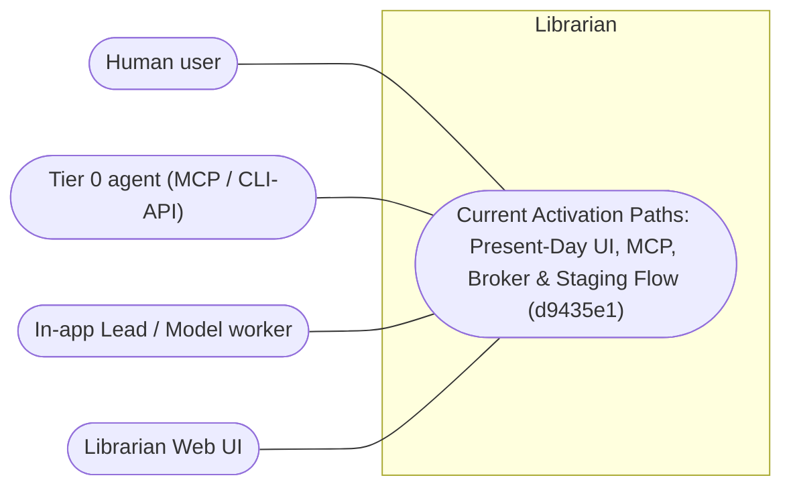

<!-- generated by build_and_validate_diagrams.py using accepted render_spec.py; edit the spec -->
# Current Activation Paths: Present-Day UI, MCP, Broker & Staging Flow (d9435e1)

**Status:** `IMPLEMENTED_VERIFIED` descriptive present-day behavioural specification at commit `d9435e1` (links to `batch-enrichment-current` and `source-enrichment-current`; preserves historical `DataManagement` `ingestion.canvas` unmodified). See [librarian-current-activation.md](librarian-current-activation.md) · [05-policy-and-behaviour-reconstruction.md](../05-policy-and-behaviour-reconstruction.md) · [Diagrams Index](README.md).

## Validation

No structural problems, cross-view flags, card overlaps, edge/card intersections, text overflows, ownership violations, or `_at_` spec clones.

## Use-case diagram



## Activity diagram

```mermaid
flowchart TD
  subgraph Human_user["Human user"]
    initiate["1. initiates via Web UI (Staging/Folders/Chat/workflow), instructs Tier 0 (Context 1), or runs ext-project build (Context 2)"]
    gate1_ui["5. reviews Staging (Which sources hides processing/accepted); approves Gate 1 & clicks Process approved"]
    dmanual_handover{"human takes over Gate 1 / Process approved in Web UI?"}
    gate2_ui["8. reviews enriched summary (F-09 conflict reload wipes edits) & clicks Accept; Folders/Lenses separate"]
    user_done["11. receives catalogued Source note in Search/Vault; Folders/Lenses/Topics remain separate on Staging"]
    user_paused["receives refusal, Ask timeout, or manual Staging handover requirement"]
    user_partial["receives partial/captured/queued/embedding_warnings result or unshown workflow outcome"]
    user_reused["receives reused catalogue note or Applications/ precedent without new batch dispatch"]
    user_esc["receives failure alert & retained sibling/staging state"]
  end
  subgraph Tier_0_agent_MCP_CLI_API_["Tier 0 agent (MCP / CLI-API)"]
    c1_call["calls MCP capped at contribute (0 folder MCP tools; process_approved refused) or actor=agent /api/tool CLI"]
    c2_call["calls search/read_source_section, delegate/dispatch_plan, queue_source, ingest, or record_application"]
    c2_deliver_reuse["delivers ext-project result + Applications/ link (no snapshot hashes/locators/verification schema)"]
    c2_deliver_partial["returns external workaround/gap notice & queued unresolved lead IDs to user"]
    c1_refusal["stops at TIER_REFUSED / THIRD_PARTY_ROUTE_REQUIRED / 150s PERMISSION_UNANSWERED; reports manual UI step"]
  end
  subgraph In_app_Lead_Model_worker["In-app Lead / Model worker"]
    chat_lead["handles UI Chat+Attach; calls tools & asks person tool-by-tool in Modes: Ask (no sprint envelope)"]
    c2_helpers["runs contribute read-only DeepInfra delegate / dispatch_plan DAGs with zero Ask prompt"]
    clerk_draft["4. drafts neutral summary via clerk_endpoint (slug/filename titles & Unfiled if <=1 topic remain)"]
  end
  subgraph Librarian_Web_UI["Librarian Web UI"]
    ui_intake["2. submits Add source (URL/arXiv/DOI/file) or /api/folders/* at curate tier (person_call bypasses Broker)"]
    ui_drop_result["app.js:8472 discards action_done.result (_result); updates staged state without workflow result drawer"]
    ui_done["10. shows ok banner & Search/Staging updates (manual Rewrite indexes if needed; no Oracle/Doctor runtime)"]
    ui_hold_notice["surfaces Ask prompt, refusal, F-09 reload conflict, or waiting/deferred Staging item"]
    ui_fail_notice["surfaces error banner or uncaught batch/write failure"]
  end
  subgraph Core["Core"]
    hist_note>"d9435e1 current-state map; links batch/source current contracts without retrofitting historical DataManagement ingestion.canvas."]
    dcontext{"which present-day activation surface & context enters Core?"}
    dchat_broker{"Broker check on Chat write call?"}
    ui_wf_start["starts background paperclip workflow at contribute with workflow_grant (read_access exempts deep_read only)"]
    dwf_route{"workflow step tier & third-party read route?"}
    wf_source_ref[["source-enrichment-current: executes current source-stage subset (deep-read-staged) under workflow_grant"]]
    wf_refused["fails action_done with TIER_REFUSED (curate op) or THIRD_PARTY_ROUTE_REQUIRED (non-deep_read)"]
    dc1_broker{"Context 1 tier, folder surface & Broker Ask check?"}
    dc2_gate{"Context 2 MCP tier & S1-S6b third-party check?"}
    dc2_outcome{"Context 2 source readiness & Applications/ path?"}
    c2_record_app["writes append-only Applications/ note (attested_by=agent, [[note]]) + project sidecar & queues unresolved_sources"]
    c2_queue_only["refuses empty sources_used (TypeError) or queues leads via queue_source without enrichment/acceptance"]
    capture_stage["3. captures Bronze .evidence/ or HTTP OP2 all-groups folder apply; restores _framing & writes staging"]
    dcap_curr{"capture outcome?"}
    reuse_curr["links already_held note or screened_out record without duplicate ingestion"]
    quar_curr["quarantines failed ref & enqueues settled queue entry for retry"]
    dgate1_auth{"Gate 1 approve & curate process_approved start authority?"}
    accept_captured["promotes captured/partial note with explicit coverage & not_examined list"]
    start_batch["6. validates curate person_call, single _LIVE lock & freezes mixed Source + Folder selection"]
    batch_ref[["7. batch-enrichment-current: dispatches frozen mixed batch via batch-enrichment-current (9 Source + 3 Folder stages)"]]
    dpartial_accept{"partial/failed item disposition & promotion mode?"}
    dgate2_curr{"Gate 2 decision & PromotionGuard CAS check?"}
    promote_curr["9. commits Sources/ note via PromotionGuard (200-file CAS), IndexGateway FTS, DA-3 & post-write vectors"]
    dfind_curr{"post-promotion catalogued & vector status?"}
  end
  s(("start"))
  e1((("Source catalogued & findable via current UI/batch path; pending tabs separate")))
  epartial((("completed with partial coverage, queued leads, or discarded workflow drawer")))
  ereused((("reused existing note, screened_out record, or Applications/ precedent")))
  epaused((("paused on Ask timeout, TIER_REFUSED, PERSON_CONFIRMS, F-09 conflict, or manual UI wait")))
  eescalated((("critical/uncaught write or batch failure escalated with retained state")))
  s --> hist_note
  hist_note --> initiate
  initiate --> dcontext
  dcontext -->|"[Context 3: direct Web UI Staging Add source / Folders (person_call, curate)]"| ui_intake
  dcontext -->|"[Context 3: Web UI Chat + Attach with in-app Lead (app.js:8924)] 1a"| chat_lead
  dcontext -->|"[Context 3: Web UI paperclip Run a workflow (App.start_action)] 1b"| ui_wf_start
  dcontext -->|"[Context 1: user directs Tier 0 agent (MCP / actor=agent API)] 1c"| c1_call
  dcontext -->|"[Context 2: external-project Tier 0 MCP during external build] 1d"| c2_call
  ui_intake --> capture_stage
  chat_lead --> dchat_broker
  dchat_broker -->|"[Auto mode or human clicks Allow in UI]"| capture_stage
  dchat_broker -->|"[Ask unanswered (600s park) or Plan PERMISSION_DENIED]"| ui_hold_notice
  ui_wf_start --> dwf_route
  dwf_route -->|"[deep-read-staged single-source workflow (read_access carveout)]"| wf_source_ref
  dwf_route -->|"[curate step or non-deep_read 3rd-party raw file]"| wf_refused
  wf_refused --> ui_hold_notice
  wf_source_ref -->|"[success]"| ui_drop_result
  wf_source_ref -->|"[partial]"| ui_drop_result
  wf_source_ref -->|"[reused]"| ui_drop_result
  wf_source_ref -->|"[paused]"| ui_hold_notice
  wf_source_ref -->|"[escalated]"| ui_fail_notice
  ui_drop_result --> user_partial
  c1_call --> dc1_broker
  dc1_broker -->|"[contribute ingest/intake_run permitted or HTTP/CLI intake]"| capture_stage
  dc1_broker -->|"[no MCP folder tools, Plan deny, or Ask 150s PERMISSION_UNANSWERED]"| c1_refusal
  c1_refusal --> user_paused
  c2_call --> dc2_gate
  dc2_gate -->|"[contribute delegate/dispatch_plan + S1-S6b reads]"| c2_helpers
  dc2_gate -->|"[consult delegate TIER_REFUSED or raw 3rd-party THIRD_PARTY_ROUTE_REQUIRED]"| c1_refusal
  c2_helpers --> dc2_outcome
  dc2_outcome -->|"[sources_used >= 1 catalogued & Broker write permitted]"| c2_record_app
  dc2_outcome -->|"[sources_used=[] TypeError or non-blocking queue_source]"| c2_queue_only
  dc2_outcome -->|"[contribute ingest captures missing ref into Staging]"| capture_stage
  dc2_outcome -->|"[Ask 150s PERMISSION_UNANSWERED on session/queue/application]"| c1_refusal
  c2_record_app --> c2_deliver_reuse
  c2_deliver_reuse --> user_reused
  c2_queue_only --> c2_deliver_partial
  c2_deliver_partial --> user_partial
  capture_stage --> dcap_curr
  dcap_curr -->|"[usable captured item]"| clerk_draft
  dcap_curr -->|"[already_held duplicate or screened_out] 3a"| reuse_curr
  dcap_curr -->|"[quarantined or capture error] 3b"| quar_curr
  reuse_curr --> user_reused
  quar_curr --> ui_hold_notice
  clerk_draft --> dgate1_auth
  dgate1_auth -->|"[Context 3 UI human approve + Process approved sources]"| gate1_ui
  dgate1_auth -->|"[Context 3 UI Accept as captured (skips batch)] 5a"| accept_captured
  dgate1_auth -->|"[MCP TIER_REFUSED on process_approved / PERSON_CONFIRMS / SENSITIVITY_REVIEW] 5b"| dmanual_handover
  dmanual_handover -->|"[human completes Gate 1 & clicks Process approved in UI]"| start_batch
  dmanual_handover -->|"[left waiting or deferred in Staging]"| ui_hold_notice
  gate1_ui --> start_batch
  start_batch --> batch_ref
  batch_ref -->|"[success]"| gate2_ui
  batch_ref -->|"[partial] 7a"| dpartial_accept
  batch_ref -->|"[reused] 7b"| reuse_curr
  batch_ref -->|"[paused] 7c"| ui_hold_notice
  batch_ref -->|"[escalated] 7d"| ui_fail_notice
  dpartial_accept -->|"[person accepts partial in UI (coverage=partial explicit)]"| accept_captured
  dpartial_accept -->|"[PERSON_CONFIRMS / SENSITIVITY_REVIEW / OP1 left unaccepted]"| ui_hold_notice
  accept_captured --> user_partial
  gate2_ui --> dgate2_curr
  dgate2_curr -->|"[Accept confirmed (curate or declared agent under promotion.mode=agent)]"| promote_curr
  dgate2_curr -->|"[Defer or Reject in Staging] 8a"| ui_hold_notice
  dgate2_curr -->|"[F-09 stale staged_revision or DOCUMENT_ACTIVE lease] 8b"| ui_hold_notice
  promote_curr --> dfind_curr
  dfind_curr -->|"[catalogued & vectors clean]"| ui_done
  dfind_curr -->|"[not_findable or embedding_warnings (note kept; manual Rewrite indexes)] 9a"| user_partial
  dfind_curr -->|"[uncaught write or index failure] 9b"| ui_fail_notice
  ui_done --> user_done
  user_done --> e1
  ui_hold_notice --> user_paused
  user_paused --> epaused
  user_partial --> epartial
  user_reused --> ereused
  ui_fail_notice --> user_esc
  user_esc --> eescalated
  classDef ext stroke:#d9534f,stroke-width:2px
```



## Written use case

**Main success scenario** (generated: the guard-true path, in step order)

1. The Human user initiates via Web UI (Staging/Folders/Chat/workflow), instructs Tier 0 (Context 1), or runs ext-project build (Context 2).
2. The Librarian Web UI submits Add source (URL/arXiv/DOI/file) or /api/folders/* at curate tier (person_call bypasses Broker).
3. The Core captures Bronze .evidence/ or HTTP OP2 all-groups folder apply; restores _framing & writes staging.
4. The In-app Lead / Model worker drafts neutral summary via clerk_endpoint (slug/filename titles & Unfiled if <=1 topic remain).
5. The Human user reviews Staging (Which sources hides processing/accepted); approves Gate 1 & clicks Process approved.
6. The Core validates curate person_call, single _LIVE lock & freezes mixed Source + Folder selection.
7. The Core dispatches frozen mixed batch via batch-enrichment-current (9 Source + 3 Folder stages).
8. The Human user reviews enriched summary (F-09 conflict reload wipes edits) & clicks Accept; Folders/Lenses separate.
9. The Core commits Sources/ note via PromotionGuard (200-file CAS), IndexGateway FTS, DA-3 & post-write vectors.
10. The Librarian Web UI shows ok banner & Search/Staging updates (manual Rewrite indexes if needed; no Oracle/Doctor runtime).
11. The Human user receives catalogued Source note in Search/Vault; Folders/Lenses/Topics remain separate on Staging.

**Extensions** (generated: one per non-happy guard; numbered by the step it leaves)

- **1a** (from: which present-day activation surface & context enters Core?) *anticipated*
  - `1a1` Context 3: Web UI Chat + Attach with in-app Lead (app.js:8924).
  - `1a2` The In-app Lead / Model worker handles UI Chat+Attach; calls tools & asks person tool-by-tool in Modes: Ask (no sprint envelope).
  - `1a3` The Core decides: Broker check on Chat write call?
  - `1a3a` If Ask unanswered (600s park) or Plan PERMISSION_DENIED: surfaces Ask prompt, refusal, F-09 reload conflict, or waiting/deferred Staging item.
  - `1a4` If Auto mode or human clicks Allow in UI:
  - `1a5` Rejoin at 3.
- **1b** (from: which present-day activation surface & context enters Core?) *anticipated*
  - `1b1` Context 3: Web UI paperclip Run a workflow (App.start_action).
  - `1b2` The Core starts background paperclip workflow at contribute with workflow_grant (read_access exempts deep_read only).
  - `1b3` The Core decides: workflow step tier & third-party read route?
  - `1b3a` If curate step or non-deep_read 3rd-party raw file: fails action_done with TIER_REFUSED (curate op) or THIRD_PARTY_ROUTE_REQUIRED (non-deep_read).
  - `1b4` If deep-read-staged single-source workflow (read_access carveout):
  - `1b5` The Core executes current source-stage subset (deep-read-staged) under workflow_grant (continues in source-enrichment-current).
  - `1b5a` If partial: app.js:8472 discards action_done.result (_result); updates staged state without workflow result drawer.
  - `1b5a` If reused: app.js:8472 discards action_done.result (_result); updates staged state without workflow result drawer.
  - `1b5a` If paused: surfaces Ask prompt, refusal, F-09 reload conflict, or waiting/deferred Staging item.
  - `1b5a` If escalated: surfaces error banner or uncaught batch/write failure.
  - `1b6` If success:
  - `1b7` The Librarian Web UI app.js:8472 discards action_done.result (_result); updates staged state without workflow result drawer.
  - `1b8` The Human user receives partial/captured/queued/embedding_warnings result or unshown workflow outcome.
  - `1b9` The use case ends: completed with partial coverage, queued leads, or discarded workflow drawer.
- **1c** (from: which present-day activation surface & context enters Core?) *anticipated*
  - `1c1` Context 1: user directs Tier 0 agent (MCP / actor=agent API).
  - `1c2` The Tier 0 agent (MCP / CLI-API) calls MCP capped at contribute (0 folder MCP tools; process_approved refused) or actor=agent /api/tool CLI.
  - `1c3` The Core decides: Context 1 tier, folder surface & Broker Ask check?
  - `1c3a` If no MCP folder tools, Plan deny, or Ask 150s PERMISSION_UNANSWERED: stops at TIER_REFUSED / THIRD_PARTY_ROUTE_REQUIRED / 150s PERMISSION_UNANSWERED; reports manual UI step.
  - `1c4` If contribute ingest/intake_run permitted or HTTP/CLI intake:
  - `1c5` Rejoin at 3.
- **1d** (from: which present-day activation surface & context enters Core?) *anticipated*
  - `1d1` Context 2: external-project Tier 0 MCP during external build.
  - `1d2` The Tier 0 agent (MCP / CLI-API) calls search/read_source_section, delegate/dispatch_plan, queue_source, ingest, or record_application.
  - `1d3` The Core decides: Context 2 MCP tier & S1-S6b third-party check?
  - `1d3a` If consult delegate TIER_REFUSED or raw 3rd-party THIRD_PARTY_ROUTE_REQUIRED: stops at TIER_REFUSED / THIRD_PARTY_ROUTE_REQUIRED / 150s PERMISSION_UNANSWERED; reports manual UI step.
  - `1d4` If contribute delegate/dispatch_plan + S1-S6b reads:
  - `1d5` The In-app Lead / Model worker runs contribute read-only DeepInfra delegate / dispatch_plan DAGs with zero Ask prompt.
  - `1d6` The Core decides: Context 2 source readiness & Applications/ path?
  - `1d6a` If sources_used=[] TypeError or non-blocking queue_source: refuses empty sources_used (TypeError) or queues leads via queue_source without enrichment/acceptance.
  - `1d6a` If contribute ingest captures missing ref into Staging: rejoin at 3.
  - `1d6a` If Ask 150s PERMISSION_UNANSWERED on session/queue/application: stops at TIER_REFUSED / THIRD_PARTY_ROUTE_REQUIRED / 150s PERMISSION_UNANSWERED; reports manual UI step.
  - `1d7` If sources_used >= 1 catalogued & Broker write permitted:
  - `1d8` The Core writes append-only Applications/ note (attested_by=agent, [[note]]) + project sidecar & queues unresolved_sources.
  - `1d9` The Tier 0 agent (MCP / CLI-API) delivers ext-project result + Applications/ link (no snapshot hashes/locators/verification schema).
  - `1d10` The Human user receives reused catalogue note or Applications/ precedent without new batch dispatch.
  - `1d11` The use case ends: reused existing note, screened_out record, or Applications/ precedent.
- **3a** (from: capture outcome?) *anticipated*
  - `3a1` Already_held duplicate or screened_out.
  - `3a2` The Core links already_held note or screened_out record without duplicate ingestion.
  - `3a3` The Human user receives reused catalogue note or Applications/ precedent without new batch dispatch.
  - `3a4` The use case ends: reused existing note, screened_out record, or Applications/ precedent.
- **3b** (from: capture outcome?) *anticipated*
  - `3b1` Quarantined or capture error.
  - `3b2` The Core quarantines failed ref & enqueues settled queue entry for retry.
  - `3b3` The Librarian Web UI surfaces Ask prompt, refusal, F-09 reload conflict, or waiting/deferred Staging item.
  - `3b4` The Human user receives refusal, Ask timeout, or manual Staging handover requirement.
  - `3b5` The use case ends: paused on Ask timeout, TIER_REFUSED, PERSON_CONFIRMS, F-09 conflict, or manual UI wait.
- **5a** (from: Gate 1 approve & curate process_approved start authority?) *anticipated*
  - `5a1` Context 3 UI Accept as captured (skips batch).
  - `5a2` The Core promotes captured/partial note with explicit coverage & not_examined list.
  - `5a3` The Human user receives partial/captured/queued/embedding_warnings result or unshown workflow outcome.
  - `5a4` The use case ends: completed with partial coverage, queued leads, or discarded workflow drawer.
- **5b** (from: Gate 1 approve & curate process_approved start authority?) *anticipated*
  - `5b1` MCP TIER_REFUSED on process_approved / PERSON_CONFIRMS / SENSITIVITY_REVIEW.
  - `5b2` The Human user decides: human takes over Gate 1 / Process approved in Web UI?
  - `5b2a` If left waiting or deferred in Staging: surfaces Ask prompt, refusal, F-09 reload conflict, or waiting/deferred Staging item.
  - `5b3` If human completes Gate 1 & clicks Process approved in UI:
  - `5b4` Rejoin at 6.
- **7a** (from: dispatches frozen mixed batch via batch-enrichment-current (9 Source + 3 Folder stages)) *anticipated*
  - `7a1` Partial.
  - `7a2` The Core decides: partial/failed item disposition & promotion mode?
  - `7a2a` If PERSON_CONFIRMS / SENSITIVITY_REVIEW / OP1 left unaccepted: surfaces Ask prompt, refusal, F-09 reload conflict, or waiting/deferred Staging item.
  - `7a3` If person accepts partial in UI (coverage=partial explicit):
  - `7a4` The Core promotes captured/partial note with explicit coverage & not_examined list.
  - `7a5` The Human user receives partial/captured/queued/embedding_warnings result or unshown workflow outcome.
  - `7a6` The use case ends: completed with partial coverage, queued leads, or discarded workflow drawer.
- **7b** (from: dispatches frozen mixed batch via batch-enrichment-current (9 Source + 3 Folder stages)) *anticipated*
  - `7b1` Reused.
  - `7b2` The Core links already_held note or screened_out record without duplicate ingestion.
  - `7b3` The Human user receives reused catalogue note or Applications/ precedent without new batch dispatch.
  - `7b4` The use case ends: reused existing note, screened_out record, or Applications/ precedent.
- **7c** (from: dispatches frozen mixed batch via batch-enrichment-current (9 Source + 3 Folder stages)) *anticipated*
  - `7c1` Paused.
  - `7c2` The Librarian Web UI surfaces Ask prompt, refusal, F-09 reload conflict, or waiting/deferred Staging item.
  - `7c3` The Human user receives refusal, Ask timeout, or manual Staging handover requirement.
  - `7c4` The use case ends: paused on Ask timeout, TIER_REFUSED, PERSON_CONFIRMS, F-09 conflict, or manual UI wait.
- **7d** (from: dispatches frozen mixed batch via batch-enrichment-current (9 Source + 3 Folder stages)) *anticipated*
  - `7d1` Escalated.
  - `7d2` The Librarian Web UI surfaces error banner or uncaught batch/write failure.
  - `7d3` The Human user receives failure alert & retained sibling/staging state.
  - `7d4` The use case ends: critical/uncaught write or batch failure escalated with retained state.
- **8a** (from: Gate 2 decision & PromotionGuard CAS check?) *anticipated*
  - `8a1` Defer or Reject in Staging.
  - `8a2` The Librarian Web UI surfaces Ask prompt, refusal, F-09 reload conflict, or waiting/deferred Staging item.
  - `8a3` The Human user receives refusal, Ask timeout, or manual Staging handover requirement.
  - `8a4` The use case ends: paused on Ask timeout, TIER_REFUSED, PERSON_CONFIRMS, F-09 conflict, or manual UI wait.
- **8b** (from: Gate 2 decision & PromotionGuard CAS check?) *anticipated*
  - `8b1` F-09 stale staged_revision or DOCUMENT_ACTIVE lease.
  - `8b2` The Librarian Web UI surfaces Ask prompt, refusal, F-09 reload conflict, or waiting/deferred Staging item.
  - `8b3` The Human user receives refusal, Ask timeout, or manual Staging handover requirement.
  - `8b4` The use case ends: paused on Ask timeout, TIER_REFUSED, PERSON_CONFIRMS, F-09 conflict, or manual UI wait.
- **9a** (from: post-promotion catalogued & vector status?) *anticipated*
  - `9a1` Not_findable or embedding_warnings (note kept; manual Rewrite indexes).
  - `9a2` The Human user receives partial/captured/queued/embedding_warnings result or unshown workflow outcome.
  - `9a3` The use case ends: completed with partial coverage, queued leads, or discarded workflow drawer.
- **9b** (from: post-promotion catalogued & vector status?) *anticipated*
  - `9b1` Uncaught write or index failure.
  - `9b2` The Librarian Web UI surfaces error banner or uncaught batch/write failure.
  - `9b3` The Human user receives failure alert & retained sibling/staging state.
  - `9b4` The use case ends: critical/uncaught write or batch failure escalated with retained state.

## Lane load

| Lane | On the main success scenario | Anywhere in the diagram |
|---|---|---|
| Human user | 4 | 9 |
| Tier 0 agent (MCP / CLI-API) | 0 | 5 |
| In-app Lead / Model worker | 1 | 3 |
| Librarian Web UI | 2 | 5 |
| Core | 9 | 23 |

**Tier-0 turns** (each return of control to tier 0; owner's scale: 2 ideal, 3 expected, 4 rusty, 5–10 bad, more: might as well have done it themselves). Main success scenario: **0 (ideal)**. Worst path: T16, **2 (ideal)**. Paths by grade: ideal 27; escalated 3 (failures, not graded).

Paths by how they end: **escalated** 3, **partial** 7, **paused** 12, **reused** 3, **success** 1. Every *escalated* path is a failure of this use case: the work went back to tier 0.

## Decision tree with 30 extension scenarios

```text
start: Current Activation Paths: Present-Day UI, MCP, Broker & Staging Flow (d9435e1)
            └─ T1: Context 3: direct Web UI Staging Add source / Folders (person_call, curate) / usable captured item / Context 3 UI human approve + Process approved sources / success / Accept confirmed (curate or declared agent under promotion.mode=agent) / catalogued & vectors clean  ⇒ Source catalogued & findable via current UI/batch path; pending tabs separate
    └─ T2: Context 3: Web UI Chat + Attach with in-app Lead (app.js:8924) / Ask unanswered (600s park) or Plan PERMISSION_DENIED  ⇒ paused on Ask timeout, TIER_REFUSED, PERSON_CONFIRMS, F-09 conflict, or manual UI wait
    └─ T3: Context 3: Web UI Chat + Attach with in-app Lead (app.js:8924) / Auto mode or human clicks Allow in UI  ⇒ rejoins at step 3
    └─ T4: Context 3: Web UI paperclip Run a workflow (App.start_action) / curate step or non-deep_read 3rd-party raw file  ⇒ paused on Ask timeout, TIER_REFUSED, PERSON_CONFIRMS, F-09 conflict, or manual UI wait
      └─ T5: Context 3: Web UI paperclip Run a workflow (App.start_action) / deep-read-staged single-source workflow (read_access carveout) / partial  ⇒ completed with partial coverage, queued leads, or discarded workflow drawer
      └─ T6: Context 3: Web UI paperclip Run a workflow (App.start_action) / deep-read-staged single-source workflow (read_access carveout) / reused  ⇒ completed with partial coverage, queued leads, or discarded workflow drawer
      └─ T7: Context 3: Web UI paperclip Run a workflow (App.start_action) / deep-read-staged single-source workflow (read_access carveout) / paused  ⇒ paused on Ask timeout, TIER_REFUSED, PERSON_CONFIRMS, F-09 conflict, or manual UI wait
      └─ T8: Context 3: Web UI paperclip Run a workflow (App.start_action) / deep-read-staged single-source workflow (read_access carveout) / escalated  ⇒ critical/uncaught write or batch failure escalated with retained state
      └─ T9: Context 3: Web UI paperclip Run a workflow (App.start_action) / deep-read-staged single-source workflow (read_access carveout) / success  ⇒ completed with partial coverage, queued leads, or discarded workflow drawer
    └─ T10: Context 1: user directs Tier 0 agent (MCP / actor=agent API) / no MCP folder tools, Plan deny, or Ask 150s PERMISSION_UNANSWERED  ⇒ paused on Ask timeout, TIER_REFUSED, PERSON_CONFIRMS, F-09 conflict, or manual UI wait
    └─ T11: Context 1: user directs Tier 0 agent (MCP / actor=agent API) / contribute ingest/intake_run permitted or HTTP/CLI intake  ⇒ rejoins at step 3
    └─ T12: Context 2: external-project Tier 0 MCP during external build / consult delegate TIER_REFUSED or raw 3rd-party THIRD_PARTY_ROUTE_REQUIRED  ⇒ paused on Ask timeout, TIER_REFUSED, PERSON_CONFIRMS, F-09 conflict, or manual UI wait
      └─ T13: Context 2: external-project Tier 0 MCP during external build / contribute delegate/dispatch_plan + S1-S6b reads / sources_used=[] TypeError or non-blocking queue_source  ⇒ completed with partial coverage, queued leads, or discarded workflow drawer
      └─ T14: Context 2: external-project Tier 0 MCP during external build / contribute delegate/dispatch_plan + S1-S6b reads / contribute ingest captures missing ref into Staging  ⇒ rejoins at step 3
      └─ T15: Context 2: external-project Tier 0 MCP during external build / contribute delegate/dispatch_plan + S1-S6b reads / Ask 150s PERMISSION_UNANSWERED on session/queue/application  ⇒ paused on Ask timeout, TIER_REFUSED, PERSON_CONFIRMS, F-09 conflict, or manual UI wait
      └─ T16: Context 2: external-project Tier 0 MCP during external build / contribute delegate/dispatch_plan + S1-S6b reads / sources_used >= 1 catalogued & Broker write permitted  ⇒ reused existing note, screened_out record, or Applications/ precedent
    └─ T17: Context 3: direct Web UI Staging Add source / Folders (person_call, curate) / already_held duplicate or screened_out  ⇒ reused existing note, screened_out record, or Applications/ precedent
    └─ T18: Context 3: direct Web UI Staging Add source / Folders (person_call, curate) / quarantined or capture error  ⇒ paused on Ask timeout, TIER_REFUSED, PERSON_CONFIRMS, F-09 conflict, or manual UI wait
      └─ T19: Context 3: direct Web UI Staging Add source / Folders (person_call, curate) / usable captured item / Context 3 UI Accept as captured (skips batch)  ⇒ completed with partial coverage, queued leads, or discarded workflow drawer
        └─ T20: Context 3: direct Web UI Staging Add source / Folders (person_call, curate) / usable captured item / MCP TIER_REFUSED on process_approved / PERSON_CONFIRMS / SENSITIVITY_REVIEW / left waiting or deferred in Staging  ⇒ paused on Ask timeout, TIER_REFUSED, PERSON_CONFIRMS, F-09 conflict, or manual UI wait
        └─ T21: Context 3: direct Web UI Staging Add source / Folders (person_call, curate) / usable captured item / MCP TIER_REFUSED on process_approved / PERSON_CONFIRMS / SENSITIVITY_REVIEW / human completes Gate 1 & clicks Process approved in UI  ⇒ rejoins at step 6
          └─ T22: Context 3: direct Web UI Staging Add source / Folders (person_call, curate) / usable captured item / Context 3 UI human approve + Process approved sources / partial / PERSON_CONFIRMS / SENSITIVITY_REVIEW / OP1 left unaccepted  ⇒ paused on Ask timeout, TIER_REFUSED, PERSON_CONFIRMS, F-09 conflict, or manual UI wait
          └─ T23: Context 3: direct Web UI Staging Add source / Folders (person_call, curate) / usable captured item / Context 3 UI human approve + Process approved sources / partial / person accepts partial in UI (coverage=partial explicit)  ⇒ completed with partial coverage, queued leads, or discarded workflow drawer
        └─ T24: Context 3: direct Web UI Staging Add source / Folders (person_call, curate) / usable captured item / Context 3 UI human approve + Process approved sources / reused  ⇒ reused existing note, screened_out record, or Applications/ precedent
        └─ T25: Context 3: direct Web UI Staging Add source / Folders (person_call, curate) / usable captured item / Context 3 UI human approve + Process approved sources / paused  ⇒ paused on Ask timeout, TIER_REFUSED, PERSON_CONFIRMS, F-09 conflict, or manual UI wait
        └─ T26: Context 3: direct Web UI Staging Add source / Folders (person_call, curate) / usable captured item / Context 3 UI human approve + Process approved sources / escalated  ⇒ critical/uncaught write or batch failure escalated with retained state
          └─ T27: Context 3: direct Web UI Staging Add source / Folders (person_call, curate) / usable captured item / Context 3 UI human approve + Process approved sources / success / Defer or Reject in Staging  ⇒ paused on Ask timeout, TIER_REFUSED, PERSON_CONFIRMS, F-09 conflict, or manual UI wait
          └─ T28: Context 3: direct Web UI Staging Add source / Folders (person_call, curate) / usable captured item / Context 3 UI human approve + Process approved sources / success / F-09 stale staged_revision or DOCUMENT_ACTIVE lease  ⇒ paused on Ask timeout, TIER_REFUSED, PERSON_CONFIRMS, F-09 conflict, or manual UI wait
            └─ T29: Context 3: direct Web UI Staging Add source / Folders (person_call, curate) / usable captured item / Context 3 UI human approve + Process approved sources / success / Accept confirmed (curate or declared agent under promotion.mode=agent) / not_findable or embedding_warnings (note kept; manual Rewrite indexes)  ⇒ completed with partial coverage, queued leads, or discarded workflow drawer
            └─ T30: Context 3: direct Web UI Staging Add source / Folders (person_call, curate) / usable captured item / Context 3 UI human approve + Process approved sources / success / Accept confirmed (curate or declared agent under promotion.mode=agent) / uncaught write or index failure  ⇒ critical/uncaught write or batch failure escalated with retained state
```

## Scenario test table

| Test | Path (guards taken) | Extension | Expected outcome | Tier-0 turns |
|---|---|---|---|---|
| T1 | which present-day activation surface & context enters Core? → Context 3: direct Web UI Staging Add source / Folders (person_call, curate); capture outcome? → usable captured item; Gate 1 approve & curate process_approved start authority? → Context 3 UI human approve + Process approved sources; dispatches frozen mixed batch via batch-enrichment-current (9 Source + 3 Folder stages) → success; Gate 2 decision & PromotionGuard CAS check? → Accept confirmed (curate or declared agent under promotion.mode=agent); post-promotion catalogued & vector status? → catalogued & vectors clean | MSS | Source catalogued & findable via current UI/batch path; pending tabs separate | 0 (ideal) |
| T2 | which present-day activation surface & context enters Core? → Context 3: Web UI Chat + Attach with in-app Lead (app.js:8924); Broker check on Chat write call? → Ask unanswered (600s park) or Plan PERMISSION_DENIED | 1a | paused on Ask timeout, TIER_REFUSED, PERSON_CONFIRMS, F-09 conflict, or manual UI wait | 0 (ideal) |
| T3 | which present-day activation surface & context enters Core? → Context 3: Web UI Chat + Attach with in-app Lead (app.js:8924); Broker check on Chat write call? → Auto mode or human clicks Allow in UI | 1a | rejoins at step 3 | 0 (ideal) |
| T4 | which present-day activation surface & context enters Core? → Context 3: Web UI paperclip Run a workflow (App.start_action); workflow step tier & third-party read route? → curate step or non-deep_read 3rd-party raw file | 1b | paused on Ask timeout, TIER_REFUSED, PERSON_CONFIRMS, F-09 conflict, or manual UI wait | 0 (ideal) |
| T5 | which present-day activation surface & context enters Core? → Context 3: Web UI paperclip Run a workflow (App.start_action); workflow step tier & third-party read route? → deep-read-staged single-source workflow (read_access carveout); executes current source-stage subset (deep-read-staged) under workflow_grant → partial | 1b | completed with partial coverage, queued leads, or discarded workflow drawer | 0 (ideal) |
| T6 | which present-day activation surface & context enters Core? → Context 3: Web UI paperclip Run a workflow (App.start_action); workflow step tier & third-party read route? → deep-read-staged single-source workflow (read_access carveout); executes current source-stage subset (deep-read-staged) under workflow_grant → reused | 1b | completed with partial coverage, queued leads, or discarded workflow drawer | 0 (ideal) |
| T7 | which present-day activation surface & context enters Core? → Context 3: Web UI paperclip Run a workflow (App.start_action); workflow step tier & third-party read route? → deep-read-staged single-source workflow (read_access carveout); executes current source-stage subset (deep-read-staged) under workflow_grant → paused | 1b | paused on Ask timeout, TIER_REFUSED, PERSON_CONFIRMS, F-09 conflict, or manual UI wait | 0 (ideal) |
| T8 | which present-day activation surface & context enters Core? → Context 3: Web UI paperclip Run a workflow (App.start_action); workflow step tier & third-party read route? → deep-read-staged single-source workflow (read_access carveout); executes current source-stage subset (deep-read-staged) under workflow_grant → escalated | 1b | critical/uncaught write or batch failure escalated with retained state | 0 (escalated: a failure) |
| T9 | which present-day activation surface & context enters Core? → Context 3: Web UI paperclip Run a workflow (App.start_action); workflow step tier & third-party read route? → deep-read-staged single-source workflow (read_access carveout); executes current source-stage subset (deep-read-staged) under workflow_grant → success | 1b | completed with partial coverage, queued leads, or discarded workflow drawer | 0 (ideal) |
| T10 | which present-day activation surface & context enters Core? → Context 1: user directs Tier 0 agent (MCP / actor=agent API); Context 1 tier, folder surface & Broker Ask check? → no MCP folder tools, Plan deny, or Ask 150s PERMISSION_UNANSWERED | 1c | paused on Ask timeout, TIER_REFUSED, PERSON_CONFIRMS, F-09 conflict, or manual UI wait | 2 (ideal) |
| T11 | which present-day activation surface & context enters Core? → Context 1: user directs Tier 0 agent (MCP / actor=agent API); Context 1 tier, folder surface & Broker Ask check? → contribute ingest/intake_run permitted or HTTP/CLI intake | 1c | rejoins at step 3 | 1 (ideal) |
| T12 | which present-day activation surface & context enters Core? → Context 2: external-project Tier 0 MCP during external build; Context 2 MCP tier & S1-S6b third-party check? → consult delegate TIER_REFUSED or raw 3rd-party THIRD_PARTY_ROUTE_REQUIRED | 1d | paused on Ask timeout, TIER_REFUSED, PERSON_CONFIRMS, F-09 conflict, or manual UI wait | 2 (ideal) |
| T13 | which present-day activation surface & context enters Core? → Context 2: external-project Tier 0 MCP during external build; Context 2 MCP tier & S1-S6b third-party check? → contribute delegate/dispatch_plan + S1-S6b reads; Context 2 source readiness & Applications/ path? → sources_used=[] TypeError or non-blocking queue_source | 1d | completed with partial coverage, queued leads, or discarded workflow drawer | 2 (ideal) |
| T14 | which present-day activation surface & context enters Core? → Context 2: external-project Tier 0 MCP during external build; Context 2 MCP tier & S1-S6b third-party check? → contribute delegate/dispatch_plan + S1-S6b reads; Context 2 source readiness & Applications/ path? → contribute ingest captures missing ref into Staging | 1d | rejoins at step 3 | 1 (ideal) |
| T15 | which present-day activation surface & context enters Core? → Context 2: external-project Tier 0 MCP during external build; Context 2 MCP tier & S1-S6b third-party check? → contribute delegate/dispatch_plan + S1-S6b reads; Context 2 source readiness & Applications/ path? → Ask 150s PERMISSION_UNANSWERED on session/queue/application | 1d | paused on Ask timeout, TIER_REFUSED, PERSON_CONFIRMS, F-09 conflict, or manual UI wait | 2 (ideal) |
| T16 | which present-day activation surface & context enters Core? → Context 2: external-project Tier 0 MCP during external build; Context 2 MCP tier & S1-S6b third-party check? → contribute delegate/dispatch_plan + S1-S6b reads; Context 2 source readiness & Applications/ path? → sources_used >= 1 catalogued & Broker write permitted | 1d | reused existing note, screened_out record, or Applications/ precedent | 2 (ideal) |
| T17 | which present-day activation surface & context enters Core? → Context 3: direct Web UI Staging Add source / Folders (person_call, curate); capture outcome? → already_held duplicate or screened_out | 3a | reused existing note, screened_out record, or Applications/ precedent | 0 (ideal) |
| T18 | which present-day activation surface & context enters Core? → Context 3: direct Web UI Staging Add source / Folders (person_call, curate); capture outcome? → quarantined or capture error | 3b | paused on Ask timeout, TIER_REFUSED, PERSON_CONFIRMS, F-09 conflict, or manual UI wait | 0 (ideal) |
| T19 | which present-day activation surface & context enters Core? → Context 3: direct Web UI Staging Add source / Folders (person_call, curate); capture outcome? → usable captured item; Gate 1 approve & curate process_approved start authority? → Context 3 UI Accept as captured (skips batch) | 5a | completed with partial coverage, queued leads, or discarded workflow drawer | 0 (ideal) |
| T20 | which present-day activation surface & context enters Core? → Context 3: direct Web UI Staging Add source / Folders (person_call, curate); capture outcome? → usable captured item; Gate 1 approve & curate process_approved start authority? → MCP TIER_REFUSED on process_approved / PERSON_CONFIRMS / SENSITIVITY_REVIEW; human takes over Gate 1 / Process approved in Web UI? → left waiting or deferred in Staging | 5b | paused on Ask timeout, TIER_REFUSED, PERSON_CONFIRMS, F-09 conflict, or manual UI wait | 0 (ideal) |
| T21 | which present-day activation surface & context enters Core? → Context 3: direct Web UI Staging Add source / Folders (person_call, curate); capture outcome? → usable captured item; Gate 1 approve & curate process_approved start authority? → MCP TIER_REFUSED on process_approved / PERSON_CONFIRMS / SENSITIVITY_REVIEW; human takes over Gate 1 / Process approved in Web UI? → human completes Gate 1 & clicks Process approved in UI | 5b | rejoins at step 6 | 0 (ideal) |
| T22 | which present-day activation surface & context enters Core? → Context 3: direct Web UI Staging Add source / Folders (person_call, curate); capture outcome? → usable captured item; Gate 1 approve & curate process_approved start authority? → Context 3 UI human approve + Process approved sources; dispatches frozen mixed batch via batch-enrichment-current (9 Source + 3 Folder stages) → partial; partial/failed item disposition & promotion mode? → PERSON_CONFIRMS / SENSITIVITY_REVIEW / OP1 left unaccepted | 7a | paused on Ask timeout, TIER_REFUSED, PERSON_CONFIRMS, F-09 conflict, or manual UI wait | 0 (ideal) |
| T23 | which present-day activation surface & context enters Core? → Context 3: direct Web UI Staging Add source / Folders (person_call, curate); capture outcome? → usable captured item; Gate 1 approve & curate process_approved start authority? → Context 3 UI human approve + Process approved sources; dispatches frozen mixed batch via batch-enrichment-current (9 Source + 3 Folder stages) → partial; partial/failed item disposition & promotion mode? → person accepts partial in UI (coverage=partial explicit) | 7a | completed with partial coverage, queued leads, or discarded workflow drawer | 0 (ideal) |
| T24 | which present-day activation surface & context enters Core? → Context 3: direct Web UI Staging Add source / Folders (person_call, curate); capture outcome? → usable captured item; Gate 1 approve & curate process_approved start authority? → Context 3 UI human approve + Process approved sources; dispatches frozen mixed batch via batch-enrichment-current (9 Source + 3 Folder stages) → reused | 7b | reused existing note, screened_out record, or Applications/ precedent | 0 (ideal) |
| T25 | which present-day activation surface & context enters Core? → Context 3: direct Web UI Staging Add source / Folders (person_call, curate); capture outcome? → usable captured item; Gate 1 approve & curate process_approved start authority? → Context 3 UI human approve + Process approved sources; dispatches frozen mixed batch via batch-enrichment-current (9 Source + 3 Folder stages) → paused | 7c | paused on Ask timeout, TIER_REFUSED, PERSON_CONFIRMS, F-09 conflict, or manual UI wait | 0 (ideal) |
| T26 | which present-day activation surface & context enters Core? → Context 3: direct Web UI Staging Add source / Folders (person_call, curate); capture outcome? → usable captured item; Gate 1 approve & curate process_approved start authority? → Context 3 UI human approve + Process approved sources; dispatches frozen mixed batch via batch-enrichment-current (9 Source + 3 Folder stages) → escalated | 7d | critical/uncaught write or batch failure escalated with retained state | 0 (escalated: a failure) |
| T27 | which present-day activation surface & context enters Core? → Context 3: direct Web UI Staging Add source / Folders (person_call, curate); capture outcome? → usable captured item; Gate 1 approve & curate process_approved start authority? → Context 3 UI human approve + Process approved sources; dispatches frozen mixed batch via batch-enrichment-current (9 Source + 3 Folder stages) → success; Gate 2 decision & PromotionGuard CAS check? → Defer or Reject in Staging | 8a | paused on Ask timeout, TIER_REFUSED, PERSON_CONFIRMS, F-09 conflict, or manual UI wait | 0 (ideal) |
| T28 | which present-day activation surface & context enters Core? → Context 3: direct Web UI Staging Add source / Folders (person_call, curate); capture outcome? → usable captured item; Gate 1 approve & curate process_approved start authority? → Context 3 UI human approve + Process approved sources; dispatches frozen mixed batch via batch-enrichment-current (9 Source + 3 Folder stages) → success; Gate 2 decision & PromotionGuard CAS check? → F-09 stale staged_revision or DOCUMENT_ACTIVE lease | 8b | paused on Ask timeout, TIER_REFUSED, PERSON_CONFIRMS, F-09 conflict, or manual UI wait | 0 (ideal) |
| T29 | which present-day activation surface & context enters Core? → Context 3: direct Web UI Staging Add source / Folders (person_call, curate); capture outcome? → usable captured item; Gate 1 approve & curate process_approved start authority? → Context 3 UI human approve + Process approved sources; dispatches frozen mixed batch via batch-enrichment-current (9 Source + 3 Folder stages) → success; Gate 2 decision & PromotionGuard CAS check? → Accept confirmed (curate or declared agent under promotion.mode=agent); post-promotion catalogued & vector status? → not_findable or embedding_warnings (note kept; manual Rewrite indexes) | 9a | completed with partial coverage, queued leads, or discarded workflow drawer | 0 (ideal) |
| T30 | which present-day activation surface & context enters Core? → Context 3: direct Web UI Staging Add source / Folders (person_call, curate); capture outcome? → usable captured item; Gate 1 approve & curate process_approved start authority? → Context 3 UI human approve + Process approved sources; dispatches frozen mixed batch via batch-enrichment-current (9 Source + 3 Folder stages) → success; Gate 2 decision & PromotionGuard CAS check? → Accept confirmed (curate or declared agent under promotion.mode=agent); post-promotion catalogued & vector status? → uncaught write or index failure | 9b | critical/uncaught write or batch failure escalated with retained state | 0 (escalated: a failure) |

_Note: Scenario tests verify static graph reachability and path coverage of this descriptive current-state model only; live behaviour is verified separately against `d9435e1` code anchors in [librarian-current-activation.md](librarian-current-activation.md)._
