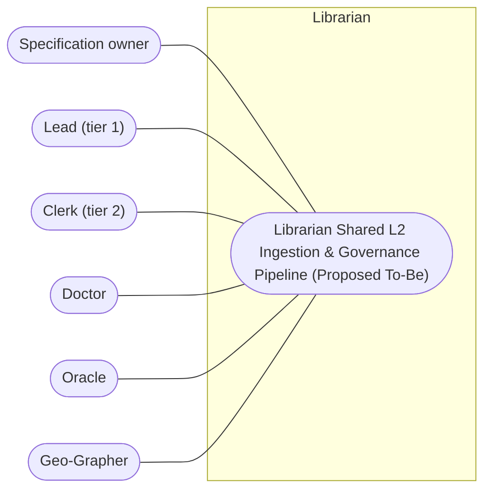

<!-- generated by build_and_validate_diagrams.py using accepted render_spec.py; edit the spec -->
# Librarian Shared L2 Ingestion & Governance Pipeline (Proposed To-Be)

**Status:** `PROPOSED_UNACCEPTED` refined to-be behavioral specification (clone-free YAML; NOT accepted by Owner and NOT implemented in runtime code). See [05-policy-and-behaviour-reconstruction.md](../05-policy-and-behaviour-reconstruction.md) · [03-proposed-librarian-tobe.md](../03-proposed-librarian-tobe.md) · [Diagrams Index](README.md).

## Validation

No structural problems, cross-view flags, card overlaps, edge/card intersections, text overflows, ownership violations, or `_at_` spec clones.

## Use-case diagram



## Activity diagram

```mermaid
flowchart TD
  subgraph Specification_owner["Specification owner"]
    ownerfolder{"Owner reserved folder choice?"}
    ownergate1{"approve & start batch?"}
    ownergate2{"consolidated independent Folder/Source/Lens/Topic choices?"}
    notifyowner["20. receives verified catalogue result, spend, deferred work & notification payload"]
    notifypartial["receives truthful partial result, not_examined list, spend & Agenda resume Tickets"]
  end
  subgraph Lead_tier_1_["Lead (tier 1)"]
    leadbind["2. owns L2 sub-run spec (sub_spec_owner=lead_tier1 <= parent) & narrowed grant envelope"]
    leadfolder["5. approves in-scope folders (Context 1 commission or standing policy); applies exclusions"]
    leadaccept["15. accepts in-scope Sources & cards (decided_by=agent; preserves flags); defers OD-05/reserved items"]
    deliver["18. packages Oracle verdict, evidence hashes, spend, coverage, deferred tabs & Agenda Tickets"]
    pauseout["returns held gate/ORACLE_ROUTE_COLLISION Ticket, spend, F-02/F-03 refusal, or resume path"]
    escout["routes critical/unresolved Ticket immediately with flags, hashes & Rule-8 compensation"]
  end
  subgraph Clerk_tier_2_["Clerk (tier 2)"]
    folderscreen["4. screens only new/ambiguous folders for purpose, unlicensed third-party risk & sensitivity (docs unread)"]
    describe["9. proposes W8 human-readable Source title (when literal header is slug/filename), neutral Silver description, semantic fields (Unknown if unsupported) & W8 topics"]
  end
  subgraph Doctor["Doctor"]
    doctorroot[["librarian-doctor-tobe: attempts scoped R1/R2 Ticket recovery (GLM-5.3 isolated adapter; single-pass)"]]
    doctorgeo[["librarian-doctor-tobe: runs bounded group/service Ticket recovery without global rebuild"]]
    doctorbatch[["librarian-doctor-tobe: runs bounded R4 partial/publish Ticket repair on affected subset"]]
    doctorphase[["librarian-doctor-tobe: repairs candidate index/findability (R5) or mapped parent Ticket"]]
  end
  subgraph Oracle["Oracle"]
    oraclecov{"degraded parse within caller tolerance?"}
    oraclebatch["14. screens batch outputs, partial gaps & Geo receipts via distinct qualified Oracle route (GLM-5.3 current adapter)"]
    dbatchscreen{"pre-promotion batch quality?"}
    oraclefinal["17. verifies findability, DATA_IS_UNFRAMED neutrality & F-01..F-03 via distinct qualified Oracle route (GLM-5.3 current adapter)"]
    doracle{"parent obligations & findability met?"}
  end
  subgraph Core["Core"]
    admit_mandate["1. admits narrowed L2 mandate, parent spec_owner, budget & commissioned_by provenance (no widen)"]
    rootinv["3. surveys roots, fingerprints, licences & exclusions ($0); reuses NAT-13 folder receipts"]
    droot{"roots & folder-route valid?"}
    reentryroot["verifies bounded R1/R2 repair progress (attempt <= 1)"]
    dfolderauth{"folder decision covered by Context-1 commission or standing policy?"}
    dheldcaller{"interactive Specification owner available?"}
    excl["records excluded subtree and read barrier"]
    queueagenda["logs Rule-16/OD-05 or Context-2 hold Ticket on vault Agenda without blocking caller"]
    folderapply["6. submits only changed/selected accepted groups (OP2 single-group fix)"]
    dgeo{"single-group Geo receipt?"}
    reentrygeo["confirms single-pass Geo recovery receipt"]
    dinput{"Source-eligible files or queued refs in scope?"}
    capture["8. fetches immutable Bronze .evidence/, extracts literal header/DOI metadata, quarantines poison siblings & restores _framing"]
    dcap{"capture & queue reconciliation?"}
    stage["10. validates & stores proposed title, Silver staging record & explicit Unknowns; queues W8 topic_propose if Unfiled-only"]
    dgate1{"Gate 1 & batch-start authority in mandate?"}
    dgate1caller{"interactive Specification owner present?"}
    startrun["11. Lead approves within grant; Core validates F-02 checkpoint & freezes mixed batch"]
    batch[["12. librarian-batch-enrichment-tobe: runs mixed source + folder enrichment child against frozen ledger"]]
    ledger["13. reconciles F-01 paginated ledger; separates Folder, Source, Lens, Topic & W5 Bridge lists"]
    reentrybatch["merges verified R4 repair into parent ledger (attempt <= 1)"]
    dgate2{"Gate 2 acceptance authority?"}
    dgate2caller{"interactive Specification owner present?"}
    promote["16. commits approved Sources (PromotionGuard CAS, index.upsert, DA-3 handoff) & separate approved metadata"]
    reentryfinal["confirms single-pass post-promotion repair"]
    dfinalkind{"full obligations clean vs permitted partial?"}
    recorddelivery["19. persists final run receipt, MC-10 cost ledger, coverage, deferrals & handover record"]
    recordpartial["persists partial coverage, spend, deferred items & open Ticket ledger"]
    reuseout["reconciles reused/excluded inputs with zero duplicate batch dispatch ($0 spend)"]
  end
  subgraph Geo_Grapher["Geo-Grapher"]
    geoapply["7. indexes changed folder group incrementally; returns parse/coverage receipt"]
  end
  s(("start"))
  e1((("parent receives Oracle-verified full catalogue state; notification recorded")))
  epartial((("permitted partial or deferred worklist returned with explicit gaps & Tickets")))
  ereused((("existing/excluded scope reconciled cleanly")))
  epaused((("paused on Rule-16/OD-05 Ticket, staged-only gate, MC-10 cap, or ORACLE_ROUTE_COLLISION")))
  eescalated((("escalated unresolved critical integrity Ticket")))
  s --> admit_mandate
  admit_mandate --> leadbind
  leadbind --> rootinv
  rootinv --> droot
  droot -->|"[current & route ready]"| folderscreen
  droot -->|"[stale root or lost route qualification (R1/R2)] 3a"| doctorroot
  droot -->|"[critical security, data-loss, or authority breach] 3b"| escout
  doctorroot -->|"[resolved]"| reentryroot
  reentryroot --> folderscreen
  doctorroot -->|"[declined]"| pauseout
  doctorroot -->|"[escalated]"| escout
  folderscreen --> dfolderauth
  dfolderauth -->|"[covered by Context-1 task commission (in-scope) or standing non-sensitive policy]"| leadfolder
  dfolderauth -->|"[Context-3 direct UI, Context-2 out-of-scope folder, unlicensed/symlink/out-of-scope, or OD-05 policy hold] 4a"| dheldcaller
  dheldcaller -->|"[interactive UI/Owner present]"| ownerfolder
  dheldcaller -->|"[MCP Tier 0 / Context-2 / scheduled run (log Agenda Ticket without blocking)]"| queueagenda
  ownerfolder -->|"[approve]"| folderapply
  ownerfolder -->|"[exclude subtree]"| excl
  ownerfolder -->|"[hold or decline]"| pauseout
  excl --> folderapply
  leadfolder --> folderapply
  folderapply --> geoapply
  geoapply --> dgeo
  dgeo -->|"[valid receipt]"| dinput
  dgeo -->|"[FOLDER_STALE or mapped Geo service fault] 7a"| doctorgeo
  doctorgeo -->|"[resolved]"| reentrygeo
  reentrygeo --> dinput
  doctorgeo -->|"[declined]"| oraclecov
  doctorgeo -->|"[escalated]"| escout
  dgeo -->|"[degraded parse coverage (e.g. tree_sitter skips)] 7b"| oraclecov
  dgeo -->|"[critical Geo DB or security violation] 7c"| escout
  oraclecov -->|"[acceptable for scope (gap recorded)]"| dinput
  oraclecov -->|"[below required quality]"| pauseout
  dinput -->|"[Source-eligible inputs present]"| capture
  dinput -->|"[code/graph folder scope only (no Source notes)] 8a"| oraclefinal
  dinput -->|"[all inputs already current or excluded] 8b"| reuseout
  capture --> dcap
  dcap -->|"[usable Sources captured]"| describe
  dcap -->|"[duplicates only] 8c"| reuseout
  dcap -->|"[all targets quarantined/unreachable] 8d"| pauseout
  describe --> stage
  stage --> dgate1
  dgate1 -->|"[authorized by Context-1 task commission or Context-3 curate start]"| startrun
  dgate1 -->|"[Context-2 stage_only scope or Context-3 awaiting human batch start] 10a"| dgate1caller
  dgate1caller -->|"[interactive UI/Owner present]"| ownergate1
  dgate1caller -->|"[Context-2 / scheduled (stage_only or awaiting curate)]"| queueagenda
  ownergate1 -->|"[approve & start]"| startrun
  ownergate1 -->|"[stage only / defer]"| pauseout
  startrun --> batch
  batch -->|"[success]"| ledger
  batch -->|"[partial] 12a"| ledger
  batch -->|"[reused] 12b"| reuseout
  batch -->|"[paused] 12c"| pauseout
  batch -->|"[escalated] 12d"| escout
  ledger --> oraclebatch
  oraclebatch --> dbatchscreen
  dbatchscreen -->|"[ready for acceptance routing (distinct Oracle route pass)]"| dgate2
  dbatchscreen -->|"[repairable partial or publish gap (R4)] 14a"| doctorbatch
  doctorbatch -->|"[resolved]"| reentrybatch
  reentrybatch --> dgate2
  doctorbatch -->|"[declined]"| dgate2
  doctorbatch -->|"[escalated]"| escout
  dbatchscreen -->|"[unmet required output blocks promotion] 14b"| pauseout
  dbatchscreen -->|"[ORACLE_ROUTE_COLLISION (no distinct qualified route; never marked independently reviewed)] 14c"| pauseout
  dbatchscreen -->|"[critical security, data-loss, or integrity violation in batch] 14d"| escout
  dgate2 -->|"[authorized by Context-1 task commission (decided_by=agent) or standing agent policy]"| leadaccept
  dgate2 -->|"[Context-2 no-accept, Context-3 human UI review, uncommissioned taxonomy change, or OD-05 policy hold] 15a"| dgate2caller
  dgate2caller -->|"[interactive UI/Owner present]"| ownergate2
  dgate2caller -->|"[Context-2 / scheduled (queue for human or Context-1 curate)]"| queueagenda
  ownergate2 -->|"[accept selected items]"| promote
  ownergate2 -->|"[hold or defer all]"| pauseout
  leadaccept --> promote
  promote --> oraclefinal
  oraclefinal --> doracle
  doracle -->|"[met (distinct Oracle route pass)]"| deliver
  doracle -->|"[index/findability miss or mapped shortfall (R5/R6)] 17a"| doctorphase
  doctorphase -->|"[resolved]"| reentryfinal
  reentryfinal --> oraclefinal
  doctorphase -->|"[declined]"| pauseout
  doctorphase -->|"[escalated]"| escout
  doracle -->|"[unmapped gap requires Owner decision] 17b"| pauseout
  doracle -->|"[ORACLE_ROUTE_COLLISION (no distinct qualified route; never marked independently reviewed)] 17c"| pauseout
  doracle -->|"[critical integrity or authority-boundary finding] 17d"| escout
  deliver --> dfinalkind
  dfinalkind -->|"[all required & optional clean]"| recorddelivery
  dfinalkind -->|"[permitted partial coverage or deferred lenses] 18a"| recordpartial
  recorddelivery --> notifyowner
  notifyowner --> e1
  recordpartial --> notifypartial
  notifypartial --> epartial
  queueagenda --> pauseout
  reuseout --> ereused
  pauseout --> epaused
  escout --> eescalated
  classDef ext stroke:#d9534f,stroke-width:2px
```



## Written use case

**Main success scenario** (generated: the guard-true path, in step order)

1. The Core admits narrowed L2 mandate, parent spec_owner, budget & commissioned_by provenance (no widen).
2. The Lead (tier 1) owns L2 sub-run spec (sub_spec_owner=lead_tier1 <= parent) & narrowed grant envelope.
3. The Core surveys roots, fingerprints, licences & exclusions ($0); reuses NAT-13 folder receipts.
4. The Clerk (tier 2) screens only new/ambiguous folders for purpose, unlicensed third-party risk & sensitivity (docs unread).
5. The Lead (tier 1) approves in-scope folders (Context 1 commission or standing policy); applies exclusions.
6. The Core submits only changed/selected accepted groups (OP2 single-group fix).
7. The Geo-Grapher indexes changed folder group incrementally; returns parse/coverage receipt.
8. The Core fetches immutable Bronze .evidence/, extracts literal header/DOI metadata, quarantines poison siblings & restores _framing.
9. The Clerk (tier 2) proposes W8 human-readable Source title (when literal header is slug/filename), neutral Silver description, semantic fields (Unknown if unsupported) & W8 topics.
10. The Core validates & stores proposed title, Silver staging record & explicit Unknowns; queues W8 topic_propose if Unfiled-only.
11. The Core Lead approves within grant; Core validates F-02 checkpoint & freezes mixed batch.
12. The Core runs mixed source + folder enrichment child against frozen ledger.
13. The Core reconciles F-01 paginated ledger; separates Folder, Source, Lens, Topic & W5 Bridge lists.
14. The Oracle screens batch outputs, partial gaps & Geo receipts via distinct qualified Oracle route (GLM-5.3 current adapter).
15. The Lead (tier 1) accepts in-scope Sources & cards (decided_by=agent; preserves flags); defers OD-05/reserved items.
16. The Core commits approved Sources (PromotionGuard CAS, index.upsert, DA-3 handoff) & separate approved metadata.
17. The Oracle verifies findability, DATA_IS_UNFRAMED neutrality & F-01..F-03 via distinct qualified Oracle route (GLM-5.3 current adapter).
18. The Lead (tier 1) packages Oracle verdict, evidence hashes, spend, coverage, deferred tabs & Agenda Tickets.
19. The Core persists final run receipt, MC-10 cost ledger, coverage, deferrals & handover record.
20. The Specification owner receives verified catalogue result, spend, deferred work & notification payload.

**Extensions** (generated: one per non-happy guard; numbered by the step it leaves)

- **3a** (from: roots & folder-route valid?) *anticipated*
  - `3a1` Stale root or lost route qualification (R1/R2).
  - `3a2` The Doctor attempts scoped R1/R2 Ticket recovery (GLM-5.3 isolated adapter; single-pass) (continues in librarian-doctor-tobe).
  - `3a2a` If declined: returns held gate/ORACLE_ROUTE_COLLISION Ticket, spend, F-02/F-03 refusal, or resume path.
  - `3a2a` If escalated: routes critical/unresolved Ticket immediately with flags, hashes & Rule-8 compensation.
  - `3a3` If resolved:
  - `3a4` The Core verifies bounded R1/R2 repair progress (attempt <= 1).
  - `3a5` Rejoin at 4.
- **3b** (from: roots & folder-route valid?) *anticipated*
  - `3b1` Critical security, data-loss, or authority breach.
  - `3b2` The Lead (tier 1) routes critical/unresolved Ticket immediately with flags, hashes & Rule-8 compensation.
  - `3b3` The use case ends: escalated unresolved critical integrity Ticket.
- **4a** (from: folder decision covered by Context-1 commission or standing policy?) *anticipated*
  - `4a1` Context-3 direct UI, Context-2 out-of-scope folder, unlicensed/symlink/out-of-scope, or OD-05 policy hold.
  - `4a2` The Core decides: interactive Specification owner available?
  - `4a2a` If MCP Tier 0 / Context-2 / scheduled run (log Agenda Ticket without blocking): logs Rule-16/OD-05 or Context-2 hold Ticket on vault Agenda without blocking caller.
  - `4a3` If interactive UI/Owner present:
  - `4a4` The Specification owner decides: Owner reserved folder choice?
  - `4a4a` If exclude subtree: records excluded subtree and read barrier.
  - `4a4a` If hold or decline: returns held gate/ORACLE_ROUTE_COLLISION Ticket, spend, F-02/F-03 refusal, or resume path.
  - `4a5` If approve:
  - `4a6` Rejoin at 6.
- **7a** (from: single-group Geo receipt?) *anticipated*
  - `7a1` FOLDER_STALE or mapped Geo service fault.
  - `7a2` The Doctor runs bounded group/service Ticket recovery without global rebuild (continues in librarian-doctor-tobe).
  - `7a2a` If declined: degraded parse within caller tolerance?.
  - `7a2a` If escalated: routes critical/unresolved Ticket immediately with flags, hashes & Rule-8 compensation.
  - `7a3` If resolved:
  - `7a4` The Core confirms single-pass Geo recovery receipt.
  - `7a5` The Core decides: Source-eligible files or queued refs in scope?
  - `7a5a` If code/graph folder scope only (no Source notes): rejoin at 17.
  - `7a5a` If all inputs already current or excluded: reconciles reused/excluded inputs with zero duplicate batch dispatch ($0 spend).
  - `7a6` If Source-eligible inputs present:
  - `7a7` Rejoin at 8.
- **7b** (from: single-group Geo receipt?) *anticipated*
  - `7b1` Degraded parse coverage (e.g. tree_sitter skips).
  - `7b2` The Oracle decides: degraded parse within caller tolerance?
  - `7b2a` If below required quality: returns held gate/ORACLE_ROUTE_COLLISION Ticket, spend, F-02/F-03 refusal, or resume path.
  - `7b3` If acceptable for scope (gap recorded):
  - `7b4` The Core decides: Source-eligible files or queued refs in scope?
  - `7b4a` If code/graph folder scope only (no Source notes): rejoin at 17.
  - `7b4a` If all inputs already current or excluded: reconciles reused/excluded inputs with zero duplicate batch dispatch ($0 spend).
  - `7b5` If Source-eligible inputs present:
  - `7b6` Rejoin at 8.
- **7c** (from: single-group Geo receipt?) *anticipated*
  - `7c1` Critical Geo DB or security violation.
  - `7c2` The Lead (tier 1) routes critical/unresolved Ticket immediately with flags, hashes & Rule-8 compensation.
  - `7c3` The use case ends: escalated unresolved critical integrity Ticket.
- **8a** (from: Source-eligible files or queued refs in scope?) *anticipated*
  - `8a1` Code/graph folder scope only (no Source notes).
  - `8a2` Rejoin at 17.
- **8b** (from: Source-eligible files or queued refs in scope?) *anticipated*
  - `8b1` All inputs already current or excluded.
  - `8b2` The Core reconciles reused/excluded inputs with zero duplicate batch dispatch ($0 spend).
  - `8b3` The use case ends: existing/excluded scope reconciled cleanly.
- **8c** (from: capture & queue reconciliation?) *anticipated*
  - `8c1` Duplicates only.
  - `8c2` The Core reconciles reused/excluded inputs with zero duplicate batch dispatch ($0 spend).
  - `8c3` The use case ends: existing/excluded scope reconciled cleanly.
- **8d** (from: capture & queue reconciliation?) *anticipated*
  - `8d1` All targets quarantined/unreachable.
  - `8d2` The Lead (tier 1) returns held gate/ORACLE_ROUTE_COLLISION Ticket, spend, F-02/F-03 refusal, or resume path.
  - `8d3` The use case ends: paused on Rule-16/OD-05 Ticket, staged-only gate, MC-10 cap, or ORACLE_ROUTE_COLLISION.
- **10a** (from: Gate 1 & batch-start authority in mandate?) *anticipated*
  - `10a1` Context-2 stage_only scope or Context-3 awaiting human batch start.
  - `10a2` The Core decides: interactive Specification owner present?
  - `10a2a` If Context-2 / scheduled (stage_only or awaiting curate): logs Rule-16/OD-05 or Context-2 hold Ticket on vault Agenda without blocking caller.
  - `10a3` If interactive UI/Owner present:
  - `10a4` The Specification owner decides: approve & start batch?
  - `10a4a` If stage only / defer: returns held gate/ORACLE_ROUTE_COLLISION Ticket, spend, F-02/F-03 refusal, or resume path.
  - `10a5` If approve & start:
  - `10a6` Rejoin at 11.
- **12a** (from: runs mixed source + folder enrichment child against frozen ledger) *anticipated*
  - `12a1` Partial.
  - `12a2` Rejoin at 13.
- **12b** (from: runs mixed source + folder enrichment child against frozen ledger) *anticipated*
  - `12b1` Reused.
  - `12b2` The Core reconciles reused/excluded inputs with zero duplicate batch dispatch ($0 spend).
  - `12b3` The use case ends: existing/excluded scope reconciled cleanly.
- **12c** (from: runs mixed source + folder enrichment child against frozen ledger) *anticipated*
  - `12c1` Paused.
  - `12c2` The Lead (tier 1) returns held gate/ORACLE_ROUTE_COLLISION Ticket, spend, F-02/F-03 refusal, or resume path.
  - `12c3` The use case ends: paused on Rule-16/OD-05 Ticket, staged-only gate, MC-10 cap, or ORACLE_ROUTE_COLLISION.
- **12d** (from: runs mixed source + folder enrichment child against frozen ledger) *anticipated*
  - `12d1` Escalated.
  - `12d2` The Lead (tier 1) routes critical/unresolved Ticket immediately with flags, hashes & Rule-8 compensation.
  - `12d3` The use case ends: escalated unresolved critical integrity Ticket.
- **14a** (from: pre-promotion batch quality?) *anticipated*
  - `14a1` Repairable partial or publish gap (R4).
  - `14a2` The Doctor runs bounded R4 partial/publish Ticket repair on affected subset (continues in librarian-doctor-tobe).
  - `14a2a` If declined: Gate 2 acceptance authority?.
  - `14a2a` If escalated: routes critical/unresolved Ticket immediately with flags, hashes & Rule-8 compensation.
  - `14a3` If resolved:
  - `14a4` The Core merges verified R4 repair into parent ledger (attempt <= 1).
  - `14a5` The Core decides: Gate 2 acceptance authority?
  - `14a5a` If Context-2 no-accept, Context-3 human UI review, uncommissioned taxonomy change, or OD-05 policy hold: interactive Specification owner present?.
  - `14a6` If authorized by Context-1 task commission (decided_by=agent) or standing agent policy:
  - `14a7` Rejoin at 15.
- **14b** (from: pre-promotion batch quality?) *anticipated*
  - `14b1` Unmet required output blocks promotion.
  - `14b2` The Lead (tier 1) returns held gate/ORACLE_ROUTE_COLLISION Ticket, spend, F-02/F-03 refusal, or resume path.
  - `14b3` The use case ends: paused on Rule-16/OD-05 Ticket, staged-only gate, MC-10 cap, or ORACLE_ROUTE_COLLISION.
- **14c** (from: pre-promotion batch quality?) *anticipated*
  - `14c1` ORACLE_ROUTE_COLLISION (no distinct qualified route; never marked independently reviewed).
  - `14c2` The Lead (tier 1) returns held gate/ORACLE_ROUTE_COLLISION Ticket, spend, F-02/F-03 refusal, or resume path.
  - `14c3` The use case ends: paused on Rule-16/OD-05 Ticket, staged-only gate, MC-10 cap, or ORACLE_ROUTE_COLLISION.
- **14d** (from: pre-promotion batch quality?) *anticipated*
  - `14d1` Critical security, data-loss, or integrity violation in batch.
  - `14d2` The Lead (tier 1) routes critical/unresolved Ticket immediately with flags, hashes & Rule-8 compensation.
  - `14d3` The use case ends: escalated unresolved critical integrity Ticket.
- **15a** (from: Gate 2 acceptance authority?) *anticipated*
  - `15a1` Context-2 no-accept, Context-3 human UI review, uncommissioned taxonomy change, or OD-05 policy hold.
  - `15a2` The Core decides: interactive Specification owner present?
  - `15a2a` If Context-2 / scheduled (queue for human or Context-1 curate): logs Rule-16/OD-05 or Context-2 hold Ticket on vault Agenda without blocking caller.
  - `15a3` If interactive UI/Owner present:
  - `15a4` The Specification owner decides: consolidated independent Folder/Source/Lens/Topic choices?
  - `15a4a` If hold or defer all: returns held gate/ORACLE_ROUTE_COLLISION Ticket, spend, F-02/F-03 refusal, or resume path.
  - `15a5` If accept selected items:
  - `15a6` Rejoin at 16.
- **17a** (from: parent obligations & findability met?) *anticipated*
  - `17a1` Index/findability miss or mapped shortfall (R5/R6).
  - `17a2` The Doctor repairs candidate index/findability (R5) or mapped parent Ticket (continues in librarian-doctor-tobe).
  - `17a2a` If declined: returns held gate/ORACLE_ROUTE_COLLISION Ticket, spend, F-02/F-03 refusal, or resume path.
  - `17a2a` If escalated: routes critical/unresolved Ticket immediately with flags, hashes & Rule-8 compensation.
  - `17a3` If resolved:
  - `17a4` The Core confirms single-pass post-promotion repair.
  - `17a5` Rejoin at 17.
- **17b** (from: parent obligations & findability met?) *anticipated*
  - `17b1` Unmapped gap requires Owner decision.
  - `17b2` The Lead (tier 1) returns held gate/ORACLE_ROUTE_COLLISION Ticket, spend, F-02/F-03 refusal, or resume path.
  - `17b3` The use case ends: paused on Rule-16/OD-05 Ticket, staged-only gate, MC-10 cap, or ORACLE_ROUTE_COLLISION.
- **17c** (from: parent obligations & findability met?) *anticipated*
  - `17c1` ORACLE_ROUTE_COLLISION (no distinct qualified route; never marked independently reviewed).
  - `17c2` The Lead (tier 1) returns held gate/ORACLE_ROUTE_COLLISION Ticket, spend, F-02/F-03 refusal, or resume path.
  - `17c3` The use case ends: paused on Rule-16/OD-05 Ticket, staged-only gate, MC-10 cap, or ORACLE_ROUTE_COLLISION.
- **17d** (from: parent obligations & findability met?) *anticipated*
  - `17d1` Critical integrity or authority-boundary finding.
  - `17d2` The Lead (tier 1) routes critical/unresolved Ticket immediately with flags, hashes & Rule-8 compensation.
  - `17d3` The use case ends: escalated unresolved critical integrity Ticket.
- **18a** (from: full obligations clean vs permitted partial?) *anticipated*
  - `18a1` Permitted partial coverage or deferred lenses.
  - `18a2` The Core persists partial coverage, spend, deferred items & open Ticket ledger.
  - `18a3` The Specification owner receives truthful partial result, not_examined list, spend & Agenda resume Tickets.
  - `18a4` The use case ends: permitted partial or deferred worklist returned with explicit gaps & Tickets.

## Lane load

| Lane | On the main success scenario | Anywhere in the diagram |
|---|---|---|
| Specification owner | 1 | 5 |
| Lead (tier 1) | 4 | 6 |
| Clerk (tier 2) | 2 | 2 |
| Doctor | 0 | 4 |
| Oracle | 4 | 5 |
| Core | 18 | 29 |
| Geo-Grapher | 1 | 1 |

Paths by how they end: **escalated** 9, **partial** 1, **paused** 16, **reused** 3, **success** 1. Every *escalated* path is a failure of this use case: the work went back to tier 0.

## Decision tree with 43 extension scenarios

```text
start: Librarian Shared L2 Ingestion & Governance Pipeline (Proposed To-Be)
                      └─ T1: current & route ready / covered by Context-1 task commission (in-scope) or standing non-sensitive policy / valid receipt / Source-eligible inputs present / usable Sources captured / authorized by Context-1 task commission or Context-3 curate start / success / ready for acceptance routing (distinct Oracle route pass) / authorized by Context-1 task commission (decided_by=agent) or standing agent policy / met (distinct Oracle route pass) / all required & optional clean  ⇒ parent receives Oracle-verified full catalogue state; notification recorded
    └─ T2: stale root or lost route qualification (R1/R2) / declined  ⇒ paused on Rule-16/OD-05 Ticket, staged-only gate, MC-10 cap, or ORACLE_ROUTE_COLLISION
    └─ T3: stale root or lost route qualification (R1/R2) / escalated  ⇒ escalated unresolved critical integrity Ticket
    └─ T4: stale root or lost route qualification (R1/R2) / resolved  ⇒ rejoins at step 4
  └─ T5: critical security, data-loss, or authority breach  ⇒ escalated unresolved critical integrity Ticket
      └─ T6: current & route ready / Context-3 direct UI, Context-2 out-of-scope folder, unlicensed/symlink/out-of-scope, or OD-05 policy hold / MCP Tier 0 / Context-2 / scheduled run (log Agenda Ticket without blocking)  ⇒ paused on Rule-16/OD-05 Ticket, staged-only gate, MC-10 cap, or ORACLE_ROUTE_COLLISION
        └─ T7: current & route ready / Context-3 direct UI, Context-2 out-of-scope folder, unlicensed/symlink/out-of-scope, or OD-05 policy hold / interactive UI/Owner present / exclude subtree  ⇒ rejoins at step 6
        └─ T8: current & route ready / Context-3 direct UI, Context-2 out-of-scope folder, unlicensed/symlink/out-of-scope, or OD-05 policy hold / interactive UI/Owner present / hold or decline  ⇒ paused on Rule-16/OD-05 Ticket, staged-only gate, MC-10 cap, or ORACLE_ROUTE_COLLISION
        └─ T9: current & route ready / Context-3 direct UI, Context-2 out-of-scope folder, unlicensed/symlink/out-of-scope, or OD-05 policy hold / interactive UI/Owner present / approve  ⇒ rejoins at step 6
          └─ T10: current & route ready / covered by Context-1 task commission (in-scope) or standing non-sensitive policy / FOLDER_STALE or mapped Geo service fault / declined / below required quality  ⇒ paused on Rule-16/OD-05 Ticket, staged-only gate, MC-10 cap, or ORACLE_ROUTE_COLLISION
          └─ T11: current & route ready / covered by Context-1 task commission (in-scope) or standing non-sensitive policy / FOLDER_STALE or mapped Geo service fault / declined / acceptable for scope (gap recorded)  ⇒ rejoins at 'Source-eligible files or queued refs in scope?' (before step 8)
        └─ T12: current & route ready / covered by Context-1 task commission (in-scope) or standing non-sensitive policy / FOLDER_STALE or mapped Geo service fault / escalated  ⇒ escalated unresolved critical integrity Ticket
        └─ T13: current & route ready / covered by Context-1 task commission (in-scope) or standing non-sensitive policy / FOLDER_STALE or mapped Geo service fault / resolved  ⇒ rejoins at 'Source-eligible files or queued refs in scope?' (before step 8)
        └─ T14: current & route ready / covered by Context-1 task commission (in-scope) or standing non-sensitive policy / degraded parse coverage (e.g. tree_sitter skips) / below required quality  ⇒ paused on Rule-16/OD-05 Ticket, staged-only gate, MC-10 cap, or ORACLE_ROUTE_COLLISION
        └─ T15: current & route ready / covered by Context-1 task commission (in-scope) or standing non-sensitive policy / degraded parse coverage (e.g. tree_sitter skips) / acceptable for scope (gap recorded)  ⇒ rejoins at 'Source-eligible files or queued refs in scope?' (before step 8)
      └─ T16: current & route ready / covered by Context-1 task commission (in-scope) or standing non-sensitive policy / critical Geo DB or security violation  ⇒ escalated unresolved critical integrity Ticket
        └─ T17: current & route ready / covered by Context-1 task commission (in-scope) or standing non-sensitive policy / valid receipt / code/graph folder scope only (no Source notes)  ⇒ rejoins at step 17
        └─ T18: current & route ready / covered by Context-1 task commission (in-scope) or standing non-sensitive policy / valid receipt / all inputs already current or excluded  ⇒ existing/excluded scope reconciled cleanly
          └─ T19: current & route ready / covered by Context-1 task commission (in-scope) or standing non-sensitive policy / valid receipt / Source-eligible inputs present / duplicates only  ⇒ existing/excluded scope reconciled cleanly
          └─ T20: current & route ready / covered by Context-1 task commission (in-scope) or standing non-sensitive policy / valid receipt / Source-eligible inputs present / all targets quarantined/unreachable  ⇒ paused on Rule-16/OD-05 Ticket, staged-only gate, MC-10 cap, or ORACLE_ROUTE_COLLISION
              └─ T21: current & route ready / covered by Context-1 task commission (in-scope) or standing non-sensitive policy / valid receipt / Source-eligible inputs present / usable Sources captured / Context-2 stage_only scope or Context-3 awaiting human batch start / Context-2 / scheduled (stage_only or awaiting curate)  ⇒ paused on Rule-16/OD-05 Ticket, staged-only gate, MC-10 cap, or ORACLE_ROUTE_COLLISION
                └─ T22: current & route ready / covered by Context-1 task commission (in-scope) or standing non-sensitive policy / valid receipt / Source-eligible inputs present / usable Sources captured / Context-2 stage_only scope or Context-3 awaiting human batch start / interactive UI/Owner present / stage only / defer  ⇒ paused on Rule-16/OD-05 Ticket, staged-only gate, MC-10 cap, or ORACLE_ROUTE_COLLISION
                └─ T23: current & route ready / covered by Context-1 task commission (in-scope) or standing non-sensitive policy / valid receipt / Source-eligible inputs present / usable Sources captured / Context-2 stage_only scope or Context-3 awaiting human batch start / interactive UI/Owner present / approve & start  ⇒ rejoins at step 11
              └─ T24: current & route ready / covered by Context-1 task commission (in-scope) or standing non-sensitive policy / valid receipt / Source-eligible inputs present / usable Sources captured / authorized by Context-1 task commission or Context-3 curate start / partial  ⇒ rejoins at step 13
              └─ T25: current & route ready / covered by Context-1 task commission (in-scope) or standing non-sensitive policy / valid receipt / Source-eligible inputs present / usable Sources captured / authorized by Context-1 task commission or Context-3 curate start / reused  ⇒ existing/excluded scope reconciled cleanly
              └─ T26: current & route ready / covered by Context-1 task commission (in-scope) or standing non-sensitive policy / valid receipt / Source-eligible inputs present / usable Sources captured / authorized by Context-1 task commission or Context-3 curate start / paused  ⇒ paused on Rule-16/OD-05 Ticket, staged-only gate, MC-10 cap, or ORACLE_ROUTE_COLLISION
              └─ T27: current & route ready / covered by Context-1 task commission (in-scope) or standing non-sensitive policy / valid receipt / Source-eligible inputs present / usable Sources captured / authorized by Context-1 task commission or Context-3 curate start / escalated  ⇒ escalated unresolved critical integrity Ticket
                  └─ T28: current & route ready / covered by Context-1 task commission (in-scope) or standing non-sensitive policy / valid receipt / Source-eligible inputs present / usable Sources captured / authorized by Context-1 task commission or Context-3 curate start / success / repairable partial or publish gap (R4) / declined  ⇒ rejoins at 'Gate 2 acceptance authority?' (before step 15)
                  └─ T29: current & route ready / covered by Context-1 task commission (in-scope) or standing non-sensitive policy / valid receipt / Source-eligible inputs present / usable Sources captured / authorized by Context-1 task commission or Context-3 curate start / success / repairable partial or publish gap (R4) / escalated  ⇒ escalated unresolved critical integrity Ticket
                  └─ T30: current & route ready / covered by Context-1 task commission (in-scope) or standing non-sensitive policy / valid receipt / Source-eligible inputs present / usable Sources captured / authorized by Context-1 task commission or Context-3 curate start / success / repairable partial or publish gap (R4) / resolved  ⇒ rejoins at 'Gate 2 acceptance authority?' (before step 15)
                └─ T31: current & route ready / covered by Context-1 task commission (in-scope) or standing non-sensitive policy / valid receipt / Source-eligible inputs present / usable Sources captured / authorized by Context-1 task commission or Context-3 curate start / success / unmet required output blocks promotion  ⇒ paused on Rule-16/OD-05 Ticket, staged-only gate, MC-10 cap, or ORACLE_ROUTE_COLLISION
                └─ T32: current & route ready / covered by Context-1 task commission (in-scope) or standing non-sensitive policy / valid receipt / Source-eligible inputs present / usable Sources captured / authorized by Context-1 task commission or Context-3 curate start / success / ORACLE_ROUTE_COLLISION (no distinct qualified route; never marked independently reviewed)  ⇒ paused on Rule-16/OD-05 Ticket, staged-only gate, MC-10 cap, or ORACLE_ROUTE_COLLISION
                └─ T33: current & route ready / covered by Context-1 task commission (in-scope) or standing non-sensitive policy / valid receipt / Source-eligible inputs present / usable Sources captured / authorized by Context-1 task commission or Context-3 curate start / success / critical security, data-loss, or integrity violation in batch  ⇒ escalated unresolved critical integrity Ticket
                    └─ T34: current & route ready / covered by Context-1 task commission (in-scope) or standing non-sensitive policy / valid receipt / Source-eligible inputs present / usable Sources captured / authorized by Context-1 task commission or Context-3 curate start / success / ready for acceptance routing (distinct Oracle route pass) / Context-2 no-accept, Context-3 human UI review, uncommissioned taxonomy change, or OD-05 policy hold / Context-2 / scheduled (queue for human or Context-1 curate)  ⇒ paused on Rule-16/OD-05 Ticket, staged-only gate, MC-10 cap, or ORACLE_ROUTE_COLLISION
                      └─ T35: current & route ready / covered by Context-1 task commission (in-scope) or standing non-sensitive policy / valid receipt / Source-eligible inputs present / usable Sources captured / authorized by Context-1 task commission or Context-3 curate start / success / ready for acceptance routing (distinct Oracle route pass) / Context-2 no-accept, Context-3 human UI review, uncommissioned taxonomy change, or OD-05 policy hold / interactive UI/Owner present / hold or defer all  ⇒ paused on Rule-16/OD-05 Ticket, staged-only gate, MC-10 cap, or ORACLE_ROUTE_COLLISION
                      └─ T36: current & route ready / covered by Context-1 task commission (in-scope) or standing non-sensitive policy / valid receipt / Source-eligible inputs present / usable Sources captured / authorized by Context-1 task commission or Context-3 curate start / success / ready for acceptance routing (distinct Oracle route pass) / Context-2 no-accept, Context-3 human UI review, uncommissioned taxonomy change, or OD-05 policy hold / interactive UI/Owner present / accept selected items  ⇒ rejoins at step 16
                      └─ T37: current & route ready / covered by Context-1 task commission (in-scope) or standing non-sensitive policy / valid receipt / Source-eligible inputs present / usable Sources captured / authorized by Context-1 task commission or Context-3 curate start / success / ready for acceptance routing (distinct Oracle route pass) / authorized by Context-1 task commission (decided_by=agent) or standing agent policy / index/findability miss or mapped shortfall (R5/R6) / declined  ⇒ paused on Rule-16/OD-05 Ticket, staged-only gate, MC-10 cap, or ORACLE_ROUTE_COLLISION
                      └─ T38: current & route ready / covered by Context-1 task commission (in-scope) or standing non-sensitive policy / valid receipt / Source-eligible inputs present / usable Sources captured / authorized by Context-1 task commission or Context-3 curate start / success / ready for acceptance routing (distinct Oracle route pass) / authorized by Context-1 task commission (decided_by=agent) or standing agent policy / index/findability miss or mapped shortfall (R5/R6) / escalated  ⇒ escalated unresolved critical integrity Ticket
                      └─ T39: current & route ready / covered by Context-1 task commission (in-scope) or standing non-sensitive policy / valid receipt / Source-eligible inputs present / usable Sources captured / authorized by Context-1 task commission or Context-3 curate start / success / ready for acceptance routing (distinct Oracle route pass) / authorized by Context-1 task commission (decided_by=agent) or standing agent policy / index/findability miss or mapped shortfall (R5/R6) / resolved  ⇒ rejoins at step 17
                    └─ T40: current & route ready / covered by Context-1 task commission (in-scope) or standing non-sensitive policy / valid receipt / Source-eligible inputs present / usable Sources captured / authorized by Context-1 task commission or Context-3 curate start / success / ready for acceptance routing (distinct Oracle route pass) / authorized by Context-1 task commission (decided_by=agent) or standing agent policy / unmapped gap requires Owner decision  ⇒ paused on Rule-16/OD-05 Ticket, staged-only gate, MC-10 cap, or ORACLE_ROUTE_COLLISION
                    └─ T41: current & route ready / covered by Context-1 task commission (in-scope) or standing non-sensitive policy / valid receipt / Source-eligible inputs present / usable Sources captured / authorized by Context-1 task commission or Context-3 curate start / success / ready for acceptance routing (distinct Oracle route pass) / authorized by Context-1 task commission (decided_by=agent) or standing agent policy / ORACLE_ROUTE_COLLISION (no distinct qualified route; never marked independently reviewed)  ⇒ paused on Rule-16/OD-05 Ticket, staged-only gate, MC-10 cap, or ORACLE_ROUTE_COLLISION
                    └─ T42: current & route ready / covered by Context-1 task commission (in-scope) or standing non-sensitive policy / valid receipt / Source-eligible inputs present / usable Sources captured / authorized by Context-1 task commission or Context-3 curate start / success / ready for acceptance routing (distinct Oracle route pass) / authorized by Context-1 task commission (decided_by=agent) or standing agent policy / critical integrity or authority-boundary finding  ⇒ escalated unresolved critical integrity Ticket
                      └─ T43: current & route ready / covered by Context-1 task commission (in-scope) or standing non-sensitive policy / valid receipt / Source-eligible inputs present / usable Sources captured / authorized by Context-1 task commission or Context-3 curate start / success / ready for acceptance routing (distinct Oracle route pass) / authorized by Context-1 task commission (decided_by=agent) or standing agent policy / met (distinct Oracle route pass) / permitted partial coverage or deferred lenses  ⇒ permitted partial or deferred worklist returned with explicit gaps & Tickets
```

## Scenario test table

| Test | Path (guards taken) | Extension | Expected outcome |
|---|---|---|---|
| T1 | roots & folder-route valid? → current & route ready; folder decision covered by Context-1 commission or standing policy? → covered by Context-1 task commission (in-scope) or standing non-sensitive policy; single-group Geo receipt? → valid receipt; Source-eligible files or queued refs in scope? → Source-eligible inputs present; capture & queue reconciliation? → usable Sources captured; Gate 1 & batch-start authority in mandate? → authorized by Context-1 task commission or Context-3 curate start; runs mixed source + folder enrichment child against frozen ledger → success; pre-promotion batch quality? → ready for acceptance routing (distinct Oracle route pass); Gate 2 acceptance authority? → authorized by Context-1 task commission (decided_by=agent) or standing agent policy; parent obligations & findability met? → met (distinct Oracle route pass); full obligations clean vs permitted partial? → all required & optional clean | MSS | parent receives Oracle-verified full catalogue state; notification recorded |
| T2 | roots & folder-route valid? → stale root or lost route qualification (R1/R2); attempts scoped R1/R2 Ticket recovery (GLM-5.3 isolated adapter; single-pass) → declined | 3a | paused on Rule-16/OD-05 Ticket, staged-only gate, MC-10 cap, or ORACLE_ROUTE_COLLISION |
| T3 | roots & folder-route valid? → stale root or lost route qualification (R1/R2); attempts scoped R1/R2 Ticket recovery (GLM-5.3 isolated adapter; single-pass) → escalated | 3a | escalated unresolved critical integrity Ticket |
| T4 | roots & folder-route valid? → stale root or lost route qualification (R1/R2); attempts scoped R1/R2 Ticket recovery (GLM-5.3 isolated adapter; single-pass) → resolved | 3a | rejoins at step 4 |
| T5 | roots & folder-route valid? → critical security, data-loss, or authority breach | 3b | escalated unresolved critical integrity Ticket |
| T6 | roots & folder-route valid? → current & route ready; folder decision covered by Context-1 commission or standing policy? → Context-3 direct UI, Context-2 out-of-scope folder, unlicensed/symlink/out-of-scope, or OD-05 policy hold; interactive Specification owner available? → MCP Tier 0 / Context-2 / scheduled run (log Agenda Ticket without blocking) | 4a | paused on Rule-16/OD-05 Ticket, staged-only gate, MC-10 cap, or ORACLE_ROUTE_COLLISION |
| T7 | roots & folder-route valid? → current & route ready; folder decision covered by Context-1 commission or standing policy? → Context-3 direct UI, Context-2 out-of-scope folder, unlicensed/symlink/out-of-scope, or OD-05 policy hold; interactive Specification owner available? → interactive UI/Owner present; Owner reserved folder choice? → exclude subtree | 4a | rejoins at step 6 |
| T8 | roots & folder-route valid? → current & route ready; folder decision covered by Context-1 commission or standing policy? → Context-3 direct UI, Context-2 out-of-scope folder, unlicensed/symlink/out-of-scope, or OD-05 policy hold; interactive Specification owner available? → interactive UI/Owner present; Owner reserved folder choice? → hold or decline | 4a | paused on Rule-16/OD-05 Ticket, staged-only gate, MC-10 cap, or ORACLE_ROUTE_COLLISION |
| T9 | roots & folder-route valid? → current & route ready; folder decision covered by Context-1 commission or standing policy? → Context-3 direct UI, Context-2 out-of-scope folder, unlicensed/symlink/out-of-scope, or OD-05 policy hold; interactive Specification owner available? → interactive UI/Owner present; Owner reserved folder choice? → approve | 4a | rejoins at step 6 |
| T10 | roots & folder-route valid? → current & route ready; folder decision covered by Context-1 commission or standing policy? → covered by Context-1 task commission (in-scope) or standing non-sensitive policy; single-group Geo receipt? → FOLDER_STALE or mapped Geo service fault; runs bounded group/service Ticket recovery without global rebuild → declined; degraded parse within caller tolerance? → below required quality | 7a | paused on Rule-16/OD-05 Ticket, staged-only gate, MC-10 cap, or ORACLE_ROUTE_COLLISION |
| T11 | roots & folder-route valid? → current & route ready; folder decision covered by Context-1 commission or standing policy? → covered by Context-1 task commission (in-scope) or standing non-sensitive policy; single-group Geo receipt? → FOLDER_STALE or mapped Geo service fault; runs bounded group/service Ticket recovery without global rebuild → declined; degraded parse within caller tolerance? → acceptable for scope (gap recorded) | 7a | rejoins at 'Source-eligible files or queued refs in scope?' (before step 8) |
| T12 | roots & folder-route valid? → current & route ready; folder decision covered by Context-1 commission or standing policy? → covered by Context-1 task commission (in-scope) or standing non-sensitive policy; single-group Geo receipt? → FOLDER_STALE or mapped Geo service fault; runs bounded group/service Ticket recovery without global rebuild → escalated | 7a | escalated unresolved critical integrity Ticket |
| T13 | roots & folder-route valid? → current & route ready; folder decision covered by Context-1 commission or standing policy? → covered by Context-1 task commission (in-scope) or standing non-sensitive policy; single-group Geo receipt? → FOLDER_STALE or mapped Geo service fault; runs bounded group/service Ticket recovery without global rebuild → resolved | 7a | rejoins at 'Source-eligible files or queued refs in scope?' (before step 8) |
| T14 | roots & folder-route valid? → current & route ready; folder decision covered by Context-1 commission or standing policy? → covered by Context-1 task commission (in-scope) or standing non-sensitive policy; single-group Geo receipt? → degraded parse coverage (e.g. tree_sitter skips); degraded parse within caller tolerance? → below required quality | 7b | paused on Rule-16/OD-05 Ticket, staged-only gate, MC-10 cap, or ORACLE_ROUTE_COLLISION |
| T15 | roots & folder-route valid? → current & route ready; folder decision covered by Context-1 commission or standing policy? → covered by Context-1 task commission (in-scope) or standing non-sensitive policy; single-group Geo receipt? → degraded parse coverage (e.g. tree_sitter skips); degraded parse within caller tolerance? → acceptable for scope (gap recorded) | 7b | rejoins at 'Source-eligible files or queued refs in scope?' (before step 8) |
| T16 | roots & folder-route valid? → current & route ready; folder decision covered by Context-1 commission or standing policy? → covered by Context-1 task commission (in-scope) or standing non-sensitive policy; single-group Geo receipt? → critical Geo DB or security violation | 7c | escalated unresolved critical integrity Ticket |
| T17 | roots & folder-route valid? → current & route ready; folder decision covered by Context-1 commission or standing policy? → covered by Context-1 task commission (in-scope) or standing non-sensitive policy; single-group Geo receipt? → valid receipt; Source-eligible files or queued refs in scope? → code/graph folder scope only (no Source notes) | 8a | rejoins at step 17 |
| T18 | roots & folder-route valid? → current & route ready; folder decision covered by Context-1 commission or standing policy? → covered by Context-1 task commission (in-scope) or standing non-sensitive policy; single-group Geo receipt? → valid receipt; Source-eligible files or queued refs in scope? → all inputs already current or excluded | 8b | existing/excluded scope reconciled cleanly |
| T19 | roots & folder-route valid? → current & route ready; folder decision covered by Context-1 commission or standing policy? → covered by Context-1 task commission (in-scope) or standing non-sensitive policy; single-group Geo receipt? → valid receipt; Source-eligible files or queued refs in scope? → Source-eligible inputs present; capture & queue reconciliation? → duplicates only | 8c | existing/excluded scope reconciled cleanly |
| T20 | roots & folder-route valid? → current & route ready; folder decision covered by Context-1 commission or standing policy? → covered by Context-1 task commission (in-scope) or standing non-sensitive policy; single-group Geo receipt? → valid receipt; Source-eligible files or queued refs in scope? → Source-eligible inputs present; capture & queue reconciliation? → all targets quarantined/unreachable | 8d | paused on Rule-16/OD-05 Ticket, staged-only gate, MC-10 cap, or ORACLE_ROUTE_COLLISION |
| T21 | roots & folder-route valid? → current & route ready; folder decision covered by Context-1 commission or standing policy? → covered by Context-1 task commission (in-scope) or standing non-sensitive policy; single-group Geo receipt? → valid receipt; Source-eligible files or queued refs in scope? → Source-eligible inputs present; capture & queue reconciliation? → usable Sources captured; Gate 1 & batch-start authority in mandate? → Context-2 stage_only scope or Context-3 awaiting human batch start; interactive Specification owner present? → Context-2 / scheduled (stage_only or awaiting curate) | 10a | paused on Rule-16/OD-05 Ticket, staged-only gate, MC-10 cap, or ORACLE_ROUTE_COLLISION |
| T22 | roots & folder-route valid? → current & route ready; folder decision covered by Context-1 commission or standing policy? → covered by Context-1 task commission (in-scope) or standing non-sensitive policy; single-group Geo receipt? → valid receipt; Source-eligible files or queued refs in scope? → Source-eligible inputs present; capture & queue reconciliation? → usable Sources captured; Gate 1 & batch-start authority in mandate? → Context-2 stage_only scope or Context-3 awaiting human batch start; interactive Specification owner present? → interactive UI/Owner present; approve & start batch? → stage only / defer | 10a | paused on Rule-16/OD-05 Ticket, staged-only gate, MC-10 cap, or ORACLE_ROUTE_COLLISION |
| T23 | roots & folder-route valid? → current & route ready; folder decision covered by Context-1 commission or standing policy? → covered by Context-1 task commission (in-scope) or standing non-sensitive policy; single-group Geo receipt? → valid receipt; Source-eligible files or queued refs in scope? → Source-eligible inputs present; capture & queue reconciliation? → usable Sources captured; Gate 1 & batch-start authority in mandate? → Context-2 stage_only scope or Context-3 awaiting human batch start; interactive Specification owner present? → interactive UI/Owner present; approve & start batch? → approve & start | 10a | rejoins at step 11 |
| T24 | roots & folder-route valid? → current & route ready; folder decision covered by Context-1 commission or standing policy? → covered by Context-1 task commission (in-scope) or standing non-sensitive policy; single-group Geo receipt? → valid receipt; Source-eligible files or queued refs in scope? → Source-eligible inputs present; capture & queue reconciliation? → usable Sources captured; Gate 1 & batch-start authority in mandate? → authorized by Context-1 task commission or Context-3 curate start; runs mixed source + folder enrichment child against frozen ledger → partial | 12a | rejoins at step 13 |
| T25 | roots & folder-route valid? → current & route ready; folder decision covered by Context-1 commission or standing policy? → covered by Context-1 task commission (in-scope) or standing non-sensitive policy; single-group Geo receipt? → valid receipt; Source-eligible files or queued refs in scope? → Source-eligible inputs present; capture & queue reconciliation? → usable Sources captured; Gate 1 & batch-start authority in mandate? → authorized by Context-1 task commission or Context-3 curate start; runs mixed source + folder enrichment child against frozen ledger → reused | 12b | existing/excluded scope reconciled cleanly |
| T26 | roots & folder-route valid? → current & route ready; folder decision covered by Context-1 commission or standing policy? → covered by Context-1 task commission (in-scope) or standing non-sensitive policy; single-group Geo receipt? → valid receipt; Source-eligible files or queued refs in scope? → Source-eligible inputs present; capture & queue reconciliation? → usable Sources captured; Gate 1 & batch-start authority in mandate? → authorized by Context-1 task commission or Context-3 curate start; runs mixed source + folder enrichment child against frozen ledger → paused | 12c | paused on Rule-16/OD-05 Ticket, staged-only gate, MC-10 cap, or ORACLE_ROUTE_COLLISION |
| T27 | roots & folder-route valid? → current & route ready; folder decision covered by Context-1 commission or standing policy? → covered by Context-1 task commission (in-scope) or standing non-sensitive policy; single-group Geo receipt? → valid receipt; Source-eligible files or queued refs in scope? → Source-eligible inputs present; capture & queue reconciliation? → usable Sources captured; Gate 1 & batch-start authority in mandate? → authorized by Context-1 task commission or Context-3 curate start; runs mixed source + folder enrichment child against frozen ledger → escalated | 12d | escalated unresolved critical integrity Ticket |
| T28 | roots & folder-route valid? → current & route ready; folder decision covered by Context-1 commission or standing policy? → covered by Context-1 task commission (in-scope) or standing non-sensitive policy; single-group Geo receipt? → valid receipt; Source-eligible files or queued refs in scope? → Source-eligible inputs present; capture & queue reconciliation? → usable Sources captured; Gate 1 & batch-start authority in mandate? → authorized by Context-1 task commission or Context-3 curate start; runs mixed source + folder enrichment child against frozen ledger → success; pre-promotion batch quality? → repairable partial or publish gap (R4); runs bounded R4 partial/publish Ticket repair on affected subset → declined | 14a | rejoins at 'Gate 2 acceptance authority?' (before step 15) |
| T29 | roots & folder-route valid? → current & route ready; folder decision covered by Context-1 commission or standing policy? → covered by Context-1 task commission (in-scope) or standing non-sensitive policy; single-group Geo receipt? → valid receipt; Source-eligible files or queued refs in scope? → Source-eligible inputs present; capture & queue reconciliation? → usable Sources captured; Gate 1 & batch-start authority in mandate? → authorized by Context-1 task commission or Context-3 curate start; runs mixed source + folder enrichment child against frozen ledger → success; pre-promotion batch quality? → repairable partial or publish gap (R4); runs bounded R4 partial/publish Ticket repair on affected subset → escalated | 14a | escalated unresolved critical integrity Ticket |
| T30 | roots & folder-route valid? → current & route ready; folder decision covered by Context-1 commission or standing policy? → covered by Context-1 task commission (in-scope) or standing non-sensitive policy; single-group Geo receipt? → valid receipt; Source-eligible files or queued refs in scope? → Source-eligible inputs present; capture & queue reconciliation? → usable Sources captured; Gate 1 & batch-start authority in mandate? → authorized by Context-1 task commission or Context-3 curate start; runs mixed source + folder enrichment child against frozen ledger → success; pre-promotion batch quality? → repairable partial or publish gap (R4); runs bounded R4 partial/publish Ticket repair on affected subset → resolved | 14a | rejoins at 'Gate 2 acceptance authority?' (before step 15) |
| T31 | roots & folder-route valid? → current & route ready; folder decision covered by Context-1 commission or standing policy? → covered by Context-1 task commission (in-scope) or standing non-sensitive policy; single-group Geo receipt? → valid receipt; Source-eligible files or queued refs in scope? → Source-eligible inputs present; capture & queue reconciliation? → usable Sources captured; Gate 1 & batch-start authority in mandate? → authorized by Context-1 task commission or Context-3 curate start; runs mixed source + folder enrichment child against frozen ledger → success; pre-promotion batch quality? → unmet required output blocks promotion | 14b | paused on Rule-16/OD-05 Ticket, staged-only gate, MC-10 cap, or ORACLE_ROUTE_COLLISION |
| T32 | roots & folder-route valid? → current & route ready; folder decision covered by Context-1 commission or standing policy? → covered by Context-1 task commission (in-scope) or standing non-sensitive policy; single-group Geo receipt? → valid receipt; Source-eligible files or queued refs in scope? → Source-eligible inputs present; capture & queue reconciliation? → usable Sources captured; Gate 1 & batch-start authority in mandate? → authorized by Context-1 task commission or Context-3 curate start; runs mixed source + folder enrichment child against frozen ledger → success; pre-promotion batch quality? → ORACLE_ROUTE_COLLISION (no distinct qualified route; never marked independently reviewed) | 14c | paused on Rule-16/OD-05 Ticket, staged-only gate, MC-10 cap, or ORACLE_ROUTE_COLLISION |
| T33 | roots & folder-route valid? → current & route ready; folder decision covered by Context-1 commission or standing policy? → covered by Context-1 task commission (in-scope) or standing non-sensitive policy; single-group Geo receipt? → valid receipt; Source-eligible files or queued refs in scope? → Source-eligible inputs present; capture & queue reconciliation? → usable Sources captured; Gate 1 & batch-start authority in mandate? → authorized by Context-1 task commission or Context-3 curate start; runs mixed source + folder enrichment child against frozen ledger → success; pre-promotion batch quality? → critical security, data-loss, or integrity violation in batch | 14d | escalated unresolved critical integrity Ticket |
| T34 | roots & folder-route valid? → current & route ready; folder decision covered by Context-1 commission or standing policy? → covered by Context-1 task commission (in-scope) or standing non-sensitive policy; single-group Geo receipt? → valid receipt; Source-eligible files or queued refs in scope? → Source-eligible inputs present; capture & queue reconciliation? → usable Sources captured; Gate 1 & batch-start authority in mandate? → authorized by Context-1 task commission or Context-3 curate start; runs mixed source + folder enrichment child against frozen ledger → success; pre-promotion batch quality? → ready for acceptance routing (distinct Oracle route pass); Gate 2 acceptance authority? → Context-2 no-accept, Context-3 human UI review, uncommissioned taxonomy change, or OD-05 policy hold; interactive Specification owner present? → Context-2 / scheduled (queue for human or Context-1 curate) | 15a | paused on Rule-16/OD-05 Ticket, staged-only gate, MC-10 cap, or ORACLE_ROUTE_COLLISION |
| T35 | roots & folder-route valid? → current & route ready; folder decision covered by Context-1 commission or standing policy? → covered by Context-1 task commission (in-scope) or standing non-sensitive policy; single-group Geo receipt? → valid receipt; Source-eligible files or queued refs in scope? → Source-eligible inputs present; capture & queue reconciliation? → usable Sources captured; Gate 1 & batch-start authority in mandate? → authorized by Context-1 task commission or Context-3 curate start; runs mixed source + folder enrichment child against frozen ledger → success; pre-promotion batch quality? → ready for acceptance routing (distinct Oracle route pass); Gate 2 acceptance authority? → Context-2 no-accept, Context-3 human UI review, uncommissioned taxonomy change, or OD-05 policy hold; interactive Specification owner present? → interactive UI/Owner present; consolidated independent Folder/Source/Lens/Topic choices? → hold or defer all | 15a | paused on Rule-16/OD-05 Ticket, staged-only gate, MC-10 cap, or ORACLE_ROUTE_COLLISION |
| T36 | roots & folder-route valid? → current & route ready; folder decision covered by Context-1 commission or standing policy? → covered by Context-1 task commission (in-scope) or standing non-sensitive policy; single-group Geo receipt? → valid receipt; Source-eligible files or queued refs in scope? → Source-eligible inputs present; capture & queue reconciliation? → usable Sources captured; Gate 1 & batch-start authority in mandate? → authorized by Context-1 task commission or Context-3 curate start; runs mixed source + folder enrichment child against frozen ledger → success; pre-promotion batch quality? → ready for acceptance routing (distinct Oracle route pass); Gate 2 acceptance authority? → Context-2 no-accept, Context-3 human UI review, uncommissioned taxonomy change, or OD-05 policy hold; interactive Specification owner present? → interactive UI/Owner present; consolidated independent Folder/Source/Lens/Topic choices? → accept selected items | 15a | rejoins at step 16 |
| T37 | roots & folder-route valid? → current & route ready; folder decision covered by Context-1 commission or standing policy? → covered by Context-1 task commission (in-scope) or standing non-sensitive policy; single-group Geo receipt? → valid receipt; Source-eligible files or queued refs in scope? → Source-eligible inputs present; capture & queue reconciliation? → usable Sources captured; Gate 1 & batch-start authority in mandate? → authorized by Context-1 task commission or Context-3 curate start; runs mixed source + folder enrichment child against frozen ledger → success; pre-promotion batch quality? → ready for acceptance routing (distinct Oracle route pass); Gate 2 acceptance authority? → authorized by Context-1 task commission (decided_by=agent) or standing agent policy; parent obligations & findability met? → index/findability miss or mapped shortfall (R5/R6); repairs candidate index/findability (R5) or mapped parent Ticket → declined | 17a | paused on Rule-16/OD-05 Ticket, staged-only gate, MC-10 cap, or ORACLE_ROUTE_COLLISION |
| T38 | roots & folder-route valid? → current & route ready; folder decision covered by Context-1 commission or standing policy? → covered by Context-1 task commission (in-scope) or standing non-sensitive policy; single-group Geo receipt? → valid receipt; Source-eligible files or queued refs in scope? → Source-eligible inputs present; capture & queue reconciliation? → usable Sources captured; Gate 1 & batch-start authority in mandate? → authorized by Context-1 task commission or Context-3 curate start; runs mixed source + folder enrichment child against frozen ledger → success; pre-promotion batch quality? → ready for acceptance routing (distinct Oracle route pass); Gate 2 acceptance authority? → authorized by Context-1 task commission (decided_by=agent) or standing agent policy; parent obligations & findability met? → index/findability miss or mapped shortfall (R5/R6); repairs candidate index/findability (R5) or mapped parent Ticket → escalated | 17a | escalated unresolved critical integrity Ticket |
| T39 | roots & folder-route valid? → current & route ready; folder decision covered by Context-1 commission or standing policy? → covered by Context-1 task commission (in-scope) or standing non-sensitive policy; single-group Geo receipt? → valid receipt; Source-eligible files or queued refs in scope? → Source-eligible inputs present; capture & queue reconciliation? → usable Sources captured; Gate 1 & batch-start authority in mandate? → authorized by Context-1 task commission or Context-3 curate start; runs mixed source + folder enrichment child against frozen ledger → success; pre-promotion batch quality? → ready for acceptance routing (distinct Oracle route pass); Gate 2 acceptance authority? → authorized by Context-1 task commission (decided_by=agent) or standing agent policy; parent obligations & findability met? → index/findability miss or mapped shortfall (R5/R6); repairs candidate index/findability (R5) or mapped parent Ticket → resolved | 17a | rejoins at step 17 |
| T40 | roots & folder-route valid? → current & route ready; folder decision covered by Context-1 commission or standing policy? → covered by Context-1 task commission (in-scope) or standing non-sensitive policy; single-group Geo receipt? → valid receipt; Source-eligible files or queued refs in scope? → Source-eligible inputs present; capture & queue reconciliation? → usable Sources captured; Gate 1 & batch-start authority in mandate? → authorized by Context-1 task commission or Context-3 curate start; runs mixed source + folder enrichment child against frozen ledger → success; pre-promotion batch quality? → ready for acceptance routing (distinct Oracle route pass); Gate 2 acceptance authority? → authorized by Context-1 task commission (decided_by=agent) or standing agent policy; parent obligations & findability met? → unmapped gap requires Owner decision | 17b | paused on Rule-16/OD-05 Ticket, staged-only gate, MC-10 cap, or ORACLE_ROUTE_COLLISION |
| T41 | roots & folder-route valid? → current & route ready; folder decision covered by Context-1 commission or standing policy? → covered by Context-1 task commission (in-scope) or standing non-sensitive policy; single-group Geo receipt? → valid receipt; Source-eligible files or queued refs in scope? → Source-eligible inputs present; capture & queue reconciliation? → usable Sources captured; Gate 1 & batch-start authority in mandate? → authorized by Context-1 task commission or Context-3 curate start; runs mixed source + folder enrichment child against frozen ledger → success; pre-promotion batch quality? → ready for acceptance routing (distinct Oracle route pass); Gate 2 acceptance authority? → authorized by Context-1 task commission (decided_by=agent) or standing agent policy; parent obligations & findability met? → ORACLE_ROUTE_COLLISION (no distinct qualified route; never marked independently reviewed) | 17c | paused on Rule-16/OD-05 Ticket, staged-only gate, MC-10 cap, or ORACLE_ROUTE_COLLISION |
| T42 | roots & folder-route valid? → current & route ready; folder decision covered by Context-1 commission or standing policy? → covered by Context-1 task commission (in-scope) or standing non-sensitive policy; single-group Geo receipt? → valid receipt; Source-eligible files or queued refs in scope? → Source-eligible inputs present; capture & queue reconciliation? → usable Sources captured; Gate 1 & batch-start authority in mandate? → authorized by Context-1 task commission or Context-3 curate start; runs mixed source + folder enrichment child against frozen ledger → success; pre-promotion batch quality? → ready for acceptance routing (distinct Oracle route pass); Gate 2 acceptance authority? → authorized by Context-1 task commission (decided_by=agent) or standing agent policy; parent obligations & findability met? → critical integrity or authority-boundary finding | 17d | escalated unresolved critical integrity Ticket |
| T43 | roots & folder-route valid? → current & route ready; folder decision covered by Context-1 commission or standing policy? → covered by Context-1 task commission (in-scope) or standing non-sensitive policy; single-group Geo receipt? → valid receipt; Source-eligible files or queued refs in scope? → Source-eligible inputs present; capture & queue reconciliation? → usable Sources captured; Gate 1 & batch-start authority in mandate? → authorized by Context-1 task commission or Context-3 curate start; runs mixed source + folder enrichment child against frozen ledger → success; pre-promotion batch quality? → ready for acceptance routing (distinct Oracle route pass); Gate 2 acceptance authority? → authorized by Context-1 task commission (decided_by=agent) or standing agent policy; parent obligations & findability met? → met (distinct Oracle route pass); full obligations clean vs permitted partial? → permitted partial coverage or deferred lenses | 18a | permitted partial or deferred worklist returned with explicit gaps & Tickets |

_Note: Scenario tests verify static graph reachability and guarded path coverage in this proposed spec only; they do NOT execute or verify live Web UI, MCP server, Broker, Geo-Grapher, or DeepInfra runtime behaviour._
