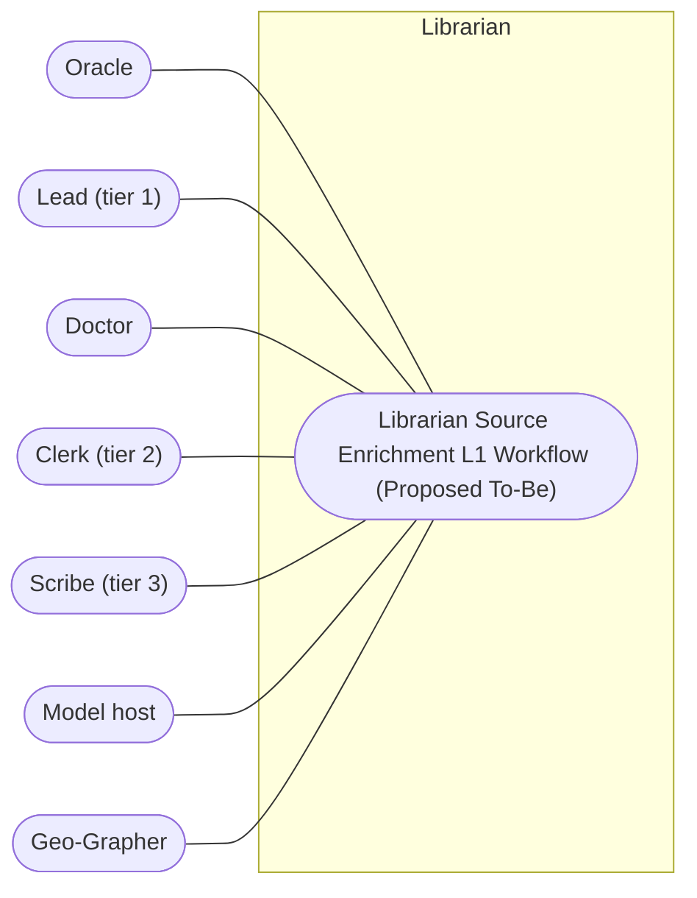

<!-- generated by build_and_validate_diagrams.py using accepted render_spec.py; edit the spec -->
# Librarian Source Enrichment L1 Workflow (Proposed To-Be)

**Status:** `PROPOSED_UNACCEPTED` refined to-be behavioral specification (clone-free YAML; NOT accepted by Owner and NOT implemented in runtime code). See [05-policy-and-behaviour-reconstruction.md](../05-policy-and-behaviour-reconstruction.md) · [03-proposed-librarian-tobe.md](../03-proposed-librarian-tobe.md) · [Diagrams Index](README.md).

## Validation

No structural problems, cross-view flags, card overlaps, edge/card intersections, text overflows, ownership violations, or `_at_` spec clones.

## Use-case diagram



## Activity diagram

```mermaid
flowchart TD
  subgraph Oracle["Oracle"]
    oracle["20. audits raw receipts, MC-10 ledger & Silver fidelity via distinct qualified Oracle route (GLM-5.3 current revisable adapter)"]
    dverdict{"Source Oracle verdict?"}
  end
  subgraph Lead_tier_1_["Lead (tier 1)"]
    handback["21. returns verified Source package, costs, coverage & independent worklists to batch"]
    retpartial["returns noncritical partial Source with unmet tasks/quarantine explicit"]
    retpause["returns MC-10 ceiling, cancel, or ORACLE_ROUTE_COLLISION (unverified) pause Ticket"]
    retesc["escalates critical integrity or authority-boundary fault to invoking parent"]
  end
  subgraph Doctor["Doctor"]
    doctor[["librarian-doctor-tobe: executes bounded YAML Ticket remedy via revisable adapter (GLM-5.3 current)"]]
  end
  subgraph Clerk_tier_2_["Clerk (tier 2)"]
    convplan["assigns bounded OCR or cleanup task under qualified role and MC-10 reserve"]
    convrev["verifies conversion fidelity without attesting unread pages"]
    readplan["5. assigns spread chunks, blind lens tasks, and required whole-source passes"]
    readproof["9. reconciles whole-source _document_pass and relate_chapters synthesis (P1-L7)"]
    relate["12. proposes semantic chapter relations across read chapters (Core persists)"]
    metapropose["13. proposes semantic content-model metadata fields from evidence; retains Unknown where insufficient"]
    review["15. drafts neutral Bottom Line & sensitivity check with low_confidence rescue"]
  end
  subgraph Scribe_tier_3_["Scribe (tier 3)"]
    convert["converts pages with [page N] anchors and explicit unread/error markers"]
    read["6. executes bounded chunk and synthesis tasks with MC-10 spend reservation"]
  end
  subgraph Core["Core"]
    bind["1. binds Source, narrowed L1 sub-run mandate (sub_spec_owner=lead_tier1 <= parent), NAT-13 & MF-013/014"]
    dwork{"L1 workflow admission source?"}
    userread["admits Context 3 UI reread/deep_read_note under person/workflow_grant route"]
    t0read["verifies Context 1/2 Delegated Commission Envelope for Source L1 workflow"]
    controls["2. checks cancel/lease flags and runs MC-10 atomic pre-dispatch budget reserve"]
    dcontrols{"controls permit dispatch?"}
    validate["3. verifies evidence hash, NAT-13 route/recipe key, and fresh publish state"]
    dvalidate{"validation result?"}
    parse["4. runs scripted fetch, AST/PDF text extract, and page map; saves originals"]
    dparse{"parse & conversion need?"}
    convchk["stores conversion with source_authorship metadata and reconciles spend"]
    dconv{"conversion usable?"}
    fallback["restores original extracted text and keeps conversion gap explicit"]
    dprov{"PDF needing provisional cache?"}
    preproj["marks provisional .nodes.json (text_layer=False); never counted published"]
    parsegap["records unread pages or missing units without granting read credit"]
    readchk["8. verifies schemas/quotes (E4/E5) and separates chunk vs _document_pass state"]
    dread{"chunk reads + whole derivations complete?"}
    dpoison{"bounded retries exhausted on poison/ungrounded text?"}
    quarantine["quarantines poison item to .librarian/quarantine/ and drops provisional cache"]
    partialread["keeps item partial with unread chunks or missing _document_pass explicit"]
    lenses["10. stores blind E4/E5 grounded lens candidates (parent acceptance separate)"]
    data["11. extracts scripted DIK structural records & static AST code relations ($0; DATA_IS_UNFRAMED)"]
    drelate{"multi-chapter document needing semantic relations?"}
    relateskip["retains Core static AST relations or marks chapter-relate N/A"]
    metadata["14. derives deterministic facts/readiness, validates proposed fields against schema, & stores proposals + Unknowns"]
    reviewchk["16. checks Bottom Line schema, literal quote grounding, flags & reading counters (does not override incomplete reading)"]
    dpub{"17. eligible for Geo paper publication?"}
    pubreceipt["19. enforces non-zero claims on multi-page PDF and triggers W5 bridge check"]
    dpubok{"publish receipt valid and non-empty?"}
    pubna["marks non-PDF or missing full conversion as publication N/A"]
    pubgap["records EMPTY_PAPER_GRAPH or Geo refusal without closing requirement"]
    reentry["confirms single-pass repair receipt (attempt <= 1) & re-admits check"]
  end
  subgraph Model_host["Model host"]
    host["7. answers task requests via qualified route; settles reserved vs actual cost"]
  end
  subgraph Geo_Grapher["Geo-Grapher"]
    publish["18. imports full-conversion paper into catalog; returns claim/concept/error counts"]
  end
  s(("start"))
  e1((("Source meets full Silver & publish obligations")))
  epartial((("partial or quarantined Source returned; gap explicit")))
  enowork((("no new work admitted; compatible NAT-13 receipts reused")))
  epaused((("paused on cancel, MC-10 budget cap, or ORACLE_ROUTE_COLLISION Ticket")))
  eescalated((("critical or unresolved integrity fault escalated")))
  s --> bind
  bind --> dwork
  dwork -->|"[system triggered (batch item admitted)]"| controls
  dwork -->|"[user directed (targeted reread/revision)] 1a"| userread
  dwork -->|"[tier 0 directed (external grant verified)] 1b"| t0read
  dwork -->|"[none admitted / reused] 1c"| enowork
  userread --> controls
  t0read --> controls
  controls --> dcontrols
  dcontrols -->|"[controls and MC-10 reserve ok]"| validate
  dcontrols -->|"[paused or MC-10 cap hit] 2a"| retpause
  dcontrols -->|"[critical writer or lease fault] 2b"| retesc
  validate --> dvalidate
  dvalidate -->|"[stage work required]"| parse
  dvalidate -->|"[unrecoverable poison or hash corruption] 3a"| quarantine
  parse --> dparse
  dparse -->|"[native extraction usable]"| dprov
  dparse -->|"[OCR or cleanup required] 4a"| convplan
  dparse -->|"[early fetch partial or missing units] 4b"| parsegap
  convplan --> convert
  convert --> convrev
  convrev --> convchk
  convchk --> dconv
  dconv -->|"[usable conversion]"| dprov
  dconv -->|"[unusable output or outage]"| fallback
  fallback --> dprov
  dprov -->|"[PDF/paper]"| preproj
  dprov -->|"[non-PDF] 4c"| readplan
  preproj --> readplan
  parsegap --> readplan
  readplan --> read
  read --> host
  host --> readchk
  readchk --> readproof
  readproof --> dread
  dread -->|"[chunks and _document_pass/relate complete]"| lenses
  dread -->|"[unread parts or missing synthesis pass] 9a"| dpoison
  dpoison -->|"[exhausted ungrounded/poison]"| quarantine
  dpoison -->|"[noncritical partial retained]"| partialread
  quarantine --> retpartial
  partialread --> lenses
  lenses --> data
  data --> drelate
  drelate -->|"[2+ read chapters with claims]"| relate
  drelate -->|"[code repo (AST in Core Data) or <2 chapters] 11a"| relateskip
  relate --> metapropose
  relateskip --> metapropose
  metapropose --> metadata
  metadata --> review
  review --> reviewchk
  reviewchk --> dpub
  dpub -->|"[full conversion and trusted folder group]"| publish
  dpub -->|"[non-PDF or no conversion] 17a"| pubna
  dpub -->|"[missing folder or Geo disabled] 17b"| pubgap
  pubna --> oracle
  pubgap --> oracle
  publish --> pubreceipt
  pubreceipt --> dpubok
  dpubok -->|"[valid non-zero graph & bridge checked]"| oracle
  dpubok -->|"[EMPTY_PAPER_GRAPH or late refusal] 19a"| pubgap
  oracle --> dverdict
  dverdict -->|"[all obligations met (distinct Oracle route)]"| handback
  dverdict -->|"[mapped shortfall needs bounded repair] 20a"| doctor
  dverdict -->|"[permitted partial gap] 20b"| retpartial
  dverdict -->|"[critical finding] 20c"| retesc
  dverdict -->|"[ORACLE_ROUTE_COLLISION (no distinct qualified route; never marked independently reviewed)] 20d"| retpause
  doctor -->|"[resolved]"| reentry
  reentry --> validate
  doctor -->|"[declined]"| retpartial
  doctor -->|"[escalated]"| retesc
  handback --> e1
  retpartial --> epartial
  retpause --> epaused
  retesc --> eescalated
  classDef ext stroke:#d9534f,stroke-width:2px
```



## Written use case

**Main success scenario** (generated: the guard-true path, in step order)

1. The Core binds Source, narrowed L1 sub-run mandate (sub_spec_owner=lead_tier1 <= parent), NAT-13 & MF-013/014.
2. The Core checks cancel/lease flags and runs MC-10 atomic pre-dispatch budget reserve.
3. The Core verifies evidence hash, NAT-13 route/recipe key, and fresh publish state.
4. The Core runs scripted fetch, AST/PDF text extract, and page map; saves originals.
5. The Clerk (tier 2) assigns spread chunks, blind lens tasks, and required whole-source passes.
6. The Scribe (tier 3) executes bounded chunk and synthesis tasks with MC-10 spend reservation.
7. The Model host answers task requests via qualified route; settles reserved vs actual cost.
8. The Core verifies schemas/quotes (E4/E5) and separates chunk vs _document_pass state.
9. The Clerk (tier 2) reconciles whole-source _document_pass and relate_chapters synthesis (P1-L7).
10. The Core stores blind E4/E5 grounded lens candidates (parent acceptance separate).
11. The Core extracts scripted DIK structural records & static AST code relations ($0; DATA_IS_UNFRAMED).
12. The Clerk (tier 2) proposes semantic chapter relations across read chapters (Core persists).
13. The Clerk (tier 2) proposes semantic content-model metadata fields from evidence; retains Unknown where insufficient.
14. The Core derives deterministic facts/readiness, validates proposed fields against schema, & stores proposals + Unknowns.
15. The Clerk (tier 2) drafts neutral Bottom Line & sensitivity check with low_confidence rescue.
16. The Core checks Bottom Line schema, literal quote grounding, flags & reading counters (does not override incomplete reading).
17. The Core eligible for Geo paper publication?.
18. The Geo-Grapher imports full-conversion paper into catalog; returns claim/concept/error counts.
19. The Core enforces non-zero claims on multi-page PDF and triggers W5 bridge check.
20. The Oracle audits raw receipts, MC-10 ledger & Silver fidelity via distinct qualified Oracle route (GLM-5.3 current revisable adapter).
21. The Lead (tier 1) returns verified Source package, costs, coverage & independent worklists to batch.

**Extensions** (generated: one per non-happy guard; numbered by the step it leaves)

- **1a** (from: L1 workflow admission source?) *anticipated*
  - `1a1` User directed (targeted reread/revision).
  - `1a2` The Core admits Context 3 UI reread/deep_read_note under person/workflow_grant route.
  - `1a3` Rejoin at 2.
- **1b** (from: L1 workflow admission source?) *anticipated*
  - `1b1` Tier 0 directed (external grant verified).
  - `1b2` The Core verifies Context 1/2 Delegated Commission Envelope for Source L1 workflow.
  - `1b3` Rejoin at 2.
- **1c** (from: L1 workflow admission source?) *anticipated*
  - `1c1` None admitted / reused.
  - `1c2` The use case ends: no new work admitted; compatible NAT-13 receipts reused.
- **2a** (from: controls permit dispatch?) *anticipated*
  - `2a1` Paused or MC-10 cap hit.
  - `2a2` The Lead (tier 1) returns MC-10 ceiling, cancel, or ORACLE_ROUTE_COLLISION (unverified) pause Ticket.
  - `2a3` The use case ends: paused on cancel, MC-10 budget cap, or ORACLE_ROUTE_COLLISION Ticket.
- **2b** (from: controls permit dispatch?) *anticipated*
  - `2b1` Critical writer or lease fault.
  - `2b2` The Lead (tier 1) escalates critical integrity or authority-boundary fault to invoking parent.
  - `2b3` The use case ends: critical or unresolved integrity fault escalated.
- **3a** (from: validation result?) *anticipated*
  - `3a1` Unrecoverable poison or hash corruption.
  - `3a2` The Core quarantines poison item to .librarian/quarantine/ and drops provisional cache.
  - `3a3` The Lead (tier 1) returns noncritical partial Source with unmet tasks/quarantine explicit.
  - `3a4` The use case ends: partial or quarantined Source returned; gap explicit.
- **4a** (from: parse & conversion need?) *anticipated*
  - `4a1` OCR or cleanup required.
  - `4a2` The Clerk (tier 2) assigns bounded OCR or cleanup task under qualified role and MC-10 reserve.
  - `4a3` The Scribe (tier 3) converts pages with [page N] anchors and explicit unread/error markers.
  - `4a4` The Clerk (tier 2) verifies conversion fidelity without attesting unread pages.
  - `4a5` The Core stores conversion with source_authorship metadata and reconciles spend.
  - `4a6` The Core decides: conversion usable?
  - `4a6a` If unusable output or outage: restores original extracted text and keeps conversion gap explicit.
  - `4a7` If usable conversion:
  - `4a8` The Core decides: PDF needing provisional cache?
  - `4a8a` If non-PDF: rejoin at 5.
  - `4a9` If PDF/paper:
  - `4a10` The Core marks provisional .nodes.json (text_layer=False); never counted published.
  - `4a11` Rejoin at 5.
- **4b** (from: parse & conversion need?) *anticipated*
  - `4b1` Early fetch partial or missing units.
  - `4b2` The Core records unread pages or missing units without granting read credit.
  - `4b3` Rejoin at 5.
- **4c** (from: PDF needing provisional cache?) *anticipated*
  - `4c1` Non-PDF.
  - `4c2` Rejoin at 5.
- **9a** (from: chunk reads + whole derivations complete?) *anticipated*
  - `9a1` Unread parts or missing synthesis pass.
  - `9a2` The Core decides: bounded retries exhausted on poison/ungrounded text?
  - `9a2a` If noncritical partial retained: keeps item partial with unread chunks or missing _document_pass explicit.
  - `9a3` If exhausted ungrounded/poison:
  - `9a4` The Core quarantines poison item to .librarian/quarantine/ and drops provisional cache.
  - `9a5` The Lead (tier 1) returns noncritical partial Source with unmet tasks/quarantine explicit.
  - `9a6` The use case ends: partial or quarantined Source returned; gap explicit.
- **11a** (from: multi-chapter document needing semantic relations?) *anticipated*
  - `11a1` Code repo (AST in Core Data) or <2 chapters.
  - `11a2` The Core retains Core static AST relations or marks chapter-relate N/A.
  - `11a3` Rejoin at 13.
- **17a** (from: eligible for Geo paper publication?) *anticipated*
  - `17a1` Non-PDF or no conversion.
  - `17a2` The Core marks non-PDF or missing full conversion as publication N/A.
  - `17a3` Rejoin at 20.
- **17b** (from: eligible for Geo paper publication?) *anticipated*
  - `17b1` Missing folder or Geo disabled.
  - `17b2` The Core records EMPTY_PAPER_GRAPH or Geo refusal without closing requirement.
  - `17b3` Rejoin at 20.
- **19a** (from: publish receipt valid and non-empty?) *anticipated*
  - `19a1` EMPTY_PAPER_GRAPH or late refusal.
  - `19a2` The Core records EMPTY_PAPER_GRAPH or Geo refusal without closing requirement.
  - `19a3` Rejoin at 20.
- **20a** (from: Source Oracle verdict?) *anticipated*
  - `20a1` Mapped shortfall needs bounded repair.
  - `20a2` The Doctor executes bounded YAML Ticket remedy via revisable adapter (GLM-5.3 current) (continues in librarian-doctor-tobe).
  - `20a2a` If declined: returns noncritical partial Source with unmet tasks/quarantine explicit.
  - `20a2a` If escalated: escalates critical integrity or authority-boundary fault to invoking parent.
  - `20a3` If resolved:
  - `20a4` The Core confirms single-pass repair receipt (attempt <= 1) & re-admits check.
  - `20a5` Rejoin at 3.
- **20b** (from: Source Oracle verdict?) *anticipated*
  - `20b1` Permitted partial gap.
  - `20b2` The Lead (tier 1) returns noncritical partial Source with unmet tasks/quarantine explicit.
  - `20b3` The use case ends: partial or quarantined Source returned; gap explicit.
- **20c** (from: Source Oracle verdict?) *anticipated*
  - `20c1` Critical finding.
  - `20c2` The Lead (tier 1) escalates critical integrity or authority-boundary fault to invoking parent.
  - `20c3` The use case ends: critical or unresolved integrity fault escalated.
- **20d** (from: Source Oracle verdict?) *anticipated*
  - `20d1` ORACLE_ROUTE_COLLISION (no distinct qualified route; never marked independently reviewed).
  - `20d2` The Lead (tier 1) returns MC-10 ceiling, cancel, or ORACLE_ROUTE_COLLISION (unverified) pause Ticket.
  - `20d3` The use case ends: paused on cancel, MC-10 budget cap, or ORACLE_ROUTE_COLLISION Ticket.

## Lane load

| Lane | On the main success scenario | Anywhere in the diagram |
|---|---|---|
| Oracle | 2 | 2 |
| Lead (tier 1) | 1 | 4 |
| Doctor | 0 | 1 |
| Clerk (tier 2) | 5 | 7 |
| Scribe (tier 3) | 1 | 2 |
| Core | 20 | 33 |
| Model host | 1 | 1 |
| Geo-Grapher | 1 | 1 |

Paths by how they end: **escalated** 3, **partial** 4, **paused** 2, **reused** 1, **success** 1. Every *escalated* path is a failure of this use case: the work went back to tier 0.

## Decision tree with 23 extension scenarios

```text
start: Librarian Source Enrichment L1 Workflow (Proposed To-Be)
                    └─ T1: system triggered (batch item admitted) / controls and MC-10 reserve ok / stage work required / native extraction usable / PDF/paper / chunks and _document_pass/relate complete / 2+ read chapters with claims / full conversion and trusted folder group / valid non-zero graph & bridge checked / all obligations met (distinct Oracle route)  ⇒ Source meets full Silver & publish obligations
  └─ T2: user directed (targeted reread/revision)  ⇒ rejoins at step 2
  └─ T3: tier 0 directed (external grant verified)  ⇒ rejoins at step 2
  └─ T4: none admitted / reused  ⇒ no new work admitted; compatible NAT-13 receipts reused
    └─ T5: system triggered (batch item admitted) / paused or MC-10 cap hit  ⇒ paused on cancel, MC-10 budget cap, or ORACLE_ROUTE_COLLISION Ticket
    └─ T6: system triggered (batch item admitted) / critical writer or lease fault  ⇒ critical or unresolved integrity fault escalated
      └─ T7: system triggered (batch item admitted) / controls and MC-10 reserve ok / unrecoverable poison or hash corruption  ⇒ partial or quarantined Source returned; gap explicit
          └─ T8: system triggered (batch item admitted) / controls and MC-10 reserve ok / stage work required / OCR or cleanup required / unusable output or outage  ⇒ rejoins at 'PDF needing provisional cache?' (before step 5)
          └─ T9: system triggered (batch item admitted) / controls and MC-10 reserve ok / stage work required / OCR or cleanup required / usable conversion  ⇒ rejoins at 'PDF needing provisional cache?' (before step 5)
        └─ T10: system triggered (batch item admitted) / controls and MC-10 reserve ok / stage work required / early fetch partial or missing units  ⇒ rejoins at step 5
          └─ T11: system triggered (batch item admitted) / controls and MC-10 reserve ok / stage work required / native extraction usable / non-PDF  ⇒ rejoins at step 5
              └─ T12: system triggered (batch item admitted) / controls and MC-10 reserve ok / stage work required / native extraction usable / PDF/paper / unread parts or missing synthesis pass / noncritical partial retained  ⇒ rejoins at step 10
              └─ T13: system triggered (batch item admitted) / controls and MC-10 reserve ok / stage work required / native extraction usable / PDF/paper / unread parts or missing synthesis pass / exhausted ungrounded/poison  ⇒ partial or quarantined Source returned; gap explicit
              └─ T14: system triggered (batch item admitted) / controls and MC-10 reserve ok / stage work required / native extraction usable / PDF/paper / chunks and _document_pass/relate complete / code repo (AST in Core Data) or <2 chapters  ⇒ rejoins at step 13
                └─ T15: system triggered (batch item admitted) / controls and MC-10 reserve ok / stage work required / native extraction usable / PDF/paper / chunks and _document_pass/relate complete / 2+ read chapters with claims / non-PDF or no conversion  ⇒ rejoins at step 20
                └─ T16: system triggered (batch item admitted) / controls and MC-10 reserve ok / stage work required / native extraction usable / PDF/paper / chunks and _document_pass/relate complete / 2+ read chapters with claims / missing folder or Geo disabled  ⇒ rejoins at step 20
                  └─ T17: system triggered (batch item admitted) / controls and MC-10 reserve ok / stage work required / native extraction usable / PDF/paper / chunks and _document_pass/relate complete / 2+ read chapters with claims / full conversion and trusted folder group / EMPTY_PAPER_GRAPH or late refusal  ⇒ rejoins at step 20
                      └─ T18: system triggered (batch item admitted) / controls and MC-10 reserve ok / stage work required / native extraction usable / PDF/paper / chunks and _document_pass/relate complete / 2+ read chapters with claims / full conversion and trusted folder group / valid non-zero graph & bridge checked / mapped shortfall needs bounded repair / declined  ⇒ partial or quarantined Source returned; gap explicit
                      └─ T19: system triggered (batch item admitted) / controls and MC-10 reserve ok / stage work required / native extraction usable / PDF/paper / chunks and _document_pass/relate complete / 2+ read chapters with claims / full conversion and trusted folder group / valid non-zero graph & bridge checked / mapped shortfall needs bounded repair / escalated  ⇒ critical or unresolved integrity fault escalated
                      └─ T20: system triggered (batch item admitted) / controls and MC-10 reserve ok / stage work required / native extraction usable / PDF/paper / chunks and _document_pass/relate complete / 2+ read chapters with claims / full conversion and trusted folder group / valid non-zero graph & bridge checked / mapped shortfall needs bounded repair / resolved  ⇒ rejoins at step 3
                    └─ T21: system triggered (batch item admitted) / controls and MC-10 reserve ok / stage work required / native extraction usable / PDF/paper / chunks and _document_pass/relate complete / 2+ read chapters with claims / full conversion and trusted folder group / valid non-zero graph & bridge checked / permitted partial gap  ⇒ partial or quarantined Source returned; gap explicit
                    └─ T22: system triggered (batch item admitted) / controls and MC-10 reserve ok / stage work required / native extraction usable / PDF/paper / chunks and _document_pass/relate complete / 2+ read chapters with claims / full conversion and trusted folder group / valid non-zero graph & bridge checked / critical finding  ⇒ critical or unresolved integrity fault escalated
                    └─ T23: system triggered (batch item admitted) / controls and MC-10 reserve ok / stage work required / native extraction usable / PDF/paper / chunks and _document_pass/relate complete / 2+ read chapters with claims / full conversion and trusted folder group / valid non-zero graph & bridge checked / ORACLE_ROUTE_COLLISION (no distinct qualified route; never marked independently reviewed)  ⇒ paused on cancel, MC-10 budget cap, or ORACLE_ROUTE_COLLISION Ticket
```

## Scenario test table

| Test | Path (guards taken) | Extension | Expected outcome |
|---|---|---|---|
| T1 | L1 workflow admission source? → system triggered (batch item admitted); controls permit dispatch? → controls and MC-10 reserve ok; validation result? → stage work required; parse & conversion need? → native extraction usable; PDF needing provisional cache? → PDF/paper; chunk reads + whole derivations complete? → chunks and _document_pass/relate complete; multi-chapter document needing semantic relations? → 2+ read chapters with claims; eligible for Geo paper publication? → full conversion and trusted folder group; publish receipt valid and non-empty? → valid non-zero graph & bridge checked; Source Oracle verdict? → all obligations met (distinct Oracle route) | MSS | Source meets full Silver & publish obligations |
| T2 | L1 workflow admission source? → user directed (targeted reread/revision) | 1a | rejoins at step 2 |
| T3 | L1 workflow admission source? → tier 0 directed (external grant verified) | 1b | rejoins at step 2 |
| T4 | L1 workflow admission source? → none admitted / reused | 1c | no new work admitted; compatible NAT-13 receipts reused |
| T5 | L1 workflow admission source? → system triggered (batch item admitted); controls permit dispatch? → paused or MC-10 cap hit | 2a | paused on cancel, MC-10 budget cap, or ORACLE_ROUTE_COLLISION Ticket |
| T6 | L1 workflow admission source? → system triggered (batch item admitted); controls permit dispatch? → critical writer or lease fault | 2b | critical or unresolved integrity fault escalated |
| T7 | L1 workflow admission source? → system triggered (batch item admitted); controls permit dispatch? → controls and MC-10 reserve ok; validation result? → unrecoverable poison or hash corruption | 3a | partial or quarantined Source returned; gap explicit |
| T8 | L1 workflow admission source? → system triggered (batch item admitted); controls permit dispatch? → controls and MC-10 reserve ok; validation result? → stage work required; parse & conversion need? → OCR or cleanup required; conversion usable? → unusable output or outage | 4a | rejoins at 'PDF needing provisional cache?' (before step 5) |
| T9 | L1 workflow admission source? → system triggered (batch item admitted); controls permit dispatch? → controls and MC-10 reserve ok; validation result? → stage work required; parse & conversion need? → OCR or cleanup required; conversion usable? → usable conversion | 4a | rejoins at 'PDF needing provisional cache?' (before step 5) |
| T10 | L1 workflow admission source? → system triggered (batch item admitted); controls permit dispatch? → controls and MC-10 reserve ok; validation result? → stage work required; parse & conversion need? → early fetch partial or missing units | 4b | rejoins at step 5 |
| T11 | L1 workflow admission source? → system triggered (batch item admitted); controls permit dispatch? → controls and MC-10 reserve ok; validation result? → stage work required; parse & conversion need? → native extraction usable; PDF needing provisional cache? → non-PDF | 4c | rejoins at step 5 |
| T12 | L1 workflow admission source? → system triggered (batch item admitted); controls permit dispatch? → controls and MC-10 reserve ok; validation result? → stage work required; parse & conversion need? → native extraction usable; PDF needing provisional cache? → PDF/paper; chunk reads + whole derivations complete? → unread parts or missing synthesis pass; bounded retries exhausted on poison/ungrounded text? → noncritical partial retained | 9a | rejoins at step 10 |
| T13 | L1 workflow admission source? → system triggered (batch item admitted); controls permit dispatch? → controls and MC-10 reserve ok; validation result? → stage work required; parse & conversion need? → native extraction usable; PDF needing provisional cache? → PDF/paper; chunk reads + whole derivations complete? → unread parts or missing synthesis pass; bounded retries exhausted on poison/ungrounded text? → exhausted ungrounded/poison | 9a | partial or quarantined Source returned; gap explicit |
| T14 | L1 workflow admission source? → system triggered (batch item admitted); controls permit dispatch? → controls and MC-10 reserve ok; validation result? → stage work required; parse & conversion need? → native extraction usable; PDF needing provisional cache? → PDF/paper; chunk reads + whole derivations complete? → chunks and _document_pass/relate complete; multi-chapter document needing semantic relations? → code repo (AST in Core Data) or <2 chapters | 11a | rejoins at step 13 |
| T15 | L1 workflow admission source? → system triggered (batch item admitted); controls permit dispatch? → controls and MC-10 reserve ok; validation result? → stage work required; parse & conversion need? → native extraction usable; PDF needing provisional cache? → PDF/paper; chunk reads + whole derivations complete? → chunks and _document_pass/relate complete; multi-chapter document needing semantic relations? → 2+ read chapters with claims; eligible for Geo paper publication? → non-PDF or no conversion | 17a | rejoins at step 20 |
| T16 | L1 workflow admission source? → system triggered (batch item admitted); controls permit dispatch? → controls and MC-10 reserve ok; validation result? → stage work required; parse & conversion need? → native extraction usable; PDF needing provisional cache? → PDF/paper; chunk reads + whole derivations complete? → chunks and _document_pass/relate complete; multi-chapter document needing semantic relations? → 2+ read chapters with claims; eligible for Geo paper publication? → missing folder or Geo disabled | 17b | rejoins at step 20 |
| T17 | L1 workflow admission source? → system triggered (batch item admitted); controls permit dispatch? → controls and MC-10 reserve ok; validation result? → stage work required; parse & conversion need? → native extraction usable; PDF needing provisional cache? → PDF/paper; chunk reads + whole derivations complete? → chunks and _document_pass/relate complete; multi-chapter document needing semantic relations? → 2+ read chapters with claims; eligible for Geo paper publication? → full conversion and trusted folder group; publish receipt valid and non-empty? → EMPTY_PAPER_GRAPH or late refusal | 19a | rejoins at step 20 |
| T18 | L1 workflow admission source? → system triggered (batch item admitted); controls permit dispatch? → controls and MC-10 reserve ok; validation result? → stage work required; parse & conversion need? → native extraction usable; PDF needing provisional cache? → PDF/paper; chunk reads + whole derivations complete? → chunks and _document_pass/relate complete; multi-chapter document needing semantic relations? → 2+ read chapters with claims; eligible for Geo paper publication? → full conversion and trusted folder group; publish receipt valid and non-empty? → valid non-zero graph & bridge checked; Source Oracle verdict? → mapped shortfall needs bounded repair; executes bounded YAML Ticket remedy via revisable adapter (GLM-5.3 current) → declined | 20a | partial or quarantined Source returned; gap explicit |
| T19 | L1 workflow admission source? → system triggered (batch item admitted); controls permit dispatch? → controls and MC-10 reserve ok; validation result? → stage work required; parse & conversion need? → native extraction usable; PDF needing provisional cache? → PDF/paper; chunk reads + whole derivations complete? → chunks and _document_pass/relate complete; multi-chapter document needing semantic relations? → 2+ read chapters with claims; eligible for Geo paper publication? → full conversion and trusted folder group; publish receipt valid and non-empty? → valid non-zero graph & bridge checked; Source Oracle verdict? → mapped shortfall needs bounded repair; executes bounded YAML Ticket remedy via revisable adapter (GLM-5.3 current) → escalated | 20a | critical or unresolved integrity fault escalated |
| T20 | L1 workflow admission source? → system triggered (batch item admitted); controls permit dispatch? → controls and MC-10 reserve ok; validation result? → stage work required; parse & conversion need? → native extraction usable; PDF needing provisional cache? → PDF/paper; chunk reads + whole derivations complete? → chunks and _document_pass/relate complete; multi-chapter document needing semantic relations? → 2+ read chapters with claims; eligible for Geo paper publication? → full conversion and trusted folder group; publish receipt valid and non-empty? → valid non-zero graph & bridge checked; Source Oracle verdict? → mapped shortfall needs bounded repair; executes bounded YAML Ticket remedy via revisable adapter (GLM-5.3 current) → resolved | 20a | rejoins at step 3 |
| T21 | L1 workflow admission source? → system triggered (batch item admitted); controls permit dispatch? → controls and MC-10 reserve ok; validation result? → stage work required; parse & conversion need? → native extraction usable; PDF needing provisional cache? → PDF/paper; chunk reads + whole derivations complete? → chunks and _document_pass/relate complete; multi-chapter document needing semantic relations? → 2+ read chapters with claims; eligible for Geo paper publication? → full conversion and trusted folder group; publish receipt valid and non-empty? → valid non-zero graph & bridge checked; Source Oracle verdict? → permitted partial gap | 20b | partial or quarantined Source returned; gap explicit |
| T22 | L1 workflow admission source? → system triggered (batch item admitted); controls permit dispatch? → controls and MC-10 reserve ok; validation result? → stage work required; parse & conversion need? → native extraction usable; PDF needing provisional cache? → PDF/paper; chunk reads + whole derivations complete? → chunks and _document_pass/relate complete; multi-chapter document needing semantic relations? → 2+ read chapters with claims; eligible for Geo paper publication? → full conversion and trusted folder group; publish receipt valid and non-empty? → valid non-zero graph & bridge checked; Source Oracle verdict? → critical finding | 20c | critical or unresolved integrity fault escalated |
| T23 | L1 workflow admission source? → system triggered (batch item admitted); controls permit dispatch? → controls and MC-10 reserve ok; validation result? → stage work required; parse & conversion need? → native extraction usable; PDF needing provisional cache? → PDF/paper; chunk reads + whole derivations complete? → chunks and _document_pass/relate complete; multi-chapter document needing semantic relations? → 2+ read chapters with claims; eligible for Geo paper publication? → full conversion and trusted folder group; publish receipt valid and non-empty? → valid non-zero graph & bridge checked; Source Oracle verdict? → ORACLE_ROUTE_COLLISION (no distinct qualified route; never marked independently reviewed) | 20d | paused on cancel, MC-10 budget cap, or ORACLE_ROUTE_COLLISION Ticket |

_Note: Scenario tests verify static graph reachability and guarded path coverage in this proposed spec only; they do NOT execute or verify live Web UI, MCP server, Broker, Geo-Grapher, or DeepInfra runtime behaviour._
