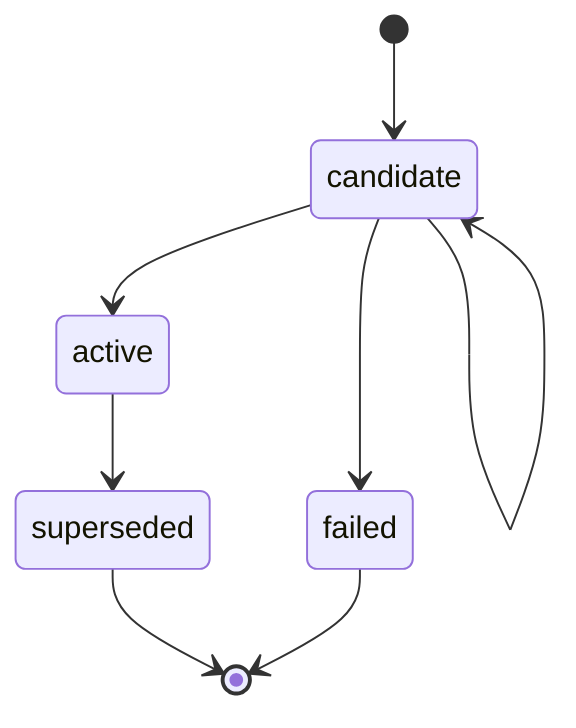

# State diagrams: geo-grapher/as-is

## A paper database generation

Each publication makes a new generation by copying the active one and adding one paper.

| From | To | On | By | Guard |
|---|---|---|---|---|
| candidate | candidate | — | Geo-Grapher service | — |
| candidate | active | — | Geo-Grapher store | — |
| candidate | failed | — | Geo-Grapher service | — |
| active | superseded | — | Geo-Grapher store | — |

Evidence: F:/uv-data/Geo_Grapher/src/geographer/library_papers.py publish

Weaknesses:

- **G-GEN-01** (cost): A superseded or failed generation is retained forever; nothing ever deletes one. Evidence: geographer/library_papers.py comment: failed or unbound candidates remain. Handled by: `state:paper-store`.
