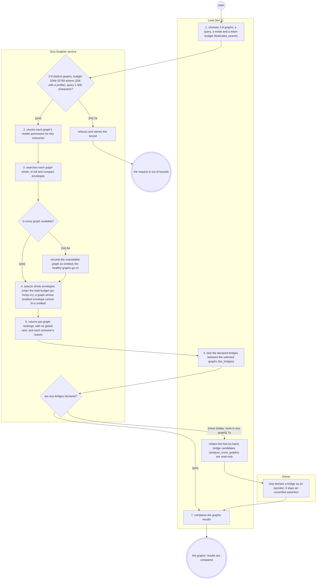

<!-- generated by render_pack.py from federated-search.spec.yaml sha256=58a59ea6fd325b4fdbfd76bb1a003a5a46cbf49c30b2a6dbf35fb42223442053; edit the spec, not this file -->
# Search across graphs and their bridges, as it runs today

**UC-G4 · as-is · `IMPLEMENTED_VERIFIED`** · spec [federated-search.spec.yaml](../federated-search.spec.yaml)

| Problem | |
|---|---|
| symptom | No bridges exist between any of the 30 graphs, so a cross-graph search returns separate lists that nothing connects. |
| root | Bridges are only ever declared by an operator; the bridge candidates Geo-Grapher can compute are read-only and go nowhere. |

## Written use case

| Field | Content |
|---|---|
| **Use case name** | Search across graphs and their bridges |
| **Brief description** | An agent compares 2-8 graphs: each is searched whole and ranked on its own, under one token budget; declared bridges connect them. |
| **Primary actor** | Lead (tier 1) |
| **Supporting actors** | Geo-Grapher service, Owner (declares bridges) |
| **Preconditions** | The graphs are readable |
| **Trigger** | A comparison across projects |
| **Success guarantee** | Per-graph results, with every omission's reason |
| **Minimal guarantee** | One unavailable graph never hides the others |
| **Open questions** | Who turns bridge candidates into bridges? |

**Main success scenario** (generated: the guard-true path, in step order)

1. The Lead (tier 1) chooses 2-8 graphs, a query, a mode and a token budget (federated_search).
2. The Geo-Grapher service checks each graph's reader permission for this consumer.
3. The Geo-Grapher service searches each graph whole, in full and compact envelopes.
4. The Geo-Grapher service selects whole envelopes under the total budget (pc-mckp-v1); a graph whose smallest envelope cannot fit is omitted.
5. The Geo-Grapher service returns per-graph rankings, with no global rank, and each omission's reason.
6. The Lead (tier 1) lists the declared bridges between the selected graphs (list_bridges).
7. The Lead (tier 1) compares the graphs' results.

**Extensions** (generated: one per non-happy guard; numbered by the step it leaves)

- **2a** (from: 2-8 distinct graphs, budget 2048-32768 tokens (256 with a profile), query 1-500 characters?) *anticipated*
  - `2a1` No.
  - `2a2` The Geo-Grapher service refuses and names the bound.
  - `2a3` The use case ends: the request is out of bounds.
- **4a** (from: is every graph available?) *anticipated*
  - `4a1` No.
  - `4a2` The Geo-Grapher service records the unavailable graph as omitted; the healthy graphs go on.
  - `4a3` Rejoin at 4.
- **7a** (from: are any bridges declared?) *anticipated*
  - `7a1` None (today: none in any graph).
  - `7a2` The Lead (tier 1) relates the lists by hand; bridge candidates (analyze_cross_graphs) are read-only.
  - `7a3` The Owner may declare a bridge as an operator; it stays an unverified assertion.
  - `7a4` Rejoin at 7.

## Activity diagram



## Lane load

| Lane | On the main success scenario | Anywhere in the diagram |
|---|---|---|
| Owner | 0 | 1 |
| Lead (tier 1) | 3 | 4 |
| Geo-Grapher service | 7 | 9 |

Paths by how they end: **refused** 1, **success** 1.

## Decision tree

```text
start: Search across graphs and their bridges, as it runs today
      └─ T1: yes / yes / yes  ⇒ the graphs' results are compared
  └─ T2: no  ⇒ the request is out of bounds
    └─ T3: yes / no  ⇒ rejoins at step 4
      └─ T4: yes / yes / none (today: none in any graph)  ⇒ rejoins at step 7
```

## Test cases

One test per path: the main success scenario, then each extension.

| Test | Path (guards taken) | Extension | Expected outcome |
|---|---|---|---|
| T1 | 2-8 distinct graphs, budget 2048-32768 tokens (256 with a profile), query 1-500 characters? → yes; is every graph available? → yes; are any bridges declared? → yes | MSS | the graphs' results are compared |
| T2 | 2-8 distinct graphs, budget 2048-32768 tokens (256 with a profile), query 1-500 characters? → no | 2a | the request is out of bounds |
| T3 | 2-8 distinct graphs, budget 2048-32768 tokens (256 with a profile), query 1-500 characters? → yes; is every graph available? → no | 4a | rejoins at step 4 |
| T4 | 2-8 distinct graphs, budget 2048-32768 tokens (256 with a profile), query 1-500 characters? → yes; is every graph available? → yes; are any bridges declared? → none (today: none in any graph) | 7a | rejoins at step 7 |

### Boundary values

| Decision | Values to test | Expected |
|---|---|---|
| 2-8 distinct graphs, budget 2048-32768 tokens (256 with a profile), query 1-500 characters? | 1 graph; 2; 8; 9; budget 2047; 2048; 32768; 32769 | outside 2-8 graphs or 2048-32768 tokens: refused |

## Weaknesses and gaps

| Id | Kind | Where | Weakness | Evidence | Handled in the to-be by |
|---|---|---|---|---|---|
| G-FED-01 | gap | 7a | No bridges exist: bridges are only declared by hand, and the bridge candidates Geo-Grapher computes are read-only. | measured 22 November; graph_server.py line 118 | `federated-search` |
| G-FED-02 | risk | answer | With no global rank, relating one graph's results to another's is left to the agent. | graph_router.py: ranking independent_per_graph_no_global_rank | `federated-search` |

## Evidence

- F:/uv-data/Geo_Grapher/src/geographer/graph_router.py lines 572-610 (federated_search); graph_server.py lines 117-130 (list_bridges, analyze_cross_graphs, federated_search).
- geographer-graph-building problem: 0 bridges exist (measured 22 November).

## Checks

Errors: none

Warnings: none
