<!-- generated by render_pack.py from graph-building.spec.yaml sha256=6127b17d0542315b0efe1e7bcb7244ec0068085e90cdc34c08552e8614bbb626; edit the spec, not this file -->
# Geo-Grapher graph building across folder review and Librarian enrichment (as-is)

**UC1d · as-is · `IMPLEMENTED_VERIFIED`** · spec [graph-building.spec.yaml](../graph-building.spec.yaml)
Supersedes: `reports/2026-11-22-geographer-graph-building/geographer-graph-building.spec.yaml`

| Problem | |
|---|---|
| symptom | 30 graphs use 77.2 GB (up to 19.5 GB for a docs graph, 96 paper-DB copies = 873 MB for a 16 MB DB), 48 published NFL papers lack Source notes, 12 unread RL papers have 0 claims, 72 NFL papers have 0 concepts, 0 bridges exist, and TypeScript AST parsing fails silently. |
| why | Code/doc graph building runs upstream at folder acceptance (not during enrichment) and rebuilds every reviewed group non-incrementally (OP2) without pruning snapshots.; Paper graph building is bolted onto enrichment stage 9 via a per-paper CLI subprocess that clones the full prior paper DB without pruning generations or checkpointing catalog.sqlite-wal.; Geo-Grapher has zero involvement during enrichment stages 3-8, builds zero bridges, hides CLI errors behind opaque publish:partial, and lacks post-publish verification or acceptance hand-off. |
| root | Graph building is split across two disconnected serial CLI subprocesses with whole-store copy/rebuild amplification, no enrichment feedback loop, and no end-to-end verification or hand-off (mirroring OP1 and OP2). |

## Written use case

| Field | Content |
|---|---|
| **Use case name** | Build the library's graphs from reviewed folders, and publish its papers |
| **Brief description** | Accepting folder decisions has Geo-Grapher apply every reviewed group; later, each fully read PDF is published into its group's paper database. |
| **Primary actor** | Owner |
| **Supporting actors** | Librarian Core, model worker, Geo-Grapher CLI, store and service |
| **Preconditions** | Folder decisions accepted; Geo-Grapher enabled for the library |
| **Trigger** | A folder accept; a source's publish stage |
| **Success guarantee** | Current code and paper graphs, served on loopback MCP |
| **Minimal guarantee** | Scope, hash and disk checks refuse a bad import |
| **Open questions** | OP2: apply only the changed group |

**Main success scenario** (generated: the guard-true path, in step order)

1. The Owner accepts folder decisions (person UI or agent policy) to trigger graph build.
2. The Core re-surveys all accepted non-excluded roots (person accept) and writes read-only barriers.
3. The Core spawns apply-folder-review CLI (14,400 s timeout) with all library groups and withheld paths.
4. The Geo-Grapher CLI checks single authorship/stratum per label, child excludes, and >= 5 GiB free disk.
5. The Geo-Grapher CLI loops serially over every reviewed group (OP2); calls ingest(stage=3) without previous_snapshot_id.
6. The Geo-Grapher store appends full unpruned snapshot to code.sqlite and upserts catalog.sqlite (no WAL checkpoint).
7. The Core saves application receipt; code/doc graph building ends before enrichment starts.
8. The Owner queues/captures sources, approves staged items, and starts process_approved batch.
9. The Core runs Stages 1-2 (validate, parse/OCR); writes early pre-read .nodes.json (often catalogue_only).
10. The Model worker runs Stages 3-8 (read, lenses, data, relate, metadata, review); Geo-Grapher is never consulted.
11. The Core runs Stage 9 (publish): checks PDF + full read; rebuilds .nodes.json with claims and terms.
12. The Core checks Geo enabled, deepest accepted folder card, fresh fingerprint, and artifact SHA-256.
13. The Core spawns cold-start import-library-paper CLI subprocess for this single PDF.
14. The Geo-Grapher CLI under import_lock, re-checks paths, SHA-256 hashes, graph scope, authorship, and >= 5 GiB disk.
15. The Geo-Grapher store clones full prior paper DB to new papers-native-<uuid>.sqlite, upserts 1 paper, keeps all old copies.
16. The Geo-Grapher store re-checks SHA-256 and CAS-updates graphs.paper_database in catalog.sqlite (no WAL checkpoint).
17. The Core records publish: complete; no claim/concept check, 0 bridges built, Source note not accepted.
18. The Geo-Grapher service serves current code and paper graphs on loopback /mcp and UI for research sessions.

**Extensions** (generated: one per non-happy guard; numbered by the step it leaves)

- **2a** (from: all accepted library roots current?) *observed: D:\Librarian_V2 blocked unrelated folder accepts (3x in RL); OP2*
  - `2a1` Unrelated accepted root stale (FOLDER_STALE).
  - `2a2` The Owner re-surveys unrelated stale root and re-applies decisions (OP2).
  - `2a3` Rejoin at 2.
- **4a** (from: strata, store ownership, and disk valid?) *observed: GROUP_STRATUM_CONFLICT in Parallax; 12x GEOGRAPHER_CALL_FAILED (5 NFL, 3 Parallax, 4 RL)*
  - `4a1` Stratum conflict, read-only store, <5 GiB disk, or CLI crash.
  - `4a2` The use case ends: folder build aborted (opaque GEOGRAPHER_CALL_FAILED); earlier loop groups may be committed.
- **5a** (from: exact snapshot digest already complete?) *observed: reuse_complete skips unchanged groups, but any 1-file edit rebuilds non-incrementally*
  - `5a1` Exact digest already complete: reuse snapshot.
  - `5a2` Rejoin at 7.
- **5b** (from: Python AST and tree-sitter parsed cleanly?) *observed: 85 NFL, 730+ Parallax, 345+ RL files (incl. Librarian_V2 TS) failed FallbackUnavailable silently*
  - `5b1` Missing tree_sitter or UTF-8 decode error.
  - `5b2` The Geo-Grapher CLI logs parse_failures_json (missing tree_sitter / UTF-8) and still publishes status='complete'.
  - `5b3` Rejoin at 6.
- **11a** (from: PDF fully read with full_conversion?) *observed: 675 NFL / 54 Parallax / 325 RL non-PDFs; 12 NFL / 10 RL catalogue_only*
  - `11a1` Non-PDF or catalogue_only (blank/un-OCRed page).
  - `11a2` The use case ends: publish: not_applicable (non-PDF or catalogue_only); source reading stands.
- **11b** (from: PDF fully read with full_conversion?) *observed: 3 DataManagement PDFs partial (terms JSON failure); 40 Librarian research PDFs read=queued*
  - `11b1` PDF reading incomplete.
  - `11b2` The use case ends: publish: partial (unread PDF, Geo off, awaiting folder, or FOLDER_STALE); reading kept.
- **12a** (from: Geo enabled, folder current, hash intact?) *observed: 41x FOLDER_STALE + 27x awaiting_accepted_folder during NFL batch publish stage*
  - `12a1` Geo disabled, awaiting_accepted_folder, FOLDER_STALE, or stale artifact.
  - `12a2` The use case ends: publish: partial (unread PDF, Geo off, awaiting folder, or FOLDER_STALE); reading kept.
- **14a** (from: scope, provenance, and disk checks pass?) *observed: batch._publish catches ValueError/OSError into opaque publish: partial*
  - `14a1` PAPER_SCOPE, PAPER_ARTIFACT_STALE, DISK_RESERVE, or CLI error.
  - `14a2` The use case ends: paper import failed or CAS-conflicted; hidden as publish: partial or cloned DB orphaned.
- **16a** (from: CAS matched unchanged graph row?) *anticipated*
  - `16a1` Concurrent graph/snapshot change during import.
  - `16a2` The use case ends: paper import failed or CAS-conflicted; hidden as publish: partial or cloned DB orphaned.
- **17a** (from: populated, checkpointed, and note accepted?) *observed: 48 published NFL PDFs unaccepted; 12 unread RL PDFs with 0 claims; 72 NFL papers with 0 concepts; 1.67 MB RL catalog WAL*
  - `17a1` Unaccepted Source note, 0 claims/concepts, or uncheckpointed WAL.
  - `17a2` The use case ends: split-brain: published papers unaccepted (OP1), 0 claims/concepts, or uncheckpointed WAL.

## Activity diagram

```mermaid
flowchart TD
  subgraph Owner["Owner"]
    a1["1. accepts folder decisions (person UI or agent policy) to trigger graph build"]
    x1["re-surveys unrelated stale root and re-applies decisions (OP2)"]
    a8["8. queues/captures sources, approves staged items, and starts process_approved batch"]
  end
  subgraph Core["Core"]
    a2["2. re-surveys all accepted non-excluded roots (person accept) and writes read-only barriers"]
    d1{"all accepted library roots current?"}
    a3["3. spawns apply-folder-review CLI (14,400 s timeout) with all library groups and withheld paths"]
    a7["7. saves application receipt; code/doc graph building ends before enrichment starts"]
    a9["9. runs Stages 1-2 (validate, parse/OCR); writes early pre-read .nodes.json (often catalogue_only)"]
    a11["11. runs Stage 9 (publish): checks PDF + full read; rebuilds .nodes.json with claims and terms"]
    d5{"PDF fully read with full_conversion?"}
    a12["12. checks Geo enabled, deepest accepted folder card, fresh fingerprint, and artifact SHA-256"]
    d6{"Geo enabled, folder current, hash intact?"}
    a13["13. spawns cold-start import-library-paper CLI subprocess for this single PDF"]
    a17["17. records publish: complete; no claim/concept check, 0 bridges built, Source note not accepted"]
  end
  subgraph Model_worker["Model worker"]
    a10["10. runs Stages 3-8 (read, lenses, data, relate, metadata, review); Geo-Grapher is never consulted"]
  end
  subgraph Geo_Grapher_CLI["Geo-Grapher CLI"]
    a4["4. checks single authorship/stratum per label, child excludes, and >= 5 GiB free disk"]
    d2{"strata, store ownership, and disk valid?"}
    a5["5. loops serially over every reviewed group (OP2); calls ingest(stage=3) without previous_snapshot_id"]
    d3{"exact snapshot digest already complete?"}
    d4{"Python AST and tree-sitter parsed cleanly?"}
    x4["logs parse_failures_json (missing tree_sitter / UTF-8) and still publishes status='complete'"]
    a14["14. under import_lock, re-checks paths, SHA-256 hashes, graph scope, authorship, and >= 5 GiB disk"]
    d7{"scope, provenance, and disk checks pass?"}
  end
  subgraph Geo_Grapher_store["Geo-Grapher store"]
    a6["6. appends full unpruned snapshot to code.sqlite and upserts catalog.sqlite (no WAL checkpoint)"]
    a15["15. clones full prior paper DB to new papers-native-<uuid>.sqlite, upserts 1 paper, keeps all old copies"]
    a16["16. re-checks SHA-256 and CAS-updates graphs.paper_database in catalog.sqlite (no WAL checkpoint)"]
    d8{"CAS matched unchanged graph row?"}
  end
  subgraph Geo_Grapher_service["Geo-Grapher service"]
    d9{"populated, checkpointed, and note accepted?"}
    a18["18. serves current code and paper graphs on loopback /mcp and UI for research sessions"]
  end
  s(("start"))
  e1((("code and paper graphs current, populated with claims/concepts, aligned with Source notes")))
  e2((("folder build aborted (opaque GEOGRAPHER_CALL_FAILED); earlier loop groups may be committed")))
  e3((("publish: not_applicable (non-PDF or catalogue_only); source reading stands")))
  e4((("publish: partial (unread PDF, Geo off, awaiting folder, or FOLDER_STALE); reading kept")))
  e5((("paper import failed or CAS-conflicted; hidden as publish: partial or cloned DB orphaned")))
  e6((("split-brain: published papers unaccepted (OP1), 0 claims/concepts, or uncheckpointed WAL")))
  s --> a1
  a1 --> a2
  a2 --> d1
  d1 -->|"[current]"| a3
  d1 -->|"[unrelated accepted root stale (FOLDER_STALE)] 2a"| x1
  x1 --> a2
  a3 --> a4
  a4 --> d2
  d2 -->|"[valid]"| a5
  d2 -->|"[stratum conflict, read-only store, <5 GiB disk, or CLI crash] 4a"| e2
  a5 --> d3
  d3 -->|"[new or changed group: full Stage 1-3 rebuild]"| d4
  d3 -->|"[exact digest already complete: reuse snapshot] 5a"| a7
  d4 -->|"[clean parse]"| a6
  d4 -->|"[missing tree_sitter or UTF-8 decode error] 5b"| x4
  x4 --> a6
  a6 --> a7
  a7 --> a8
  a8 --> a9
  a9 --> a10
  a10 --> a11
  a11 --> d5
  d5 -->|"[PDF fully read and full_conversion verified]"| a12
  d5 -->|"[non-PDF or catalogue_only (blank/un-OCRed page)] 11a"| e3
  d5 -->|"[PDF reading incomplete] 11b"| e4
  a12 --> d6
  d6 -->|"[admitted]"| a13
  d6 -->|"[Geo disabled, awaiting_accepted_folder, FOLDER_STALE, or stale artifact] 12a"| e4
  a13 --> a14
  a14 --> d7
  d7 -->|"[passed]"| a15
  d7 -->|"[PAPER_SCOPE, PAPER_ARTIFACT_STALE, DISK_RESERVE, or CLI error] 14a"| e5
  a15 --> a16
  a16 --> d8
  d8 -->|"[matched 1 row]"| a17
  d8 -->|"[concurrent graph/snapshot change during import] 16a"| e5
  a17 --> d9
  d9 -->|"[populated, checkpointed, and Source note accepted]"| a18
  d9 -->|"[unaccepted Source note, 0 claims/concepts, or uncheckpointed WAL] 17a"| e6
  a18 --> e1
  classDef ext stroke:#d9534f,stroke-width:2px
```



## Lane load

| Lane | On the main success scenario | Anywhere in the diagram |
|---|---|---|
| Owner | 2 | 3 |
| Core | 11 | 11 |
| Model worker | 1 | 1 |
| Geo-Grapher CLI | 7 | 8 |
| Geo-Grapher store | 4 | 4 |
| Geo-Grapher service | 2 | 2 |

Paths by how they end: **failure** 4, **partial** 2, **reused** 1, **success** 1.

## Decision tree

```text
start: Geo-Grapher graph building across folder review and Librarian enrichment (as-is)
                  └─ T1: current / valid / new or changed group: full Stage 1-3 rebuild / clean parse / PDF fully read and full_conversion verified / admitted / passed / matched 1 row / populated, checkpointed, and Source note accepted  ⇒ code and paper graphs current, populated with claims/concepts, aligned with Source notes
  └─ T2: unrelated accepted root stale (FOLDER_STALE)  ⇒ rejoins at step 2
    └─ T3: current / stratum conflict, read-only store, <5 GiB disk, or CLI crash  ⇒ folder build aborted (opaque GEOGRAPHER_CALL_FAILED); earlier loop groups may be committed
      └─ T4: current / valid / exact digest already complete: reuse snapshot  ⇒ rejoins at step 7
        └─ T5: current / valid / new or changed group: full Stage 1-3 rebuild / missing tree_sitter or UTF-8 decode error  ⇒ rejoins at step 6
          └─ T6: current / valid / new or changed group: full Stage 1-3 rebuild / clean parse / non-PDF or catalogue_only (blank/un-OCRed page)  ⇒ publish: not_applicable (non-PDF or catalogue_only); source reading stands
          └─ T7: current / valid / new or changed group: full Stage 1-3 rebuild / clean parse / PDF reading incomplete  ⇒ publish: partial (unread PDF, Geo off, awaiting folder, or FOLDER_STALE); reading kept
            └─ T8: current / valid / new or changed group: full Stage 1-3 rebuild / clean parse / PDF fully read and full_conversion verified / Geo disabled, awaiting_accepted_folder, FOLDER_STALE, or stale artifact  ⇒ publish: partial (unread PDF, Geo off, awaiting folder, or FOLDER_STALE); reading kept
              └─ T9: current / valid / new or changed group: full Stage 1-3 rebuild / clean parse / PDF fully read and full_conversion verified / admitted / PAPER_SCOPE, PAPER_ARTIFACT_STALE, DISK_RESERVE, or CLI error  ⇒ paper import failed or CAS-conflicted; hidden as publish: partial or cloned DB orphaned
                └─ T10: current / valid / new or changed group: full Stage 1-3 rebuild / clean parse / PDF fully read and full_conversion verified / admitted / passed / concurrent graph/snapshot change during import  ⇒ paper import failed or CAS-conflicted; hidden as publish: partial or cloned DB orphaned
                  └─ T11: current / valid / new or changed group: full Stage 1-3 rebuild / clean parse / PDF fully read and full_conversion verified / admitted / passed / matched 1 row / unaccepted Source note, 0 claims/concepts, or uncheckpointed WAL  ⇒ split-brain: published papers unaccepted (OP1), 0 claims/concepts, or uncheckpointed WAL
```

## Test cases

One test per path: the main success scenario, then each extension.

| Test | Path (guards taken) | Extension | Expected outcome |
|---|---|---|---|
| T1 | all accepted library roots current? → current; strata, store ownership, and disk valid? → valid; exact snapshot digest already complete? → new or changed group: full Stage 1-3 rebuild; Python AST and tree-sitter parsed cleanly? → clean parse; PDF fully read with full_conversion? → PDF fully read and full_conversion verified; Geo enabled, folder current, hash intact? → admitted; scope, provenance, and disk checks pass? → passed; CAS matched unchanged graph row? → matched 1 row; populated, checkpointed, and note accepted? → populated, checkpointed, and Source note accepted | MSS | code and paper graphs current, populated with claims/concepts, aligned with Source notes |
| T2 | all accepted library roots current? → unrelated accepted root stale (FOLDER_STALE) | 2a | rejoins at step 2 |
| T3 | all accepted library roots current? → current; strata, store ownership, and disk valid? → stratum conflict, read-only store, <5 GiB disk, or CLI crash | 4a | folder build aborted (opaque GEOGRAPHER_CALL_FAILED); earlier loop groups may be committed |
| T4 | all accepted library roots current? → current; strata, store ownership, and disk valid? → valid; exact snapshot digest already complete? → exact digest already complete: reuse snapshot | 5a | rejoins at step 7 |
| T5 | all accepted library roots current? → current; strata, store ownership, and disk valid? → valid; exact snapshot digest already complete? → new or changed group: full Stage 1-3 rebuild; Python AST and tree-sitter parsed cleanly? → missing tree_sitter or UTF-8 decode error | 5b | rejoins at step 6 |
| T6 | all accepted library roots current? → current; strata, store ownership, and disk valid? → valid; exact snapshot digest already complete? → new or changed group: full Stage 1-3 rebuild; Python AST and tree-sitter parsed cleanly? → clean parse; PDF fully read with full_conversion? → non-PDF or catalogue_only (blank/un-OCRed page) | 11a | publish: not_applicable (non-PDF or catalogue_only); source reading stands |
| T7 | all accepted library roots current? → current; strata, store ownership, and disk valid? → valid; exact snapshot digest already complete? → new or changed group: full Stage 1-3 rebuild; Python AST and tree-sitter parsed cleanly? → clean parse; PDF fully read with full_conversion? → PDF reading incomplete | 11b | publish: partial (unread PDF, Geo off, awaiting folder, or FOLDER_STALE); reading kept |
| T8 | all accepted library roots current? → current; strata, store ownership, and disk valid? → valid; exact snapshot digest already complete? → new or changed group: full Stage 1-3 rebuild; Python AST and tree-sitter parsed cleanly? → clean parse; PDF fully read with full_conversion? → PDF fully read and full_conversion verified; Geo enabled, folder current, hash intact? → Geo disabled, awaiting_accepted_folder, FOLDER_STALE, or stale artifact | 12a | publish: partial (unread PDF, Geo off, awaiting folder, or FOLDER_STALE); reading kept |
| T9 | all accepted library roots current? → current; strata, store ownership, and disk valid? → valid; exact snapshot digest already complete? → new or changed group: full Stage 1-3 rebuild; Python AST and tree-sitter parsed cleanly? → clean parse; PDF fully read with full_conversion? → PDF fully read and full_conversion verified; Geo enabled, folder current, hash intact? → admitted; scope, provenance, and disk checks pass? → PAPER_SCOPE, PAPER_ARTIFACT_STALE, DISK_RESERVE, or CLI error | 14a | paper import failed or CAS-conflicted; hidden as publish: partial or cloned DB orphaned |
| T10 | all accepted library roots current? → current; strata, store ownership, and disk valid? → valid; exact snapshot digest already complete? → new or changed group: full Stage 1-3 rebuild; Python AST and tree-sitter parsed cleanly? → clean parse; PDF fully read with full_conversion? → PDF fully read and full_conversion verified; Geo enabled, folder current, hash intact? → admitted; scope, provenance, and disk checks pass? → passed; CAS matched unchanged graph row? → concurrent graph/snapshot change during import | 16a | paper import failed or CAS-conflicted; hidden as publish: partial or cloned DB orphaned |
| T11 | all accepted library roots current? → current; strata, store ownership, and disk valid? → valid; exact snapshot digest already complete? → new or changed group: full Stage 1-3 rebuild; Python AST and tree-sitter parsed cleanly? → clean parse; PDF fully read with full_conversion? → PDF fully read and full_conversion verified; Geo enabled, folder current, hash intact? → admitted; scope, provenance, and disk checks pass? → passed; CAS matched unchanged graph row? → matched 1 row; populated, checkpointed, and note accepted? → unaccepted Source note, 0 claims/concepts, or uncheckpointed WAL | 17a | split-brain: published papers unaccepted (OP1), 0 claims/concepts, or uncheckpointed WAL |

### Boundary values

| Decision | Values to test | Expected |
|---|---|---|
| under import_lock, re-checks paths, SHA-256 hashes, graph scope, authorship, and >= 5 GiB disk | free space 5 GiB + required; exactly at the reserve; 1 byte under | under the reserve: DISK_RESERVE |

## Weaknesses and gaps

| Id | Kind | Where | Weakness | Evidence | Handled in the to-be by |
|---|---|---|---|---|---|
| G-BLD-01 | cost | a5 | Every folder accept loops serially over every reviewed group in the library, under a 14,400-second timeout. | geographer/folder_review.py lines 128-131; Librarian folder_review.py lines 263-312 | `graph-building` |
| G-BLD-02 | fault | x4 | Parse failures (a missing tree-sitter grammar, bad UTF-8, TypeScript) are logged, and the snapshot still publishes status complete. | geographer/treesitter.py lines 22-30; parse_failures_json | `graph-building` |
| G-BLD-03 | cost | a6 | Each build appends a full, unpruned snapshot: 30 graphs use 77.2 GB, up to 19.5 GB for one documentation graph. | geographer/folder_review.py lines 138-154; measured 22 November | `graph-building` |
| G-BLD-04 | risk | a16 | The code stores and the catalogue are written without a WAL checkpoint. | graph_catalog.py lines 93-105; graph-building a6 and a16 | `graph-building` |
| G-BLD-05 | fault | e2 | A failed build ends in an opaque GEOGRAPHER_CALL_FAILED, while the groups earlier in the loop may already be committed. | graph-building e2 | `graph-building` |
| G-BLD-06 | cost | a15 | Each paper publication copies the whole previous paper database into a new generation and deletes nothing: 96 copies take 873 MB for one 16 MB database. | geographer/library_papers.py publish (backup into papers-native-<uuid>.sqlite; 'never edited or deleted here') | `paper-import` |
| G-BLD-07 | cost | a13 | Each PDF is published by a cold-start CLI subprocess. | Librarian paper_graph.py; graph-building a13 | `paper-import` |
| G-BLD-08 | gap | a17 | Publication is recorded complete with no check of claims or concepts: 12 unread papers have 0 claims, and 72 have 0 concepts. | measured 22 November; graph-building a17 | `paper-import` |
| G-BLD-09 | drift | d9 | 48 published papers have no accepted Source note: the graph and the library disagree about what is in the library. | measured 22 November; OP1 | `paper-import` |
| G-BLD-10 | gap | d6 | A paper is published only into an active reviewed folder group whose reviewed roots hold the original, so a source added without folder review is never published. | geographer/library_papers.py PAPER_SCOPE checks | `paper-import` |
| G-BLD-11 | gap | a16 | The import receipt returns a document count, not the new document's id, so neither side can store a link between the paper and its source. | geographer/library_papers.py publish return value | `paper-import` |
| G-BLD-12 | risk | a14 | The disk reserve grows with twice the previous paper database, so as generations pile up, publication will be refused (DISK_RESERVE). | geographer/library_papers.py lines 75-77 | `paper-import` |

## Evidence

- {'a2': ['src/resource_librarian/folder_review.py:579-597'], 'a3': ['src/resource_librarian/folder_review.py:263-312'], 'a4': ['geographer/folder_review.py:56-125'], 'a5': ['geographer/folder_review.py:128-131', 'geographer/pipeline.py:13-78'], 'x4': ['geographer/treesitter.py:22-30'], 'a6': ['geographer/folder_review.py:138-154', 'geographer/graph_catalog.py:93-105'], 'a9': ['src/resource_librarian/batch.py:235-293'], 'a10': ['src/resource_librarian/batch.py:357-567', 'src/resource_librarian/paper_graph.py:40-74'], 'a11': ['src/resource_librarian/batch.py:569-597', 'src/resource_librarian/paper_graph.py:18-160'], 'a12': ['src/resource_librarian/paper_graph.py:163-197'], 'a13': ['src/resource_librarian/paper_graph.py:195-197', 'src/resource_librarian/folder_review.py:266-296'], 'a14': ['geographer/library_papers.py:47-77'], 'a15': ['geographer/library_papers.py:78-90', 'pipeline/stage3_build_db.py:143-180'], 'a16': ['geographer/library_papers.py:91-98'], 'a18': ['src/resource_librarian/geo_service.py:103-168']}

## Checks

Errors: none

Warnings: 
- decision d2 ('strata, store ownership, and disk valid?') tests a quantity but declares no boundary values
