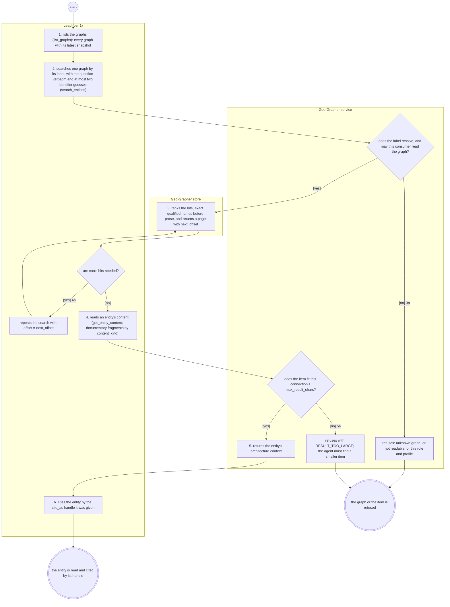

<!-- generated by render_pack.py from query-graph.spec.yaml sha256=083283c74a41c2e6a8ddb3f1eccd2dfcc1c15148cd2ccac892481f0b9d192168; edit the spec, not this file -->
# Query a graph through MCP, as it runs today

**UC-G3 · as-is · `IMPLEMENTED_VERIFIED`** · spec [query-graph.spec.yaml](../query-graph.spec.yaml)

| Problem | |
|---|---|
| symptom | On 20 November the Lead could not get the graph labels and guessed one; the Librarian now supplies them (9fd2fe9). |
| root | list_graphs answers with every graph and its snapshot; the cheap thing an agent needs, the labels, is not its own answer. |

## Written use case

| Field | Content |
|---|---|
| **Use case name** | Query a graph through MCP |
| **Brief description** | An agent lists the graphs, searches one by label, pages the hits, reads an entity and cites it by handle. |
| **Primary actor** | Lead (tier 1), or any agent |
| **Supporting actors** | Geo-Grapher service and store |
| **Preconditions** | The graph is served and readable for the consumer's role |
| **Trigger** | A question needs code or paper evidence |
| **Success guarantee** | The entity is read and cited by its handle |
| **Minimal guarantee** | A refusal names its reason |
| **Open questions** | Should listing return labels only, paged? |

**Main success scenario** (generated: the guard-true path, in step order)

1. The Lead (tier 1) lists the graphs (list_graphs): every graph with its latest snapshot.
2. The Lead (tier 1) searches one graph by its label, with the question verbatim and at most two identifier guesses (search_entities).
3. The Geo-Grapher store ranks the hits, exact qualified names before prose, and returns a page with next_offset.
4. The Lead (tier 1) reads an entity's content (get_entity_content; documentary fragments by content_kind).
5. The Geo-Grapher service returns the entity's architecture context.
6. The Lead (tier 1) cites the entity by the cite_as handle it was given.

**Extensions** (generated: one per non-happy guard; numbered by the step it leaves)

- **3a** (from: does the label resolve, and may this consumer read the graph?) *anticipated*
  - `3a1` No.
  - `3a2` The Geo-Grapher service refuses: unknown graph, or not readable for this role and profile.
  - `3a3` The use case ends: the graph or the item is refused.
- **4a** (from: are more hits needed?) *anticipated*
  - `4a1` Yes.
  - `4a2` The Lead (tier 1) repeats the search with offset = next_offset.
  - `4a3` Rejoin at 3.
- **5a** (from: does the item fit this connection's max_result_chars?) *anticipated*
  - `5a1` No.
  - `5a2` The Geo-Grapher service refuses with RESULT_TOO_LARGE; the agent must find a smaller item.
  - `5a3` The use case ends: the graph or the item is refused.

## Activity diagram



## Lane load

| Lane | On the main success scenario | Anywhere in the diagram |
|---|---|---|
| Lead (tier 1) | 5 | 6 |
| Geo-Grapher service | 3 | 5 |
| Geo-Grapher store | 1 | 1 |

Paths by how they end: **refused** 2, **success** 1.

## Decision tree

```text
start: Query a graph through MCP, as it runs today
      └─ T1: yes / no / yes  ⇒ the entity is read and cited by its handle
  └─ T2: no  ⇒ the graph or the item is refused
    └─ T3: yes / yes  ⇒ rejoins at step 3
      └─ T4: yes / no / no  ⇒ the graph or the item is refused
```

## Test cases

One test per path: the main success scenario, then each extension.

| Test | Path (guards taken) | Extension | Expected outcome |
|---|---|---|---|
| T1 | does the label resolve, and may this consumer read the graph? → yes; are more hits needed? → no; does the item fit this connection's max_result_chars? → yes | MSS | the entity is read and cited by its handle |
| T2 | does the label resolve, and may this consumer read the graph? → no | 3a | the graph or the item is refused |
| T3 | does the label resolve, and may this consumer read the graph? → yes; are more hits needed? → yes | 4a | rejoins at step 3 |
| T4 | does the label resolve, and may this consumer read the graph? → yes; are more hits needed? → no; does the item fit this connection's max_result_chars? → no | 5a | the graph or the item is refused |

### Boundary values

| Decision | Values to test | Expected |
|---|---|---|
| does the item fit this connection's max_result_chars? | item at max_result_chars; one character over | over: RESULT_TOO_LARGE |

## Weaknesses and gaps

| Id | Kind | Where | Weakness | Evidence | Handled in the to-be by |
|---|---|---|---|---|---|
| G-QRY-01 | cost | list | list_graphs answers with every graph and its snapshot; an agent that needs only the labels gets them from the Librarian, not from Geo-Grapher. | graph_server.py line 110 (router.summary); Librarian 9fd2fe9 | `query-graph` |
| G-QRY-02 | gap | toolarge | An item larger than the connection's limit is refused outright, with no pointer to a smaller part of it. | graph_router.py lines 560-562 | `query-graph` |

## Evidence

- F:/uv-data/Geo_Grapher/src/geographer/graph_server.py lines 47, 94, 110-130 (tool descriptions); graph_router.py lines 25-46 (operations, role tool sets), 560-562 (RESULT_TOO_LARGE).
- Librarian 9fd2fe9: graph labels in the Lead's context.

## Checks

Errors: none

Warnings: none
