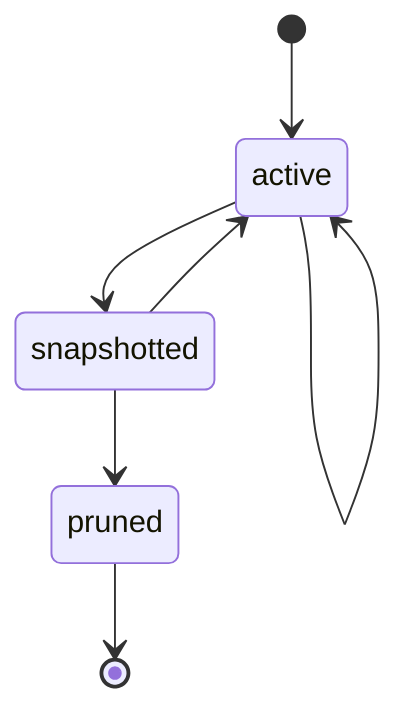

# State diagrams: geo-grapher/to-be

## A graph's paper store

One active database per graph; each paper is one transaction; snapshots exist only for rollback, by retention.

| From | To | On | By | Guard |
|---|---|---|---|---|
| active | active | — | Geo-Grapher store | — |
| active | snapshotted | — | Geo-Grapher store | — |
| snapshotted | active | — | Geo-Grapher store | — |
| snapshotted | pruned | — | Geo-Grapher store | — |
| active | active | — | Geo-Grapher store | — |

Evidence: To-be paper-import; as-is states.yaml (paper-generation)

Handles:

- **G-GEN-01**: Rollback snapshots are kept by a retention policy; a failed import leaves nothing behind.
