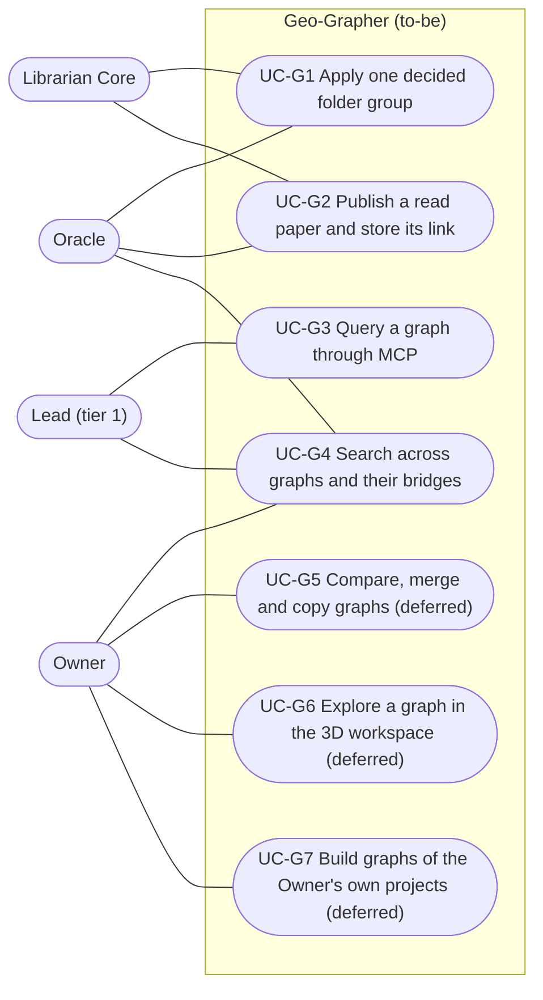

# Use case diagram: Geo-Grapher (to-be)

Actors outside the boundary; dashed arrows are «include» and «extend».

| Use case | Actors | Spec | Status |
|---|---|---|---|
| UC-G1 Apply one decided folder group | Librarian Core, Oracle | [graph-building](views/graph-building.views.md) | PROPOSED_UNACCEPTED |
| UC-G2 Publish a read paper and store its link | Librarian Core, Oracle | [paper-import](views/paper-import.views.md) | PROPOSED_UNACCEPTED |
| UC-G3 Query a graph through MCP | Lead (tier 1) | [query-graph](views/query-graph.views.md) | PROPOSED_UNACCEPTED |
| UC-G4 Search across graphs and their bridges | Lead (tier 1), Owner, Oracle | [federated-search](views/federated-search.views.md) | PROPOSED_UNACCEPTED |
| UC-G5 Compare, merge and copy graphs | Owner | — | deferred: not on the Librarian's path |
| UC-G6 Explore a graph in the 3D workspace | Owner | — | deferred: the person's UI |
| UC-G7 Build graphs of the Owner's own projects | Owner | — | deferred: outside folder review |
