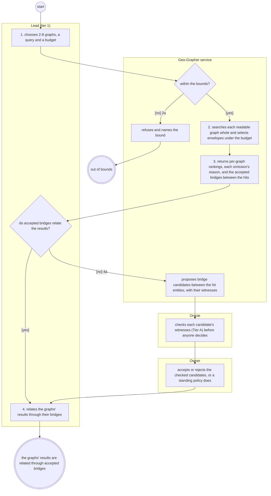

<!-- generated by render_pack.py from federated-search.spec.yaml sha256=8eb8d7f74bc0916b3fcaa5072e24769a54e604572b94b9396c5ea6c81d3a7d5f; edit the spec, not this file -->
# Search across graphs and their bridges (proposed)

**UC-G4 · to-be · `PROPOSED_UNACCEPTED`** · spec [federated-search.spec.yaml](../federated-search.spec.yaml)
Supersedes: `reports/2026-11-25-systems-analysis-finalisation/geo-grapher/as-is/federated-search.spec.yaml`

| Problem | |
|---|---|
| symptom | As-is: no bridges exist; the computed candidates go nowhere. |
| root | A candidate bridge is checked against its witnesses and decided like any other proposal; accepted bridges connect the results. |

## Written use case

| Field | Content |
|---|---|
| **Use case name** | Search across graphs and their bridges |
| **Brief description** | Per-graph results related through accepted bridges; candidates are proposed, checked and decided. |
| **Primary actor** | Lead (tier 1) |
| **Supporting actors** | Geo-Grapher service, Oracle, Owner |
| **Preconditions** | Readable graphs |
| **Trigger** | A comparison across projects |
| **Success guarantee** | Results related through accepted bridges |
| **Minimal guarantee** | A bridge is never accepted without its witnesses checked |
| **Open questions** | Which bridge kinds a standing policy may accept |

**Main success scenario** (generated: the guard-true path, in step order)

1. The Lead (tier 1) chooses 2-8 graphs, a query and a budget.
2. The Geo-Grapher service searches each readable graph whole and selects envelopes under the budget.
3. The Geo-Grapher service returns per-graph rankings, each omission's reason, and the accepted bridges between the hits.
4. The Lead (tier 1) relates the graphs' results through their bridges.

**Extensions** (generated: one per non-happy guard; numbered by the step it leaves)

- **2a** (from: within the bounds?) *anticipated*
  - `2a1` No.
  - `2a2` The Geo-Grapher service refuses and names the bound.
  - `2a3` The use case ends: out of bounds.
- **4a** (from: do accepted bridges relate the results?) *anticipated*
  - `4a1` No.
  - `4a2` The Geo-Grapher service proposes bridge candidates between the hit entities, with their witnesses.
  - `4a3` The Oracle checks each candidate's witnesses (Tier A) before anyone decides.
  - `4a4` The Owner accepts or rejects the checked candidates, or a standing policy does.
  - `4a5` Rejoin at 4.

## Activity diagram



## Lane load

| Lane | On the main success scenario | Anywhere in the diagram |
|---|---|---|
| Owner | 0 | 1 |
| Lead (tier 1) | 3 | 3 |
| Geo-Grapher service | 3 | 5 |
| Oracle | 0 | 1 |

Paths by how they end: **refused** 1, **success** 1.

## Decision tree

```text
start: Search across graphs and their bridges (proposed)
    └─ T1: yes / yes  ⇒ the graphs' results are related through accepted bridges
  └─ T2: no  ⇒ out of bounds
    └─ T3: yes / no  ⇒ rejoins at step 4
```

## Test cases

One test per path: the main success scenario, then each extension.

| Test | Path (guards taken) | Extension | Expected outcome |
|---|---|---|---|
| T1 | within the bounds? → yes; do accepted bridges relate the results? → yes | MSS | the graphs' results are related through accepted bridges |
| T2 | within the bounds? → no | 2a | out of bounds |
| T3 | within the bounds? → yes; do accepted bridges relate the results? → no | 4a | rejoins at step 4 |

### Boundary values

_None declared._

## As-is weaknesses this handles

| As-is weakness | Where here | How it is handled |
|---|---|---|
| G-FED-01 (federated-search): No bridges exist: bridges are only declared by hand, and the bridge candidates Geo-Grapher computes are read-only. | propose | Bridge candidates are proposed with their witnesses, checked by the Oracle and decided, so bridges come to exist. |
| G-FED-02 (federated-search): With no global rank, relating one graph's results to another's is left to the agent. | answer | Results come back with the accepted bridges between their hits. |

## Evidence

- As-is weaknesses G-FED-01, G-FED-02; analyze_cross_graphs bridge_candidates (graph_server.py line 118).

## Checks

Errors: none

Warnings: 
- decision dvalid ('within the bounds?') tests a quantity but declares no boundary values
