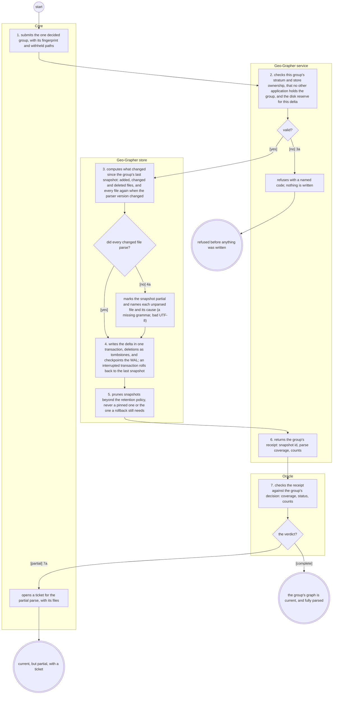

<!-- generated by render_pack.py from graph-building.spec.yaml sha256=95f2344a99b9537a5f5d5060478dbda4512020667995a6eeb7fe186652cd9408; edit the spec, not this file -->
# Apply one decided folder group to its graph (proposed)

**UC-G1 · to-be · `PROPOSED_UNACCEPTED`** · spec [graph-building.spec.yaml](../graph-building.spec.yaml)
Supersedes: `reports/2026-11-25-systems-analysis-finalisation/geo-grapher/as-is/graph-building.spec.yaml`

| Problem | |
|---|---|
| symptom | As-is: every accept rebuilds every group, appends full snapshots (77.2 GB), publishes complete over parse failures, and can leave a loop half committed. |
| root | A decision changes its own group, as a delta, in one transaction, and its receipt says exactly what was parsed. |

## Written use case

| Field | Content |
|---|---|
| **Use case name** | Apply one decided folder group |
| **Brief description** | The one decided group is applied as a delta in one transaction, pruned by retention, and its receipt judged. |
| **Primary actor** | Librarian Core |
| **Supporting actors** | Geo-Grapher service and store, Oracle |
| **Preconditions** | A decided group with its fingerprint |
| **Trigger** | The Librarian's folder-review applies a decision |
| **Success guarantee** | The group's graph is current and fully parsed |
| **Minimal guarantee** | Nothing is written before every check passes |
| **Open questions** | The retention policy's numbers |

**Main success scenario** (generated: the guard-true path, in step order)

1. The Core submits the one decided group, with its fingerprint and withheld paths.
2. The Geo-Grapher service checks this group's stratum and store ownership, that no other application holds the group, and the disk reserve for this delta.
3. The Geo-Grapher store computes what changed since the group's last snapshot: added, changed and deleted files, and every file again when the parser version changed.
4. The Geo-Grapher store writes the delta in one transaction, deletions as tombstones, and checkpoints the WAL; an interrupted transaction rolls back to the last snapshot.
5. The Geo-Grapher store prunes snapshots beyond the retention policy, never a pinned one or the one a rollback still needs.
6. The Geo-Grapher service returns the group's receipt: snapshot id, parse coverage, counts.
7. The Oracle checks the receipt against the group's decision: coverage, status, counts.

**Extensions** (generated: one per non-happy guard; numbered by the step it leaves)

- **3a** (from: valid?) *anticipated*
  - `3a1` No.
  - `3a2` The Geo-Grapher service refuses with a named code; nothing is written.
  - `3a3` The use case ends: refused before anything was written.
- **4a** (from: did every changed file parse?) *anticipated*
  - `4a1` No.
  - `4a2` The Geo-Grapher store marks the snapshot partial and names each unparsed file and its cause (a missing grammar, bad UTF-8).
  - `4a3` Rejoin at 4.
- **7a** (from: the verdict?) *anticipated*
  - `7a1` Partial.
  - `7a2` The Core opens a ticket for the partial parse, with its files.
  - `7a3` The use case ends: current, but partial, with a ticket.

## Activity diagram



## Lane load

| Lane | On the main success scenario | Anywhere in the diagram |
|---|---|---|
| Core | 1 | 2 |
| Geo-Grapher service | 3 | 4 |
| Geo-Grapher store | 4 | 5 |
| Oracle | 2 | 2 |

Paths by how they end: **partial** 1, **refused** 1, **success** 1.

## Decision tree

```text
start: Apply one decided folder group to its graph (proposed)
      └─ T1: yes / yes / complete  ⇒ the group's graph is current, and fully parsed
  └─ T2: no  ⇒ refused before anything was written
    └─ T3: yes / no  ⇒ rejoins at step 4
      └─ T4: yes / yes / partial  ⇒ current, but partial, with a ticket
```

## Test cases

One test per path: the main success scenario, then each extension.

| Test | Path (guards taken) | Extension | Expected outcome |
|---|---|---|---|
| T1 | valid? → yes; did every changed file parse? → yes; the verdict? → complete | MSS | the group's graph is current, and fully parsed |
| T2 | valid? → no | 3a | refused before anything was written |
| T3 | valid? → yes; did every changed file parse? → no | 4a | rejoins at step 4 |
| T4 | valid? → yes; did every changed file parse? → yes; the verdict? → partial | 7a | current, but partial, with a ticket |

### Boundary values

_None declared._

## As-is weaknesses this handles

| As-is weakness | Where here | How it is handled |
|---|---|---|
| G-BLD-01 (graph-building): Every folder accept loops serially over every reviewed group in the library, under a 14,400-second timeout. | submit | Only the one decided group is submitted and applied. |
| G-BLD-02 (graph-building): Parse failures (a missing tree-sitter grammar, bad UTF-8, TypeScript) are logged, and the snapshot still publishes status complete. | partial | Unparsed files make the snapshot partial, each named with its cause, and the Oracle's partial verdict opens a ticket. |
| G-BLD-03 (graph-building): Each build appends a full, unpruned snapshot: 30 graphs use 77.2 GB, up to 19.5 GB for one documentation graph. | delta | A delta snapshot of what changed, pruned by a retention policy. |
| G-BLD-04 (graph-building): The code stores and the catalogue are written without a WAL checkpoint. | write | One transaction per group, then a WAL checkpoint. |
| G-BLD-05 (graph-building): A failed build ends in an opaque GEOGRAPHER_CALL_FAILED, while the groups earlier in the loop may already be committed. | refuse | Checks run before anything is written, and a refusal names its code; one group is one transaction, so nothing is half committed. |

## Evidence

- As-is graph-building and its weaknesses G-BLD-01 to G-BLD-05; Librarian to-be folder-review (folderapply: only the changed group).

## Checks

Errors: none

Warnings: none
