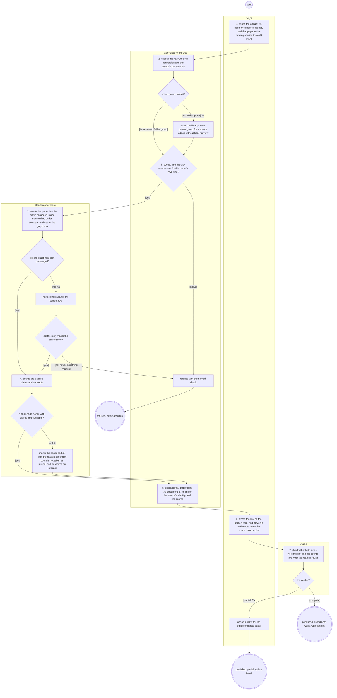

<!-- generated by render_pack.py from paper-import.spec.yaml sha256=0d602c7f4a7d3a3cdf4b8dde1a35262072f927ac87d06d8081b38e8e7965db9b; edit the spec, not this file -->
# Publish a read paper and store its link (proposed)

**UC-G2 · to-be · `PROPOSED_UNACCEPTED`** · spec [paper-import.spec.yaml](../paper-import.spec.yaml)
Supersedes: `reports/2026-11-25-systems-analysis-finalisation/geo-grapher/as-is/graph-building.spec.yaml`

| Problem | |
|---|---|
| symptom | As-is: each paper copies the whole paper database, is published empty without complaint, and leaves no link to its source. |
| root | A paper is one insert into the active database, checked for content, and its receipt carries the link both sides store. |

## Written use case

| Field | Content |
|---|---|
| **Use case name** | Publish a read paper and store its link |
| **Brief description** | One checked insert into the active paper database; the receipt carries the link to the source, which the Librarian stores. |
| **Primary actor** | Librarian Core |
| **Supporting actors** | Geo-Grapher service and store, Oracle |
| **Preconditions** | A fully read, fully converted paper |
| **Trigger** | The Librarian's publication stage |
| **Success guarantee** | Published with content, linked both ways |
| **Minimal guarantee** | An empty paper is partial and ticketed |
| **Open questions** | Does the library's own papers group need review before first use? |

**Main success scenario** (generated: the guard-true path, in step order)

1. The Core sends the artifact, its hash, the source's identity and the graph to the running service (no cold start).
2. The Geo-Grapher service checks the hash, the full conversion and the source's provenance.
3. The Geo-Grapher store inserts the paper into the active database in one transaction, under compare-and-set on the graph row.
4. The Geo-Grapher store counts the paper's claims and concepts.
5. The Geo-Grapher service checkpoints, and returns the document id, its link to the source's identity, and the counts.
6. The Core stores the link on the staged item, and moves it to the note when the source is accepted.
7. The Oracle checks that both sides hold the link and the counts are what the reading found.

**Extensions** (generated: one per non-happy guard; numbered by the step it leaves)

- **3a** (from: which graph holds it?) *anticipated*
  - `3a1` No folder group.
  - `3a2` The Geo-Grapher service uses the library's own papers group for a source added without folder review.
  - `3a3` The Geo-Grapher service decides: in scope, and the disk reserve met for this paper's own size?
  - `3a3a` If no: refuses with the named check.
  - `3a4` If yes:
  - `3a5` Rejoin at 3.
- **3b** (from: in scope, and the disk reserve met for this paper's own size?) *anticipated*
  - `3b1` No.
  - `3b2` The Geo-Grapher service refuses with the named check.
  - `3b3` The use case ends: refused, nothing written.
- **4a** (from: did the graph row stay unchanged?) *anticipated*
  - `4a1` No.
  - `4a2` The Geo-Grapher store retries once against the current row.
  - `4a3` The Geo-Grapher store decides: did the retry match the current row?
  - `4a3a` If no: refused, nothing written: refuses with the named check.
  - `4a4` If yes:
  - `4a5` Rejoin at 4.
- **5a** (from: a multi-page paper with claims and concepts?) *anticipated*
  - `5a1` No.
  - `5a2` The Geo-Grapher store marks the paper partial, with the reason; an empty count is not taken as unread, and no claims are invented.
  - `5a3` Rejoin at 5.
- **7a** (from: the verdict?) *anticipated*
  - `7a1` Partial.
  - `7a2` The Core opens a ticket for the empty or partial paper.
  - `7a3` The use case ends: published partial, with a ticket.

## Activity diagram



## Lane load

| Lane | On the main success scenario | Anywhere in the diagram |
|---|---|---|
| Core | 2 | 3 |
| Geo-Grapher service | 4 | 6 |
| Geo-Grapher store | 4 | 7 |
| Oracle | 2 | 2 |

Paths by how they end: **partial** 1, **refused** 2, **success** 1.

## Decision tree

```text
start: Publish a read paper and store its link (proposed)
          └─ T1: its reviewed folder group / yes / yes / yes / complete  ⇒ published, linked both ways, with content
  └─ T2: no folder group  ⇒ rejoins at 'in scope, and the disk reserve met for this paper's own size?' (before step 3)
    └─ T3: its reviewed folder group / no  ⇒ refused, nothing written
        └─ T4: its reviewed folder group / yes / no / no: refused, nothing written  ⇒ refused, nothing written
        └─ T5: its reviewed folder group / yes / no / yes  ⇒ rejoins at step 4
        └─ T6: its reviewed folder group / yes / yes / no  ⇒ rejoins at step 5
          └─ T7: its reviewed folder group / yes / yes / yes / partial  ⇒ published partial, with a ticket
```

## Test cases

One test per path: the main success scenario, then each extension.

| Test | Path (guards taken) | Extension | Expected outcome |
|---|---|---|---|
| T1 | which graph holds it? → its reviewed folder group; in scope, and the disk reserve met for this paper's own size? → yes; did the graph row stay unchanged? → yes; a multi-page paper with claims and concepts? → yes; the verdict? → complete | MSS | published, linked both ways, with content |
| T2 | which graph holds it? → no folder group | 3a | rejoins at 'in scope, and the disk reserve met for this paper's own size?' (before step 3) |
| T3 | which graph holds it? → its reviewed folder group; in scope, and the disk reserve met for this paper's own size? → no | 3b | refused, nothing written |
| T4 | which graph holds it? → its reviewed folder group; in scope, and the disk reserve met for this paper's own size? → yes; did the graph row stay unchanged? → no; did the retry match the current row? → no: refused, nothing written | 4a | refused, nothing written |
| T5 | which graph holds it? → its reviewed folder group; in scope, and the disk reserve met for this paper's own size? → yes; did the graph row stay unchanged? → no; did the retry match the current row? → yes | 4a | rejoins at step 4 |
| T6 | which graph holds it? → its reviewed folder group; in scope, and the disk reserve met for this paper's own size? → yes; did the graph row stay unchanged? → yes; a multi-page paper with claims and concepts? → no | 5a | rejoins at step 5 |
| T7 | which graph holds it? → its reviewed folder group; in scope, and the disk reserve met for this paper's own size? → yes; did the graph row stay unchanged? → yes; a multi-page paper with claims and concepts? → yes; the verdict? → partial | 7a | published partial, with a ticket |

### Boundary values

_None declared._

## As-is weaknesses this handles

| As-is weakness | Where here | How it is handled |
|---|---|---|
| G-BLD-06 (graph-building): Each paper publication copies the whole previous paper database into a new generation and deletes nothing: 96 copies take 873 MB for one 16 MB database. | insert | A paper is one insert into the active database; nothing is copied. |
| G-BLD-07 (graph-building): Each PDF is published by a cold-start CLI subprocess. | send | The running service imports the paper; there is no cold-start subprocess. |
| G-BLD-08 (graph-building): Publication is recorded complete with no check of claims or concepts: 12 unread papers have 0 claims, and 72 have 0 concepts. | dcontent | A multi-page paper with no claims or concepts is marked partial and ticketed, never recorded complete. |
| G-BLD-09 (graph-building): 48 published papers have no accepted Source note: the graph and the library disagree about what is in the library. | link | The link is stored on the staged item and moves to the note on acceptance, so the graph and the library agree. |
| G-BLD-10 (graph-building): A paper is published only into an active reviewed folder group whose reviewed roots hold the original, so a source added without folder review is never published. | libgroup | A source added without folder review is published into the library's own papers group. |
| G-BLD-11 (graph-building): The import receipt returns a document count, not the new document's id, so neither side can store a link between the paper and its source. | receipt | The receipt returns the document id and its link to the source's identity. |
| G-BLD-12 (graph-building): The disk reserve grows with twice the previous paper database, so as generations pile up, publication will be refused (DISK_RESERVE). | dscope | The disk reserve is checked against the paper's own size. |

## Evidence

- As-is weaknesses G-BLD-06 to G-BLD-12; geographer/library_papers.py publish.

## Checks

Errors: none

Warnings: none
