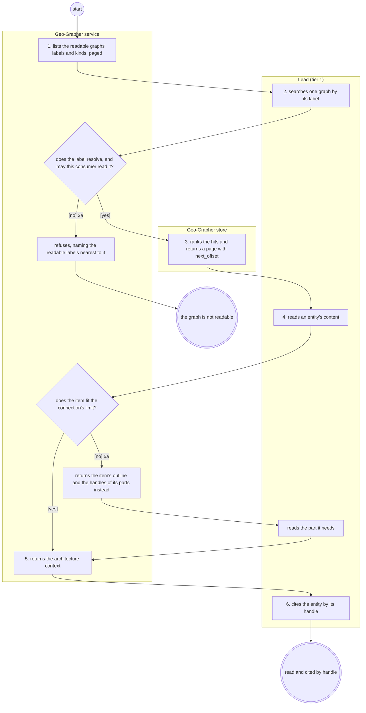

<!-- generated by render_pack.py from query-graph.spec.yaml sha256=59150f4b588ff300d2d325dc7a9716ebbd324520405303a0e649c2f8fff54f71; edit the spec, not this file -->
# Query a graph through MCP (proposed)

**UC-G3 · to-be · `PROPOSED_UNACCEPTED`** · spec [query-graph.spec.yaml](../query-graph.spec.yaml)
Supersedes: `reports/2026-11-25-systems-analysis-finalisation/geo-grapher/as-is/query-graph.spec.yaml`

| Problem | |
|---|---|
| symptom | As-is: listing returns every graph and snapshot; a large item returns nothing. |
| root | Listing pages labels; a large item answers with its parts. |

## Written use case

| Field | Content |
|---|---|
| **Use case name** | Query a graph through MCP |
| **Brief description** | Paged labels, ranked hits, and large items answered by their parts. |
| **Primary actor** | Lead (tier 1), or any agent |
| **Supporting actors** | Geo-Grapher service and store |
| **Preconditions** | A readable graph |
| **Trigger** | A question needs graph evidence |
| **Success guarantee** | Read and cited by handle |
| **Minimal guarantee** | A refusal names the nearest readable labels |
| **Open questions** | — |

**Main success scenario** (generated: the guard-true path, in step order)

1. The Geo-Grapher service lists the readable graphs' labels and kinds, paged.
2. The Lead (tier 1) searches one graph by its label.
3. The Geo-Grapher store ranks the hits and returns a page with next_offset.
4. The Lead (tier 1) reads an entity's content.
5. The Geo-Grapher service returns the architecture context.
6. The Lead (tier 1) cites the entity by its handle.

**Extensions** (generated: one per non-happy guard; numbered by the step it leaves)

- **3a** (from: does the label resolve, and may this consumer read it?) *anticipated*
  - `3a1` No.
  - `3a2` The Geo-Grapher service refuses, naming the readable labels nearest to it.
  - `3a3` The use case ends: the graph is not readable.
- **5a** (from: does the item fit the connection's limit?) *anticipated*
  - `5a1` No.
  - `5a2` The Geo-Grapher service returns the item's outline and the handles of its parts instead.
  - `5a3` The Lead (tier 1) reads the part it needs.
  - `5a4` Rejoin at 5.

## Activity diagram



## Lane load

| Lane | On the main success scenario | Anywhere in the diagram |
|---|---|---|
| Lead (tier 1) | 3 | 4 |
| Geo-Grapher service | 4 | 6 |
| Geo-Grapher store | 1 | 1 |

Paths by how they end: **refused** 1, **success** 1.

## Decision tree

```text
start: Query a graph through MCP (proposed)
    └─ T1: yes / yes  ⇒ read and cited by handle
  └─ T2: no  ⇒ the graph is not readable
    └─ T3: yes / no  ⇒ rejoins at step 5
```

## Test cases

One test per path: the main success scenario, then each extension.

| Test | Path (guards taken) | Extension | Expected outcome |
|---|---|---|---|
| T1 | does the label resolve, and may this consumer read it? → yes; does the item fit the connection's limit? → yes | MSS | read and cited by handle |
| T2 | does the label resolve, and may this consumer read it? → no | 3a | the graph is not readable |
| T3 | does the label resolve, and may this consumer read it? → yes; does the item fit the connection's limit? → no | 5a | rejoins at step 5 |

### Boundary values

_None declared._

## As-is weaknesses this handles

| As-is weakness | Where here | How it is handled |
|---|---|---|
| G-QRY-01 (query-graph): list_graphs answers with every graph and its snapshot; an agent that needs only the labels gets them from the Librarian, not from Geo-Grapher. | list | Listing returns the readable labels and kinds, paged. |
| G-QRY-02 (query-graph): An item larger than the connection's limit is refused outright, with no pointer to a smaller part of it. | parts | An oversized item answers with its outline and the handles of its parts. |

## Evidence

- As-is weaknesses G-QRY-01, G-QRY-02.

## Checks

Errors: none

Warnings: 
- decision dsize ('does the item fit the connection's limit?') tests a quantity but declares no boundary values
