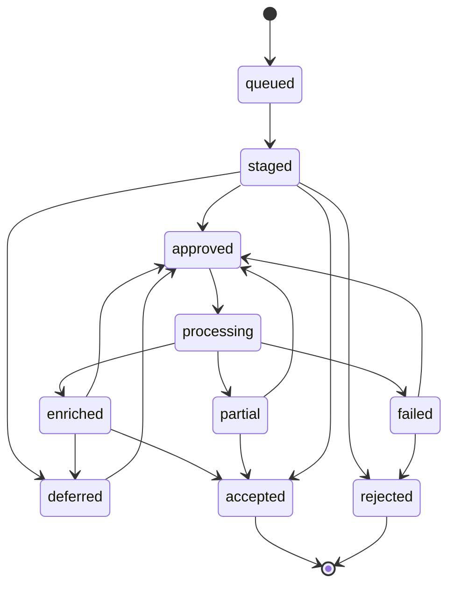
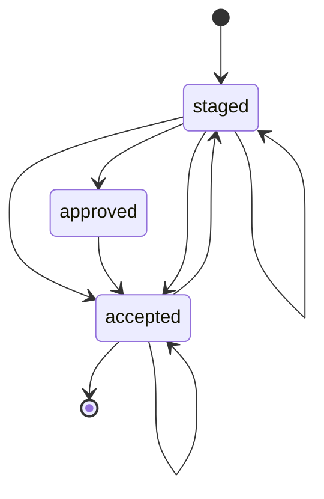
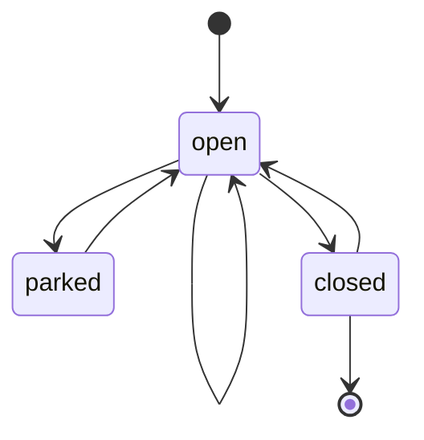
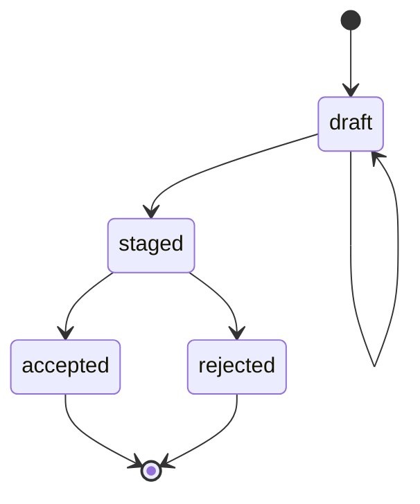

# State diagrams: librarian/as-is

## A staged item (a source)

One source in staging, from capture to its decision. STATUSES and DECIDABLE in staging.py.

| From | To | On | By | Guard |
|---|---|---|---|---|
| queued | staged | — | Core | — |
| staged | approved | — | Owner | — |
| deferred | approved | — | Owner | — |
| approved | processing | — | Owner | — |
| processing | enriched | — | Core | — |
| processing | partial | — | Core | — |
| processing | failed | — | Core | — |
| partial | approved | — | Owner | — |
| failed | approved | — | Owner | — |
| enriched | approved | — | Owner | — |
| enriched | accepted | — | Owner | promotion.mode = person; or agent mode, attested as agent |
| partial | accepted | — | Owner | — |
| staged | accepted | — | Owner | — |
| staged | deferred | — | Owner | — |
| enriched | deferred | — | Owner | — |
| staged | rejected | — | Owner | — |
| failed | rejected | — | Owner | — |

Evidence: src/resource_librarian/staging.py lines 80-87 (STATUSES, DECIDABLE); batch.py stage results

Weaknesses:

- **W-STI-01** (risk): A source can be accepted straight from staged ('accept as captured'), entering the library with only what intake fetched read; only its coverage label says so. Evidence: staging.py DECIDABLE['accept'] includes staged; CAPTURED. Handled by: `state:staged-item`.
- **W-STI-02** (gap): An enriched or partial item has no owner and no deadline: it waits until someone decides it. Evidence: OP1; 96 items waited 19-20 November; awaiting_acceptance() counts them (8489387). Handled by: `state:staged-item`.

## A folder card

One folder's decision in the Folders tab. folder_review.py.

| From | To | On | By | Guard |
|---|---|---|---|---|
| staged | staged | — | Model worker | — |
| staged | approved | — | Owner | — |
| staged | accepted | — | Owner | the fingerprint matches; no accepted root is stale |
| approved | accepted | — | Owner | — |
| staged | accepted | — | Core | — |
| accepted | accepted | — | Geo-Grapher | — |
| accepted | staged | — | Owner | — |

Evidence: src/resource_librarian/folder_review.py: survey (342), approve_batch (469), accept (539), accept_by_policy (616); FOLDER_STALE at 496, 556, 560, 591, 631

## A session

A Lead's session and its phases. session.py Session; standard/phases.yaml.

| From | To | On | By | Guard |
|---|---|---|---|---|
| open | open | — | Lead (tier 1) | — |
| open | parked | — | Core | — |
| parked | open | — | Owner | — |
| open | closed | — | Lead (tier 1) | — |
| closed | open | — | Owner | — |

Evidence: src/resource_librarian/session.py lines 694-707 (status events), 490-499 (budget_left), 836-839 (next_step); broker.py 228-236 (park on an unanswered permission)

## An offering (a drafted report)

A report drafted in Synthesise, checked, staged and accepted by a person. tools/sessions.py.

| From | To | On | By | Guard |
|---|---|---|---|---|
| draft | staged | — | Core | — |
| draft | draft | — | Lead (tier 1) | — |
| staged | accepted | — | Owner | — |
| staged | rejected | — | Owner | — |

Evidence: src/resource_librarian/tools/sessions.py lines 1665 (status draft) and 1702 (status staged); promote_offering
