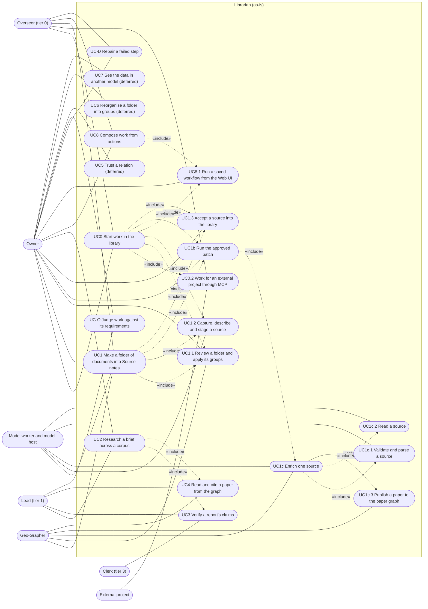

# Use case diagram: Librarian (as-is)

Actors outside the boundary; dashed arrows are «include» and «extend».

| Use case | Actors | Spec | Status |
|---|---|---|---|
| UC0 Start work in the library | Owner, Overseer (tier 0) | [activation](views/activation.views.md) | IMPLEMENTED_VERIFIED |
| UC0.2 Work for an external project through MCP | Overseer (tier 0), External project | [activation-external-project](views/activation-external-project.views.md) | IMPLEMENTED_VERIFIED |
| UC1 Make a folder of documents into Source notes | Owner, Overseer (tier 0), Geo-Grapher, Model worker and model host | [ingestion](views/ingestion.views.md) | IMPLEMENTED_VERIFIED |
| UC1.1 Review a folder and apply its groups | Owner, Geo-Grapher | [folder-review](views/folder-review.views.md) | IMPLEMENTED_VERIFIED |
| UC1.2 Capture, describe and stage a source | Model worker and model host | [source-intake](views/source-intake.views.md) | IMPLEMENTED_VERIFIED |
| UC1b Run the approved batch | Owner | [batch-enrichment](views/batch-enrichment.views.md) | IMPLEMENTED_VERIFIED |
| UC1c Enrich one source | Model worker and model host, Geo-Grapher | [source-enrichment](views/source-enrichment.views.md) | IMPLEMENTED_VERIFIED |
| UC1c.1 Validate and parse a source | Model worker and model host | [source-parse](views/source-parse.views.md) | IMPLEMENTED_VERIFIED |
| UC1c.2 Read a source | Model worker and model host | [source-reading](views/source-reading.views.md) | IMPLEMENTED_VERIFIED |
| UC1c.3 Publish a paper to the paper graph | Geo-Grapher | [paper-publication](views/paper-publication.views.md) | IMPLEMENTED_VERIFIED |
| UC1.3 Accept a source into the library | Owner | [acceptance](views/acceptance.views.md) | IMPLEMENTED_VERIFIED |
| UC2 Research a brief across a corpus | Owner, Lead (tier 1) | [research](views/research.views.md) | IMPLEMENTED_OBSERVED |
| UC3 Verify a report's claims | Lead (tier 1), Clerk (tier 3) | [verify-claims](views/verify-claims.views.md) | IMPLEMENTED_OBSERVED |
| UC4 Read and cite a paper from the graph | Lead (tier 1), Geo-Grapher | [cite-graph](views/cite-graph.views.md) | IMPLEMENTED_OBSERVED |
| UC8 Compose work from actions | Owner, Overseer (tier 0) | [compose](views/compose.views.md) | IMPLEMENTED_VERIFIED |
| UC8.1 Run a saved workflow from the Web UI | Owner | [workflow-run](views/workflow-run.views.md) | IMPLEMENTED_VERIFIED |
| UC-D Repair a failed step | Overseer (tier 0), Owner | [doctor](views/doctor.views.md) | IMPLEMENTED_OBSERVED |
| UC-O Judge work against its requirements | Owner, Lead (tier 1) | [oracle](views/oracle.views.md) | IMPLEMENTED_VERIFIED |
| UC5 Trust a relation | Owner | — | deferred: to-be only; there is no as-is (USE-CASES.md UC5) |
| UC6 Reorganise a folder into groups | Owner | — | deferred: PLAN.md 2.2 |
| UC7 See the data in another model | Owner | — | deferred: PLAN.md 2.2 |
