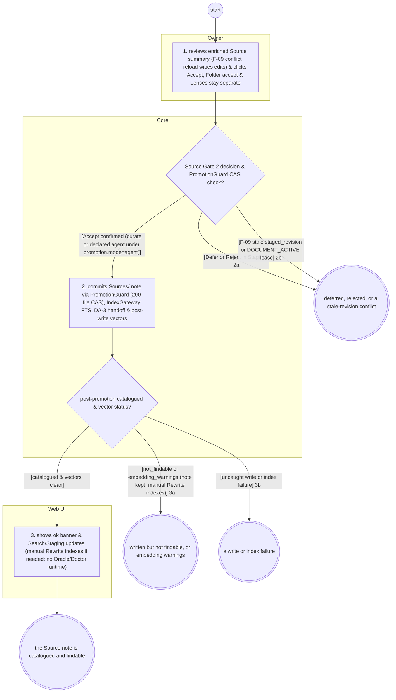

<!-- generated by render_pack.py from acceptance.spec.yaml sha256=3ca4a546c4e88c2f72358abd90e05f55e97d8630fec8381da79bcf9521df8ce2; edit the spec, not this file -->
# Accept an enriched source into the library, as it runs today

**UC1.3 · as-is · `IMPLEMENTED_VERIFIED`** · spec [acceptance.spec.yaml](../acceptance.spec.yaml)

## Written use case

| Field | Content |
|---|---|
| **Use case name** | Accept a source into the library |
| **Brief description** | The person reviews the enriched summary and accepts it; the guarded writer commits the note and indexes it. |
| **Primary actor** | Owner |
| **Supporting actors** | Web UI, Core |
| **Preconditions** | An enriched or partial staged source |
| **Trigger** | Accept in Staging |
| **Success guarantee** | The note is catalogued and findable by title, Bottom Line and concepts |
| **Minimal guarantee** | A stale revision is refused; nothing is half-written |
| **Open questions** | OP1: who is told that read work is waiting, and who decides? |

**Main success scenario** (generated: the guard-true path, in step order)

1. The Owner reviews enriched Source summary (F-09 conflict reload wipes edits) & clicks Accept; Folder accept & Lenses stay separate.
2. The Core commits Sources/ note via PromotionGuard (200-file CAS), IndexGateway FTS, DA-3 handoff & post-write vectors.
3. The Web UI shows ok banner & Search/Staging updates (manual Rewrite indexes if needed; no Oracle/Doctor runtime).

**Extensions** (generated: one per non-happy guard; numbered by the step it leaves)

- **2a** (from: Source Gate 2 decision & PromotionGuard CAS check?) *anticipated*
  - `2a1` Defer or Reject in Staging.
  - `2a2` The use case ends: deferred, rejected, or a stale-revision conflict.
- **2b** (from: Source Gate 2 decision & PromotionGuard CAS check?) *anticipated*
  - `2b1` F-09 stale staged_revision or DOCUMENT_ACTIVE lease.
  - `2b2` The use case ends: deferred, rejected, or a stale-revision conflict.
- **3a** (from: post-promotion catalogued & vector status?) *anticipated*
  - `3a1` Not_findable or embedding_warnings (note kept; manual Rewrite indexes).
  - `3a2` The use case ends: written but not findable, or embedding warnings.
- **3b** (from: post-promotion catalogued & vector status?) *anticipated*
  - `3b1` Uncaught write or index failure.
  - `3b2` The use case ends: a write or index failure.

## Activity diagram



## Lane load

| Lane | On the main success scenario | Anywhere in the diagram |
|---|---|---|
| Core | 3 | 3 |
| Web UI | 1 | 1 |
| Owner | 1 | 1 |

Paths by how they end: **escalated** 1, **partial** 1, **paused** 2, **success** 1. Every *escalated* path is a failure of this use case: the work went back to tier 0.

## Decision tree

```text
start: Accept an enriched source into the library, as it runs today
    └─ T1: Accept confirmed (curate or declared agent under promotion.mode=agent) / catalogued & vectors clean  ⇒ the Source note is catalogued and findable
  └─ T2: Defer or Reject in Staging  ⇒ deferred, rejected, or a stale-revision conflict
  └─ T3: F-09 stale staged_revision or DOCUMENT_ACTIVE lease  ⇒ deferred, rejected, or a stale-revision conflict
    └─ T4: Accept confirmed (curate or declared agent under promotion.mode=agent) / not_findable or embedding_warnings (note kept; manual Rewrite indexes)  ⇒ written but not findable, or embedding warnings
    └─ T5: Accept confirmed (curate or declared agent under promotion.mode=agent) / uncaught write or index failure  ⇒ a write or index failure
```

## Test cases

One test per path: the main success scenario, then each extension.

| Test | Path (guards taken) | Extension | Expected outcome |
|---|---|---|---|
| T1 | Source Gate 2 decision & PromotionGuard CAS check? → Accept confirmed (curate or declared agent under promotion.mode=agent); post-promotion catalogued & vector status? → catalogued & vectors clean | MSS | the Source note is catalogued and findable |
| T2 | Source Gate 2 decision & PromotionGuard CAS check? → Defer or Reject in Staging | 2a | deferred, rejected, or a stale-revision conflict |
| T3 | Source Gate 2 decision & PromotionGuard CAS check? → F-09 stale staged_revision or DOCUMENT_ACTIVE lease | 2b | deferred, rejected, or a stale-revision conflict |
| T4 | Source Gate 2 decision & PromotionGuard CAS check? → Accept confirmed (curate or declared agent under promotion.mode=agent); post-promotion catalogued & vector status? → not_findable or embedding_warnings (note kept; manual Rewrite indexes) | 3a | written but not findable, or embedding warnings |
| T5 | Source Gate 2 decision & PromotionGuard CAS check? → Accept confirmed (curate or declared agent under promotion.mode=agent); post-promotion catalogued & vector status? → uncaught write or index failure | 3b | a write or index failure |

### Boundary values

_None declared._

## Weaknesses and gaps

| Id | Kind | Where | Weakness | Evidence | Handled in the to-be by |
|---|---|---|---|---|---|
| W-ACC-01 | fault | gate2_ui | A stale-revision conflict reloads the form and wipes the person's edits (F-09). | gate2_ui label | **not yet** |
| W-ACC-02 | gap | dfind_curr | A note written but not findable needs a manual Rewrite indexes; nothing re-checks findability by itself. | ui_done label; remedy-catalogue R5 (proposed) | **not yet** |
| W-ACC-03 | unverified | gate2_ui | The only check of an enriched source is a person reading its summary; nothing compares the note with its evidence first. | ui_done label: no Oracle or Doctor at run time | **not yet** |
| W-ACC-04 | drift | promote_curr | The 96 notes an agent accepted on 20 November still record a person as the attester; correcting them is an Owner decision. | 8489387 (F2: attestation names who accepted) | **not yet** |

## Checks

Errors: none

Warnings: none
