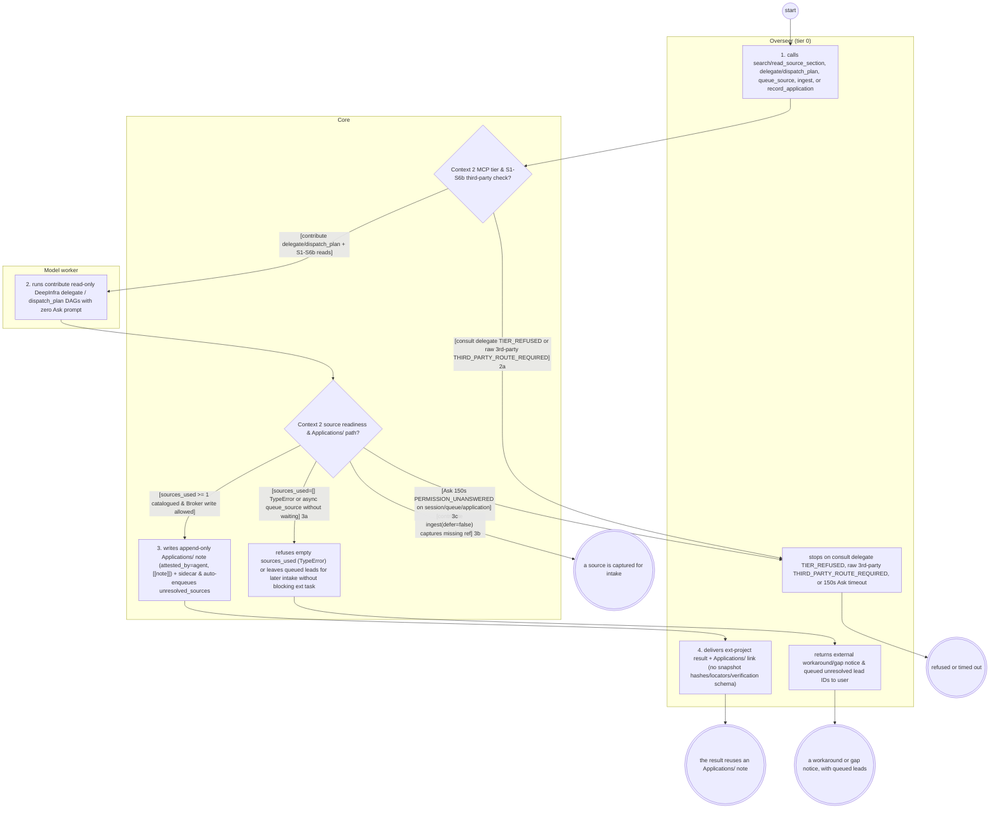

<!-- generated by render_pack.py from activation-external-project.spec.yaml sha256=75ac8c27a602825e501bce7fb7db3f5c8cf62043d9358188090822d42fcae4fe; edit the spec, not this file -->
# Work for an external project through MCP (Context 2), as it runs today

**UC0.2 · as-is · `IMPLEMENTED_VERIFIED`** · spec [activation-external-project.spec.yaml](../activation-external-project.spec.yaml)

## Written use case

| Field | Content |
|---|---|
| **Use case name** | Work for an external project through MCP |
| **Brief description** | Tier 0, working in another project, searches and reads the library, delegates bounded reading, and records what it applied. |
| **Primary actor** | Overseer (tier 0), in the external project |
| **Supporting actors** | Core, model worker (delegate, dispatch_plan) |
| **Preconditions** | MCP connected at contribute; the third-party route is set for raw third-party reading |
| **Trigger** | The external task needs the library |
| **Success guarantee** | An Applications/ note records what was used, attested by the agent |
| **Minimal guarantee** | Unresolved sources are queued as leads; nothing is ingested past the tier |
| **Open questions** | What should an Applications/ note pin: snapshot hashes, locators, the verification used? |

**Main success scenario** (generated: the guard-true path, in step order)

1. The Overseer (tier 0) calls search/read_source_section, delegate/dispatch_plan, queue_source, ingest, or record_application.
2. The Model worker runs contribute read-only DeepInfra delegate / dispatch_plan DAGs with zero Ask prompt.
3. The Core writes append-only Applications/ note (attested_by=agent, [[note]]) + sidecar & auto-enqueues unresolved_sources.
4. The Overseer (tier 0) delivers ext-project result + Applications/ link (no snapshot hashes/locators/verification schema).

**Extensions** (generated: one per non-happy guard; numbered by the step it leaves)

- **2a** (from: Context 2 MCP tier & S1-S6b third-party check?) *anticipated*
  - `2a1` Consult delegate TIER_REFUSED or raw 3rd-party THIRD_PARTY_ROUTE_REQUIRED.
  - `2a2` The Overseer (tier 0) stops on consult delegate TIER_REFUSED, raw 3rd-party THIRD_PARTY_ROUTE_REQUIRED, or 150s Ask timeout.
  - `2a3` The use case ends: refused or timed out.
- **3a** (from: Context 2 source readiness & Applications/ path?) *anticipated*
  - `3a1` Sources_used=[] TypeError or async queue_source without waiting.
  - `3a2` The Core refuses empty sources_used (TypeError) or leaves queued leads for later intake without blocking ext task.
  - `3a3` The Overseer (tier 0) returns external workaround/gap notice & queued unresolved lead IDs to user.
  - `3a4` The use case ends: a workaround or gap notice, with queued leads.
- **3b** (from: Context 2 source readiness & Applications/ path?) *anticipated*
  - `3b1` Contribute ingest(defer=false) captures missing ref.
  - `3b2` The use case ends: a source is captured for intake.
- **3c** (from: Context 2 source readiness & Applications/ path?) *anticipated*
  - `3c1` Ask 150s PERMISSION_UNANSWERED on session/queue/application.
  - `3c2` The Overseer (tier 0) stops on consult delegate TIER_REFUSED, raw 3rd-party THIRD_PARTY_ROUTE_REQUIRED, or 150s Ask timeout.
  - `3c3` The use case ends: refused or timed out.

## Activity diagram



## Lane load

| Lane | On the main success scenario | Anywhere in the diagram |
|---|---|---|
| Overseer (tier 0) | 2 | 4 |
| Core | 3 | 4 |
| Model worker | 1 | 1 |

**Tier-0 turns** (each return of control to tier 0; owner's scale: 2 ideal, 3 expected, 4 rusty, 5–10 bad, more: might as well have done it themselves). Main success scenario: **2 (ideal)**. Worst path: T5, **2 (ideal)**. Paths by grade: ideal 5.

Paths by how they end: **partial** 1, **paused** 2, **reused** 1, **success** 1.

## Decision tree

```text
start: Work for an external project through MCP (Context 2), as it runs today
    └─ T1: contribute delegate/dispatch_plan + S1-S6b reads / sources_used >= 1 catalogued & Broker write allowed  ⇒ the result reuses an Applications/ note
  └─ T2: consult delegate TIER_REFUSED or raw 3rd-party THIRD_PARTY_ROUTE_REQUIRED  ⇒ refused or timed out
    └─ T3: contribute delegate/dispatch_plan + S1-S6b reads / sources_used=[] TypeError or async queue_source without waiting  ⇒ a workaround or gap notice, with queued leads
    └─ T4: contribute delegate/dispatch_plan + S1-S6b reads / contribute ingest(defer=false) captures missing ref  ⇒ a source is captured for intake
    └─ T5: contribute delegate/dispatch_plan + S1-S6b reads / Ask 150s PERMISSION_UNANSWERED on session/queue/application  ⇒ refused or timed out
```

## Test cases

One test per path: the main success scenario, then each extension.

| Test | Path (guards taken) | Extension | Expected outcome | Tier-0 turns |
|---|---|---|---|---|
| T1 | Context 2 MCP tier & S1-S6b third-party check? → contribute delegate/dispatch_plan + S1-S6b reads; Context 2 source readiness & Applications/ path? → sources_used >= 1 catalogued & Broker write allowed | MSS | the result reuses an Applications/ note | 2 (ideal) |
| T2 | Context 2 MCP tier & S1-S6b third-party check? → consult delegate TIER_REFUSED or raw 3rd-party THIRD_PARTY_ROUTE_REQUIRED | 2a | refused or timed out | 2 (ideal) |
| T3 | Context 2 MCP tier & S1-S6b third-party check? → contribute delegate/dispatch_plan + S1-S6b reads; Context 2 source readiness & Applications/ path? → sources_used=[] TypeError or async queue_source without waiting | 3a | a workaround or gap notice, with queued leads | 2 (ideal) |
| T4 | Context 2 MCP tier & S1-S6b third-party check? → contribute delegate/dispatch_plan + S1-S6b reads; Context 2 source readiness & Applications/ path? → contribute ingest(defer=false) captures missing ref | 3b | a source is captured for intake | 1 (ideal) |
| T5 | Context 2 MCP tier & S1-S6b third-party check? → contribute delegate/dispatch_plan + S1-S6b reads; Context 2 source readiness & Applications/ path? → Ask 150s PERMISSION_UNANSWERED on session/queue/application | 3c | refused or timed out | 2 (ideal) |

### Boundary values

| Decision | Values to test | Expected |
|---|---|---|
| Context 2 source readiness & Applications/ path? | sources_used = 0; 1; many | 0 raises TypeError today; 1 or more writes the note |

## Weaknesses and gaps

| Id | Kind | Where | Weakness | Evidence | Handled in the to-be by |
|---|---|---|---|---|---|
| W-EXT-01 | fault | c2_queue_only | Recording an application with no sources used raises a TypeError instead of a refusal. | dc2_outcome guard and c2_queue_only label | **not yet** |
| W-EXT-02 | gap | c2_record_app | An Applications/ note pins no snapshot hashes, locators or verification, so a later reader cannot tell exactly what was used. | c2_deliver_reuse label | **not yet** |
| W-EXT-03 | cost | c2_refusal | A consult-tier delegate is refused, and a session Ask times out at 150 s; either ends the external task's use of the library. | c2_refusal label | **not yet** |

## Checks

Errors: none

Warnings: none
