<!-- generated by render_pack.py from activation.spec.yaml sha256=107c8d11cf3f24b724cfcaef2ac70a5d6753e4fbaef3def01bf8535d699ffd57; edit the spec, not this file -->
# Current Activation Paths: Present-Day UI, Folders, Workflows, MCP & Staging (d9435e1)

**UC0 · as-is · `IMPLEMENTED_VERIFIED`** · spec [activation.spec.yaml](../activation.spec.yaml)
Supersedes: `reports/2026-11-24-librarian-reconstruction-and-offering/diagrams/librarian-current-activation.spec.yaml`

| Problem | |
|---|---|
| symptom | MCP agents hit contribute caps, 0 folder MCP tools, curate process_approved refusals, 150s Ask waits, F-09 form wipes, and dropped workflow results (app.js:8472). |
| root | Document verified d9435e1 UI, separate Folder review/Geo apply, the /api/folders/sources queue bridge, the deep-read-staged workflow, MCP/Broker and batch paths without retrofitting the historical trace. |

## Written use case

| Field | Content |
|---|---|
| **Use case name** | Start work in the library |
| **Brief description** | Every surface that starts work today: the Web UI's Add source, Folders, Chat and workflows; tier 0 through MCP or the CLI; and tier 0 working for an external project. |
| **Primary actor** | Owner; or tier 0 acting for the Owner |
| **Supporting actors** | Web UI, Core, Lead (in-app chat), model worker, Geo-Grapher |
| **Preconditions** | A Core is running for the library; the caller holds a surface and a tier |
| **Trigger** | The Owner, or tier 0, starts something |
| **Success guarantee** | A started source ends catalogued and findable, or its state is kept and shown |
| **Minimal guarantee** | A refusal names its rule; nothing is written past a gate the caller does not hold |
| **Open questions** | Should every surface reach the same parent process, rather than six partial paths? |

**Main success scenario** (generated: the guard-true path, in step order)

1. The Owner initiates via Web UI (Add source, Folders, Chat, or paperclip workflow), instructs Tier 0 (Context 1), or runs ext build (Context 2).
2. The Web UI submits Staging -> Sources -> Add source via person_call(ingest, defer=false) at curate tier (bypasses Broker).
3. The Core captures, describes and stages the source.
4. The Owner reviews Staging -> Sources (Which sources hides processing/accepted); approves Gate 1 & clicks Process approved.
5. The Core validates curate person_call, single _LIVE lock & freezes approved Sources (+ any approved Folder cards).
6. The Core dispatches frozen mixed batch via batch-enrichment-current (calls source-enrichment-current for Sources; FOLDER_STAGES for folders).
7. The Owner accepts the enriched source (Gate 2).
8. The Owner receives catalogued Source note in Search/Vault; Folders/Lenses/Topics remain separate.

**Extensions** (generated: one per non-happy guard; numbered by the step it leaves)

- **2a** (from: which present-day activation surface enters Core?) *anticipated*
  - `2a1` Context 1: user directs Tier 0 agent (MCP / actor=agent API).
  - `2a2` The Overseer (tier 0) calls MCP capped at contribute (0 folder MCP tools; process_approved refused) or declared actor=agent /api/tool CLI.
  - `2a3` The Core decides: Context 1 surface, tier & Broker Ask check?
  - `2a3a` If MCP queue_source or ingest(defer=true) permitted: queued intake refs drained via intake_run / run-queue?.
  - `2a3a` If 0 MCP folder tools, curate TIER_REFUSED, Plan deny, or Ask 150s timeout: stops at TIER_REFUSED / 0 MCP folder tools / Plan deny / 150s PERMISSION_UNANSWERED; reports manual UI step.
  - `2a4` If MCP/API ingest(defer=false) or intake_run permitted:
  - `2a5` Rejoin at 3.
- **2b** (from: which present-day activation surface enters Core?) *anticipated*
  - `2b1` Context 2: external-project Tier 0 MCP during ext build.
  - `2b2` The Overseer (tier 0) works for an external project through MCP (continues in activation-external-project).
  - `2b2a` If reused: receives reused note, Applications/ precedent, or indexed-whole non-Source folder confirmation.
  - `2b2a` If partial: receives partial/captured/queued/embedding_warnings result or unseen finished workflow state.
  - `2b2a` If paused: receives refusal, Ask timeout, paused workflow chip, or manual Staging/Folders handover requirement.
  - `2b3` If success:
  - `2b4` Rejoin at 3.
- **2c** (from: which present-day activation surface enters Core?) *anticipated*
  - `2c1` Context 3: Web UI Folders tab (/api/folders/*).
  - `2c2` The Web UI reviews the folder in the Folders tab (continues in folder-review).
  - `2c2a` If approved for processing: rejoin at 5.
  - `2c2a` If reused: receives reused note, Applications/ precedent, or indexed-whole non-Source folder confirmation.
  - `2c2a` If paused: surfaces Ask prompt, refusal, FOLDER_STALE/policy hold, F-09 conflict, or waiting/queued Staging state.
  - `2c2a` If escalated: surfaces error banner, failed Geo folder apply, or failed workflow chip (result.error dropped).
  - `2c3` If success:
  - `2c4` The Core decides: queued intake refs drained via intake_run / run-queue?
  - `2c4a` If stays status=queued or stops at [budget] ceiling_usd: surfaces Ask prompt, refusal, FOLDER_STALE/policy hold, F-09 conflict, or waiting/queued Staging state.
  - `2c5` If intake_run / run-queue captures queued refs within budget:
  - `2c6` Rejoin at 3.
- **2d** (from: which present-day activation surface enters Core?) *anticipated*
  - `2d1` Context 3: Web UI Chat + Attach with in-app Lead.
  - `2d2` The Lead (tier 1) handles UI Chat+Attach; calls tools & asks person tool-by-tool in Modes: Ask (600s wait; no sprint envelope).
  - `2d3` The Core decides: Chat tool target & Broker Ask/Plan check?
  - `2d3a` If queue_source / ingest(defer=true) allowed (status=queued): queued intake refs drained via intake_run / run-queue?.
  - `2d3a` If Ask unanswered (600s park) or Plan PERMISSION_DENIED: surfaces Ask prompt, refusal, FOLDER_STALE/policy hold, F-09 conflict, or waiting/queued Staging state.
  - `2d4` If ingest(defer=false) / intake_run allowed (Auto or UI Allow):
  - `2d5` Rejoin at 3.
- **2e** (from: which present-day activation surface enters Core?) *anticipated*
  - `2e1` Context 3: Web UI paperclip Run a workflow (App.start_action).
  - `2e2` The Web UI runs a saved workflow (paperclip) (continues in workflow-run).
  - `2e2a` If partial: updates Staging/Search with partial/captured/warning state or finished workflow without result drawer.
  - `2e2a` If paused: receives refusal, Ask timeout, paused workflow chip, or manual Staging/Folders handover requirement.
  - `2e2a` If escalated: surfaces error banner, failed Geo folder apply, or failed workflow chip (result.error dropped).
  - `2e3` If success:
  - `2e4` The Core decides: Source Gate 1 decision & curate process_approved start authority?
  - `2e4a` If Context 3 UI Accept as captured (skips batch): promotes captured/partial Source note with explicit coverage & not_examined list.
  - `2e4a` If MCP TIER_REFUSED on process_approved / PERSON_CONFIRMS / SENSITIVITY_REVIEW: human takes over Gate 1 / Process approved in Web UI?.
  - `2e5` If Context 3 UI human approve + Process approved sources:
  - `2e6` Rejoin at 4.
- **4a** (from: Source Gate 1 decision & curate process_approved start authority?) *anticipated*
  - `4a1` Context 3 UI Accept as captured (skips batch).
  - `4a2` The Core promotes captured/partial Source note with explicit coverage & not_examined list.
  - `4a3` The Web UI updates Staging/Search with partial/captured/warning state or finished workflow without result drawer.
  - `4a4` The Owner receives partial/captured/queued/embedding_warnings result or unseen finished workflow state.
  - `4a5` The use case ends: completed with partial coverage, queued leads, or discarded finished workflow output (items still staged).
- **4b** (from: Source Gate 1 decision & curate process_approved start authority?) *anticipated*
  - `4b1` MCP TIER_REFUSED on process_approved / PERSON_CONFIRMS / SENSITIVITY_REVIEW.
  - `4b2` The Owner decides: human takes over Gate 1 / Process approved in Web UI?
  - `4b2a` If left waiting or deferred in Staging: surfaces Ask prompt, refusal, FOLDER_STALE/policy hold, F-09 conflict, or waiting/queued Staging state.
  - `4b3` If human completes Gate 1 & clicks Process approved in UI:
  - `4b4` Rejoin at 5.
- **6a** (from: dispatches frozen mixed batch via batch-enrichment-current (calls source-enrichment-current for Sources; FOLDER_STAGES for folders)) *anticipated*
  - `6a1` Partial.
  - `6a2` The Core decides: partial/failed item disposition & promotion mode?
  - `6a2a` If PERSON_CONFIRMS / SENSITIVITY_REVIEW / OP1 left unaccepted: surfaces Ask prompt, refusal, FOLDER_STALE/policy hold, F-09 conflict, or waiting/queued Staging state.
  - `6a3` If person accepts partial in UI (coverage=partial explicit):
  - `6a4` The Core promotes captured/partial Source note with explicit coverage & not_examined list.
  - `6a5` The Web UI updates Staging/Search with partial/captured/warning state or finished workflow without result drawer.
  - `6a6` The Owner receives partial/captured/queued/embedding_warnings result or unseen finished workflow state.
  - `6a7` The use case ends: completed with partial coverage, queued leads, or discarded finished workflow output (items still staged).
- **6b** (from: dispatches frozen mixed batch via batch-enrichment-current (calls source-enrichment-current for Sources; FOLDER_STAGES for folders)) *anticipated*
  - `6b1` Reused.
  - `6b2` The Core links already_held note or brief screened_out record without duplicate staging.
  - `6b3` The Owner receives reused note, Applications/ precedent, or indexed-whole non-Source folder confirmation.
  - `6b4` The use case ends: reused existing note/precedent or applied non-Source folder graph without Source intake.
- **6c** (from: dispatches frozen mixed batch via batch-enrichment-current (calls source-enrichment-current for Sources; FOLDER_STAGES for folders)) *anticipated*
  - `6c1` Paused.
  - `6c2` The Web UI surfaces Ask prompt, refusal, FOLDER_STALE/policy hold, F-09 conflict, or waiting/queued Staging state.
  - `6c3` The Owner receives refusal, Ask timeout, paused workflow chip, or manual Staging/Folders handover requirement.
  - `6c4` The use case ends: paused on Ask timeout, TIER_REFUSED, FOLDER_STALE/policy hold, queued refs, or paused workflow chip.
- **6d** (from: dispatches frozen mixed batch via batch-enrichment-current (calls source-enrichment-current for Sources; FOLDER_STAGES for folders)) *anticipated*
  - `6d1` Escalated.
  - `6d2` The Web UI surfaces error banner, failed Geo folder apply, or failed workflow chip (result.error dropped).
  - `6d3` The Owner receives failure alert & retained barrier/staging state.
  - `6d4` The use case ends: failed workflow, Geo apply, or uncaught batch/write error surfaced with retained state.
- **3a** (from: captures, describes and stages the source) *anticipated*
  - `3a1` Reused.
  - `3a2` The Core links already_held note or brief screened_out record without duplicate staging.
  - `3a3` The Owner receives reused note, Applications/ precedent, or indexed-whole non-Source folder confirmation.
  - `3a4` The use case ends: reused existing note/precedent or applied non-Source folder graph without Source intake.
- **3b** (from: captures, describes and stages the source) *anticipated*
  - `3b1` Paused.
  - `3b2` The Web UI surfaces Ask prompt, refusal, FOLDER_STALE/policy hold, F-09 conflict, or waiting/queued Staging state.
  - `3b3` The Owner receives refusal, Ask timeout, paused workflow chip, or manual Staging/Folders handover requirement.
  - `3b4` The use case ends: paused on Ask timeout, TIER_REFUSED, FOLDER_STALE/policy hold, queued refs, or paused workflow chip.
- **7a** (from: accepts the enriched source (Gate 2)) *anticipated*
  - `7a1` Paused.
  - `7a2` The Web UI surfaces Ask prompt, refusal, FOLDER_STALE/policy hold, F-09 conflict, or waiting/queued Staging state.
  - `7a3` The Owner receives refusal, Ask timeout, paused workflow chip, or manual Staging/Folders handover requirement.
  - `7a4` The use case ends: paused on Ask timeout, TIER_REFUSED, FOLDER_STALE/policy hold, queued refs, or paused workflow chip.
- **7b** (from: accepts the enriched source (Gate 2)) *anticipated*
  - `7b1` Partial.
  - `7b2` The Web UI updates Staging/Search with partial/captured/warning state or finished workflow without result drawer.
  - `7b3` The Owner receives partial/captured/queued/embedding_warnings result or unseen finished workflow state.
  - `7b4` The use case ends: completed with partial coverage, queued leads, or discarded finished workflow output (items still staged).
- **7c** (from: accepts the enriched source (Gate 2)) *anticipated*
  - `7c1` Escalated.
  - `7c2` The Web UI surfaces error banner, failed Geo folder apply, or failed workflow chip (result.error dropped).
  - `7c3` The Owner receives failure alert & retained barrier/staging state.
  - `7c4` The use case ends: failed workflow, Geo apply, or uncaught batch/write error surfaced with retained state.

## Activity diagram

```mermaid
flowchart TD
  subgraph Overseer_tier_0_["Overseer (tier 0)"]
    c1_call["calls MCP capped at contribute (0 folder MCP tools; process_approved refused) or declared actor=agent /api/tool CLI"]
    c1_refusal["stops at TIER_REFUSED / 0 MCP folder tools / Plan deny / 150s PERMISSION_UNANSWERED; reports manual UI step"]
    ref_activation_external_project[["activation-external-project: works for an external project through MCP"]]
  end
  subgraph Core["Core"]
    hist_note>"d9435e1 current-state map; separates Folder review/Geo apply from Source intake, connects them only via /api/folders/sources, and preserves historical ingestion.canvas."]
    dcontext{"which present-day activation surface enters Core?"}
    dc1_broker{"Context 1 surface, tier & Broker Ask check?"}
    dqueue_drain{"queued intake refs drained via intake_run / run-queue?"}
    dchat_broker{"Chat tool target & Broker Ask/Plan check?"}
    ref_source_intake[["3. source-intake: captures, describes and stages the source"]]
    reuse_curr["links already_held note or brief screened_out record without duplicate staging"]
    dgate1_auth{"Source Gate 1 decision & curate process_approved start authority?"}
    accept_captured["promotes captured/partial Source note with explicit coverage & not_examined list"]
    start_batch["5. validates curate person_call, single _LIVE lock & freezes approved Sources (+ any approved Folder cards)"]
    batch_ref[["6. batch-enrichment: dispatches frozen mixed batch via batch-enrichment-current (calls source-enrichment-current for Sources; FOLDER_STAGES for folders)"]]
    dpartial_accept{"partial/failed item disposition & promotion mode?"}
  end
  subgraph Web_UI["Web UI"]
    ui_source_intake["2. submits Staging -> Sources -> Add source via person_call(ingest, defer=false) at curate tier (bypasses Broker)"]
    ref_folder_review[["folder-review: reviews the folder in the Folders tab"]]
    ref_workflow_run[["workflow-run: runs a saved workflow (paperclip)"]]
    ui_hold_notice["surfaces Ask prompt, refusal, FOLDER_STALE/policy hold, F-09 conflict, or waiting/queued Staging state"]
    ui_partial_notice["updates Staging/Search with partial/captured/warning state or finished workflow without result drawer"]
    ui_fail_notice["surfaces error banner, failed Geo folder apply, or failed workflow chip (result.error dropped)"]
  end
  subgraph Owner["Owner"]
    initiate["1. initiates via Web UI (Add source, Folders, Chat, or paperclip workflow), instructs Tier 0 (Context 1), or runs ext build (Context 2)"]
    gate1_ui["4. reviews Staging -> Sources (Which sources hides processing/accepted); approves Gate 1 & clicks Process approved"]
    dmanual_handover{"human takes over Gate 1 / Process approved in Web UI?"}
    ref_acceptance[["7. acceptance: accepts the enriched source (Gate 2)"]]
    user_done["8. receives catalogued Source note in Search/Vault; Folders/Lenses/Topics remain separate"]
    user_paused["receives refusal, Ask timeout, paused workflow chip, or manual Staging/Folders handover requirement"]
    user_partial["receives partial/captured/queued/embedding_warnings result or unseen finished workflow state"]
    user_reused["receives reused note, Applications/ precedent, or indexed-whole non-Source folder confirmation"]
    user_esc["receives failure alert & retained barrier/staging state"]
  end
  subgraph Lead_tier_1_["Lead (tier 1)"]
    chat_lead["handles UI Chat+Attach; calls tools & asks person tool-by-tool in Modes: Ask (600s wait; no sprint envelope)"]
  end
  s(("start"))
  e1((("Source catalogued & findable via current UI/batch path; Folder/Lens/Topic decisions separate")))
  epartial((("completed with partial coverage, queued leads, or discarded finished workflow output (items still staged)")))
  ereused((("reused existing note/precedent or applied non-Source folder graph without Source intake")))
  epaused((("paused on Ask timeout, TIER_REFUSED, FOLDER_STALE/policy hold, queued refs, or paused workflow chip")))
  eescalated((("failed workflow, Geo apply, or uncaught batch/write error surfaced with retained state")))
  s --> hist_note
  hist_note --> initiate
  initiate --> dcontext
  dcontext -->|"[Context 3: Web UI Staging -> Sources -> Add source (curate)]"| ui_source_intake
  dcontext -->|"[Context 1: user directs Tier 0 agent (MCP / actor=agent API)] 2a"| c1_call
  dcontext -->|"[Context 2: external-project Tier 0 MCP during ext build] 2b"| ref_activation_external_project
  dcontext -->|"[Context 3: Web UI Folders tab (/api/folders/*)] 2c"| ref_folder_review
  dcontext -->|"[Context 3: Web UI Chat + Attach with in-app Lead] 2d"| chat_lead
  dcontext -->|"[Context 3: Web UI paperclip Run a workflow (App.start_action)] 2e"| ref_workflow_run
  ui_source_intake --> ref_source_intake
  c1_call --> dc1_broker
  dc1_broker -->|"[MCP/API ingest(defer=false) or intake_run permitted]"| ref_source_intake
  dc1_broker -->|"[MCP queue_source or ingest(defer=true) permitted]"| dqueue_drain
  dc1_broker -->|"[0 MCP folder tools, curate TIER_REFUSED, Plan deny, or Ask 150s timeout]"| c1_refusal
  c1_refusal --> user_paused
  dqueue_drain -->|"[intake_run / run-queue captures queued refs within budget]"| ref_source_intake
  dqueue_drain -->|"[stays status=queued or stops at [budget] ceiling_usd]"| ui_hold_notice
  chat_lead --> dchat_broker
  dchat_broker -->|"[ingest(defer=false) / intake_run allowed (Auto or UI Allow)]"| ref_source_intake
  dchat_broker -->|"[queue_source / ingest(defer=true) allowed (status=queued)]"| dqueue_drain
  dchat_broker -->|"[Ask unanswered (600s park) or Plan PERMISSION_DENIED]"| ui_hold_notice
  reuse_curr --> user_reused
  dgate1_auth -->|"[Context 3 UI human approve + Process approved sources]"| gate1_ui
  dgate1_auth -->|"[Context 3 UI Accept as captured (skips batch)] 4a"| accept_captured
  dgate1_auth -->|"[MCP TIER_REFUSED on process_approved / PERSON_CONFIRMS / SENSITIVITY_REVIEW] 4b"| dmanual_handover
  dmanual_handover -->|"[human completes Gate 1 & clicks Process approved in UI]"| start_batch
  dmanual_handover -->|"[left waiting or deferred in Staging]"| ui_hold_notice
  gate1_ui --> start_batch
  start_batch --> batch_ref
  batch_ref -->|"[success]"| ref_acceptance
  batch_ref -->|"[partial] 6a"| dpartial_accept
  batch_ref -->|"[reused] 6b"| reuse_curr
  batch_ref -->|"[paused] 6c"| ui_hold_notice
  batch_ref -->|"[escalated] 6d"| ui_fail_notice
  dpartial_accept -->|"[person accepts partial in UI (coverage=partial explicit)]"| accept_captured
  dpartial_accept -->|"[PERSON_CONFIRMS / SENSITIVITY_REVIEW / OP1 left unaccepted]"| ui_hold_notice
  accept_captured --> ui_partial_notice
  ui_partial_notice --> user_partial
  user_done --> e1
  ui_hold_notice --> user_paused
  user_paused --> epaused
  user_partial --> epartial
  user_reused --> ereused
  ui_fail_notice --> user_esc
  user_esc --> eescalated
  ref_activation_external_project -->|"[success]"| ref_source_intake
  ref_activation_external_project -->|"[reused]"| user_reused
  ref_activation_external_project -->|"[partial]"| user_partial
  ref_activation_external_project -->|"[paused]"| user_paused
  ref_folder_review -->|"[success]"| dqueue_drain
  ref_folder_review -->|"[approved for processing]"| start_batch
  ref_folder_review -->|"[reused]"| user_reused
  ref_folder_review -->|"[paused]"| ui_hold_notice
  ref_folder_review -->|"[escalated]"| ui_fail_notice
  ref_workflow_run -->|"[success]"| dgate1_auth
  ref_workflow_run -->|"[partial]"| ui_partial_notice
  ref_workflow_run -->|"[paused]"| user_paused
  ref_workflow_run -->|"[escalated]"| ui_fail_notice
  ref_source_intake -->|"[success]"| dgate1_auth
  ref_source_intake -->|"[reused] 3a"| reuse_curr
  ref_source_intake -->|"[paused] 3b"| ui_hold_notice
  ref_acceptance -->|"[success]"| user_done
  ref_acceptance -->|"[paused] 7a"| ui_hold_notice
  ref_acceptance -->|"[partial] 7b"| ui_partial_notice
  ref_acceptance -->|"[escalated] 7c"| ui_fail_notice
  classDef ext stroke:#d9534f,stroke-width:2px
```



## Lane load

| Lane | On the main success scenario | Anywhere in the diagram |
|---|---|---|
| Overseer (tier 0) | 0 | 3 |
| Core | 5 | 11 |
| Web UI | 1 | 6 |
| Owner | 4 | 9 |
| Lead (tier 1) | 0 | 1 |

**Tier-0 turns** (each return of control to tier 0; owner's scale: 2 ideal, 3 expected, 4 rusty, 5–10 bad, more: might as well have done it themselves). Main success scenario: **0 (ideal)**. Worst path: T4, **2 (ideal)**. Paths by grade: ideal 32; escalated 4 (failures, not graded).

Paths by how they end: **escalated** 4, **partial** 5, **paused** 13, **reused** 4, **success** 1. Every *escalated* path is a failure of this use case: the work went back to tier 0.

## Decision tree

```text
start: Current Activation Paths: Present-Day UI, Folders, Workflows, MCP & Staging (d9435e1)
          └─ T1: Context 3: Web UI Staging -> Sources -> Add source (curate) / success / Context 3 UI human approve + Process approved sources / success / success  ⇒ Source catalogued & findable via current UI/batch path; Folder/Lens/Topic decisions separate
      └─ T2: Context 1: user directs Tier 0 agent (MCP / actor=agent API) / MCP queue_source or ingest(defer=true) permitted / stays status=queued or stops at [budget] ceiling_usd  ⇒ paused on Ask timeout, TIER_REFUSED, FOLDER_STALE/policy hold, queued refs, or paused workflow chip
      └─ T3: Context 1: user directs Tier 0 agent (MCP / actor=agent API) / MCP queue_source or ingest(defer=true) permitted / intake_run / run-queue captures queued refs within budget  ⇒ rejoins at step 3
    └─ T4: Context 1: user directs Tier 0 agent (MCP / actor=agent API) / 0 MCP folder tools, curate TIER_REFUSED, Plan deny, or Ask 150s timeout  ⇒ paused on Ask timeout, TIER_REFUSED, FOLDER_STALE/policy hold, queued refs, or paused workflow chip
    └─ T5: Context 1: user directs Tier 0 agent (MCP / actor=agent API) / MCP/API ingest(defer=false) or intake_run permitted  ⇒ rejoins at step 3
    └─ T6: Context 2: external-project Tier 0 MCP during ext build / reused  ⇒ reused existing note/precedent or applied non-Source folder graph without Source intake
    └─ T7: Context 2: external-project Tier 0 MCP during ext build / partial  ⇒ completed with partial coverage, queued leads, or discarded finished workflow output (items still staged)
    └─ T8: Context 2: external-project Tier 0 MCP during ext build / paused  ⇒ paused on Ask timeout, TIER_REFUSED, FOLDER_STALE/policy hold, queued refs, or paused workflow chip
    └─ T9: Context 2: external-project Tier 0 MCP during ext build / success  ⇒ rejoins at step 3
    └─ T10: Context 3: Web UI Folders tab (/api/folders/*) / approved for processing  ⇒ rejoins at step 5
    └─ T11: Context 3: Web UI Folders tab (/api/folders/*) / reused  ⇒ reused existing note/precedent or applied non-Source folder graph without Source intake
    └─ T12: Context 3: Web UI Folders tab (/api/folders/*) / paused  ⇒ paused on Ask timeout, TIER_REFUSED, FOLDER_STALE/policy hold, queued refs, or paused workflow chip
    └─ T13: Context 3: Web UI Folders tab (/api/folders/*) / escalated  ⇒ failed workflow, Geo apply, or uncaught batch/write error surfaced with retained state
      └─ T14: Context 3: Web UI Folders tab (/api/folders/*) / success / stays status=queued or stops at [budget] ceiling_usd  ⇒ paused on Ask timeout, TIER_REFUSED, FOLDER_STALE/policy hold, queued refs, or paused workflow chip
      └─ T15: Context 3: Web UI Folders tab (/api/folders/*) / success / intake_run / run-queue captures queued refs within budget  ⇒ rejoins at step 3
      └─ T16: Context 3: Web UI Chat + Attach with in-app Lead / queue_source / ingest(defer=true) allowed (status=queued) / stays status=queued or stops at [budget] ceiling_usd  ⇒ paused on Ask timeout, TIER_REFUSED, FOLDER_STALE/policy hold, queued refs, or paused workflow chip
      └─ T17: Context 3: Web UI Chat + Attach with in-app Lead / queue_source / ingest(defer=true) allowed (status=queued) / intake_run / run-queue captures queued refs within budget  ⇒ rejoins at step 3
    └─ T18: Context 3: Web UI Chat + Attach with in-app Lead / Ask unanswered (600s park) or Plan PERMISSION_DENIED  ⇒ paused on Ask timeout, TIER_REFUSED, FOLDER_STALE/policy hold, queued refs, or paused workflow chip
    └─ T19: Context 3: Web UI Chat + Attach with in-app Lead / ingest(defer=false) / intake_run allowed (Auto or UI Allow)  ⇒ rejoins at step 3
    └─ T20: Context 3: Web UI paperclip Run a workflow (App.start_action) / partial  ⇒ completed with partial coverage, queued leads, or discarded finished workflow output (items still staged)
    └─ T21: Context 3: Web UI paperclip Run a workflow (App.start_action) / paused  ⇒ paused on Ask timeout, TIER_REFUSED, FOLDER_STALE/policy hold, queued refs, or paused workflow chip
    └─ T22: Context 3: Web UI paperclip Run a workflow (App.start_action) / escalated  ⇒ failed workflow, Geo apply, or uncaught batch/write error surfaced with retained state
    └─ T23: Context 3: Web UI paperclip Run a workflow (App.start_action) / success  ⇒ rejoins at 'Source Gate 1 decision & curate process_approved start authority?' (before step 4)
    └─ T24: Context 3: Web UI Staging -> Sources -> Add source (curate) / reused  ⇒ reused existing note/precedent or applied non-Source folder graph without Source intake
    └─ T25: Context 3: Web UI Staging -> Sources -> Add source (curate) / paused  ⇒ paused on Ask timeout, TIER_REFUSED, FOLDER_STALE/policy hold, queued refs, or paused workflow chip
      └─ T26: Context 3: Web UI Staging -> Sources -> Add source (curate) / success / Context 3 UI Accept as captured (skips batch)  ⇒ completed with partial coverage, queued leads, or discarded finished workflow output (items still staged)
        └─ T27: Context 3: Web UI Staging -> Sources -> Add source (curate) / success / MCP TIER_REFUSED on process_approved / PERSON_CONFIRMS / SENSITIVITY_REVIEW / left waiting or deferred in Staging  ⇒ paused on Ask timeout, TIER_REFUSED, FOLDER_STALE/policy hold, queued refs, or paused workflow chip
        └─ T28: Context 3: Web UI Staging -> Sources -> Add source (curate) / success / MCP TIER_REFUSED on process_approved / PERSON_CONFIRMS / SENSITIVITY_REVIEW / human completes Gate 1 & clicks Process approved in UI  ⇒ rejoins at step 5
          └─ T29: Context 3: Web UI Staging -> Sources -> Add source (curate) / success / Context 3 UI human approve + Process approved sources / partial / PERSON_CONFIRMS / SENSITIVITY_REVIEW / OP1 left unaccepted  ⇒ paused on Ask timeout, TIER_REFUSED, FOLDER_STALE/policy hold, queued refs, or paused workflow chip
          └─ T30: Context 3: Web UI Staging -> Sources -> Add source (curate) / success / Context 3 UI human approve + Process approved sources / partial / person accepts partial in UI (coverage=partial explicit)  ⇒ completed with partial coverage, queued leads, or discarded finished workflow output (items still staged)
        └─ T31: Context 3: Web UI Staging -> Sources -> Add source (curate) / success / Context 3 UI human approve + Process approved sources / reused  ⇒ reused existing note/precedent or applied non-Source folder graph without Source intake
        └─ T32: Context 3: Web UI Staging -> Sources -> Add source (curate) / success / Context 3 UI human approve + Process approved sources / paused  ⇒ paused on Ask timeout, TIER_REFUSED, FOLDER_STALE/policy hold, queued refs, or paused workflow chip
        └─ T33: Context 3: Web UI Staging -> Sources -> Add source (curate) / success / Context 3 UI human approve + Process approved sources / escalated  ⇒ failed workflow, Geo apply, or uncaught batch/write error surfaced with retained state
          └─ T34: Context 3: Web UI Staging -> Sources -> Add source (curate) / success / Context 3 UI human approve + Process approved sources / success / paused  ⇒ paused on Ask timeout, TIER_REFUSED, FOLDER_STALE/policy hold, queued refs, or paused workflow chip
          └─ T35: Context 3: Web UI Staging -> Sources -> Add source (curate) / success / Context 3 UI human approve + Process approved sources / success / partial  ⇒ completed with partial coverage, queued leads, or discarded finished workflow output (items still staged)
          └─ T36: Context 3: Web UI Staging -> Sources -> Add source (curate) / success / Context 3 UI human approve + Process approved sources / success / escalated  ⇒ failed workflow, Geo apply, or uncaught batch/write error surfaced with retained state
```

## Test cases

One test per path: the main success scenario, then each extension.

| Test | Path (guards taken) | Extension | Expected outcome | Tier-0 turns |
|---|---|---|---|---|
| T1 | which present-day activation surface enters Core? → Context 3: Web UI Staging -> Sources -> Add source (curate); captures, describes and stages the source → success; Source Gate 1 decision & curate process_approved start authority? → Context 3 UI human approve + Process approved sources; dispatches frozen mixed batch via batch-enrichment-current (calls source-enrichment-current for Sources; FOLDER_STAGES for folders) → success; accepts the enriched source (Gate 2) → success | MSS | Source catalogued & findable via current UI/batch path; Folder/Lens/Topic decisions separate | 0 (ideal) |
| T2 | which present-day activation surface enters Core? → Context 1: user directs Tier 0 agent (MCP / actor=agent API); Context 1 surface, tier & Broker Ask check? → MCP queue_source or ingest(defer=true) permitted; queued intake refs drained via intake_run / run-queue? → stays status=queued or stops at [budget] ceiling_usd | 2a | paused on Ask timeout, TIER_REFUSED, FOLDER_STALE/policy hold, queued refs, or paused workflow chip | 1 (ideal) |
| T3 | which present-day activation surface enters Core? → Context 1: user directs Tier 0 agent (MCP / actor=agent API); Context 1 surface, tier & Broker Ask check? → MCP queue_source or ingest(defer=true) permitted; queued intake refs drained via intake_run / run-queue? → intake_run / run-queue captures queued refs within budget | 2a | rejoins at step 3 | 1 (ideal) |
| T4 | which present-day activation surface enters Core? → Context 1: user directs Tier 0 agent (MCP / actor=agent API); Context 1 surface, tier & Broker Ask check? → 0 MCP folder tools, curate TIER_REFUSED, Plan deny, or Ask 150s timeout | 2a | paused on Ask timeout, TIER_REFUSED, FOLDER_STALE/policy hold, queued refs, or paused workflow chip | 2 (ideal) |
| T5 | which present-day activation surface enters Core? → Context 1: user directs Tier 0 agent (MCP / actor=agent API); Context 1 surface, tier & Broker Ask check? → MCP/API ingest(defer=false) or intake_run permitted | 2a | rejoins at step 3 | 1 (ideal) |
| T6 | which present-day activation surface enters Core? → Context 2: external-project Tier 0 MCP during ext build; works for an external project through MCP → reused | 2b | reused existing note/precedent or applied non-Source folder graph without Source intake | 1 (ideal) |
| T7 | which present-day activation surface enters Core? → Context 2: external-project Tier 0 MCP during ext build; works for an external project through MCP → partial | 2b | completed with partial coverage, queued leads, or discarded finished workflow output (items still staged) | 1 (ideal) |
| T8 | which present-day activation surface enters Core? → Context 2: external-project Tier 0 MCP during ext build; works for an external project through MCP → paused | 2b | paused on Ask timeout, TIER_REFUSED, FOLDER_STALE/policy hold, queued refs, or paused workflow chip | 1 (ideal) |
| T9 | which present-day activation surface enters Core? → Context 2: external-project Tier 0 MCP during ext build; works for an external project through MCP → success | 2b | rejoins at step 3 | 1 (ideal) |
| T10 | which present-day activation surface enters Core? → Context 3: Web UI Folders tab (/api/folders/*); reviews the folder in the Folders tab → approved for processing | 2c | rejoins at step 5 | 0 (ideal) |
| T11 | which present-day activation surface enters Core? → Context 3: Web UI Folders tab (/api/folders/*); reviews the folder in the Folders tab → reused | 2c | reused existing note/precedent or applied non-Source folder graph without Source intake | 0 (ideal) |
| T12 | which present-day activation surface enters Core? → Context 3: Web UI Folders tab (/api/folders/*); reviews the folder in the Folders tab → paused | 2c | paused on Ask timeout, TIER_REFUSED, FOLDER_STALE/policy hold, queued refs, or paused workflow chip | 0 (ideal) |
| T13 | which present-day activation surface enters Core? → Context 3: Web UI Folders tab (/api/folders/*); reviews the folder in the Folders tab → escalated | 2c | failed workflow, Geo apply, or uncaught batch/write error surfaced with retained state | 0 (escalated: a failure) |
| T14 | which present-day activation surface enters Core? → Context 3: Web UI Folders tab (/api/folders/*); reviews the folder in the Folders tab → success; queued intake refs drained via intake_run / run-queue? → stays status=queued or stops at [budget] ceiling_usd | 2c | paused on Ask timeout, TIER_REFUSED, FOLDER_STALE/policy hold, queued refs, or paused workflow chip | 0 (ideal) |
| T15 | which present-day activation surface enters Core? → Context 3: Web UI Folders tab (/api/folders/*); reviews the folder in the Folders tab → success; queued intake refs drained via intake_run / run-queue? → intake_run / run-queue captures queued refs within budget | 2c | rejoins at step 3 | 0 (ideal) |
| T16 | which present-day activation surface enters Core? → Context 3: Web UI Chat + Attach with in-app Lead; Chat tool target & Broker Ask/Plan check? → queue_source / ingest(defer=true) allowed (status=queued); queued intake refs drained via intake_run / run-queue? → stays status=queued or stops at [budget] ceiling_usd | 2d | paused on Ask timeout, TIER_REFUSED, FOLDER_STALE/policy hold, queued refs, or paused workflow chip | 0 (ideal) |
| T17 | which present-day activation surface enters Core? → Context 3: Web UI Chat + Attach with in-app Lead; Chat tool target & Broker Ask/Plan check? → queue_source / ingest(defer=true) allowed (status=queued); queued intake refs drained via intake_run / run-queue? → intake_run / run-queue captures queued refs within budget | 2d | rejoins at step 3 | 0 (ideal) |
| T18 | which present-day activation surface enters Core? → Context 3: Web UI Chat + Attach with in-app Lead; Chat tool target & Broker Ask/Plan check? → Ask unanswered (600s park) or Plan PERMISSION_DENIED | 2d | paused on Ask timeout, TIER_REFUSED, FOLDER_STALE/policy hold, queued refs, or paused workflow chip | 0 (ideal) |
| T19 | which present-day activation surface enters Core? → Context 3: Web UI Chat + Attach with in-app Lead; Chat tool target & Broker Ask/Plan check? → ingest(defer=false) / intake_run allowed (Auto or UI Allow) | 2d | rejoins at step 3 | 0 (ideal) |
| T20 | which present-day activation surface enters Core? → Context 3: Web UI paperclip Run a workflow (App.start_action); runs a saved workflow (paperclip) → partial | 2e | completed with partial coverage, queued leads, or discarded finished workflow output (items still staged) | 0 (ideal) |
| T21 | which present-day activation surface enters Core? → Context 3: Web UI paperclip Run a workflow (App.start_action); runs a saved workflow (paperclip) → paused | 2e | paused on Ask timeout, TIER_REFUSED, FOLDER_STALE/policy hold, queued refs, or paused workflow chip | 0 (ideal) |
| T22 | which present-day activation surface enters Core? → Context 3: Web UI paperclip Run a workflow (App.start_action); runs a saved workflow (paperclip) → escalated | 2e | failed workflow, Geo apply, or uncaught batch/write error surfaced with retained state | 0 (escalated: a failure) |
| T23 | which present-day activation surface enters Core? → Context 3: Web UI paperclip Run a workflow (App.start_action); runs a saved workflow (paperclip) → success | 2e | rejoins at 'Source Gate 1 decision & curate process_approved start authority?' (before step 4) | 0 (ideal) |
| T24 | which present-day activation surface enters Core? → Context 3: Web UI Staging -> Sources -> Add source (curate); captures, describes and stages the source → reused | 3a | reused existing note/precedent or applied non-Source folder graph without Source intake | 0 (ideal) |
| T25 | which present-day activation surface enters Core? → Context 3: Web UI Staging -> Sources -> Add source (curate); captures, describes and stages the source → paused | 3b | paused on Ask timeout, TIER_REFUSED, FOLDER_STALE/policy hold, queued refs, or paused workflow chip | 0 (ideal) |
| T26 | which present-day activation surface enters Core? → Context 3: Web UI Staging -> Sources -> Add source (curate); captures, describes and stages the source → success; Source Gate 1 decision & curate process_approved start authority? → Context 3 UI Accept as captured (skips batch) | 4a | completed with partial coverage, queued leads, or discarded finished workflow output (items still staged) | 0 (ideal) |
| T27 | which present-day activation surface enters Core? → Context 3: Web UI Staging -> Sources -> Add source (curate); captures, describes and stages the source → success; Source Gate 1 decision & curate process_approved start authority? → MCP TIER_REFUSED on process_approved / PERSON_CONFIRMS / SENSITIVITY_REVIEW; human takes over Gate 1 / Process approved in Web UI? → left waiting or deferred in Staging | 4b | paused on Ask timeout, TIER_REFUSED, FOLDER_STALE/policy hold, queued refs, or paused workflow chip | 0 (ideal) |
| T28 | which present-day activation surface enters Core? → Context 3: Web UI Staging -> Sources -> Add source (curate); captures, describes and stages the source → success; Source Gate 1 decision & curate process_approved start authority? → MCP TIER_REFUSED on process_approved / PERSON_CONFIRMS / SENSITIVITY_REVIEW; human takes over Gate 1 / Process approved in Web UI? → human completes Gate 1 & clicks Process approved in UI | 4b | rejoins at step 5 | 0 (ideal) |
| T29 | which present-day activation surface enters Core? → Context 3: Web UI Staging -> Sources -> Add source (curate); captures, describes and stages the source → success; Source Gate 1 decision & curate process_approved start authority? → Context 3 UI human approve + Process approved sources; dispatches frozen mixed batch via batch-enrichment-current (calls source-enrichment-current for Sources; FOLDER_STAGES for folders) → partial; partial/failed item disposition & promotion mode? → PERSON_CONFIRMS / SENSITIVITY_REVIEW / OP1 left unaccepted | 6a | paused on Ask timeout, TIER_REFUSED, FOLDER_STALE/policy hold, queued refs, or paused workflow chip | 0 (ideal) |
| T30 | which present-day activation surface enters Core? → Context 3: Web UI Staging -> Sources -> Add source (curate); captures, describes and stages the source → success; Source Gate 1 decision & curate process_approved start authority? → Context 3 UI human approve + Process approved sources; dispatches frozen mixed batch via batch-enrichment-current (calls source-enrichment-current for Sources; FOLDER_STAGES for folders) → partial; partial/failed item disposition & promotion mode? → person accepts partial in UI (coverage=partial explicit) | 6a | completed with partial coverage, queued leads, or discarded finished workflow output (items still staged) | 0 (ideal) |
| T31 | which present-day activation surface enters Core? → Context 3: Web UI Staging -> Sources -> Add source (curate); captures, describes and stages the source → success; Source Gate 1 decision & curate process_approved start authority? → Context 3 UI human approve + Process approved sources; dispatches frozen mixed batch via batch-enrichment-current (calls source-enrichment-current for Sources; FOLDER_STAGES for folders) → reused | 6b | reused existing note/precedent or applied non-Source folder graph without Source intake | 0 (ideal) |
| T32 | which present-day activation surface enters Core? → Context 3: Web UI Staging -> Sources -> Add source (curate); captures, describes and stages the source → success; Source Gate 1 decision & curate process_approved start authority? → Context 3 UI human approve + Process approved sources; dispatches frozen mixed batch via batch-enrichment-current (calls source-enrichment-current for Sources; FOLDER_STAGES for folders) → paused | 6c | paused on Ask timeout, TIER_REFUSED, FOLDER_STALE/policy hold, queued refs, or paused workflow chip | 0 (ideal) |
| T33 | which present-day activation surface enters Core? → Context 3: Web UI Staging -> Sources -> Add source (curate); captures, describes and stages the source → success; Source Gate 1 decision & curate process_approved start authority? → Context 3 UI human approve + Process approved sources; dispatches frozen mixed batch via batch-enrichment-current (calls source-enrichment-current for Sources; FOLDER_STAGES for folders) → escalated | 6d | failed workflow, Geo apply, or uncaught batch/write error surfaced with retained state | 0 (escalated: a failure) |
| T34 | which present-day activation surface enters Core? → Context 3: Web UI Staging -> Sources -> Add source (curate); captures, describes and stages the source → success; Source Gate 1 decision & curate process_approved start authority? → Context 3 UI human approve + Process approved sources; dispatches frozen mixed batch via batch-enrichment-current (calls source-enrichment-current for Sources; FOLDER_STAGES for folders) → success; accepts the enriched source (Gate 2) → paused | 7a | paused on Ask timeout, TIER_REFUSED, FOLDER_STALE/policy hold, queued refs, or paused workflow chip | 0 (ideal) |
| T35 | which present-day activation surface enters Core? → Context 3: Web UI Staging -> Sources -> Add source (curate); captures, describes and stages the source → success; Source Gate 1 decision & curate process_approved start authority? → Context 3 UI human approve + Process approved sources; dispatches frozen mixed batch via batch-enrichment-current (calls source-enrichment-current for Sources; FOLDER_STAGES for folders) → success; accepts the enriched source (Gate 2) → partial | 7b | completed with partial coverage, queued leads, or discarded finished workflow output (items still staged) | 0 (ideal) |
| T36 | which present-day activation surface enters Core? → Context 3: Web UI Staging -> Sources -> Add source (curate); captures, describes and stages the source → success; Source Gate 1 decision & curate process_approved start authority? → Context 3 UI human approve + Process approved sources; dispatches frozen mixed batch via batch-enrichment-current (calls source-enrichment-current for Sources; FOLDER_STAGES for folders) → success; accepts the enriched source (Gate 2) → escalated | 7c | failed workflow, Geo apply, or uncaught batch/write error surfaced with retained state | 0 (escalated: a failure) |

### Boundary values

| Decision | Values to test | Expected |
|---|---|---|
| Chat tool target & Broker Ask/Plan check? | answered at 599 s; at 600 s; unanswered at 601 s | the Chat's Ask waits 600 s, then parks the thread |
| Context 1 surface, tier & Broker Ask check? | answered at 149 s; at 150 s; unanswered at 151 s | the Broker's Ask times out at 150 s with PERMISSION_UNANSWERED |

## Weaknesses and gaps

| Id | Kind | Where | Weakness | Evidence | Handled in the to-be by |
|---|---|---|---|---|---|
| W-ACT-01 | gap | c1_call | Tier 0 through MCP is capped at contribute: it has no folder tools, and process_approved (curate) is refused, so each folder decision and batch start is handed back to the person. | librarian-current-activation c1_call, dc1_broker (verified at d9435e1) | **not yet** |
| W-ACT-02 | cost | dc1_broker | A Broker Ask waits 150 s, then fails with PERMISSION_UNANSWERED; an unattended run stalls on each one. | app.py line 277 (MCP_PERMISSION_WAIT = 150.0); broker.py lines 215-236 | **not yet** |
| W-ACT-03 | cost | chat_lead | The in-app Lead asks tool by tool (Ask mode, 600 s wait); there is no permission envelope for a whole run. | broker.py line 76 (timeout 600.0; an unanswered request parks the session); on 20 November the Lead asked once per Geo-Grapher tool (plan entry 2026-11-21, permission envelope) | **not yet** |
| W-ACT-04 | gap | dcontext | Six surfaces enter the Core with different tiers and gates, and none reaches a common parent process for the work it starts. | dcontext's six ways out | **not yet** |
| W-ACT-05 | risk | ui_source_intake | Add source in the Web UI ingests at curate through person_call and bypasses the Broker; the same act through MCP is gated. | ui_source_intake label | **not yet** |

## Checks

Errors: none

Warnings: 
- decision dcontext ('which present-day activation surface enters Core?') tests a quantity but declares no boundary values
- decision dqueue_drain ('queued intake refs drained via intake_run / run-queue?') tests a quantity but declares no boundary values
