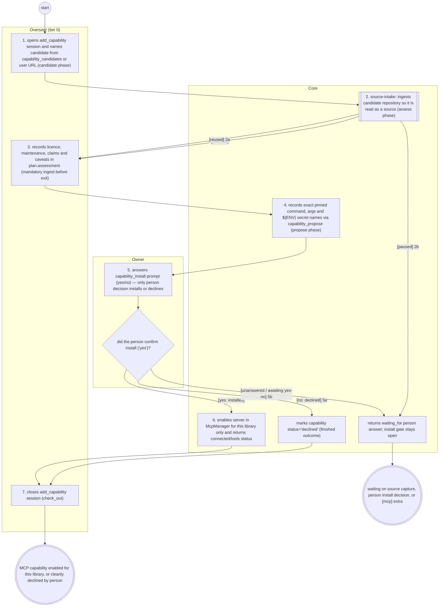

<!-- generated by render_pack.py from add-capability.spec.yaml sha256=b99ecaa340d11ac35de7e3c3a6119593aa69663e5da5674480b82089b566a796; edit the spec, not this file -->
# Add a capability (an MCP server), as it runs today

**UC15 · as-is · `IMPLEMENTED_VERIFIED`** · spec [add-capability.spec.yaml](../add-capability.spec.yaml)

## Written use case

| Field | Content |
|---|---|
| **Use case name** | Add a capability (an MCP server) |
| **Brief description** | Tier 0 names a curated or user-supplied MCP server, ingests its repository as a source, records assessment, proposes a pinned definition and invokes capability_install so the person decides. |
| **Primary actor** | Overseer (tier 0) |
| **Supporting actors** | Owner, Core |
| **Preconditions** | MCP connected at contribute tier (and resource-librarian[mcp] extra available to enable) |
| **Trigger** | The Owner wants to add an outside MCP server capability |
| **Success guarantee** | Capability assessed from ingested repository, pinned with ${ENV} secrets only and enabled or declined by the person |
| **Minimal guarantee** | No server is installed without the person's explicit yes; missing [mcp] extra refuses cleanly |
| **Open questions** | Where should unattended or deferred capability install asks be held? |

**Main success scenario** (generated: the guard-true path, in step order)

1. The Overseer (tier 0) opens add_capability session and names candidate from capability_candidates or user URL (candidate phase).
2. The Core ingests candidate repository so it is read as a source (assess phase).
3. The Overseer (tier 0) records licence, maintenance, claims and caveats in plan.assessment (mandatory ingest before exit).
4. The Core records exact pinned command, args and ${ENV} secret names via capability_propose (propose phase).
5. The Owner answers capability_install prompt (yes/no) — only person decision installs or declines.
6. The Core enables server in McpManager for this library only and returns connected/tools status.
7. The Overseer (tier 0) closes add_capability session (check_out).

**Extensions** (generated: one per non-happy guard; numbered by the step it leaves)

- **2a** (from: ingests candidate repository so it is read as a source (assess phase)) *anticipated*
  - `2a1` Reused.
  - `2a2` Rejoin at 3.
- **2b** (from: ingests candidate repository so it is read as a source (assess phase)) *anticipated*
  - `2b1` Paused.
  - `2b2` The Core returns waiting_for person answer; install gate stays open.
  - `2b3` The use case ends: waiting on source capture, person install decision, or [mcp] extra.
- **5a** (from: did the person confirm install ('yes')?) *anticipated*
  - `5a1` No: declined.
  - `5a2` The Core marks capability status='declined' (finished outcome).
  - `5a3` Rejoin at 7.
- **5b** (from: did the person confirm install ('yes')?) *anticipated*
  - `5b1` Unanswered / awaiting yes-no.
  - `5b2` The Core returns waiting_for person answer; install gate stays open.
  - `5b3` The use case ends: waiting on source capture, person install decision, or [mcp] extra.

## Activity diagram



## Lane load

| Lane | On the main success scenario | Anywhere in the diagram |
|---|---|---|
| Owner | 2 | 2 |
| Overseer (tier 0) | 3 | 3 |
| Core | 3 | 5 |

**Tier-0 turns** (each return of control to tier 0; owner's scale: 2 ideal, 3 expected, 4 rusty, 5–10 bad, more: might as well have done it themselves). Main success scenario: **3 (expected)**. Worst path: T4, **3 (expected)**. Paths by grade: expected 3, ideal 2.

Paths by how they end: **paused** 2, **success** 1.

## Decision tree

```text
start: Add a capability (an MCP server), as it runs today
    └─ T1: success / yes: installed  ⇒ MCP capability enabled for this library, or cleanly declined by person
  └─ T2: reused  ⇒ rejoins at step 3
  └─ T3: paused  ⇒ waiting on source capture, person install decision, or [mcp] extra
    └─ T4: success / no: declined  ⇒ rejoins at step 7
    └─ T5: success / unanswered / awaiting yes-no  ⇒ waiting on source capture, person install decision, or [mcp] extra
```

## Test cases

One test per path: the main success scenario, then each extension.

| Test | Path (guards taken) | Extension | Expected outcome | Tier-0 turns |
|---|---|---|---|---|
| T1 | ingests candidate repository so it is read as a source (assess phase) → success; did the person confirm install ('yes')? → yes: installed | MSS | MCP capability enabled for this library, or cleanly declined by person | 3 (expected) |
| T2 | ingests candidate repository so it is read as a source (assess phase) → reused | 2a | rejoins at step 3 | 3 (expected) |
| T3 | ingests candidate repository so it is read as a source (assess phase) → paused | 2b | waiting on source capture, person install decision, or [mcp] extra | 1 (ideal) |
| T4 | ingests candidate repository so it is read as a source (assess phase) → success; did the person confirm install ('yes')? → no: declined | 5a | rejoins at step 7 | 3 (expected) |
| T5 | ingests candidate repository so it is read as a source (assess phase) → success; did the person confirm install ('yes')? → unanswered / awaiting yes-no | 5b | waiting on source capture, person install decision, or [mcp] extra | 2 (ideal) |

### Boundary values

_None declared._

## Weaknesses and gaps

_None recorded._

## Evidence

- src/resource_librarian/standard/phases.yaml:58,251-283 (add_capability = candidate, assess, propose, install, check_out).
- src/resource_librarian/session.py:1224-1260; src/resource_librarian/tools/capabilities.py:110-152.

## Checks

Errors: none

Warnings: none
