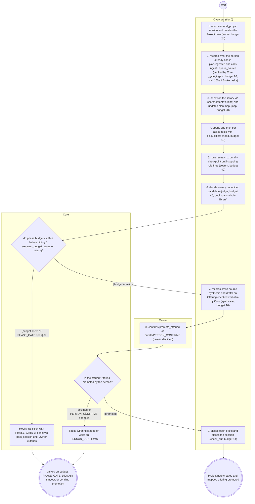

<!-- generated by render_pack.py from add-project.spec.yaml sha256=a00e03aa8f3d34fa08afaf4483b75cdd2dfb41e3c3b2a0272fe0f32a7f4a3484; edit the spec, not this file -->
# Add a project and map what the library holds for it, as it runs today

**UC11 · as-is · `IMPLEMENTED_VERIFIED`** · spec [add-project.spec.yaml](../add-project.spec.yaml)

## Written use case

| Field | Content |
|---|---|
| **Use case name** | Add a project and map what the library holds for it |
| **Brief description** | Tier 0 opens an add_project session, creates a Project note, records supplied sources, maps existing holdings, opens briefs, searches, judges candidates and drafts an Offering for promotion. |
| **Primary actor** | Overseer (tier 0) |
| **Supporting actors** | Core, Owner, Model worker |
| **Preconditions** | MCP connected at contribute tier |
| **Trigger** | The Owner asks to onboard a new project into the library |
| **Success guarantee** | Project note created and mapped Offering promoted into the library |
| **Minimal guarantee** | Phase gates enforce exit checks; unpromoted drafts stay staged |
| **Open questions** | Why do phase budgets halve on return and judge pools include non-project notes? |

**Main success scenario** (generated: the guard-true path, in step order)

1. The Overseer (tier 0) opens an add_project session and creates the Project note (frame, budget 24).
2. The Overseer (tier 0) records what the person already has in plan.ingested and calls ingest / queue_source (verified by Core _gate_ingest; budget 20, wait 150s if Broker asks).
3. The Overseer (tier 0) orients in the library via search(intent='orient') and updates plan.map (map, budget 20).
4. The Overseer (tier 0) opens one brief per asked topic with disqualifiers (need, budget 18).
5. The Overseer (tier 0) runs research_round + checkpoint until stopping rule fires (search, budget 40).
6. The Overseer (tier 0) decides every undecided candidate (judge, budget 40; pool spans whole library).
7. The Overseer (tier 0) records cross-source synthesis and drafts an Offering checked verbatim by Core (synthesise, budget 16).
8. The Owner confirms promote_offering at curate/PERSON_CONFIRMS (unless declined).
9. The Overseer (tier 0) closes open briefs and closes the session (check_out, budget 14).

**Extensions** (generated: one per non-happy guard; numbered by the step it leaves)

- **6a** (from: do phase budgets suffice before hitting 0 (request_budget halves on return)?) *anticipated*
  - `6a1` Budget spent or PHASE_GATE open.
  - `6a2` The Core blocks transition with PHASE_GATE or parks via park_session until Owner extends.
  - `6a3` The use case ends: parked on budget, PHASE_GATE, 150s Ask timeout, or pending promotion.
- **8a** (from: is the staged Offering promoted by the person?) *anticipated*
  - `8a1` Declined or PERSON_CONFIRMS open.
  - `8a2` The Core keeps Offering staged or waits on PERSON_CONFIRMS.
  - `8a3` The use case ends: parked on budget, PHASE_GATE, 150s Ask timeout, or pending promotion.

## Activity diagram



## Lane load

| Lane | On the main success scenario | Anywhere in the diagram |
|---|---|---|
| Owner | 1 | 1 |
| Overseer (tier 0) | 8 | 8 |
| Core | 2 | 4 |

**Tier-0 turns** (each return of control to tier 0; owner's scale: 2 ideal, 3 expected, 4 rusty, 5–10 bad, more: might as well have done it themselves). Main success scenario: **3 (expected)**. Worst path: T1, **3 (expected)**. Paths by grade: expected 1, ideal 2.

Paths by how they end: **paused** 2, **success** 1.

## Decision tree

```text
start: Add a project and map what the library holds for it, as it runs today
    └─ T1: budget remains / promoted  ⇒ Project note created and mapped offering promoted
  └─ T2: budget spent or PHASE_GATE open  ⇒ parked on budget, PHASE_GATE, 150s Ask timeout, or pending promotion
    └─ T3: budget remains / declined or PERSON_CONFIRMS open  ⇒ parked on budget, PHASE_GATE, 150s Ask timeout, or pending promotion
```

## Test cases

One test per path: the main success scenario, then each extension.

| Test | Path (guards taken) | Extension | Expected outcome | Tier-0 turns |
|---|---|---|---|---|
| T1 | do phase budgets suffice before hitting 0 (request_budget halves on return)? → budget remains; is the staged Offering promoted by the person? → promoted | MSS | Project note created and mapped offering promoted | 3 (expected) |
| T2 | do phase budgets suffice before hitting 0 (request_budget halves on return)? → budget spent or PHASE_GATE open | 6a | parked on budget, PHASE_GATE, 150s Ask timeout, or pending promotion | 1 (ideal) |
| T3 | do phase budgets suffice before hitting 0 (request_budget halves on return)? → budget remains; is the staged Offering promoted by the person? → declined or PERSON_CONFIRMS open | 8a | parked on budget, PHASE_GATE, 150s Ask timeout, or pending promotion | 2 (ideal) |

### Boundary values

| Decision | Values to test | Expected |
|---|---|---|
| do phase budgets suffice before hitting 0 (request_budget halves on return)? | budget_left > 0; budget_left = 0 with open gate | when budget hits 0, phase blocks or parks via request_budget until Owner extends (halved on return) |

## Weaknesses and gaps

_None recorded._

## Evidence

- src/resource_librarian/standard/phases.yaml:47 (add_project = frame, ingest, map, need, search, judge, synthesise, check_out).
- src/resource_librarian/session.py:998-1129 (_gate_frame, _gate_ingest, _gate_map, _gate_need, _gate_search, _gate_judge, _gate_synthesise, _gate_check_out).

## Checks

Errors: none

Warnings: none
