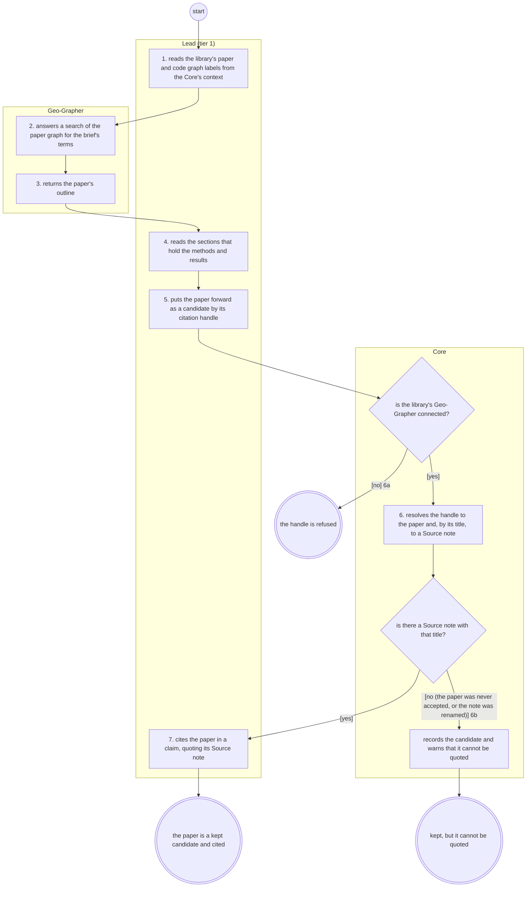

<!-- generated by render_pack.py from cite-graph.spec.yaml sha256=fd90f8c2fda95cd108bc1614c8d50dc1a26d636672323c2565826540bcf37f07; edit the spec, not this file -->
# Read and cite a paper from the graph, as it runs today

**UC4 · as-is · `IMPLEMENTED_OBSERVED`** · spec [cite-graph.spec.yaml](../cite-graph.spec.yaml)

| Problem | |
|---|---|
| symptom | The Lead quoted only papers' cards, and a paper with no Source note could be kept but never quoted. |
| root | The paper graph and the Source notes are two stores, joined by a title that is derived, not stored. |

## Written use case

| Field | Content |
|---|---|
| **Use case name** | Read and cite a paper from the graph |
| **Brief description** | The Lead searches the paper graph, reads a paper's sections, and cites it by its handle. |
| **Primary actor** | Lead |
| **Supporting actors** | Geo-Grapher, Core |
| **Preconditions** | The library's Geo-Grapher is running; the paper was published |
| **Trigger** | A brief needs a paper's methods or results |
| **Success guarantee** | The paper is a kept candidate, cited with a quote from its Source note |
| **Minimal guarantee** | A paper without a note is kept with a warning |
| **Open questions** | Should the paper-to-note link be stored, not derived from the title? |

**Main success scenario** (generated: the guard-true path, in step order)

1. The Lead (tier 1) reads the library's paper and code graph labels from the Core's context.
2. The Geo-Grapher answers a search of the paper graph for the brief's terms.
3. The Geo-Grapher returns the paper's outline.
4. The Lead (tier 1) reads the sections that hold the methods and results.
5. The Lead (tier 1) puts the paper forward as a candidate by its citation handle.
6. The Core resolves the handle to the paper and, by its title, to a Source note.
7. The Lead (tier 1) cites the paper in a claim, quoting its Source note.

**Extensions** (generated: one per non-happy guard; numbered by the step it leaves)

- **6a** (from: is the library's Geo-Grapher connected?) *anticipated*
  - `6a1` No.
  - `6a2` The use case ends: the handle is refused.
- **6b** (from: is there a Source note with that title?) *anticipated*
  - `6b1` No (the paper was never accepted, or the note was renamed).
  - `6b2` The Core records the candidate and warns that it cannot be quoted.
  - `6b3` The use case ends: kept, but it cannot be quoted.

## Activity diagram



## Lane load

| Lane | On the main success scenario | Anywhere in the diagram |
|---|---|---|
| Lead (tier 1) | 4 | 4 |
| Core | 3 | 4 |
| Geo-Grapher | 2 | 2 |

Paths by how they end: **success** 1, **unavailable** 1, **uncitable** 1.

## Decision tree

```text
start: Read and cite a paper from the graph, as it runs today
    └─ T1: yes / yes  ⇒ the paper is a kept candidate and cited
  └─ T2: no  ⇒ the handle is refused
    └─ T3: yes / no (the paper was never accepted, or the note was renamed)  ⇒ kept, but it cannot be quoted
```

## Test cases

One test per path: the main success scenario, then each extension.

| Test | Path (guards taken) | Extension | Expected outcome |
|---|---|---|---|
| T1 | is the library's Geo-Grapher connected? → yes; is there a Source note with that title? → yes | MSS | the paper is a kept candidate and cited |
| T2 | is the library's Geo-Grapher connected? → no | 6a | the handle is refused |
| T3 | is the library's Geo-Grapher connected? → yes; is there a Source note with that title? → no (the paper was never accepted, or the note was renamed) | 6b | kept, but it cannot be quoted |

### Boundary values

_None declared._

## Weaknesses and gaps

| Id | Kind | Where | Weakness | Evidence | Handled in the to-be by |
|---|---|---|---|---|---|
| W-CIT-01 | risk | resolve | A graph paper is linked to its Source note by title, derived each time; a renamed note breaks the link. | USE-CASES.md UC4 assumption | **not yet** |
| W-CIT-02 | gap | 6b | A read but unaccepted paper can be kept as a candidate but never quoted. | USE-CASES.md UC4 6a | **not yet** |

## Evidence

- Graph labels in the Lead's context and paper_get_outline offered: 9fd2fe9. Graph citations as candidates: 1064cf0.
- USE-CASES.md UC4 and its assumption: the link from a graph paper to its Source note is its title, derived when needed.

## Checks

Errors: none

Warnings: none
