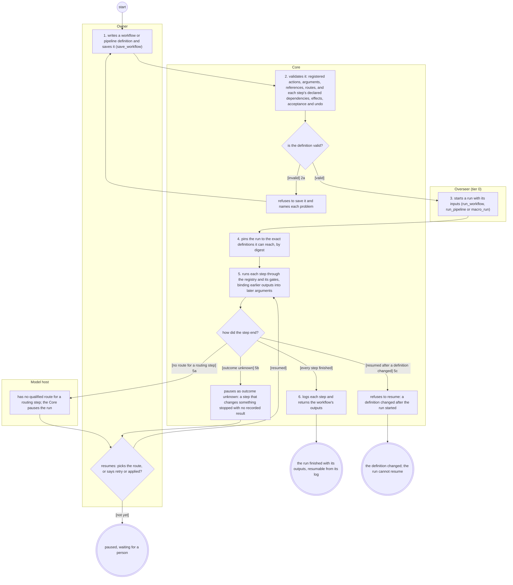

<!-- generated by render_pack.py from compose.spec.yaml sha256=40855ad44d0083bfe00caa5495ae7c2ada581dd16e55204d80d7d36cb7274075; edit the spec, not this file -->
# Compose work from actions, as it runs today

**UC8 · as-is · `IMPLEMENTED_VERIFIED`** · spec [compose.spec.yaml](../compose.spec.yaml)

| Problem | |
|---|---|
| symptom | The largest flows, the batch's stages and the session's phases, cannot be composed: stages are coded, and phases are declared but not runnable as a workflow. |
| root | Definitions cover agent macros and small jobs; the processes that matter most are still code. |

## Written use case

| Field | Content |
|---|---|
| **Use case name** | Compose work from actions |
| **Brief description** | A workflow is a sequence of registered actions, validated before it is saved and pinned when it runs. |
| **Primary actor** | Owner, or an orchestrating agent |
| **Supporting actors** | Core, model host (routing steps) |
| **Preconditions** | Every action named is registered |
| **Trigger** | A definition is saved, then run |
| **Success guarantee** | Validated before saving; pinned to its definitions; every step through the registry; resumable |
| **Minimal guarantee** | A changed definition refuses to resume |
| **Open questions** | OP16: the batch's stages are still code |

**Main success scenario** (generated: the guard-true path, in step order)

1. The Owner writes a workflow or pipeline definition and saves it (save_workflow).
2. The Core validates it: registered actions, arguments, references, routes, and each step's declared dependencies, effects, acceptance and undo.
3. The Overseer (tier 0) starts a run with its inputs (run_workflow, run_pipeline or macro_run).
4. The Core pins the run to the exact definitions it can reach, by digest.
5. The Core runs each step through the registry and its gates, binding earlier outputs into later arguments.
6. The Core logs each step and returns the workflow's outputs.

**Extensions** (generated: one per non-happy guard; numbered by the step it leaves)

- **2a** (from: is the definition valid?) *anticipated*
  - `2a1` Invalid.
  - `2a2` The Core refuses to save it and names each problem.
  - `2a3` Rejoin at 1.
- **5a** (from: how did the step end?) *anticipated*
  - `5a1` No route for a routing step.
  - `5a2` The Model host has no qualified route for a routing step; the Core pauses the run.
  - `5a3` The Owner decides: resumes: picks the route, or says retry or applied?
  - `5a3a` If not yet: the use case ends: paused, waiting for a person.
  - `5a4` If resumed:
  - `5a5` Rejoin at 5.
- **5b** (from: how did the step end?) *anticipated*
  - `5b1` Outcome unknown.
  - `5b2` The Core pauses as outcome unknown: a step that changes something stopped with no recorded result.
  - `5b3` The Owner decides: resumes: picks the route, or says retry or applied?
  - `5b3a` If not yet: the use case ends: paused, waiting for a person.
  - `5b4` If resumed:
  - `5b5` Rejoin at 5.
- **5c** (from: how did the step end?) *anticipated*
  - `5c1` Resumed after a definition changed.
  - `5c2` The Core refuses to resume: a definition changed after the run started.
  - `5c3` The use case ends: the definition changed; the run cannot resume.

## Activity diagram



## Lane load

| Lane | On the main success scenario | Anywhere in the diagram |
|---|---|---|
| Owner | 1 | 2 |
| Overseer (tier 0) | 1 | 1 |
| Core | 6 | 9 |
| Model host | 0 | 1 |

**Tier-0 turns** (each return of control to tier 0; owner's scale: 2 ideal, 3 expected, 4 rusty, 5–10 bad, more: might as well have done it themselves). Main success scenario: **1 (ideal)**. Worst path: T7, **1 (ideal)**. Paths by grade: ideal 7.

Paths by how they end: **paused** 2, **refused** 1, **success** 1.

## Decision tree

```text
start: Compose work from actions, as it runs today
    └─ T1: valid / every step finished  ⇒ the run finished with its outputs, resumable from its log
  └─ T2: invalid  ⇒ rejoins at step 1
      └─ T3: valid / no route for a routing step / not yet  ⇒ paused, waiting for a person
      └─ T4: valid / no route for a routing step / resumed  ⇒ rejoins at step 5
      └─ T5: valid / outcome unknown / not yet  ⇒ paused, waiting for a person
      └─ T6: valid / outcome unknown / resumed  ⇒ rejoins at step 5
    └─ T7: valid / resumed after a definition changed  ⇒ the definition changed; the run cannot resume
```

## Test cases

One test per path: the main success scenario, then each extension.

| Test | Path (guards taken) | Extension | Expected outcome | Tier-0 turns |
|---|---|---|---|---|
| T1 | is the definition valid? → valid; how did the step end? → every step finished | MSS | the run finished with its outputs, resumable from its log | 1 (ideal) |
| T2 | is the definition valid? → invalid | 2a | rejoins at step 1 | 1 (ideal) |
| T3 | is the definition valid? → valid; how did the step end? → no route for a routing step; resumes: picks the route, or says retry or applied? → not yet | 5a | paused, waiting for a person | 1 (ideal) |
| T4 | is the definition valid? → valid; how did the step end? → no route for a routing step; resumes: picks the route, or says retry or applied? → resumed | 5a | rejoins at step 5 | 1 (ideal) |
| T5 | is the definition valid? → valid; how did the step end? → outcome unknown; resumes: picks the route, or says retry or applied? → not yet | 5b | paused, waiting for a person | 1 (ideal) |
| T6 | is the definition valid? → valid; how did the step end? → outcome unknown; resumes: picks the route, or says retry or applied? → resumed | 5b | rejoins at step 5 | 1 (ideal) |
| T7 | is the definition valid? → valid; how did the step end? → resumed after a definition changed | 5c | the definition changed; the run cannot resume | 1 (ideal) |

### Boundary values

_None declared._

## Weaknesses and gaps

| Id | Kind | Where | Weakness | Evidence | Handled in the to-be by |
|---|---|---|---|---|---|
| W-CMP-01 | gap | * | The batch's stages and the session's phases are not compositions: stages are code, and phases are declared data that no workflow can call (OP16). | batch.py stage chain; standard/phases.yaml | `compose` |

## Evidence

- src/resource_librarian/workflows.py and standard/workflows/, standard/pipelines/: 19 workflows and 2 pipelines.
- Agent macros are YAML workflows (f61e30c); steps declare dependencies, side effects, acceptance and undo (af45e7c); session phases are declared as data (f6a85d6).
- USE-CASES.md UC8 extensions 2a, 5a, 5b, 5c; the Web UI's own start and result handling is workflow-run.

## Checks

Errors: none

Warnings: none
