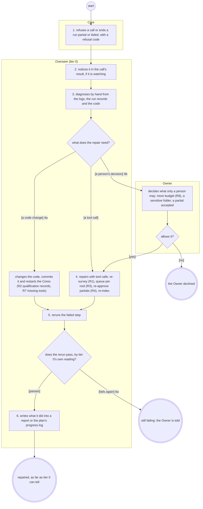

<!-- generated by render_pack.py from doctor.spec.yaml sha256=6bc91cf19ec12d3fbff2d608ddfd783df73cb8971460a36e3f1da9d2d2071a3e; edit the spec, not this file -->
# Repair a failed step, as it is done today (by tier 0, by hand)

**UC-D · as-is · `IMPLEMENTED_OBSERVED`** · spec [doctor.spec.yaml](../doctor.spec.yaml)

| Problem | |
|---|---|
| symptom | Each failure of the 19-20 November run came back to tier 0, which read logs and code, repaired it and reran the step: R1-R4 and R7-R8. |
| root | Failures carry a refusal code but no case record, no remedy is catalogued in code, and nothing checks a repair's reach before it runs. |

## Written use case

| Field | Content |
|---|---|
| **Use case name** | Repair a failed step |
| **Brief description** | There is no Doctor today: tier 0 notices a failure, diagnoses it, repairs it and reruns the step. |
| **Primary actor** | Overseer (tier 0) |
| **Supporting actors** | Owner, Core |
| **Preconditions** | Tier 0 is watching the run |
| **Trigger** | A refusal, or a run ending partial or failed |
| **Success guarantee** | The step passes on rerun |
| **Minimal guarantee** | The Owner is told what still fails |
| **Open questions** | Which failures should a catalogued remedy repair without tier 0? |

**Main success scenario** (generated: the guard-true path, in step order)

1. The Core refuses a call or ends a run partial or failed, with a refusal code.
2. The Overseer (tier 0) notices it in the call's result, if it is watching.
3. The Overseer (tier 0) diagnoses by hand from the logs, the run records and the code.
4. The Overseer (tier 0) repairs with tool calls: re-survey (R1), queue per root (R3), re-approve partials (R4), re-index.
5. The Overseer (tier 0) reruns the failed step.
6. The Overseer (tier 0) writes what it did into a report or the plan's progress log.

**Extensions** (generated: one per non-happy guard; numbered by the step it leaves)

- **4a** (from: what does the repair need?) *anticipated*
  - `4a1` A code change.
  - `4a2` The Overseer (tier 0) changes the code, commits it and restarts the Cores (R2 qualification records, R7 missing tools).
  - `4a3` Rejoin at 5.
- **4b** (from: what does the repair need?) *anticipated*
  - `4b1` A person's decision.
  - `4b2` The Owner decides what only a person may: more budget (R8), a sensitive folder, a partial accepted.
  - `4b3` The Owner decides: allows it?
  - `4b3a` If no: the use case ends: the Owner declined.
  - `4b4` If yes:
  - `4b5` Rejoin at 4.
- **6a** (from: does the rerun pass, by tier 0's own reading?) *anticipated*
  - `6a1` Fails again.
  - `6a2` The use case ends: still failing: the Owner is told.

## Activity diagram



## Lane load

| Lane | On the main success scenario | Anywhere in the diagram |
|---|---|---|
| Owner | 0 | 2 |
| Overseer (tier 0) | 7 | 8 |
| Core | 1 | 1 |

**Tier-0 turns** (each return of control to tier 0; owner's scale: 2 ideal, 3 expected, 4 rusty, 5–10 bad, more: might as well have done it themselves). Main success scenario: **1 (ideal)**. Worst path: T4, **2 (ideal)**. Paths by grade: ideal 4; escalated 1 (failures, not graded).

Paths by how they end: **declined** 1, **escalated** 1, **resolved** 1. Every *escalated* path is a failure of this use case: the work went back to tier 0.

## Decision tree

```text
start: Repair a failed step, as it is done today (by tier 0, by hand)
    └─ T1: a tool call / passes  ⇒ repaired, as far as tier 0 can tell
  └─ T2: a code change  ⇒ rejoins at step 5
    └─ T3: a person's decision / no  ⇒ the Owner declined
    └─ T4: a person's decision / yes  ⇒ rejoins at step 4
    └─ T5: a tool call / fails again  ⇒ still failing: the Owner is told
```

## Test cases

One test per path: the main success scenario, then each extension.

| Test | Path (guards taken) | Extension | Expected outcome | Tier-0 turns |
|---|---|---|---|---|
| T1 | what does the repair need? → a tool call; does the rerun pass, by tier 0's own reading? → passes | MSS | repaired, as far as tier 0 can tell | 1 (ideal) |
| T2 | what does the repair need? → a code change | 4a | rejoins at step 5 | 1 (ideal) |
| T3 | what does the repair need? → a person's decision; allows it? → no | 4b | the Owner declined | 1 (ideal) |
| T4 | what does the repair need? → a person's decision; allows it? → yes | 4b | rejoins at step 4 | 2 (ideal) |
| T5 | what does the repair need? → a tool call; does the rerun pass, by tier 0's own reading? → fails again | 6a | still failing: the Owner is told | 1 (escalated: a failure) |

### Boundary values

_None declared._

## Weaknesses and gaps

| Id | Kind | Where | Weakness | Evidence | Handled in the to-be by |
|---|---|---|---|---|---|
| W-DOC-01 | cost | notice | Every repair is tier-0 work: each failure of the 19-20 November run came back to tier 0. | remedy-catalogue history R1-R4, R7, R8 | **not yet** |
| W-DOC-02 | gap | fail | A failure is a refusal code in a call's result, not a ticket: there is no register of open failures, their owners or their repairs. | no fault store in src/resource_librarian; docs/terminology.md (fault register: proposed) | **not yet** |
| W-DOC-03 | risk | repair | Nothing checks a repair's reach before it runs: R1's re-survey re-applied every group in the library. | remedy-catalogue R1 scope note | **not yet** |
| W-DOC-04 | unverified | dpass | Whether a repair worked is judged by the agent that made it. | dpass | **not yet** |
| W-DOC-05 | drift | * | `doctor` already names the install capability check (doctor.py, the doctor tool); the repair role needs a distinct code name. | src/resource_librarian/doctor.py docstring | **not yet** |

## Evidence

- reports/2026-11-20-workflow-map/examples/ingestion/remedy-catalogue.yaml, `history` of R1-R4, R7, R8 (19-20 November): each `by: tier 0`.
- R2's root cause was Cores overwriting each other's qualification records (cab623a); R7's three cases were fixed in 0d6af41, 8129b3b, 9fd2fe9.
- src/resource_librarian/doctor.py is an install capability check (RUN_BEFORE_CLAIM), not a repair role.

## Checks

Errors: none

Warnings: none
