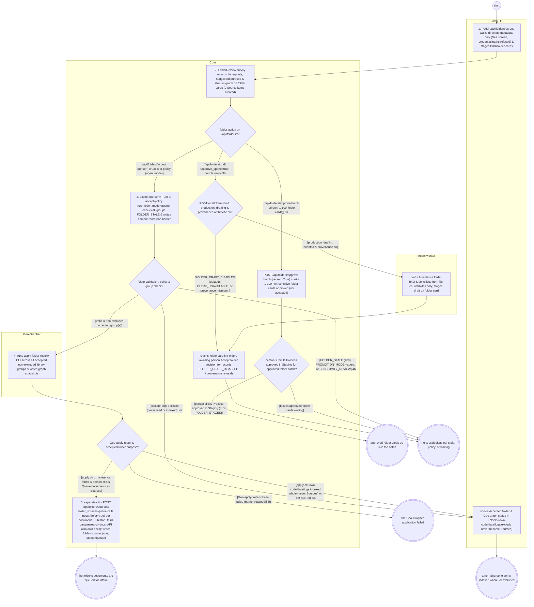

<!-- generated by render_pack.py from folder-review.spec.yaml sha256=0bf25444ce28fd3297751ff181b42d1f7f1847215cb771a74730b1ec662bfb8a; edit the spec, not this file -->
# Review a folder and apply its groups, as it runs today

**UC1.1 · as-is · `IMPLEMENTED_VERIFIED`** · spec [folder-review.spec.yaml](../folder-review.spec.yaml)

## Written use case

| Field | Content |
|---|---|
| **Use case name** | Review a folder and apply its groups |
| **Brief description** | The Folders tab surveys a folder's metadata, stages folder cards, and on the person's acceptance has Geo-Grapher apply the groups. |
| **Primary actor** | Owner |
| **Supporting actors** | Web UI, Core, model worker (draft, off by default), Geo-Grapher |
| **Preconditions** | The folder is attached |
| **Trigger** | The Owner opens the folder in the Folders tab |
| **Success guarantee** | Accepted folders are applied as graph groups, and Source documents queued |
| **Minimal guarantee** | Files are not read; credential paths are refused; a stale card is refused |
| **Open questions** | OP2: should an accept rebuild only its own group? |

**Main success scenario** (generated: the guard-true path, in step order)

1. The Web UI POST /api/folders/survey walks directory metadata only (files unread, credential paths refused) & stages kind=folder cards.
2. The Core FolderReview.survey records fingerprints, suggested purpose & stratum graph on folder cards (0 Source items created).
3. The Core accept (person=True) or accept-policy (promotion.mode=agent): checks all-groups FOLDER_STALE & writes content-roots.json barrier.
4. The Geo-Grapher runs apply-folder-review CLI across all accepted non-excluded library groups & writes graph snapshots.
5. The Core separate click POST /api/folders/sources: folder_sources.queue calls ingest(defer=true) per document (UI button: third-party/research-docs; API also own-docs); writes folder-sources.json, status=queued.

**Extensions** (generated: one per non-happy guard; numbered by the step it leaves)

- **3a** (from: folder action on /api/folders/*?) *anticipated*
  - `3a1` /api/folders/approve-batch (person; 1-100 folder cards).
  - `3a2` The Core POST /api/folders/approve-batch (person=True) marks 1-100 non-sensitive folder cards approved (not accepted).
  - `3a3` The Core decides: person submits Process approved in Staging for approved folder cards?
  - `3a3a` If leaves approved folder cards waiting: the use case ends: held: draft disabled, stale, policy, or waiting.
  - `3a4` If person clicks Process approved in Staging (runs FOLDER_STAGES):
  - `3a5` The use case ends: approved folder cards go into the batch.
- **3b** (from: folder action on /api/folders/*?) *anticipated*
  - `3b1` /api/folders/draft (approve_spend=true; counts only).
  - `3b2` The Core decides: POST /api/folders/draft: production_drafting & provenance arithmetic ok?
  - `3b2a` If FOLDER_DRAFT_DISABLED (default), CLERK_UNAVAILABLE, or provenance mismatch: retains folder card in Folders awaiting person Accept folder decision (or records FOLDER_DRAFT_DISABLED / provenance refusal).
  - `3b3` If production_drafting enabled & provenance ok:
  - `3b4` The Model worker drafts 1-sentence folder brief & sensitivity from file counts/bytes only; stages draft on folder card.
  - `3b5` The Core retains folder card in Folders awaiting person Accept folder decision (or records FOLDER_DRAFT_DISABLED / provenance refusal).
  - `3b6` The use case ends: held: draft disabled, stale, policy, or waiting.
- **4a** (from: folder validation, policy & group check?) *anticipated*
  - `4a1` Exclude-only decision (never read or indexed).
  - `4a2` The Web UI shows Accepted folder & Geo graph status in Folders (own-code/data/logs/exclude never become Sources).
  - `4a3` The use case ends: a non-Source folder is indexed whole, or excluded.
- **4b** (from: folder validation, policy & group check?) *anticipated*
  - `4b1` FOLDER_STALE (409), PROMOTION_MODE!=agent, or SENSITIVITY_REVIEW.
  - `4b2` The use case ends: held: draft disabled, stale, policy, or waiting.
- **5a** (from: Geo apply result & accepted folder purpose?) *anticipated*
  - `5a1` Apply ok: own-code/data/logs indexed whole (never Sources) or not queued.
  - `5a2` The Web UI shows Accepted folder & Geo graph status in Folders (own-code/data/logs/exclude never become Sources).
  - `5a3` The use case ends: a non-Source folder is indexed whole, or excluded.
- **5b** (from: Geo apply result & accepted folder purpose?) *anticipated*
  - `5b1` Geo apply-folder-review failed (barrier retained).
  - `5b2` The use case ends: the Geo-Grapher application failed.

## Activity diagram



## Lane load

| Lane | On the main success scenario | Anywhere in the diagram |
|---|---|---|
| Geo-Grapher | 1 | 1 |
| Core | 6 | 10 |
| Web UI | 1 | 2 |
| Model worker | 0 | 1 |

Paths by how they end: **approved for processing** 1, **escalated** 1, **paused** 4, **reused** 2, **success** 1. Every *escalated* path is a failure of this use case: the work went back to tier 0.

## Decision tree

```text
start: Review a folder and apply its groups, as it runs today
      └─ T1: /api/folders/accept (person) or /accept-policy (agent mode) / valid & non-excluded accepted group(s) / apply ok on reference folder & person clicks Queue documents as Sources  ⇒ the folder's documents are queued for intake
    └─ T2: /api/folders/approve-batch (person; 1-100 folder cards) / leaves approved folder cards waiting  ⇒ held: draft disabled, stale, policy, or waiting
    └─ T3: /api/folders/approve-batch (person; 1-100 folder cards) / person clicks Process approved in Staging (runs FOLDER_STAGES)  ⇒ approved folder cards go into the batch
    └─ T4: /api/folders/draft (approve_spend=true; counts only) / FOLDER_DRAFT_DISABLED (default), CLERK_UNAVAILABLE, or provenance mismatch  ⇒ held: draft disabled, stale, policy, or waiting
    └─ T5: /api/folders/draft (approve_spend=true; counts only) / production_drafting enabled & provenance ok  ⇒ held: draft disabled, stale, policy, or waiting
    └─ T6: /api/folders/accept (person) or /accept-policy (agent mode) / exclude-only decision (never read or indexed)  ⇒ a non-Source folder is indexed whole, or excluded
    └─ T7: /api/folders/accept (person) or /accept-policy (agent mode) / FOLDER_STALE (409), PROMOTION_MODE!=agent, or SENSITIVITY_REVIEW  ⇒ held: draft disabled, stale, policy, or waiting
      └─ T8: /api/folders/accept (person) or /accept-policy (agent mode) / valid & non-excluded accepted group(s) / apply ok: own-code/data/logs indexed whole (never Sources) or not queued  ⇒ a non-Source folder is indexed whole, or excluded
      └─ T9: /api/folders/accept (person) or /accept-policy (agent mode) / valid & non-excluded accepted group(s) / Geo apply-folder-review failed (barrier retained)  ⇒ the Geo-Grapher application failed
```

## Test cases

One test per path: the main success scenario, then each extension.

| Test | Path (guards taken) | Extension | Expected outcome |
|---|---|---|---|
| T1 | folder action on /api/folders/*? → /api/folders/accept (person) or /accept-policy (agent mode); folder validation, policy & group check? → valid & non-excluded accepted group(s); Geo apply result & accepted folder purpose? → apply ok on reference folder & person clicks Queue documents as Sources | MSS | the folder's documents are queued for intake |
| T2 | folder action on /api/folders/*? → /api/folders/approve-batch (person; 1-100 folder cards); person submits Process approved in Staging for approved folder cards? → leaves approved folder cards waiting | 3a | held: draft disabled, stale, policy, or waiting |
| T3 | folder action on /api/folders/*? → /api/folders/approve-batch (person; 1-100 folder cards); person submits Process approved in Staging for approved folder cards? → person clicks Process approved in Staging (runs FOLDER_STAGES) | 3a | approved folder cards go into the batch |
| T4 | folder action on /api/folders/*? → /api/folders/draft (approve_spend=true; counts only); POST /api/folders/draft: production_drafting & provenance arithmetic ok? → FOLDER_DRAFT_DISABLED (default), CLERK_UNAVAILABLE, or provenance mismatch | 3b | held: draft disabled, stale, policy, or waiting |
| T5 | folder action on /api/folders/*? → /api/folders/draft (approve_spend=true; counts only); POST /api/folders/draft: production_drafting & provenance arithmetic ok? → production_drafting enabled & provenance ok | 3b | held: draft disabled, stale, policy, or waiting |
| T6 | folder action on /api/folders/*? → /api/folders/accept (person) or /accept-policy (agent mode); folder validation, policy & group check? → exclude-only decision (never read or indexed) | 4a | a non-Source folder is indexed whole, or excluded |
| T7 | folder action on /api/folders/*? → /api/folders/accept (person) or /accept-policy (agent mode); folder validation, policy & group check? → FOLDER_STALE (409), PROMOTION_MODE!=agent, or SENSITIVITY_REVIEW | 4b | held: draft disabled, stale, policy, or waiting |
| T8 | folder action on /api/folders/*? → /api/folders/accept (person) or /accept-policy (agent mode); folder validation, policy & group check? → valid & non-excluded accepted group(s); Geo apply result & accepted folder purpose? → apply ok: own-code/data/logs indexed whole (never Sources) or not queued | 5a | a non-Source folder is indexed whole, or excluded |
| T9 | folder action on /api/folders/*? → /api/folders/accept (person) or /accept-policy (agent mode); folder validation, policy & group check? → valid & non-excluded accepted group(s); Geo apply result & accepted folder purpose? → Geo apply-folder-review failed (barrier retained) | 5b | the Geo-Grapher application failed |

### Boundary values

| Decision | Values to test | Expected |
|---|---|---|
| POST /api/folders/approve-batch (person=True) marks 1-100 non-sensitive folder cards approved (not accepted) | 0 cards; 1; 100; 101; a sensitive card among them | 1-100 non-sensitive cards are approved; others refused |

## Weaknesses and gaps

| Id | Kind | Where | Weakness | Evidence | Handled in the to-be by |
|---|---|---|---|---|---|
| W-FOL-01 | risk | geo_folder_apply | Every accept re-applies every accepted group in the library (OP2): one folder's decision has a whole-library radius. | geo_folder_apply label; remedy-catalogue R1 scope note | `folder-review` |
| W-FOL-02 | fault | dfolder_prep | A stale card anywhere refuses this decision (FOLDER_STALE across all groups); R1 needed a re-survey of an unrelated root. | folder_review.py line 591; remedy-catalogue R1 history | `folder-review` |
| W-FOL-03 | gap | folder_draft_check | The model's draft of a folder's purpose is off by default (FOLDER_DRAFT_DISABLED); when on, it sees only file counts and bytes. | folder_draft_check and folder_clerk_draft labels | `folder-review` |
| W-FOL-04 | gap | folder_queue_sources | Accepting a folder does not start its intake: queueing its documents is a separate click or API call. | folder_queue_sources label (POST /api/folders/sources) | `ingestion` |
| W-FOL-05 | risk | folder_batch_approve | A folder card can be approved (for the batch) or accepted (applied as a group): two states with different powers that the person can confuse. | folder_review.py approve_batch (status approved) and accept (status accepted) | `state:folder-card` |

## Checks

Errors: none

Warnings: none
