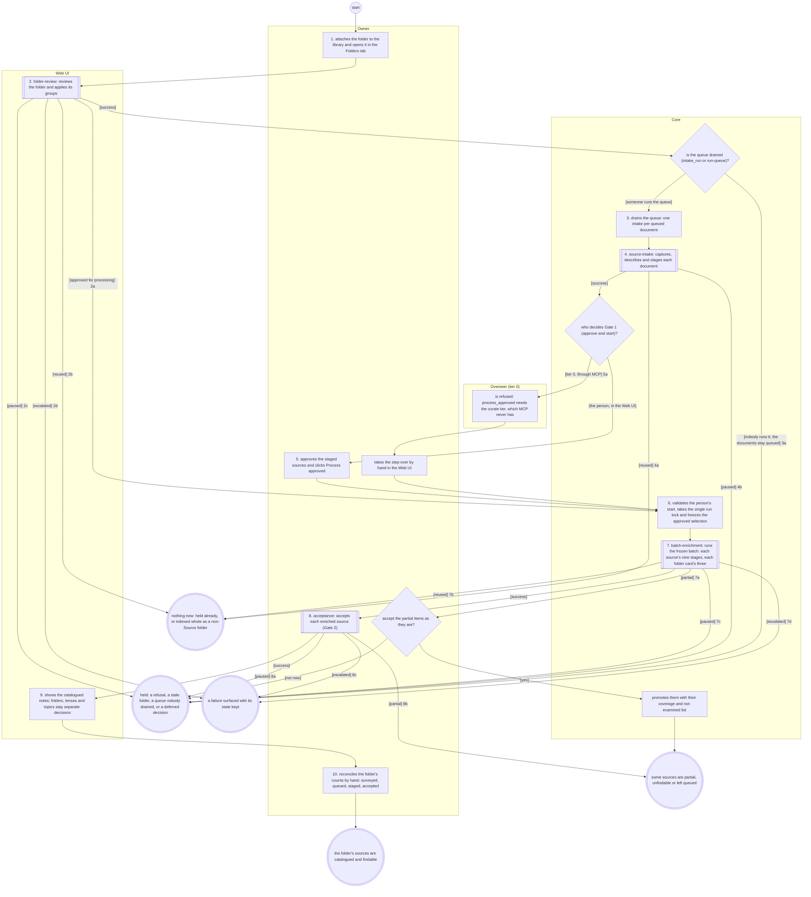

<!-- generated by render_pack.py from ingestion.spec.yaml sha256=b4e3447fb0441856bc43adf99b8e2916022f04bd64f845cbd049a962e382929a; edit the spec, not this file -->
# Make a folder of documents into Source notes, as it runs today

**UC1 · as-is · `IMPLEMENTED_VERIFIED`** · spec [ingestion.spec.yaml](../ingestion.spec.yaml)
Supersedes: `reports/2026-11-20-workflow-map/examples/ingestion/ingestion.spec.yaml`

| Problem | |
|---|---|
| symptom | On 19-20 November a folder of 96 papers came back to tier 0 eight times on its main path (graded bad), and the 96 read papers then waited unaccepted with nothing saying so. |
| why | Folder review, queueing, intake, the batch and acceptance are separate surfaces joined by hand.; Each stage reports its own outcome; nothing reconciles them for the folder as a whole. |
| root | There is no parent process for a folder: the person or tier 0 is the parent. |

## Written use case

| Field | Content |
|---|---|
| **Use case name** | Make a folder of documents into Source notes |
| **Brief description** | A folder is reviewed, its documents queued, captured, staged, enriched in one approved batch, and accepted as Source notes. |
| **Primary actor** | Owner; tier 0 may do the steps its tier allows |
| **Supporting actors** | Web UI, Core, model worker, model host, Geo-Grapher |
| **Preconditions** | Core running; the folder readable; the Clerk's route qualified |
| **Trigger** | The Owner wants the folder in the library |
| **Success guarantee** | Each document is a catalogued, findable Source note, with its coverage recorded |
| **Minimal guarantee** | Every item keeps its stage receipts; partial work is never credited as read |
| **Open questions** | OP1 who owns acceptance; OP2 the rebuild radius of a folder decision |

**Main success scenario** (generated: the guard-true path, in step order)

1. The Owner attaches the folder to the library and opens it in the Folders tab.
2. The Web UI reviews the folder and applies its groups.
3. The Core drains the queue: one intake per queued document.
4. The Core captures, describes and stages each document.
5. The Owner approves the staged sources and clicks Process approved.
6. The Core validates the person's start, takes the single run lock and freezes the approved selection.
7. The Core runs the frozen batch: each source's nine stages, each folder card's three.
8. The Owner accepts each enriched source (Gate 2).
9. The Web UI shows the catalogued notes; folders, lenses and topics stay separate decisions.
10. The Owner reconciles the folder's counts by hand: surveyed, queued, staged, accepted.

**Extensions** (generated: one per non-happy guard; numbered by the step it leaves)

- **2a** (from: reviews the folder and applies its groups) *anticipated*
  - `2a1` Approved for processing.
  - `2a2` Rejoin at 6.
- **2b** (from: reviews the folder and applies its groups) *anticipated*
  - `2b1` Reused.
  - `2b2` The use case ends: nothing new: held already, or indexed whole as a non-Source folder.
- **2c** (from: reviews the folder and applies its groups) *anticipated*
  - `2c1` Paused.
  - `2c2` The use case ends: held: a refusal, a stale folder, a queue nobody drained, or a deferred decision.
- **2d** (from: reviews the folder and applies its groups) *anticipated*
  - `2d1` Escalated.
  - `2d2` The use case ends: a failure surfaced with its state kept.
- **3a** (from: is the queue drained (intake_run or run-queue)?) *anticipated*
  - `3a1` Nobody runs it; the documents stay queued.
  - `3a2` The use case ends: held: a refusal, a stale folder, a queue nobody drained, or a deferred decision.
- **4a** (from: captures, describes and stages each document) *anticipated*
  - `4a1` Reused.
  - `4a2` The use case ends: nothing new: held already, or indexed whole as a non-Source folder.
- **4b** (from: captures, describes and stages each document) *anticipated*
  - `4b1` Paused.
  - `4b2` The use case ends: held: a refusal, a stale folder, a queue nobody drained, or a deferred decision.
- **5a** (from: who decides Gate 1 (approve and start)?) *anticipated*
  - `5a1` Tier 0, through MCP.
  - `5a2` The Overseer (tier 0) is refused: process_approved needs the curate tier, which MCP never has.
  - `5a3` The Owner takes the step over by hand in the Web UI.
  - `5a4` Rejoin at 6.
- **7a** (from: runs the frozen batch: each source's nine stages, each folder card's three) *anticipated*
  - `7a1` Partial.
  - `7a2` The Owner decides: accept the partial items as they are?
  - `7a2a` If not now: the use case ends: held: a refusal, a stale folder, a queue nobody drained, or a deferred decision.
  - `7a3` If yes:
  - `7a4` The Core promotes them with their coverage and not-examined list.
  - `7a5` The use case ends: some sources are partial, unfindable or left queued.
- **7b** (from: runs the frozen batch: each source's nine stages, each folder card's three) *anticipated*
  - `7b1` Reused.
  - `7b2` The use case ends: nothing new: held already, or indexed whole as a non-Source folder.
- **7c** (from: runs the frozen batch: each source's nine stages, each folder card's three) *anticipated*
  - `7c1` Paused.
  - `7c2` The use case ends: held: a refusal, a stale folder, a queue nobody drained, or a deferred decision.
- **7d** (from: runs the frozen batch: each source's nine stages, each folder card's three) *anticipated*
  - `7d1` Escalated.
  - `7d2` The use case ends: a failure surfaced with its state kept.
- **8a** (from: accepts each enriched source (Gate 2)) *anticipated*
  - `8a1` Paused.
  - `8a2` The use case ends: held: a refusal, a stale folder, a queue nobody drained, or a deferred decision.
- **8b** (from: accepts each enriched source (Gate 2)) *anticipated*
  - `8b1` Partial.
  - `8b2` The use case ends: some sources are partial, unfindable or left queued.
- **8c** (from: accepts each enriched source (Gate 2)) *anticipated*
  - `8c1` Escalated.
  - `8c2` The use case ends: a failure surfaced with its state kept.

## Activity diagram



## Lane load

| Lane | On the main success scenario | Anywhere in the diagram |
|---|---|---|
| Owner | 4 | 6 |
| Overseer (tier 0) | 0 | 1 |
| Web UI | 2 | 2 |
| Core | 6 | 7 |

**Tier-0 turns** (each return of control to tier 0; owner's scale: 2 ideal, 3 expected, 4 rusty, 5–10 bad, more: might as well have done it themselves). Main success scenario: **0 (ideal)**. Worst path: T9, **1 (ideal)**. Paths by grade: ideal 14; escalated 3 (failures, not graded).

Paths by how they end: **escalated** 3, **partial** 2, **paused** 6, **reused** 3, **success** 1. Every *escalated* path is a failure of this use case: the work went back to tier 0.

## Decision tree

```text
start: Make a folder of documents into Source notes, as it runs today
            └─ T1: success / someone runs the queue / success / the person, in the Web UI / success / success  ⇒ the folder's sources are catalogued and findable
  └─ T2: approved for processing  ⇒ rejoins at step 6
  └─ T3: reused  ⇒ nothing new: held already, or indexed whole as a non-Source folder
  └─ T4: paused  ⇒ held: a refusal, a stale folder, a queue nobody drained, or a deferred decision
  └─ T5: escalated  ⇒ a failure surfaced with its state kept
    └─ T6: success / nobody runs it; the documents stay queued  ⇒ held: a refusal, a stale folder, a queue nobody drained, or a deferred decision
      └─ T7: success / someone runs the queue / reused  ⇒ nothing new: held already, or indexed whole as a non-Source folder
      └─ T8: success / someone runs the queue / paused  ⇒ held: a refusal, a stale folder, a queue nobody drained, or a deferred decision
        └─ T9: success / someone runs the queue / success / tier 0, through MCP  ⇒ rejoins at step 6
            └─ T10: success / someone runs the queue / success / the person, in the Web UI / partial / not now  ⇒ held: a refusal, a stale folder, a queue nobody drained, or a deferred decision
            └─ T11: success / someone runs the queue / success / the person, in the Web UI / partial / yes  ⇒ some sources are partial, unfindable or left queued
          └─ T12: success / someone runs the queue / success / the person, in the Web UI / reused  ⇒ nothing new: held already, or indexed whole as a non-Source folder
          └─ T13: success / someone runs the queue / success / the person, in the Web UI / paused  ⇒ held: a refusal, a stale folder, a queue nobody drained, or a deferred decision
          └─ T14: success / someone runs the queue / success / the person, in the Web UI / escalated  ⇒ a failure surfaced with its state kept
            └─ T15: success / someone runs the queue / success / the person, in the Web UI / success / paused  ⇒ held: a refusal, a stale folder, a queue nobody drained, or a deferred decision
            └─ T16: success / someone runs the queue / success / the person, in the Web UI / success / partial  ⇒ some sources are partial, unfindable or left queued
            └─ T17: success / someone runs the queue / success / the person, in the Web UI / success / escalated  ⇒ a failure surfaced with its state kept
```

## Test cases

One test per path: the main success scenario, then each extension.

| Test | Path (guards taken) | Extension | Expected outcome | Tier-0 turns |
|---|---|---|---|---|
| T1 | reviews the folder and applies its groups → success; is the queue drained (intake_run or run-queue)? → someone runs the queue; captures, describes and stages each document → success; who decides Gate 1 (approve and start)? → the person, in the Web UI; runs the frozen batch: each source's nine stages, each folder card's three → success; accepts each enriched source (Gate 2) → success | MSS | the folder's sources are catalogued and findable | 0 (ideal) |
| T2 | reviews the folder and applies its groups → approved for processing | 2a | rejoins at step 6 | 0 (ideal) |
| T3 | reviews the folder and applies its groups → reused | 2b | nothing new: held already, or indexed whole as a non-Source folder | 0 (ideal) |
| T4 | reviews the folder and applies its groups → paused | 2c | held: a refusal, a stale folder, a queue nobody drained, or a deferred decision | 0 (ideal) |
| T5 | reviews the folder and applies its groups → escalated | 2d | a failure surfaced with its state kept | 0 (escalated: a failure) |
| T6 | reviews the folder and applies its groups → success; is the queue drained (intake_run or run-queue)? → nobody runs it; the documents stay queued | 3a | held: a refusal, a stale folder, a queue nobody drained, or a deferred decision | 0 (ideal) |
| T7 | reviews the folder and applies its groups → success; is the queue drained (intake_run or run-queue)? → someone runs the queue; captures, describes and stages each document → reused | 4a | nothing new: held already, or indexed whole as a non-Source folder | 0 (ideal) |
| T8 | reviews the folder and applies its groups → success; is the queue drained (intake_run or run-queue)? → someone runs the queue; captures, describes and stages each document → paused | 4b | held: a refusal, a stale folder, a queue nobody drained, or a deferred decision | 0 (ideal) |
| T9 | reviews the folder and applies its groups → success; is the queue drained (intake_run or run-queue)? → someone runs the queue; captures, describes and stages each document → success; who decides Gate 1 (approve and start)? → tier 0, through MCP | 5a | rejoins at step 6 | 1 (ideal) |
| T10 | reviews the folder and applies its groups → success; is the queue drained (intake_run or run-queue)? → someone runs the queue; captures, describes and stages each document → success; who decides Gate 1 (approve and start)? → the person, in the Web UI; runs the frozen batch: each source's nine stages, each folder card's three → partial; accept the partial items as they are? → not now | 7a | held: a refusal, a stale folder, a queue nobody drained, or a deferred decision | 0 (ideal) |
| T11 | reviews the folder and applies its groups → success; is the queue drained (intake_run or run-queue)? → someone runs the queue; captures, describes and stages each document → success; who decides Gate 1 (approve and start)? → the person, in the Web UI; runs the frozen batch: each source's nine stages, each folder card's three → partial; accept the partial items as they are? → yes | 7a | some sources are partial, unfindable or left queued | 0 (ideal) |
| T12 | reviews the folder and applies its groups → success; is the queue drained (intake_run or run-queue)? → someone runs the queue; captures, describes and stages each document → success; who decides Gate 1 (approve and start)? → the person, in the Web UI; runs the frozen batch: each source's nine stages, each folder card's three → reused | 7b | nothing new: held already, or indexed whole as a non-Source folder | 0 (ideal) |
| T13 | reviews the folder and applies its groups → success; is the queue drained (intake_run or run-queue)? → someone runs the queue; captures, describes and stages each document → success; who decides Gate 1 (approve and start)? → the person, in the Web UI; runs the frozen batch: each source's nine stages, each folder card's three → paused | 7c | held: a refusal, a stale folder, a queue nobody drained, or a deferred decision | 0 (ideal) |
| T14 | reviews the folder and applies its groups → success; is the queue drained (intake_run or run-queue)? → someone runs the queue; captures, describes and stages each document → success; who decides Gate 1 (approve and start)? → the person, in the Web UI; runs the frozen batch: each source's nine stages, each folder card's three → escalated | 7d | a failure surfaced with its state kept | 0 (escalated: a failure) |
| T15 | reviews the folder and applies its groups → success; is the queue drained (intake_run or run-queue)? → someone runs the queue; captures, describes and stages each document → success; who decides Gate 1 (approve and start)? → the person, in the Web UI; runs the frozen batch: each source's nine stages, each folder card's three → success; accepts each enriched source (Gate 2) → paused | 8a | held: a refusal, a stale folder, a queue nobody drained, or a deferred decision | 0 (ideal) |
| T16 | reviews the folder and applies its groups → success; is the queue drained (intake_run or run-queue)? → someone runs the queue; captures, describes and stages each document → success; who decides Gate 1 (approve and start)? → the person, in the Web UI; runs the frozen batch: each source's nine stages, each folder card's three → success; accepts each enriched source (Gate 2) → partial | 8b | some sources are partial, unfindable or left queued | 0 (ideal) |
| T17 | reviews the folder and applies its groups → success; is the queue drained (intake_run or run-queue)? → someone runs the queue; captures, describes and stages each document → success; who decides Gate 1 (approve and start)? → the person, in the Web UI; runs the frozen batch: each source's nine stages, each folder card's three → success; accepts each enriched source (Gate 2) → escalated | 8c | a failure surfaced with its state kept | 0 (escalated: a failure) |

### Boundary values

_None declared._

## Weaknesses and gaps

| Id | Kind | Where | Weakness | Evidence | Handled in the to-be by |
|---|---|---|---|---|---|
| W-ING-01 | gap | tell | Nothing reconciles a folder's counts (surveyed, queued, staged, enriched, accepted); the person or tier 0 does it by hand. | remedy-catalogue R3 (queued 0, then 96 across 24 subfolders) and proposed R6 | `ingestion` |
| W-ING-02 | gap | dqueue | Queued documents wait until someone runs the queue, and a queue nobody drains says nothing. | dqueue_drain in the activation map: queued refs stay status=queued | `ingestion` |
| W-ING-03 | fault | dgate1 | Tier 0 cannot approve or start a batch, so an orchestrated ingestion always hands Gate 1 back to the person. | dmanual_handover in the activation map; the 19-20 November trace | `ingestion` |
| W-ING-04 | gap | 7a | A partial item is re-run only by a fresh approval and start; resuming an unfinished run is a different path. | USE-CASES.md UC1 14a; remedy-catalogue R4 (3 of 6 stayed partial) | `ingestion` |
| W-ING-05 | cost | * | On 19-20 November control came back to tier 0 eight times on the main path, and ten on the worst (graded bad). | examples/ingestion/ingestion.views.md, tier-0 turns | `activation-overseer` |

## Evidence

- Children split from reports/2026-11-24-librarian-reconstruction-and-offering/diagrams/librarian-current-activation.spec.yaml (verified at d9435e1).
- Observed trace: examples/ingestion/ingestion.spec.yaml and its views: 8 tier-0 turns on the main path and 10 on the worst, both graded bad.
- awaiting_acceptance() (W7, 8489387) now tells the agenda, batch_status and the Lead's context about read work waiting; it does not reconcile the folder's counts.

## Checks

Errors: none

Warnings: none
