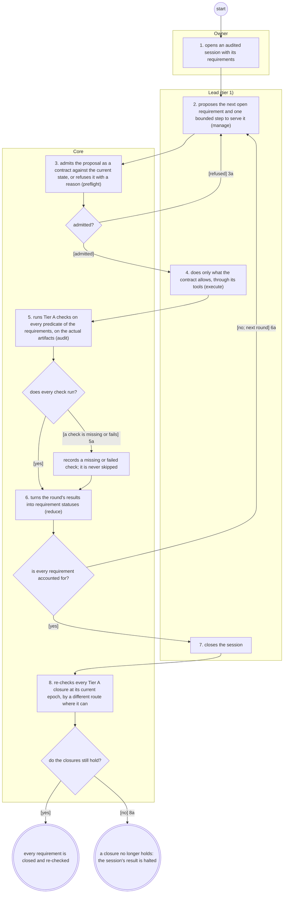

<!-- generated by render_pack.py from oracle.spec.yaml sha256=c2a27ed9445d23e0a088029060c41219114c2d7b91b3266a6cda6fb211c6f662; edit the spec, not this file -->
# Judge work against its requirements, as it runs today (the audited session only)

**UC-O · as-is · `IMPLEMENTED_VERIFIED`** · spec [oracle.spec.yaml](../oracle.spec.yaml)

| Problem | |
|---|---|
| symptom | Ingestion and research runs are judged by the agent that ran them; only an audited session checks its work against stated requirements. |
| root | Tier A checks and admitted contracts exist, but only inside one session purpose. |

## Written use case

| Field | Content |
|---|---|
| **Use case name** | Judge work against its requirements |
| **Brief description** | Only an audited session judges work against stated requirements, with Tier A checks and a closure re-check. |
| **Primary actor** | Owner |
| **Supporting actors** | Lead, Core |
| **Preconditions** | An audited session with requirements |
| **Trigger** | The Owner opens an audited session |
| **Success guarantee** | Every requirement closed by a Tier A check, and re-checked |
| **Minimal guarantee** | A missing check is recorded, never skipped |
| **Open questions** | Why do ingestion and research have no judge? |

**Main success scenario** (generated: the guard-true path, in step order)

1. The Owner opens an audited session with its requirements.
2. The Lead (tier 1) proposes the next open requirement and one bounded step to serve it (manage).
3. The Core admits the proposal as a contract against the current state, or refuses it with a reason (preflight).
4. The Lead (tier 1) does only what the contract allows, through its tools (execute).
5. The Core runs Tier A checks on every predicate of the requirements, on the actual artifacts (audit).
6. The Core turns the round's results into requirement statuses (reduce).
7. The Lead (tier 1) closes the session.
8. The Core re-checks every Tier A closure at its current epoch, by a different route where it can.

**Extensions** (generated: one per non-happy guard; numbered by the step it leaves)

- **3a** (from: admitted?) *anticipated*
  - `3a1` Refused.
  - `3a2` Rejoin at 2.
- **5a** (from: does every check run?) *anticipated*
  - `5a1` A check is missing or fails.
  - `5a2` The Core records a missing or failed check; it is never skipped.
  - `5a3` Rejoin at 6.
- **6a** (from: is every requirement accounted for?) *anticipated*
  - `6a1` No; next round.
  - `6a2` Rejoin at 2.
- **8a** (from: do the closures still hold?) *anticipated*
  - `8a1` No.
  - `8a2` The use case ends: a closure no longer holds: the session's result is halted.

## Activity diagram



## Lane load

| Lane | On the main success scenario | Anywhere in the diagram |
|---|---|---|
| Owner | 1 | 1 |
| Lead (tier 1) | 3 | 3 |
| Core | 8 | 9 |

Paths by how they end: **escalated** 1, **success** 1. Every *escalated* path is a failure of this use case: the work went back to tier 0.

## Decision tree

```text
start: Judge work against its requirements, as it runs today (the audited session only)
        └─ T1: admitted / yes / yes / yes  ⇒ every requirement is closed and re-checked
  └─ T2: refused  ⇒ rejoins at step 2
    └─ T3: admitted / a check is missing or fails  ⇒ rejoins at step 6
      └─ T4: admitted / yes / no; next round  ⇒ rejoins at step 2
        └─ T5: admitted / yes / yes / no  ⇒ a closure no longer holds: the session's result is halted
```

## Test cases

One test per path: the main success scenario, then each extension.

| Test | Path (guards taken) | Extension | Expected outcome |
|---|---|---|---|
| T1 | admitted? → admitted; does every check run? → yes; is every requirement accounted for? → yes; do the closures still hold? → yes | MSS | every requirement is closed and re-checked |
| T2 | admitted? → refused | 3a | rejoins at step 2 |
| T3 | admitted? → admitted; does every check run? → a check is missing or fails | 5a | rejoins at step 6 |
| T4 | admitted? → admitted; does every check run? → yes; is every requirement accounted for? → no; next round | 6a | rejoins at step 2 |
| T5 | admitted? → admitted; does every check run? → yes; is every requirement accounted for? → yes; do the closures still hold? → no | 8a | a closure no longer holds: the session's result is halted |

### Boundary values

_None declared._

## Weaknesses and gaps

| Id | Kind | Where | Weakness | Evidence | Handled in the to-be by |
|---|---|---|---|---|---|
| W-ORA-01 | gap | open | Admitted contracts and Tier A checks exist only in audited sessions; ingestion, research and workflows are judged by whoever ran them. | standard/phases.yaml purposes; research_grains.py; closure_audit.py | **not yet** |

## Evidence

- src/resource_librarian/standard/phases.yaml: purposes.audited and the manage, preflight, execute, audit, reduce phases (HARNESS-03).
- src/resource_librarian/research_grains.py (Tier A checks for a round's grains, HARNESS-06); closure_audit.py (re-check every Tier A closure).
- session.py: `audit.halted` stops progress (lines 717, 907).

## Checks

Errors: none

Warnings: none
