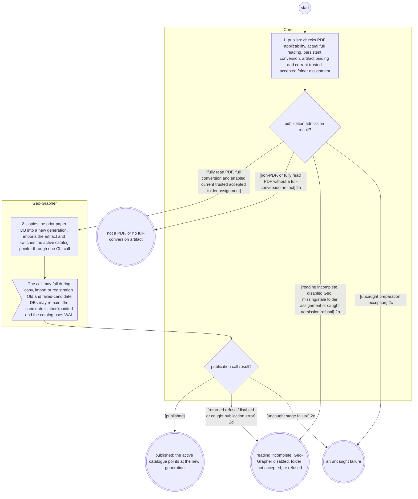

<!-- generated by render_pack.py from paper-publication.spec.yaml sha256=85ccbe113b14b72567eea8e6abe29af1db4351659554a7376f5e889e37bc3f2e; edit the spec, not this file -->
# Publish a read paper to Geo-Grapher (stage 9), as it runs today

**UC1c.3 · as-is · `IMPLEMENTED_VERIFIED`** · spec [paper-publication.spec.yaml](../paper-publication.spec.yaml)

## Written use case

| Field | Content |
|---|---|
| **Use case name** | Publish a paper to the paper graph |
| **Brief description** | A fully read PDF with a full conversion is imported into a new generation of the paper DB. |
| **Primary actor** | Core |
| **Supporting actors** | Geo-Grapher |
| **Preconditions** | Full reading, a full-conversion artifact, an accepted current folder |
| **Trigger** | Stage 9 |
| **Success guarantee** | The active catalogue points at the new generation |
| **Minimal guarantee** | A gap or refusal is recorded; the old generation stays active |
| **Open questions** | Old and failed candidate DBs are never cleaned up |

**Main success scenario** (generated: the guard-true path, in step order)

1. The Core publish: checks PDF applicability, actual full reading, persistent conversion, artifact binding and current trusted accepted folder assignment.
2. The Geo-Grapher copies the prior paper DB into a new generation, imports the artifact and switches the active catalog pointer through one CLI call.

**Extensions** (generated: one per non-happy guard; numbered by the step it leaves)

- **2a** (from: publication admission result?) *anticipated*
  - `2a1` Non-PDF, or fully read PDF without a full-conversion artifact.
  - `2a2` The use case ends: not a PDF, or no full-conversion artifact.
- **2b** (from: publication admission result?) *anticipated*
  - `2b1` Reading incomplete, disabled Geo, missing/stale folder assignment or caught admission refusal.
  - `2b2` The use case ends: reading incomplete, Geo-Grapher disabled, folder not accepted, or refused.
- **2c** (from: publication admission result?) *anticipated*
  - `2c1` Uncaught preparation exception.
  - `2c2` The use case ends: an uncaught failure.
- **2d** (from: publication call result?) *anticipated*
  - `2d1` Returned refusal/disabled or caught publication error.
  - `2d2` The use case ends: reading incomplete, Geo-Grapher disabled, folder not accepted, or refused.
- **2e** (from: publication call result?) *anticipated*
  - `2e1` Uncaught stage failure.
  - `2e2` The use case ends: an uncaught failure.

## Activity diagram



## Lane load

| Lane | On the main success scenario | Anywhere in the diagram |
|---|---|---|
| Core | 3 | 3 |
| Geo-Grapher | 1 | 1 |

Paths by how they end: **failed** 2, **gap** 2, **not applicable** 1, **success** 1.

## Decision tree

```text
start: Publish a read paper to Geo-Grapher (stage 9), as it runs today
    └─ T1: fully read PDF, full conversion and enabled current trusted accepted folder assignment / published  ⇒ published; the active catalogue points at the new generation
  └─ T2: non-PDF, or fully read PDF without a full-conversion artifact  ⇒ not a PDF, or no full-conversion artifact
  └─ T3: reading incomplete, disabled Geo, missing/stale folder assignment or caught admission refusal  ⇒ reading incomplete, Geo-Grapher disabled, folder not accepted, or refused
  └─ T4: uncaught preparation exception  ⇒ an uncaught failure
    └─ T5: fully read PDF, full conversion and enabled current trusted accepted folder assignment / returned refusal/disabled or caught publication error  ⇒ reading incomplete, Geo-Grapher disabled, folder not accepted, or refused
    └─ T6: fully read PDF, full conversion and enabled current trusted accepted folder assignment / uncaught stage failure  ⇒ an uncaught failure
```

## Test cases

One test per path: the main success scenario, then each extension.

| Test | Path (guards taken) | Extension | Expected outcome |
|---|---|---|---|
| T1 | publication admission result? → fully read PDF, full conversion and enabled current trusted accepted folder assignment; publication call result? → published | MSS | published; the active catalogue points at the new generation |
| T2 | publication admission result? → non-PDF, or fully read PDF without a full-conversion artifact | 2a | not a PDF, or no full-conversion artifact |
| T3 | publication admission result? → reading incomplete, disabled Geo, missing/stale folder assignment or caught admission refusal | 2b | reading incomplete, Geo-Grapher disabled, folder not accepted, or refused |
| T4 | publication admission result? → uncaught preparation exception | 2c | an uncaught failure |
| T5 | publication admission result? → fully read PDF, full conversion and enabled current trusted accepted folder assignment; publication call result? → returned refusal/disabled or caught publication error | 2d | reading incomplete, Geo-Grapher disabled, folder not accepted, or refused |
| T6 | publication admission result? → fully read PDF, full conversion and enabled current trusted accepted folder assignment; publication call result? → uncaught stage failure | 2e | an uncaught failure |

### Boundary values

_None declared._

## Weaknesses and gaps

| Id | Kind | Where | Weakness | Evidence | Handled in the to-be by |
|---|---|---|---|---|---|
| W-PUB-01 | cost | publishstorage | Old and failed candidate paper databases are never cleaned up. | publishstorage note | open: Cleaning old and failed candidate paper databases is Geo-Grapher's; decided in its pack. |
| W-PUB-02 | gap | pubcheck | Publication needs an accepted current folder, so a source added without folder review is never published. | pubgap label: awaiting accepted folder | open: Publication still requires an accepted folder; decided in the Geo-Grapher pack. |

## Checks

Errors: none

Warnings: none
