<!-- generated by render_pack.py from research.spec.yaml sha256=b43c5226c084a7fe5ad0e7375c6dc556c9e3266a6eb140e4c838e36604884361; edit the spec, not this file -->
# Research a brief across a corpus, as it runs today

**UC2 · as-is · `IMPLEMENTED_OBSERVED`** · spec [research.spec.yaml](../research.spec.yaml)

| Problem | |
|---|---|
| symptom | The 20 November run needed four budget extensions, decided 82 candidates that were the library's own notes, and shared one synthesis across every report. |
| why | Budgets are per phase visit; the candidate pool is the whole library; a session holds one synthesis. |
| root | The explore purpose was built for one question about the library itself, not a multi-question brief over an outside corpus. |

## Written use case

| Field | Content |
|---|---|
| **Use case name** | Research a brief across a corpus |
| **Brief description** | The Lead works a multi-question brief through an explore session and stages one evidenced report per question. |
| **Primary actor** | Owner (the Lead does the work) |
| **Supporting actors** | Lead, Clerk, Core, Geo-Grapher |
| **Preconditions** | A project note with disqualifiers; the corpus accepted as Source notes; a qualified Lead |
| **Trigger** | The Owner asks the Lead to carry out the brief |
| **Success guarantee** | One staged report per question; every claim's quote verified and its sentence reviewed |
| **Minimal guarantee** | Within budgets; a refusal names its rule and its remedy is offered |
| **Open questions** | OP3 one synthesis per session; OP4 own notes in the pool; OP5 budget per visit; OP10 code placement unchecked |

**Main success scenario** (generated: the guard-true path, in step order)

1. The Owner asks the Lead to carry out the brief.
2. The Lead (tier 1) opens an explore session for the project, each question a topic.
3. The Core validates the project and records the session's question (frame, budget 24).
4. The Lead (tier 1) records its orientation in the library (map, budget 20).
5. The Lead (tier 1) opens one brief per question, with the disqualifiers (need, budget 18).
6. The Lead (tier 1) runs research rounds until the stopping rule fires (search, budget 40).
7. The Core adds each round's new finds as candidates.
8. The Lead (tier 1) decides each candidate, a run at a time: kept with its role, context, rejected or deferred, each with a reason (judge, budget 40).
9. The Lead (tier 1) records its assumptions and how each was settled.
10. The Lead (tier 1) reads the kept papers in the graph.
11. The Lead (tier 1) looks for each finding in the code graph.
12. The Lead (tier 1) records one synthesis for the session (synthesise, budget 16).
13. The Lead (tier 1) drafts one report per brief, each claim citing a source and a verbatim quote.
14. The Core verifies and reviews the report's claims, then stages it.
15. The Lead (tier 1) closes each brief with its coverage verdict, then the session (check_out).

**Extensions** (generated: one per non-happy guard; numbered by the step it leaves)

- **5a** (from: does the project note give the brief's disqualifiers?) *anticipated*
  - `5a1` No.
  - `5a2` The Lead (tier 1) asks the Owner for them (ask_user).
  - `5a3` The Owner decides: answers within 10 minutes?
  - `5a3a` If nobody answers: parks the session; a later message from the Owner resumes it.
  - `5a4` If answered:
  - `5a5` Rejoin at 5.
- **7a** (from: are the candidates from the brief's corpus?) *anticipated*
  - `7a1` They include the library's own notes.
  - `7a2` The Core adds the library's own design notes and folder cards too, all to be decided.
  - `7a3` The Core decides: are the corpus's papers candidates?
  - `7a3a` If no: puts papers forward by their graph citation (unaccepted papers are not candidates).
  - `7a4` If yes:
  - `7a5` The Core decides: is the phase's budget enough to decide them all?
  - `7a5a` If not enough: requests more calls (request_budget).
  - `7a6` If enough:
  - `7a7` Rejoin at 8.
- **7b** (from: are the corpus's papers candidates?) *anticipated*
  - `7b1` No.
  - `7b2` The Lead (tier 1) puts papers forward by their graph citation (unaccepted papers are not candidates).
  - `7b3` The Core decides: is the phase's budget enough to decide them all?
  - `7b3a` If not enough: requests more calls (request_budget).
  - `7b4` If enough:
  - `7b5` Rejoin at 8.
- **8a** (from: is the phase's budget enough to decide them all?) *anticipated*
  - `8a1` Not enough.
  - `8a2` The Lead (tier 1) requests more calls (request_budget).
  - `8a3` The Owner decides: extends the phase's budget?
  - `8a3a` If not extended: parks the session; a later message from the Owner resumes it.
  - `8a4` If extended:
  - `8a5` Rejoin at 8.
- **10a** (from: reads the kept papers in the graph) *anticipated*
  - `10a1` Uncitable.
  - `10a2` Rejoin at 11.
- **10b** (from: reads the kept papers in the graph) *anticipated*
  - `10b1` Unavailable.
  - `10b2` The use case ends: the graph is unavailable: the papers cannot be read or cited.
- **11a** (from: is a code entity found and named?) *anticipated*
  - `11a1` No.
  - `11a2` The Lead (tier 1) leaves the code placement as prose in the summary; nothing checks it.
  - `11a3` Rejoin at 12.
- **12a** (from: was anything kept?) *anticipated*
  - `12a1` Nothing kept; the synthesis is refused.
  - `12a2` Rejoin at 6.
- **14a** (from: verifies and reviews the report's claims, then stages it) *anticipated*
  - `14a1` Challenged.
  - `14a2` Rejoin at 13.
- **14b** (from: verifies and reviews the report's claims, then stages it) *anticipated*
  - `14b1` Refused.
  - `14b2` Rejoin at 13.

## Activity diagram

```mermaid
flowchart TD
  subgraph Owner["Owner"]
    ask["1. asks the Lead to carry out the brief"]
    danswer{"answers within 10 minutes?"}
    dextend{"extends the phase's budget?"}
  end
  subgraph Lead_tier_1_["Lead (tier 1)"]
    open["2. opens an explore session for the project, each question a topic"]
    map["4. records its orientation in the library (map, budget 20)"]
    askdisq["asks the Owner for them (ask_user)"]
    brief["5. opens one brief per question, with the disqualifiers (need, budget 18)"]
    rounds["6. runs research rounds until the stopping rule fires (search, budget 40)"]
    bycitation["puts papers forward by their graph citation (unaccepted papers are not candidates)"]
    reqbudget["requests more calls (request_budget)"]
    judge["8. decides each candidate, a run at a time: kept with its role, context, rejected or deferred, each with a reason (judge, budget 40)"]
    assume["9. records its assumptions and how each was settled"]
    ref_cite[["10. cite-graph: reads the kept papers in the graph"]]
    code["11. looks for each finding in the code graph"]
    dcode{"is a code entity found and named?"}
    prose["leaves the code placement as prose in the summary; nothing checks it"]
    synth["12. records one synthesis for the session (synthesise, budget 16)"]
    draft["13. drafts one report per brief, each claim citing a source and a verbatim quote"]
    close["15. closes each brief with its coverage verdict, then the session (check_out)"]
  end
  subgraph Core["Core"]
    frame["3. validates the project and records the session's question (frame, budget 24)"]
    ddisq{"does the project note give the brief's disqualifiers?"}
    parked["parks the session; a later message from the Owner resumes it"]
    candidates["7. adds each round's new finds as candidates"]
    dpool{"are the candidates from the brief's corpus?"}
    ownnotes["adds the library's own design notes and folder cards too, all to be decided"]
    dpapers{"are the corpus's papers candidates?"}
    dbudget{"is the phase's budget enough to decide them all?"}
    dkept{"was anything kept?"}
    ref_verify[["14. verify-claims: verifies and reviews the report's claims, then stages it"]]
  end
  subgraph Clerk_tier_2_["Clerk (tier 2)"]
  end
  subgraph Geo_Grapher["Geo-Grapher"]
  end
  s(("start"))
  e1((("one staged report per question")))
  e_paused((("parked: a question unanswered, or a budget not extended")))
  e_unreachable((("the graph is unavailable: the papers cannot be read or cited")))
  s --> ask
  ask --> open
  open --> frame
  frame --> map
  map --> ddisq
  ddisq -->|"[yes]"| brief
  ddisq -->|"[no] 5a"| askdisq
  askdisq --> danswer
  danswer -->|"[answered]"| brief
  danswer -->|"[nobody answers]"| parked
  parked --> e_paused
  brief --> rounds
  rounds --> candidates
  candidates --> dpool
  dpool -->|"[yes]"| dpapers
  dpool -->|"[they include the library's own notes] 7a"| ownnotes
  ownnotes --> dpapers
  dpapers -->|"[yes]"| dbudget
  dpapers -->|"[no] 7b"| bycitation
  bycitation --> dbudget
  dbudget -->|"[enough]"| judge
  dbudget -->|"[not enough] 8a"| reqbudget
  reqbudget --> dextend
  dextend -->|"[extended]"| judge
  dextend -->|"[not extended]"| parked
  judge --> assume
  assume --> ref_cite
  ref_cite -->|"[success]"| code
  ref_cite -->|"[uncitable] 10a"| code
  ref_cite -->|"[unavailable] 10b"| e_unreachable
  code --> dcode
  dcode -->|"[yes]"| synth
  dcode -->|"[no] 11a"| prose
  prose --> synth
  synth --> dkept
  dkept -->|"[yes]"| draft
  dkept -->|"[nothing kept; the synthesis is refused] 12a"| rounds
  draft --> ref_verify
  ref_verify -->|"[success]"| close
  ref_verify -->|"[challenged] 14a"| draft
  ref_verify -->|"[refused] 14b"| draft
  close --> e1
  classDef ext stroke:#d9534f,stroke-width:2px
```



## Lane load

| Lane | On the main success scenario | Anywhere in the diagram |
|---|---|---|
| Owner | 1 | 3 |
| Lead (tier 1) | 12 | 16 |
| Core | 8 | 10 |
| Clerk (tier 2) | 0 | 0 |
| Geo-Grapher | 0 | 0 |

Paths by how they end: **escalated** 1, **paused** 2, **success** 1. Every *escalated* path is a failure of this use case: the work went back to tier 0.

## Decision tree

```text
start: Research a brief across a corpus, as it runs today
                └─ T1: yes / yes / yes / enough / success / yes / yes / success  ⇒ one staged report per question
    └─ T2: no / nobody answers  ⇒ parked: a question unanswered, or a budget not extended
    └─ T3: no / answered  ⇒ rejoins at step 5
    └─ T4: yes / they include the library's own notes  ⇒ rejoins at 'are the corpus's papers candidates?' (before step 8)
      └─ T5: yes / yes / no  ⇒ rejoins at 'is the phase's budget enough to decide them all?' (before step 8)
          └─ T6: yes / yes / yes / not enough / not extended  ⇒ parked: a question unanswered, or a budget not extended
          └─ T7: yes / yes / yes / not enough / extended  ⇒ rejoins at step 8
          └─ T8: yes / yes / yes / enough / uncitable  ⇒ rejoins at step 11
          └─ T9: yes / yes / yes / enough / unavailable  ⇒ the graph is unavailable: the papers cannot be read or cited
            └─ T10: yes / yes / yes / enough / success / no  ⇒ rejoins at step 12
              └─ T11: yes / yes / yes / enough / success / yes / nothing kept; the synthesis is refused  ⇒ rejoins at step 6
                └─ T12: yes / yes / yes / enough / success / yes / yes / challenged  ⇒ rejoins at step 13
                └─ T13: yes / yes / yes / enough / success / yes / yes / refused  ⇒ rejoins at step 13
```

## Test cases

One test per path: the main success scenario, then each extension.

| Test | Path (guards taken) | Extension | Expected outcome |
|---|---|---|---|
| T1 | does the project note give the brief's disqualifiers? → yes; are the candidates from the brief's corpus? → yes; are the corpus's papers candidates? → yes; is the phase's budget enough to decide them all? → enough; reads the kept papers in the graph → success; is a code entity found and named? → yes; was anything kept? → yes; verifies and reviews the report's claims, then stages it → success | MSS | one staged report per question |
| T2 | does the project note give the brief's disqualifiers? → no; answers within 10 minutes? → nobody answers | 5a | parked: a question unanswered, or a budget not extended |
| T3 | does the project note give the brief's disqualifiers? → no; answers within 10 minutes? → answered | 5a | rejoins at step 5 |
| T4 | does the project note give the brief's disqualifiers? → yes; are the candidates from the brief's corpus? → they include the library's own notes | 7a | rejoins at 'are the corpus's papers candidates?' (before step 8) |
| T5 | does the project note give the brief's disqualifiers? → yes; are the candidates from the brief's corpus? → yes; are the corpus's papers candidates? → no | 7b | rejoins at 'is the phase's budget enough to decide them all?' (before step 8) |
| T6 | does the project note give the brief's disqualifiers? → yes; are the candidates from the brief's corpus? → yes; are the corpus's papers candidates? → yes; is the phase's budget enough to decide them all? → not enough; extends the phase's budget? → not extended | 8a | parked: a question unanswered, or a budget not extended |
| T7 | does the project note give the brief's disqualifiers? → yes; are the candidates from the brief's corpus? → yes; are the corpus's papers candidates? → yes; is the phase's budget enough to decide them all? → not enough; extends the phase's budget? → extended | 8a | rejoins at step 8 |
| T8 | does the project note give the brief's disqualifiers? → yes; are the candidates from the brief's corpus? → yes; are the corpus's papers candidates? → yes; is the phase's budget enough to decide them all? → enough; reads the kept papers in the graph → uncitable | 10a | rejoins at step 11 |
| T9 | does the project note give the brief's disqualifiers? → yes; are the candidates from the brief's corpus? → yes; are the corpus's papers candidates? → yes; is the phase's budget enough to decide them all? → enough; reads the kept papers in the graph → unavailable | 10b | the graph is unavailable: the papers cannot be read or cited |
| T10 | does the project note give the brief's disqualifiers? → yes; are the candidates from the brief's corpus? → yes; are the corpus's papers candidates? → yes; is the phase's budget enough to decide them all? → enough; reads the kept papers in the graph → success; is a code entity found and named? → no | 11a | rejoins at step 12 |
| T11 | does the project note give the brief's disqualifiers? → yes; are the candidates from the brief's corpus? → yes; are the corpus's papers candidates? → yes; is the phase's budget enough to decide them all? → enough; reads the kept papers in the graph → success; is a code entity found and named? → yes; was anything kept? → nothing kept; the synthesis is refused | 12a | rejoins at step 6 |
| T12 | does the project note give the brief's disqualifiers? → yes; are the candidates from the brief's corpus? → yes; are the corpus's papers candidates? → yes; is the phase's budget enough to decide them all? → enough; reads the kept papers in the graph → success; is a code entity found and named? → yes; was anything kept? → yes; verifies and reviews the report's claims, then stages it → challenged | 14a | rejoins at step 13 |
| T13 | does the project note give the brief's disqualifiers? → yes; are the candidates from the brief's corpus? → yes; are the corpus's papers candidates? → yes; is the phase's budget enough to decide them all? → enough; reads the kept papers in the graph → success; is a code entity found and named? → yes; was anything kept? → yes; verifies and reviews the report's claims, then stages it → refused | 14b | rejoins at step 13 |

### Boundary values

| Decision | Values to test | Expected |
|---|---|---|
| answers within 10 minutes? | answered at 9 min 59 s; at 10 min; unanswered at 10 min 1 s | the session parks at 10 minutes |
| extends the phase's budget? | — | reviewed: no numeric threshold. the person's yes or no; how much to extend is theirs |
| is the phase's budget enough to decide them all? | candidates = 0; = calls left; = calls left + 1 | judge's 40 calls per visit; a run of candidates sharing a reason is one call |

## Weaknesses and gaps

| Id | Kind | Where | Weakness | Evidence | Handled in the to-be by |
|---|---|---|---|---|---|
| W-RES-01 | cost | 7a | The candidate pool is the whole library: 82 of its own notes and folder cards had to be decided in the 20 November run (OP4). | USE-CASES.md UC2 6a | `research` |
| W-RES-02 | cost | 8a | A phase's budget is per visit and halves on every return (20, 10, 5, 2, 1, then nothing): the run needed four extensions, and Synthesise reopened with one call left (OP5). | session.py lines 490-499 (budget_left); USE-CASES.md UC2 *c; remedy-catalogue R8 history | `research` |
| W-RES-03 | gap | synth | A session holds one synthesis, so every report shares one Together and one Unknowns, which go stale after a redraft (OP3). | USE-CASES.md UC2 12a | `research` |
| W-RES-04 | gap | 11a | Where a finding lands in our code stays prose: it is not a claim, and nothing checks it (OP10). | USE-CASES.md UC2 11b | `research` |
| W-RES-05 | gap | 7b | Read papers that were never accepted are not candidates; the Lead has to find them again by graph citation. | USE-CASES.md UC2 8c; 1064cf0 | `research` |
| W-RES-06 | fault | draft | A report quoting only a paper's card broke the project's disqualifier, and nothing caught it. | USE-CASES.md UC2 13a | `research` |

## Evidence

- src/resource_librarian/standard/phases.yaml: purposes.explore = frame, map, need, search, judge, synthesise, check_out; budgets as labelled.
- USE-CASES.md UC2 and the 20 November run: extensions 2a, 6a (82 own-note candidates), 8a (ea6a30c), 8c (1064cf0), 11a (9fd2fe9), 12a, *c (four extensions).
- Fixed since: *a (0d6af41, refused at once); *b, a refusal naming a tool the phase does not offer (tail and refusal_remedies, tests/test_phase_declaration.py::test_every_phase_offers_what_its_gate_and_any_refusal_name).

## Checks

Errors: none

Warnings: none
